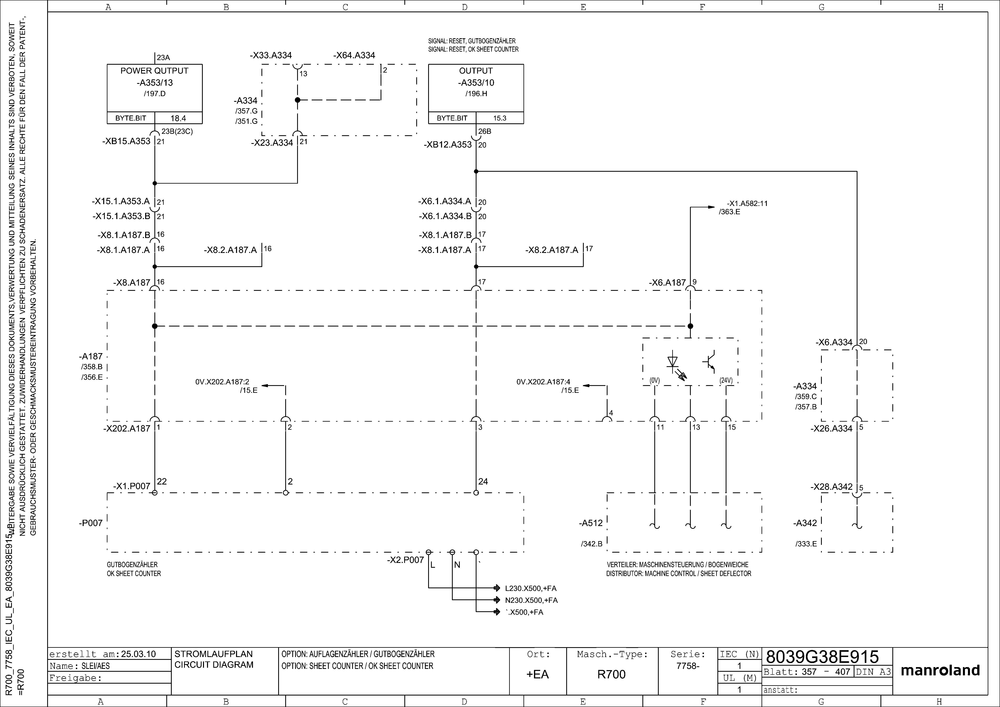

# +EA — Sheet 357 of 407 — OPTION: AUFLAGENZÄHLER / GUTBOGENZÄHLER

**OPTION: SHEET COUNTER / OK SHEET COUNTER**

> Part of the manroland **R700** printing press IEC/UL circuit diagrams.
> Drawing class: **Stromlaufplan / Circuit diagram** (DIN A3).
> Document `+EA` covers the **Printing unit** machine section.

## At a glance

| Field | Value |
|---|---|
| Document | `+EA`  (8039G38E915) |
| Sheet | **357** of 407 |
| Section (DE) | OPTION: AUFLAGENZÄHLER / GUTBOGENZÄHLER |
| Section (EN) | OPTION: SHEET COUNTER / OK SHEET COUNTER |
| Section type | CIRCUIT — Circuit diagram |
| Machine type | `R700` |
| Series | `7758` |
| Created | 25.03.10 |
| Replaces | — |
| Columns used | A, B, C, D, E, F, G |
| Path numbers | — |
| Labels on sheet | 101 |
| Cross-refs out | 13 |
| Cross-refs in | 41 |

**Previous:** [+EA sheet 356](SHEET_0356.md) · **Next:** [+EA sheet 358](SHEET_0358.md) · **Document TOC:** [_TOC.md](_TOC.md)  (+EA) · **Master TOC:** [all sheets](../_MASTER_TOC.md)

## Sheet image (300 DPI, exact vector render)



_Rendered directly from the PDF vector layer at 300 DPI (1-bit), no OCR and no resampling. Use it to confirm anything ambiguous in the text below._

## Cross-references on this sheet

Each entry is a wire leaving this sheet. The printed token is `/sheet.column`; the link resolves to that sheet inside the same document.

| Ref | Target sheet | Col | Path | Destination on target | Target section | From col |
|---|---|---|---|---|---|---|
| `/197.D` | [+EA sheet 197](SHEET_0197.md) | D | — | — | REFERENZMODUL | A |
| `/196.H` | [+EA sheet 196](SHEET_0196.md) | H | — | — | REFERENZMODUL | D |
| `/357.G` | [+EA sheet 357](SHEET_0357.md) | G | — | — | OPTION: AUFLAGENZÄHLER / GUTBOGENZÄHLER | B |
| `/351.G` | [+EA sheet 351](SHEET_0351.md) | G | — | — | OPTION: VORBEREITUNG: PUDERABSAUGUNG | B |
| `/363.E` | [+EA sheet 363](SHEET_0363.md) | E | — | — | OPTION: | F |
| `/358.B` | [+EA sheet 358](SHEET_0358.md) | B | — | — | OPTION: MAKULATURBOGENZÄHLER | A |
| `/356.E` | [+EA sheet 356](SHEET_0356.md) | E | — | — | OPTION: VORBEREITUNG: PUDERABSAUGUNG | A |
| `/15.E` | [+EA sheet 15](SHEET_0015.md) | E | — | 0V.X202.A187:2 0V.X202.A187:4 | SPANNUNGSVERSORGUNG: 400V, 24V | C |
| `/15.E` | [+EA sheet 15](SHEET_0015.md) | E | — | 0V.X202.A187:2 0V.X202.A187:4 | SPANNUNGSVERSORGUNG: 400V, 24V | C |
| `/359.C` | [+EA sheet 359](SHEET_0359.md) | C | — | — | OPTION: | G |
| `/357.B` | [+EA sheet 357](SHEET_0357.md) | B | — | — | OPTION: AUFLAGENZÄHLER / GUTBOGENZÄHLER | G |
| `/342.B` | [+EA sheet 342](SHEET_0342.md) | B | — | — | OPTION: BOGENWEICHE | E |
| `/333.E` | [+EA sheet 333](SHEET_0333.md) | E | — | — | OPTION: BOGENWEICHE | G |

### Incoming references (sheets that point here)

Every other sheet that sends a wire to this one. `Back-ref` is the token printed on *that* sheet; `Path` is its line number.

| From sheet | Cols | Back-ref | Path | Refs | What continues there |
|---|---|---|---|---|---|
| [+EA#15](SHEET_0015.md) | F | `/15.F` | — | 2 | 0V.X202.A187:2; 0V.X202.A187:4 |
| [+EA#196](SHEET_0196.md) | H | `/196.H` | — | 1 | — |
| [+EA#197](SHEET_0197.md) | D | `/197.D` | — | 1 | — |
| [+EA#243](SHEET_0243.md) | G | `/243.G` | — | 1 | — |
| [+EA#244](SHEET_0244.md) | F, G, H | `/244.F`, `/244.G`, `/244.H` | — | 3 | — |
| [+EA#248](SHEET_0248.md) | C, E, F, G | `/248.C`, `/248.E`, `/248.F`, `/248.G` | — | 8 | — |
| [+EA#257](SHEET_0257.md) | C | `/257.C` | — | 1 | — |
| [+EA#260](SHEET_0260.md) | F, G, H | `/260.F`, `/260.G`, `/260.H` | — | 3 | — |
| [+EA#265](SHEET_0265.md) | A | `/265.A` | — | 1 | — |
| [+EA#269](SHEET_0269.md) | B | `/269.B` | — | 1 | — |
| [+EA#272](SHEET_0272.md) | E | `/272.E` | — | 1 | — |
| [+EA#277](SHEET_0277.md) | B | `/277.B` | — | 1 | — |
| [+EA#284](SHEET_0284.md) | C | `/284.C` | — | 1 | — |
| [+EA#286](SHEET_0286.md) | H | `/286.H` | — | 7 | — |
| [+EA#333](SHEET_0333.md) | D | `/333.D` | — | 1 | — |
| [+EA#342](SHEET_0342.md) | B | `/342.B` | — | 1 | — |
| [+EA#351](SHEET_0351.md) | G | `/351.G` | — | 1 | — |
| [+EA#356](SHEET_0356.md) | E | `/356.E` | — | 1 | — |
| [+EA#357](SHEET_0357.md) | B, G | `/357.B`, `/357.G` | — | 2 | — |
| [+EA#358](SHEET_0358.md) | B | `/358.B` | — | 1 | — |
| [+EA#359](SHEET_0359.md) | C | `/359.C` | — | 1 | — |
| [+EA#363](SHEET_0363.md) | D | `/363.D` | — | 1 | X1.A582:11 |


## Devices on this sheet

| Tag | Class | Class meaning (IEC) | Col | Sub | Terminal | Sign |
|---|---|---|---|---|---|---|
| `A353/13` | A | Baugruppe / assembly, module, PC board | A | 13 | — | — |
| `A334` | A | Baugruppe / assembly, module, PC board | B | — | — | — |
| `A353/10` | A | Baugruppe / assembly, module, PC board | D | 10 | — | — |
| `A187` | A | Baugruppe / assembly, module, PC board | A | — | — | — |
| `A334` | A | Baugruppe / assembly, module, PC board | G | — | — | — |
| `A512` | A | Baugruppe / assembly, module, PC board | E | — | — | — |
| `A342` | A | Baugruppe / assembly, module, PC board | G | — | — | — |
| `P007` | P | Messgeraet / measuring instrument, meter | A | — | — | — |
| `18.4` | — | cross-device reference | B | — | — | — |
| `XB15.A353` | — | cross-device reference | A | — | — | — |
| `X23.A334` | — | cross-device reference | B | — | — | — |
| `X15.1.A353.B` | — | cross-device reference | A | — | — | — |
| `X15.1.A353.A` | — | cross-device reference | A | — | — | — |
| `15.3` | — | cross-device reference | D | — | — | — |
| `X6.1.A334.B` | — | cross-device reference | D | — | — | — |
| `X6.1.A334.A` | — | cross-device reference | D | — | — | — |
| `XB12.A353` | — | cross-device reference | D | — | — | — |
| `X202.A187` | — | cross-device reference | A | — | — | — |
| `X8.A187` | — | cross-device reference | A | — | — | — |
| `X6.A187` | — | cross-device reference | F | — | — | — |
| `X6.A334` | — | cross-device reference | G | — | — | — |
| `X26.A334` | — | cross-device reference | G | — | — | — |
| `X28.A342` | — | cross-device reference | G | — | — | — |
| `X1.P007` | — | cross-device reference | A | — | — | — |
| `X2.P007` | — | cross-device reference | D | — | — | — |
| `X8.1.A187.A` | — | cross-device reference | A | — | — | — |
| `X8.1.A187.B` | — | cross-device reference | A | — | — | — |
| `X8.2.A187.A` | — | cross-device reference | B | — | — | — |
| `X8.1.A187.A` | — | cross-device reference | D | — | — | — |
| `X8.1.A187.B` | — | cross-device reference | D | — | — | — |
| `X8.2.A187.A` | — | cross-device reference | E | — | — | — |
| `X1.A582:11` | — | cross-device reference | F | — | 11 | — |
| `X64.A334` | — | cross-device reference | C | — | — | — |
| `X33.A334` | — | cross-device reference | B | — | — | — |

## Potentials / nets

| Potential | Count | Columns | Attached devices | Terminals |
|---|---|---|---|---|
| `0V` | 2 | B, E | `A187`, `X202` | `2`, `4` |
| `N` | 1 | D | — | — |


A potential such as `L24+/4` or `M24+` is a named supply/return rail; every place it appears on this sheet is electrically common.

## Wire-end annotations (grouped as printed)

A wire that continues elsewhere is annotated with a small cluster: the destination description, the path/line number `#NN`, and the `/sheet.column` cross reference. Each row below is one such cluster exactly as it is grouped on the drawing.

| Col | Y | Path | Cross-ref | Text on the wire |
|---|---|---|---|---|
| D | 46.1 | — | — | `SIGNAL: RESET, GUTBOGENZÄHLER SIGNAL: RESET, OK SHEET COUNTER` |
| C | 61.2 | — | — | `X33.A334 X64.A334` |
| A | 64.8 | — | — | `23A` |
| C | 79.7 | — | — | `13 2` |
| A | 79.9 | — | — | `POWER QUTPUT` |
| D | 80.0 | — | — | `OUTPUT` |
| A | 93.8 | — | — | `A353/13` |
| D | 93.8 | — | — | `A353/10` |
| A | 107.7 | — | `/197.D` | — |
| D | 107.7 | — | `/196.H` | — |
| B | 115.1 | — | — | `A334` |
| B | 128.2 | — | `/357.G`, `/351.G` | — |
| A | 136.7 | — | — | `BYTE.BIT 18.4` |
| D | 137.3 | — | — | `BYTE.BIT 15.3` |
| B | 152.7 | — | — | `23B(23C)` |
| D | 152.7 | — | — | `26B` |
| B | 163.3 | — | — | `XB15.A353 21 X23.A334 21` |
| D | 167.6 | — | — | `XB12.A353 20` |
| A | 234.9 | — | — | `X15.1.A353.A 21` |
| D | 234.9 | — | — | `X6.1.A334.A 20` |
| F | 238.4 | — | — | `X1.A582:11` |
| F | 248.3 | — | `/363.E` | — |
| A | 252.6 | — | — | `X15.1.A353.B 21` |
| D | 252.6 | — | — | `X6.1.A334.B 20` |
| A | 275.3 | — | — | `X8.1.A187.B 16` |
| D | 275.3 | — | — | `X8.1.A187.B 17` |
| A | 292.3 | — | — | `X8.1.A187.A 16` |
| C | 292.3 | — | — | `X8.2.A187.A 16 X8.1.A187.A 17` |
| E | 292.3 | — | — | `X8.2.A187.A 17` |
| A | 332.0 | — | — | `X8.A187 16` |
| E | 332.0 | — | — | `17 X6.A187 9` |
| G | 402.8 | — | — | `X6.A334 20` |
| A | 419.8 | — | — | `A187` |
| A | 432.9 | — | `/358.B`, `/356.E` | — |
| F | 449.9 | — | — | `(0V) (24V)` |
| C | 451.0 | — | `/15.E`, `/15.E` | `0V.X202.A187:2 0V.X202.A187:4` |
| G | 455.3 | — | — | `A334` |
| G | 468.4 | — | `/359.C`, `/357.B` | — |
| E | 487.9 | — | — | `4` |
| B | 504.9 | — | — | `X202.A187 1 2` |
| E | 504.9 | — | — | `3 11 13 15` |
| G | 504.9 | — | — | `X26.A334 5` |
| D | 568.6 | — | — | `X1.P007 22 2 24 X28.A342 5` |
| A | 618.3 | — | — | `P007` |
| E | 618.3 | — | — | `A512` |
| G | 618.3 | — | — | `A342` |
| E | 643.7 | — | `/342.B` | — |
| G | 643.7 | — | `/333.E` | — |
| D | 662.2 | — | — | `X2.P007 L N '` |
| A | 669.6 | — | — | `GUTBOGENZÄHLER OK SHEET COUNTER` |
| F | 669.6 | — | — | `DISTRIBUTOR: MACHINE CONTROL / SHEET DEFLECTOR VERTEILER: MASCHINENSTEUERUNG / BOGENWEICHE` |
| E | 696.9 | — | — | `L230.X500,+FA` |
| E | 711.1 | — | — | `N230.X500,+FA` |
| E | 725.2 | — | — | `'.X500,+FA` |


## Reconstructed tables

This sheet carries tabular content (pin map / terminal assignment / index). The grid below was rebuilt from the drawing's own rule lines, so each row is exactly one physical row of the table.

### Table 1 — 7 data rows × 14 columns (at x=127.6, y=76.5)

| POWER | QUTPUT A353/13 /197.D |  |  | 13 | 2 |  | OUTPUT | A353/10 /196.H |  |  |  |  |  |
|---|---|---|---|---|---|---|---|---|---|---|---|---|---|
|  |  | `A334 /357.G` |  |  |  |  |  |  |  |  |  |  |  |
| `BYTE.BIT` | `18.4` | `/351.G` |  |  |  | `BYTE.BIT` |  | `15.3` |  |  |  |  |  |
| `XB15.A353` | `23B(23C) 21` | `X23.A334` |  | `21` |  | `XB12.A353` |  | `26B 20` |  |  |  |  |  |
| `X15.1.A353.A X15.1.A353.B X8.1.A187.B X8.1.A187.A` | `21 21 16 16` | `16 X8.2.A187.A` |  |  |  | `X6.1.A334.A X6.1.A334.B X8.1.A187.B X8.1.A187.A` |  | `20 20 17 17` | `17 X8.2.A187.A` |  |  |  |  |
| `X8.A187` | `16` |  |  |  |  |  |  | `17` |  |  | `X6.A187` |  | `9` |
| `X202.A187 X1.P007 GUTBOGENZÄHLER OK SHEET COUNTER` | `1 22` | `0V.X202.A187:2 /15.E` | `2 2` |  | `X2.P007` | `L` | `N` | `3 24 '` | `0V.X202.A187:4 /15.E A512 /342.B` | `4 VERTEILER: DISTRIBUTOR:` | `(0V) 11 MASCHINENSTEUERUNG MACHINE` | `CONTROL` | `(24V) 13 / / SHEET` |
|  |  |  |  |  |  |  |  |  | `L230.X500,+FA` |  |  |  |  |


## Notes and free text on this sheet

| Text | Col | Y (pt) |
|---|---|---|
| `23A` | A | 64.77 |
| `23B(23C)` | B | 152.68 |
| `POWER QUTPUT` | A | 79.93 |
| `BYTE.BIT` | A | 137.26 |
| `26B` | D | 152.65 |
| `OUTPUT` | D | 79.98 |
| `BYTE.BIT` | D | 137.26 |
| `SIGNAL: RESET, GUTBOGENZÄHLER` | D | 46.13 |
| `SIGNAL: RESET, OK SHEET COUNTER` | D | 56.08 |
| `VERTEILER: MASCHINENSTEUERUNG / BOGENWEICHE` | F | 669.6 |
| `DISTRIBUTOR: MACHINE CONTROL / SHEET DEFLECTOR` | F | 680.24 |
| `GUTBOGENZÄHLER` | A | 669.62 |
| `OK SHEET COUNTER` | A | 680.24 |
| `L` | D | 667.83 |
| `L230.X500,+FA` | E | 696.9 |
| `N230.X500,+FA` | E | 711.07 |
| `'.X500,+FA` | E | 725.23 |
| `(0V)` | F | 449.88 |
| `(24V)` | F | 449.9 |

## Complete label inventory (exact text from the drawing)

Every text object inside the drawing area of this sheet, in DIN reading order (column A→H, then top→bottom). This is the authoritative list: if a string is not here it is not printed on this sheet.

| Col | Y | X | Dir | Type | Text |
|---|---|---|---|---|---|
| A | 64.8 | 186.8 | → | text | `23A` |
| A | 79.9 | 143.4 | → | text | `POWER QUTPUT` |
| A | 93.8 | 162.9 | → | device tag | `A353/13` |
| A | 107.7 | 171.5 | → | cross-reference | `/197.D` |
| A | 137.3 | 137.5 | → | text | `BYTE.BIT` |
| A | 163.3 | 121.9 | → | device ref | `XB15.A353` |
| A | 164.7 | 186.8 | → | number | `21` |
| A | 234.9 | 109.4 | → | device ref | `X15.1.A353.A` |
| A | 237.0 | 186.8 | → | number | `21` |
| A | 252.6 | 110.3 | → | device ref | `X15.1.A353.B` |
| A | 254.0 | 186.8 | → | number | `21` |
| A | 275.3 | 116.2 | → | device ref | `X8.1.A187.B` |
| A | 275.3 | 186.2 | → | number | `16` |
| A | 292.3 | 186.2 | → | number | `16` |
| A | 293.0 | 115.4 | → | device ref | `X8.1.A187.A` |
| A | 332.0 | 134.9 | → | device ref | `X8.A187` |
| A | 332.0 | 186.2 | → | number | `16` |
| A | 419.8 | 94.1 | → | device tag | `A187` |
| A | 432.9 | 96.7 | → | cross-reference | `/358.B` |
| A | 445.3 | 96.9 | → | cross-reference | `/356.E` |
| A | 504.9 | 186.2 | → | number | `1` |
| A | 505.6 | 123.0 | → | device ref | `X202.A187` |
| A | 568.6 | 186.8 | → | number | `22` |
| A | 574.3 | 134.9 | → | device ref | `X1.P007` |
| A | 618.3 | 94.1 | → | device tag | `P007` |
| A | 669.6 | 127.3 | → | text | `GUTBOGENZÄHLER` |
| A | 680.2 | 127.3 | → | text | `OK SHEET COUNTER` |
| B | 61.2 | 297.6 | → | device ref | `X33.A334` |
| B | 115.1 | 278.4 | → | device tag | `A334` |
| B | 128.2 | 280.3 | → | cross-reference | `/357.G` |
| B | 136.7 | 202.8 | → | device ref | `18.4` |
| B | 140.6 | 280.3 | → | cross-reference | `/351.G` |
| B | 152.7 | 192.5 | → | text | `23B(23C)` |
| B | 165.4 | 299.1 | → | device ref | `X23.A334` |
| B | 292.3 | 313.8 | → | number | `16` |
| B | 293.0 | 242.9 | → | device ref | `X8.2.A187.A` |
| B | 451.0 | 232.7 | → | potential | `0V.X202.A187:2` |
| B | 460.9 | 286.0 | → | cross-reference | `/15.E` |
| C | 61.2 | 396.9 | → | device ref | `X64.A334` |
| C | 79.7 | 456.1 | → | number | `2` |
| C | 83.9 | 356.3 | → | number | `13` |
| C | 164.7 | 356.9 | → | number | `21` |
| C | 504.9 | 342.7 | → | number | `2` |
| C | 568.6 | 342.7 | → | number | `2` |
| D | 46.1 | 510.0 | → | text | `SIGNAL: RESET, GUTBOGENZÄHLER` |
| D | 56.1 | 510.0 | → | text | `SIGNAL: RESET, OK SHEET COUNTER` |
| D | 80.0 | 546.7 | → | text | `OUTPUT` |
| D | 93.8 | 545.5 | → | device tag | `A353/10` |
| D | 107.7 | 554.5 | → | cross-reference | `/196.H` |
| D | 137.3 | 520.2 | → | text | `BYTE.BIT` |
| D | 137.3 | 587.1 | → | device ref | `15.3` |
| D | 152.6 | 569.5 | → | text | `26B` |
| D | 167.5 | 504.6 | → | device ref | `XB12.A353` |
| D | 169.0 | 569.5 | → | number | `20` |
| D | 234.9 | 498.0 | → | device ref | `X6.1.A334.A` |
| D | 237.0 | 569.5 | → | number | `20` |
| D | 252.6 | 498.9 | → | device ref | `X6.1.A334.B` |
| D | 254.0 | 569.5 | → | number | `20` |
| D | 275.3 | 498.9 | → | device ref | `X8.1.A187.B` |
| D | 275.3 | 568.9 | → | number | `17` |
| D | 292.3 | 568.9 | → | number | `17` |
| D | 293.0 | 498.0 | → | device ref | `X8.1.A187.A` |
| D | 332.0 | 568.9 | → | number | `17` |
| D | 504.9 | 569.5 | → | number | `3` |
| D | 568.6 | 569.5 | → | number | `24` |
| D | 662.2 | 460.9 | → | device ref | `X2.P007` |
| D | 667.8 | 512.2 | → | text | `L` |
| D | 667.9 | 540.6 | → | potential | `N` |
| D | 668.0 | 569.5 | → | other | `'` |
| E | 292.3 | 696.5 | → | number | `17` |
| E | 293.0 | 625.6 | → | device ref | `X8.2.A187.A` |
| E | 451.0 | 615.1 | → | potential | `0V.X202.A187:4` |
| E | 460.9 | 668.7 | → | cross-reference | `/15.E` |
| E | 487.9 | 725.4 | → | number | `4` |
| E | 618.3 | 689.4 | → | device tag | `A512` |
| E | 643.7 | 691.9 | → | cross-reference | `/342.B` |
| E | 696.9 | 601.5 | → | text | `L230.X500,+FA` |
| E | 711.1 | 601.5 | → | text | `N230.X500,+FA` |
| E | 725.2 | 602.1 | → | text | `'.X500,+FA` |
| F | 238.4 | 865.7 | → | device ref | `X1.A582:11` |
| F | 248.3 | 856.1 | → | cross-reference | `/363.E` |
| F | 332.0 | 772.7 | → | device ref | `X6.A187` |
| F | 332.0 | 824.6 | → | number | `9` |
| F | 449.9 | 773.5 | → | text | `(0V)` |
| F | 449.9 | 856.9 | → | text | `(24V)` |
| F | 504.9 | 781.5 | → | number | `11` |
| F | 504.9 | 824.0 | → | number | `13` |
| F | 504.9 | 866.6 | → | number | `15` |
| F | 669.6 | 722.8 | → | text | `VERTEILER: MASCHINENSTEUERUNG / BOGENWEICHE` |
| F | 680.2 | 722.0 | → | text | `DISTRIBUTOR: MACHINE CONTROL / SHEET DEFLECTOR` |
| G | 402.8 | 971.1 | → | device ref | `X6.A334` |
| G | 402.8 | 1023.0 | → | number | `20` |
| G | 455.3 | 944.5 | → | device tag | `A334` |
| G | 468.4 | 946.8 | → | cross-reference | `/359.C` |
| G | 480.7 | 947.1 | → | cross-reference | `/357.B` |
| G | 504.9 | 1023.0 | → | number | `5` |
| G | 505.6 | 965.2 | → | device ref | `X26.A334` |
| G | 575.0 | 965.2 | → | device ref | `X28.A342` |
| G | 577.2 | 1023.0 | → | number | `5` |
| G | 618.3 | 944.5 | → | device tag | `A342` |
| G | 643.7 | 947.3 | → | cross-reference | `/333.E` |

## Reading-order text block

The same content as a plain block, grouped by DIN column — convenient to paste or to match against a visual description.

```text
=== Column A ===
  64.8  186.8  text         23A
  79.9  143.4  text         POWER QUTPUT
  93.8  162.9  devtag       A353/13
 107.7  171.5  xref         /197.D
 137.3  137.5  text         BYTE.BIT
 163.3  121.9  devref       XB15.A353
 164.7  186.8  numeric      21
 234.9  109.4  devref       X15.1.A353.A
 237.0  186.8  numeric      21
 252.6  110.3  devref       X15.1.A353.B
 254.0  186.8  numeric      21
 275.3  116.2  devref       X8.1.A187.B
 275.3  186.2  numeric      16
 292.3  186.2  numeric      16
 293.0  115.4  devref       X8.1.A187.A
 332.0  134.9  devref       X8.A187
 332.0  186.2  numeric      16
 419.8   94.1  devtag       A187
 432.9   96.7  xref         /358.B
 445.3   96.9  xref         /356.E
 504.9  186.2  numeric      1
 505.6  123.0  devref       X202.A187
 568.6  186.8  numeric      22
 574.3  134.9  devref       X1.P007
 618.3   94.1  devtag       P007
 669.6  127.3  text         GUTBOGENZÄHLER
 680.2  127.3  text         OK SHEET COUNTER
=== Column B ===
  61.2  297.6  devref       X33.A334
 115.1  278.4  devtag       A334
 128.2  280.3  xref         /357.G
 136.7  202.8  devref       18.4
 140.6  280.3  xref         /351.G
 152.7  192.5  text         23B(23C)
 165.4  299.1  devref       X23.A334
 292.3  313.8  numeric      16
 293.0  242.9  devref       X8.2.A187.A
 451.0  232.7  net          0V.X202.A187:2
 460.9  286.0  xref         /15.E
=== Column C ===
  61.2  396.9  devref       X64.A334
  79.7  456.1  numeric      2
  83.9  356.3  numeric      13
 164.7  356.9  numeric      21
 504.9  342.7  numeric      2
 568.6  342.7  numeric      2
=== Column D ===
  46.1  510.0  text         SIGNAL: RESET, GUTBOGENZÄHLER
  56.1  510.0  text         SIGNAL: RESET, OK SHEET COUNTER
  80.0  546.7  text         OUTPUT
  93.8  545.5  devtag       A353/10
 107.7  554.5  xref         /196.H
 137.3  520.2  text         BYTE.BIT
 137.3  587.1  devref       15.3
 152.6  569.5  text         26B
 167.5  504.6  devref       XB12.A353
 169.0  569.5  numeric      20
 234.9  498.0  devref       X6.1.A334.A
 237.0  569.5  numeric      20
 252.6  498.9  devref       X6.1.A334.B
 254.0  569.5  numeric      20
 275.3  498.9  devref       X8.1.A187.B
 275.3  568.9  numeric      17
 292.3  568.9  numeric      17
 293.0  498.0  devref       X8.1.A187.A
 332.0  568.9  numeric      17
 504.9  569.5  numeric      3
 568.6  569.5  numeric      24
 662.2  460.9  devref       X2.P007
 667.8  512.2  text         L
 667.9  540.6  net          N
 668.0  569.5  other        `
=== Column E ===
 292.3  696.5  numeric      17
 293.0  625.6  devref       X8.2.A187.A
 451.0  615.1  net          0V.X202.A187:4
 460.9  668.7  xref         /15.E
 487.9  725.4  numeric      4
 618.3  689.4  devtag       A512
 643.7  691.9  xref         /342.B
 696.9  601.5  text         L230.X500,+FA
 711.1  601.5  text         N230.X500,+FA
 725.2  602.1  text         `.X500,+FA
=== Column F ===
 238.4  865.7  devref       X1.A582:11
 248.3  856.1  xref         /363.E
 332.0  772.7  devref       X6.A187
 332.0  824.6  numeric      9
 449.9  773.5  text         (0V)
 449.9  856.9  text         (24V)
 504.9  781.5  numeric      11
 504.9  824.0  numeric      13
 504.9  866.6  numeric      15
 669.6  722.8  text         VERTEILER: MASCHINENSTEUERUNG / BOGENWEICHE
 680.2  722.0  text         DISTRIBUTOR: MACHINE CONTROL / SHEET DEFLECTOR
=== Column G ===
 402.8  971.1  devref       X6.A334
 402.8 1023.0  numeric      20
 455.3  944.5  devtag       A334
 468.4  946.8  xref         /359.C
 480.7  947.1  xref         /357.B
 504.9 1023.0  numeric      5
 505.6  965.2  devref       X26.A334
 575.0  965.2  devref       X28.A342
 577.2 1023.0  numeric      5
 618.3  944.5  devtag       A342
 643.7  947.3  xref         /333.E
```

---
_Generated from the PDF vector text layer; no OCR. Source: `R700_7758_IEC_UL_EA_8039G38E915_p`, sheet 357._
