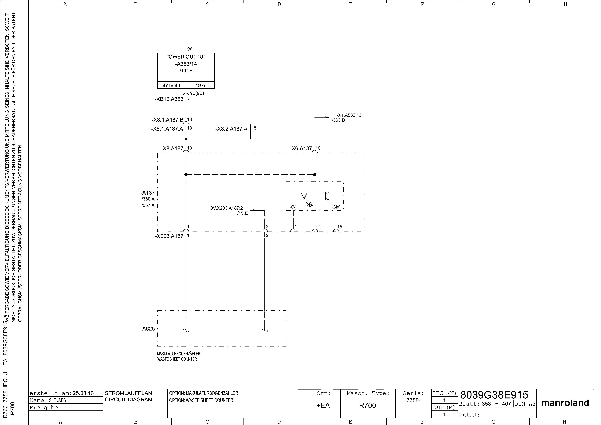

# +EA — Sheet 358 of 407 — OPTION: MAKULATURBOGENZÄHLER

**OPTION: WASTE SHEET COUNTER**

> Part of the manroland **R700** printing press IEC/UL circuit diagrams.
> Drawing class: **Stromlaufplan / Circuit diagram** (DIN A3).
> Document `+EA` covers the **Printing unit** machine section.

## At a glance

| Field | Value |
|---|---|
| Document | `+EA`  (8039G38E915) |
| Sheet | **358** of 407 |
| Section (DE) | OPTION: MAKULATURBOGENZÄHLER |
| Section (EN) | OPTION: WASTE SHEET COUNTER |
| Section type | CIRCUIT — Circuit diagram |
| Machine type | `R700` |
| Series | `7758` |
| Created | 25.03.10 |
| Replaces | — |
| Columns used | B, C, D, E |
| Path numbers | — |
| Labels on sheet | 39 |
| Cross-refs out | 5 |
| Cross-refs in | 16 |

**Previous:** [+EA sheet 357](SHEET_0357.md) · **Next:** [+EA sheet 359](SHEET_0359.md) · **Document TOC:** [_TOC.md](_TOC.md)  (+EA) · **Master TOC:** [all sheets](../_MASTER_TOC.md)

## Sheet image (300 DPI, exact vector render)



_Rendered directly from the PDF vector layer at 300 DPI (1-bit), no OCR and no resampling. Use it to confirm anything ambiguous in the text below._

## Cross-references on this sheet

Each entry is a wire leaving this sheet. The printed token is `/sheet.column`; the link resolves to that sheet inside the same document.

| Ref | Target sheet | Col | Path | Destination on target | Target section | From col |
|---|---|---|---|---|---|---|
| `/197.F` | [+EA sheet 197](SHEET_0197.md) | F | — | — | REFERENZMODUL | C |
| `/363.D` | [+EA sheet 363](SHEET_0363.md) | D | — | — | OPTION: | E |
| `/360.A` | [+EA sheet 360](SHEET_0360.md) | A | — | — | OPTION: | B |
| `/357.A` | [+EA sheet 357](SHEET_0357.md) | A | — | — | OPTION: AUFLAGENZÄHLER / GUTBOGENZÄHLER | B |
| `/15.E` | [+EA sheet 15](SHEET_0015.md) | E | — | (0V) (24V) 0V.X203.A187:2 | SPANNUNGSVERSORGUNG: 400V, 24V | D |

### Incoming references (sheets that point here)

Every other sheet that sends a wire to this one. `Back-ref` is the token printed on *that* sheet; `Path` is its line number.

| From sheet | Cols | Back-ref | Path | Refs | What continues there |
|---|---|---|---|---|---|
| [+EA#15](SHEET_0015.md) | F | `/15.F` | — | 1 | 0V.X203.A187:2 |
| [+EA#197](SHEET_0197.md) | F | `/197.F` | — | 1 | — |
| [+EA#243](SHEET_0243.md) | G | `/243.G` | — | 1 | — |
| [+EA#248](SHEET_0248.md) | C, E, F, G | `/248.C`, `/248.E`, `/248.F`, `/248.G` | — | 4 | — |
| [+EA#261](SHEET_0261.md) | G | `/261.G` | — | 1 | — |
| [+EA#287](SHEET_0287.md) | B | `/287.B` | — | 5 | — |
| [+EA#357](SHEET_0357.md) | A | `/357.A` | — | 1 | — |
| [+EA#360](SHEET_0360.md) | A | `/360.A` | — | 1 | — |
| [+EA#363](SHEET_0363.md) | C | `/363.C` | — | 1 | X1.A582:13 |


## Devices on this sheet

| Tag | Class | Class meaning (IEC) | Col | Sub | Terminal | Sign |
|---|---|---|---|---|---|---|
| `A353/14` | A | Baugruppe / assembly, module, PC board | C | 14 | — | — |
| `A187` | A | Baugruppe / assembly, module, PC board | B | — | — | — |
| `A625` | A | Baugruppe / assembly, module, PC board | B | — | — | — |
| `X203.A187` | — | cross-device reference | B | — | — | — |
| `X8.A187` | — | cross-device reference | C | — | — | — |
| `X6.A187` | — | cross-device reference | D | — | — | — |
| `19.6` | — | cross-device reference | C | — | — | — |
| `XB16.A353` | — | cross-device reference | B | — | — | — |
| `X8.1.A187.A` | — | cross-device reference | B | — | — | — |
| `X8.1.A187.B` | — | cross-device reference | B | — | — | — |
| `X8.2.A187.A` | — | cross-device reference | C | — | — | — |
| `X1.A582:13` | — | cross-device reference | E | — | 13 | — |

## Potentials / nets

| Potential | Count | Columns | Attached devices | Terminals |
|---|---|---|---|---|
| `0V` | 1 | C | `A187`, `X203` | `2` |


A potential such as `L24+/4` or `M24+` is a named supply/return rail; every place it appears on this sheet is electrically common.

## Wire-end annotations (grouped as printed)

A wire that continues elsewhere is annotated with a small cluster: the destination description, the path/line number `#NN`, and the `/sheet.column` cross reference. Each row below is one such cluster exactly as it is grouped on the drawing.

| Col | Y | Path | Cross-ref | Text on the wire |
|---|---|---|---|---|
| C | 93.1 | — | — | `9A` |
| C | 108.3 | — | — | `POWER QUTPUT` |
| C | 122.2 | — | — | `A353/14` |
| C | 136.0 | — | `/197.F` | — |
| C | 165.0 | — | — | `BYTE.BIT 19.6` |
| C | 181.0 | — | — | `9B(9C)` |
| C | 191.6 | — | — | `XB16.A353 7` |
| E | 224.2 | — | — | `X1.A582:13` |
| B | 232.8 | — | — | `X8.1.A187.B 18` |
| E | 234.2 | — | `/363.D` | — |
| B | 249.8 | — | — | `X8.1.A187.A 18` |
| C | 249.8 | — | — | `X8.2.A187.A 18` |
| C | 289.4 | — | — | `X8.A187 18 X6.A187 10` |
| B | 377.3 | — | — | `A187` |
| B | 390.4 | — | `/360.A`, `/357.A` | — |
| D | 407.4 | — | `/15.E` | `0V.X203.A187:2 (0V) (24V)` |
| C | 445.4 | — | — | `1` |
| D | 445.4 | — | — | `2` |
| E | 445.4 | — | — | `11 12 15` |
| C | 462.4 | — | — | `X203.A187 1` |
| D | 462.4 | — | — | `2` |
| B | 646.6 | — | — | `A625` |
| C | 698.0 | — | — | `MAKULATURBOGENZÄHLER` |
| C | 708.6 | — | — | `WASTE SHEET COUNTER` |


## Reconstructed tables

This sheet carries tabular content (pin map / terminal assignment / index). The grid below was rebuilt from the drawing's own rule lines, so each row is exactly one physical row of the table.

### Table 1 — 3 data rows × 3 columns (at x=311.8, y=104.9)

| POWER | QUTPUT A353/14 /197.F |  |
|---|---|---|
| `BYTE.BIT` | `19.6` |  |
| `XB16.A353 X8.1.A187.B X8.1.A187.A` | `9B(9C) 7 18 18` | `18 X8.2.A187.A` |
| `X8.A187` | `18` |  |


## Notes and free text on this sheet

| Text | Col | Y (pt) |
|---|---|---|
| `9A` | C | 93.1 |
| `9B(9C)` | C | 181.03 |
| `POWER QUTPUT` | C | 108.28 |
| `BYTE.BIT` | B | 165.6 |
| `MAKULATURBOGENZÄHLER` | C | 697.96 |
| `WASTE SHEET COUNTER` | C | 708.56 |
| `(0V)` | D | 407.36 |
| `(24V)` | E | 407.38 |

## Complete label inventory (exact text from the drawing)

Every text object inside the drawing area of this sheet, in DIN reading order (column A→H, then top→bottom). This is the authoritative list: if a string is not here it is not printed on this sheet.

| Col | Y | X | Dir | Type | Text |
|---|---|---|---|---|---|
| B | 165.6 | 321.7 | → | text | `BYTE.BIT` |
| B | 191.6 | 306.1 | → | device ref | `XB16.A353` |
| B | 232.8 | 300.5 | → | device ref | `X8.1.A187.B` |
| B | 250.5 | 299.6 | → | device ref | `X8.1.A187.A` |
| B | 377.3 | 278.4 | → | device tag | `A187` |
| B | 390.4 | 280.6 | → | cross-reference | `/360.A` |
| B | 402.8 | 280.6 | → | cross-reference | `/357.A` |
| B | 463.1 | 307.3 | → | device ref | `X203.A187` |
| B | 646.6 | 278.4 | → | device tag | `A625` |
| C | 93.1 | 371.1 | → | text | `9A` |
| C | 108.3 | 327.7 | → | text | `POWER QUTPUT` |
| C | 122.2 | 347.1 | → | device tag | `A353/14` |
| C | 136.0 | 356.2 | → | cross-reference | `/197.F` |
| C | 165.0 | 387.1 | → | device ref | `19.6` |
| C | 181.0 | 376.7 | → | text | `9B(9C)` |
| C | 193.1 | 371.1 | → | number | `7` |
| C | 232.8 | 370.5 | → | number | `18` |
| C | 249.8 | 370.5 | → | number | `18` |
| C | 250.5 | 427.2 | → | device ref | `X8.2.A187.A` |
| C | 289.4 | 319.2 | → | device ref | `X8.A187` |
| C | 289.5 | 370.5 | → | number | `18` |
| C | 408.5 | 417.0 | → | potential | `0V.X203.A187:2` |
| C | 418.4 | 470.3 | → | cross-reference | `/15.E` |
| C | 445.4 | 370.5 | → | number | `1` |
| C | 462.4 | 370.5 | → | number | `1` |
| C | 698.0 | 311.2 | → | text | `MAKULATURBOGENZÄHLER` |
| C | 708.6 | 311.8 | → | text | `WASTE SHEET COUNTER` |
| D | 249.8 | 498.0 | → | number | `18` |
| D | 289.4 | 574.3 | → | device ref | `X6.A187` |
| D | 407.4 | 575.1 | → | text | `(0V)` |
| D | 445.4 | 527.0 | → | number | `2` |
| D | 445.4 | 583.1 | → | number | `11` |
| D | 462.4 | 527.0 | → | number | `2` |
| E | 224.2 | 667.3 | → | device ref | `X1.A582:13` |
| E | 234.1 | 657.6 | → | cross-reference | `/363.D` |
| E | 289.5 | 625.6 | → | number | `10` |
| E | 407.4 | 658.4 | → | text | `(24V)` |
| E | 445.4 | 625.6 | → | number | `12` |
| E | 445.4 | 668.1 | → | number | `15` |

## Reading-order text block

The same content as a plain block, grouped by DIN column — convenient to paste or to match against a visual description.

```text
=== Column B ===
 165.6  321.7  text         BYTE.BIT
 191.6  306.1  devref       XB16.A353
 232.8  300.5  devref       X8.1.A187.B
 250.5  299.6  devref       X8.1.A187.A
 377.3  278.4  devtag       A187
 390.4  280.6  xref         /360.A
 402.8  280.6  xref         /357.A
 463.1  307.3  devref       X203.A187
 646.6  278.4  devtag       A625
=== Column C ===
  93.1  371.1  text         9A
 108.3  327.7  text         POWER QUTPUT
 122.2  347.1  devtag       A353/14
 136.0  356.2  xref         /197.F
 165.0  387.1  devref       19.6
 181.0  376.7  text         9B(9C)
 193.1  371.1  numeric      7
 232.8  370.5  numeric      18
 249.8  370.5  numeric      18
 250.5  427.2  devref       X8.2.A187.A
 289.4  319.2  devref       X8.A187
 289.5  370.5  numeric      18
 408.5  417.0  net          0V.X203.A187:2
 418.4  470.3  xref         /15.E
 445.4  370.5  numeric      1
 462.4  370.5  numeric      1
 698.0  311.2  text         MAKULATURBOGENZÄHLER
 708.6  311.8  text         WASTE SHEET COUNTER
=== Column D ===
 249.8  498.0  numeric      18
 289.4  574.3  devref       X6.A187
 407.4  575.1  text         (0V)
 445.4  527.0  numeric      2
 445.4  583.1  numeric      11
 462.4  527.0  numeric      2
=== Column E ===
 224.2  667.3  devref       X1.A582:13
 234.1  657.6  xref         /363.D
 289.5  625.6  numeric      10
 407.4  658.4  text         (24V)
 445.4  625.6  numeric      12
 445.4  668.1  numeric      15
```

---
_Generated from the PDF vector text layer; no OCR. Source: `R700_7758_IEC_UL_EA_8039G38E915_p`, sheet 358._
