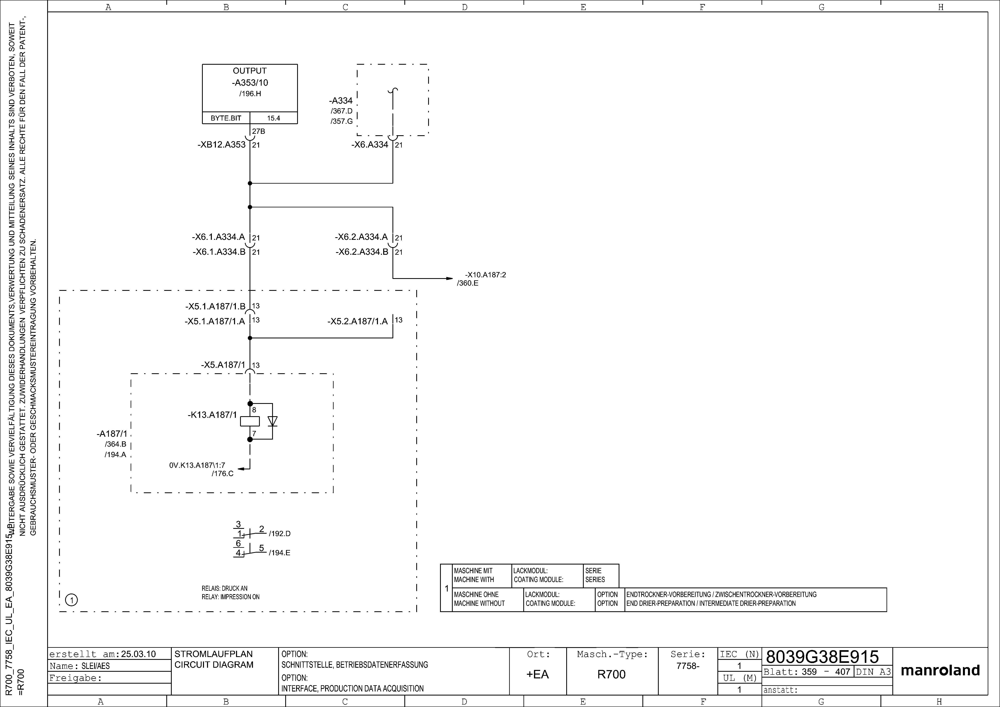

# +EA — Sheet 359 of 407 — OPTION:

**SCHNITTSTELLE, BETRIEBSDATENERFASSUNG**

> Part of the manroland **R700** printing press IEC/UL circuit diagrams.
> Drawing class: **Stromlaufplan / Circuit diagram** (DIN A3).
> Document `+EA` covers the **Printing unit** machine section.

## At a glance

| Field | Value |
|---|---|
| Document | `+EA`  (8039G38E915) |
| Sheet | **359** of 407 |
| Section (DE) | OPTION: |
| Section (EN) | SCHNITTSTELLE, BETRIEBSDATENERFASSUNG |
| Section type | CIRCUIT — Circuit diagram |
| Machine type | `R700` |
| Series | `7758` |
| Created | 25.03.10 |
| Replaces | — |
| Columns used | A, B, C, D, E, F |
| Path numbers | — |
| Labels on sheet | 65 |
| Cross-refs out | 9 |
| Cross-refs in | 19 |

**Previous:** [+EA sheet 358](SHEET_0358.md) · **Next:** [+EA sheet 360](SHEET_0360.md) · **Document TOC:** [_TOC.md](_TOC.md)  (+EA) · **Master TOC:** [all sheets](../_MASTER_TOC.md)

## Sheet image (300 DPI, exact vector render)



_Rendered directly from the PDF vector layer at 300 DPI (1-bit), no OCR and no resampling. Use it to confirm anything ambiguous in the text below._

## Cross-references on this sheet

Each entry is a wire leaving this sheet. The printed token is `/sheet.column`; the link resolves to that sheet inside the same document.

| Ref | Target sheet | Col | Path | Destination on target | Target section | From col |
|---|---|---|---|---|---|---|
| `/196.H` | [+EA sheet 196](SHEET_0196.md) | H | — | — | REFERENZMODUL | B |
| `/367.D` | [+EA sheet 367](SHEET_0367.md) | D | — | — | OPTION: TROCKNER VORBEREITUNG; | C |
| `/357.G` | [+EA sheet 357](SHEET_0357.md) | G | — | — | OPTION: AUFLAGENZÄHLER / GUTBOGENZÄHLER | C |
| `/360.E` | [+EA sheet 360](SHEET_0360.md) | E | — | — | OPTION: | D |
| `/364.B` | [+EA sheet 364](SHEET_0364.md) | B | — | — | OPTION: TROCKNER VORBEREITUNG; | A |
| `/194.A` | [+EA sheet 194](SHEET_0194.md) | A | — | — | RESERVE | A |
| `/176.C` | [+EA sheet 176](SHEET_0176.md) | C | — | 0V.K13.A187\1:7 | RESERVE | B |
| `/192.D` | [+EA sheet 192](SHEET_0192.md) | D | — | — | RESERVE | B |
| `/194.E` | [+EA sheet 194](SHEET_0194.md) | E | — | — | RESERVE | B |

### Incoming references (sheets that point here)

Every other sheet that sends a wire to this one. `Back-ref` is the token printed on *that* sheet; `Path` is its line number.

| From sheet | Cols | Back-ref | Path | Refs | What continues there |
|---|---|---|---|---|---|
| [+EA#176](SHEET_0176.md) | C | `/176.C` | — | 1 | — |
| [+EA#192](SHEET_0192.md) | D | `/192.D` | — | 1 | — |
| [+EA#194](SHEET_0194.md) | A, E | `/194.A`, `/194.E` | — | 2 | — |
| [+EA#196](SHEET_0196.md) | H | `/196.H` | — | 1 | — |
| [+EA#239](SHEET_0239.md) | C, E, F, G | `/239.C`, `/239.E`, `/239.F`, `/239.G` | — | 4 | — |
| [+EA#244](SHEET_0244.md) | F, G, H | `/244.F`, `/244.G`, `/244.H` | — | 3 | — |
| [+EA#245](SHEET_0245.md) | A, B | `/245.A`, `/245.B` | — | 2 | — |
| [+EA#257](SHEET_0257.md) | C | `/257.C` | — | 1 | — |
| [+EA#357](SHEET_0357.md) | G | `/357.G` | — | 1 | — |
| [+EA#360](SHEET_0360.md) | E | `/360.E` | — | 1 | X10.A187:2 |
| [+EA#364](SHEET_0364.md) | B | `/364.B` | — | 1 | — |
| [+EA#367](SHEET_0367.md) | D | `/367.D` | — | 1 | — |


## Devices on this sheet

| Tag | Class | Class meaning (IEC) | Col | Sub | Terminal | Sign |
|---|---|---|---|---|---|---|
| `A187/1` | A | Baugruppe / assembly, module, PC board | A | 1 | — | — |
| `A353/10` | A | Baugruppe / assembly, module, PC board | B | 10 | — | — |
| `A334` | A | Baugruppe / assembly, module, PC board | C | — | — | — |
| `XB12.A353` | — | cross-device reference | B | — | — | — |
| `15.4` | — | cross-device reference | B | — | — | — |
| `X6.A334` | — | cross-device reference | C | — | — | — |
| `X6.1.A334.B` | — | cross-device reference | B | — | — | — |
| `X6.1.A334.A` | — | cross-device reference | B | — | — | — |
| `X6.2.A334.B` | — | cross-device reference | C | — | — | — |
| `X6.2.A334.A` | — | cross-device reference | C | — | — | — |
| `X10.A187:2` | — | cross-device reference | D | — | 2 | — |

## Potentials / nets

| Potential | Count | Columns | Attached devices | Terminals |
|---|---|---|---|---|
| `0V` | 1 | B | `A187\1`, `K13` | `7` |


A potential such as `L24+/4` or `M24+` is a named supply/return rail; every place it appears on this sheet is electrically common.

## Wire-end annotations (grouped as printed)

A wire that continues elsewhere is annotated with a small cluster: the destination description, the path/line number `#NN`, and the `/sheet.column` cross reference. Each row below is one such cluster exactly as it is grouped on the drawing.

| Col | Y | Path | Cross-ref | Text on the wire |
|---|---|---|---|---|
| B | 80.0 | — | — | `OUTPUT` |
| B | 93.8 | — | — | `A353/10` |
| B | 107.7 | — | `/196.H` | — |
| C | 115.1 | — | — | `A334` |
| C | 128.2 | — | `/367.D`, `/357.G` | — |
| B | 137.3 | — | — | `BYTE.BIT 15.4` |
| B | 152.7 | — | — | `27B` |
| B | 167.6 | — | — | `XB12.A353 21` |
| C | 167.6 | — | — | `X6.A334 21` |
| B | 277.4 | — | — | `X6.1.A334.A 21` |
| C | 277.4 | — | — | `X6.2.A334.A 21` |
| B | 295.1 | — | — | `X6.1.A334.B 21` |
| C | 295.1 | — | — | `X6.2.A334.B 21` |
| D | 323.4 | — | — | `X10.A187:2` |
| D | 333.3 | — | `/360.E` | — |
| B | 360.3 | — | — | `X5.1.A187/1.B 13` |
| B | 377.3 | — | — | `X5.1.A187/1.A 13` |
| C | 377.3 | — | — | `X5.2.A187/1.A 13` |
| B | 429.8 | — | — | `X5.A187/1 13` |
| B | 484.3 | — | — | `8` |
| B | 489.3 | — | — | `K13.A187/1` |
| A | 512.0 | — | — | `A187/1` |
| B | 512.7 | — | — | `7` |
| A | 525.0 | — | `/364.B`, `/194.A` | — |
| B | 550.2 | — | `/176.C` | `0V.K13.A187\1:7` |
| B | 619.6 | — | — | `3 6 4 1` |
| B | 625.3 | — | — | `2` |
| B | 631.7 | — | `/192.D` | — |
| B | 648.0 | — | — | `5` |
| B | 654.4 | — | `/194.E` | — |
| E | 676.6 | — | — | `1 SERIE SERIES OPTION OPTION` |
| D | 676.7 | — | — | `MASCHINE MIT MACHINE WITH` |
| E | 676.7 | — | — | `LACKMODUL:` |
| E | 687.3 | — | — | `COATING MODULE:` |
| B | 698.1 | — | — | `RELAIS: DRUCK AN RELAY: IMPRESSION ON` |
| D | 705.0 | — | — | `MASCHINE OHNE MACHINE WITHOUT` |
| E | 705.0 | — | — | `LACKMODUL:` |
| F | 705.0 | — | — | `ENDTROCKNER VORBEREITUNG / ZWISCHENTROCKNER VORBEREITUNG END DRIER PREPARATION / INTERMEDIATE DRIER PREPARATION` |
| A | 711.3 | — | — | `1` |
| E | 715.7 | — | — | `COATING MODULE:` |


## Reconstructed tables

This sheet carries tabular content (pin map / terminal assignment / index). The grid below was rebuilt from the drawing's own rule lines, so each row is exactly one physical row of the table.

### Table 1 — 3 data rows × 3 columns (at x=240.9, y=76.5)

| OUTPUT | A353/10 /196.H |  |
|---|---|---|
| `BYTE.BIT` |  | `15.4` |
| `XB12.A353` | `27B 21` |  |
| `X6.1.A334.A X6.1.A334.B X5.1.A187/1.B X5.1.A187/1.A` | `21 21 13 13` |  |


## Notes and free text on this sheet

| Text | Col | Y (pt) |
|---|---|---|
| `27B` | B | 152.65 |
| `OUTPUT` | B | 79.98 |
| `BYTE.BIT` | B | 137.26 |
| `RELAIS: DRUCK AN` | B | 698.11 |
| `RELAY: IMPRESSION ON` | B | 708.08 |
| `X5.A187/1` | B | 429.76 |
| `K13.A187/1` | B | 489.29 |
| `X5.1.A187/1.A` | B | 378.04 |
| `X5.1.A187/1.B` | B | 360.32 |
| `X5.2.A187/1.A` | C | 378.04 |
| `MASCHINE MIT` | D | 676.7 |
| `MACHINE WITH` | D | 687.28 |
| `LACKMODUL:` | E | 676.69 |
| `COATING MODULE:` | E | 687.33 |
| `MASCHINE OHNE` | D | 705.04 |
| `MACHINE WITHOUT` | D | 715.65 |
| `SERIE` | E | 676.64 |
| `SERIES` | E | 687.27 |
| `OPTION` | E | 705.01 |
| `ENDTROCKNER VORBEREITUNG / ZWISCHENTROCKNER VORBEREITUNG` | F | 705.04 |
| `END DRIER PREPARATION / INTERMEDIATE DRIER PREPARATION` | F | 715.67 |

## Complete label inventory (exact text from the drawing)

Every text object inside the drawing area of this sheet, in DIN reading order (column A→H, then top→bottom). This is the authoritative list: if a string is not here it is not printed on this sheet.

| Col | Y | X | Dir | Type | Text |
|---|---|---|---|---|---|
| A | 512.0 | 115.1 | → | device tag | `A187/1` |
| A | 525.0 | 125.0 | → | cross-reference | `/364.B` |
| A | 537.4 | 124.7 | → | cross-reference | `/194.A` |
| A | 711.3 | 83.3 | → | number | `1` |
| B | 80.0 | 277.4 | → | text | `OUTPUT` |
| B | 93.8 | 276.2 | → | device tag | `A353/10` |
| B | 107.7 | 285.2 | → | cross-reference | `/196.H` |
| B | 137.3 | 250.9 | → | text | `BYTE.BIT` |
| B | 137.3 | 317.8 | → | device ref | `15.4` |
| B | 152.6 | 300.2 | → | text | `27B` |
| B | 167.5 | 235.3 | → | device ref | `XB12.A353` |
| B | 169.0 | 300.2 | → | number | `21` |
| B | 277.4 | 228.8 | → | device ref | `X6.1.A334.A` |
| B | 279.5 | 300.2 | → | number | `21` |
| B | 295.1 | 229.6 | → | device ref | `X6.1.A334.B` |
| B | 296.5 | 300.2 | → | number | `21` |
| B | 360.3 | 220.8 | → | text | `X5.1.A187/1.B` |
| B | 360.3 | 299.6 | → | number | `13` |
| B | 377.3 | 299.6 | → | number | `13` |
| B | 378.0 | 220.0 | → | text | `X5.1.A187/1.A` |
| B | 429.8 | 239.5 | → | text | `X5.A187/1` |
| B | 431.2 | 299.6 | → | number | `13` |
| B | 484.3 | 300.2 | → | number | `8` |
| B | 489.3 | 223.7 | → | text | `K13.A187/1` |
| B | 512.7 | 300.2 | → | number | `7` |
| B | 550.2 | 201.5 | → | potential | `0V.K13.A187\1:7` |
| B | 560.1 | 252.3 | → | cross-reference | `/176.C` |
| B | 619.6 | 280.9 | → | number | `3` |
| B | 625.3 | 308.7 | → | number | `2` |
| B | 631.0 | 282.3 | → | number | `1` |
| B | 631.7 | 320.3 | → | cross-reference | `/192.D` |
| B | 642.3 | 280.9 | → | number | `6` |
| B | 648.0 | 308.4 | → | number | `5` |
| B | 653.7 | 280.9 | → | number | `4` |
| B | 654.4 | 320.3 | → | cross-reference | `/194.E` |
| B | 698.1 | 240.4 | → | text | `RELAIS: DRUCK AN` |
| B | 708.1 | 240.4 | → | text | `RELAY: IMPRESSION ON` |
| C | 115.1 | 391.7 | → | device tag | `A334` |
| C | 128.2 | 394.0 | → | cross-reference | `/367.D` |
| C | 140.6 | 393.7 | → | cross-reference | `/357.G` |
| C | 167.6 | 418.4 | → | device ref | `X6.A334` |
| C | 169.0 | 470.3 | → | number | `21` |
| C | 277.4 | 398.8 | → | device ref | `X6.2.A334.A` |
| C | 279.5 | 470.3 | → | number | `21` |
| C | 295.1 | 399.7 | → | device ref | `X6.2.A334.B` |
| C | 296.5 | 470.3 | → | number | `21` |
| C | 377.3 | 469.7 | → | number | `13` |
| C | 378.0 | 390.0 | → | text | `X5.2.A187/1.A` |
| D | 323.4 | 553.9 | → | device ref | `X10.A187:2` |
| D | 333.3 | 544.3 | → | cross-reference | `/360.E` |
| D | 676.7 | 540.9 | → | text | `MASCHINE MIT` |
| D | 687.3 | 540.9 | → | text | `MACHINE WITH` |
| D | 696.2 | 528.9 | → | number | `1` |
| D | 705.0 | 540.9 | → | text | `MASCHINE OHNE` |
| D | 715.7 | 540.9 | → | text | `MACHINE WITHOUT` |
| E | 676.6 | 697.0 | → | text | `SERIE` |
| E | 676.7 | 611.4 | → | text | `LACKMODUL:` |
| E | 687.3 | 612.0 | → | text | `COATING MODULE:` |
| E | 687.3 | 697.0 | → | text | `SERIES` |
| E | 705.0 | 625.6 | → | text | `LACKMODUL:` |
| E | 705.0 | 711.2 | → | text | `OPTION` |
| E | 715.6 | 711.2 | → | text | `OPTION` |
| E | 715.7 | 626.2 | → | text | `COATING MODULE:` |
| F | 705.0 | 746.1 | → | text | `ENDTROCKNER VORBEREITUNG / ZWISCHENTROCKNER VORBEREITUNG` |
| F | 715.7 | 746.1 | → | text | `END DRIER PREPARATION / INTERMEDIATE DRIER PREPARATION` |

## Reading-order text block

The same content as a plain block, grouped by DIN column — convenient to paste or to match against a visual description.

```text
=== Column A ===
 512.0  115.1  devtag       A187/1
 525.0  125.0  xref         /364.B
 537.4  124.7  xref         /194.A
 711.3   83.3  numeric      1
=== Column B ===
  80.0  277.4  text         OUTPUT
  93.8  276.2  devtag       A353/10
 107.7  285.2  xref         /196.H
 137.3  250.9  text         BYTE.BIT
 137.3  317.8  devref       15.4
 152.6  300.2  text         27B
 167.5  235.3  devref       XB12.A353
 169.0  300.2  numeric      21
 277.4  228.8  devref       X6.1.A334.A
 279.5  300.2  numeric      21
 295.1  229.6  devref       X6.1.A334.B
 296.5  300.2  numeric      21
 360.3  220.8  text         X5.1.A187/1.B
 360.3  299.6  numeric      13
 377.3  299.6  numeric      13
 378.0  220.0  text         X5.1.A187/1.A
 429.8  239.5  text         X5.A187/1
 431.2  299.6  numeric      13
 484.3  300.2  numeric      8
 489.3  223.7  text         K13.A187/1
 512.7  300.2  numeric      7
 550.2  201.5  net          0V.K13.A187\1:7
 560.1  252.3  xref         /176.C
 619.6  280.9  numeric      3
 625.3  308.7  numeric      2
 631.0  282.3  numeric      1
 631.7  320.3  xref         /192.D
 642.3  280.9  numeric      6
 648.0  308.4  numeric      5
 653.7  280.9  numeric      4
 654.4  320.3  xref         /194.E
 698.1  240.4  text         RELAIS: DRUCK AN
 708.1  240.4  text         RELAY: IMPRESSION ON
=== Column C ===
 115.1  391.7  devtag       A334
 128.2  394.0  xref         /367.D
 140.6  393.7  xref         /357.G
 167.6  418.4  devref       X6.A334
 169.0  470.3  numeric      21
 277.4  398.8  devref       X6.2.A334.A
 279.5  470.3  numeric      21
 295.1  399.7  devref       X6.2.A334.B
 296.5  470.3  numeric      21
 377.3  469.7  numeric      13
 378.0  390.0  text         X5.2.A187/1.A
=== Column D ===
 323.4  553.9  devref       X10.A187:2
 333.3  544.3  xref         /360.E
 676.7  540.9  text         MASCHINE MIT
 687.3  540.9  text         MACHINE WITH
 696.2  528.9  numeric      1
 705.0  540.9  text         MASCHINE OHNE
 715.7  540.9  text         MACHINE WITHOUT
=== Column E ===
 676.6  697.0  text         SERIE
 676.7  611.4  text         LACKMODUL:
 687.3  612.0  text         COATING MODULE:
 687.3  697.0  text         SERIES
 705.0  625.6  text         LACKMODUL:
 705.0  711.2  text         OPTION
 715.6  711.2  text         OPTION
 715.7  626.2  text         COATING MODULE:
=== Column F ===
 705.0  746.1  text         ENDTROCKNER VORBEREITUNG / ZWISCHENTROCKNER VORBEREITUNG
 715.7  746.1  text         END DRIER PREPARATION / INTERMEDIATE DRIER PREPARATION
```

---
_Generated from the PDF vector text layer; no OCR. Source: `R700_7758_IEC_UL_EA_8039G38E915_p`, sheet 359._
