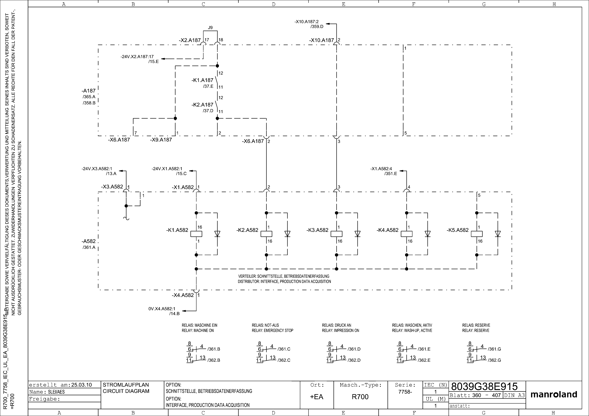

# +EA — Sheet 360 of 407 — OPTION:

**SCHNITTSTELLE, BETRIEBSDATENERFASSUNG**

> Part of the manroland **R700** printing press IEC/UL circuit diagrams.
> Drawing class: **Stromlaufplan / Circuit diagram** (DIN A3).
> Document `+EA` covers the **Printing unit** machine section.

## At a glance

| Field | Value |
|---|---|
| Document | `+EA`  (8039G38E915) |
| Sheet | **360** of 407 |
| Section (DE) | OPTION: |
| Section (EN) | SCHNITTSTELLE, BETRIEBSDATENERFASSUNG |
| Section type | CIRCUIT — Circuit diagram |
| Machine type | `R700` |
| Series | `7758` |
| Created | 25.03.10 |
| Replaces | — |
| Columns used | A, B, C, D, E, F, G |
| Path numbers | — |
| Labels on sheet | 119 |
| Cross-refs out | 21 |
| Cross-refs in | 36 |

**Previous:** [+EA sheet 359](SHEET_0359.md) · **Next:** [+EA sheet 361](SHEET_0361.md) · **Document TOC:** [_TOC.md](_TOC.md)  (+EA) · **Master TOC:** [all sheets](../_MASTER_TOC.md)

## Sheet image (300 DPI, exact vector render)



_Rendered directly from the PDF vector layer at 300 DPI (1-bit), no OCR and no resampling. Use it to confirm anything ambiguous in the text below._

## Cross-references on this sheet

Each entry is a wire leaving this sheet. The printed token is `/sheet.column`; the link resolves to that sheet inside the same document.

| Ref | Target sheet | Col | Path | Destination on target | Target section | From col |
|---|---|---|---|---|---|---|
| `/359.D` | [+EA sheet 359](SHEET_0359.md) | D | — | X10.A187:2 | OPTION: | E |
| `/15.E` | [+EA sheet 15](SHEET_0015.md) | E | — | 24V.X2.A187:17 | SPANNUNGSVERSORGUNG: 400V, 24V | B |
| `/37.E` | [+EA sheet 37](SHEET_0037.md) | E | — | — | BUSVERBINDUNGEN: NOT AUS | C |
| `/365.A` | [+EA sheet 365](SHEET_0365.md) | A | — | — | OPTION: TROCKNER VORBEREITUNG; | A |
| `/358.B` | [+EA sheet 358](SHEET_0358.md) | B | — | — | OPTION: MAKULATURBOGENZÄHLER | A |
| `/37.D` | [+EA sheet 37](SHEET_0037.md) | D | — | — | BUSVERBINDUNGEN: NOT AUS | C |
| `/13.A` | [+EA sheet 13](SHEET_0013.md) | A | — | 24V.X3.A582:1 | SPANNUNGSVERSORGUNG: 400V, 24V | B |
| `/15.C` | [+EA sheet 15](SHEET_0015.md) | C | — | 24V.X1.A582:1 | SPANNUNGSVERSORGUNG: 400V, 24V | C |
| `/351.E` | [+EA sheet 351](SHEET_0351.md) | E | — | X1.A582:4 | OPTION: VORBEREITUNG: PUDERABSAUGUNG | F |
| `/361.A` | [+EA sheet 361](SHEET_0361.md) | A | — | — | OPTION: | A |
| `/14.B` | [+EA sheet 14](SHEET_0014.md) | B | — | 0V.X4.A582:1 | SPANNUNGSVERSORGUNG: 400V, 24V | B |
| `/361.B` | [+EA sheet 361](SHEET_0361.md) | B | — | 4 | OPTION: | C |
| `/361.C` | [+EA sheet 361](SHEET_0361.md) | C | — | 4 | OPTION: | D |
| `/361.D` | [+EA sheet 361](SHEET_0361.md) | D | — | 4 | OPTION: | E |
| `/361.E` | [+EA sheet 361](SHEET_0361.md) | E | — | 4 | OPTION: | F |
| `/361.G` | [+EA sheet 361](SHEET_0361.md) | G | — | 4 | OPTION: | G |
| `/362.B` | [+EA sheet 362](SHEET_0362.md) | B | — | — | OPTION: | C |
| `/362.E` | [+EA sheet 362](SHEET_0362.md) | E | — | — | OPTION: | F |
| `/362.G` | [+EA sheet 362](SHEET_0362.md) | G | — | — | OPTION: | G |
| `/362.C` | [+EA sheet 362](SHEET_0362.md) | C | — | — | OPTION: | D |
| `/362.D` | [+EA sheet 362](SHEET_0362.md) | D | — | — | OPTION: | E |

### Incoming references (sheets that point here)

Every other sheet that sends a wire to this one. `Back-ref` is the token printed on *that* sheet; `Path` is its line number.

| From sheet | Cols | Back-ref | Path | Refs | What continues there |
|---|---|---|---|---|---|
| [+EA#13](SHEET_0013.md) | A | `/13.A` | — | 1 | 24V.X3.A582:1 |
| [+EA#14](SHEET_0014.md) | A | `/14.A` | — | 1 | 0V.X4.A582:1 |
| [+EA#15](SHEET_0015.md) | C, F | `/15.C`, `/15.F` | — | 2 | 24V.X1.A582:1; 24V.X2.A187:17 |
| [+EA#37](SHEET_0037.md) | D, E | `/37.D`, `/37.E` | — | 2 | — |
| [+EA#212](SHEET_0212.md) | A | `/212.A` | — | 5 | — |
| [+EA#223](SHEET_0223.md) | C | `/223.C` | — | 2 | — |
| [+EA#243](SHEET_0243.md) | G | `/243.G` | — | 4 | — |
| [+EA#251](SHEET_0251.md) | C | `/251.C` | — | 2 | — |
| [+EA#253](SHEET_0253.md) | F | `/253.F` | — | 2 | — |
| [+EA#351](SHEET_0351.md) | E | `/351.E` | — | 1 | — |
| [+EA#358](SHEET_0358.md) | B | `/358.B` | — | 1 | — |
| [+EA#359](SHEET_0359.md) | D | `/359.D` | — | 1 | — |
| [+EA#361](SHEET_0361.md) | A, B, C, D, E, F | `/361.A`, `/361.B`, `/361.C`, `/361.D`, `/361.E`, `/361.F` | — | 6 | — |
| [+EA#362](SHEET_0362.md) | B, C, D, E, F | `/362.B`, `/362.C`, `/362.D`, `/362.E`, `/362.F` | — | 5 | — |
| [+EA#365](SHEET_0365.md) | A | `/365.A` | — | 1 | — |


## Devices on this sheet

| Tag | Class | Class meaning (IEC) | Col | Sub | Terminal | Sign |
|---|---|---|---|---|---|---|
| `A582` | A | Baugruppe / assembly, module, PC board | A | — | — | — |
| `A187` | A | Baugruppe / assembly, module, PC board | A | — | — | — |
| `J9` | J |  | C | — | — | — |
| `K1.A582` | — | cross-device reference | C | — | — | — |
| `X1.A582` | — | cross-device reference | C | — | — | — |
| `K2.A582` | — | cross-device reference | D | — | — | — |
| `K3.A582` | — | cross-device reference | E | — | — | — |
| `K4.A582` | — | cross-device reference | F | — | — | — |
| `K5.A582` | — | cross-device reference | G | — | — | — |
| `X4.A582` | — | cross-device reference | C | — | — | — |
| `X3.A582` | — | cross-device reference | B | — | — | — |
| `X10.A187` | — | cross-device reference | E | — | — | — |
| `X2.A187` | — | cross-device reference | C | — | — | — |
| `K2.A187` | — | cross-device reference | C | — | — | — |
| `X6.A187` | — | cross-device reference | D | — | — | — |
| `K1.A187` | — | cross-device reference | C | — | — | — |
| `X1.A582:4` | — | cross-device reference | F | — | 4 | — |
| `X10.A187:2` | — | cross-device reference | D | — | 2 | — |
| `X9.A187` | — | cross-device reference | B | — | — | — |
| `X6.A187` | — | cross-device reference | B | — | — | — |

## Potentials / nets

| Potential | Count | Columns | Attached devices | Terminals |
|---|---|---|---|---|
| `0V` | 1 | B | `A582`, `X4` | `1` |
| `24V` | 3 | A, B | `A187`, `A582`, `X1`, `X2`, `X3` | `1`, `17` |


A potential such as `L24+/4` or `M24+` is a named supply/return rail; every place it appears on this sheet is electrically common.

## Wire-end annotations (grouped as printed)

A wire that continues elsewhere is annotated with a small cluster: the destination description, the path/line number `#NN`, and the `/sheet.column` cross reference. Each row below is one such cluster exactly as it is grouped on the drawing.

| Col | Y | Path | Cross-ref | Text on the wire |
|---|---|---|---|---|
| E | 40.0 | — | `/359.D` | `X10.A187:2` |
| C | 52.0 | — | — | `J9` |
| C | 76.8 | — | — | `X2.A187 17 18` |
| E | 76.8 | — | — | `X10.A187 2` |
| F | 93.9 | — | — | `1` |
| B | 110.8 | — | `/15.E` | `24V.X2.A187:17` |
| C | 144.2 | — | — | `12` |
| C | 157.6 | — | — | `K1.A187 11` |
| C | 170.7 | — | `/37.E` | — |
| A | 178.9 | — | — | `A187` |
| A | 192.0 | — | `/365.A`, `/358.B` | — |
| C | 193.8 | — | — | `12` |
| C | 207.2 | — | — | `K2.A187 11` |
| C | 220.3 | — | `/37.D` | — |
| B | 265.4 | — | — | `7 1` |
| C | 265.4 | — | — | `2` |
| F | 265.4 | — | — | `5` |
| B | 278.1 | — | — | `X6.A187 X9.A187` |
| D | 280.9 | — | — | `X6.A187 2 3` |
| B | 337.6 | — | `/13.A` | `24V.X3.A582:1` |
| C | 337.6 | — | `/15.C` | `24V.X1.A582:1` |
| F | 337.6 | — | `/351.E` | `X1.A582:4` |
| B | 373.1 | — | — | `X3.A582 1` |
| C | 374.5 | — | — | `X1.A582 1` |
| D | 374.5 | — | — | `2` |
| E | 374.5 | — | — | `3` |
| F | 374.5 | — | — | `4` |
| G | 391.5 | — | — | `5` |
| B | 392.2 | — | — | `1` |
| C | 456.0 | — | — | `16` |
| D | 456.0 | — | — | `1` |
| E | 456.0 | — | — | `1` |
| F | 456.0 | — | — | `1` |
| G | 456.0 | — | — | `1` |
| C | 460.9 | — | — | `K1.A582` |
| D | 460.9 | — | — | `K2.A582` |
| E | 460.9 | — | — | `K3.A582` |
| F | 460.9 | — | — | `K4.A582` |
| G | 460.9 | — | — | `K5.A582` |
| A | 483.6 | — | — | `A582` |
| C | 484.3 | — | — | `1` |
| D | 484.3 | — | — | `16` |
| E | 484.3 | — | — | `16` |
| F | 484.3 | — | — | `16` |
| G | 484.3 | — | — | `16` |
| A | 496.7 | — | `/361.A` | — |
| D | 556.2 | — | — | `DISTRIBUTOR: INTERFACE, PRODUCTION DATA ACQUISITION VERTEILER: SCHNITTSTELLE, BETRIEBSDATENERFASSUNG` |
| C | 592.7 | — | — | `X4.A582 1` |
| B | 621.0 | — | `/14.B` | `0V.X4.A582:1` |
| C | 655.4 | — | — | `RELAIS: MASCHINE EIN RELAY: MACHINE ON` |
| D | 655.4 | — | — | `RELAIS: NOT AUS RELAY: EMERGENCY STOP` |
| E | 655.4 | — | — | `RELAIS: DRUCK AN RELAY: IMPRESSION ON` |
| F | 655.4 | — | — | `RELAIS: WASCHEN, AKTIV RELAY: WASH UP, ACTIVE` |
| G | 655.4 | — | — | `RELAIS: RESERVE RELAY: RESERVE` |
| C | 690.5 | — | — | `11 8 6 9 13` |
| D | 690.5 | — | — | `11 8 6 9 13` |
| E | 690.5 | — | — | `11 8 6 9 13` |
| F | 690.5 | — | — | `11 8 6 9 13` |
| G | 690.5 | — | — | `11 8 6 9 13` |
| C | 696.2 | — | `/361.B` | `4` |
| D | 696.2 | — | `/361.C` | `4` |
| E | 696.2 | — | `/361.D` | `4` |
| F | 696.2 | — | `/361.E` | `4` |
| G | 696.2 | — | `/361.G` | `4` |
| C | 725.2 | — | `/362.B` | — |
| D | 725.2 | — | `/362.C` | — |
| E | 725.2 | — | `/362.D` | — |
| F | 725.2 | — | `/362.E` | — |
| G | 725.2 | — | `/362.G` | — |


## Reconstructed tables

This sheet carries tabular content (pin map / terminal assignment / index). The grid below was rebuilt from the drawing's own rule lines, so each row is exactly one physical row of the table.

### Table 1 — 2 data rows × 13 columns (at x=255.1, y=119.1) — **/15.E**

|  |  |  | K1.A187 /37.E K2.A187 /37.D | 12 11 12 11 |  |  |  |  |  |  |  |  |
|---|---|---|---|---|---|---|---|---|---|---|---|---|
| `1` | `7 X9.A187 24V.X1.A582:1 1` | `1 /15.C X1.A582` | `1` | `2 X6.A187` | `2 2` |  | `3 3` | `X1.A582:4 /351.E` | `5` | `4` |  | `5` |
|  |  | `K1.A582` | `16 1` | `K2.A582` | `1 16` | `K3.A582` | `1 16` | `K4.A582` |  | `1 16` | `K5.A582` | `1 16` |


## Notes and free text on this sheet

| Text | Col | Y (pt) |
|---|---|---|
| `RELAIS: MASCHINE EIN` | C | 655.41 |
| `RELAY: MACHINE ON` | C | 666.05 |
| `RELAIS: NOT AUS` | D | 655.41 |
| `RELAY: EMERGENCY STOP` | D | 666.06 |
| `RELAIS: DRUCK AN` | E | 655.41 |
| `RELAY: IMPRESSION ON` | E | 666.05 |
| `RELAIS: WASCHEN, AKTIV` | F | 655.39 |
| `RELAY: WASH UP, ACTIVE` | F | 666.02 |
| `RELAIS: RESERVE` | G | 655.4 |
| `RELAY: RESERVE` | G | 666.03 |
| `VERTEILER: SCHNITTSTELLE, BETRIEBSDATENERFASSUNG` | D | 556.22 |
| `DISTRIBUTOR: INTERFACE, PRODUCTION DATA ACQUISITION` | D | 566.85 |

## Complete label inventory (exact text from the drawing)

Every text object inside the drawing area of this sheet, in DIN reading order (column A→H, then top→bottom). This is the authoritative list: if a string is not here it is not printed on this sheet.

| Col | Y | X | Dir | Type | Text |
|---|---|---|---|---|---|
| A | 178.9 | 165.0 | → | device tag | `A187` |
| A | 192.0 | 167.2 | → | cross-reference | `/365.A` |
| A | 204.4 | 167.5 | → | cross-reference | `/358.B` |
| A | 337.6 | 165.0 | → | potential | `24V.X3.A582:1` |
| A | 483.6 | 165.0 | → | device tag | `A582` |
| A | 496.7 | 167.2 | → | cross-reference | `/361.A` |
| B | 110.8 | 243.8 | → | potential | `24V.X2.A187:17` |
| B | 120.7 | 300.2 | → | cross-reference | `/15.E` |
| B | 265.4 | 271.8 | → | number | `7` |
| B | 278.1 | 218.6 | → | device ref | `X6.A187` |
| B | 278.1 | 303.6 | → | device ref | `X9.A187` |
| B | 337.6 | 306.7 | → | potential | `24V.X1.A582:1` |
| B | 347.5 | 214.6 | → | cross-reference | `/13.A` |
| B | 373.1 | 204.4 | → | device ref | `X3.A582` |
| B | 374.4 | 256.8 | → | number | `1` |
| B | 392.2 | 287.4 | → | number | `1` |
| B | 621.1 | 300.2 | → | potential | `0V.X4.A582:1` |
| C | 52.0 | 420.5 | → | device tag | `J9` |
| C | 76.8 | 361.7 | → | device ref | `X2.A187` |
| C | 76.9 | 413.0 | → | number | `17` |
| C | 76.9 | 441.4 | → | number | `18` |
| C | 144.2 | 441.4 | → | number | `12` |
| C | 157.6 | 387.2 | → | device ref | `K1.A187` |
| C | 170.7 | 410.7 | → | cross-reference | `/37.E` |
| C | 172.5 | 441.4 | → | number | `11` |
| C | 193.8 | 441.4 | → | number | `12` |
| C | 207.2 | 387.2 | → | device ref | `K2.A187` |
| C | 220.3 | 410.2 | → | cross-reference | `/37.D` |
| C | 222.1 | 441.4 | → | number | `11` |
| C | 265.4 | 356.3 | → | number | `1` |
| C | 265.4 | 441.9 | → | number | `2` |
| C | 347.5 | 356.3 | → | cross-reference | `/15.C` |
| C | 374.5 | 347.5 | → | device ref | `X1.A582` |
| C | 374.5 | 398.8 | → | number | `1` |
| C | 456.0 | 398.8 | → | number | `16` |
| C | 460.9 | 336.2 | → | device ref | `K1.A582` |
| C | 484.3 | 398.8 | → | number | `1` |
| C | 592.7 | 398.6 | → | number | `1` |
| C | 592.8 | 347.5 | → | device ref | `X4.A582` |
| C | 631.0 | 342.4 | → | cross-reference | `/14.B` |
| C | 655.4 | 367.7 | → | text | `RELAIS: MASCHINE EIN` |
| C | 666.1 | 367.7 | → | text | `RELAY: MACHINE ON` |
| C | 690.5 | 380.1 | → | number | `8` |
| C | 696.2 | 405.1 | → | number | `4` |
| C | 701.8 | 380.1 | → | number | `6` |
| C | 702.5 | 419.5 | → | cross-reference | `/361.B` |
| C | 713.2 | 380.1 | → | number | `9` |
| C | 718.9 | 403.4 | → | number | `13` |
| C | 724.5 | 375.6 | → | number | `11` |
| C | 725.2 | 419.5 | → | cross-reference | `/362.B` |
| D | 40.0 | 595.3 | → | device ref | `X10.A187:2` |
| D | 280.9 | 489.3 | → | device ref | `X6.A187` |
| D | 282.4 | 541.1 | → | number | `2` |
| D | 374.5 | 541.1 | → | number | `2` |
| D | 456.0 | 540.6 | → | number | `1` |
| D | 460.9 | 477.9 | → | device ref | `K2.A582` |
| D | 484.3 | 540.6 | → | number | `16` |
| D | 556.2 | 481.9 | → | text | `VERTEILER: SCHNITTSTELLE, BETRIEBSDATENERFASSUNG` |
| D | 566.9 | 481.0 | → | text | `DISTRIBUTOR: INTERFACE, PRODUCTION DATA ACQUISITION` |
| D | 655.4 | 509.4 | → | text | `RELAIS: NOT AUS` |
| D | 666.1 | 509.4 | → | text | `RELAY: EMERGENCY STOP` |
| D | 690.5 | 521.9 | → | number | `8` |
| D | 696.2 | 546.8 | → | number | `4` |
| D | 701.8 | 521.9 | → | number | `6` |
| D | 702.6 | 561.3 | → | cross-reference | `/361.C` |
| D | 713.2 | 521.9 | → | number | `9` |
| D | 718.9 | 545.1 | → | number | `13` |
| D | 724.5 | 517.3 | → | number | `11` |
| D | 725.3 | 561.3 | → | cross-reference | `/362.C` |
| E | 49.9 | 627.9 | → | cross-reference | `/359.D` |
| E | 76.8 | 625.0 | → | device ref | `X10.A187` |
| E | 76.9 | 682.9 | → | number | `2` |
| E | 282.4 | 682.9 | → | number | `3` |
| E | 374.5 | 682.9 | → | number | `3` |
| E | 456.0 | 682.3 | → | number | `1` |
| E | 460.9 | 619.7 | → | device ref | `K3.A582` |
| E | 484.3 | 682.3 | → | number | `16` |
| E | 655.4 | 651.1 | → | text | `RELAIS: DRUCK AN` |
| E | 666.0 | 651.1 | → | text | `RELAY: IMPRESSION ON` |
| E | 690.5 | 663.6 | → | number | `8` |
| E | 696.2 | 688.5 | → | number | `4` |
| E | 701.8 | 663.6 | → | number | `6` |
| E | 702.6 | 703.0 | → | cross-reference | `/361.D` |
| E | 713.2 | 663.6 | → | number | `9` |
| E | 718.9 | 686.8 | → | number | `13` |
| E | 724.5 | 659.1 | → | number | `11` |
| E | 725.3 | 703.0 | → | cross-reference | `/362.D` |
| F | 93.9 | 816.9 | → | number | `1` |
| F | 265.4 | 817.5 | → | number | `5` |
| F | 337.6 | 748.6 | → | device ref | `X1.A582:4` |
| F | 347.5 | 777.3 | → | cross-reference | `/351.E` |
| F | 374.5 | 824.6 | → | number | `4` |
| F | 456.0 | 824.0 | → | number | `1` |
| F | 460.9 | 761.4 | → | device ref | `K4.A582` |
| F | 484.3 | 824.0 | → | number | `16` |
| F | 655.4 | 792.9 | → | text | `RELAIS: WASCHEN, AKTIV` |
| F | 666.0 | 792.9 | → | text | `RELAY: WASH UP, ACTIVE` |
| F | 690.5 | 805.3 | → | number | `8` |
| F | 696.2 | 830.3 | → | number | `4` |
| F | 701.8 | 805.3 | → | number | `6` |
| F | 702.5 | 844.7 | → | cross-reference | `/361.E` |
| F | 713.2 | 805.3 | → | number | `9` |
| F | 718.9 | 828.6 | → | number | `13` |
| F | 724.5 | 800.8 | → | number | `11` |
| F | 725.2 | 844.7 | → | cross-reference | `/362.E` |
| G | 391.5 | 966.3 | → | number | `5` |
| G | 456.0 | 965.8 | → | number | `1` |
| G | 460.9 | 903.1 | → | device ref | `K5.A582` |
| G | 484.3 | 965.8 | → | number | `16` |
| G | 655.4 | 934.6 | → | text | `RELAIS: RESERVE` |
| G | 666.0 | 934.6 | → | text | `RELAY: RESERVE` |
| G | 690.5 | 947.1 | → | number | `8` |
| G | 696.2 | 972.0 | → | number | `4` |
| G | 701.8 | 947.1 | → | number | `6` |
| G | 702.6 | 986.5 | → | cross-reference | `/361.G` |
| G | 713.2 | 947.1 | → | number | `9` |
| G | 718.9 | 970.3 | → | number | `13` |
| G | 724.5 | 942.5 | → | number | `11` |
| G | 725.2 | 986.5 | → | cross-reference | `/362.G` |

## Reading-order text block

The same content as a plain block, grouped by DIN column — convenient to paste or to match against a visual description.

```text
=== Column A ===
 178.9  165.0  devtag       A187
 192.0  167.2  xref         /365.A
 204.4  167.5  xref         /358.B
 337.6  165.0  net          24V.X3.A582:1
 483.6  165.0  devtag       A582
 496.7  167.2  xref         /361.A
=== Column B ===
 110.8  243.8  net          24V.X2.A187:17
 120.7  300.2  xref         /15.E
 265.4  271.8  numeric      7
 278.1  218.6  devref       X6.A187
 278.1  303.6  devref       X9.A187
 337.6  306.7  net          24V.X1.A582:1
 347.5  214.6  xref         /13.A
 373.1  204.4  devref       X3.A582
 374.4  256.8  numeric      1
 392.2  287.4  numeric      1
 621.1  300.2  net          0V.X4.A582:1
=== Column C ===
  52.0  420.5  devtag       J9
  76.8  361.7  devref       X2.A187
  76.9  413.0  numeric      17
  76.9  441.4  numeric      18
 144.2  441.4  numeric      12
 157.6  387.2  devref       K1.A187
 170.7  410.7  xref         /37.E
 172.5  441.4  numeric      11
 193.8  441.4  numeric      12
 207.2  387.2  devref       K2.A187
 220.3  410.2  xref         /37.D
 222.1  441.4  numeric      11
 265.4  356.3  numeric      1
 265.4  441.9  numeric      2
 347.5  356.3  xref         /15.C
 374.5  347.5  devref       X1.A582
 374.5  398.8  numeric      1
 456.0  398.8  numeric      16
 460.9  336.2  devref       K1.A582
 484.3  398.8  numeric      1
 592.7  398.6  numeric      1
 592.8  347.5  devref       X4.A582
 631.0  342.4  xref         /14.B
 655.4  367.7  text         RELAIS: MASCHINE EIN
 666.1  367.7  text         RELAY: MACHINE ON
 690.5  380.1  numeric      8
 696.2  405.1  numeric      4
 701.8  380.1  numeric      6
 702.5  419.5  xref         /361.B
 713.2  380.1  numeric      9
 718.9  403.4  numeric      13
 724.5  375.6  numeric      11
 725.2  419.5  xref         /362.B
=== Column D ===
  40.0  595.3  devref       X10.A187:2
 280.9  489.3  devref       X6.A187
 282.4  541.1  numeric      2
 374.5  541.1  numeric      2
 456.0  540.6  numeric      1
 460.9  477.9  devref       K2.A582
 484.3  540.6  numeric      16
 556.2  481.9  text         VERTEILER: SCHNITTSTELLE, BETRIEBSDATENERFASSUNG
 566.9  481.0  text         DISTRIBUTOR: INTERFACE, PRODUCTION DATA ACQUISITION
 655.4  509.4  text         RELAIS: NOT AUS
 666.1  509.4  text         RELAY: EMERGENCY STOP
 690.5  521.9  numeric      8
 696.2  546.8  numeric      4
 701.8  521.9  numeric      6
 702.6  561.3  xref         /361.C
 713.2  521.9  numeric      9
 718.9  545.1  numeric      13
 724.5  517.3  numeric      11
 725.3  561.3  xref         /362.C
=== Column E ===
  49.9  627.9  xref         /359.D
  76.8  625.0  devref       X10.A187
  76.9  682.9  numeric      2
 282.4  682.9  numeric      3
 374.5  682.9  numeric      3
 456.0  682.3  numeric      1
 460.9  619.7  devref       K3.A582
 484.3  682.3  numeric      16
 655.4  651.1  text         RELAIS: DRUCK AN
 666.0  651.1  text         RELAY: IMPRESSION ON
 690.5  663.6  numeric      8
 696.2  688.5  numeric      4
 701.8  663.6  numeric      6
 702.6  703.0  xref         /361.D
 713.2  663.6  numeric      9
 718.9  686.8  numeric      13
 724.5  659.1  numeric      11
 725.3  703.0  xref         /362.D
=== Column F ===
  93.9  816.9  numeric      1
 265.4  817.5  numeric      5
 337.6  748.6  devref       X1.A582:4
 347.5  777.3  xref         /351.E
 374.5  824.6  numeric      4
 456.0  824.0  numeric      1
 460.9  761.4  devref       K4.A582
 484.3  824.0  numeric      16
 655.4  792.9  text         RELAIS: WASCHEN, AKTIV
 666.0  792.9  text         RELAY: WASH UP, ACTIVE
 690.5  805.3  numeric      8
 696.2  830.3  numeric      4
 701.8  805.3  numeric      6
 702.5  844.7  xref         /361.E
 713.2  805.3  numeric      9
 718.9  828.6  numeric      13
 724.5  800.8  numeric      11
 725.2  844.7  xref         /362.E
=== Column G ===
 391.5  966.3  numeric      5
 456.0  965.8  numeric      1
 460.9  903.1  devref       K5.A582
 484.3  965.8  numeric      16
 655.4  934.6  text         RELAIS: RESERVE
 666.0  934.6  text         RELAY: RESERVE
 690.5  947.1  numeric      8
 696.2  972.0  numeric      4
 701.8  947.1  numeric      6
 702.6  986.5  xref         /361.G
 713.2  947.1  numeric      9
 718.9  970.3  numeric      13
 724.5  942.5  numeric      11
 725.2  986.5  xref         /362.G
```

---
_Generated from the PDF vector text layer; no OCR. Source: `R700_7758_IEC_UL_EA_8039G38E915_p`, sheet 360._
