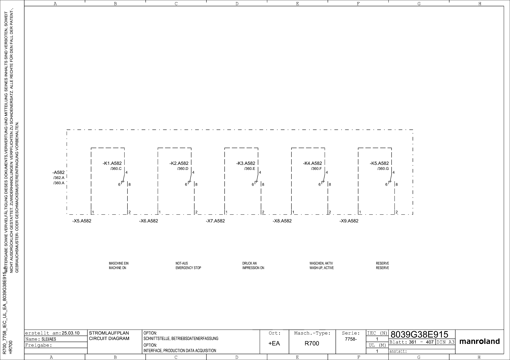

# +EA — Sheet 361 of 407 — OPTION:

**SCHNITTSTELLE, BETRIEBSDATENERFASSUNG**

> Part of the manroland **R700** printing press IEC/UL circuit diagrams.
> Drawing class: **Stromlaufplan / Circuit diagram** (DIN A3).
> Document `+EA` covers the **Printing unit** machine section.

## At a glance

| Field | Value |
|---|---|
| Document | `+EA`  (8039G38E915) |
| Sheet | **361** of 407 |
| Section (DE) | OPTION: |
| Section (EN) | SCHNITTSTELLE, BETRIEBSDATENERFASSUNG |
| Section type | CIRCUIT — Circuit diagram |
| Machine type | `R700` |
| Series | `7758` |
| Created | 25.03.10 |
| Replaces | — |
| Columns used | A, B, C, D, E, F, G |
| Path numbers | — |
| Labels on sheet | 53 |
| Cross-refs out | 7 |
| Cross-refs in | 17 |

**Previous:** [+EA sheet 360](SHEET_0360.md) · **Next:** [+EA sheet 362](SHEET_0362.md) · **Document TOC:** [_TOC.md](_TOC.md)  (+EA) · **Master TOC:** [all sheets](../_MASTER_TOC.md)

## Sheet image (300 DPI, exact vector render)



_Rendered directly from the PDF vector layer at 300 DPI (1-bit), no OCR and no resampling. Use it to confirm anything ambiguous in the text below._

## Cross-references on this sheet

Each entry is a wire leaving this sheet. The printed token is `/sheet.column`; the link resolves to that sheet inside the same document.

| Ref | Target sheet | Col | Path | Destination on target | Target section | From col |
|---|---|---|---|---|---|---|
| `/360.E` | [+EA sheet 360](SHEET_0360.md) | E | — | — | OPTION: | D |
| `/360.F` | [+EA sheet 360](SHEET_0360.md) | F | — | — | OPTION: | E |
| `/360.G` | [+EA sheet 360](SHEET_0360.md) | G | — | — | OPTION: | F |
| `/360.C` | [+EA sheet 360](SHEET_0360.md) | C | — | — | OPTION: | B |
| `/360.D` | [+EA sheet 360](SHEET_0360.md) | D | — | — | OPTION: | C |
| `/362.A` | [+EA sheet 362](SHEET_0362.md) | A | — | — | OPTION: | A |
| `/360.A` | [+EA sheet 360](SHEET_0360.md) | A | — | — | OPTION: | A |

### Incoming references (sheets that point here)

Every other sheet that sends a wire to this one. `Back-ref` is the token printed on *that* sheet; `Path` is its line number.

| From sheet | Cols | Back-ref | Path | Refs | What continues there |
|---|---|---|---|---|---|
| [+EA#243](SHEET_0243.md) | C | `/243.C` | — | 2 | — |
| [+EA#245](SHEET_0245.md) | G | `/245.G` | — | 2 | — |
| [+EA#247](SHEET_0247.md) | G | `/247.G` | — | 2 | — |
| [+EA#250](SHEET_0250.md) | G | `/250.G` | — | 2 | — |
| [+EA#253](SHEET_0253.md) | A | `/253.A` | — | 2 | — |
| [+EA#360](SHEET_0360.md) | A, C, D, E, F, G | `/360.A`, `/360.C`, `/360.D`, `/360.E`, `/360.F`, `/360.G` | — | 6 | 4 |
| [+EA#362](SHEET_0362.md) | B | `/362.B` | — | 1 | 11 |


## Devices on this sheet

| Tag | Class | Class meaning (IEC) | Col | Sub | Terminal | Sign |
|---|---|---|---|---|---|---|
| `A582` | A | Baugruppe / assembly, module, PC board | A | — | — | — |
| `K1.A582` | — | cross-device reference | B | — | — | — |
| `K2.A582` | — | cross-device reference | C | — | — | — |
| `K3.A582` | — | cross-device reference | D | — | — | — |
| `K4.A582` | — | cross-device reference | E | — | — | — |
| `K5.A582` | — | cross-device reference | F | — | — | — |
| `X5.A582` | — | cross-device reference | A | — | — | — |
| `X6.A582` | — | cross-device reference | C | — | — | — |
| `X7.A582` | — | cross-device reference | D | — | — | — |
| `X8.A582` | — | cross-device reference | E | — | — | — |
| `X9.A582` | — | cross-device reference | F | — | — | — |

## Potentials / nets

_No named potentials on this sheet._

## Wire-end annotations (grouped as printed)

A wire that continues elsewhere is annotated with a small cluster: the destination description, the path/line number `#NN`, and the `/sheet.column` cross reference. Each row below is one such cluster exactly as it is grouped on the drawing.

| Col | Y | Path | Cross-ref | Text on the wire |
|---|---|---|---|---|
| B | 377.3 | — | — | `K1.A582` |
| C | 377.3 | — | — | `K2.A582` |
| D | 377.3 | — | — | `K3.A582` |
| E | 377.3 | — | — | `K4.A582` |
| F | 377.3 | — | — | `K5.A582` |
| B | 390.4 | — | `/360.C` | — |
| C | 390.4 | — | `/360.D` | — |
| D | 390.4 | — | `/360.E` | — |
| E | 390.4 | — | `/360.F` | — |
| F | 390.4 | — | `/360.G` | — |
| A | 398.6 | — | — | `A582` |
| B | 399.3 | — | — | `4` |
| C | 399.3 | — | — | `4` |
| D | 399.3 | — | — | `4` |
| E | 399.3 | — | — | `4` |
| G | 399.3 | — | — | `4` |
| A | 411.6 | — | `/362.A`, `/360.A` | — |
| B | 427.6 | — | — | `6` |
| B | 427.6 | — | — | `8` |
| C | 427.6 | — | — | `6` |
| C | 427.6 | — | — | `8` |
| D | 427.6 | — | — | `6` |
| D | 427.6 | — | — | `8` |
| E | 427.6 | — | — | `6` |
| F | 427.6 | — | — | `8` |
| F | 427.6 | — | — | `6` |
| G | 427.6 | — | — | `8` |
| B | 492.1 | — | — | `1 2` |
| C | 492.1 | — | — | `1 2` |
| D | 492.1 | — | — | `1 2` |
| E | 492.1 | — | — | `1 2` |
| F | 492.1 | — | — | `1 2` |
| D | 512.0 | — | — | `X5.A582 X6.A582 X7.A582 X8.A582 X9.A582` |
| B | 612.9 | — | — | `MASCHINE EIN MACHINE ON` |
| C | 612.9 | — | — | `NOT AUS EMERGENCY STOP` |
| D | 612.9 | — | — | `DRUCK AN IMPRESSION ON` |
| E | 612.9 | — | — | `WASCHEN, AKTIV WASH UP, ACTIVE` |
| F | 612.9 | — | — | `RESERVE RESERVE` |


## Reconstructed tables

This sheet carries tabular content (pin map / terminal assignment / index). The grid below was rebuilt from the drawing's own rule lines, so each row is exactly one physical row of the table.

### Table 1 — 5 data rows × 21 columns (at x=204.1, y=0.0) — **K1.A582 /360.C 6 1 MASCHINE MACHINE ON 4 EIN 8 2 X6.A582 K2.A582 /360.D 6 1 NOT AUS EMERGENCY 4 8 2 X7.A582 STOP K3.A582 /360.E 6 1 DRUCK AN IMPRESSION 8 2 X8.A582 ON K4.A582 /360.F 6 1 WASCHEN, WASH UP, 8 2 AKTIV ACTIVE X9.A582 1 K5.A582 /360.G 6 RESERVE RESERVE**

|  | STROMLAUFPLAN |  |  | OPTION: |  |  |  |  |  | Ort: |  | Masch. Type: |  |  | Serie: |  | IEC (N) |  |  | 8039G38E915 |
|---|---|---|---|---|---|---|---|---|---|---|---|---|---|---|---|---|---|---|---|---|
|  | `CIRCUIT DIAGRAM` |  |  |  |  |  |  |  |  |  |  |  |  |  |  |  |  |  |  |  |
|  |  |  |  | `SCHNITTSTELLE,` |  |  | `BETRIEBSDATENERFASSUNG` |  |  |  |  |  |  |  | `7758` |  | `1` |  |  |  |
|  |  |  |  |  |  |  |  |  |  | `+EA` |  | `R700` |  |  |  |  |  |  |  | `Blatt: DIN A3 361 407` |
|  |  |  |  | `OPTION:` |  |  |  |  |  |  |  |  |  |  |  |  | `UL (M)` |  |  |  |
|  |  |  |  | `INTERFACE,` | `PRODUCTION DATA` |  | `ACQUISITION` |  |  |  |  |  |  |  |  |  | `1` |  |  | `anstatt:` |


## Notes and free text on this sheet

| Text | Col | Y (pt) |
|---|---|---|
| `MASCHINE EIN` | B | 612.9 |
| `MACHINE ON` | B | 623.54 |
| `NOT AUS` | C | 612.89 |
| `EMERGENCY STOP` | C | 623.54 |
| `DRUCK AN` | D | 612.9 |
| `IMPRESSION ON` | D | 623.53 |
| `WASCHEN, AKTIV` | E | 612.87 |
| `WASH UP, ACTIVE` | E | 623.5 |
| `RESERVE` | F | 612.87 |

## Complete label inventory (exact text from the drawing)

Every text object inside the drawing area of this sheet, in DIN reading order (column A→H, then top→bottom). This is the authoritative list: if a string is not here it is not printed on this sheet.

| Col | Y | X | Dir | Type | Text |
|---|---|---|---|---|---|
| A | 398.6 | 122.5 | → | device tag | `A582` |
| A | 411.6 | 124.7 | → | cross-reference | `/362.A` |
| A | 424.0 | 124.7 | → | cross-reference | `/360.A` |
| A | 512.0 | 168.9 | → | device ref | `X5.A582` |
| B | 377.3 | 239.8 | → | device ref | `K1.A582` |
| B | 390.4 | 258.0 | → | cross-reference | `/360.C` |
| B | 399.3 | 293.1 | → | number | `4` |
| B | 427.6 | 276.1 | → | number | `6` |
| B | 427.6 | 300.2 | → | number | `8` |
| B | 492.1 | 214.6 | → | number | `1` |
| B | 492.1 | 300.2 | → | number | `2` |
| B | 612.9 | 254.6 | → | text | `MASCHINE EIN` |
| B | 623.5 | 254.6 | → | text | `MACHINE ON` |
| C | 377.3 | 395.7 | → | device ref | `K2.A582` |
| C | 390.4 | 413.9 | → | cross-reference | `/360.D` |
| C | 399.3 | 449.0 | → | number | `4` |
| C | 427.6 | 432.0 | → | number | `6` |
| C | 427.6 | 456.1 | → | number | `8` |
| C | 492.1 | 370.5 | → | number | `1` |
| C | 492.1 | 456.1 | → | number | `2` |
| C | 512.0 | 324.9 | → | device ref | `X6.A582` |
| C | 612.9 | 410.2 | → | text | `NOT AUS` |
| C | 623.5 | 410.2 | → | text | `EMERGENCY STOP` |
| D | 377.3 | 551.6 | → | device ref | `K3.A582` |
| D | 390.4 | 570.3 | → | cross-reference | `/360.E` |
| D | 399.3 | 604.9 | → | number | `4` |
| D | 427.6 | 587.9 | → | number | `6` |
| D | 427.6 | 612.0 | → | number | `8` |
| D | 492.1 | 526.4 | → | number | `1` |
| D | 492.1 | 612.0 | → | number | `2` |
| D | 512.0 | 480.8 | → | device ref | `X7.A582` |
| D | 612.9 | 566.1 | → | text | `DRUCK AN` |
| D | 623.5 | 566.1 | → | text | `IMPRESSION ON` |
| E | 377.3 | 707.5 | → | device ref | `K4.A582` |
| E | 390.4 | 726.5 | → | cross-reference | `/360.F` |
| E | 399.3 | 760.8 | → | number | `4` |
| E | 427.6 | 743.8 | → | number | `6` |
| E | 492.1 | 682.3 | → | number | `1` |
| E | 512.0 | 636.7 | → | device ref | `X8.A582` |
| E | 612.9 | 722.8 | → | text | `WASCHEN, AKTIV` |
| E | 623.5 | 722.8 | → | text | `WASH UP, ACTIVE` |
| F | 377.3 | 863.4 | → | device ref | `K5.A582` |
| F | 390.4 | 881.3 | → | cross-reference | `/360.G` |
| F | 427.6 | 767.9 | → | number | `8` |
| F | 427.6 | 899.7 | → | number | `6` |
| F | 492.1 | 767.9 | → | number | `2` |
| F | 492.1 | 838.2 | → | number | `1` |
| F | 512.0 | 792.6 | → | device ref | `X9.A582` |
| F | 612.9 | 877.9 | → | text | `RESERVE` |
| F | 623.5 | 877.9 | → | text | `RESERVE` |
| G | 399.3 | 916.7 | → | number | `4` |
| G | 427.6 | 923.8 | → | number | `8` |
| G | 492.1 | 923.8 | → | number | `2` |

## Reading-order text block

The same content as a plain block, grouped by DIN column — convenient to paste or to match against a visual description.

```text
=== Column A ===
 398.6  122.5  devtag       A582
 411.6  124.7  xref         /362.A
 424.0  124.7  xref         /360.A
 512.0  168.9  devref       X5.A582
=== Column B ===
 377.3  239.8  devref       K1.A582
 390.4  258.0  xref         /360.C
 399.3  293.1  numeric      4
 427.6  276.1  numeric      6
 427.6  300.2  numeric      8
 492.1  214.6  numeric      1
 492.1  300.2  numeric      2
 612.9  254.6  text         MASCHINE EIN
 623.5  254.6  text         MACHINE ON
=== Column C ===
 377.3  395.7  devref       K2.A582
 390.4  413.9  xref         /360.D
 399.3  449.0  numeric      4
 427.6  432.0  numeric      6
 427.6  456.1  numeric      8
 492.1  370.5  numeric      1
 492.1  456.1  numeric      2
 512.0  324.9  devref       X6.A582
 612.9  410.2  text         NOT AUS
 623.5  410.2  text         EMERGENCY STOP
=== Column D ===
 377.3  551.6  devref       K3.A582
 390.4  570.3  xref         /360.E
 399.3  604.9  numeric      4
 427.6  587.9  numeric      6
 427.6  612.0  numeric      8
 492.1  526.4  numeric      1
 492.1  612.0  numeric      2
 512.0  480.8  devref       X7.A582
 612.9  566.1  text         DRUCK AN
 623.5  566.1  text         IMPRESSION ON
=== Column E ===
 377.3  707.5  devref       K4.A582
 390.4  726.5  xref         /360.F
 399.3  760.8  numeric      4
 427.6  743.8  numeric      6
 492.1  682.3  numeric      1
 512.0  636.7  devref       X8.A582
 612.9  722.8  text         WASCHEN, AKTIV
 623.5  722.8  text         WASH UP, ACTIVE
=== Column F ===
 377.3  863.4  devref       K5.A582
 390.4  881.3  xref         /360.G
 427.6  767.9  numeric      8
 427.6  899.7  numeric      6
 492.1  767.9  numeric      2
 492.1  838.2  numeric      1
 512.0  792.6  devref       X9.A582
 612.9  877.9  text         RESERVE
 623.5  877.9  text         RESERVE
=== Column G ===
 399.3  916.7  numeric      4
 427.6  923.8  numeric      8
 492.1  923.8  numeric      2
```

---
_Generated from the PDF vector text layer; no OCR. Source: `R700_7758_IEC_UL_EA_8039G38E915_p`, sheet 361._
