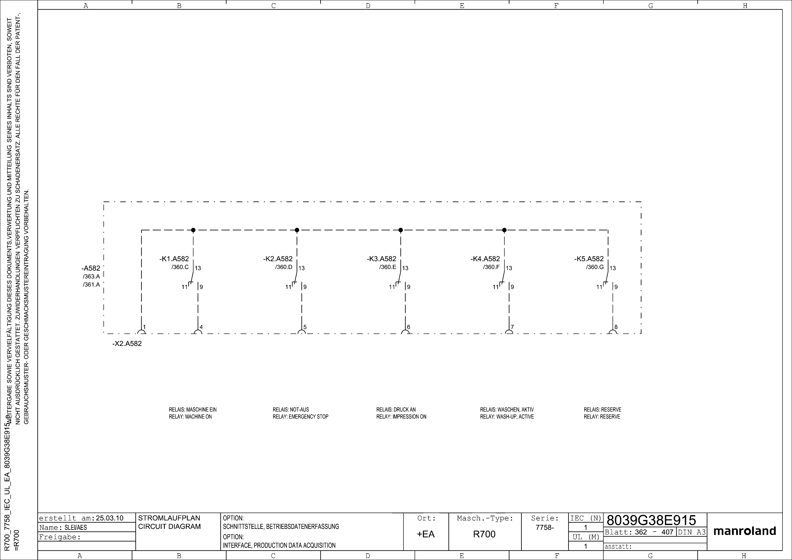

# +EA — Sheet 362 of 407 — OPTION:

**SCHNITTSTELLE, BETRIEBSDATENERFASSUNG**

> Part of the manroland **R700** printing press IEC/UL circuit diagrams.
> Drawing class: **Stromlaufplan / Circuit diagram** (DIN A3).
> Document `+EA` covers the **Printing unit** machine section.

## At a glance

| Field | Value |
|---|---|
| Document | `+EA`  (8039G38E915) |
| Sheet | **362** of 407 |
| Section (DE) | OPTION: |
| Section (EN) | SCHNITTSTELLE, BETRIEBSDATENERFASSUNG |
| Section type | CIRCUIT — Circuit diagram |
| Machine type | `R700` |
| Series | `7758` |
| Created | 25.03.10 |
| Replaces | — |
| Columns used | A, B, C, D, E, F, G |
| Path numbers | — |
| Labels on sheet | 45 |
| Cross-refs out | 7 |
| Cross-refs in | 13 |

**Previous:** [+EA sheet 361](SHEET_0361.md) · **Next:** [+EA sheet 363](SHEET_0363.md) · **Document TOC:** [_TOC.md](_TOC.md)  (+EA) · **Master TOC:** [all sheets](../_MASTER_TOC.md)

## Sheet image (300 DPI, exact vector render)



_Rendered directly from the PDF vector layer at 300 DPI (1-bit), no OCR and no resampling. Use it to confirm anything ambiguous in the text below._

## Cross-references on this sheet

Each entry is a wire leaving this sheet. The printed token is `/sheet.column`; the link resolves to that sheet inside the same document.

| Ref | Target sheet | Col | Path | Destination on target | Target section | From col |
|---|---|---|---|---|---|---|
| `/360.E` | [+EA sheet 360](SHEET_0360.md) | E | — | — | OPTION: | D |
| `/360.F` | [+EA sheet 360](SHEET_0360.md) | F | — | — | OPTION: | E |
| `/360.G` | [+EA sheet 360](SHEET_0360.md) | G | — | — | OPTION: | F |
| `/360.C` | [+EA sheet 360](SHEET_0360.md) | C | — | — | OPTION: | B |
| `/360.D` | [+EA sheet 360](SHEET_0360.md) | D | — | — | OPTION: | C |
| `/363.A` | [+EA sheet 363](SHEET_0363.md) | A | — | 11 | OPTION: | B |
| `/361.A` | [+EA sheet 361](SHEET_0361.md) | A | — | 11 | OPTION: | B |

### Incoming references (sheets that point here)

Every other sheet that sends a wire to this one. `Back-ref` is the token printed on *that* sheet; `Path` is its line number.

| From sheet | Cols | Back-ref | Path | Refs | What continues there |
|---|---|---|---|---|---|
| [+EA#230](SHEET_0230.md) | E | `/230.E` | — | 6 | — |
| [+EA#360](SHEET_0360.md) | C, D, E, F, G | `/360.C`, `/360.D`, `/360.E`, `/360.F`, `/360.G` | — | 5 | — |
| [+EA#361](SHEET_0361.md) | A | `/361.A` | — | 1 | — |
| [+EA#363](SHEET_0363.md) | A | `/363.A` | — | 1 | — |


## Devices on this sheet

| Tag | Class | Class meaning (IEC) | Col | Sub | Terminal | Sign |
|---|---|---|---|---|---|---|
| `A582` | A | Baugruppe / assembly, module, PC board | A | — | — | — |
| `K1.A582` | — | cross-device reference | B | — | — | — |
| `K2.A582` | — | cross-device reference | C | — | — | — |
| `K3.A582` | — | cross-device reference | D | — | — | — |
| `K4.A582` | — | cross-device reference | E | — | — | — |
| `K5.A582` | — | cross-device reference | F | — | — | — |
| `X2.A582` | — | cross-device reference | A | — | — | — |

## Potentials / nets

_No named potentials on this sheet._

## Wire-end annotations (grouped as printed)

A wire that continues elsewhere is annotated with a small cluster: the destination description, the path/line number `#NN`, and the `/sheet.column` cross reference. Each row below is one such cluster exactly as it is grouped on the drawing.

| Col | Y | Path | Cross-ref | Text on the wire |
|---|---|---|---|---|
| B | 384.4 | — | — | `K1.A582` |
| C | 384.4 | — | — | `K2.A582` |
| D | 384.4 | — | — | `K3.A582` |
| E | 384.4 | — | — | `K4.A582` |
| F | 384.4 | — | — | `K5.A582` |
| B | 397.5 | — | `/360.C` | — |
| C | 397.5 | — | `/360.D` | — |
| D | 397.5 | — | `/360.E` | — |
| E | 397.5 | — | `/360.F` | — |
| F | 397.5 | — | `/360.G` | — |
| A | 398.6 | — | — | `A582` |
| B | 399.3 | — | — | `13` |
| C | 399.3 | — | — | `13` |
| D | 399.3 | — | — | `13` |
| E | 399.3 | — | — | `13` |
| G | 399.3 | — | — | `13` |
| B | 411.6 | — | `/363.A`, `/361.A` | `11` |
| B | 427.6 | — | — | `9` |
| C | 427.6 | — | — | `11` |
| C | 427.6 | — | — | `9` |
| D | 427.6 | — | — | `11` |
| D | 427.6 | — | — | `9` |
| E | 427.6 | — | — | `11` |
| F | 427.6 | — | — | `9` |
| F | 427.6 | — | — | `11` |
| G | 427.6 | — | — | `9` |
| D | 487.9 | — | — | `1 4 5 6 7 8` |
| A | 512.0 | — | — | `X2.A582` |
| B | 612.9 | — | — | `RELAIS: MASCHINE EIN RELAY: MACHINE ON` |
| C | 612.9 | — | — | `RELAIS: NOT AUS RELAY: EMERGENCY STOP` |
| D | 612.9 | — | — | `RELAIS: DRUCK AN RELAY: IMPRESSION ON` |
| E | 612.9 | — | — | `RELAIS: WASCHEN, AKTIV RELAY: WASH UP, ACTIVE` |
| F | 612.9 | — | — | `RELAIS: RESERVE RELAY: RESERVE` |


## Reconstructed tables

This sheet carries tabular content (pin map / terminal assignment / index). The grid below was rebuilt from the drawing's own rule lines, so each row is exactly one physical row of the table.

### Table 1 — 5 data rows × 17 columns (at x=204.1, y=0.0) — **K1.A582 /360.C 11 1 RELAIS: RELAY: 13 MASCHINE MACHINE 9 4 EIN ON K2.A582 /360.D 11 RELAIS: RELAY: 13 NOT AUS K3.A582 /360.E 9 11 5 RELAIS: RELAY: EMERGENCY STOP DRUCK 9 6 AN IMPRESSION ON K4.A582 /360.F 11 RELAIS: RELAY: 13 WASCHEN, WASH UP, 9 7 AKTIV ACTIVE K5.A582 /360.G 11 RELAIS: RELAY: 13 RESERVE RESERVE 9 8**

|  | STROMLAUFPLAN |  |  | OPTION: |  |  |  | Ort: | Masch. Type: |  |  | Serie: | IEC (N) |  |  | 8039G38E915 |
|---|---|---|---|---|---|---|---|---|---|---|---|---|---|---|---|---|
|  | `CIRCUIT DIAGRAM` |  |  |  |  |  |  |  |  |  |  |  |  |  |  |  |
|  |  |  |  | `SCHNITTSTELLE,` |  | `BETRIEBSDATENERFASSUNG` |  |  |  |  |  | `7758` | `1` |  |  |  |
|  |  |  |  |  |  |  |  | `+EA` | `R700` |  |  |  |  |  |  | `Blatt: DIN A3 362 407` |
|  |  |  |  | `OPTION:` |  |  |  |  |  |  |  |  | `UL (M)` |  |  |  |
|  |  |  |  | `INTERFACE, PRODUCTION DATA` |  | `ACQUISITION` |  |  |  |  |  |  | `1` |  |  | `anstatt:` |


## Notes and free text on this sheet

| Text | Col | Y (pt) |
|---|---|---|
| `RELAIS: MASCHINE EIN` | B | 612.89 |
| `RELAY: MACHINE ON` | B | 623.53 |
| `RELAIS: NOT AUS` | C | 612.89 |
| `RELAY: EMERGENCY STOP` | C | 623.54 |
| `RELAIS: DRUCK AN` | D | 612.89 |
| `RELAY: IMPRESSION ON` | D | 623.53 |
| `RELAIS: WASCHEN, AKTIV` | E | 612.87 |
| `RELAY: WASH UP, ACTIVE` | E | 623.5 |
| `RELAIS: RESERVE` | F | 612.88 |
| `RELAY: RESERVE` | F | 623.51 |

## Complete label inventory (exact text from the drawing)

Every text object inside the drawing area of this sheet, in DIN reading order (column A→H, then top→bottom). This is the authoritative list: if a string is not here it is not printed on this sheet.

| Col | Y | X | Dir | Type | Text |
|---|---|---|---|---|---|
| A | 398.6 | 122.5 | → | device tag | `A582` |
| A | 411.6 | 124.7 | → | cross-reference | `/363.A` |
| A | 424.0 | 124.7 | → | cross-reference | `/361.A` |
| A | 512.0 | 168.9 | → | device ref | `X2.A582` |
| B | 384.4 | 239.8 | → | device ref | `K1.A582` |
| B | 397.5 | 258.0 | → | cross-reference | `/360.C` |
| B | 399.3 | 292.5 | → | number | `13` |
| B | 427.6 | 272.7 | → | number | `11` |
| B | 427.6 | 300.2 | → | number | `9` |
| B | 487.9 | 214.6 | → | number | `1` |
| B | 487.9 | 300.2 | → | number | `4` |
| B | 612.9 | 254.3 | → | text | `RELAIS: MASCHINE EIN` |
| B | 623.5 | 254.3 | → | text | `RELAY: MACHINE ON` |
| C | 384.4 | 395.7 | → | device ref | `K2.A582` |
| C | 397.5 | 413.9 | → | cross-reference | `/360.D` |
| C | 399.3 | 448.4 | → | number | `13` |
| C | 427.6 | 428.6 | → | number | `11` |
| C | 427.6 | 456.1 | → | number | `9` |
| C | 487.9 | 456.1 | → | number | `5` |
| C | 612.9 | 410.2 | → | text | `RELAIS: NOT AUS` |
| C | 623.5 | 410.2 | → | text | `RELAY: EMERGENCY STOP` |
| D | 384.4 | 551.6 | → | device ref | `K3.A582` |
| D | 397.5 | 570.3 | → | cross-reference | `/360.E` |
| D | 399.3 | 604.3 | → | number | `13` |
| D | 427.6 | 584.5 | → | number | `11` |
| D | 427.6 | 612.0 | → | number | `9` |
| D | 487.9 | 612.0 | → | number | `6` |
| D | 612.9 | 566.1 | → | text | `RELAIS: DRUCK AN` |
| D | 623.5 | 566.1 | → | text | `RELAY: IMPRESSION ON` |
| E | 384.4 | 707.5 | → | device ref | `K4.A582` |
| E | 397.5 | 726.5 | → | cross-reference | `/360.F` |
| E | 399.3 | 760.3 | → | number | `13` |
| E | 427.6 | 740.4 | → | number | `11` |
| E | 612.9 | 722.0 | → | text | `RELAIS: WASCHEN, AKTIV` |
| E | 623.5 | 722.0 | → | text | `RELAY: WASH UP, ACTIVE` |
| F | 384.4 | 863.4 | → | device ref | `K5.A582` |
| F | 397.5 | 881.3 | → | cross-reference | `/360.G` |
| F | 427.6 | 767.9 | → | number | `9` |
| F | 427.6 | 896.3 | → | number | `11` |
| F | 487.9 | 767.9 | → | number | `7` |
| F | 612.9 | 877.9 | → | text | `RELAIS: RESERVE` |
| F | 623.5 | 877.9 | → | text | `RELAY: RESERVE` |
| G | 399.3 | 916.2 | → | number | `13` |
| G | 427.6 | 923.8 | → | number | `9` |
| G | 487.9 | 923.8 | → | number | `8` |

## Reading-order text block

The same content as a plain block, grouped by DIN column — convenient to paste or to match against a visual description.

```text
=== Column A ===
 398.6  122.5  devtag       A582
 411.6  124.7  xref         /363.A
 424.0  124.7  xref         /361.A
 512.0  168.9  devref       X2.A582
=== Column B ===
 384.4  239.8  devref       K1.A582
 397.5  258.0  xref         /360.C
 399.3  292.5  numeric      13
 427.6  272.7  numeric      11
 427.6  300.2  numeric      9
 487.9  214.6  numeric      1
 487.9  300.2  numeric      4
 612.9  254.3  text         RELAIS: MASCHINE EIN
 623.5  254.3  text         RELAY: MACHINE ON
=== Column C ===
 384.4  395.7  devref       K2.A582
 397.5  413.9  xref         /360.D
 399.3  448.4  numeric      13
 427.6  428.6  numeric      11
 427.6  456.1  numeric      9
 487.9  456.1  numeric      5
 612.9  410.2  text         RELAIS: NOT AUS
 623.5  410.2  text         RELAY: EMERGENCY STOP
=== Column D ===
 384.4  551.6  devref       K3.A582
 397.5  570.3  xref         /360.E
 399.3  604.3  numeric      13
 427.6  584.5  numeric      11
 427.6  612.0  numeric      9
 487.9  612.0  numeric      6
 612.9  566.1  text         RELAIS: DRUCK AN
 623.5  566.1  text         RELAY: IMPRESSION ON
=== Column E ===
 384.4  707.5  devref       K4.A582
 397.5  726.5  xref         /360.F
 399.3  760.3  numeric      13
 427.6  740.4  numeric      11
 612.9  722.0  text         RELAIS: WASCHEN, AKTIV
 623.5  722.0  text         RELAY: WASH UP, ACTIVE
=== Column F ===
 384.4  863.4  devref       K5.A582
 397.5  881.3  xref         /360.G
 427.6  767.9  numeric      9
 427.6  896.3  numeric      11
 487.9  767.9  numeric      7
 612.9  877.9  text         RELAIS: RESERVE
 623.5  877.9  text         RELAY: RESERVE
=== Column G ===
 399.3  916.2  numeric      13
 427.6  923.8  numeric      9
 487.9  923.8  numeric      8
```

---
_Generated from the PDF vector text layer; no OCR. Source: `R700_7758_IEC_UL_EA_8039G38E915_p`, sheet 362._
