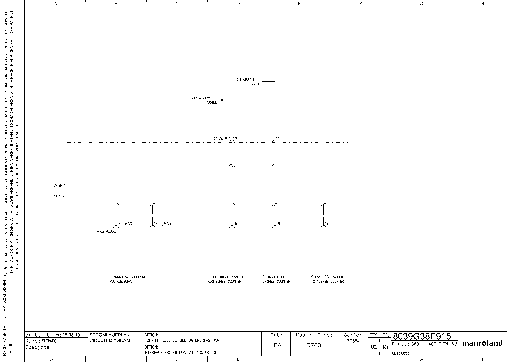

# +EA — Sheet 363 of 407 — OPTION:

**SCHNITTSTELLE, BETRIEBSDATENERFASSUNG**

> Part of the manroland **R700** printing press IEC/UL circuit diagrams.
> Drawing class: **Stromlaufplan / Circuit diagram** (DIN A3).
> Document `+EA` covers the **Printing unit** machine section.

## At a glance

| Field | Value |
|---|---|
| Document | `+EA`  (8039G38E915) |
| Sheet | **363** of 407 |
| Section (DE) | OPTION: |
| Section (EN) | SCHNITTSTELLE, BETRIEBSDATENERFASSUNG |
| Section type | CIRCUIT — Circuit diagram |
| Machine type | `R700` |
| Series | `7758` |
| Created | 25.03.10 |
| Replaces | — |
| Columns used | A, B, C, D, E |
| Path numbers | — |
| Labels on sheet | 25 |
| Cross-refs out | 3 |
| Cross-refs in | 10 |

**Previous:** [+EA sheet 362](SHEET_0362.md) · **Next:** [+EA sheet 364](SHEET_0364.md) · **Document TOC:** [_TOC.md](_TOC.md)  (+EA) · **Master TOC:** [all sheets](../_MASTER_TOC.md)

## Sheet image (300 DPI, exact vector render)



_Rendered directly from the PDF vector layer at 300 DPI (1-bit), no OCR and no resampling. Use it to confirm anything ambiguous in the text below._

## Cross-references on this sheet

Each entry is a wire leaving this sheet. The printed token is `/sheet.column`; the link resolves to that sheet inside the same document.

| Ref | Target sheet | Col | Path | Destination on target | Target section | From col |
|---|---|---|---|---|---|---|
| `/357.F` | [+EA sheet 357](SHEET_0357.md) | F | — | X1.A582:11 | OPTION: AUFLAGENZÄHLER / GUTBOGENZÄHLER | D |
| `/358.E` | [+EA sheet 358](SHEET_0358.md) | E | — | X1.A582:13 | OPTION: MAKULATURBOGENZÄHLER | C |
| `/362.A` | [+EA sheet 362](SHEET_0362.md) | A | — | — | OPTION: | A |

### Incoming references (sheets that point here)

Every other sheet that sends a wire to this one. `Back-ref` is the token printed on *that* sheet; `Path` is its line number.

| From sheet | Cols | Back-ref | Path | Refs | What continues there |
|---|---|---|---|---|---|
| [+EA#212](SHEET_0212.md) | A | `/212.A` | — | 2 | — |
| [+EA#230](SHEET_0230.md) | E | `/230.E` | — | 5 | — |
| [+EA#357](SHEET_0357.md) | F | `/357.F` | — | 1 | — |
| [+EA#358](SHEET_0358.md) | E | `/358.E` | — | 1 | — |
| [+EA#362](SHEET_0362.md) | B | `/362.B` | — | 1 | 11 |


## Devices on this sheet

| Tag | Class | Class meaning (IEC) | Col | Sub | Terminal | Sign |
|---|---|---|---|---|---|---|
| `A582` | A | Baugruppe / assembly, module, PC board | A | — | — | — |
| `X1.A582` | — | cross-device reference | D | — | — | — |
| `X1.A582:13` | — | cross-device reference | C | — | 13 | — |
| `X1.A582:11` | — | cross-device reference | D | — | 11 | — |
| `X2.A582` | — | cross-device reference | B | — | — | — |

## Potentials / nets

_No named potentials on this sheet._

## Wire-end annotations (grouped as printed)

A wire that continues elsewhere is annotated with a small cluster: the destination description, the path/line number `#NN`, and the `/sheet.column` cross reference. Each row below is one such cluster exactly as it is grouped on the drawing.

| Col | Y | Path | Cross-ref | Text on the wire |
|---|---|---|---|---|
| D | 181.7 | — | `/357.F` | `X1.A582:11` |
| C | 224.2 | — | `/358.E` | `X1.A582:13` |
| D | 317.8 | — | — | `X1.A582 13` |
| E | 317.8 | — | — | `11` |
| A | 426.9 | — | — | `A582` |
| A | 452.4 | — | `/362.A` | — |
| C | 516.2 | — | — | `14 18 15` |
| C | 516.2 | — | — | `(0V) (24V)` |
| E | 516.2 | — | — | `16 17` |
| B | 533.2 | — | — | `X2.A582` |
| B | 641.3 | — | — | `SPANNUNGSVERSORGUNG VOLTAGE SUPPLY` |
| D | 641.3 | — | — | `MAKULATURBOGENZÄHLER` |
| E | 641.3 | — | — | `GUTBOGENZÄHLER OK SHEET COUNTER` |
| E | 641.3 | — | — | `GESAMTBOGENZÄHLER TOTAL SHEET COUNTER` |
| D | 651.9 | — | — | `WASTE SHEET COUNTER` |


## Reconstructed tables

This sheet carries tabular content (pin map / terminal assignment / index). The grid below was rebuilt from the drawing's own rule lines, so each row is exactly one physical row of the table.

### Table 1 — 6 data rows × 12 columns (at x=204.1, y=0.0)

| X2.A582 | (0V) 14 SPANNUNGSVERSORGUNG VOLTAGE SUPPLY |  | X1.A582:13 /358.E X1.A582 (24V) 18 MAKULATURBOGENZÄHLER WASTE SHEET | X1.A582:11 /357.F 13 15 COUNTER | OK SHEET | 11 16 GUTBOGENZÄHLER COUNTER | TOTAL | 17 GESAMTBOGENZÄHLER SHEET COUNTER |  |  |  |
|---|---|---|---|---|---|---|---|---|---|---|---|
| `STROMLAUFPLAN` |  | `OPTION:` |  |  |  | `Ort:` | `Masch. Type:` |  | `Serie:` | `IEC (N)` | `8039G38E915` |
| `CIRCUIT` | `DIAGRAM` |  |  |  |  |  |  |  |  |  |  |
|  |  |  | `SCHNITTSTELLE, BETRIEBSDATENERFASSUNG` |  |  |  |  |  | `7758` | `1` |  |
|  |  |  |  |  |  | `+EA` | `R700` |  |  |  | `Blatt: DIN A3 363 407` |
|  |  | `OPTION:` |  |  |  |  |  |  |  | `UL (M)` |  |
|  |  |  | `INTERFACE, PRODUCTION DATA ACQUISITION` |  |  |  |  |  |  | `1` | `anstatt:` |


## Notes and free text on this sheet

| Text | Col | Y (pt) |
|---|---|---|
| `SPANNUNGSVERSORGUNG` | B | 641.27 |
| `VOLTAGE SUPPLY` | B | 651.89 |
| `(0V)` | B | 516.22 |
| `(24V)` | C | 516.22 |
| `MAKULATURBOGENZÄHLER` | D | 641.27 |
| `WASTE SHEET COUNTER` | D | 651.87 |
| `GUTBOGENZÄHLER` | E | 641.27 |
| `OK SHEET COUNTER` | E | 651.89 |
| `GESAMTBOGENZÄHLER` | E | 641.27 |
| `TOTAL SHEET COUNTER` | E | 651.9 |

## Complete label inventory (exact text from the drawing)

Every text object inside the drawing area of this sheet, in DIN reading order (column A→H, then top→bottom). This is the authoritative list: if a string is not here it is not printed on this sheet.

| Col | Y | X | Dir | Type | Text |
|---|---|---|---|---|---|
| A | 426.9 | 122.5 | → | device tag | `A582` |
| A | 452.4 | 124.7 | → | cross-reference | `/362.A` |
| B | 516.2 | 271.3 | → | number | `14` |
| B | 516.2 | 290.0 | → | text | `(0V)` |
| B | 533.2 | 225.6 | → | device ref | `X2.A582` |
| B | 641.3 | 254.8 | → | text | `SPANNUNGSVERSORGUNG` |
| B | 651.9 | 255.1 | → | text | `VOLTAGE SUPPLY` |
| C | 224.2 | 446.2 | → | device ref | `X1.A582:13` |
| C | 516.2 | 356.3 | → | number | `18` |
| C | 516.2 | 375.0 | → | text | `(24V)` |
| D | 181.7 | 546.8 | → | device ref | `X1.A582:11` |
| D | 191.6 | 579.1 | → | cross-reference | `/357.F` |
| D | 234.1 | 479.6 | → | cross-reference | `/358.E` |
| D | 317.8 | 489.3 | → | device ref | `X1.A582` |
| D | 317.8 | 540.6 | → | number | `13` |
| D | 516.2 | 540.6 | → | number | `15` |
| D | 641.3 | 481.3 | → | text | `MAKULATURBOGENZÄHLER` |
| D | 651.9 | 481.9 | → | text | `WASTE SHEET COUNTER` |
| E | 317.8 | 639.8 | → | number | `11` |
| E | 516.2 | 639.8 | → | number | `16` |
| E | 516.2 | 753.2 | → | number | `17` |
| E | 641.3 | 609.2 | → | text | `GUTBOGENZÄHLER` |
| E | 641.3 | 722.6 | → | text | `GESAMTBOGENZÄHLER` |
| E | 651.9 | 609.2 | → | text | `OK SHEET COUNTER` |
| E | 651.9 | 722.6 | → | text | `TOTAL SHEET COUNTER` |

## Reading-order text block

The same content as a plain block, grouped by DIN column — convenient to paste or to match against a visual description.

```text
=== Column A ===
 426.9  122.5  devtag       A582
 452.4  124.7  xref         /362.A
=== Column B ===
 516.2  271.3  numeric      14
 516.2  290.0  text         (0V)
 533.2  225.6  devref       X2.A582
 641.3  254.8  text         SPANNUNGSVERSORGUNG
 651.9  255.1  text         VOLTAGE SUPPLY
=== Column C ===
 224.2  446.2  devref       X1.A582:13
 516.2  356.3  numeric      18
 516.2  375.0  text         (24V)
=== Column D ===
 181.7  546.8  devref       X1.A582:11
 191.6  579.1  xref         /357.F
 234.1  479.6  xref         /358.E
 317.8  489.3  devref       X1.A582
 317.8  540.6  numeric      13
 516.2  540.6  numeric      15
 641.3  481.3  text         MAKULATURBOGENZÄHLER
 651.9  481.9  text         WASTE SHEET COUNTER
=== Column E ===
 317.8  639.8  numeric      11
 516.2  639.8  numeric      16
 516.2  753.2  numeric      17
 641.3  609.2  text         GUTBOGENZÄHLER
 641.3  722.6  text         GESAMTBOGENZÄHLER
 651.9  609.2  text         OK SHEET COUNTER
 651.9  722.6  text         TOTAL SHEET COUNTER
```

---
_Generated from the PDF vector text layer; no OCR. Source: `R700_7758_IEC_UL_EA_8039G38E915_p`, sheet 363._
