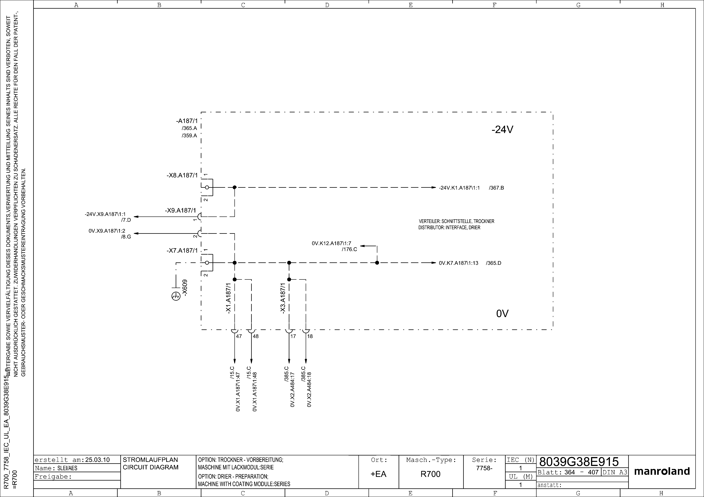

# +EA — Sheet 364 of 407 — OPTION: TROCKNER VORBEREITUNG;

**MASCHINE MIT LACKMODUL:SERIE**

> Part of the manroland **R700** printing press IEC/UL circuit diagrams.
> Drawing class: **Stromlaufplan / Circuit diagram** (DIN A3).
> Document `+EA` covers the **Printing unit** machine section.

## At a glance

| Field | Value |
|---|---|
| Document | `+EA`  (8039G38E915) |
| Sheet | **364** of 407 |
| Section (DE) | OPTION: TROCKNER VORBEREITUNG; |
| Section (EN) | MASCHINE MIT LACKMODUL:SERIE |
| Section type | CIRCUIT — Circuit diagram |
| Machine type | `R700` |
| Series | `7758` |
| Created | 25.03.10 |
| Replaces | — |
| Columns used | A, B, C, D, E, F |
| Path numbers | — |
| Labels on sheet | 41 |
| Cross-refs out | 11 |
| Cross-refs in | 17 |

**Previous:** [+EA sheet 363](SHEET_0363.md) · **Next:** [+EA sheet 365](SHEET_0365.md) · **Document TOC:** [_TOC.md](_TOC.md)  (+EA) · **Master TOC:** [all sheets](../_MASTER_TOC.md)

## Sheet image (300 DPI, exact vector render)



_Rendered directly from the PDF vector layer at 300 DPI (1-bit), no OCR and no resampling. Use it to confirm anything ambiguous in the text below._

## Cross-references on this sheet

Each entry is a wire leaving this sheet. The printed token is `/sheet.column`; the link resolves to that sheet inside the same document.

| Ref | Target sheet | Col | Path | Destination on target | Target section | From col |
|---|---|---|---|---|---|---|
| `/365.A` | [+EA sheet 365](SHEET_0365.md) | A | — | — | OPTION: TROCKNER VORBEREITUNG; | B |
| `/359.A` | [+EA sheet 359](SHEET_0359.md) | A | — | — | OPTION: | B |
| `/367.B` | [+EA sheet 367](SHEET_0367.md) | B | — | 24V.K1.A187\1:1 | OPTION: TROCKNER VORBEREITUNG; | F |
| `/7.D` | [+EA sheet 7](SHEET_0007.md) | D | — | 24V.X9.A187\1:1 | SPANNUNGSVERSORGUNG: 400V, 24V | A |
| `/8.G` | [+EA sheet 8](SHEET_0008.md) | G | — | 0V.X9.A187\1:2 | SPANNUNGSVERSORGUNG: 400V, 24V | A |
| `/176.C` | [+EA sheet 176](SHEET_0176.md) | C | — | 0V.K12.A187\1:7 | RESERVE | D |
| `/365.D` | [+EA sheet 365](SHEET_0365.md) | D | — | 0V.K7.A187\1:13 | OPTION: TROCKNER VORBEREITUNG; | F |
| `/15.C` | [+EA sheet 15](SHEET_0015.md) | C | — | — | SPANNUNGSVERSORGUNG: 400V, 24V | C |
| `/15.C` | [+EA sheet 15](SHEET_0015.md) | C | — | — | SPANNUNGSVERSORGUNG: 400V, 24V | C |
| `/385.C` | [+EA sheet 385](SHEET_0385.md) | C | — | — | OPTION: ZWISCHENTROCKNER VORBEREITUNG; | D |
| `/385.C` | [+EA sheet 385](SHEET_0385.md) | C | — | — | OPTION: ZWISCHENTROCKNER VORBEREITUNG; | D |

### Incoming references (sheets that point here)

Every other sheet that sends a wire to this one. `Back-ref` is the token printed on *that* sheet; `Path` is its line number.

| From sheet | Cols | Back-ref | Path | Refs | What continues there |
|---|---|---|---|---|---|
| [+EA#7](SHEET_0007.md) | D | `/7.D` | — | 1 | 24V.X9.A187\1:1 |
| [+EA#8](SHEET_0008.md) | G | `/8.G` | — | 1 | 0V.X9.A187\1:2 |
| [+EA#15](SHEET_0015.md) | C | `/15.C` | — | 2 | — |
| [+EA#176](SHEET_0176.md) | C | `/176.C` | — | 1 | — |
| [+EA#207](SHEET_0207.md) | B | `/207.B` | — | 2 | — |
| [+EA#231](SHEET_0231.md) | G | `/231.G` | — | 2 | — |
| [+EA#251](SHEET_0251.md) | C | `/251.C` | — | 2 | — |
| [+EA#359](SHEET_0359.md) | A | `/359.A` | — | 1 | — |
| [+EA#365](SHEET_0365.md) | A, E | `/365.A`, `/365.E` | — | 2 | 0V.K691:A1 0V.K692:A1 0V.K7.A187\1:13 |
| [+EA#367](SHEET_0367.md) | B | `/367.B` | — | 1 | — |
| [+EA#385](SHEET_0385.md) | C | `/385.C` | — | 2 | — |


## Devices on this sheet

| Tag | Class | Class meaning (IEC) | Col | Sub | Terminal | Sign |
|---|---|---|---|---|---|---|
| `A187/1` | A | Baugruppe / assembly, module, PC board | B | 1 | — | — |
| `X609` | X | Klemme / terminal, plug connector | B | — | — | — |

## Potentials / nets

| Potential | Count | Columns | Attached devices | Terminals |
|---|---|---|---|---|
| `0V` | 8 | A, C, D, F | `A187\1`, `A484`, `K12`, `K7`, `X1`, `X2`, `X9` | `13`, `17`, `18`, `2`, `47`, `48`, `7` |
| `24V` | 3 | A, F | `A187\1`, `K1`, `X9` | `1` |


A potential such as `L24+/4` or `M24+` is a named supply/return rail; every place it appears on this sheet is electrically common.

## Wire-end annotations (grouped as printed)

A wire that continues elsewhere is annotated with a small cluster: the destination description, the path/line number `#NN`, and the `/sheet.column` cross reference. Each row below is one such cluster exactly as it is grouped on the drawing.

| Col | Y | Path | Cross-ref | Text on the wire |
|---|---|---|---|---|
| B | 200.2 | — | — | `A187/1` |
| F | 211.8 | — | — | `24V` |
| B | 213.2 | — | `/365.A`, `/359.A` | — |
| B | 292.3 | — | — | `X8.A187/1` |
| C | 293.4 | — | — | `1 2` |
| F | 314.2 | — | `/367.B` | `24V.K1.A187\1:1` |
| B | 351.8 | — | — | `X9.A187/1` |
| A | 358.9 | — | `/7.D` | `24V.X9.A187\1:1` |
| B | 370.2 | — | — | `1` |
| F | 372.0 | — | — | `DISTRIBUTOR: INTERFACE, DRIER VERTEILER: SCHNITTSTELLE, TROCKNER` |
| A | 387.2 | — | `/8.G` | `0V.X9.A187\1:2` |
| B | 398.0 | — | — | `2` |
| D | 408.5 | — | `/176.C` | `0V.K12.A187\1:7` |
| B | 419.8 | — | — | `X7.A187/1` |
| C | 420.9 | — | — | `1 2` |
| F | 441.8 | — | `/365.D` | `0V.K7.A187\1:13` |
| B | 473.2 | — | — | `X609` |
| C | 478.5 | — | — | `X1.A187/1` |
| C | 478.5 | — | — | `X3.A187/1` |
| F | 523.6 | — | — | `0V` |
| C | 565.8 | — | — | `47` |
| C | 565.8 | — | — | `48` |
| D | 565.8 | — | — | `17` |
| D | 565.8 | — | — | `18` |
| C | 620.5 | — | `/15.C` | — |
| C | 620.5 | — | `/15.C` | — |
| D | 620.5 | — | `/385.C` | — |
| D | 620.5 | — | `/385.C` | — |
| C | 630.4 | — | — | `0V.X1.A187\1:47` |
| C | 630.4 | — | — | `0V.X1.A187\1:48` |
| D | 630.4 | — | — | `0V.X2.A484:17` |
| D | 630.4 | — | — | `0V.X2.A484:18` |


## Reconstructed tables

This sheet carries tabular content (pin map / terminal assignment / index). The grid below was rebuilt from the drawing's own rule lines, so each row is exactly one physical row of the table.

### Table 1 — 3 data rows × 1 columns (at x=297.6, y=317.5)

| C1 |
|---|
| `2 X9.A187/1` |
| `1` |
| `2 X7.A187/1 1` |


## Notes and free text on this sheet

| Text | Col | Y (pt) |
|---|---|---|
| `VERTEILER: SCHNITTSTELLE, TROCKNER` | F | 371.97 |
| `DISTRIBUTOR: INTERFACE, DRIER` | E | 382.6 |
| `X1.A187/1` | C | 478.49 |
| `X9.A187/1` | B | 351.81 |
| `X3.A187/1` | C | 478.49 |
| `X8.A187/1` | B | 292.28 |
| `X7.A187/1` | B | 419.84 |

## Complete label inventory (exact text from the drawing)

Every text object inside the drawing area of this sheet, in DIN reading order (column A→H, then top→bottom). This is the authoritative list: if a string is not here it is not printed on this sheet.

| Col | Y | X | Dir | Type | Text |
|---|---|---|---|---|---|
| A | 358.9 | 143.4 | → | potential | `24V.X9.A187\1:1` |
| A | 387.2 | 150.0 | → | potential | `0V.X9.A187\1:2` |
| B | 200.2 | 297.9 | → | device tag | `A187/1` |
| B | 213.2 | 307.6 | → | cross-reference | `/365.A` |
| B | 225.6 | 307.6 | → | cross-reference | `/359.A` |
| B | 292.3 | 282.0 | → | text | `X8.A187/1` |
| B | 351.8 | 279.1 | → | text | `X9.A187/1` |
| B | 368.8 | 205.2 | → | cross-reference | `/7.D` |
| B | 370.2 | 326.3 | ↕ | number | `1` |
| B | 397.1 | 204.9 | → | cross-reference | `/8.G` |
| B | 398.0 | 326.3 | ↕ | number | `2` |
| B | 419.8 | 282.0 | → | text | `X7.A187/1` |
| B | 473.2 | 307.9 | ↕ | device tag | `X609` |
| C | 293.4 | 344.0 | ↕ | number | `1` |
| C | 336.2 | 344.0 | ↕ | number | `2` |
| C | 420.9 | 344.0 | ↕ | number | `1` |
| C | 463.7 | 344.0 | ↕ | number | `2` |
| C | 478.5 | 381.6 | ↕ | text | `X1.A187/1` |
| C | 478.5 | 473.7 | ↕ | text | `X3.A187/1` |
| C | 565.8 | 399.4 | → | number | `47` |
| C | 565.8 | 427.7 | → | number | `48` |
| C | 620.5 | 388.6 | ↕ | cross-reference | `/15.C` |
| C | 620.5 | 417.0 | ↕ | cross-reference | `/15.C` |
| C | 630.4 | 398.5 | ↕ | potential | `0V.X1.A187\1:47` |
| C | 630.4 | 426.9 | ↕ | potential | `0V.X1.A187\1:48` |
| D | 408.5 | 527.5 | → | potential | `0V.K12.A187\1:7` |
| D | 418.4 | 578.3 | → | cross-reference | `/176.C` |
| D | 565.8 | 491.0 | → | number | `17` |
| D | 565.8 | 519.3 | → | number | `18` |
| D | 620.5 | 480.8 | ↕ | cross-reference | `/385.C` |
| D | 620.5 | 509.1 | ↕ | cross-reference | `/385.C` |
| D | 630.4 | 490.7 | ↕ | potential | `0V.X2.A484:17` |
| D | 630.4 | 519.0 | ↕ | potential | `0V.X2.A484:18` |
| E | 382.6 | 707.8 | → | text | `DISTRIBUTOR: INTERFACE, DRIER` |
| F | 211.8 | 831.5 | → | potential | `24V` |
| F | 314.2 | 742.4 | → | potential | `24V.K1.A187\1:1` |
| F | 314.2 | 827.0 | → | cross-reference | `/367.B` |
| F | 372.0 | 708.7 | → | text | `VERTEILER: SCHNITTSTELLE, TROCKNER` |
| F | 441.8 | 742.4 | → | potential | `0V.K7.A187\1:13` |
| F | 441.8 | 822.0 | → | cross-reference | `/365.D` |
| F | 523.6 | 839.2 | → | potential | `0V` |

## Reading-order text block

The same content as a plain block, grouped by DIN column — convenient to paste or to match against a visual description.

```text
=== Column A ===
 358.9  143.4  net          24V.X9.A187\1:1
 387.2  150.0  net          0V.X9.A187\1:2
=== Column B ===
 200.2  297.9  devtag       A187/1
 213.2  307.6  xref         /365.A
 225.6  307.6  xref         /359.A
 292.3  282.0  text         X8.A187/1
 351.8  279.1  text         X9.A187/1
 368.8  205.2  xref         /7.D
 370.2  326.3  numeric      1
 397.1  204.9  xref         /8.G
 398.0  326.3  numeric      2
 419.8  282.0  text         X7.A187/1
 473.2  307.9  devtag       X609
=== Column C ===
 293.4  344.0  numeric      1
 336.2  344.0  numeric      2
 420.9  344.0  numeric      1
 463.7  344.0  numeric      2
 478.5  381.6  text         X1.A187/1
 478.5  473.7  text         X3.A187/1
 565.8  399.4  numeric      47
 565.8  427.7  numeric      48
 620.5  388.6  xref         /15.C
 620.5  417.0  xref         /15.C
 630.4  398.5  net          0V.X1.A187\1:47
 630.4  426.9  net          0V.X1.A187\1:48
=== Column D ===
 408.5  527.5  net          0V.K12.A187\1:7
 418.4  578.3  xref         /176.C
 565.8  491.0  numeric      17
 565.8  519.3  numeric      18
 620.5  480.8  xref         /385.C
 620.5  509.1  xref         /385.C
 630.4  490.7  net          0V.X2.A484:17
 630.4  519.0  net          0V.X2.A484:18
=== Column E ===
 382.6  707.8  text         DISTRIBUTOR: INTERFACE, DRIER
=== Column F ===
 211.8  831.5  net          24V
 314.2  742.4  net          24V.K1.A187\1:1
 314.2  827.0  xref         /367.B
 372.0  708.7  text         VERTEILER: SCHNITTSTELLE, TROCKNER
 441.8  742.4  net          0V.K7.A187\1:13
 441.8  822.0  xref         /365.D
 523.6  839.2  net          0V
```

---
_Generated from the PDF vector text layer; no OCR. Source: `R700_7758_IEC_UL_EA_8039G38E915_p`, sheet 364._
