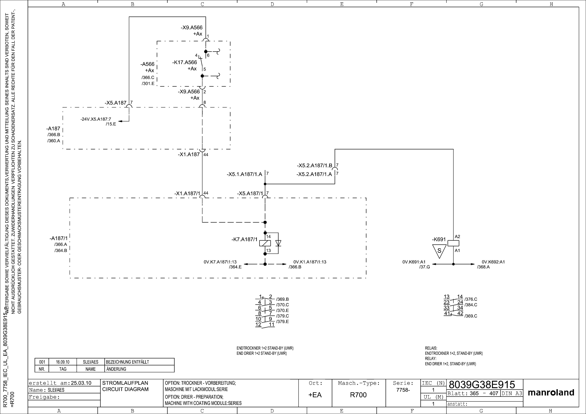

# +EA — Sheet 365 of 407 — OPTION: TROCKNER VORBEREITUNG;

**MASCHINE MIT LACKMODUL:SERIE**

> Part of the manroland **R700** printing press IEC/UL circuit diagrams.
> Drawing class: **Stromlaufplan / Circuit diagram** (DIN A3).
> Document `+EA` covers the **Printing unit** machine section.

## At a glance

| Field | Value |
|---|---|
| Document | `+EA`  (8039G38E915) |
| Sheet | **365** of 407 |
| Section (DE) | OPTION: TROCKNER VORBEREITUNG; |
| Section (EN) | MASCHINE MIT LACKMODUL:SERIE |
| Section type | CIRCUIT — Circuit diagram |
| Machine type | `R700` |
| Series | `7758` |
| Created | 25.03.10 |
| Replaces | — |
| Columns used | A, B, C, D, E, F, G |
| Path numbers | — |
| Labels on sheet | 95 |
| Cross-refs out | 19 |
| Cross-refs in | 29 |

**Previous:** [+EA sheet 364](SHEET_0364.md) · **Next:** [+EA sheet 366](SHEET_0366.md) · **Document TOC:** [_TOC.md](_TOC.md)  (+EA) · **Master TOC:** [all sheets](../_MASTER_TOC.md)

## Sheet image (300 DPI, exact vector render)



_Rendered directly from the PDF vector layer at 300 DPI (1-bit), no OCR and no resampling. Use it to confirm anything ambiguous in the text below._

## Cross-references on this sheet

Each entry is a wire leaving this sheet. The printed token is `/sheet.column`; the link resolves to that sheet inside the same document.

| Ref | Target sheet | Col | Path | Destination on target | Target section | From col |
|---|---|---|---|---|---|---|
| `/366.C` | [+EA sheet 366](SHEET_0366.md) | C | — | — | OPTION: TROCKNER VORBEREITUNG; | B |
| `/301.E` | [+EA sheet 301](SHEET_0301.md) | E | — | — | OPTION: ZWISCHENSTAPEL / | B |
| `/15.E` | [+EA sheet 15](SHEET_0015.md) | E | — | 24V.X5.A187:7 | SPANNUNGSVERSORGUNG: 400V, 24V | B |
| `/366.B` | [+EA sheet 366](SHEET_0366.md) | B | — | — | OPTION: TROCKNER VORBEREITUNG; | A |
| `/360.A` | [+EA sheet 360](SHEET_0360.md) | A | — | — | OPTION: | A |
| `/366.A` | [+EA sheet 366](SHEET_0366.md) | A | — | — | OPTION: TROCKNER VORBEREITUNG; | A |
| `/364.B` | [+EA sheet 364](SHEET_0364.md) | B | — | — | OPTION: TROCKNER VORBEREITUNG; | A |
| `/364.E` | [+EA sheet 364](SHEET_0364.md) | E | — | 0V.K691:A1 0V.K692:A1 0V.K7.A187\1:13 | OPTION: TROCKNER VORBEREITUNG; | E |
| `/366.B` | [+EA sheet 366](SHEET_0366.md) | B | — | 0V.K691:A1 0V.K692:A1 0V.K7.A187\1:13 | OPTION: TROCKNER VORBEREITUNG; | E |
| `/37.G` | [+EA sheet 37](SHEET_0037.md) | G | — | 0V.K691:A1 0V.K692:A1 0V.K7.A187\1:13 | BUSVERBINDUNGEN: NOT AUS | E |
| `/368.A` | [+EA sheet 368](SHEET_0368.md) | A | — | — | OPTION: ENDTROCKNER 1 VORBEREITUNG; | G |
| `/369.B` | [+EA sheet 369](SHEET_0369.md) | B | — | — | OPTION: ENDTROCKNER 1 VORBEREITUNG; | D |
| `/370.C` | [+EA sheet 370](SHEET_0370.md) | C | — | — | OPTION: ENDTROCKNER 1 VORBEREITUNG; | D |
| `/370.E` | [+EA sheet 370](SHEET_0370.md) | E | — | — | OPTION: ENDTROCKNER 1 VORBEREITUNG; | D |
| `/379.C` | [+EA sheet 379](SHEET_0379.md) | C | — | — | OPTION: ENDTROCKNER 2 VORBEREITUNG | D |
| `/379.E` | [+EA sheet 379](SHEET_0379.md) | E | — | — | OPTION: ENDTROCKNER 2 VORBEREITUNG | D |
| `/376.C` | [+EA sheet 376](SHEET_0376.md) | C | — | — | OPTION: ENDTROCKNER 1 VORBEREITUNG; | G |
| `/384.C` | [+EA sheet 384](SHEET_0384.md) | C | — | — | OPTION: ENDTROCKNER 2 VORBEREITUNG | G |
| `/369.C` | [+EA sheet 369](SHEET_0369.md) | C | — | — | OPTION: ENDTROCKNER 1 VORBEREITUNG; | G |

### Incoming references (sheets that point here)

Every other sheet that sends a wire to this one. `Back-ref` is the token printed on *that* sheet; `Path` is its line number.

| From sheet | Cols | Back-ref | Path | Refs | What continues there |
|---|---|---|---|---|---|
| [+EA#15](SHEET_0015.md) | F | `/15.F` | — | 1 | 24V.X5.A187:7 |
| [+EA#37](SHEET_0037.md) | D | `/37.D` | — | 1 | 0V.K458:A1 |
| [+EA#206](SHEET_0206.md) | H | `/206.H` | — | 1 | — |
| [+EA#207](SHEET_0207.md) | B | `/207.B` | — | 1 | — |
| [+EA#239](SHEET_0239.md) | B, C, E, G, H | `/239.B`, `/239.C`, `/239.E`, `/239.G`, `/239.H` | — | 6 | — |
| [+EA#250](SHEET_0250.md) | G | `/250.G` | — | 2 | — |
| [+EA#301](SHEET_0301.md) | E | `/301.E` | — | 1 | — |
| [+EA#360](SHEET_0360.md) | A | `/360.A` | — | 1 | — |
| [+EA#364](SHEET_0364.md) | B, F | `/364.B`, `/364.F` | — | 2 | 0V.K7.A187\1:13 |
| [+EA#366](SHEET_0366.md) | A, B, C, E | `/366.A`, `/366.B`, `/366.C`, `/366.E` | — | 4 | 0V.K8.A187\1:7 0V.K1.A187\1:13 |
| [+EA#368](SHEET_0368.md) | A | `/368.A` | — | 1 | 0V.K692:A1 |
| [+EA#369](SHEET_0369.md) | B, C | `/369.B`, `/369.C` | — | 2 | — |
| [+EA#370](SHEET_0370.md) | C, D | `/370.C`, `/370.D` | — | 2 | — |
| [+EA#376](SHEET_0376.md) | C | `/376.C` | — | 1 | — |
| [+EA#379](SHEET_0379.md) | C, D | `/379.C`, `/379.D` | — | 2 | — |
| [+EA#384](SHEET_0384.md) | C | `/384.C` | — | 1 | — |


## Devices on this sheet

| Tag | Class | Class meaning (IEC) | Col | Sub | Terminal | Sign |
|---|---|---|---|---|---|---|
| `A187/1` | A | Baugruppe / assembly, module, PC board | A | 1 | — | — |
| `A187` | A | Baugruppe / assembly, module, PC board | A | — | — | — |
| `A566` | A | Baugruppe / assembly, module, PC board | B | — | — | — |
| `A2` | A | Baugruppe / assembly, module, PC board | G | — | — | — |
| `A1` | A | Baugruppe / assembly, module, PC board | G | — | — | — |
| `K691` | K | Relais / relay, contactor | F | — | — | — |
| `X1.A187` | — | cross-device reference | C | — | — | — |
| `K17.A566` | — | cross-device reference | C | — | — | — |
| `X9.A566` | — | cross-device reference | C | — | — | — |
| `X5.A187` | — | cross-device reference | B | — | — | — |
| `X9.A566` | — | cross-device reference | C | — | — | — |
| `NR.` | — | cross-device reference | A | — | — | — |
| `16.09.10` | — | cross-device reference | A | — | — | — |

## Potentials / nets

| Potential | Count | Columns | Attached devices | Terminals |
|---|---|---|---|---|
| `0V` | 4 | C, E, F, G | `A187\1`, `K1`, `K691`, `K692`, `K7` | `13`, `A1` |
| `24V` | 1 | A | `A187`, `X5` | `7` |


A potential such as `L24+/4` or `M24+` is a named supply/return rail; every place it appears on this sheet is electrically common.

## Wire-end annotations (grouped as printed)

A wire that continues elsewhere is annotated with a small cluster: the destination description, the path/line number `#NN`, and the `/sheet.column` cross reference. Each row below is one such cluster exactly as it is grouped on the drawing.

| Col | Y | Path | Cross-ref | Text on the wire |
|---|---|---|---|---|
| C | 51.3 | — | — | `X9.A566` |
| C | 64.1 | — | — | `+Ax` |
| C | 69.8 | — | — | `1` |
| C | 108.8 | — | — | `K17.A566 6` |
| C | 108.8 | — | — | `4` |
| B | 125.7 | — | — | `A566` |
| C | 135.0 | — | — | `+Ax` |
| C | 137.1 | — | — | `5` |
| B | 138.5 | — | — | `+Ax` |
| B | 153.7 | — | `/366.C` | — |
| B | 166.1 | — | `/301.E` | — |
| C | 181.7 | — | — | `X9.A566 2` |
| B | 194.5 | — | — | `X5.A187 7 +Ax` |
| C | 204.4 | — | — | `8` |
| B | 238.4 | — | `/15.E` | `24V.X5.A187:7` |
| A | 256.8 | — | — | `A187` |
| A | 269.9 | — | `/366.B`, `/360.A` | — |
| C | 309.3 | — | — | `X1.A187 44` |
| E | 332.0 | — | — | `X5.2.A187/1.B 7` |
| D | 349.0 | — | — | `X5.1.A187/1.A 7 X5.2.A187/1.A 7` |
| C | 388.7 | — | — | `X1.A187/1 44 X5.A187/1 7` |
| D | 477.2 | — | — | `14` |
| G | 477.2 | — | — | `A2` |
| A | 480.1 | — | — | `A187/1` |
| D | 482.2 | — | — | `K7.A187/1` |
| F | 482.2 | — | — | `K691` |
| A | 493.1 | — | `/366.A`, `/364.B` | — |
| F | 504.2 | — | — | `S` |
| D | 505.6 | — | — | `13` |
| G | 505.6 | — | — | `A1` |
| E | 528.9 | — | `/364.E`, `/366.B`, `/37.G` | `0V.K7.A187\1:13 0V.K691:A1 0V.K692:A1` |
| E | 528.9 | — | — | `0V.K1.A187\1:13` |
| G | 538.9 | — | `/368.A` | — |
| D | 598.4 | — | — | `1 2` |
| G | 598.4 | — | — | `13 14` |
| D | 604.8 | — | `/369.B`, `/370.C`, `/370.E`, `/379.C`, `/379.E` | — |
| G | 604.8 | — | `/376.C`, `/384.C` | — |
| D | 609.7 | — | — | `4 6 3 5` |
| G | 609.7 | — | — | `23 33 34 24` |
| D | 632.4 | — | — | `8` |
| D | 632.4 | — | — | `7` |
| G | 632.4 | — | — | `41 42` |
| G | 638.8 | — | `/369.C` | — |
| D | 643.7 | — | — | `10 12 11 9` |
| D | 705.0 | — | — | `NR. TAG NAME ÄNDERUNG RELAIS: ENDTROCKNER 1+2, STAND BY (UWR) RELAY: END DRIER 1+2, STAND BY (UWR)` |
| D | 705.0 | — | — | `ENDTROCKNER 1+2 STAND BY (UWR) END DRIER 1+2 STAND BY (UWR)` |
| A | 733.0 | — | — | `001 16.09.10 SLEI/AES BEZEICHNUNG ENTFÄLLT` |


## Reconstructed tables

This sheet carries tabular content (pin map / terminal assignment / index). The grid below was rebuilt from the drawing's own rule lines, so each row is exactly one physical row of the table.

### Table 1 — 5 data rows × 14 columns (at x=204.1, y=0.0) — **X5.A187 /15.E A566 +Ax /366.C /301.E 7 X9.A566 +Ax 4 K17.A566 +Ax X9.A566 +Ax 5 2 8 1 6 X1.A187 44 X5.1.A187/1.A 7 X5.2.A187/1.B X5.2.A187/1.A 7 7 X1.A187/1 X5.A187/1 44 K7.A187/1 0V.K7.A187\1:13 14 13 0V.K1.A187\1:13 0V.K691:A1 K691 S A2 A1 0V.K692:A1 BEZEICHNUNG ÄNDERUNG ENTFÄLLT /364.E 1 4 6 8 10 12 ENDTROCKNER 1+2 END DRIER 1+2 2 3 5 7 9 11 STAND BY STAND BY /366.B /369.B /370.C /370.E /379.C /379.E (UWR) (UWR) /37.G RELAIS: ENDTROCKNER RELAY: END DRIER 1+2, 13 23 33 41 1+2, /368.A 14 /376.C 24 /384.C 34 42 /369.C STAND BY (UWR) STAND BY (UWR)**

| STROMLAUFPLAN |  | OPTION: TROCKNER |  | VORBEREITUNG; |  |  | Ort: |  | Masch. Type: | Serie: | IEC (N) |  | 8039G38E915 |
|---|---|---|---|---|---|---|---|---|---|---|---|---|---|
| `CIRCUIT` | `DIAGRAM` |  |  |  |  |  |  |  |  |  |  |  |  |
|  |  | `MASCHINE MIT` |  | `LACKMODUL:SERIE` |  |  |  |  |  | `7758` | `1` |  |  |
|  |  |  |  |  |  |  | `+EA` |  | `R700` |  |  |  | `Blatt: DIN A3 365 407` |
|  |  | `OPTION: DRIER` |  | `PREPARATION;` |  |  |  |  |  |  | `UL (M)` |  |  |
|  |  | `MACHINE WITH COATING` |  | `MODULE:SERIES` |  |  |  |  |  |  | `1` |  | `anstatt:` |


## Notes and free text on this sheet

| Text | Col | Y (pt) |
|---|---|---|
| `X1.A187/1` | C | 388.66 |
| `X5.A187/1` | D | 388.66 |
| `K7.A187/1` | D | 482.2 |
| `ENDTROCKNER 1+2 STAND BY (UWR)` | D | 705.04 |
| `END DRIER 1+2 STAND BY (UWR)` | D | 715.66 |
| `+Ax` | C | 134.98 |
| `+Ax` | B | 138.53 |
| `X5.1.A187/1.A` | D | 349.69 |
| `X5.2.A187/1.A` | E | 349.69 |
| `X5.2.A187/1.B` | E | 331.98 |
| `RELAIS:` | F | 704.96 |
| `ENDTROCKNER 1+2, STAND BY (UWR)` | G | 715.67 |
| `RELAY:` | F | 726.23 |
| `END DRIER 1+2, STAND BY (UWR)` | G | 736.93 |
| `TAG` | A | 747.27 |
| `NAME` | A | 747.25 |
| `ÄNDERUNG` | B | 747.31 |
| `SLEI/AES` | A | 733.13 |
| `BEZEICHNUNG ENTFÄLLT` | B | 733.14 |
| `S` | F | 504.24 |

## Complete label inventory (exact text from the drawing)

Every text object inside the drawing area of this sheet, in DIN reading order (column A→H, then top→bottom). This is the authoritative list: if a string is not here it is not printed on this sheet.

| Col | Y | X | Dir | Type | Text |
|---|---|---|---|---|---|
| A | 238.4 | 163.6 | → | potential | `24V.X5.A187:7` |
| A | 256.8 | 94.1 | → | device tag | `A187` |
| A | 269.9 | 96.7 | → | cross-reference | `/366.B` |
| A | 282.3 | 96.4 | → | cross-reference | `/360.A` |
| A | 480.1 | 100.9 | → | device tag | `A187/1` |
| A | 493.1 | 110.6 | → | cross-reference | `/366.A` |
| A | 505.5 | 110.8 | → | cross-reference | `/364.B` |
| A | 733.0 | 79.8 | → | number | `001` |
| A | 733.1 | 113.6 | → | device ref | `16.09.10` |
| A | 733.1 | 168.7 | → | text | `SLEI/AES` |
| A | 747.1 | 78.9 | → | device ref | `NR.` |
| A | 747.3 | 120.4 | → | text | `TAG` |
| A | 747.3 | 173.8 | → | text | `NAME` |
| B | 125.7 | 285.4 | → | device tag | `A566` |
| B | 138.5 | 294.8 | → | text | `+Ax` |
| B | 153.7 | 287.7 | → | cross-reference | `/366.C` |
| B | 166.1 | 288.3 | → | cross-reference | `/301.E` |
| B | 204.4 | 212.9 | → | device ref | `X5.A187` |
| B | 204.4 | 264.8 | → | number | `7` |
| B | 248.3 | 215.1 | → | cross-reference | `/15.E` |
| B | 733.1 | 215.3 | → | text | `BEZEICHNUNG ENTFÄLLT` |
| B | 747.3 | 216.4 | → | text | `ÄNDERUNG` |
| C | 51.3 | 367.4 | → | device ref | `X9.A566` |
| C | 64.1 | 392.6 | → | text | `+Ax` |
| C | 69.8 | 420.1 | → | number | `1` |
| C | 108.7 | 396.6 | → | number | `4` |
| C | 108.7 | 420.7 | → | number | `6` |
| C | 122.2 | 350.1 | → | device ref | `K17.A566` |
| C | 135.0 | 381.3 | → | text | `+Ax` |
| C | 137.1 | 413.6 | → | number | `5` |
| C | 181.7 | 361.7 | → | device ref | `X9.A566` |
| C | 183.2 | 413.6 | → | number | `2` |
| C | 194.5 | 386.9 | → | text | `+Ax` |
| C | 204.4 | 413.6 | → | number | `8` |
| C | 309.3 | 361.7 | → | device ref | `X1.A187` |
| C | 310.7 | 413.6 | → | number | `44` |
| C | 388.7 | 354.3 | → | text | `X1.A187/1` |
| C | 388.7 | 413.6 | → | number | `44` |
| C | 528.9 | 414.1 | → | potential | `0V.K7.A187\1:13` |
| C | 538.8 | 465.4 | → | cross-reference | `/364.E` |
| D | 349.0 | 541.1 | → | number | `7` |
| D | 349.7 | 460.9 | → | text | `X5.1.A187/1.A` |
| D | 388.7 | 481.9 | → | text | `X5.A187/1` |
| D | 388.7 | 541.1 | → | number | `7` |
| D | 477.3 | 540.6 | → | number | `14` |
| D | 482.2 | 470.6 | → | text | `K7.A187/1` |
| D | 505.6 | 540.6 | → | number | `13` |
| D | 538.8 | 586.8 | → | cross-reference | `/366.B` |
| D | 598.4 | 526.1 | → | number | `1` |
| D | 598.4 | 546.8 | → | number | `2` |
| D | 604.8 | 561.3 | → | cross-reference | `/369.B` |
| D | 609.7 | 524.7 | → | number | `4` |
| D | 609.7 | 546.5 | → | number | `3` |
| D | 616.1 | 561.3 | → | cross-reference | `/370.C` |
| D | 621.1 | 524.7 | → | number | `6` |
| D | 621.1 | 546.5 | → | number | `5` |
| D | 627.4 | 561.3 | → | cross-reference | `/370.E` |
| D | 632.4 | 524.7 | → | number | `8` |
| D | 632.4 | 546.8 | → | number | `7` |
| D | 638.8 | 561.3 | → | cross-reference | `/379.C` |
| D | 643.7 | 518.7 | → | number | `10` |
| D | 643.7 | 546.5 | → | number | `9` |
| D | 650.1 | 561.3 | → | cross-reference | `/379.E` |
| D | 655.1 | 518.7 | → | number | `12` |
| D | 655.1 | 546.0 | → | number | `11` |
| D | 705.0 | 481.0 | → | text | `ENDTROCKNER 1+2 STAND BY (UWR)` |
| D | 715.7 | 481.0 | → | text | `END DRIER 1+2 STAND BY (UWR)` |
| E | 332.0 | 603.5 | → | text | `X5.2.A187/1.B` |
| E | 332.0 | 682.9 | → | number | `7` |
| E | 349.0 | 682.9 | → | number | `7` |
| E | 349.7 | 602.6 | → | text | `X5.2.A187/1.A` |
| E | 528.9 | 596.4 | → | potential | `0V.K1.A187\1:13` |
| F | 482.2 | 877.9 | → | device tag | `K691` |
| F | 504.2 | 888.8 | → | text | `S` |
| F | 528.9 | 817.8 | → | potential | `0V.K691:A1` |
| F | 538.9 | 852.1 | → | cross-reference | `/37.G` |
| F | 705.0 | 863.7 | → | text | `RELAIS:` |
| F | 726.2 | 863.7 | → | text | `RELAY:` |
| G | 477.2 | 924.1 | → | device tag | `A2` |
| G | 505.5 | 924.1 | → | device tag | `A1` |
| G | 528.9 | 979.1 | → | potential | `0V.K692:A1` |
| G | 538.8 | 969.4 | → | cross-reference | `/368.A` |
| G | 598.4 | 901.4 | → | number | `13` |
| G | 598.4 | 928.6 | → | number | `14` |
| G | 604.8 | 943.9 | → | cross-reference | `/376.C` |
| G | 609.7 | 901.4 | → | number | `23` |
| G | 609.7 | 929.5 | → | number | `24` |
| G | 616.1 | 943.9 | → | cross-reference | `/384.C` |
| G | 621.1 | 901.4 | → | number | `33` |
| G | 621.1 | 929.2 | → | number | `34` |
| G | 632.4 | 902.8 | → | number | `41` |
| G | 632.4 | 929.5 | → | number | `42` |
| G | 638.8 | 943.9 | → | cross-reference | `/369.C` |
| G | 715.7 | 863.7 | → | text | `ENDTROCKNER 1+2, STAND BY (UWR)` |
| G | 736.9 | 863.7 | → | text | `END DRIER 1+2, STAND BY (UWR)` |

## Reading-order text block

The same content as a plain block, grouped by DIN column — convenient to paste or to match against a visual description.

```text
=== Column A ===
 238.4  163.6  net          24V.X5.A187:7
 256.8   94.1  devtag       A187
 269.9   96.7  xref         /366.B
 282.3   96.4  xref         /360.A
 480.1  100.9  devtag       A187/1
 493.1  110.6  xref         /366.A
 505.5  110.8  xref         /364.B
 733.0   79.8  numeric      001
 733.1  113.6  devref       16.09.10
 733.1  168.7  text         SLEI/AES
 747.1   78.9  devref       NR.
 747.3  120.4  text         TAG
 747.3  173.8  text         NAME
=== Column B ===
 125.7  285.4  devtag       A566
 138.5  294.8  text         +Ax
 153.7  287.7  xref         /366.C
 166.1  288.3  xref         /301.E
 204.4  212.9  devref       X5.A187
 204.4  264.8  numeric      7
 248.3  215.1  xref         /15.E
 733.1  215.3  text         BEZEICHNUNG ENTFÄLLT
 747.3  216.4  text         ÄNDERUNG
=== Column C ===
  51.3  367.4  devref       X9.A566
  64.1  392.6  text         +Ax
  69.8  420.1  numeric      1
 108.7  396.6  numeric      4
 108.7  420.7  numeric      6
 122.2  350.1  devref       K17.A566
 135.0  381.3  text         +Ax
 137.1  413.6  numeric      5
 181.7  361.7  devref       X9.A566
 183.2  413.6  numeric      2
 194.5  386.9  text         +Ax
 204.4  413.6  numeric      8
 309.3  361.7  devref       X1.A187
 310.7  413.6  numeric      44
 388.7  354.3  text         X1.A187/1
 388.7  413.6  numeric      44
 528.9  414.1  net          0V.K7.A187\1:13
 538.8  465.4  xref         /364.E
=== Column D ===
 349.0  541.1  numeric      7
 349.7  460.9  text         X5.1.A187/1.A
 388.7  481.9  text         X5.A187/1
 388.7  541.1  numeric      7
 477.3  540.6  numeric      14
 482.2  470.6  text         K7.A187/1
 505.6  540.6  numeric      13
 538.8  586.8  xref         /366.B
 598.4  526.1  numeric      1
 598.4  546.8  numeric      2
 604.8  561.3  xref         /369.B
 609.7  524.7  numeric      4
 609.7  546.5  numeric      3
 616.1  561.3  xref         /370.C
 621.1  524.7  numeric      6
 621.1  546.5  numeric      5
 627.4  561.3  xref         /370.E
 632.4  524.7  numeric      8
 632.4  546.8  numeric      7
 638.8  561.3  xref         /379.C
 643.7  518.7  numeric      10
 643.7  546.5  numeric      9
 650.1  561.3  xref         /379.E
 655.1  518.7  numeric      12
 655.1  546.0  numeric      11
 705.0  481.0  text         ENDTROCKNER 1+2 STAND BY (UWR)
 715.7  481.0  text         END DRIER 1+2 STAND BY (UWR)
=== Column E ===
 332.0  603.5  text         X5.2.A187/1.B
 332.0  682.9  numeric      7
 349.0  682.9  numeric      7
 349.7  602.6  text         X5.2.A187/1.A
 528.9  596.4  net          0V.K1.A187\1:13
=== Column F ===
 482.2  877.9  devtag       K691
 504.2  888.8  text         S
 528.9  817.8  net          0V.K691:A1
 538.9  852.1  xref         /37.G
 705.0  863.7  text         RELAIS:
 726.2  863.7  text         RELAY:
=== Column G ===
 477.2  924.1  devtag       A2
 505.5  924.1  devtag       A1
 528.9  979.1  net          0V.K692:A1
 538.8  969.4  xref         /368.A
 598.4  901.4  numeric      13
 598.4  928.6  numeric      14
 604.8  943.9  xref         /376.C
 609.7  901.4  numeric      23
 609.7  929.5  numeric      24
 616.1  943.9  xref         /384.C
 621.1  901.4  numeric      33
 621.1  929.2  numeric      34
 632.4  902.8  numeric      41
 632.4  929.5  numeric      42
 638.8  943.9  xref         /369.C
 715.7  863.7  text         ENDTROCKNER 1+2, STAND BY (UWR)
 736.9  863.7  text         END DRIER 1+2, STAND BY (UWR)
```

---
_Generated from the PDF vector text layer; no OCR. Source: `R700_7758_IEC_UL_EA_8039G38E915_p`, sheet 365._
