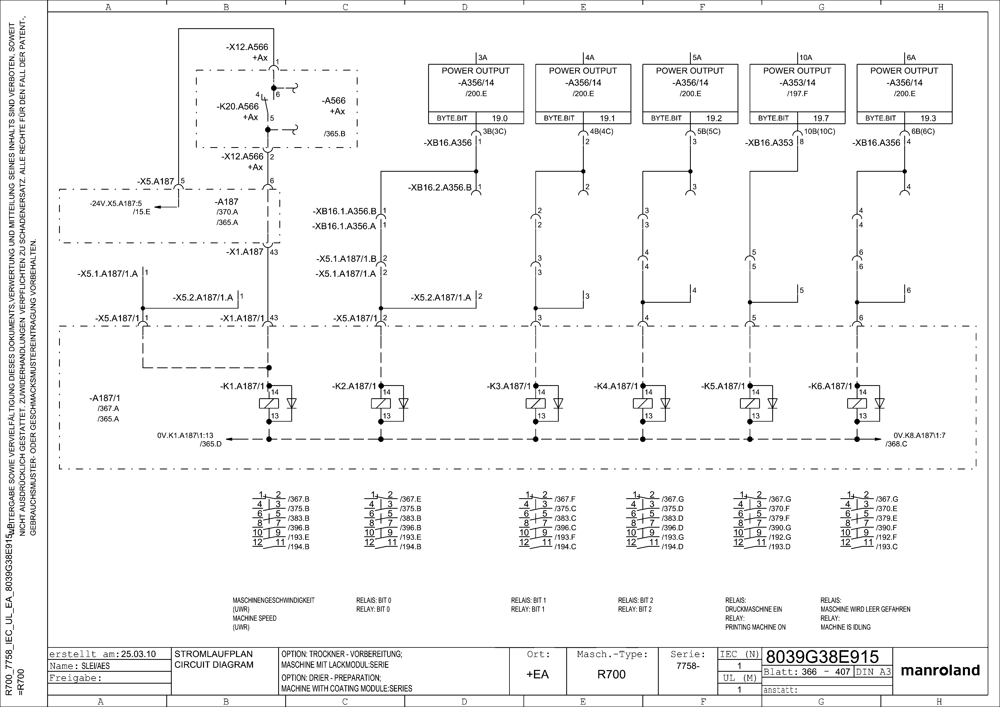

# +EA — Sheet 366 of 407 — OPTION: TROCKNER VORBEREITUNG;

**MASCHINE MIT LACKMODUL:SERIE**

> Part of the manroland **R700** printing press IEC/UL circuit diagrams.
> Drawing class: **Stromlaufplan / Circuit diagram** (DIN A3).
> Document `+EA` covers the **Printing unit** machine section.

## At a glance

| Field | Value |
|---|---|
| Document | `+EA`  (8039G38E915) |
| Sheet | **366** of 407 |
| Section (DE) | OPTION: TROCKNER VORBEREITUNG; |
| Section (EN) | MASCHINE MIT LACKMODUL:SERIE |
| Section type | CIRCUIT — Circuit diagram |
| Machine type | `R700` |
| Series | `7758` |
| Created | 25.03.10 |
| Replaces | — |
| Columns used | A, B, C, D, E, F, G, H |
| Path numbers | — |
| Labels on sheet | 265 |
| Cross-refs out | 49 |
| Cross-refs in | 95 |

**Previous:** [+EA sheet 365](SHEET_0365.md) · **Next:** [+EA sheet 367](SHEET_0367.md) · **Document TOC:** [_TOC.md](_TOC.md)  (+EA) · **Master TOC:** [all sheets](../_MASTER_TOC.md)

## Sheet image (300 DPI, exact vector render)



_Rendered directly from the PDF vector layer at 300 DPI (1-bit), no OCR and no resampling. Use it to confirm anything ambiguous in the text below._

## Cross-references on this sheet

Each entry is a wire leaving this sheet. The printed token is `/sheet.column`; the link resolves to that sheet inside the same document.

| Ref | Target sheet | Col | Path | Destination on target | Target section | From col |
|---|---|---|---|---|---|---|
| `/200.E` | [+EA sheet 200](SHEET_0200.md) | E | — | — | REFERENZMODUL | D |
| `/200.E` | [+EA sheet 200](SHEET_0200.md) | E | — | — | REFERENZMODUL | E |
| `/200.E` | [+EA sheet 200](SHEET_0200.md) | E | — | — | REFERENZMODUL | F |
| `/200.E` | [+EA sheet 200](SHEET_0200.md) | E | — | — | REFERENZMODUL | H |
| `/197.F` | [+EA sheet 197](SHEET_0197.md) | F | — | — | REFERENZMODUL | G |
| `/365.B` | [+EA sheet 365](SHEET_0365.md) | B | — | — | OPTION: TROCKNER VORBEREITUNG; | C |
| `/15.E` | [+EA sheet 15](SHEET_0015.md) | E | — | 24V.X5.A187:5 | SPANNUNGSVERSORGUNG: 400V, 24V | A |
| `/370.A` | [+EA sheet 370](SHEET_0370.md) | A | — | — | OPTION: ENDTROCKNER 1 VORBEREITUNG; | B |
| `/365.A` | [+EA sheet 365](SHEET_0365.md) | A | — | — | OPTION: TROCKNER VORBEREITUNG; | B |
| `/367.A` | [+EA sheet 367](SHEET_0367.md) | A | — | — | OPTION: TROCKNER VORBEREITUNG; | A |
| `/365.A` | [+EA sheet 365](SHEET_0365.md) | A | — | — | OPTION: TROCKNER VORBEREITUNG; | A |
| `/365.D` | [+EA sheet 365](SHEET_0365.md) | D | — | 0V.K8.A187\1:7 0V.K1.A187\1:13 | OPTION: TROCKNER VORBEREITUNG; | E |
| `/368.C` | [+EA sheet 368](SHEET_0368.md) | C | — | — | OPTION: ENDTROCKNER 1 VORBEREITUNG; | H |
| `/367.B` | [+EA sheet 367](SHEET_0367.md) | B | — | — | OPTION: TROCKNER VORBEREITUNG; | C |
| `/375.B` | [+EA sheet 375](SHEET_0375.md) | B | — | — | OPTION: ENDTROCKNER 1 VORBEREITUNG; | C |
| `/383.B` | [+EA sheet 383](SHEET_0383.md) | B | — | — | OPTION: ENDTROCKNER 2 VORBEREITUNG | C |
| `/396.B` | [+EA sheet 396](SHEET_0396.md) | B | — | — | OPTION: ZWISCHENTROCKNER VORBEREITUNG; | C |
| `/193.E` | [+EA sheet 193](SHEET_0193.md) | E | — | — | RESERVE | C |
| `/194.B` | [+EA sheet 194](SHEET_0194.md) | B | — | — | RESERVE | C |
| `/367.E` | [+EA sheet 367](SHEET_0367.md) | E | — | — | OPTION: TROCKNER VORBEREITUNG; | D |
| `/375.B` | [+EA sheet 375](SHEET_0375.md) | B | — | — | OPTION: ENDTROCKNER 1 VORBEREITUNG; | D |
| `/383.B` | [+EA sheet 383](SHEET_0383.md) | B | — | — | OPTION: ENDTROCKNER 2 VORBEREITUNG | D |
| `/396.B` | [+EA sheet 396](SHEET_0396.md) | B | — | — | OPTION: ZWISCHENTROCKNER VORBEREITUNG; | D |
| `/193.E` | [+EA sheet 193](SHEET_0193.md) | E | — | — | RESERVE | D |
| `/194.B` | [+EA sheet 194](SHEET_0194.md) | B | — | — | RESERVE | D |
| `/367.F` | [+EA sheet 367](SHEET_0367.md) | F | — | — | OPTION: TROCKNER VORBEREITUNG; | E |
| `/375.C` | [+EA sheet 375](SHEET_0375.md) | C | — | — | OPTION: ENDTROCKNER 1 VORBEREITUNG; | E |
| `/383.C` | [+EA sheet 383](SHEET_0383.md) | C | — | — | OPTION: ENDTROCKNER 2 VORBEREITUNG | E |
| `/396.C` | [+EA sheet 396](SHEET_0396.md) | C | — | — | OPTION: ZWISCHENTROCKNER VORBEREITUNG; | E |
| `/193.F` | [+EA sheet 193](SHEET_0193.md) | F | — | — | RESERVE | E |
| `/194.C` | [+EA sheet 194](SHEET_0194.md) | C | — | — | RESERVE | E |
| `/367.G` | [+EA sheet 367](SHEET_0367.md) | G | — | — | OPTION: TROCKNER VORBEREITUNG; | F |
| `/375.D` | [+EA sheet 375](SHEET_0375.md) | D | — | — | OPTION: ENDTROCKNER 1 VORBEREITUNG; | F |
| `/383.D` | [+EA sheet 383](SHEET_0383.md) | D | — | — | OPTION: ENDTROCKNER 2 VORBEREITUNG | F |
| `/396.D` | [+EA sheet 396](SHEET_0396.md) | D | — | — | OPTION: ZWISCHENTROCKNER VORBEREITUNG; | F |
| `/193.G` | [+EA sheet 193](SHEET_0193.md) | G | — | — | RESERVE | F |
| `/194.D` | [+EA sheet 194](SHEET_0194.md) | D | — | — | RESERVE | F |
| `/367.G` | [+EA sheet 367](SHEET_0367.md) | G | — | — | OPTION: TROCKNER VORBEREITUNG; | G |
| `/370.F` | [+EA sheet 370](SHEET_0370.md) | F | — | — | OPTION: ENDTROCKNER 1 VORBEREITUNG; | G |
| `/379.F` | [+EA sheet 379](SHEET_0379.md) | F | — | — | OPTION: ENDTROCKNER 2 VORBEREITUNG | G |
| `/390.G` | [+EA sheet 390](SHEET_0390.md) | G | — | — | OPTION: ZWISCHENTROCKNER VORBEREITUNG; | G |
| `/192.G` | [+EA sheet 192](SHEET_0192.md) | G | — | — | RESERVE | G |
| `/193.D` | [+EA sheet 193](SHEET_0193.md) | D | — | — | RESERVE | G |
| `/367.G` | [+EA sheet 367](SHEET_0367.md) | G | — | — | OPTION: TROCKNER VORBEREITUNG; | H |
| `/370.E` | [+EA sheet 370](SHEET_0370.md) | E | — | — | OPTION: ENDTROCKNER 1 VORBEREITUNG; | H |
| `/379.E` | [+EA sheet 379](SHEET_0379.md) | E | — | — | OPTION: ENDTROCKNER 2 VORBEREITUNG | H |
| `/390.F` | [+EA sheet 390](SHEET_0390.md) | F | — | — | OPTION: ZWISCHENTROCKNER VORBEREITUNG; | H |
| `/192.F` | [+EA sheet 192](SHEET_0192.md) | F | — | — | RESERVE | H |
| `/193.C` | [+EA sheet 193](SHEET_0193.md) | C | — | — | RESERVE | H |

### Incoming references (sheets that point here)

Every other sheet that sends a wire to this one. `Back-ref` is the token printed on *that* sheet; `Path` is its line number.

| From sheet | Cols | Back-ref | Path | Refs | What continues there |
|---|---|---|---|---|---|
| [+EA#15](SHEET_0015.md) | F | `/15.F` | — | 1 | 24V.X5.A187:5 |
| [+EA#192](SHEET_0192.md) | F, G | `/192.F`, `/192.G` | — | 2 | — |
| [+EA#193](SHEET_0193.md) | C, D, E, F, G | `/193.C`, `/193.D`, `/193.E`, `/193.F`, `/193.G` | — | 6 | — |
| [+EA#194](SHEET_0194.md) | B, C | `/194.B`, `/194.C` | — | 4 | — |
| [+EA#197](SHEET_0197.md) | F | `/197.F` | — | 1 | — |
| [+EA#200](SHEET_0200.md) | E | `/200.E` | — | 4 | — |
| [+EA#206](SHEET_0206.md) | H | `/206.H` | — | 1 | — |
| [+EA#207](SHEET_0207.md) | B | `/207.B` | — | 1 | — |
| [+EA#239](SHEET_0239.md) | B, C, D, E, F, G | `/239.B`, `/239.C`, `/239.D`, `/239.E`, `/239.F`, `/239.G` | — | 25 | — |
| [+EA#257](SHEET_0257.md) | G | `/257.G` | — | 2 | — |
| [+EA#261](SHEET_0261.md) | G, H | `/261.G`, `/261.H` | — | 5 | — |
| [+EA#262](SHEET_0262.md) | A, B, E | `/262.A`, `/262.B`, `/262.E` | — | 12 | — |
| [+EA#365](SHEET_0365.md) | A, B, E | `/365.A`, `/365.B`, `/365.E` | — | 4 | 0V.K691:A1 0V.K692:A1 0V.K7.A187\1:13 |
| [+EA#367](SHEET_0367.md) | A, B, D, E, F, G | `/367.A`, `/367.B`, `/367.D`, `/367.E`, `/367.F`, `/367.G` | — | 7 | — |
| [+EA#368](SHEET_0368.md) | E | `/368.E` | — | 1 | 0V.K8.A187\1:7 |
| [+EA#370](SHEET_0370.md) | A, E, F | `/370.A`, `/370.E`, `/370.F` | — | 3 | — |
| [+EA#375](SHEET_0375.md) | B, C, D | `/375.B`, `/375.C`, `/375.D` | — | 4 | — |
| [+EA#379](SHEET_0379.md) | E, F | `/379.E`, `/379.F` | — | 2 | — |
| [+EA#383](SHEET_0383.md) | B, C, D | `/383.B`, `/383.C`, `/383.D` | — | 4 | — |
| [+EA#390](SHEET_0390.md) | F, G | `/390.F`, `/390.G` | — | 2 | — |
| [+EA#396](SHEET_0396.md) | B, C | `/396.B`, `/396.C` | — | 4 | — |


## Devices on this sheet

| Tag | Class | Class meaning (IEC) | Col | Sub | Terminal | Sign |
|---|---|---|---|---|---|---|
| `A356/14` | A | Baugruppe / assembly, module, PC board | D | 14 | — | — |
| `A356/14` | A | Baugruppe / assembly, module, PC board | E | 14 | — | — |
| `A356/14` | A | Baugruppe / assembly, module, PC board | F | 14 | — | — |
| `A353/14` | A | Baugruppe / assembly, module, PC board | G | 14 | — | — |
| `A356/14` | A | Baugruppe / assembly, module, PC board | H | 14 | — | — |
| `A187` | A | Baugruppe / assembly, module, PC board | B | — | — | — |
| `A566` | A | Baugruppe / assembly, module, PC board | C | — | — | — |
| `A187/1` | A | Baugruppe / assembly, module, PC board | A | 1 | — | — |
| `19.0` | — | cross-device reference | D | — | — | — |
| `XB16.A356` | — | cross-device reference | D | — | — | — |
| `19.1` | — | cross-device reference | E | — | — | — |
| `19.2` | — | cross-device reference | F | — | — | — |
| `19.7` | — | cross-device reference | G | — | — | — |
| `XB16.A353` | — | cross-device reference | G | — | — | — |
| `19.3` | — | cross-device reference | H | — | — | — |
| `XB16.A356` | — | cross-device reference | G | — | — | — |
| `XB16.2.A356.B` | — | cross-device reference | D | — | — | — |
| `X5.A187` | — | cross-device reference | A | — | — | — |
| `X1.A187` | — | cross-device reference | B | — | — | — |
| `K20.A566` | — | cross-device reference | B | — | — | — |
| `X12.A566` | — | cross-device reference | B | — | — | — |
| `X12.A566` | — | cross-device reference | B | — | — | — |
| `XB16.1.A356.B` | — | cross-device reference | C | — | — | — |
| `XB16.1.A356.A` | — | cross-device reference | C | — | — | — |

## Potentials / nets

| Potential | Count | Columns | Attached devices | Terminals |
|---|---|---|---|---|
| `0V` | 2 | B, H | `A187\1`, `K1`, `K8` | `13`, `7` |
| `24V` | 1 | A | `A187`, `X5` | `5` |


A potential such as `L24+/4` or `M24+` is a named supply/return rail; every place it appears on this sheet is electrically common.

## Wire-end annotations (grouped as printed)

A wire that continues elsewhere is annotated with a small cluster: the destination description, the path/line number `#NN`, and the `/sheet.column` cross reference. Each row below is one such cluster exactly as it is grouped on the drawing.

| Col | Y | Path | Cross-ref | Text on the wire |
|---|---|---|---|---|
| B | 51.3 | — | — | `X12.A566` |
| B | 64.1 | — | — | `+Ax` |
| D | 64.8 | — | — | `3A` |
| E | 64.8 | — | — | `4A` |
| F | 64.8 | — | — | `5A` |
| G | 64.8 | — | — | `10A` |
| H | 64.8 | — | — | `6A` |
| B | 69.8 | — | — | `1` |
| D | 79.9 | — | — | `POWER OUTPUT` |
| E | 79.9 | — | — | `POWER OUTPUT` |
| F | 79.9 | — | — | `POWER OUTPUT` |
| G | 79.9 | — | — | `POWER OUTPUT` |
| H | 79.9 | — | — | `POWER OUTPUT` |
| D | 93.8 | — | — | `A356/14` |
| E | 93.8 | — | — | `A356/14` |
| F | 93.8 | — | — | `A356/14` |
| G | 93.8 | — | — | `A353/14` |
| H | 93.8 | — | — | `A356/14` |
| D | 107.6 | — | `/200.E` | — |
| E | 107.6 | — | `/200.E` | — |
| F | 107.6 | — | `/200.E` | — |
| G | 107.6 | — | `/197.F` | — |
| H | 107.6 | — | `/200.E` | — |
| B | 108.8 | — | — | `K20.A566 6` |
| B | 108.8 | — | — | `4` |
| C | 115.1 | — | — | `A566` |
| C | 127.9 | — | — | `+Ax` |
| B | 135.0 | — | — | `+Ax` |
| D | 136.7 | — | — | `BYTE.BIT 19.0` |
| E | 136.7 | — | — | `BYTE.BIT 19.1` |
| F | 136.7 | — | — | `BYTE.BIT 19.2` |
| G | 136.7 | — | — | `BYTE.BIT 19.7` |
| H | 136.7 | — | — | `BYTE.BIT 19.3` |
| B | 137.1 | — | — | `5` |
| D | 152.7 | — | — | `3B(3C)` |
| E | 152.7 | — | — | `4B(4C)` |
| F | 152.7 | — | — | `5B(5C)` |
| G | 152.7 | — | — | `10B(10C)` |
| H | 152.7 | — | — | `6B(6C)` |
| C | 155.5 | — | `/365.B` | — |
| D | 164.7 | — | — | `XB16.A356 1` |
| E | 164.7 | — | — | `2` |
| F | 164.7 | — | — | `3` |
| G | 164.7 | — | — | `XB16.A353 8` |
| H | 164.7 | — | — | `XB16.A356 4` |
| B | 181.7 | — | — | `X12.A566 2` |
| B | 194.5 | — | — | `+Ax` |
| E | 211.5 | — | — | `X5.A187 5 2 3 4` |
| B | 211.5 | — | — | `6` |
| D | 218.6 | — | — | `XB16.2.A356.B 1` |
| B | 235.6 | — | — | `A187` |
| A | 238.4 | — | `/15.E` | `24V.X5.A187:5` |
| C | 246.9 | — | — | `XB16.1.A356.B 1` |
| E | 246.9 | — | — | `2` |
| F | 246.9 | — | — | `3` |
| G | 246.9 | — | — | `4` |
| B | 248.7 | — | `/370.A`, `/365.A` | — |
| C | 263.9 | — | — | `XB16.1.A356.A 1` |
| E | 263.9 | — | — | `2` |
| F | 263.9 | — | — | `3` |
| G | 263.9 | — | — | `4` |
| B | 295.1 | — | — | `X1.A187 43` |
| F | 296.5 | — | — | `4` |
| F | 296.5 | — | — | `5` |
| G | 296.5 | — | — | `6` |
| C | 303.6 | — | — | `X5.1.A187/1.B 2` |
| E | 303.6 | — | — | `3` |
| F | 313.6 | — | — | `4` |
| F | 313.6 | — | — | `5` |
| G | 313.6 | — | — | `6` |
| A | 320.6 | — | — | `X5.1.A187/1.A 1` |
| C | 320.6 | — | — | `X5.1.A187/1.A 2` |
| E | 320.6 | — | — | `3` |
| F | 341.9 | — | — | `4` |
| G | 341.9 | — | — | `5` |
| H | 341.9 | — | — | `6` |
| B | 349.0 | — | — | `X5.2.A187/1.A 1` |
| D | 349.0 | — | — | `X5.2.A187/1.A 2` |
| E | 349.0 | — | — | `3` |
| A | 374.5 | — | — | `X5.A187/1 1` |
| B | 374.5 | — | — | `X1.A187/1 43` |
| C | 374.5 | — | — | `X5.A187/1 2` |
| E | 374.5 | — | — | `3` |
| F | 374.5 | — | — | `4` |
| F | 374.5 | — | — | `5` |
| G | 374.5 | — | — | `6` |
| B | 455.3 | — | — | `K1.A187/1` |
| C | 455.3 | — | — | `K2.A187/1` |
| D | 455.3 | — | — | `K3.A187/1` |
| E | 455.3 | — | — | `K4.A187/1` |
| F | 455.3 | — | — | `K5.A187/1` |
| G | 455.3 | — | — | `K6.A187/1` |
| B | 463.1 | — | — | `14` |
| C | 463.1 | — | — | `14` |
| E | 463.1 | — | — | `14` |
| F | 463.1 | — | — | `14` |
| F | 463.1 | — | — | `14` |
| G | 463.1 | — | — | `14` |
| A | 469.4 | — | — | `A187/1` |
| A | 482.5 | — | `/367.A`, `/365.A` | — |
| B | 491.4 | — | — | `13` |
| C | 491.4 | — | — | `13` |
| E | 491.4 | — | — | `13` |
| F | 491.4 | — | — | `13` |
| F | 491.4 | — | — | `13` |
| G | 491.4 | — | — | `13` |
| E | 514.8 | — | `/365.D` | `0V.K1.A187\1:13 0V.K8.A187\1:7` |
| H | 524.7 | — | `/368.C` | — |
| B | 584.2 | — | — | `1 2` |
| C | 584.2 | — | — | `1 2` |
| E | 584.2 | — | — | `1 2` |
| F | 584.2 | — | — | `1 2` |
| F | 584.2 | — | — | `1 2` |
| G | 584.2 | — | — | `1 2` |
| C | 590.6 | — | `/367.B`, `/375.B`, `/383.B`, `/396.B`, `/193.E`, `/194.B` | — |
| D | 590.6 | — | `/367.E`, `/375.B`, `/383.B`, `/396.B`, `/193.E`, `/194.B` | — |
| E | 590.6 | — | `/367.F`, `/375.C`, `/383.C`, `/396.C`, `/193.F`, `/194.C` | — |
| F | 590.6 | — | `/367.G`, `/375.D`, `/383.D`, `/396.D`, `/193.G`, `/194.D` | — |
| G | 590.6 | — | `/367.G`, `/370.F`, `/379.F`, `/390.G`, `/192.G`, `/193.D` | — |
| H | 590.6 | — | `/367.G`, `/370.E`, `/379.E`, `/390.F`, `/192.F`, `/193.C` | — |
| B | 595.5 | — | — | `4 6 3 5` |
| C | 595.5 | — | — | `4 6 3 5` |
| E | 595.5 | — | — | `4 6 3 5` |
| F | 595.5 | — | — | `4 6 3 5` |
| F | 595.5 | — | — | `4 6 3 5` |
| G | 595.5 | — | — | `4 6 3 5` |
| B | 618.2 | — | — | `8` |
| B | 618.2 | — | — | `7` |
| C | 618.2 | — | — | `8` |
| C | 618.2 | — | — | `7` |
| E | 618.2 | — | — | `8` |
| E | 618.2 | — | — | `7` |
| E | 618.2 | — | — | `8` |
| F | 618.2 | — | — | `7` |
| F | 618.2 | — | — | `8` |
| F | 618.2 | — | — | `7` |
| G | 618.2 | — | — | `8` |
| G | 618.2 | — | — | `7` |
| B | 629.6 | — | — | `10 12 11 9` |
| C | 629.6 | — | — | `10 12 11 9` |
| E | 629.6 | — | — | `10 12 11 9` |
| E | 629.6 | — | — | `10 12 11 9` |
| F | 629.6 | — | — | `10 12 11 9` |
| G | 629.6 | — | — | `10 12 11 9` |
| E | 712.0 | — | — | `RELAIS: BIT 1 RELAY: BIT 1` |
| F | 712.0 | — | — | `RELAIS: DRUCKMASCHINE EIN RELAY: PRINTING MACHINE ON` |
| G | 712.0 | — | — | `RELAIS: RELAY: MASCHINE WIRD LEER GEFAHREN MACHINE IS IDLING` |
| B | 712.1 | — | — | `MASCHINENGESCHWINDIGKEIT (UWR) MACHINE SPEED (UWR)` |
| C | 712.1 | — | — | `RELAIS: BIT 0 RELAY: BIT 0` |
| E | 712.1 | — | — | `RELAIS: BIT 2 RELAY: BIT 2` |


## Reconstructed tables

This sheet carries tabular content (pin map / terminal assignment / index). The grid below was rebuilt from the drawing's own rule lines, so each row is exactly one physical row of the table.

### Table 1 — 6 data rows × 6 columns (at x=170.1, y=34.0)

|  | X12.A566 +Ax |  | 1 |  |  |
|---|---|---|---|---|---|
|  | `4 K20.A566` |  | `6` | `A566 +Ax` |  |
|  | `+Ax` | `5` |  |  |  |
|  | `X12.A566 +Ax` | `2` |  | `/365.B` |  |
| `X5.A187 1` | `5 A187 /370.A /365.A X1.A187 1 X5.2.A187/1.A` | `6` | `43` | `XB16.1.A356.B XB16.1.A356.A X5.1.A187/1.B X5.1.A187/1.A` | `1 1 2 2` |
| `1` | `X1.A187/1` |  | `43` | `X5.A187/1` | `2` |
|  | `K1.A187/1 0V.K1.A187\1:13` |  | `14 13` | `K2.A187/1` | `14 13` |


### Table 2 — 4 data rows × 2 columns (at x=510.2, y=34.0) — **3A**

| POWER | OUTPUT A356/14 /200.E |
|---|---|
| `BYTE.BIT` | `19.0` |
| `XB16.A356` | `3B(3C) 1` |
| `XB16.2.A356.B X5.2.A187/1.A` | `1 2` |
|  | `K3.A187/1` |


### Table 3 — 5 data rows × 3 columns (at x=637.8, y=34.0) — **4A**

|  | POWER | OUTPUT A356/14 /200.E |
|---|---|---|
|  | `BYTE.BIT` | `19.1` |
|  |  | `4B(4C) 2` |
| `2 2 3 3` |  | `2 3` |
| `3` |  |  |
| `14 13` |  | `K4.A187/1` |


### Table 4 — 5 data rows × 3 columns (at x=765.4, y=34.0) — **5A**

|  | POWER | OUTPUT A356/14 /200.E |
|---|---|---|
|  | `BYTE.BIT` | `19.2` |
|  |  | `5B(5C) 3` |
| `3 3 4 4` |  | `3 4` |
| `4` |  |  |
| `14 13` |  | `K5.A187/1` |


### Table 5 — 5 data rows × 3 columns (at x=892.9, y=34.0) — **10A**

|  | POWER | OUTPUT A353/14 /197.F |
|---|---|---|
|  | `BYTE.BIT` | `19.7` |
| `XB16.A353` |  | `10B(10C) 8` |
| `5 5` |  | `5` |
| `5` |  |  |
| `14 13` |  | `K6.A187/1` |


### Table 6 — 5 data rows × 3 columns (at x=1020.5, y=34.0) — **6A**

|  | POWER | OUTPUT A356/14 /200.E |
|---|---|---|
|  | `BYTE.BIT` | `19.3` |
| `XB16.A356` |  | `6B(6C) 4` |
| `4 4 6 6` |  | `4 6` |
| `6` |  |  |
| `14 13` |  | `0V.K8.A187\1:7` |


## Notes and free text on this sheet

| Text | Col | Y (pt) |
|---|---|---|
| `3A` | D | 64.76 |
| `3B(3C)` | D | 152.68 |
| `POWER OUTPUT` | D | 79.93 |
| `BYTE.BIT` | D | 137.26 |
| `4A` | E | 64.76 |
| `4B(4C)` | E | 152.68 |
| `POWER OUTPUT` | E | 79.93 |
| `BYTE.BIT` | E | 137.26 |
| `5A` | F | 64.76 |
| `5B(5C)` | F | 152.68 |
| `POWER OUTPUT` | F | 79.93 |
| `BYTE.BIT` | F | 137.26 |
| `10A` | G | 64.77 |
| `10B(10C)` | G | 152.68 |
| `POWER OUTPUT` | G | 79.93 |
| `BYTE.BIT` | G | 137.26 |
| `6A` | H | 64.76 |
| `6B(6C)` | H | 152.68 |
| `POWER OUTPUT` | H | 79.93 |
| `+Ax` | B | 134.98 |
| `+Ax` | C | 127.9 |
| `K3.A187/1` | D | 455.27 |
| `RELAIS: BIT 1` | E | 712.05 |
| `RELAY: BIT 1` | E | 722.69 |
| `K4.A187/1` | E | 455.27 |
| `RELAIS: BIT 2` | E | 712.07 |
| `RELAY: BIT 2` | E | 722.71 |
| `K5.A187/1` | F | 455.27 |
| `RELAIS:` | F | 712.05 |
| `DRUCKMASCHINE EIN` | F | 722.76 |
| `RELAY:` | F | 733.32 |
| `PRINTING MACHINE ON` | F | 744.02 |
| `K6.A187/1` | G | 455.27 |
| `RELAIS:` | G | 712.05 |
| `MASCHINE WIRD LEER GEFAHREN` | G | 722.74 |
| `RELAY:` | G | 733.32 |
| `MACHINE IS IDLING` | G | 744.02 |
| `X5.A187/1` | C | 374.49 |
| `K2.A187/1` | C | 455.27 |
| `RELAIS: BIT 0` | C | 712.08 |
| `RELAY: BIT 0` | C | 722.72 |
| `X1.A187/1` | B | 374.49 |
| `K1.A187/1` | B | 455.27 |
| `MASCHINENGESCHWINDIGKEIT` | B | 712.11 |
| `(UWR)` | B | 722.68 |
| `MACHINE SPEED` | B | 733.38 |
| `X5.1.A187/1.B` | C | 303.63 |
| `X5.1.A187/1.A` | C | 321.35 |
| `X5.2.A187/1.A` | D | 349.69 |
| `X5.A187/1` | A | 374.49 |
| `X5.1.A187/1.A` | A | 321.35 |
| `X5.2.A187/1.A` | B | 349.69 |

## Complete label inventory (exact text from the drawing)

Every text object inside the drawing area of this sheet, in DIN reading order (column A→H, then top→bottom). This is the authoritative list: if a string is not here it is not printed on this sheet.

| Col | Y | X | Dir | Type | Text |
|---|---|---|---|---|---|
| A | 211.5 | 163.3 | → | device ref | `X5.A187` |
| A | 238.4 | 106.9 | → | potential | `24V.X5.A187:5` |
| A | 248.3 | 158.5 | → | cross-reference | `/15.E` |
| A | 320.6 | 172.1 | → | number | `1` |
| A | 321.3 | 92.4 | → | text | `X5.1.A187/1.A` |
| A | 374.5 | 113.4 | → | text | `X5.A187/1` |
| A | 374.5 | 172.1 | → | number | `1` |
| A | 469.4 | 106.6 | → | device tag | `A187/1` |
| A | 482.5 | 116.2 | → | cross-reference | `/367.A` |
| A | 494.9 | 116.2 | → | cross-reference | `/365.A` |
| B | 51.3 | 269.3 | → | device ref | `X12.A566` |
| B | 64.1 | 300.5 | → | text | `+Ax` |
| B | 69.8 | 328.0 | → | number | `1` |
| B | 108.7 | 304.4 | → | number | `4` |
| B | 108.7 | 328.5 | → | number | `6` |
| B | 122.2 | 258.0 | → | device ref | `K20.A566` |
| B | 135.0 | 289.1 | → | text | `+Ax` |
| B | 137.1 | 321.4 | → | number | `5` |
| B | 181.7 | 263.6 | → | device ref | `X12.A566` |
| B | 183.2 | 321.4 | → | number | `2` |
| B | 194.5 | 294.8 | → | text | `+Ax` |
| B | 211.5 | 215.1 | → | number | `5` |
| B | 211.5 | 321.4 | → | number | `6` |
| B | 235.6 | 255.7 | → | device tag | `A187` |
| B | 248.6 | 258.0 | → | cross-reference | `/370.A` |
| B | 261.1 | 258.0 | → | cross-reference | `/365.A` |
| B | 295.1 | 269.6 | → | device ref | `X1.A187` |
| B | 296.5 | 321.4 | → | number | `43` |
| B | 349.0 | 285.4 | → | number | `1` |
| B | 349.7 | 205.8 | → | text | `X5.2.A187/1.A` |
| B | 374.5 | 262.2 | → | text | `X1.A187/1` |
| B | 374.5 | 321.4 | → | number | `43` |
| B | 455.3 | 262.2 | → | text | `K1.A187/1` |
| B | 463.1 | 322.3 | → | number | `14` |
| B | 491.4 | 322.3 | → | number | `13` |
| B | 514.8 | 187.4 | → | potential | `0V.K1.A187\1:13` |
| B | 524.7 | 238.1 | → | cross-reference | `/365.D` |
| B | 584.2 | 307.8 | → | number | `1` |
| B | 584.2 | 328.5 | → | number | `2` |
| B | 595.5 | 306.4 | → | number | `4` |
| B | 595.5 | 328.3 | → | number | `3` |
| B | 606.9 | 306.4 | → | number | `6` |
| B | 606.9 | 328.3 | → | number | `5` |
| B | 618.2 | 306.4 | → | number | `8` |
| B | 618.2 | 328.5 | → | number | `7` |
| B | 629.6 | 300.5 | → | number | `10` |
| B | 629.6 | 328.3 | → | number | `9` |
| B | 640.9 | 300.5 | → | number | `12` |
| B | 640.9 | 327.7 | → | number | `11` |
| B | 712.1 | 277.2 | → | text | `MASCHINENGESCHWINDIGKEIT` |
| B | 722.7 | 277.2 | → | text | `(UWR)` |
| B | 733.4 | 277.2 | → | text | `MACHINE SPEED` |
| B | 743.9 | 277.2 | → | text | `(UWR)` |
| C | 115.1 | 383.2 | → | device tag | `A566` |
| C | 127.9 | 392.6 | → | text | `+Ax` |
| C | 155.5 | 385.8 | → | cross-reference | `/365.B` |
| C | 246.9 | 372.5 | → | device ref | `XB16.1.A356.B` |
| C | 246.9 | 455.5 | → | number | `1` |
| C | 263.9 | 455.5 | → | number | `1` |
| C | 264.6 | 371.6 | → | device ref | `XB16.1.A356.A` |
| C | 303.6 | 376.7 | → | text | `X5.1.A187/1.B` |
| C | 303.6 | 456.1 | → | number | `2` |
| C | 320.6 | 456.1 | → | number | `2` |
| C | 321.3 | 375.9 | → | text | `X5.1.A187/1.A` |
| C | 374.5 | 396.9 | → | text | `X5.A187/1` |
| C | 374.5 | 456.1 | → | number | `2` |
| C | 455.3 | 395.4 | → | text | `K2.A187/1` |
| C | 463.1 | 455.5 | → | number | `14` |
| C | 491.4 | 455.5 | → | number | `13` |
| C | 584.2 | 441.1 | → | number | `1` |
| C | 584.2 | 461.8 | → | number | `2` |
| C | 590.6 | 343.0 | → | cross-reference | `/367.B` |
| C | 595.5 | 439.7 | → | number | `4` |
| C | 595.5 | 461.5 | → | number | `3` |
| C | 601.9 | 343.0 | → | cross-reference | `/375.B` |
| C | 606.9 | 439.7 | → | number | `6` |
| C | 606.9 | 461.5 | → | number | `5` |
| C | 613.3 | 343.0 | → | cross-reference | `/383.B` |
| C | 618.2 | 439.7 | → | number | `8` |
| C | 618.2 | 461.8 | → | number | `7` |
| C | 624.6 | 343.0 | → | cross-reference | `/396.B` |
| C | 629.6 | 433.7 | → | number | `10` |
| C | 629.6 | 461.5 | → | number | `9` |
| C | 635.9 | 343.0 | → | cross-reference | `/193.E` |
| C | 640.9 | 433.7 | → | number | `12` |
| C | 640.9 | 460.9 | → | number | `11` |
| C | 647.3 | 343.0 | → | cross-reference | `/194.B` |
| C | 712.1 | 424.3 | → | text | `RELAIS: BIT 0` |
| C | 722.7 | 424.3 | → | text | `RELAY: BIT 0` |
| D | 64.8 | 569.5 | → | text | `3A` |
| D | 79.9 | 526.1 | → | text | `POWER OUTPUT` |
| D | 93.8 | 545.5 | → | device tag | `A356/14` |
| D | 107.6 | 554.5 | → | cross-reference | `/200.E` |
| D | 136.7 | 585.5 | → | device ref | `19.0` |
| D | 137.3 | 520.2 | → | text | `BYTE.BIT` |
| D | 152.7 | 575.1 | → | text | `3B(3C)` |
| D | 164.7 | 568.9 | → | number | `1` |
| D | 165.4 | 504.6 | → | device ref | `XB16.A356` |
| D | 218.6 | 485.9 | → | device ref | `XB16.2.A356.B` |
| D | 218.6 | 568.9 | → | number | `1` |
| D | 349.0 | 569.5 | → | number | `2` |
| D | 349.7 | 489.3 | → | text | `X5.2.A187/1.A` |
| D | 455.3 | 579.7 | → | text | `K3.A187/1` |
| D | 590.6 | 476.2 | → | cross-reference | `/367.E` |
| D | 601.9 | 476.2 | → | cross-reference | `/375.B` |
| D | 613.3 | 476.2 | → | cross-reference | `/383.B` |
| D | 624.6 | 476.2 | → | cross-reference | `/396.B` |
| D | 635.9 | 476.2 | → | cross-reference | `/193.E` |
| D | 647.3 | 476.2 | → | cross-reference | `/194.B` |
| E | 64.8 | 697.0 | → | text | `4A` |
| E | 79.9 | 653.7 | → | text | `POWER OUTPUT` |
| E | 93.8 | 673.1 | → | device tag | `A356/14` |
| E | 107.6 | 682.0 | → | cross-reference | `/200.E` |
| E | 136.7 | 713.9 | → | device ref | `19.1` |
| E | 137.3 | 647.7 | → | text | `BYTE.BIT` |
| E | 152.7 | 702.7 | → | text | `4B(4C)` |
| E | 164.7 | 697.0 | → | number | `2` |
| E | 218.6 | 697.0 | → | number | `2` |
| E | 246.9 | 640.3 | → | number | `2` |
| E | 263.9 | 640.3 | → | number | `2` |
| E | 303.6 | 640.3 | → | number | `3` |
| E | 320.6 | 640.3 | → | number | `3` |
| E | 349.0 | 697.0 | → | number | `3` |
| E | 374.5 | 640.3 | → | number | `3` |
| E | 455.3 | 707.2 | → | text | `K4.A187/1` |
| E | 463.1 | 639.8 | → | number | `14` |
| E | 491.4 | 639.8 | → | number | `13` |
| E | 584.2 | 625.3 | → | number | `1` |
| E | 584.2 | 646.0 | → | number | `2` |
| E | 584.2 | 752.9 | → | number | `1` |
| E | 590.6 | 660.5 | → | cross-reference | `/367.F` |
| E | 595.5 | 623.9 | → | number | `4` |
| E | 595.5 | 645.7 | → | number | `3` |
| E | 595.5 | 751.5 | → | number | `4` |
| E | 601.9 | 660.5 | → | cross-reference | `/375.C` |
| E | 606.9 | 623.9 | → | number | `6` |
| E | 606.9 | 645.7 | → | number | `5` |
| E | 606.9 | 751.5 | → | number | `6` |
| E | 613.3 | 660.5 | → | cross-reference | `/383.C` |
| E | 618.2 | 623.9 | → | number | `8` |
| E | 618.2 | 646.0 | → | number | `7` |
| E | 618.2 | 751.5 | → | number | `8` |
| E | 624.6 | 660.5 | → | cross-reference | `/396.C` |
| E | 629.6 | 618.0 | → | number | `10` |
| E | 629.6 | 645.7 | → | number | `9` |
| E | 629.6 | 745.5 | → | number | `10` |
| E | 635.9 | 660.5 | → | cross-reference | `/193.F` |
| E | 640.9 | 618.0 | → | number | `12` |
| E | 640.9 | 645.2 | → | number | `11` |
| E | 640.9 | 745.5 | → | number | `12` |
| E | 647.3 | 660.5 | → | cross-reference | `/194.C` |
| E | 712.1 | 608.6 | → | text | `RELAIS: BIT 1` |
| E | 712.1 | 736.2 | → | text | `RELAIS: BIT 2` |
| E | 722.7 | 608.6 | → | text | `RELAY: BIT 1` |
| E | 722.7 | 736.2 | → | text | `RELAY: BIT 2` |
| F | 64.8 | 824.6 | → | text | `5A` |
| F | 79.9 | 781.2 | → | text | `POWER OUTPUT` |
| F | 93.8 | 800.6 | → | device tag | `A356/14` |
| F | 107.6 | 809.6 | → | cross-reference | `/200.E` |
| F | 136.7 | 840.6 | → | device ref | `19.2` |
| F | 137.3 | 775.3 | → | text | `BYTE.BIT` |
| F | 152.7 | 830.3 | → | text | `5B(5C)` |
| F | 164.7 | 824.6 | → | number | `3` |
| F | 218.6 | 824.6 | → | number | `3` |
| F | 246.9 | 767.9 | → | number | `3` |
| F | 263.9 | 767.9 | → | number | `3` |
| F | 296.5 | 767.9 | → | number | `4` |
| F | 296.5 | 895.5 | → | number | `5` |
| F | 313.6 | 767.9 | → | number | `4` |
| F | 313.6 | 895.5 | → | number | `5` |
| F | 341.9 | 824.6 | → | number | `4` |
| F | 374.5 | 767.9 | → | number | `4` |
| F | 374.5 | 895.5 | → | number | `5` |
| F | 455.3 | 834.8 | → | text | `K5.A187/1` |
| F | 463.1 | 767.3 | → | number | `14` |
| F | 463.1 | 894.9 | → | number | `14` |
| F | 491.4 | 767.3 | → | number | `13` |
| F | 491.4 | 894.9 | → | number | `13` |
| F | 584.2 | 773.6 | → | number | `2` |
| F | 584.2 | 880.4 | → | number | `1` |
| F | 584.2 | 901.1 | → | number | `2` |
| F | 590.6 | 788.0 | → | cross-reference | `/367.G` |
| F | 595.5 | 773.3 | → | number | `3` |
| F | 595.5 | 879.0 | → | number | `4` |
| F | 595.5 | 900.9 | → | number | `3` |
| F | 601.9 | 788.0 | → | cross-reference | `/375.D` |
| F | 606.9 | 773.3 | → | number | `5` |
| F | 606.9 | 879.0 | → | number | `6` |
| F | 606.9 | 900.9 | → | number | `5` |
| F | 613.3 | 788.0 | → | cross-reference | `/383.D` |
| F | 618.2 | 773.6 | → | number | `7` |
| F | 618.2 | 879.0 | → | number | `8` |
| F | 618.2 | 901.1 | → | number | `7` |
| F | 624.6 | 788.0 | → | cross-reference | `/396.D` |
| F | 629.6 | 773.3 | → | number | `9` |
| F | 629.6 | 873.1 | → | number | `10` |
| F | 629.6 | 900.9 | → | number | `9` |
| F | 635.9 | 788.0 | → | cross-reference | `/193.G` |
| F | 640.9 | 772.7 | → | number | `11` |
| F | 640.9 | 873.1 | → | number | `12` |
| F | 640.9 | 900.3 | → | number | `11` |
| F | 647.3 | 788.0 | → | cross-reference | `/194.D` |
| F | 712.1 | 863.7 | → | text | `RELAIS:` |
| F | 722.8 | 863.7 | → | text | `DRUCKMASCHINE EIN` |
| F | 733.3 | 863.7 | → | text | `RELAY:` |
| F | 744.0 | 863.7 | → | text | `PRINTING MACHINE ON` |
| G | 64.8 | 951.6 | → | text | `10A` |
| G | 79.9 | 908.8 | → | text | `POWER OUTPUT` |
| G | 93.8 | 928.2 | → | device tag | `A353/14` |
| G | 107.6 | 937.3 | → | cross-reference | `/197.F` |
| G | 136.7 | 968.2 | → | device ref | `19.7` |
| G | 137.3 | 902.8 | → | text | `BYTE.BIT` |
| G | 137.3 | 1030.4 | → | text | `BYTE.BIT` |
| G | 152.7 | 957.3 | → | text | `10B(10C)` |
| G | 164.7 | 952.2 | → | number | `8` |
| G | 165.4 | 887.2 | → | device ref | `XB16.A353` |
| G | 165.4 | 1014.8 | → | device ref | `XB16.A356` |
| G | 246.9 | 1023.0 | → | number | `4` |
| G | 263.9 | 1023.0 | → | number | `4` |
| G | 296.5 | 1023.0 | → | number | `6` |
| G | 313.6 | 1023.0 | → | number | `6` |
| G | 341.9 | 952.2 | → | number | `5` |
| G | 374.5 | 1023.0 | → | number | `6` |
| G | 455.3 | 962.4 | → | text | `K6.A187/1` |
| G | 463.1 | 1022.5 | → | number | `14` |
| G | 491.4 | 1022.5 | → | number | `13` |
| G | 584.2 | 1008.0 | → | number | `1` |
| G | 584.2 | 1028.7 | → | number | `2` |
| G | 590.6 | 915.6 | → | cross-reference | `/367.G` |
| G | 595.5 | 1006.6 | → | number | `4` |
| G | 595.5 | 1028.4 | → | number | `3` |
| G | 601.9 | 915.6 | → | cross-reference | `/370.F` |
| G | 606.9 | 1006.6 | → | number | `6` |
| G | 606.9 | 1028.4 | → | number | `5` |
| G | 613.3 | 915.6 | → | cross-reference | `/379.F` |
| G | 618.2 | 1006.6 | → | number | `8` |
| G | 618.2 | 1028.7 | → | number | `7` |
| G | 624.6 | 915.6 | → | cross-reference | `/390.G` |
| G | 629.6 | 1000.6 | → | number | `10` |
| G | 629.6 | 1028.4 | → | number | `9` |
| G | 635.9 | 915.6 | → | cross-reference | `/192.G` |
| G | 640.9 | 1000.6 | → | number | `12` |
| G | 640.9 | 1027.8 | → | number | `11` |
| G | 647.3 | 915.6 | → | cross-reference | `/193.D` |
| G | 712.1 | 977.1 | → | text | `RELAIS:` |
| G | 722.7 | 977.4 | → | text | `MASCHINE WIRD LEER GEFAHREN` |
| G | 733.3 | 977.1 | → | text | `RELAY:` |
| G | 744.0 | 977.4 | → | text | `MACHINE IS IDLING` |
| H | 64.8 | 1079.7 | → | text | `6A` |
| H | 79.9 | 1036.3 | → | text | `POWER OUTPUT` |
| H | 93.8 | 1055.8 | → | device tag | `A356/14` |
| H | 107.6 | 1064.7 | → | cross-reference | `/200.E` |
| H | 136.7 | 1095.7 | → | device ref | `19.3` |
| H | 152.7 | 1085.4 | → | text | `6B(6C)` |
| H | 164.7 | 1079.7 | → | number | `4` |
| H | 218.6 | 1079.7 | → | number | `4` |
| H | 341.9 | 1079.7 | → | number | `6` |
| H | 514.8 | 1064.1 | → | potential | `0V.K8.A187\1:7` |
| H | 524.7 | 1054.5 | → | cross-reference | `/368.C` |
| H | 590.6 | 1043.1 | → | cross-reference | `/367.G` |
| H | 601.9 | 1043.1 | → | cross-reference | `/370.E` |
| H | 613.3 | 1043.1 | → | cross-reference | `/379.E` |
| H | 624.6 | 1043.1 | → | cross-reference | `/390.F` |
| H | 635.9 | 1043.1 | → | cross-reference | `/192.F` |
| H | 647.3 | 1043.1 | → | cross-reference | `/193.C` |

## Reading-order text block

The same content as a plain block, grouped by DIN column — convenient to paste or to match against a visual description.

```text
=== Column A ===
 211.5  163.3  devref       X5.A187
 238.4  106.9  net          24V.X5.A187:5
 248.3  158.5  xref         /15.E
 320.6  172.1  numeric      1
 321.3   92.4  text         X5.1.A187/1.A
 374.5  113.4  text         X5.A187/1
 374.5  172.1  numeric      1
 469.4  106.6  devtag       A187/1
 482.5  116.2  xref         /367.A
 494.9  116.2  xref         /365.A
=== Column B ===
  51.3  269.3  devref       X12.A566
  64.1  300.5  text         +Ax
  69.8  328.0  numeric      1
 108.7  304.4  numeric      4
 108.7  328.5  numeric      6
 122.2  258.0  devref       K20.A566
 135.0  289.1  text         +Ax
 137.1  321.4  numeric      5
 181.7  263.6  devref       X12.A566
 183.2  321.4  numeric      2
 194.5  294.8  text         +Ax
 211.5  215.1  numeric      5
 211.5  321.4  numeric      6
 235.6  255.7  devtag       A187
 248.6  258.0  xref         /370.A
 261.1  258.0  xref         /365.A
 295.1  269.6  devref       X1.A187
 296.5  321.4  numeric      43
 349.0  285.4  numeric      1
 349.7  205.8  text         X5.2.A187/1.A
 374.5  262.2  text         X1.A187/1
 374.5  321.4  numeric      43
 455.3  262.2  text         K1.A187/1
 463.1  322.3  numeric      14
 491.4  322.3  numeric      13
 514.8  187.4  net          0V.K1.A187\1:13
 524.7  238.1  xref         /365.D
 584.2  307.8  numeric      1
 584.2  328.5  numeric      2
 595.5  306.4  numeric      4
 595.5  328.3  numeric      3
 606.9  306.4  numeric      6
 606.9  328.3  numeric      5
 618.2  306.4  numeric      8
 618.2  328.5  numeric      7
 629.6  300.5  numeric      10
 629.6  328.3  numeric      9
 640.9  300.5  numeric      12
 640.9  327.7  numeric      11
 712.1  277.2  text         MASCHINENGESCHWINDIGKEIT
 722.7  277.2  text         (UWR)
 733.4  277.2  text         MACHINE SPEED
 743.9  277.2  text         (UWR)
=== Column C ===
 115.1  383.2  devtag       A566
 127.9  392.6  text         +Ax
 155.5  385.8  xref         /365.B
 246.9  372.5  devref       XB16.1.A356.B
 246.9  455.5  numeric      1
 263.9  455.5  numeric      1
 264.6  371.6  devref       XB16.1.A356.A
 303.6  376.7  text         X5.1.A187/1.B
 303.6  456.1  numeric      2
 320.6  456.1  numeric      2
 321.3  375.9  text         X5.1.A187/1.A
 374.5  396.9  text         X5.A187/1
 374.5  456.1  numeric      2
 455.3  395.4  text         K2.A187/1
 463.1  455.5  numeric      14
 491.4  455.5  numeric      13
 584.2  441.1  numeric      1
 584.2  461.8  numeric      2
 590.6  343.0  xref         /367.B
 595.5  439.7  numeric      4
 595.5  461.5  numeric      3
 601.9  343.0  xref         /375.B
 606.9  439.7  numeric      6
 606.9  461.5  numeric      5
 613.3  343.0  xref         /383.B
 618.2  439.7  numeric      8
 618.2  461.8  numeric      7
 624.6  343.0  xref         /396.B
 629.6  433.7  numeric      10
 629.6  461.5  numeric      9
 635.9  343.0  xref         /193.E
 640.9  433.7  numeric      12
 640.9  460.9  numeric      11
 647.3  343.0  xref         /194.B
 712.1  424.3  text         RELAIS: BIT 0
 722.7  424.3  text         RELAY: BIT 0
=== Column D ===
  64.8  569.5  text         3A
  79.9  526.1  text         POWER OUTPUT
  93.8  545.5  devtag       A356/14
 107.6  554.5  xref         /200.E
 136.7  585.5  devref       19.0
 137.3  520.2  text         BYTE.BIT
 152.7  575.1  text         3B(3C)
 164.7  568.9  numeric      1
 165.4  504.6  devref       XB16.A356
 218.6  485.9  devref       XB16.2.A356.B
 218.6  568.9  numeric      1
 349.0  569.5  numeric      2
 349.7  489.3  text         X5.2.A187/1.A
 455.3  579.7  text         K3.A187/1
 590.6  476.2  xref         /367.E
 601.9  476.2  xref         /375.B
 613.3  476.2  xref         /383.B
 624.6  476.2  xref         /396.B
 635.9  476.2  xref         /193.E
 647.3  476.2  xref         /194.B
=== Column E ===
  64.8  697.0  text         4A
  79.9  653.7  text         POWER OUTPUT
  93.8  673.1  devtag       A356/14
 107.6  682.0  xref         /200.E
 136.7  713.9  devref       19.1
 137.3  647.7  text         BYTE.BIT
 152.7  702.7  text         4B(4C)
 164.7  697.0  numeric      2
 218.6  697.0  numeric      2
 246.9  640.3  numeric      2
 263.9  640.3  numeric      2
 303.6  640.3  numeric      3
 320.6  640.3  numeric      3
 349.0  697.0  numeric      3
 374.5  640.3  numeric      3
 455.3  707.2  text         K4.A187/1
 463.1  639.8  numeric      14
 491.4  639.8  numeric      13
 584.2  625.3  numeric      1
 584.2  646.0  numeric      2
 584.2  752.9  numeric      1
 590.6  660.5  xref         /367.F
 595.5  623.9  numeric      4
 595.5  645.7  numeric      3
 595.5  751.5  numeric      4
 601.9  660.5  xref         /375.C
 606.9  623.9  numeric      6
 606.9  645.7  numeric      5
 606.9  751.5  numeric      6
 613.3  660.5  xref         /383.C
 618.2  623.9  numeric      8
 618.2  646.0  numeric      7
 618.2  751.5  numeric      8
 624.6  660.5  xref         /396.C
 629.6  618.0  numeric      10
 629.6  645.7  numeric      9
 629.6  745.5  numeric      10
 635.9  660.5  xref         /193.F
 640.9  618.0  numeric      12
 640.9  645.2  numeric      11
 640.9  745.5  numeric      12
 647.3  660.5  xref         /194.C
 712.1  608.6  text         RELAIS: BIT 1
 712.1  736.2  text         RELAIS: BIT 2
 722.7  608.6  text         RELAY: BIT 1
 722.7  736.2  text         RELAY: BIT 2
=== Column F ===
  64.8  824.6  text         5A
  79.9  781.2  text         POWER OUTPUT
  93.8  800.6  devtag       A356/14
 107.6  809.6  xref         /200.E
 136.7  840.6  devref       19.2
 137.3  775.3  text         BYTE.BIT
 152.7  830.3  text         5B(5C)
 164.7  824.6  numeric      3
 218.6  824.6  numeric      3
 246.9  767.9  numeric      3
 263.9  767.9  numeric      3
 296.5  767.9  numeric      4
 296.5  895.5  numeric      5
 313.6  767.9  numeric      4
 313.6  895.5  numeric      5
 341.9  824.6  numeric      4
 374.5  767.9  numeric      4
 374.5  895.5  numeric      5
 455.3  834.8  text         K5.A187/1
 463.1  767.3  numeric      14
 463.1  894.9  numeric      14
 491.4  767.3  numeric      13
 491.4  894.9  numeric      13
 584.2  773.6  numeric      2
 584.2  880.4  numeric      1
 584.2  901.1  numeric      2
 590.6  788.0  xref         /367.G
 595.5  773.3  numeric      3
 595.5  879.0  numeric      4
 595.5  900.9  numeric      3
 601.9  788.0  xref         /375.D
 606.9  773.3  numeric      5
 606.9  879.0  numeric      6
 606.9  900.9  numeric      5
 613.3  788.0  xref         /383.D
 618.2  773.6  numeric      7
 618.2  879.0  numeric      8
 618.2  901.1  numeric      7
 624.6  788.0  xref         /396.D
 629.6  773.3  numeric      9
 629.6  873.1  numeric      10
 629.6  900.9  numeric      9
 635.9  788.0  xref         /193.G
 640.9  772.7  numeric      11
 640.9  873.1  numeric      12
 640.9  900.3  numeric      11
 647.3  788.0  xref         /194.D
 712.1  863.7  text         RELAIS:
 722.8  863.7  text         DRUCKMASCHINE EIN
 733.3  863.7  text         RELAY:
 744.0  863.7  text         PRINTING MACHINE ON
=== Column G ===
  64.8  951.6  text         10A
  79.9  908.8  text         POWER OUTPUT
  93.8  928.2  devtag       A353/14
 107.6  937.3  xref         /197.F
 136.7  968.2  devref       19.7
 137.3  902.8  text         BYTE.BIT
 137.3 1030.4  text         BYTE.BIT
 152.7  957.3  text         10B(10C)
 164.7  952.2  numeric      8
 165.4  887.2  devref       XB16.A353
 165.4 1014.8  devref       XB16.A356
 246.9 1023.0  numeric      4
 263.9 1023.0  numeric      4
 296.5 1023.0  numeric      6
 313.6 1023.0  numeric      6
 341.9  952.2  numeric      5
 374.5 1023.0  numeric      6
 455.3  962.4  text         K6.A187/1
 463.1 1022.5  numeric      14
 491.4 1022.5  numeric      13
 584.2 1008.0  numeric      1
 584.2 1028.7  numeric      2
 590.6  915.6  xref         /367.G
 595.5 1006.6  numeric      4
 595.5 1028.4  numeric      3
 601.9  915.6  xref         /370.F
 606.9 1006.6  numeric      6
 606.9 1028.4  numeric      5
 613.3  915.6  xref         /379.F
 618.2 1006.6  numeric      8
 618.2 1028.7  numeric      7
 624.6  915.6  xref         /390.G
 629.6 1000.6  numeric      10
 629.6 1028.4  numeric      9
 635.9  915.6  xref         /192.G
 640.9 1000.6  numeric      12
 640.9 1027.8  numeric      11
 647.3  915.6  xref         /193.D
 712.1  977.1  text         RELAIS:
 722.7  977.4  text         MASCHINE WIRD LEER GEFAHREN
 733.3  977.1  text         RELAY:
 744.0  977.4  text         MACHINE IS IDLING
=== Column H ===
  64.8 1079.7  text         6A
  79.9 1036.3  text         POWER OUTPUT
  93.8 1055.8  devtag       A356/14
 107.6 1064.7  xref         /200.E
 136.7 1095.7  devref       19.3
 152.7 1085.4  text         6B(6C)
 164.7 1079.7  numeric      4
 218.6 1079.7  numeric      4
 341.9 1079.7  numeric      6
 514.8 1064.1  net          0V.K8.A187\1:7
 524.7 1054.5  xref         /368.C
 590.6 1043.1  xref         /367.G
 601.9 1043.1  xref         /370.E
 613.3 1043.1  xref         /379.E
 624.6 1043.1  xref         /390.F
 635.9 1043.1  xref         /192.F
 647.3 1043.1  xref         /193.C
```

---
_Generated from the PDF vector text layer; no OCR. Source: `R700_7758_IEC_UL_EA_8039G38E915_p`, sheet 366._
