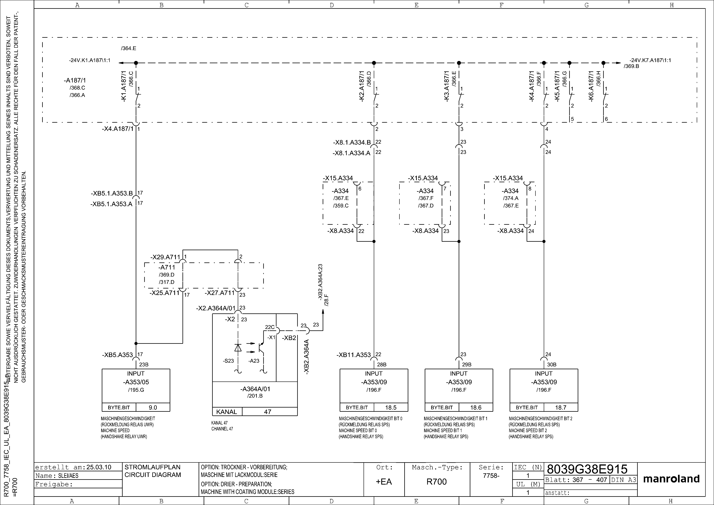

# +EA — Sheet 367 of 407 — OPTION: TROCKNER VORBEREITUNG;

**MASCHINE MIT LACKMODUL:SERIE**

> Part of the manroland **R700** printing press IEC/UL circuit diagrams.
> Drawing class: **Stromlaufplan / Circuit diagram** (DIN A3).
> Document `+EA` covers the **Printing unit** machine section.

## At a glance

| Field | Value |
|---|---|
| Document | `+EA`  (8039G38E915) |
| Sheet | **367** of 407 |
| Section (DE) | OPTION: TROCKNER VORBEREITUNG; |
| Section (EN) | MASCHINE MIT LACKMODUL:SERIE |
| Section type | CIRCUIT — Circuit diagram |
| Machine type | `R700` |
| Series | `7758` |
| Created | 25.03.10 |
| Replaces | — |
| Columns used | A, B, C, D, E, F, G, H |
| Path numbers | — |
| Labels on sheet | 147 |
| Cross-refs out | 24 |
| Cross-refs in | 54 |

**Previous:** [+EA sheet 366](SHEET_0366.md) · **Next:** [+EA sheet 368](SHEET_0368.md) · **Document TOC:** [_TOC.md](_TOC.md)  (+EA) · **Master TOC:** [all sheets](../_MASTER_TOC.md)

## Sheet image (300 DPI, exact vector render)



_Rendered directly from the PDF vector layer at 300 DPI (1-bit), no OCR and no resampling. Use it to confirm anything ambiguous in the text below._

## Cross-references on this sheet

Each entry is a wire leaving this sheet. The printed token is `/sheet.column`; the link resolves to that sheet inside the same document.

| Ref | Target sheet | Col | Path | Destination on target | Target section | From col |
|---|---|---|---|---|---|---|
| `/364.E` | [+EA sheet 364](SHEET_0364.md) | E | — | — | OPTION: TROCKNER VORBEREITUNG; | B |
| `/369.B` | [+EA sheet 369](SHEET_0369.md) | B | — | — | OPTION: ENDTROCKNER 1 VORBEREITUNG; | H |
| `/366.H` | [+EA sheet 366](SHEET_0366.md) | H | — | — | OPTION: TROCKNER VORBEREITUNG; | G |
| `/366.E` | [+EA sheet 366](SHEET_0366.md) | E | — | — | OPTION: TROCKNER VORBEREITUNG; | E |
| `/366.G` | [+EA sheet 366](SHEET_0366.md) | G | — | — | OPTION: TROCKNER VORBEREITUNG; | G |
| `/366.C` | [+EA sheet 366](SHEET_0366.md) | C | — | — | OPTION: TROCKNER VORBEREITUNG; | B |
| `/366.D` | [+EA sheet 366](SHEET_0366.md) | D | — | — | OPTION: TROCKNER VORBEREITUNG; | D |
| `/366.F` | [+EA sheet 366](SHEET_0366.md) | F | — | — | OPTION: TROCKNER VORBEREITUNG; | F |
| `/368.C` | [+EA sheet 368](SHEET_0368.md) | C | — | — | OPTION: ENDTROCKNER 1 VORBEREITUNG; | A |
| `/366.A` | [+EA sheet 366](SHEET_0366.md) | A | — | — | OPTION: TROCKNER VORBEREITUNG; | A |
| `/367.E` | [+EA sheet 367](SHEET_0367.md) | E | — | — | OPTION: TROCKNER VORBEREITUNG; | D |
| `/359.C` | [+EA sheet 359](SHEET_0359.md) | C | — | — | OPTION: | D |
| `/374.A` | [+EA sheet 374](SHEET_0374.md) | A | — | — | OPTION: ENDTROCKNER 1 VORBEREITUNG; | F |
| `/367.F` | [+EA sheet 367](SHEET_0367.md) | F | — | — | OPTION: TROCKNER VORBEREITUNG; | E |
| `/367.D` | [+EA sheet 367](SHEET_0367.md) | D | — | — | OPTION: TROCKNER VORBEREITUNG; | E |
| `/367.E` | [+EA sheet 367](SHEET_0367.md) | E | — | — | OPTION: TROCKNER VORBEREITUNG; | F |
| `/28.F` | [+EA sheet 28](SHEET_0028.md) | F | — | XB2.A364A:23 | BUSVERBINDUNGEN: SICHERHEITSBUS | D |
| `/369.D` | [+EA sheet 369](SHEET_0369.md) | D | — | — | OPTION: ENDTROCKNER 1 VORBEREITUNG; | B |
| `/317.D` | [+EA sheet 317](SHEET_0317.md) | D | — | — | OPTION: LOGISTIK, AUSLEGER | B |
| `/195.G` | [+EA sheet 195](SHEET_0195.md) | G | — | — | REFERENZMODUL | B |
| `/196.F` | [+EA sheet 196](SHEET_0196.md) | F | — | — | REFERENZMODUL | E |
| `/196.F` | [+EA sheet 196](SHEET_0196.md) | F | — | — | REFERENZMODUL | F |
| `/196.F` | [+EA sheet 196](SHEET_0196.md) | F | — | — | REFERENZMODUL | G |
| `/201.B` | [+EA sheet 201](SHEET_0201.md) | B | — | — | REFERENZMODUL | C |

### Incoming references (sheets that point here)

Every other sheet that sends a wire to this one. `Back-ref` is the token printed on *that* sheet; `Path` is its line number.

| From sheet | Cols | Back-ref | Path | Refs | What continues there |
|---|---|---|---|---|---|
| [+EA#28](SHEET_0028.md) | F | `/28.F` | — | 1 | — |
| [+EA#195](SHEET_0195.md) | G | `/195.G` | — | 1 | — |
| [+EA#196](SHEET_0196.md) | F | `/196.F` | — | 3 | — |
| [+EA#201](SHEET_0201.md) | B | `/201.B` | — | 1 | — |
| [+EA#227](SHEET_0227.md) | C, E | `/227.C`, `/227.E` | — | 2 | — |
| [+EA#236](SHEET_0236.md) | B | `/236.B` | — | 6 | — |
| [+EA#240](SHEET_0240.md) | F | `/240.F` | — | 1 | — |
| [+EA#241](SHEET_0241.md) | A, B | `/241.A`, `/241.B` | — | 2 | — |
| [+EA#249](SHEET_0249.md) | D, E, F | `/249.D`, `/249.E`, `/249.F` | — | 9 | — |
| [+EA#256](SHEET_0256.md) | A | `/256.A` | — | 3 | — |
| [+EA#260](SHEET_0260.md) | D | `/260.D` | — | 3 | — |
| [+EA#268](SHEET_0268.md) | E | `/268.E` | — | 1 | — |
| [+EA#271](SHEET_0271.md) | F | `/271.F` | — | 1 | — |
| [+EA#274](SHEET_0274.md) | E | `/274.E` | — | 2 | — |
| [+EA#317](SHEET_0317.md) | D | `/317.D` | — | 1 | — |
| [+EA#359](SHEET_0359.md) | C | `/359.C` | — | 1 | — |
| [+EA#364](SHEET_0364.md) | F | `/364.F` | — | 1 | 24V.K1.A187\1:1 |
| [+EA#366](SHEET_0366.md) | A, C, D, E, F, G, H | `/366.A`, `/366.C`, `/366.D`, `/366.E`, `/366.F`, `/366.G`, `/366.H` | — | 7 | — |
| [+EA#367](SHEET_0367.md) | D, E, F | `/367.D`, `/367.E`, `/367.F` | — | 4 | — |
| [+EA#368](SHEET_0368.md) | B | `/368.B` | — | 1 | — |
| [+EA#369](SHEET_0369.md) | A, D | `/369.A`, `/369.D` | — | 2 | 24V.K7.A187\1:1 |
| [+EA#374](SHEET_0374.md) | A | `/374.A` | — | 1 | — |


## Devices on this sheet

| Tag | Class | Class meaning (IEC) | Col | Sub | Terminal | Sign |
|---|---|---|---|---|---|---|
| `A187/1` | A | Baugruppe / assembly, module, PC board | A | 1 | — | — |
| `A334` | A | Baugruppe / assembly, module, PC board | E | — | — | — |
| `A334` | A | Baugruppe / assembly, module, PC board | D | — | — | — |
| `A353/05` | A | Baugruppe / assembly, module, PC board | B | 05 | — | — |
| `S23` | S | Schalter / switch | C | — | — | — |
| `A23` | A | Baugruppe / assembly, module, PC board | C | — | — | — |
| `X1` | X | Klemme / terminal, plug connector | C | — | — | — |
| `X2` | X | Klemme / terminal, plug connector | C | — | — | — |
| `XB2` | XB |  | C | — | — | — |
| `A353/09` | A | Baugruppe / assembly, module, PC board | F | 09 | — | — |
| `A711` | A | Baugruppe / assembly, module, PC board | B | — | — | — |
| `A353/09` | A | Baugruppe / assembly, module, PC board | E | 09 | — | — |
| `A334` | A | Baugruppe / assembly, module, PC board | F | — | — | — |
| `A353/09` | A | Baugruppe / assembly, module, PC board | G | 09 | — | — |
| `XB5.1.A353.B` | — | cross-device reference | A | — | — | — |
| `XB5.1.A353.A` | — | cross-device reference | A | — | — | — |
| `X8.A334` | — | cross-device reference | E | — | — | — |
| `9.0` | — | cross-device reference | B | — | — | — |
| `XB5.A353` | — | cross-device reference | A | — | — | — |
| `XB2.A364A` | — | cross-device reference | D | — | — | — |
| `X27.A711` | — | cross-device reference | C | — | — | — |
| `18.6` | — | cross-device reference | F | — | — | — |
| `X29.A711` | — | cross-device reference | B | — | — | — |
| `X25.A711` | — | cross-device reference | B | — | — | — |
| `X8.1.A334.B` | — | cross-device reference | D | — | — | — |
| `X8.1.A334.A` | — | cross-device reference | D | — | — | — |
| `X8.A334` | — | cross-device reference | D | — | — | — |
| `18.5` | — | cross-device reference | E | — | — | — |
| `XB11.A353` | — | cross-device reference | D | — | — | — |
| `X8.A334` | — | cross-device reference | F | — | — | — |
| `18.7` | — | cross-device reference | G | — | — | — |
| `XB2.A364A:23` | — | cross-device reference | D | — | 23 | — |
| `X15.A334` | — | cross-device reference | E | — | — | — |
| `X15.A334` | — | cross-device reference | D | — | — | — |
| `X15.A334` | — | cross-device reference | F | — | — | — |

## Potentials / nets

| Potential | Count | Columns | Attached devices | Terminals |
|---|---|---|---|---|
| `24V` | 2 | A, H | `A187\1`, `K1`, `K7` | `1` |


A potential such as `L24+/4` or `M24+` is a named supply/return rail; every place it appears on this sheet is electrically common.

## Wire-end annotations (grouped as printed)

A wire that continues elsewhere is annotated with a small cluster: the destination description, the path/line number `#NN`, and the `/sheet.column` cross reference. Each row below is one such cluster exactly as it is grouped on the drawing.

| Col | Y | Path | Cross-ref | Text on the wire |
|---|---|---|---|---|
| B | 76.8 | — | `/364.E` | — |
| A | 96.7 | — | — | `24V.K1.A187\1:1` |
| H | 96.7 | — | — | `24V.K7.A187\1:1` |
| H | 106.6 | — | `/369.B` | — |
| B | 117.1 | — | — | `K1.A187/1` |
| D | 117.1 | — | — | `K2.A187/1` |
| E | 117.1 | — | — | `K3.A187/1` |
| F | 117.1 | — | — | `K4.A187/1` |
| G | 117.1 | — | — | `K5.A187/1` |
| G | 117.1 | — | — | `K6.A187/1` |
| G | 118.2 | — | `/366.H` | — |
| E | 118.5 | — | `/366.E` | — |
| G | 118.5 | — | `/366.G` | — |
| B | 118.8 | — | `/366.C` | — |
| D | 118.8 | — | `/366.D` | — |
| F | 118.8 | — | `/366.F` | — |
| A | 129.3 | — | — | `A187/1` |
| A | 142.4 | — | `/368.C`, `/366.A` | — |
| B | 144.2 | — | — | `1` |
| E | 144.2 | — | — | `1` |
| F | 144.2 | — | — | `1` |
| G | 144.2 | — | — | `1` |
| G | 144.2 | — | — | `1` |
| G | 144.2 | — | — | `1` |
| B | 172.5 | — | — | `2` |
| E | 172.5 | — | — | `2` |
| F | 172.5 | — | — | `2` |
| G | 172.5 | — | — | `2` |
| G | 172.5 | — | — | `2` |
| G | 172.5 | — | — | `2` |
| G | 194.5 | — | — | `5` |
| G | 194.5 | — | — | `6` |
| B | 210.1 | — | — | `X4.A187/1 1` |
| E | 211.5 | — | — | `2` |
| F | 211.5 | — | — | `3` |
| G | 211.5 | — | — | `4` |
| D | 232.8 | — | — | `X8.1.A334.B 22` |
| F | 232.8 | — | — | `23` |
| G | 232.8 | — | — | `24` |
| D | 249.8 | — | — | `X8.1.A334.A 22` |
| F | 249.8 | — | — | `23` |
| G | 249.8 | — | — | `24` |
| E | 292.3 | — | — | `X15.A334 X15.A334 X15.A334` |
| D | 310.7 | — | — | `6` |
| E | 310.7 | — | — | `7` |
| F | 310.7 | — | — | `8` |
| D | 313.5 | — | — | `A334` |
| E | 313.5 | — | — | `A334` |
| F | 313.5 | — | — | `A334` |
| A | 317.8 | — | — | `XB5.1.A353.B 17` |
| D | 326.6 | — | `/367.E`, `/359.C` | — |
| E | 326.6 | — | `/367.F`, `/367.D` | — |
| F | 326.6 | — | `/374.A` | — |
| A | 334.8 | — | — | `XB5.1.A353.A 17` |
| F | 339.0 | — | `/367.E` | — |
| D | 380.1 | — | — | `X8.A334 22` |
| E | 380.1 | — | — | `X8.A334 23` |
| F | 380.1 | — | — | `X8.A334 24` |
| B | 424.1 | — | — | `X29.A711 1` |
| C | 424.1 | — | — | `2` |
| D | 439.9 | — | `/28.F` | `XB2.A364A:23` |
| B | 441.1 | — | — | `A711` |
| B | 454.2 | — | `/369.D`, `/317.D` | — |
| B | 483.6 | — | — | `X25.A711 17` |
| C | 483.6 | — | — | `X27.A711 23` |
| C | 509.1 | — | — | `X2.A364A/01 23` |
| C | 527.6 | — | — | `X2` |
| C | 529.0 | — | — | `23 23` |
| D | 537.5 | — | — | `23` |
| C | 541.8 | — | — | `22C` |
| C | 558.7 | — | — | `X1` |
| C | 558.7 | — | — | `XB2` |
| D | 565.8 | — | — | `XB2.A364A` |
| B | 587.1 | — | — | `XB5.A353 17` |
| D | 587.1 | — | — | `XB11.A353 22` |
| F | 587.1 | — | — | `23` |
| G | 587.1 | — | — | `24` |
| C | 597.7 | — | — | `S23 A23` |
| B | 604.1 | — | — | `23B` |
| E | 604.1 | — | — | `28B` |
| F | 604.1 | — | — | `29B` |
| G | 604.1 | — | — | `30B` |
| B | 618.6 | — | — | `INPUT` |
| D | 618.6 | — | — | `INPUT` |
| E | 618.6 | — | — | `INPUT` |
| F | 618.6 | — | — | `INPUT` |
| B | 632.4 | — | — | `A353/05` |
| E | 632.4 | — | — | `A353/09` |
| F | 632.4 | — | — | `A353/09` |
| G | 632.4 | — | — | `A353/09` |
| C | 643.8 | — | — | `A364A/01` |
| B | 646.2 | — | `/195.G` | — |
| E | 646.2 | — | `/196.F` | — |
| F | 646.2 | — | `/196.F` | — |
| G | 646.2 | — | `/196.F` | — |
| C | 656.1 | — | `/201.B` | — |
| B | 675.3 | — | — | `BYTE.BIT 9.0` |
| D | 675.3 | — | — | `BYTE.BIT 18.5` |
| E | 675.3 | — | — | `BYTE.BIT 18.6` |
| F | 675.3 | — | — | `BYTE.BIT 18.7` |
| C | 682.0 | — | — | `KANAL 47` |
| B | 695.3 | — | — | `(RÜCKMELDUNG RELAIS UWR) (HANDSHAKE RELAY UWR) MASCHINENGESCHWINDIGKEIT MACHINE SPEED` |
| D | 695.3 | — | — | `(RÜCKMELDUNG RELAIS SPS) (HANDSHAKE RELAY SPS) MASCHINENGESCHWINDIGKEIT BIT 0 MACHINE SPEED BIT 0` |
| E | 695.3 | — | — | `(RÜCKMELDUNG RELAIS SPS) (HANDSHAKE RELAY SPS) MASCHINENGESCHWINDIGKEIT BIT 1 MACHINE SPEED BIT 1` |
| F | 695.3 | — | — | `(RÜCKMELDUNG RELAIS SPS) (HANDSHAKE RELAY SPS) MASCHINENGESCHWINDIGKEIT BIT 2 MACHINE SPEED BIT 2` |
| C | 702.4 | — | — | `KANAL 47 CHANNEL 47` |


## Reconstructed tables

This sheet carries tabular content (pin map / terminal assignment / index). The grid below was rebuilt from the drawing's own rule lines, so each row is exactly one physical row of the table.

### Table 1 — 5 data rows × 2 columns (at x=170.1, y=104.9)

| K1.A187/1 /366.C X4.A187/1 XB5.1.A353.B XB5.1.A353.A | 1 2 1 17 17 |
|---|---|
|  | `X29.A711 A711 /369.D /317.D X25.A711` |
| `XB5.A353` | `17 23B` |
| `INPUT` |  |
|  | `A353/05 /195.G` |
| `BYTE.BIT` | `9.0` |


### Table 2 — 7 data rows × 20 columns (at x=304.7, y=104.9)

|  |  |  |  |  |  | X15.A334 | X8.1.A334.B X8.1.A334.A A334 /367.E /359.C X8.A334 | K2.A187/1 /366.D 6 22 | 1 2 2 22 22 | X15.A334 | A334 /367.F /367.D X8.A334 | K3.A187/1 /366.E 7 23 | 1 2 3 23 23 | X15.A334 | A334 /374.A /367.E X8.A334 | K4.A187/1 /366.F 8 24 | K5.A187/1 /366.G 1 2 4 24 24 | 1 2 5 | K6.A187/1 /366.H |
|---|---|---|---|---|---|---|---|---|---|---|---|---|---|---|---|---|---|---|---|
| `1 17` | `X27.A711 X2.A364A/01` | `2 23 23` |  |  | `XB2.A364A:23` | `/28.F` |  |  |  |  |  |  |  |  |  |  |  |  |  |
|  | `X2` | `23` | `22C X1` | `XB2` | `23 23` |  |  |  |  |  |  |  |  |  |  |  |  |  |  |
|  | `S23` | `A23` |  |  | `XB2.A364A` |  | `XB11.A353` |  | `22 28B` |  |  |  | `23 29B` |  |  |  | `24 30B` |  |  |
|  |  |  |  |  |  |  |  | `INPUT` |  |  |  | `INPUT` |  |  |  | `INPUT` |  |  |  |
|  |  | `A364A/01 /201.B` |  |  |  |  |  |  | `A353/09 /196.F` |  |  |  | `A353/09 /196.F` |  |  |  | `A353/09 /196.F` |  |  |
|  |  |  |  |  |  |  | `BYTE.BIT` |  | `18.5` |  | `BYTE.BIT` |  | `18.6` |  | `BYTE.BIT` |  | `18.7` |  |  |
|  | `KANAL` |  | `47` |  |  |  |  |  |  |  |  |  |  |  |  |  |  |  |  |


## Notes and free text on this sheet

| Text | Col | Y (pt) |
|---|---|---|
| `K6.A187/1` | G | 117.07 |
| `X4.A187/1` | A | 210.08 |
| `K1.A187/1` | B | 117.07 |
| `K5.A187/1` | G | 117.07 |
| `K3.A187/1` | E | 117.07 |
| `23B` | B | 604.07 |
| `INPUT` | B | 618.59 |
| `BYTE.BIT` | A | 675.84 |
| `MASCHINENGESCHWINDIGKEIT` | B | 695.28 |
| `(RÜCKMELDUNG RELAIS UWR)` | B | 705.21 |
| `MACHINE SPEED` | A | 715.2 |
| `(HANDSHAKE RELAY UWR)` | B | 725.09 |
| `KANAL 47` | C | 702.36 |
| `CHANNEL 47` | C | 712.3 |
| `22C` | C | 541.75 |
| `KANAL` | C | 682.03 |
| `A364A/01` | C | 643.77 |
| `X2.A364A/01` | C | 509.13 |
| `29B` | F | 604.07 |
| `INPUT` | E | 618.59 |
| `BYTE.BIT` | E | 675.84 |
| `MASCHINENGESCHWINDIGKEIT BIT 1` | E | 695.27 |
| `(RÜCKMELDUNG RELAIS SPS)` | E | 705.23 |
| `MACHINE SPEED BIT 1` | E | 715.18 |
| `(HANDSHAKE RELAY SPS)` | E | 725.12 |
| `K2.A187/1` | D | 117.07 |
| `28B` | E | 604.07 |
| `INPUT` | D | 618.59 |
| `BYTE.BIT` | D | 675.84 |
| `MASCHINENGESCHWINDIGKEIT BIT 0` | D | 695.28 |
| `(RÜCKMELDUNG RELAIS SPS)` | D | 705.23 |
| `MACHINE SPEED BIT 0` | D | 715.19 |
| `(HANDSHAKE RELAY SPS)` | D | 725.12 |
| `K4.A187/1` | F | 117.07 |
| `30B` | G | 604.07 |
| `INPUT` | F | 618.59 |
| `BYTE.BIT` | F | 675.84 |
| `MASCHINENGESCHWINDIGKEIT BIT 2` | F | 695.28 |
| `(RÜCKMELDUNG RELAIS SPS)` | F | 705.23 |
| `MACHINE SPEED BIT 2` | F | 715.19 |
| `(HANDSHAKE RELAY SPS)` | F | 725.12 |

## Complete label inventory (exact text from the drawing)

Every text object inside the drawing area of this sheet, in DIN reading order (column A→H, then top→bottom). This is the authoritative list: if a string is not here it is not printed on this sheet.

| Col | Y | X | Dir | Type | Text |
|---|---|---|---|---|---|
| A | 96.7 | 115.1 | → | potential | `24V.K1.A187\1:1` |
| A | 129.3 | 106.6 | → | device tag | `A187/1` |
| A | 142.4 | 116.2 | → | cross-reference | `/368.C` |
| A | 154.8 | 116.2 | → | cross-reference | `/366.A` |
| A | 210.1 | 170.1 | → | text | `X4.A187/1` |
| A | 317.8 | 151.7 | → | device ref | `XB5.1.A353.B` |
| A | 335.5 | 150.8 | → | device ref | `XB5.1.A353.A` |
| A | 587.1 | 170.4 | → | device ref | `XB5.A353` |
| A | 675.8 | 180.0 | → | text | `BYTE.BIT` |
| A | 715.2 | 168.4 | → | text | `MACHINE SPEED` |
| B | 76.8 | 201.8 | → | cross-reference | `/364.E` |
| B | 117.1 | 201.6 | ↕ | text | `K1.A187/1` |
| B | 118.8 | 214.7 | ↕ | cross-reference | `/366.C` |
| B | 144.2 | 228.8 | → | number | `1` |
| B | 172.5 | 229.3 | → | number | `2` |
| B | 211.5 | 228.8 | → | number | `1` |
| B | 317.8 | 228.8 | → | number | `17` |
| B | 334.8 | 228.8 | → | number | `17` |
| B | 424.1 | 250.9 | → | device ref | `X29.A711` |
| B | 424.1 | 306.7 | → | number | `1` |
| B | 441.1 | 264.2 | → | device tag | `A711` |
| B | 454.2 | 265.0 | → | cross-reference | `/369.D` |
| B | 466.6 | 265.0 | → | cross-reference | `/317.D` |
| B | 483.6 | 249.4 | → | device ref | `X25.A711` |
| B | 487.9 | 306.7 | → | number | `17` |
| B | 587.1 | 228.8 | → | number | `17` |
| B | 604.1 | 232.2 | → | text | `23B` |
| B | 618.6 | 211.9 | → | text | `INPUT` |
| B | 632.4 | 205.4 | → | device tag | `A353/05` |
| B | 646.2 | 213.9 | → | cross-reference | `/195.G` |
| B | 675.3 | 248.3 | → | device ref | `9.0` |
| B | 695.3 | 168.4 | → | text | `MASCHINENGESCHWINDIGKEIT` |
| B | 705.2 | 168.1 | → | text | `(RÜCKMELDUNG RELAIS UWR)` |
| B | 725.1 | 168.1 | → | text | `(HANDSHAKE RELAY UWR)` |
| C | 424.1 | 399.4 | → | number | `2` |
| C | 483.6 | 341.6 | → | device ref | `X27.A711` |
| C | 487.9 | 399.4 | → | number | `23` |
| C | 509.1 | 327.1 | → | text | `X2.A364A/01` |
| C | 509.1 | 399.4 | → | number | `23` |
| C | 527.6 | 375.3 | → | device tag | `X2` |
| C | 529.0 | 402.2 | → | number | `23` |
| C | 541.7 | 442.2 | → | text | `22C` |
| C | 558.7 | 445.9 | → | device tag | `X1` |
| C | 558.7 | 470.3 | → | device tag | `XB2` |
| C | 597.7 | 371.6 | → | device tag | `S23` |
| C | 597.7 | 414.1 | → | device tag | `A23` |
| C | 643.8 | 401.0 | → | text | `A364A/01` |
| C | 656.1 | 412.6 | → | cross-reference | `/201.B` |
| C | 682.0 | 360.6 | → | text | `KANAL` |
| C | 682.0 | 440.6 | → | number | `47` |
| C | 702.4 | 352.3 | → | text | `KANAL 47` |
| C | 712.3 | 352.6 | → | text | `CHANNEL 47` |
| D | 117.1 | 598.4 | ↕ | text | `K2.A187/1` |
| D | 118.8 | 611.5 | ↕ | cross-reference | `/366.D` |
| D | 232.8 | 555.6 | → | device ref | `X8.1.A334.B` |
| D | 250.5 | 554.7 | → | device ref | `X8.1.A334.A` |
| D | 292.3 | 538.6 | → | device ref | `X15.A334` |
| D | 310.7 | 597.8 | → | number | `6` |
| D | 313.5 | 553.3 | → | device tag | `A334` |
| D | 326.6 | 556.2 | → | cross-reference | `/367.E` |
| D | 339.0 | 555.6 | → | cross-reference | `/359.C` |
| D | 380.2 | 546.0 | → | device ref | `X8.A334` |
| D | 381.6 | 597.8 | → | number | `22` |
| D | 439.9 | 530.4 | ↕ | device ref | `XB2.A364A:23` |
| D | 490.1 | 540.3 | ↕ | cross-reference | `/28.F` |
| D | 537.5 | 522.1 | → | number | `23` |
| D | 538.9 | 501.4 | → | number | `23` |
| D | 565.8 | 506.3 | ↕ | device ref | `XB2.A364A` |
| D | 587.1 | 561.3 | → | device ref | `XB11.A353` |
| D | 618.6 | 608.7 | → | text | `INPUT` |
| D | 675.8 | 576.9 | → | text | `BYTE.BIT` |
| D | 695.3 | 565.2 | → | text | `MASCHINENGESCHWINDIGKEIT BIT 0` |
| D | 705.2 | 564.9 | → | text | `(RÜCKMELDUNG RELAIS SPS)` |
| D | 715.2 | 565.2 | → | text | `MACHINE SPEED BIT 0` |
| D | 725.1 | 564.9 | → | text | `(HANDSHAKE RELAY SPS)` |
| E | 117.1 | 740.2 | ↕ | text | `K3.A187/1` |
| E | 118.5 | 753.2 | ↕ | cross-reference | `/366.E` |
| E | 144.2 | 625.6 | → | number | `1` |
| E | 172.5 | 626.2 | → | number | `2` |
| E | 211.5 | 626.2 | → | number | `2` |
| E | 232.8 | 626.2 | → | number | `22` |
| E | 249.8 | 626.2 | → | number | `22` |
| E | 292.3 | 680.3 | → | device ref | `X15.A334` |
| E | 310.7 | 739.6 | → | number | `7` |
| E | 313.5 | 695.1 | → | device tag | `A334` |
| E | 326.6 | 698.2 | → | cross-reference | `/367.F` |
| E | 339.0 | 697.3 | → | cross-reference | `/367.D` |
| E | 380.2 | 687.7 | → | device ref | `X8.A334` |
| E | 381.6 | 739.6 | → | number | `23` |
| E | 587.1 | 626.2 | → | number | `22` |
| E | 604.1 | 629.0 | → | text | `28B` |
| E | 618.6 | 750.5 | → | text | `INPUT` |
| E | 632.4 | 602.2 | → | device tag | `A353/09` |
| E | 646.2 | 611.3 | → | cross-reference | `/196.F` |
| E | 675.3 | 642.2 | → | device ref | `18.5` |
| E | 675.8 | 718.6 | → | text | `BYTE.BIT` |
| E | 695.3 | 707.0 | → | text | `MASCHINENGESCHWINDIGKEIT BIT 1` |
| E | 705.2 | 706.7 | → | text | `(RÜCKMELDUNG RELAIS SPS)` |
| E | 715.2 | 707.0 | → | text | `MACHINE SPEED BIT 1` |
| E | 725.1 | 706.7 | → | text | `(HANDSHAKE RELAY SPS)` |
| F | 117.1 | 881.9 | ↕ | text | `K4.A187/1` |
| F | 118.8 | 895.0 | ↕ | cross-reference | `/366.F` |
| F | 144.2 | 767.3 | → | number | `1` |
| F | 172.5 | 767.9 | → | number | `2` |
| F | 211.5 | 767.9 | → | number | `3` |
| F | 232.8 | 767.9 | → | number | `23` |
| F | 249.8 | 767.9 | → | number | `23` |
| F | 292.3 | 822.0 | → | device ref | `X15.A334` |
| F | 310.7 | 881.3 | → | number | `8` |
| F | 313.5 | 836.8 | → | device tag | `A334` |
| F | 326.6 | 839.1 | → | cross-reference | `/374.A` |
| F | 339.0 | 839.6 | → | cross-reference | `/367.E` |
| F | 380.2 | 829.4 | → | device ref | `X8.A334` |
| F | 381.6 | 881.3 | → | number | `24` |
| F | 587.1 | 767.9 | → | number | `23` |
| F | 604.1 | 770.7 | → | text | `29B` |
| F | 618.6 | 892.2 | → | text | `INPUT` |
| F | 632.4 | 744.0 | → | device tag | `A353/09` |
| F | 646.2 | 753.0 | → | cross-reference | `/196.F` |
| F | 675.3 | 783.9 | → | device ref | `18.6` |
| F | 675.8 | 860.3 | → | text | `BYTE.BIT` |
| F | 695.3 | 848.7 | → | text | `MASCHINENGESCHWINDIGKEIT BIT 2` |
| F | 705.2 | 848.4 | → | text | `(RÜCKMELDUNG RELAIS SPS)` |
| F | 715.2 | 848.7 | → | text | `MACHINE SPEED BIT 2` |
| F | 725.1 | 848.4 | → | text | `(HANDSHAKE RELAY SPS)` |
| G | 117.1 | 924.4 | ↕ | text | `K5.A187/1` |
| G | 117.1 | 981.1 | ↕ | text | `K6.A187/1` |
| G | 118.2 | 994.2 | ↕ | cross-reference | `/366.H` |
| G | 118.5 | 937.5 | ↕ | cross-reference | `/366.G` |
| G | 144.2 | 909.1 | → | number | `1` |
| G | 144.2 | 951.6 | → | number | `1` |
| G | 144.2 | 1008.3 | → | number | `1` |
| G | 172.5 | 909.6 | → | number | `2` |
| G | 172.5 | 952.2 | → | number | `2` |
| G | 172.5 | 1008.9 | → | number | `2` |
| G | 194.5 | 952.2 | → | number | `5` |
| G | 194.5 | 1008.9 | → | number | `6` |
| G | 211.5 | 909.6 | → | number | `4` |
| G | 232.8 | 909.6 | → | number | `24` |
| G | 249.8 | 909.6 | → | number | `24` |
| G | 587.1 | 909.6 | → | number | `24` |
| G | 604.1 | 912.5 | → | text | `30B` |
| G | 632.4 | 885.7 | → | device tag | `A353/09` |
| G | 646.2 | 894.8 | → | cross-reference | `/196.F` |
| G | 675.3 | 925.7 | → | device ref | `18.7` |
| H | 96.7 | 1050.0 | → | potential | `24V.K7.A187\1:1` |
| H | 106.6 | 1040.3 | → | cross-reference | `/369.B` |

## Reading-order text block

The same content as a plain block, grouped by DIN column — convenient to paste or to match against a visual description.

```text
=== Column A ===
  96.7  115.1  net          24V.K1.A187\1:1
 129.3  106.6  devtag       A187/1
 142.4  116.2  xref         /368.C
 154.8  116.2  xref         /366.A
 210.1  170.1  text         X4.A187/1
 317.8  151.7  devref       XB5.1.A353.B
 335.5  150.8  devref       XB5.1.A353.A
 587.1  170.4  devref       XB5.A353
 675.8  180.0  text         BYTE.BIT
 715.2  168.4  text         MACHINE SPEED
=== Column B ===
  76.8  201.8  xref         /364.E
 117.1  201.6  text         K1.A187/1
 118.8  214.7  xref         /366.C
 144.2  228.8  numeric      1
 172.5  229.3  numeric      2
 211.5  228.8  numeric      1
 317.8  228.8  numeric      17
 334.8  228.8  numeric      17
 424.1  250.9  devref       X29.A711
 424.1  306.7  numeric      1
 441.1  264.2  devtag       A711
 454.2  265.0  xref         /369.D
 466.6  265.0  xref         /317.D
 483.6  249.4  devref       X25.A711
 487.9  306.7  numeric      17
 587.1  228.8  numeric      17
 604.1  232.2  text         23B
 618.6  211.9  text         INPUT
 632.4  205.4  devtag       A353/05
 646.2  213.9  xref         /195.G
 675.3  248.3  devref       9.0
 695.3  168.4  text         MASCHINENGESCHWINDIGKEIT
 705.2  168.1  text         (RÜCKMELDUNG RELAIS UWR)
 725.1  168.1  text         (HANDSHAKE RELAY UWR)
=== Column C ===
 424.1  399.4  numeric      2
 483.6  341.6  devref       X27.A711
 487.9  399.4  numeric      23
 509.1  327.1  text         X2.A364A/01
 509.1  399.4  numeric      23
 527.6  375.3  devtag       X2
 529.0  402.2  numeric      23
 541.7  442.2  text         22C
 558.7  445.9  devtag       X1
 558.7  470.3  devtag       XB2
 597.7  371.6  devtag       S23
 597.7  414.1  devtag       A23
 643.8  401.0  text         A364A/01
 656.1  412.6  xref         /201.B
 682.0  360.6  text         KANAL
 682.0  440.6  numeric      47
 702.4  352.3  text         KANAL 47
 712.3  352.6  text         CHANNEL 47
=== Column D ===
 117.1  598.4  text         K2.A187/1
 118.8  611.5  xref         /366.D
 232.8  555.6  devref       X8.1.A334.B
 250.5  554.7  devref       X8.1.A334.A
 292.3  538.6  devref       X15.A334
 310.7  597.8  numeric      6
 313.5  553.3  devtag       A334
 326.6  556.2  xref         /367.E
 339.0  555.6  xref         /359.C
 380.2  546.0  devref       X8.A334
 381.6  597.8  numeric      22
 439.9  530.4  devref       XB2.A364A:23
 490.1  540.3  xref         /28.F
 537.5  522.1  numeric      23
 538.9  501.4  numeric      23
 565.8  506.3  devref       XB2.A364A
 587.1  561.3  devref       XB11.A353
 618.6  608.7  text         INPUT
 675.8  576.9  text         BYTE.BIT
 695.3  565.2  text         MASCHINENGESCHWINDIGKEIT BIT 0
 705.2  564.9  text         (RÜCKMELDUNG RELAIS SPS)
 715.2  565.2  text         MACHINE SPEED BIT 0
 725.1  564.9  text         (HANDSHAKE RELAY SPS)
=== Column E ===
 117.1  740.2  text         K3.A187/1
 118.5  753.2  xref         /366.E
 144.2  625.6  numeric      1
 172.5  626.2  numeric      2
 211.5  626.2  numeric      2
 232.8  626.2  numeric      22
 249.8  626.2  numeric      22
 292.3  680.3  devref       X15.A334
 310.7  739.6  numeric      7
 313.5  695.1  devtag       A334
 326.6  698.2  xref         /367.F
 339.0  697.3  xref         /367.D
 380.2  687.7  devref       X8.A334
 381.6  739.6  numeric      23
 587.1  626.2  numeric      22
 604.1  629.0  text         28B
 618.6  750.5  text         INPUT
 632.4  602.2  devtag       A353/09
 646.2  611.3  xref         /196.F
 675.3  642.2  devref       18.5
 675.8  718.6  text         BYTE.BIT
 695.3  707.0  text         MASCHINENGESCHWINDIGKEIT BIT 1
 705.2  706.7  text         (RÜCKMELDUNG RELAIS SPS)
 715.2  707.0  text         MACHINE SPEED BIT 1
 725.1  706.7  text         (HANDSHAKE RELAY SPS)
=== Column F ===
 117.1  881.9  text         K4.A187/1
 118.8  895.0  xref         /366.F
 144.2  767.3  numeric      1
 172.5  767.9  numeric      2
 211.5  767.9  numeric      3
 232.8  767.9  numeric      23
 249.8  767.9  numeric      23
 292.3  822.0  devref       X15.A334
 310.7  881.3  numeric      8
 313.5  836.8  devtag       A334
 326.6  839.1  xref         /374.A
 339.0  839.6  xref         /367.E
 380.2  829.4  devref       X8.A334
 381.6  881.3  numeric      24
 587.1  767.9  numeric      23
 604.1  770.7  text         29B
 618.6  892.2  text         INPUT
 632.4  744.0  devtag       A353/09
 646.2  753.0  xref         /196.F
 675.3  783.9  devref       18.6
 675.8  860.3  text         BYTE.BIT
 695.3  848.7  text         MASCHINENGESCHWINDIGKEIT BIT 2
 705.2  848.4  text         (RÜCKMELDUNG RELAIS SPS)
 715.2  848.7  text         MACHINE SPEED BIT 2
 725.1  848.4  text         (HANDSHAKE RELAY SPS)
=== Column G ===
 117.1  924.4  text         K5.A187/1
 117.1  981.1  text         K6.A187/1
 118.2  994.2  xref         /366.H
 118.5  937.5  xref         /366.G
 144.2  909.1  numeric      1
 144.2  951.6  numeric      1
 144.2 1008.3  numeric      1
 172.5  909.6  numeric      2
 172.5  952.2  numeric      2
 172.5 1008.9  numeric      2
 194.5  952.2  numeric      5
 194.5 1008.9  numeric      6
 211.5  909.6  numeric      4
 232.8  909.6  numeric      24
 249.8  909.6  numeric      24
 587.1  909.6  numeric      24
 604.1  912.5  text         30B
 632.4  885.7  devtag       A353/09
 646.2  894.8  xref         /196.F
 675.3  925.7  devref       18.7
=== Column H ===
  96.7 1050.0  net          24V.K7.A187\1:1
 106.6 1040.3  xref         /369.B
```

---
_Generated from the PDF vector text layer; no OCR. Source: `R700_7758_IEC_UL_EA_8039G38E915_p`, sheet 367._
