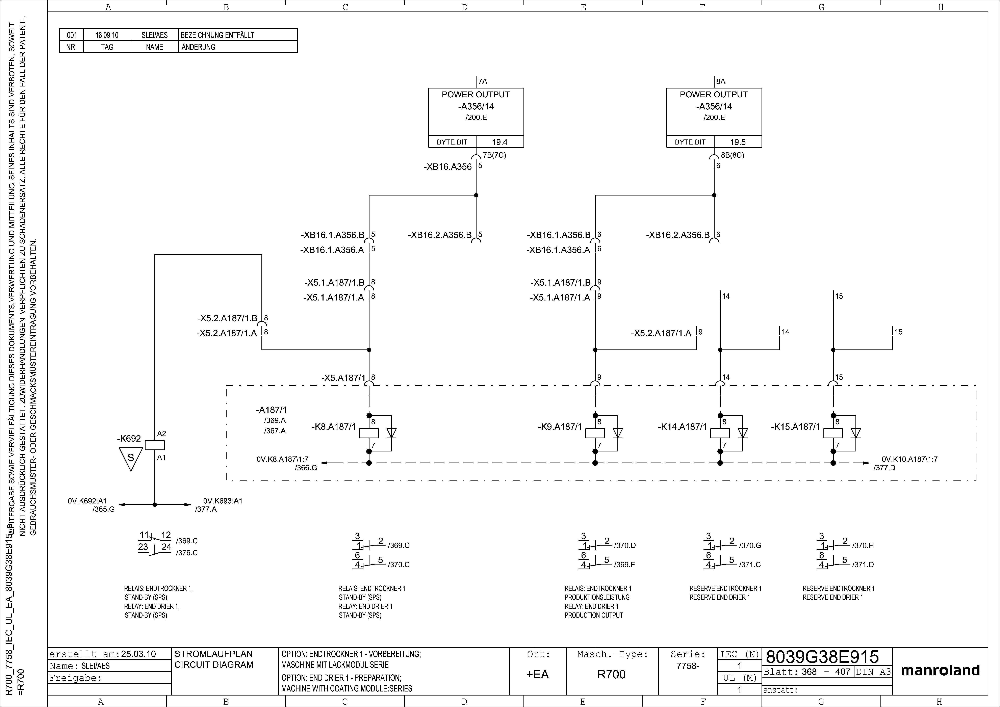

# +EA — Sheet 368 of 407 — OPTION: ENDTROCKNER 1 VORBEREITUNG;

**MASCHINE MIT LACKMODUL:SERIE**

> Part of the manroland **R700** printing press IEC/UL circuit diagrams.
> Drawing class: **Stromlaufplan / Circuit diagram** (DIN A3).
> Document `+EA` covers the **Printing unit** machine section.

## At a glance

| Field | Value |
|---|---|
| Document | `+EA`  (8039G38E915) |
| Sheet | **368** of 407 |
| Section (DE) | OPTION: ENDTROCKNER 1 VORBEREITUNG; |
| Section (EN) | MASCHINE MIT LACKMODUL:SERIE |
| Section type | CIRCUIT — Circuit diagram |
| Machine type | `R700` |
| Series | `7758` |
| Created | 25.03.10 |
| Replaces | — |
| Columns used | A, B, C, D, E, F, G, H |
| Path numbers | — |
| Labels on sheet | 140 |
| Cross-refs out | 17 |
| Cross-refs in | 41 |

**Previous:** [+EA sheet 367](SHEET_0367.md) · **Next:** [+EA sheet 369](SHEET_0369.md) · **Document TOC:** [_TOC.md](_TOC.md)  (+EA) · **Master TOC:** [all sheets](../_MASTER_TOC.md)

## Sheet image (300 DPI, exact vector render)



_Rendered directly from the PDF vector layer at 300 DPI (1-bit), no OCR and no resampling. Use it to confirm anything ambiguous in the text below._

## Cross-references on this sheet

Each entry is a wire leaving this sheet. The printed token is `/sheet.column`; the link resolves to that sheet inside the same document.

| Ref | Target sheet | Col | Path | Destination on target | Target section | From col |
|---|---|---|---|---|---|---|
| `/200.E` | [+EA sheet 200](SHEET_0200.md) | E | — | — | REFERENZMODUL | D |
| `/200.E` | [+EA sheet 200](SHEET_0200.md) | E | — | — | REFERENZMODUL | F |
| `/369.A` | [+EA sheet 369](SHEET_0369.md) | A | — | — | OPTION: ENDTROCKNER 1 VORBEREITUNG; | B |
| `/367.A` | [+EA sheet 367](SHEET_0367.md) | A | — | — | OPTION: TROCKNER VORBEREITUNG; | B |
| `/366.G` | [+EA sheet 366](SHEET_0366.md) | G | — | 0V.K8.A187\1:7 | OPTION: TROCKNER VORBEREITUNG; | E |
| `/377.D` | [+EA sheet 377](SHEET_0377.md) | D | — | 0V.K8.A187\1:7 | OPTION: ENDTROCKNER 2 VORBEREITUNG | E |
| `/377.A` | [+EA sheet 377](SHEET_0377.md) | A | — | 0V.K692:A1 | OPTION: ENDTROCKNER 2 VORBEREITUNG | A |
| `/365.G` | [+EA sheet 365](SHEET_0365.md) | G | — | 0V.K692:A1 | OPTION: TROCKNER VORBEREITUNG; | A |
| `/370.G` | [+EA sheet 370](SHEET_0370.md) | G | — | — | OPTION: ENDTROCKNER 1 VORBEREITUNG; | F |
| `/369.C` | [+EA sheet 369](SHEET_0369.md) | C | — | — | OPTION: ENDTROCKNER 1 VORBEREITUNG; | C |
| `/370.D` | [+EA sheet 370](SHEET_0370.md) | D | — | — | OPTION: ENDTROCKNER 1 VORBEREITUNG; | E |
| `/370.H` | [+EA sheet 370](SHEET_0370.md) | H | — | — | OPTION: ENDTROCKNER 1 VORBEREITUNG; | G |
| `/376.C` | [+EA sheet 376](SHEET_0376.md) | C | — | — | OPTION: ENDTROCKNER 1 VORBEREITUNG; | B |
| `/369.F` | [+EA sheet 369](SHEET_0369.md) | F | — | — | OPTION: ENDTROCKNER 1 VORBEREITUNG; | E |
| `/370.C` | [+EA sheet 370](SHEET_0370.md) | C | — | — | OPTION: ENDTROCKNER 1 VORBEREITUNG; | C |
| `/371.C` | [+EA sheet 371](SHEET_0371.md) | C | — | — | OPTION: ENDTROCKNER 1 VORBEREITUNG; | F |
| `/371.D` | [+EA sheet 371](SHEET_0371.md) | D | — | — | OPTION: ENDTROCKNER 1 VORBEREITUNG; | G |

### Incoming references (sheets that point here)

Every other sheet that sends a wire to this one. `Back-ref` is the token printed on *that* sheet; `Path` is its line number.

| From sheet | Cols | Back-ref | Path | Refs | What continues there |
|---|---|---|---|---|---|
| [+EA#200](SHEET_0200.md) | E | `/200.E` | — | 2 | — |
| [+EA#239](SHEET_0239.md) | C, D, E, F, G, H | `/239.C`, `/239.D`, `/239.E`, `/239.F`, `/239.G`, `/239.H` | — | 15 | — |
| [+EA#261](SHEET_0261.md) | H | `/261.H` | — | 2 | — |
| [+EA#262](SHEET_0262.md) | A, B, E | `/262.A`, `/262.B`, `/262.E` | — | 6 | — |
| [+EA#365](SHEET_0365.md) | G | `/365.G` | — | 1 | — |
| [+EA#366](SHEET_0366.md) | H | `/366.H` | — | 1 | — |
| [+EA#367](SHEET_0367.md) | A | `/367.A` | — | 1 | — |
| [+EA#369](SHEET_0369.md) | A, C, F | `/369.A`, `/369.C`, `/369.F` | — | 4 | — |
| [+EA#370](SHEET_0370.md) | C, D, G | `/370.C`, `/370.D`, `/370.G` | — | 4 | — |
| [+EA#371](SHEET_0371.md) | B, D | `/371.B`, `/371.D` | — | 2 | — |
| [+EA#376](SHEET_0376.md) | C | `/376.C` | — | 1 | — |
| [+EA#377](SHEET_0377.md) | A, C | `/377.A`, `/377.C` | — | 2 | 0V.K10.A187\1:7; 0V.K693:A1 |


## Devices on this sheet

| Tag | Class | Class meaning (IEC) | Col | Sub | Terminal | Sign |
|---|---|---|---|---|---|---|
| `A356/14` | A | Baugruppe / assembly, module, PC board | D | 14 | — | — |
| `A356/14` | A | Baugruppe / assembly, module, PC board | F | 14 | — | — |
| `A187/1` | A | Baugruppe / assembly, module, PC board | B | 1 | — | — |
| `A2` | A | Baugruppe / assembly, module, PC board | A | — | — | — |
| `A1` | A | Baugruppe / assembly, module, PC board | A | — | — | — |
| `K692` | K | Relais / relay, contactor | A | — | — | — |
| `19.4` | — | cross-device reference | D | — | — | — |
| `XB16.A356` | — | cross-device reference | D | — | — | — |
| `19.5` | — | cross-device reference | F | — | — | — |
| `XB16.2.A356.B` | — | cross-device reference | D | — | — | — |
| `XB16.1.A356.B` | — | cross-device reference | C | — | — | — |
| `XB16.2.A356.B` | — | cross-device reference | F | — | — | — |
| `XB16.1.A356.B` | — | cross-device reference | E | — | — | — |
| `XB16.1.A356.A` | — | cross-device reference | C | — | — | — |
| `XB16.1.A356.A` | — | cross-device reference | E | — | — | — |
| `NR.` | — | cross-device reference | A | — | — | — |
| `16.09.10` | — | cross-device reference | A | — | — | — |

## Potentials / nets

| Potential | Count | Columns | Attached devices | Terminals |
|---|---|---|---|---|
| `0V` | 4 | A, B, H | `A187\1`, `K10`, `K692`, `K693`, `K8` | `7`, `A1` |


A potential such as `L24+/4` or `M24+` is a named supply/return rail; every place it appears on this sheet is electrically common.

## Wire-end annotations (grouped as printed)

A wire that continues elsewhere is annotated with a small cluster: the destination description, the path/line number `#NN`, and the `/sheet.column` cross reference. Each row below is one such cluster exactly as it is grouped on the drawing.

| Col | Y | Path | Cross-ref | Text on the wire |
|---|---|---|---|---|
| A | 38.5 | — | — | `001 16.09.10 SLEI/AES BEZEICHNUNG ENTFÄLLT` |
| A | 52.7 | — | — | `NR. TAG NAME ÄNDERUNG` |
| D | 93.1 | — | — | `7A` |
| F | 93.1 | — | — | `8A` |
| D | 108.3 | — | — | `POWER OUTPUT` |
| F | 108.3 | — | — | `POWER OUTPUT` |
| D | 122.2 | — | — | `A356/14` |
| F | 122.2 | — | — | `A356/14` |
| D | 136.0 | — | `/200.E` | — |
| F | 136.0 | — | `/200.E` | — |
| D | 165.0 | — | — | `BYTE.BIT 19.4` |
| F | 165.0 | — | — | `BYTE.BIT 19.5` |
| D | 181.0 | — | — | `7B(7C)` |
| F | 181.0 | — | — | `8B(8C)` |
| D | 193.1 | — | — | `XB16.A356 5` |
| F | 193.1 | — | — | `6` |
| D | 275.3 | — | — | `XB16.1.A356.B 5 XB16.2.A356.B 5 XB16.1.A356.B 6 XB16.2.A356.B 6` |
| D | 292.3 | — | — | `XB16.1.A356.A 5 XB16.1.A356.A 6` |
| C | 332.0 | — | — | `X5.1.A187/1.B 8` |
| E | 332.0 | — | — | `X5.1.A187/1.B 9` |
| C | 349.0 | — | — | `X5.1.A187/1.A 8` |
| E | 349.0 | — | — | `X5.1.A187/1.A 9` |
| F | 349.0 | — | — | `14` |
| G | 349.0 | — | — | `15` |
| B | 374.5 | — | — | `X5.2.A187/1.B 8` |
| B | 391.5 | — | — | `X5.2.A187/1.A 8` |
| F | 391.5 | — | — | `X5.2.A187/1.A 9` |
| G | 391.5 | — | — | `14` |
| H | 391.5 | — | — | `15` |
| D | 445.4 | — | — | `X5.A187/1 8 9` |
| F | 445.4 | — | — | `14` |
| G | 445.4 | — | — | `15` |
| B | 483.6 | — | — | `A187/1` |
| B | 496.7 | — | `/369.A`, `/367.A` | — |
| C | 498.5 | — | — | `8` |
| E | 498.5 | — | — | `8` |
| F | 498.5 | — | — | `8` |
| G | 498.5 | — | — | `8` |
| C | 503.5 | — | — | `K8.A187/1` |
| E | 503.5 | — | — | `K9.A187/1` |
| F | 503.5 | — | — | `K14.A187/1` |
| G | 503.5 | — | — | `K15.A187/1` |
| A | 512.6 | — | — | `A2` |
| A | 517.6 | — | — | `K692` |
| C | 526.9 | — | — | `7` |
| E | 526.9 | — | — | `7` |
| F | 526.9 | — | — | `7` |
| G | 526.9 | — | — | `7` |
| E | 539.7 | — | — | `S 0V.K10.A187\1:7` |
| A | 541.0 | — | — | `A1` |
| E | 543.1 | — | `/366.G`, `/377.D` | `0V.K8.A187\1:7` |
| A | 592.7 | — | `/377.A`, `/365.G` | `0V.K692:A1` |
| B | 592.7 | — | — | `0V.K693:A1` |
| B | 632.4 | — | — | `23 11 12 /369.C 24` |
| C | 633.8 | — | — | `3 6 4 1` |
| E | 633.8 | — | — | `3 6 4 1` |
| F | 633.8 | — | — | `3 6 4 1` |
| G | 633.8 | — | — | `3 6 4 1` |
| C | 639.5 | — | — | `2` |
| E | 639.5 | — | — | `2` |
| F | 639.5 | — | — | `2` |
| G | 639.5 | — | — | `2` |
| C | 645.9 | — | `/369.C` | — |
| E | 645.9 | — | `/370.D` | — |
| F | 645.9 | — | `/370.G` | — |
| G | 645.9 | — | `/370.H` | — |
| B | 654.4 | — | `/376.C` | — |
| C | 662.2 | — | — | `5` |
| E | 662.2 | — | — | `5` |
| F | 662.2 | — | — | `5` |
| G | 662.2 | — | — | `5` |
| E | 668.5 | — | `/369.F` | — |
| C | 668.6 | — | `/370.C` | — |
| F | 668.6 | — | `/371.C` | — |
| G | 668.6 | — | `/371.D` | — |
| A | 697.9 | — | — | `RELAIS: ENDTROCKNER 1,` |
| C | 697.9 | — | — | `RELAIS: ENDTROCKNER 1` |
| E | 697.9 | — | — | `RELAIS: ENDTROCKNER 1 PRODUKTIONSLEISTUNG RELAY: END DRIER 1 PRODUCTION OUTPUT` |
| F | 697.9 | — | — | `RESERVE ENDTROCKNER 1 RESERVE END DRIER 1` |
| G | 697.9 | — | — | `RESERVE ENDTROCKNER 1 RESERVE END DRIER 1` |
| A | 708.6 | — | — | `RELAY: END DRIER 1, STAND BY (SPS)` |
| C | 708.6 | — | — | `RELAY: END DRIER 1 STAND BY (SPS)` |
| A | 729.8 | — | — | `STAND BY (SPS)` |
| C | 729.8 | — | — | `STAND BY (SPS)` |


## Reconstructed tables

This sheet carries tabular content (pin map / terminal assignment / index). The grid below was rebuilt from the drawing's own rule lines, so each row is exactly one physical row of the table.

### Table 1 — 2 data rows × 1 columns (at x=439.4, y=104.9)

| C1 |
|---|
| `5 5 8 8` |
| `8 8 7` |


### Table 2 — 4 data rows × 8 columns (at x=510.2, y=104.9)

| POWER | OUTPUT A356/14 /200.E |  |  |  | POWER | A356/14 /200.E | OUTPUT |
|---|---|---|---|---|---|---|---|
| `BYTE.BIT` | `19.4` |  |  |  | `BYTE.BIT` |  | `19.5` |
| `XB16.A356` | `7B(7C) 5` |  |  |  |  | `6` | `8B(8C)` |
| `XB16.2.A356.B` | `5` | `XB16.1.A356.B XB16.1.A356.A X5.1.A187/1.B X5.1.A187/1.A` | `6 6 9 9` | `X5.2.A187/1.A` | `XB16.2.A356.B 9` | `6` | `14` |
|  |  | `K9.A187/1` | `9 8 7` |  | `K14.A187/1` |  | `14 8 7` |


### Table 3 — 1 data rows × 2 columns (at x=907.1, y=104.9)

| 14 | 15 |
|---|---|
| `K15.A187/1` | `15 8 7` |


## Notes and free text on this sheet

| Text | Col | Y (pt) |
|---|---|---|
| `7A` | D | 93.1 |
| `7B(7C)` | D | 181.03 |
| `POWER OUTPUT` | D | 108.28 |
| `BYTE.BIT` | D | 165.6 |
| `8A` | F | 93.1 |
| `8B(8C)` | F | 181.03 |
| `POWER OUTPUT` | F | 108.28 |
| `BYTE.BIT` | F | 165.6 |
| `X5.A187/1` | C | 445.35 |
| `K8.A187/1` | C | 503.46 |
| `RELAIS: ENDTROCKNER 1` | C | 697.93 |
| `STAND BY (SPS)` | C | 708.57 |
| `RELAY: END DRIER 1` | C | 719.19 |
| `K9.A187/1` | E | 503.46 |
| `RELAIS: ENDTROCKNER 1` | E | 697.93 |
| `PRODUKTIONSLEISTUNG` | E | 708.58 |
| `RELAY: END DRIER 1` | E | 719.19 |
| `PRODUCTION OUTPUT` | E | 729.86 |
| `X5.1.A187/1.B` | E | 331.98 |
| `X5.1.A187/1.A` | E | 349.69 |
| `X5.1.A187/1.B` | C | 331.98 |
| `X5.1.A187/1.A` | C | 349.69 |
| `X5.2.A187/1.A` | B | 392.21 |
| `X5.2.A187/1.B` | B | 374.49 |
| `K15.A187/1` | G | 503.46 |
| `RESERVE ENDTROCKNER 1` | G | 697.94 |
| `RESERVE END DRIER 1` | G | 708.56 |
| `12 /369.C` | B | 632.4 |
| `RELAIS: ENDTROCKNER 1,` | A | 697.94 |
| `STAND BY (SPS)` | A | 708.57 |
| `RELAY: END DRIER 1,` | A | 719.2 |
| `X5.2.A187/1.A` | F | 392.21 |
| `K14.A187/1` | F | 503.46 |
| `RESERVE ENDTROCKNER 1` | F | 697.94 |
| `RESERVE END DRIER 1` | F | 708.56 |
| `TAG` | A | 52.78 |
| `NAME` | A | 52.76 |
| `ÄNDERUNG` | B | 52.82 |
| `SLEI/AES` | A | 38.64 |
| `BEZEICHNUNG ENTFÄLLT` | B | 38.66 |
| `S` | A | 539.67 |

## Complete label inventory (exact text from the drawing)

Every text object inside the drawing area of this sheet, in DIN reading order (column A→H, then top→bottom). This is the authoritative list: if a string is not here it is not printed on this sheet.

| Col | Y | X | Dir | Type | Text |
|---|---|---|---|---|---|
| A | 38.5 | 79.8 | → | number | `001` |
| A | 38.6 | 113.6 | → | device ref | `16.09.10` |
| A | 38.6 | 168.7 | → | text | `SLEI/AES` |
| A | 52.7 | 78.9 | → | device ref | `NR.` |
| A | 52.8 | 120.4 | → | text | `TAG` |
| A | 52.8 | 173.8 | → | text | `NAME` |
| A | 512.6 | 187.1 | → | device tag | `A2` |
| A | 517.6 | 139.5 | → | device tag | `K692` |
| A | 539.7 | 151.8 | → | text | `S` |
| A | 541.0 | 187.1 | → | device tag | `A1` |
| A | 592.7 | 80.8 | → | potential | `0V.K692:A1` |
| A | 602.6 | 110.3 | → | cross-reference | `/365.G` |
| A | 632.4 | 165.8 | → | number | `11` |
| A | 646.6 | 164.4 | → | number | `23` |
| A | 646.6 | 192.5 | → | number | `24` |
| A | 697.9 | 148.0 | → | text | `RELAIS: ENDTROCKNER 1,` |
| A | 708.6 | 148.5 | → | text | `STAND BY (SPS)` |
| A | 719.2 | 148.0 | → | text | `RELAY: END DRIER 1,` |
| A | 729.8 | 148.5 | → | text | `STAND BY (SPS)` |
| B | 38.7 | 215.3 | → | text | `BEZEICHNUNG ENTFÄLLT` |
| B | 52.8 | 216.4 | → | text | `ÄNDERUNG` |
| B | 374.5 | 235.0 | → | text | `X5.2.A187/1.B` |
| B | 374.5 | 314.4 | → | number | `8` |
| B | 391.5 | 314.4 | → | number | `8` |
| B | 392.2 | 234.1 | → | text | `X5.2.A187/1.A` |
| B | 483.6 | 305.0 | → | device tag | `A187/1` |
| B | 496.7 | 314.6 | → | cross-reference | `/369.A` |
| B | 509.1 | 314.6 | → | cross-reference | `/367.A` |
| B | 543.1 | 305.6 | → | potential | `0V.K8.A187\1:7` |
| B | 592.7 | 242.1 | → | potential | `0V.K693:A1` |
| B | 602.6 | 232.4 | → | cross-reference | `/377.A` |
| B | 632.4 | 191.6 | → | text | `12 /369.C` |
| B | 654.4 | 209.8 | → | cross-reference | `/376.C` |
| C | 275.3 | 358.3 | → | device ref | `XB16.1.A356.B` |
| C | 275.3 | 441.9 | → | number | `5` |
| C | 292.3 | 441.9 | → | number | `5` |
| C | 293.0 | 357.4 | → | device ref | `XB16.1.A356.A` |
| C | 332.0 | 362.6 | → | text | `X5.1.A187/1.B` |
| C | 332.0 | 441.9 | → | number | `8` |
| C | 349.0 | 441.9 | → | number | `8` |
| C | 349.7 | 361.7 | → | text | `X5.1.A187/1.A` |
| C | 445.4 | 382.7 | → | text | `X5.A187/1` |
| C | 445.4 | 441.9 | → | number | `8` |
| C | 498.5 | 441.9 | → | number | `8` |
| C | 503.5 | 371.3 | → | text | `K8.A187/1` |
| C | 526.9 | 441.9 | → | number | `7` |
| C | 553.0 | 351.2 | → | cross-reference | `/366.G` |
| C | 633.8 | 422.6 | → | number | `3` |
| C | 639.5 | 450.4 | → | number | `2` |
| C | 645.2 | 424.1 | → | number | `1` |
| C | 645.9 | 462.0 | → | cross-reference | `/369.C` |
| C | 656.5 | 422.6 | → | number | `6` |
| C | 662.2 | 450.1 | → | number | `5` |
| C | 667.8 | 422.6 | → | number | `4` |
| C | 668.6 | 462.0 | → | cross-reference | `/370.C` |
| C | 697.9 | 403.1 | → | text | `RELAIS: ENDTROCKNER 1` |
| C | 708.6 | 403.7 | → | text | `STAND BY (SPS)` |
| C | 719.2 | 403.1 | → | text | `RELAY: END DRIER 1` |
| C | 729.8 | 403.7 | → | text | `STAND BY (SPS)` |
| D | 93.1 | 569.5 | → | text | `7A` |
| D | 108.3 | 526.1 | → | text | `POWER OUTPUT` |
| D | 122.2 | 545.5 | → | device tag | `A356/14` |
| D | 136.0 | 554.5 | → | cross-reference | `/200.E` |
| D | 165.0 | 585.5 | → | device ref | `19.4` |
| D | 165.6 | 520.2 | → | text | `BYTE.BIT` |
| D | 181.0 | 575.1 | → | text | `7B(7C)` |
| D | 193.1 | 569.5 | → | number | `5` |
| D | 193.8 | 504.6 | → | device ref | `XB16.A356` |
| D | 275.3 | 485.9 | → | device ref | `XB16.2.A356.B` |
| D | 275.3 | 569.5 | → | number | `5` |
| E | 275.3 | 627.6 | → | device ref | `XB16.1.A356.B` |
| E | 275.3 | 711.2 | → | number | `6` |
| E | 292.3 | 711.2 | → | number | `6` |
| E | 293.0 | 626.7 | → | device ref | `XB16.1.A356.A` |
| E | 332.0 | 631.8 | → | text | `X5.1.A187/1.B` |
| E | 332.0 | 711.2 | → | number | `9` |
| E | 349.0 | 711.2 | → | number | `9` |
| E | 349.7 | 631.0 | → | text | `X5.1.A187/1.A` |
| E | 445.4 | 711.2 | → | number | `9` |
| E | 498.5 | 711.2 | → | number | `8` |
| E | 503.5 | 640.6 | → | text | `K9.A187/1` |
| E | 526.9 | 711.2 | → | number | `7` |
| E | 633.8 | 691.9 | → | number | `3` |
| E | 639.5 | 719.7 | → | number | `2` |
| E | 645.2 | 693.4 | → | number | `1` |
| E | 645.9 | 731.3 | → | cross-reference | `/370.D` |
| E | 656.5 | 691.9 | → | number | `6` |
| E | 662.2 | 719.4 | → | number | `5` |
| E | 667.8 | 691.9 | → | number | `4` |
| E | 668.5 | 731.3 | → | cross-reference | `/369.F` |
| E | 697.9 | 672.4 | → | text | `RELAIS: ENDTROCKNER 1` |
| E | 708.6 | 672.4 | → | text | `PRODUKTIONSLEISTUNG` |
| E | 719.2 | 672.4 | → | text | `RELAY: END DRIER 1` |
| E | 729.9 | 672.4 | → | text | `PRODUCTION OUTPUT` |
| F | 93.1 | 852.9 | → | text | `8A` |
| F | 108.3 | 809.6 | → | text | `POWER OUTPUT` |
| F | 122.2 | 829.0 | → | device tag | `A356/14` |
| F | 136.0 | 837.9 | → | cross-reference | `/200.E` |
| F | 165.0 | 869.0 | → | device ref | `19.5` |
| F | 165.6 | 803.6 | → | text | `BYTE.BIT` |
| F | 181.0 | 858.6 | → | text | `8B(8C)` |
| F | 193.1 | 852.9 | → | number | `6` |
| F | 275.3 | 769.3 | → | device ref | `XB16.2.A356.B` |
| F | 275.3 | 852.9 | → | number | `6` |
| F | 349.0 | 859.5 | → | number | `14` |
| F | 391.5 | 831.7 | → | number | `9` |
| F | 392.2 | 751.5 | → | text | `X5.2.A187/1.A` |
| F | 445.4 | 859.5 | → | number | `14` |
| F | 498.5 | 860.0 | → | number | `8` |
| F | 503.5 | 783.5 | → | text | `K14.A187/1` |
| F | 526.9 | 860.0 | → | number | `7` |
| F | 633.8 | 840.8 | → | number | `3` |
| F | 639.5 | 868.5 | → | number | `2` |
| F | 645.2 | 842.2 | → | number | `1` |
| F | 645.9 | 880.2 | → | cross-reference | `/370.G` |
| F | 656.5 | 840.8 | → | number | `6` |
| F | 662.2 | 868.3 | → | number | `5` |
| F | 667.8 | 840.8 | → | number | `4` |
| F | 668.6 | 880.2 | → | cross-reference | `/371.C` |
| F | 697.9 | 821.2 | → | text | `RESERVE ENDTROCKNER 1` |
| F | 708.6 | 821.2 | → | text | `RESERVE END DRIER 1` |
| G | 349.0 | 994.1 | → | number | `15` |
| G | 391.5 | 930.3 | → | number | `14` |
| G | 445.4 | 994.1 | → | number | `15` |
| G | 498.5 | 994.7 | → | number | `8` |
| G | 503.5 | 918.1 | → | text | `K15.A187/1` |
| G | 526.9 | 994.7 | → | number | `7` |
| G | 633.8 | 975.4 | → | number | `3` |
| G | 639.5 | 1003.2 | → | number | `2` |
| G | 645.2 | 976.8 | → | number | `1` |
| G | 645.9 | 1014.8 | → | cross-reference | `/370.H` |
| G | 656.5 | 975.4 | → | number | `6` |
| G | 662.2 | 1002.9 | → | number | `5` |
| G | 667.8 | 975.4 | → | number | `4` |
| G | 668.6 | 1014.8 | → | cross-reference | `/371.D` |
| G | 697.9 | 955.8 | → | text | `RESERVE ENDTROCKNER 1` |
| G | 708.6 | 955.8 | → | text | `RESERVE END DRIER 1` |
| H | 391.5 | 1065.0 | → | number | `15` |
| H | 543.1 | 1050.0 | → | potential | `0V.K10.A187\1:7` |
| H | 553.0 | 1040.3 | → | cross-reference | `/377.D` |

## Reading-order text block

The same content as a plain block, grouped by DIN column — convenient to paste or to match against a visual description.

```text
=== Column A ===
  38.5   79.8  numeric      001
  38.6  113.6  devref       16.09.10
  38.6  168.7  text         SLEI/AES
  52.7   78.9  devref       NR.
  52.8  120.4  text         TAG
  52.8  173.8  text         NAME
 512.6  187.1  devtag       A2
 517.6  139.5  devtag       K692
 539.7  151.8  text         S
 541.0  187.1  devtag       A1
 592.7   80.8  net          0V.K692:A1
 602.6  110.3  xref         /365.G
 632.4  165.8  numeric      11
 646.6  164.4  numeric      23
 646.6  192.5  numeric      24
 697.9  148.0  text         RELAIS: ENDTROCKNER 1,
 708.6  148.5  text         STAND BY (SPS)
 719.2  148.0  text         RELAY: END DRIER 1,
 729.8  148.5  text         STAND BY (SPS)
=== Column B ===
  38.7  215.3  text         BEZEICHNUNG ENTFÄLLT
  52.8  216.4  text         ÄNDERUNG
 374.5  235.0  text         X5.2.A187/1.B
 374.5  314.4  numeric      8
 391.5  314.4  numeric      8
 392.2  234.1  text         X5.2.A187/1.A
 483.6  305.0  devtag       A187/1
 496.7  314.6  xref         /369.A
 509.1  314.6  xref         /367.A
 543.1  305.6  net          0V.K8.A187\1:7
 592.7  242.1  net          0V.K693:A1
 602.6  232.4  xref         /377.A
 632.4  191.6  text         12 /369.C
 654.4  209.8  xref         /376.C
=== Column C ===
 275.3  358.3  devref       XB16.1.A356.B
 275.3  441.9  numeric      5
 292.3  441.9  numeric      5
 293.0  357.4  devref       XB16.1.A356.A
 332.0  362.6  text         X5.1.A187/1.B
 332.0  441.9  numeric      8
 349.0  441.9  numeric      8
 349.7  361.7  text         X5.1.A187/1.A
 445.4  382.7  text         X5.A187/1
 445.4  441.9  numeric      8
 498.5  441.9  numeric      8
 503.5  371.3  text         K8.A187/1
 526.9  441.9  numeric      7
 553.0  351.2  xref         /366.G
 633.8  422.6  numeric      3
 639.5  450.4  numeric      2
 645.2  424.1  numeric      1
 645.9  462.0  xref         /369.C
 656.5  422.6  numeric      6
 662.2  450.1  numeric      5
 667.8  422.6  numeric      4
 668.6  462.0  xref         /370.C
 697.9  403.1  text         RELAIS: ENDTROCKNER 1
 708.6  403.7  text         STAND BY (SPS)
 719.2  403.1  text         RELAY: END DRIER 1
 729.8  403.7  text         STAND BY (SPS)
=== Column D ===
  93.1  569.5  text         7A
 108.3  526.1  text         POWER OUTPUT
 122.2  545.5  devtag       A356/14
 136.0  554.5  xref         /200.E
 165.0  585.5  devref       19.4
 165.6  520.2  text         BYTE.BIT
 181.0  575.1  text         7B(7C)
 193.1  569.5  numeric      5
 193.8  504.6  devref       XB16.A356
 275.3  485.9  devref       XB16.2.A356.B
 275.3  569.5  numeric      5
=== Column E ===
 275.3  627.6  devref       XB16.1.A356.B
 275.3  711.2  numeric      6
 292.3  711.2  numeric      6
 293.0  626.7  devref       XB16.1.A356.A
 332.0  631.8  text         X5.1.A187/1.B
 332.0  711.2  numeric      9
 349.0  711.2  numeric      9
 349.7  631.0  text         X5.1.A187/1.A
 445.4  711.2  numeric      9
 498.5  711.2  numeric      8
 503.5  640.6  text         K9.A187/1
 526.9  711.2  numeric      7
 633.8  691.9  numeric      3
 639.5  719.7  numeric      2
 645.2  693.4  numeric      1
 645.9  731.3  xref         /370.D
 656.5  691.9  numeric      6
 662.2  719.4  numeric      5
 667.8  691.9  numeric      4
 668.5  731.3  xref         /369.F
 697.9  672.4  text         RELAIS: ENDTROCKNER 1
 708.6  672.4  text         PRODUKTIONSLEISTUNG
 719.2  672.4  text         RELAY: END DRIER 1
 729.9  672.4  text         PRODUCTION OUTPUT
=== Column F ===
  93.1  852.9  text         8A
 108.3  809.6  text         POWER OUTPUT
 122.2  829.0  devtag       A356/14
 136.0  837.9  xref         /200.E
 165.0  869.0  devref       19.5
 165.6  803.6  text         BYTE.BIT
 181.0  858.6  text         8B(8C)
 193.1  852.9  numeric      6
 275.3  769.3  devref       XB16.2.A356.B
 275.3  852.9  numeric      6
 349.0  859.5  numeric      14
 391.5  831.7  numeric      9
 392.2  751.5  text         X5.2.A187/1.A
 445.4  859.5  numeric      14
 498.5  860.0  numeric      8
 503.5  783.5  text         K14.A187/1
 526.9  860.0  numeric      7
 633.8  840.8  numeric      3
 639.5  868.5  numeric      2
 645.2  842.2  numeric      1
 645.9  880.2  xref         /370.G
 656.5  840.8  numeric      6
 662.2  868.3  numeric      5
 667.8  840.8  numeric      4
 668.6  880.2  xref         /371.C
 697.9  821.2  text         RESERVE ENDTROCKNER 1
 708.6  821.2  text         RESERVE END DRIER 1
=== Column G ===
 349.0  994.1  numeric      15
 391.5  930.3  numeric      14
 445.4  994.1  numeric      15
 498.5  994.7  numeric      8
 503.5  918.1  text         K15.A187/1
 526.9  994.7  numeric      7
 633.8  975.4  numeric      3
 639.5 1003.2  numeric      2
 645.2  976.8  numeric      1
 645.9 1014.8  xref         /370.H
 656.5  975.4  numeric      6
 662.2 1002.9  numeric      5
 667.8  975.4  numeric      4
 668.6 1014.8  xref         /371.D
 697.9  955.8  text         RESERVE ENDTROCKNER 1
 708.6  955.8  text         RESERVE END DRIER 1
=== Column H ===
 391.5 1065.0  numeric      15
 543.1 1050.0  net          0V.K10.A187\1:7
 553.0 1040.3  xref         /377.D
```

---
_Generated from the PDF vector text layer; no OCR. Source: `R700_7758_IEC_UL_EA_8039G38E915_p`, sheet 368._
