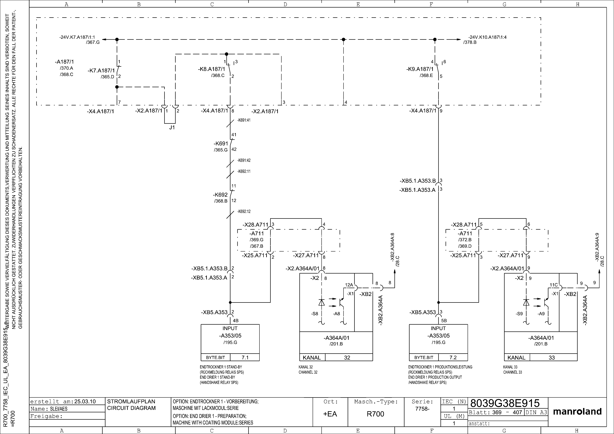

# +EA — Sheet 369 of 407 — OPTION: ENDTROCKNER 1 VORBEREITUNG;

**MASCHINE MIT LACKMODUL:SERIE**

> Part of the manroland **R700** printing press IEC/UL circuit diagrams.
> Drawing class: **Stromlaufplan / Circuit diagram** (DIN A3).
> Document `+EA` covers the **Printing unit** machine section.

## At a glance

| Field | Value |
|---|---|
| Document | `+EA`  (8039G38E915) |
| Sheet | **369** of 407 |
| Section (DE) | OPTION: ENDTROCKNER 1 VORBEREITUNG; |
| Section (EN) | MASCHINE MIT LACKMODUL:SERIE |
| Section type | CIRCUIT — Circuit diagram |
| Machine type | `R700` |
| Series | `7758` |
| Created | 25.03.10 |
| Replaces | — |
| Columns used | A, B, C, D, E, F, G, H |
| Path numbers | — |
| Labels on sheet | 138 |
| Cross-refs out | 19 |
| Cross-refs in | 43 |

**Previous:** [+EA sheet 368](SHEET_0368.md) · **Next:** [+EA sheet 370](SHEET_0370.md) · **Document TOC:** [_TOC.md](_TOC.md)  (+EA) · **Master TOC:** [all sheets](../_MASTER_TOC.md)

## Sheet image (300 DPI, exact vector render)



_Rendered directly from the PDF vector layer at 300 DPI (1-bit), no OCR and no resampling. Use it to confirm anything ambiguous in the text below._

## Cross-references on this sheet

Each entry is a wire leaving this sheet. The printed token is `/sheet.column`; the link resolves to that sheet inside the same document.

| Ref | Target sheet | Col | Path | Destination on target | Target section | From col |
|---|---|---|---|---|---|---|
| `/367.G` | [+EA sheet 367](SHEET_0367.md) | G | — | 24V.K7.A187\1:1 | OPTION: TROCKNER VORBEREITUNG; | A |
| `/378.B` | [+EA sheet 378](SHEET_0378.md) | B | — | — | OPTION: ENDTROCKNER 2 VORBEREITUNG | G |
| `/370.A` | [+EA sheet 370](SHEET_0370.md) | A | — | — | OPTION: ENDTROCKNER 1 VORBEREITUNG; | A |
| `/368.C` | [+EA sheet 368](SHEET_0368.md) | C | — | — | OPTION: ENDTROCKNER 1 VORBEREITUNG; | A |
| `/368.E` | [+EA sheet 368](SHEET_0368.md) | E | — | — | OPTION: ENDTROCKNER 1 VORBEREITUNG; | F |
| `/368.C` | [+EA sheet 368](SHEET_0368.md) | C | — | — | OPTION: ENDTROCKNER 1 VORBEREITUNG; | C |
| `/365.D` | [+EA sheet 365](SHEET_0365.md) | D | — | — | OPTION: TROCKNER VORBEREITUNG; | B |
| `/365.G` | [+EA sheet 365](SHEET_0365.md) | G | — | — | OPTION: TROCKNER VORBEREITUNG; | C |
| `/368.B` | [+EA sheet 368](SHEET_0368.md) | B | — | — | OPTION: ENDTROCKNER 1 VORBEREITUNG; | C |
| `/28.C` | [+EA sheet 28](SHEET_0028.md) | C | — | XB2.A364A:8 | BUSVERBINDUNGEN: SICHERHEITSBUS | F |
| `/28.C` | [+EA sheet 28](SHEET_0028.md) | C | — | XB2.A364A:9 | BUSVERBINDUNGEN: SICHERHEITSBUS | H |
| `/372.B` | [+EA sheet 372](SHEET_0372.md) | B | — | — | OPTION: ENDTROCKNER 1 VORBEREITUNG; | F |
| `/369.D` | [+EA sheet 369](SHEET_0369.md) | D | — | — | OPTION: ENDTROCKNER 1 VORBEREITUNG; | F |
| `/369.G` | [+EA sheet 369](SHEET_0369.md) | G | — | — | OPTION: ENDTROCKNER 1 VORBEREITUNG; | D |
| `/367.B` | [+EA sheet 367](SHEET_0367.md) | B | — | — | OPTION: TROCKNER VORBEREITUNG; | D |
| `/195.G` | [+EA sheet 195](SHEET_0195.md) | G | — | — | REFERENZMODUL | C |
| `/195.G` | [+EA sheet 195](SHEET_0195.md) | G | — | — | REFERENZMODUL | F |
| `/201.B` | [+EA sheet 201](SHEET_0201.md) | B | — | — | REFERENZMODUL | E |
| `/201.B` | [+EA sheet 201](SHEET_0201.md) | B | — | — | REFERENZMODUL | G |

### Incoming references (sheets that point here)

Every other sheet that sends a wire to this one. `Back-ref` is the token printed on *that* sheet; `Path` is its line number.

| From sheet | Cols | Back-ref | Path | Refs | What continues there |
|---|---|---|---|---|---|
| [+EA#28](SHEET_0028.md) | C | `/28.C` | — | 2 | — |
| [+EA#195](SHEET_0195.md) | G | `/195.G` | — | 2 | — |
| [+EA#201](SHEET_0201.md) | B | `/201.B` | — | 2 | — |
| [+EA#223](SHEET_0223.md) | E | `/223.E` | — | 4 | — |
| [+EA#227](SHEET_0227.md) | B, D | `/227.B`, `/227.D` | — | 4 | — |
| [+EA#236](SHEET_0236.md) | B | `/236.B` | — | 3 | — |
| [+EA#240](SHEET_0240.md) | F | `/240.F` | — | 2 | — |
| [+EA#241](SHEET_0241.md) | A, B | `/241.A`, `/241.B` | — | 4 | — |
| [+EA#268](SHEET_0268.md) | E | `/268.E` | — | 2 | — |
| [+EA#271](SHEET_0271.md) | E | `/271.E` | — | 2 | — |
| [+EA#273](SHEET_0273.md) | A | `/273.A` | — | 4 | — |
| [+EA#365](SHEET_0365.md) | D, G | `/365.D`, `/365.G` | — | 2 | — |
| [+EA#367](SHEET_0367.md) | B, H | `/367.B`, `/367.H` | — | 2 | — |
| [+EA#368](SHEET_0368.md) | B, C, E | `/368.B`, `/368.C`, `/368.E` | — | 3 | — |
| [+EA#369](SHEET_0369.md) | D, F | `/369.D`, `/369.F` | — | 2 | — |
| [+EA#370](SHEET_0370.md) | A | `/370.A` | — | 1 | — |
| [+EA#372](SHEET_0372.md) | B | `/372.B` | — | 1 | — |
| [+EA#378](SHEET_0378.md) | A | `/378.A` | — | 1 | 24V.K10.A187\1:4 |


## Devices on this sheet

| Tag | Class | Class meaning (IEC) | Col | Sub | Terminal | Sign |
|---|---|---|---|---|---|---|
| `A187/1` | A | Baugruppe / assembly, module, PC board | A | 1 | — | — |
| `A353/05` | A | Baugruppe / assembly, module, PC board | F | 05 | — | — |
| `A353/05` | A | Baugruppe / assembly, module, PC board | C | 05 | — | — |
| `K691` | K | Relais / relay, contactor | C | — | — | — |
| `K692` | K | Relais / relay, contactor | C | — | — | — |
| `A711` | A | Baugruppe / assembly, module, PC board | F | — | — | — |
| `S9` | S | Schalter / switch | G | — | — | — |
| `A9` | A | Baugruppe / assembly, module, PC board | H | — | — | — |
| `X1` | X | Klemme / terminal, plug connector | H | — | — | — |
| `X2` | X | Klemme / terminal, plug connector | G | — | — | — |
| `XB2` | XB |  | H | — | — | — |
| `A711` | A | Baugruppe / assembly, module, PC board | D | — | — | — |
| `S8` | S | Schalter / switch | D | — | — | — |
| `A8` | A | Baugruppe / assembly, module, PC board | E | — | — | — |
| `X1` | X | Klemme / terminal, plug connector | E | — | — | — |
| `X2` | X | Klemme / terminal, plug connector | D | — | — | — |
| `XB2` | XB |  | E | — | — | — |
| `J1` | J |  | B | — | — | — |
| `K691:41` | K | Relais / relay, contactor | C | — | 41 | — |
| `K691:42` | K | Relais / relay, contactor | C | — | 42 | — |
| `K692:11` | K | Relais / relay, contactor | C | — | 11 | — |
| `K692:12` | K | Relais / relay, contactor | C | — | 12 | — |
| `XB5.1.A353.B` | — | cross-device reference | F | — | — | — |
| `XB5.1.A353.A` | — | cross-device reference | F | — | — | — |
| `7.2` | — | cross-device reference | F | — | — | — |
| `XB5.A353` | — | cross-device reference | F | — | — | — |
| `7.1` | — | cross-device reference | C | — | — | — |
| `XB5.A353` | — | cross-device reference | C | — | — | — |
| `XB5.1.A353.B` | — | cross-device reference | C | — | — | — |
| `XB5.1.A353.A` | — | cross-device reference | C | — | — | — |
| `X27.A711` | — | cross-device reference | G | — | — | — |
| `X28.A711` | — | cross-device reference | F | — | — | — |
| `X25.A711` | — | cross-device reference | F | — | — | — |
| `XB2.A364A` | — | cross-device reference | H | — | — | — |
| `X28.A711` | — | cross-device reference | D | — | — | — |
| `X25.A711` | — | cross-device reference | D | — | — | — |
| `XB2.A364A` | — | cross-device reference | E | — | — | — |
| `X27.A711` | — | cross-device reference | D | — | — | — |
| `XB2.A364A:8` | — | cross-device reference | E | — | 8 | — |
| `XB2.A364A:9` | — | cross-device reference | H | — | 9 | — |

## Potentials / nets

| Potential | Count | Columns | Attached devices | Terminals |
|---|---|---|---|---|
| `24V` | 2 | A, G | `A187\1`, `K10`, `K7` | `1`, `4` |


A potential such as `L24+/4` or `M24+` is a named supply/return rail; every place it appears on this sheet is electrically common.

## Wire-end annotations (grouped as printed)

A wire that continues elsewhere is annotated with a small cluster: the destination description, the path/line number `#NN`, and the `/sheet.column` cross reference. Each row below is one such cluster exactly as it is grouped on the drawing.

| Col | Y | Path | Cross-ref | Text on the wire |
|---|---|---|---|---|
| A | 68.3 | — | `/367.G` | `24V.K7.A187\1:1` |
| G | 68.3 | — | — | `24V.K10.A187\1:4` |
| G | 78.2 | — | `/378.B` | — |
| A | 115.1 | — | — | `A187/1` |
| B | 115.8 | — | — | `1` |
| C | 115.8 | — | — | `K8.A187/1 3` |
| C | 115.8 | — | — | `1` |
| F | 115.8 | — | — | `K9.A187/1 6` |
| F | 115.8 | — | — | `4` |
| A | 128.2 | — | `/370.A`, `/368.C` | — |
| B | 132.1 | — | — | `K7.A187/1 2` |
| F | 142.3 | — | `/368.E` | — |
| C | 142.4 | — | `/368.C` | — |
| C | 144.2 | — | — | `2` |
| F | 144.2 | — | — | `5` |
| B | 145.2 | — | `/365.D` | — |
| B | 194.5 | — | — | `7` |
| D | 194.5 | — | — | `3` |
| E | 194.5 | — | — | `4` |
| D | 210.1 | — | — | `X2.A187/1 1 X4.A187/1 9` |
| C | 210.1 | — | — | `2 X4.A187/1 8` |
| A | 211.5 | — | — | `X4.A187/1` |
| D | 211.5 | — | — | `X2.A187/1` |
| C | 230.2 | — | — | `K691:41` |
| B | 242.6 | — | — | `J1` |
| C | 257.6 | — | — | `41` |
| C | 273.9 | — | — | `K691 42` |
| C | 286.9 | — | `/365.G` | — |
| C | 308.2 | — | — | `K691:42` |
| C | 329.4 | — | — | `K692:11` |
| F | 346.1 | — | — | `XB5.1.A353.B 3` |
| C | 356.8 | — | — | `11` |
| F | 363.2 | — | — | `XB5.1.A353.A 3` |
| C | 373.1 | — | — | `K692 12` |
| C | 386.1 | — | `/368.B` | — |
| C | 407.4 | — | — | `K692:12` |
| D | 431.2 | — | — | `X28.A711 3` |
| E | 431.2 | — | — | `4` |
| F | 431.2 | — | — | `X28.A711 5` |
| G | 431.2 | — | — | `6` |
| D | 448.2 | — | — | `A711` |
| F | 448.2 | — | — | `A711` |
| F | 451.8 | — | `/28.C` | `XB2.A364A:8` |
| H | 451.8 | — | `/28.C` | `XB2.A364A:9` |
| F | 461.2 | — | `/372.B`, `/369.D` | — |
| D | 461.3 | — | `/369.G` | — |
| D | 473.6 | — | `/367.B` | — |
| D | 490.7 | — | — | `X25.A711 2` |
| D | 490.7 | — | — | `X27.A711 8` |
| F | 490.7 | — | — | `X25.A711 3` |
| G | 490.7 | — | — | `X27.A711 9` |
| C | 516.2 | — | — | `XB5.1.A353.B 2` |
| D | 516.2 | — | — | `X2.A364A/01 8` |
| G | 516.2 | — | — | `X2.A364A/01 9` |
| C | 533.2 | — | — | `XB5.1.A353.A 2` |
| D | 534.7 | — | — | `X2` |
| G | 534.7 | — | — | `X2` |
| E | 536.1 | — | — | `8 8` |
| H | 536.1 | — | — | `9 9` |
| E | 544.6 | — | — | `8` |
| H | 544.6 | — | — | `9` |
| E | 548.8 | — | — | `12A` |
| H | 548.8 | — | — | `11C` |
| E | 565.8 | — | — | `X1` |
| E | 565.8 | — | — | `XB2` |
| H | 565.8 | — | — | `X1` |
| H | 565.8 | — | — | `XB2` |
| E | 572.9 | — | — | `XB2.A364A` |
| H | 572.9 | — | — | `XB2.A364A` |
| C | 601.2 | — | — | `XB5.A353 2` |
| F | 601.2 | — | — | `XB5.A353 3` |
| E | 604.8 | — | — | `S8 A8` |
| G | 604.8 | — | — | `S9 A9` |
| C | 618.2 | — | — | `4B` |
| F | 618.2 | — | — | `5B` |
| C | 632.8 | — | — | `INPUT` |
| F | 632.8 | — | — | `INPUT` |
| C | 646.6 | — | — | `A353/05` |
| F | 646.6 | — | — | `A353/05` |
| E | 650.9 | — | — | `A364A/01` |
| H | 650.9 | — | — | `A364A/01` |
| C | 660.4 | — | `/195.G` | — |
| F | 660.4 | — | `/195.G` | — |
| E | 663.2 | — | `/201.B` | — |
| G | 663.2 | — | `/201.B` | — |
| E | 689.1 | — | — | `KANAL 32` |
| G | 689.1 | — | — | `KANAL 33` |
| C | 689.4 | — | — | `BYTE.BIT 7.1` |
| F | 689.4 | — | — | `BYTE.BIT 7.2` |
| C | 709.4 | — | — | `ENDTROCKNER 1 STAND BY (RÜCKMELDUNG RELAIS SPS) END DRIER 1 STAND BY (HANDSHAKE RELAY SPS)` |
| D | 709.4 | — | — | `KANAL 32 CHANNEL 32` |
| F | 709.4 | — | — | `ENDTROCKNER 1 PRODUKTIONSLEISTUNG (RÜCKMELDUNG RELAIS SPS) END DRIER 1 PRODUCTION OUTPUT` |
| G | 709.5 | — | — | `KANAL 33 CHANNEL 33` |
| F | 739.3 | — | — | `/HANDSHAKE RELAY SPS)` |


## Reconstructed tables

This sheet carries tabular content (pin map / terminal assignment / index). The grid below was rebuilt from the drawing's own rule lines, so each row is exactly one physical row of the table.

### Table 1 — 7 data rows × 24 columns (at x=226.8, y=76.5) — **/378.B**

| 1 2 |  |  | 1 K8.A187/1 /368.C | 3 2 |  |  |  |  |  |  |  |  |  | 4 K9.A187/1 /368.E |  | 6 5 |  |  |  |  |  |  |  |
|---|---|---|---|---|---|---|---|---|---|---|---|---|---|---|---|---|---|---|---|---|---|---|---|
| `7 X2.A187/1` | `1 J1` | `2` | `X4.A187/1 K691 /365.G K692 /368.B` | `8 K691:41 41 42 K691:42 K692:11 11 12 K692:12` | `X2.A187/1` |  | `3` |  |  | `4` |  |  |  | `X4.A187/1 XB5.1.A353.B XB5.1.A353.A` |  | `9 3 3` |  |  |  |  |  |  |  |
|  |  |  | `XB5.1.A353.B` | `X28.A711 A711 /369.G /367.B X25.A711 2` |  | `3 2` |  | `X27.A711 X2.A364A/01` | `4 8 8` |  |  | `XB2.A364A:8` | `/28.C` |  |  | `X28.A711 A711 /372.B /369.D X25.A711` |  | `5 3` | `X27.A711 X2.A364A/01` | `6 9 9` |  |  | `XB2.A364A:9` |
|  |  |  | `XB5.1.A353.A` | `2` |  |  |  | `X2` | `8` | `12A X1` | `XB2` | `8 8` |  |  |  |  |  |  | `X2` | `9` | `11C X1` | `XB2` | `9 9` |
|  |  |  | `XB5.A353` | `2 4B` |  |  |  | `S8` | `A8` |  |  | `XB2.A364A` |  | `XB5.A353` |  | `3 5B` |  |  | `S9` | `A9` |  |  | `XB2.A364A` |
|  |  |  | `INPUT` |  |  |  |  |  |  |  |  |  |  |  | `INPUT` |  |  |  |  |  |  |  |  |
|  |  |  |  | `A353/05 /195.G` |  |  |  |  | `A364A/01 /201.B` |  |  |  |  |  |  | `A353/05 /195.G` |  |  |  | `A364A/01 /201.B` |  |  |  |
|  |  |  | `BYTE.BIT` | `7.1` |  |  |  | `KANAL` |  | `32` |  |  |  | `BYTE.BIT` |  | `7.2` |  |  | `KANAL` |  | `33` |  |  |


## Notes and free text on this sheet

| Text | Col | Y (pt) |
|---|---|---|
| `K7.A187/1` | A | 132.12 |
| `K9.A187/1` | F | 129.29 |
| `X4.A187/1` | F | 210.08 |
| `X2.A187/1` | B | 210.08 |
| `K8.A187/1` | C | 129.29 |
| `X4.A187/1` | C | 210.08 |
| `5B` | F | 618.22 |
| `INPUT` | F | 632.76 |
| `BYTE.BIT` | F | 690.01 |
| `ENDTROCKNER 1 PRODUKTIONSLEISTUNG` | F | 709.43 |
| `(RÜCKMELDUNG RELAIS SPS)` | F | 719.4 |
| `END DRIER 1 PRODUCTION OUTPUT` | F | 729.32 |
| `/HANDSHAKE RELAY SPS)` | F | 739.3 |
| `4B` | C | 618.22 |
| `INPUT` | C | 632.76 |
| `BYTE.BIT` | C | 690.01 |
| `ENDTROCKNER 1 STAND BY` | C | 709.43 |
| `(RÜCKMELDUNG RELAIS SPS)` | C | 719.4 |
| `END DRIER 1 STAND BY` | C | 729.34 |
| `(HANDSHAKE RELAY SPS)` | C | 739.29 |
| `KANAL 33` | G | 709.45 |
| `CHANNEL 33` | G | 719.39 |
| `11C` | H | 548.83 |
| `KANAL` | G | 689.12 |
| `A364A/01` | H | 650.86 |
| `X2.A364A/01` | G | 516.21 |
| `KANAL 32` | D | 709.44 |
| `CHANNEL 32` | D | 719.38 |
| `12A` | E | 548.79 |
| `KANAL` | D | 689.12 |
| `A364A/01` | E | 650.86 |
| `X2.A364A/01` | D | 516.21 |
| `X4.A187/1` | A | 211.49 |
| `X2.A187/1` | D | 211.49 |

## Complete label inventory (exact text from the drawing)

Every text object inside the drawing area of this sheet, in DIN reading order (column A→H, then top→bottom). This is the authoritative list: if a string is not here it is not printed on this sheet.

| Col | Y | X | Dir | Type | Text |
|---|---|---|---|---|---|
| A | 68.3 | 115.1 | → | potential | `24V.K7.A187\1:1` |
| A | 78.2 | 167.0 | → | cross-reference | `/367.G` |
| A | 115.1 | 106.6 | → | device tag | `A187/1` |
| A | 128.2 | 116.2 | → | cross-reference | `/370.A` |
| A | 132.1 | 170.1 | → | text | `K7.A187/1` |
| A | 140.6 | 116.2 | → | cross-reference | `/368.C` |
| A | 211.5 | 168.7 | → | text | `X4.A187/1` |
| B | 115.8 | 228.8 | → | number | `1` |
| B | 144.2 | 229.3 | → | number | `2` |
| B | 145.2 | 195.6 | → | cross-reference | `/365.D` |
| B | 194.5 | 229.3 | → | number | `7` |
| B | 210.1 | 262.2 | → | text | `X2.A187/1` |
| B | 211.5 | 320.9 | → | number | `1` |
| B | 242.6 | 328.3 | → | device tag | `J1` |
| C | 115.8 | 433.4 | → | number | `1` |
| C | 115.8 | 456.1 | → | number | `3` |
| C | 129.3 | 384.1 | → | text | `K8.A187/1` |
| C | 142.4 | 409.6 | → | cross-reference | `/368.C` |
| C | 144.2 | 449.0 | → | number | `2` |
| C | 210.1 | 389.8 | → | text | `X4.A187/1` |
| C | 211.5 | 342.7 | → | number | `2` |
| C | 211.5 | 449.0 | → | number | `8` |
| C | 230.2 | 460.3 | → | device tag | `K691:41` |
| C | 257.6 | 449.0 | → | number | `41` |
| C | 273.8 | 414.4 | → | device tag | `K691` |
| C | 285.9 | 449.0 | → | number | `42` |
| C | 286.9 | 415.0 | → | cross-reference | `/365.G` |
| C | 308.2 | 460.3 | → | device tag | `K691:42` |
| C | 329.4 | 460.3 | → | device tag | `K692:11` |
| C | 356.8 | 448.4 | → | number | `11` |
| C | 373.1 | 413.0 | → | device tag | `K692` |
| C | 385.1 | 448.4 | → | number | `12` |
| C | 386.1 | 415.6 | → | cross-reference | `/368.B` |
| C | 407.4 | 460.3 | → | device tag | `K692:12` |
| C | 516.2 | 371.3 | → | device ref | `XB5.1.A353.B` |
| C | 516.2 | 449.0 | → | number | `2` |
| C | 533.2 | 449.0 | → | number | `2` |
| C | 533.9 | 370.5 | → | device ref | `XB5.1.A353.A` |
| C | 601.3 | 390.0 | → | device ref | `XB5.A353` |
| C | 601.3 | 449.0 | → | number | `2` |
| C | 618.2 | 451.8 | → | text | `4B` |
| C | 632.8 | 431.6 | → | text | `INPUT` |
| C | 646.6 | 425.1 | → | device tag | `A353/05` |
| C | 660.4 | 433.6 | → | cross-reference | `/195.G` |
| C | 689.4 | 468.9 | → | device ref | `7.1` |
| C | 690.0 | 399.7 | → | text | `BYTE.BIT` |
| C | 709.4 | 387.8 | → | text | `ENDTROCKNER 1 STAND BY` |
| C | 719.4 | 387.8 | → | text | `(RÜCKMELDUNG RELAIS SPS)` |
| C | 729.3 | 387.8 | → | text | `END DRIER 1 STAND BY` |
| C | 739.3 | 387.8 | → | text | `(HANDSHAKE RELAY SPS)` |
| D | 194.5 | 548.2 | → | number | `3` |
| D | 211.5 | 487.6 | → | text | `X2.A187/1` |
| D | 431.2 | 470.6 | → | device ref | `X28.A711` |
| D | 431.2 | 527.0 | → | number | `3` |
| D | 448.2 | 483.9 | → | device tag | `A711` |
| D | 461.3 | 484.4 | → | cross-reference | `/369.G` |
| D | 473.6 | 485.0 | → | cross-reference | `/367.B` |
| D | 490.7 | 469.1 | → | device ref | `X25.A711` |
| D | 490.7 | 568.3 | → | device ref | `X27.A711` |
| D | 495.0 | 527.0 | → | number | `2` |
| D | 516.2 | 553.9 | → | text | `X2.A364A/01` |
| D | 534.7 | 602.1 | → | device tag | `X2` |
| D | 604.8 | 603.2 | → | device tag | `S8` |
| D | 689.1 | 587.3 | → | text | `KANAL` |
| D | 709.4 | 579.1 | → | text | `KANAL 32` |
| D | 719.4 | 579.4 | → | text | `CHANNEL 32` |
| E | 194.5 | 668.7 | → | number | `4` |
| E | 431.2 | 626.2 | → | number | `4` |
| E | 451.8 | 757.1 | ↕ | device ref | `XB2.A364A:8` |
| E | 495.0 | 626.2 | → | number | `8` |
| E | 516.2 | 626.2 | → | number | `8` |
| E | 536.1 | 629.0 | → | number | `8` |
| E | 544.6 | 753.7 | → | number | `8` |
| E | 546.0 | 728.2 | → | number | `8` |
| E | 548.8 | 669.0 | → | text | `12A` |
| E | 565.8 | 672.7 | → | device tag | `X1` |
| E | 565.8 | 697.0 | → | device tag | `XB2` |
| E | 572.9 | 733.1 | ↕ | device ref | `XB2.A364A` |
| E | 604.8 | 645.7 | → | device tag | `A8` |
| E | 650.9 | 627.7 | → | text | `A364A/01` |
| E | 663.2 | 639.4 | → | cross-reference | `/201.B` |
| E | 689.1 | 667.3 | → | number | `32` |
| F | 115.8 | 835.9 | → | number | `4` |
| F | 115.8 | 860.0 | → | number | `6` |
| F | 129.3 | 788.0 | → | text | `K9.A187/1` |
| F | 142.4 | 814.1 | → | cross-reference | `/368.E` |
| F | 144.2 | 852.9 | → | number | `5` |
| F | 210.1 | 793.7 | → | text | `X4.A187/1` |
| F | 211.5 | 852.9 | → | number | `9` |
| F | 346.1 | 775.3 | → | device ref | `XB5.1.A353.B` |
| F | 346.2 | 852.9 | → | number | `3` |
| F | 363.2 | 852.9 | → | number | `3` |
| F | 363.9 | 774.4 | → | device ref | `XB5.1.A353.A` |
| F | 431.2 | 874.5 | → | device ref | `X28.A711` |
| F | 448.2 | 887.8 | → | device tag | `A711` |
| F | 461.2 | 888.9 | → | cross-reference | `/372.B` |
| F | 473.7 | 888.7 | → | cross-reference | `/369.D` |
| F | 490.7 | 873.1 | → | device ref | `X25.A711` |
| F | 496.3 | 767.1 | ↕ | cross-reference | `/28.C` |
| F | 601.3 | 794.0 | → | device ref | `XB5.A353` |
| F | 601.3 | 852.9 | → | number | `3` |
| F | 618.2 | 855.8 | → | text | `5B` |
| F | 632.8 | 835.5 | → | text | `INPUT` |
| F | 646.6 | 829.0 | → | device tag | `A353/05` |
| F | 660.4 | 837.5 | → | cross-reference | `/195.G` |
| F | 689.4 | 871.9 | → | device ref | `7.2` |
| F | 690.0 | 803.6 | → | text | `BYTE.BIT` |
| F | 709.4 | 791.7 | → | text | `ENDTROCKNER 1 PRODUKTIONSLEISTUNG` |
| F | 719.4 | 791.7 | → | text | `(RÜCKMELDUNG RELAIS SPS)` |
| F | 729.3 | 791.7 | → | text | `END DRIER 1 PRODUCTION OUTPUT` |
| F | 739.3 | 792.3 | → | text | `/HANDSHAKE RELAY SPS)` |
| G | 68.3 | 908.2 | → | potential | `24V.K10.A187\1:4` |
| G | 78.2 | 898.6 | → | cross-reference | `/378.B` |
| G | 431.2 | 930.9 | → | number | `5` |
| G | 431.2 | 1023.0 | → | number | `6` |
| G | 490.7 | 965.2 | → | device ref | `X27.A711` |
| G | 495.0 | 930.9 | → | number | `3` |
| G | 495.0 | 1023.0 | → | number | `9` |
| G | 516.2 | 950.7 | → | text | `X2.A364A/01` |
| G | 516.2 | 1023.0 | → | number | `9` |
| G | 534.7 | 998.9 | → | device tag | `X2` |
| G | 536.1 | 1025.9 | → | number | `9` |
| G | 604.8 | 1000.1 | → | device tag | `S9` |
| G | 663.2 | 1036.2 | → | cross-reference | `/201.B` |
| G | 689.1 | 984.2 | → | text | `KANAL` |
| G | 709.4 | 976.0 | → | text | `KANAL 33` |
| G | 719.4 | 976.3 | → | text | `CHANNEL 33` |
| H | 451.8 | 1154.0 | ↕ | device ref | `XB2.A364A:9` |
| H | 496.3 | 1163.9 | ↕ | cross-reference | `/28.C` |
| H | 544.6 | 1150.6 | → | number | `9` |
| H | 546.0 | 1125.1 | → | number | `9` |
| H | 548.8 | 1065.8 | → | text | `11C` |
| H | 565.8 | 1069.5 | → | device tag | `X1` |
| H | 565.8 | 1093.9 | → | device tag | `XB2` |
| H | 572.9 | 1129.9 | ↕ | device ref | `XB2.A364A` |
| H | 604.8 | 1042.6 | → | device tag | `A9` |
| H | 650.9 | 1024.6 | → | text | `A364A/01` |
| H | 689.1 | 1064.1 | → | number | `33` |

## Reading-order text block

The same content as a plain block, grouped by DIN column — convenient to paste or to match against a visual description.

```text
=== Column A ===
  68.3  115.1  net          24V.K7.A187\1:1
  78.2  167.0  xref         /367.G
 115.1  106.6  devtag       A187/1
 128.2  116.2  xref         /370.A
 132.1  170.1  text         K7.A187/1
 140.6  116.2  xref         /368.C
 211.5  168.7  text         X4.A187/1
=== Column B ===
 115.8  228.8  numeric      1
 144.2  229.3  numeric      2
 145.2  195.6  xref         /365.D
 194.5  229.3  numeric      7
 210.1  262.2  text         X2.A187/1
 211.5  320.9  numeric      1
 242.6  328.3  devtag       J1
=== Column C ===
 115.8  433.4  numeric      1
 115.8  456.1  numeric      3
 129.3  384.1  text         K8.A187/1
 142.4  409.6  xref         /368.C
 144.2  449.0  numeric      2
 210.1  389.8  text         X4.A187/1
 211.5  342.7  numeric      2
 211.5  449.0  numeric      8
 230.2  460.3  devtag       K691:41
 257.6  449.0  numeric      41
 273.8  414.4  devtag       K691
 285.9  449.0  numeric      42
 286.9  415.0  xref         /365.G
 308.2  460.3  devtag       K691:42
 329.4  460.3  devtag       K692:11
 356.8  448.4  numeric      11
 373.1  413.0  devtag       K692
 385.1  448.4  numeric      12
 386.1  415.6  xref         /368.B
 407.4  460.3  devtag       K692:12
 516.2  371.3  devref       XB5.1.A353.B
 516.2  449.0  numeric      2
 533.2  449.0  numeric      2
 533.9  370.5  devref       XB5.1.A353.A
 601.3  390.0  devref       XB5.A353
 601.3  449.0  numeric      2
 618.2  451.8  text         4B
 632.8  431.6  text         INPUT
 646.6  425.1  devtag       A353/05
 660.4  433.6  xref         /195.G
 689.4  468.9  devref       7.1
 690.0  399.7  text         BYTE.BIT
 709.4  387.8  text         ENDTROCKNER 1 STAND BY
 719.4  387.8  text         (RÜCKMELDUNG RELAIS SPS)
 729.3  387.8  text         END DRIER 1 STAND BY
 739.3  387.8  text         (HANDSHAKE RELAY SPS)
=== Column D ===
 194.5  548.2  numeric      3
 211.5  487.6  text         X2.A187/1
 431.2  470.6  devref       X28.A711
 431.2  527.0  numeric      3
 448.2  483.9  devtag       A711
 461.3  484.4  xref         /369.G
 473.6  485.0  xref         /367.B
 490.7  469.1  devref       X25.A711
 490.7  568.3  devref       X27.A711
 495.0  527.0  numeric      2
 516.2  553.9  text         X2.A364A/01
 534.7  602.1  devtag       X2
 604.8  603.2  devtag       S8
 689.1  587.3  text         KANAL
 709.4  579.1  text         KANAL 32
 719.4  579.4  text         CHANNEL 32
=== Column E ===
 194.5  668.7  numeric      4
 431.2  626.2  numeric      4
 451.8  757.1  devref       XB2.A364A:8
 495.0  626.2  numeric      8
 516.2  626.2  numeric      8
 536.1  629.0  numeric      8
 544.6  753.7  numeric      8
 546.0  728.2  numeric      8
 548.8  669.0  text         12A
 565.8  672.7  devtag       X1
 565.8  697.0  devtag       XB2
 572.9  733.1  devref       XB2.A364A
 604.8  645.7  devtag       A8
 650.9  627.7  text         A364A/01
 663.2  639.4  xref         /201.B
 689.1  667.3  numeric      32
=== Column F ===
 115.8  835.9  numeric      4
 115.8  860.0  numeric      6
 129.3  788.0  text         K9.A187/1
 142.4  814.1  xref         /368.E
 144.2  852.9  numeric      5
 210.1  793.7  text         X4.A187/1
 211.5  852.9  numeric      9
 346.1  775.3  devref       XB5.1.A353.B
 346.2  852.9  numeric      3
 363.2  852.9  numeric      3
 363.9  774.4  devref       XB5.1.A353.A
 431.2  874.5  devref       X28.A711
 448.2  887.8  devtag       A711
 461.2  888.9  xref         /372.B
 473.7  888.7  xref         /369.D
 490.7  873.1  devref       X25.A711
 496.3  767.1  xref         /28.C
 601.3  794.0  devref       XB5.A353
 601.3  852.9  numeric      3
 618.2  855.8  text         5B
 632.8  835.5  text         INPUT
 646.6  829.0  devtag       A353/05
 660.4  837.5  xref         /195.G
 689.4  871.9  devref       7.2
 690.0  803.6  text         BYTE.BIT
 709.4  791.7  text         ENDTROCKNER 1 PRODUKTIONSLEISTUNG
 719.4  791.7  text         (RÜCKMELDUNG RELAIS SPS)
 729.3  791.7  text         END DRIER 1 PRODUCTION OUTPUT
 739.3  792.3  text         /HANDSHAKE RELAY SPS)
=== Column G ===
  68.3  908.2  net          24V.K10.A187\1:4
  78.2  898.6  xref         /378.B
 431.2  930.9  numeric      5
 431.2 1023.0  numeric      6
 490.7  965.2  devref       X27.A711
 495.0  930.9  numeric      3
 495.0 1023.0  numeric      9
 516.2  950.7  text         X2.A364A/01
 516.2 1023.0  numeric      9
 534.7  998.9  devtag       X2
 536.1 1025.9  numeric      9
 604.8 1000.1  devtag       S9
 663.2 1036.2  xref         /201.B
 689.1  984.2  text         KANAL
 709.4  976.0  text         KANAL 33
 719.4  976.3  text         CHANNEL 33
=== Column H ===
 451.8 1154.0  devref       XB2.A364A:9
 496.3 1163.9  xref         /28.C
 544.6 1150.6  numeric      9
 546.0 1125.1  numeric      9
 548.8 1065.8  text         11C
 565.8 1069.5  devtag       X1
 565.8 1093.9  devtag       XB2
 572.9 1129.9  devref       XB2.A364A
 604.8 1042.6  devtag       A9
 650.9 1024.6  text         A364A/01
 689.1 1064.1  numeric      33
```

---
_Generated from the PDF vector text layer; no OCR. Source: `R700_7758_IEC_UL_EA_8039G38E915_p`, sheet 369._
