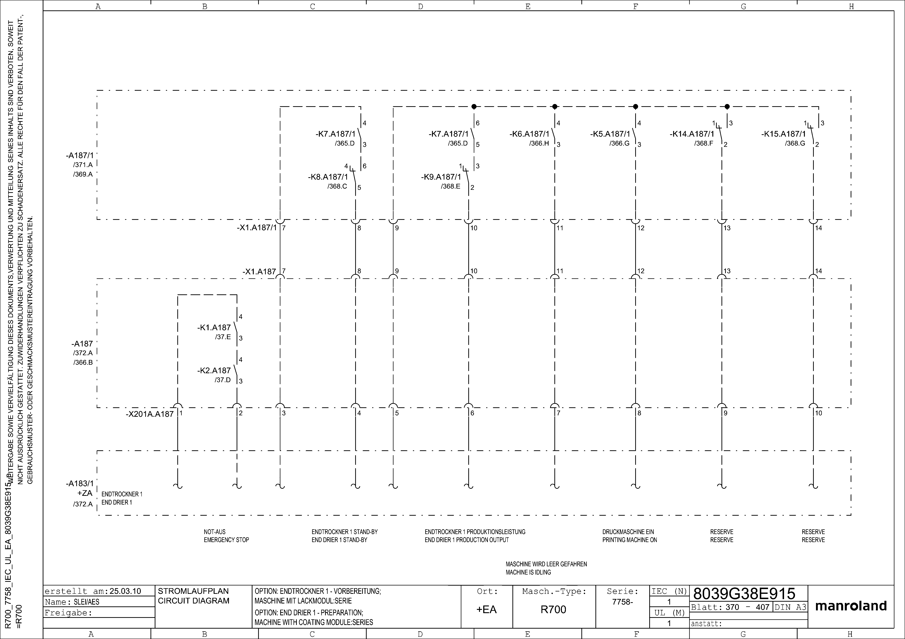

# +EA — Sheet 370 of 407 — OPTION: ENDTROCKNER 1 VORBEREITUNG;

**MASCHINE MIT LACKMODUL:SERIE**

> Part of the manroland **R700** printing press IEC/UL circuit diagrams.
> Drawing class: **Stromlaufplan / Circuit diagram** (DIN A3).
> Document `+EA` covers the **Printing unit** machine section.

## At a glance

| Field | Value |
|---|---|
| Document | `+EA`  (8039G38E915) |
| Sheet | **370** of 407 |
| Section (DE) | OPTION: ENDTROCKNER 1 VORBEREITUNG; |
| Section (EN) | MASCHINE MIT LACKMODUL:SERIE |
| Section type | CIRCUIT — Circuit diagram |
| Machine type | `R700` |
| Series | `7758` |
| Created | 25.03.10 |
| Replaces | — |
| Columns used | A, B, C, D, E, F, G, H |
| Path numbers | — |
| Labels on sheet | 98 |
| Cross-refs out | 15 |
| Cross-refs in | 41 |

**Previous:** [+EA sheet 369](SHEET_0369.md) · **Next:** [+EA sheet 371](SHEET_0371.md) · **Document TOC:** [_TOC.md](_TOC.md)  (+EA) · **Master TOC:** [all sheets](../_MASTER_TOC.md)

## Sheet image (300 DPI, exact vector render)



_Rendered directly from the PDF vector layer at 300 DPI (1-bit), no OCR and no resampling. Use it to confirm anything ambiguous in the text below._

## Cross-references on this sheet

Each entry is a wire leaving this sheet. The printed token is `/sheet.column`; the link resolves to that sheet inside the same document.

| Ref | Target sheet | Col | Path | Destination on target | Target section | From col |
|---|---|---|---|---|---|---|
| `/368.F` | [+EA sheet 368](SHEET_0368.md) | F | — | — | OPTION: ENDTROCKNER 1 VORBEREITUNG; | G |
| `/366.G` | [+EA sheet 366](SHEET_0366.md) | G | — | — | OPTION: TROCKNER VORBEREITUNG; | F |
| `/368.G` | [+EA sheet 368](SHEET_0368.md) | G | — | — | OPTION: ENDTROCKNER 1 VORBEREITUNG; | G |
| `/365.D` | [+EA sheet 365](SHEET_0365.md) | D | — | — | OPTION: TROCKNER VORBEREITUNG; | C |
| `/365.D` | [+EA sheet 365](SHEET_0365.md) | D | — | — | OPTION: TROCKNER VORBEREITUNG; | D |
| `/366.H` | [+EA sheet 366](SHEET_0366.md) | H | — | — | OPTION: TROCKNER VORBEREITUNG; | E |
| `/371.A` | [+EA sheet 371](SHEET_0371.md) | A | — | — | OPTION: ENDTROCKNER 1 VORBEREITUNG; | A |
| `/369.A` | [+EA sheet 369](SHEET_0369.md) | A | — | — | OPTION: ENDTROCKNER 1 VORBEREITUNG; | A |
| `/368.E` | [+EA sheet 368](SHEET_0368.md) | E | — | — | OPTION: ENDTROCKNER 1 VORBEREITUNG; | D |
| `/368.C` | [+EA sheet 368](SHEET_0368.md) | C | — | — | OPTION: ENDTROCKNER 1 VORBEREITUNG; | C |
| `/37.E` | [+EA sheet 37](SHEET_0037.md) | E | — | — | BUSVERBINDUNGEN: NOT AUS | B |
| `/372.A` | [+EA sheet 372](SHEET_0372.md) | A | — | — | OPTION: ENDTROCKNER 1 VORBEREITUNG; | A |
| `/366.B` | [+EA sheet 366](SHEET_0366.md) | B | — | — | OPTION: TROCKNER VORBEREITUNG; | A |
| `/37.D` | [+EA sheet 37](SHEET_0037.md) | D | — | — | BUSVERBINDUNGEN: NOT AUS | B |
| `/372.A` | [+EA sheet 372](SHEET_0372.md) | A | — | — | OPTION: ENDTROCKNER 1 VORBEREITUNG; | A |

### Incoming references (sheets that point here)

Every other sheet that sends a wire to this one. `Back-ref` is the token printed on *that* sheet; `Path` is its line number.

| From sheet | Cols | Back-ref | Path | Refs | What continues there |
|---|---|---|---|---|---|
| [+EA#37](SHEET_0037.md) | D, E | `/37.D`, `/37.E` | — | 2 | — |
| [+EA#206](SHEET_0206.md) | G | `/206.G` | — | 8 | — |
| [+EA#207](SHEET_0207.md) | A | `/207.A` | — | 8 | — |
| [+EA#286](SHEET_0286.md) | F | `/286.F` | — | 10 | — |
| [+EA#365](SHEET_0365.md) | D | `/365.D` | — | 2 | — |
| [+EA#366](SHEET_0366.md) | B, G, H | `/366.B`, `/366.G`, `/366.H` | — | 3 | — |
| [+EA#368](SHEET_0368.md) | C, E, F, G | `/368.C`, `/368.E`, `/368.F`, `/368.G` | — | 4 | — |
| [+EA#369](SHEET_0369.md) | A | `/369.A` | — | 1 | — |
| [+EA#371](SHEET_0371.md) | A | `/371.A` | — | 1 | — |
| [+EA#372](SHEET_0372.md) | A | `/372.A` | — | 2 | — |


## Devices on this sheet

| Tag | Class | Class meaning (IEC) | Col | Sub | Terminal | Sign |
|---|---|---|---|---|---|---|
| `A187/1` | A | Baugruppe / assembly, module, PC board | A | 1 | — | — |
| `A187` | A | Baugruppe / assembly, module, PC board | A | — | — | — |
| `A183/1` | A | Baugruppe / assembly, module, PC board | A | 1 | — | — |
| `K1.A187` | — | cross-device reference | B | — | — | — |
| `K2.A187` | — | cross-device reference | B | — | — | — |
| `X1.A187` | — | cross-device reference | C | — | — | — |
| `X201A.A187` | — | cross-device reference | A | — | — | — |

## Potentials / nets

_No named potentials on this sheet._

## Wire-end annotations (grouped as printed)

A wire that continues elsewhere is annotated with a small cluster: the destination description, the path/line number `#NN`, and the `/sheet.column` cross reference. Each row below is one such cluster exactly as it is grouped on the drawing.

| Col | Y | Path | Cross-ref | Text on the wire |
|---|---|---|---|---|
| C | 158.4 | — | — | `4` |
| E | 158.4 | — | — | `6` |
| E | 158.4 | — | — | `4` |
| F | 158.4 | — | — | `4` |
| G | 158.4 | — | — | `K14.A187/1 3` |
| G | 158.4 | — | — | `1` |
| G | 158.4 | — | — | `K15.A187/1 3` |
| H | 158.4 | — | — | `1` |
| C | 171.8 | — | — | `K7.A187/1 3` |
| D | 171.8 | — | — | `K7.A187/1 5` |
| E | 171.8 | — | — | `K6.A187/1 3` |
| F | 171.8 | — | — | `K5.A187/1 3` |
| C | 184.9 | — | `/365.D` | — |
| D | 184.9 | — | `/365.D` | — |
| E | 184.9 | — | `/366.H` | — |
| F | 184.9 | — | `/366.G` | — |
| G | 184.9 | — | `/368.F` | — |
| G | 184.9 | — | `/368.G` | — |
| G | 186.7 | — | — | `2` |
| H | 186.7 | — | — | `2` |
| A | 200.2 | — | — | `A187/1` |
| A | 213.2 | — | `/371.A`, `/369.A` | — |
| C | 215.1 | — | — | `K8.A187/1 6` |
| C | 215.1 | — | — | `4` |
| D | 215.1 | — | — | `K9.A187/1 3` |
| D | 215.1 | — | — | `1` |
| C | 241.6 | — | `/368.C` | — |
| D | 241.6 | — | `/368.E` | — |
| C | 243.4 | — | — | `5` |
| D | 243.4 | — | — | `2` |
| C | 295.1 | — | — | `X1.A187/1 7 9 10` |
| C | 296.5 | — | — | `8` |
| F | 296.5 | — | — | `11 12` |
| G | 296.5 | — | — | `13 14` |
| C | 353.2 | — | — | `X1.A187 7` |
| C | 353.2 | — | — | `8` |
| D | 353.2 | — | — | `9` |
| D | 353.2 | — | — | `10` |
| F | 353.2 | — | — | `11 12 13 14` |
| B | 413.5 | — | — | `4` |
| B | 426.9 | — | — | `K1.A187 3` |
| B | 440.0 | — | `/37.E` | — |
| A | 448.2 | — | — | `A187` |
| A | 461.2 | — | `/372.A`, `/366.B` | — |
| B | 470.2 | — | — | `4` |
| B | 483.6 | — | — | `K2.A187 3` |
| B | 496.7 | — | `/37.D` | — |
| B | 540.3 | — | — | `X201A.A187 1 2 3` |
| C | 540.3 | — | — | `4` |
| D | 540.3 | — | — | `5` |
| D | 540.3 | — | — | `6` |
| F | 540.3 | — | — | `7 8 9 10` |
| A | 632.4 | — | — | `A183/1` |
| A | 645.1 | — | — | `+ZA` |
| A | 648.3 | — | — | `ENDTROCKNER 1 END DRIER 1` |
| A | 660.4 | — | `/372.A` | — |
| B | 697.9 | — | — | `NOT AUS EMERGENCY STOP` |
| F | 697.9 | — | — | `ENDTROCKNER 1 PRODUKTIONSLEISTUNG END DRIER 1 PRODUCTION OUTPUT RESERVE RESERVE` |
| G | 697.9 | — | — | `RESERVE RESERVE` |
| C | 698.0 | — | — | `ENDTROCKNER 1 STAND BY END DRIER 1 STAND BY` |
| F | 698.0 | — | — | `DRUCKMASCHINE EIN PRINTING MACHINE ON` |
| E | 740.5 | — | — | `MASCHINE WIRD LEER GEFAHREN MACHINE IS IDLING` |


## Reconstructed tables

This sheet carries tabular content (pin map / terminal assignment / index). The grid below was rebuilt from the drawing's own rule lines, so each row is exactly one physical row of the table.

### Table 1 — 5 data rows × 21 columns (at x=204.1, y=0.0) — **X1.A187/1 X1.A187 K7.A187/1 /365.D 4 K8.A187/1 /368.C 7 7 5 8 8 4 3 6 K7.A187/1 /365.D 1 K9.A187/1 /368.E 9 9 2 10 10 6 5 3 K6.A187/1 /366.H 4 3 11 11 K5.A187/1 /366.G 4 3 12 12 1 K14.A187/1 /368.F 2 13 13 3 1 K15.A187/1 /368.G 2 14 14 K1.A187 /37.E K2.A187 /37.D 1 NOT AUS EMERGENCY 4 3 4 3 2 STOP 3 ENDTROCKNER 1 END DRIER 1 STAND BY 4 STAND BY 5 ENDTROCKNER END DRIER 1 1 6 PRODUCTION PRODUKTIONSLEISTUNG OUTPUT MASCHINE WIRD LEER MACHINE IS IDLING 7 GEFAHREN DRUCKMASCHINE PRINTING 8 MACHINE EIN ON 9 RESERVE RESERVE 10 RESERVE RESERVE**

|  | STROMLAUFPLAN |  | OPTION: | ENDTROCKNER 1 | VORBEREITUNG; |  |  |  |  | Ort: |  | Masch. Type: | Serie: |  | IEC (N) |  |  | 8039G38E915 |  |  |
|---|---|---|---|---|---|---|---|---|---|---|---|---|---|---|---|---|---|---|---|---|
| `CIRCUIT` | `DIAGRAM` |  |  |  |  |  |  |  |  |  |  |  |  |  |  |  |  |  |  |  |
|  |  |  | `MASCHINE` | `MIT LACKMODUL:SERIE` |  |  |  |  |  |  |  |  | `7758` |  | `1` |  |  |  |  |  |
|  |  |  |  |  |  |  |  |  |  | `+EA` | `R700` |  |  |  |  | `Blatt:` |  | `DIN A3 370 407` |  |  |
|  |  |  | `OPTION:` | `END DRIER 1 PREPARATION;` |  |  |  |  |  |  |  |  |  |  | `UL (M)` |  |  |  |  |  |
|  |  |  | `MACHINE` | `WITH COATING MODULE:SERIES` |  |  |  |  |  |  |  |  |  |  | `1` | `anstatt:` |  |  |  |  |


## Notes and free text on this sheet

| Text | Col | Y (pt) |
|---|---|---|
| `K7.A187/1` | D | 171.81 |
| `K5.A187/1` | F | 171.81 |
| `K9.A187/1` | D | 228.5 |
| `K7.A187/1` | C | 171.81 |
| `K8.A187/1` | C | 228.5 |
| `X1.A187/1` | B | 295.12 |
| `K6.A187/1` | E | 171.81 |
| `K14.A187/1` | G | 171.81 |
| `K15.A187/1` | G | 171.81 |
| `+ZA` | A | 645.11 |
| `ENDTROCKNER 1` | A | 648.33 |
| `END DRIER 1` | A | 658.94 |
| `ENDTROCKNER 1 STAND BY` | C | 697.96 |
| `END DRIER 1 STAND BY` | C | 708.58 |
| `DRUCKMASCHINE EIN` | F | 697.95 |
| `PRINTING MACHINE ON` | F | 708.58 |
| `RESERVE` | G | 697.91 |
| `RESERVE` | H | 697.91 |
| `ENDTROCKNER 1 PRODUKTIONSLEISTUNG` | E | 697.96 |
| `END DRIER 1 PRODUCTION OUTPUT` | D | 708.59 |
| `MASCHINE WIRD LEER GEFAHREN` | E | 740.46 |
| `MACHINE IS IDLING` | E | 751.1 |
| `NOT AUS` | B | 697.93 |
| `EMERGENCY STOP` | B | 708.58 |

## Complete label inventory (exact text from the drawing)

Every text object inside the drawing area of this sheet, in DIN reading order (column A→H, then top→bottom). This is the authoritative list: if a string is not here it is not printed on this sheet.

| Col | Y | X | Dir | Type | Text |
|---|---|---|---|---|---|
| A | 200.2 | 86.7 | → | device tag | `A187/1` |
| A | 213.2 | 96.4 | → | cross-reference | `/371.A` |
| A | 225.6 | 96.4 | → | cross-reference | `/369.A` |
| A | 448.2 | 94.1 | → | device tag | `A187` |
| A | 461.2 | 96.4 | → | cross-reference | `/372.A` |
| A | 473.6 | 96.7 | → | cross-reference | `/366.B` |
| A | 541.0 | 165.5 | → | device ref | `X201A.A187` |
| A | 632.4 | 86.7 | → | device tag | `A183/1` |
| A | 645.1 | 101.8 | → | text | `+ZA` |
| A | 648.3 | 133.8 | → | text | `ENDTROCKNER 1` |
| A | 658.9 | 133.8 | → | text | `END DRIER 1` |
| A | 660.4 | 96.4 | → | cross-reference | `/372.A` |
| B | 295.1 | 311.8 | → | text | `X1.A187/1` |
| B | 413.5 | 314.4 | → | number | `4` |
| B | 426.9 | 259.7 | → | device ref | `K1.A187` |
| B | 440.0 | 283.2 | → | cross-reference | `/37.E` |
| B | 441.8 | 314.4 | → | number | `3` |
| B | 470.2 | 314.4 | → | number | `4` |
| B | 483.6 | 259.7 | → | device ref | `K2.A187` |
| B | 496.7 | 282.6 | → | cross-reference | `/37.D` |
| B | 498.5 | 314.4 | → | number | `3` |
| B | 540.3 | 235.8 | → | number | `1` |
| B | 540.3 | 314.4 | → | number | `2` |
| B | 697.9 | 268.4 | → | text | `NOT AUS` |
| B | 708.6 | 268.4 | → | text | `EMERGENCY STOP` |
| C | 158.4 | 477.4 | → | number | `4` |
| C | 171.8 | 415.3 | → | text | `K7.A187/1` |
| C | 184.9 | 440.8 | → | cross-reference | `/365.D` |
| C | 186.7 | 477.4 | → | number | `3` |
| C | 215.0 | 453.3 | → | number | `4` |
| C | 215.0 | 477.4 | → | number | `6` |
| C | 228.5 | 405.4 | → | text | `K8.A187/1` |
| C | 241.6 | 430.9 | → | cross-reference | `/368.C` |
| C | 243.4 | 470.3 | → | number | `5` |
| C | 296.5 | 371.1 | → | number | `7` |
| C | 296.5 | 470.3 | → | number | `8` |
| C | 353.2 | 319.2 | → | device ref | `X1.A187` |
| C | 353.2 | 371.1 | → | number | `7` |
| C | 353.2 | 470.3 | → | number | `8` |
| C | 540.3 | 371.1 | → | number | `3` |
| C | 540.3 | 470.3 | → | number | `4` |
| C | 698.0 | 410.2 | → | text | `ENDTROCKNER 1 STAND BY` |
| C | 708.6 | 410.2 | → | text | `END DRIER 1 STAND BY` |
| D | 171.8 | 564.1 | → | text | `K7.A187/1` |
| D | 184.9 | 589.6 | → | cross-reference | `/365.D` |
| D | 215.0 | 603.5 | → | number | `1` |
| D | 228.5 | 554.2 | → | text | `K9.A187/1` |
| D | 241.6 | 580.3 | → | cross-reference | `/368.E` |
| D | 243.4 | 619.1 | → | number | `2` |
| D | 296.5 | 519.9 | → | number | `9` |
| D | 296.5 | 618.5 | → | number | `10` |
| D | 353.2 | 519.9 | → | number | `9` |
| D | 353.2 | 618.5 | → | number | `10` |
| D | 540.3 | 519.9 | → | number | `5` |
| D | 540.3 | 619.1 | → | number | `6` |
| D | 708.6 | 559.0 | → | text | `END DRIER 1 PRODUCTION OUTPUT` |
| E | 158.4 | 626.2 | → | number | `6` |
| E | 158.4 | 732.5 | → | number | `4` |
| E | 171.8 | 670.4 | → | text | `K6.A187/1` |
| E | 184.9 | 696.5 | → | cross-reference | `/366.H` |
| E | 186.7 | 626.2 | → | number | `5` |
| E | 186.7 | 732.5 | → | number | `3` |
| E | 215.0 | 626.2 | → | number | `3` |
| E | 296.5 | 731.9 | → | number | `11` |
| E | 353.2 | 731.9 | → | number | `11` |
| E | 540.3 | 732.5 | → | number | `7` |
| E | 698.0 | 559.0 | → | text | `ENDTROCKNER 1 PRODUKTIONSLEISTUNG` |
| E | 740.5 | 665.6 | → | text | `MASCHINE WIRD LEER GEFAHREN` |
| E | 751.1 | 665.6 | → | text | `MACHINE IS IDLING` |
| F | 158.4 | 838.8 | → | number | `4` |
| F | 171.8 | 776.7 | → | text | `K5.A187/1` |
| F | 184.9 | 801.9 | → | cross-reference | `/366.G` |
| F | 186.7 | 838.8 | → | number | `3` |
| F | 296.5 | 838.2 | → | number | `12` |
| F | 353.2 | 838.2 | → | number | `12` |
| F | 540.3 | 838.8 | → | number | `8` |
| F | 698.0 | 792.9 | → | text | `DRUCKMASCHINE EIN` |
| F | 708.6 | 792.9 | → | text | `PRINTING MACHINE ON` |
| G | 158.4 | 936.6 | → | number | `1` |
| G | 158.4 | 959.2 | → | number | `3` |
| G | 171.8 | 881.3 | → | text | `K14.A187/1` |
| G | 171.8 | 1001.8 | → | text | `K15.A187/1` |
| G | 184.9 | 913.6 | → | cross-reference | `/368.F` |
| G | 184.9 | 1032.9 | → | cross-reference | `/368.G` |
| G | 186.7 | 952.2 | → | number | `2` |
| G | 296.5 | 951.6 | → | number | `13` |
| G | 353.2 | 951.6 | → | number | `13` |
| G | 540.3 | 952.2 | → | number | `9` |
| G | 697.9 | 934.6 | → | text | `RESERVE` |
| G | 708.5 | 934.6 | → | text | `RESERVE` |
| H | 158.4 | 1057.0 | → | number | `1` |
| H | 158.4 | 1079.7 | → | number | `3` |
| H | 186.7 | 1072.6 | → | number | `2` |
| H | 296.5 | 1072.1 | → | number | `14` |
| H | 353.2 | 1072.1 | → | number | `14` |
| H | 540.3 | 1072.1 | → | number | `10` |
| H | 697.9 | 1055.1 | → | text | `RESERVE` |
| H | 708.5 | 1055.1 | → | text | `RESERVE` |

## Reading-order text block

The same content as a plain block, grouped by DIN column — convenient to paste or to match against a visual description.

```text
=== Column A ===
 200.2   86.7  devtag       A187/1
 213.2   96.4  xref         /371.A
 225.6   96.4  xref         /369.A
 448.2   94.1  devtag       A187
 461.2   96.4  xref         /372.A
 473.6   96.7  xref         /366.B
 541.0  165.5  devref       X201A.A187
 632.4   86.7  devtag       A183/1
 645.1  101.8  text         +ZA
 648.3  133.8  text         ENDTROCKNER 1
 658.9  133.8  text         END DRIER 1
 660.4   96.4  xref         /372.A
=== Column B ===
 295.1  311.8  text         X1.A187/1
 413.5  314.4  numeric      4
 426.9  259.7  devref       K1.A187
 440.0  283.2  xref         /37.E
 441.8  314.4  numeric      3
 470.2  314.4  numeric      4
 483.6  259.7  devref       K2.A187
 496.7  282.6  xref         /37.D
 498.5  314.4  numeric      3
 540.3  235.8  numeric      1
 540.3  314.4  numeric      2
 697.9  268.4  text         NOT AUS
 708.6  268.4  text         EMERGENCY STOP
=== Column C ===
 158.4  477.4  numeric      4
 171.8  415.3  text         K7.A187/1
 184.9  440.8  xref         /365.D
 186.7  477.4  numeric      3
 215.0  453.3  numeric      4
 215.0  477.4  numeric      6
 228.5  405.4  text         K8.A187/1
 241.6  430.9  xref         /368.C
 243.4  470.3  numeric      5
 296.5  371.1  numeric      7
 296.5  470.3  numeric      8
 353.2  319.2  devref       X1.A187
 353.2  371.1  numeric      7
 353.2  470.3  numeric      8
 540.3  371.1  numeric      3
 540.3  470.3  numeric      4
 698.0  410.2  text         ENDTROCKNER 1 STAND BY
 708.6  410.2  text         END DRIER 1 STAND BY
=== Column D ===
 171.8  564.1  text         K7.A187/1
 184.9  589.6  xref         /365.D
 215.0  603.5  numeric      1
 228.5  554.2  text         K9.A187/1
 241.6  580.3  xref         /368.E
 243.4  619.1  numeric      2
 296.5  519.9  numeric      9
 296.5  618.5  numeric      10
 353.2  519.9  numeric      9
 353.2  618.5  numeric      10
 540.3  519.9  numeric      5
 540.3  619.1  numeric      6
 708.6  559.0  text         END DRIER 1 PRODUCTION OUTPUT
=== Column E ===
 158.4  626.2  numeric      6
 158.4  732.5  numeric      4
 171.8  670.4  text         K6.A187/1
 184.9  696.5  xref         /366.H
 186.7  626.2  numeric      5
 186.7  732.5  numeric      3
 215.0  626.2  numeric      3
 296.5  731.9  numeric      11
 353.2  731.9  numeric      11
 540.3  732.5  numeric      7
 698.0  559.0  text         ENDTROCKNER 1 PRODUKTIONSLEISTUNG
 740.5  665.6  text         MASCHINE WIRD LEER GEFAHREN
 751.1  665.6  text         MACHINE IS IDLING
=== Column F ===
 158.4  838.8  numeric      4
 171.8  776.7  text         K5.A187/1
 184.9  801.9  xref         /366.G
 186.7  838.8  numeric      3
 296.5  838.2  numeric      12
 353.2  838.2  numeric      12
 540.3  838.8  numeric      8
 698.0  792.9  text         DRUCKMASCHINE EIN
 708.6  792.9  text         PRINTING MACHINE ON
=== Column G ===
 158.4  936.6  numeric      1
 158.4  959.2  numeric      3
 171.8  881.3  text         K14.A187/1
 171.8 1001.8  text         K15.A187/1
 184.9  913.6  xref         /368.F
 184.9 1032.9  xref         /368.G
 186.7  952.2  numeric      2
 296.5  951.6  numeric      13
 353.2  951.6  numeric      13
 540.3  952.2  numeric      9
 697.9  934.6  text         RESERVE
 708.5  934.6  text         RESERVE
=== Column H ===
 158.4 1057.0  numeric      1
 158.4 1079.7  numeric      3
 186.7 1072.6  numeric      2
 296.5 1072.1  numeric      14
 353.2 1072.1  numeric      14
 540.3 1072.1  numeric      10
 697.9 1055.1  text         RESERVE
 708.5 1055.1  text         RESERVE
```

---
_Generated from the PDF vector text layer; no OCR. Source: `R700_7758_IEC_UL_EA_8039G38E915_p`, sheet 370._
