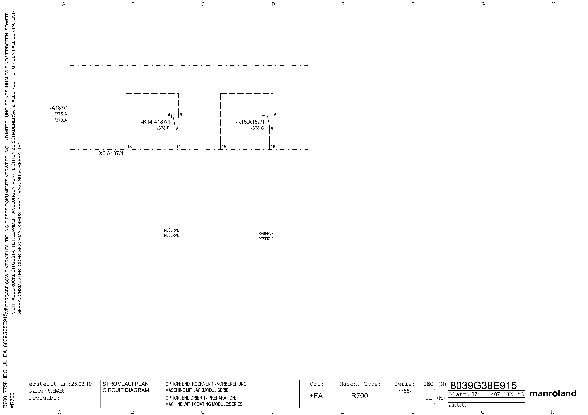

# +EA — Sheet 371 of 407 — OPTION: ENDTROCKNER 1 VORBEREITUNG;

**MASCHINE MIT LACKMODUL:SERIE**

> Part of the manroland **R700** printing press IEC/UL circuit diagrams.
> Drawing class: **Stromlaufplan / Circuit diagram** (DIN A3).
> Document `+EA` covers the **Printing unit** machine section.

## At a glance

| Field | Value |
|---|---|
| Document | `+EA`  (8039G38E915) |
| Sheet | **371** of 407 |
| Section (DE) | OPTION: ENDTROCKNER 1 VORBEREITUNG; |
| Section (EN) | MASCHINE MIT LACKMODUL:SERIE |
| Section type | CIRCUIT — Circuit diagram |
| Machine type | `R700` |
| Series | `7758` |
| Created | 25.03.10 |
| Replaces | — |
| Columns used | A, B, C, D |
| Path numbers | — |
| Labels on sheet | 22 |
| Cross-refs out | 4 |
| Cross-refs in | 8 |

**Previous:** [+EA sheet 370](SHEET_0370.md) · **Next:** [+EA sheet 372](SHEET_0372.md) · **Document TOC:** [_TOC.md](_TOC.md)  (+EA) · **Master TOC:** [all sheets](../_MASTER_TOC.md)

## Sheet image (300 DPI, exact vector render)



_Rendered directly from the PDF vector layer at 300 DPI (1-bit), no OCR and no resampling. Use it to confirm anything ambiguous in the text below._

## Cross-references on this sheet

Each entry is a wire leaving this sheet. The printed token is `/sheet.column`; the link resolves to that sheet inside the same document.

| Ref | Target sheet | Col | Path | Destination on target | Target section | From col |
|---|---|---|---|---|---|---|
| `/375.A` | [+EA sheet 375](SHEET_0375.md) | A | — | — | OPTION: ENDTROCKNER 1 VORBEREITUNG; | A |
| `/370.A` | [+EA sheet 370](SHEET_0370.md) | A | — | — | OPTION: ENDTROCKNER 1 VORBEREITUNG; | A |
| `/368.F` | [+EA sheet 368](SHEET_0368.md) | F | — | — | OPTION: ENDTROCKNER 1 VORBEREITUNG; | B |
| `/368.G` | [+EA sheet 368](SHEET_0368.md) | G | — | — | OPTION: ENDTROCKNER 1 VORBEREITUNG; | D |

### Incoming references (sheets that point here)

Every other sheet that sends a wire to this one. `Back-ref` is the token printed on *that* sheet; `Path` is its line number.

| From sheet | Cols | Back-ref | Path | Refs | What continues there |
|---|---|---|---|---|---|
| [+EA#243](SHEET_0243.md) | H | `/243.H` | — | 4 | — |
| [+EA#368](SHEET_0368.md) | F, G | `/368.F`, `/368.G` | — | 2 | — |
| [+EA#370](SHEET_0370.md) | A | `/370.A` | — | 1 | — |
| [+EA#375](SHEET_0375.md) | A | `/375.A` | — | 1 | — |


## Devices on this sheet

| Tag | Class | Class meaning (IEC) | Col | Sub | Terminal | Sign |
|---|---|---|---|---|---|---|
| `A187/1` | A | Baugruppe / assembly, module, PC board | A | 1 | — | — |

## Potentials / nets

_No named potentials on this sheet._

## Wire-end annotations (grouped as printed)

A wire that continues elsewhere is annotated with a small cluster: the destination description, the path/line number `#NN`, and the `/sheet.column` cross reference. Each row below is one such cluster exactly as it is grouped on the drawing.

| Col | Y | Path | Cross-ref | Text on the wire |
|---|---|---|---|---|
| A | 214.3 | — | — | `A187/1` |
| A | 227.4 | — | `/375.A`, `/370.A` | — |
| B | 229.2 | — | — | `K14.A187/1 6` |
| C | 229.2 | — | — | `4` |
| D | 229.2 | — | — | `K15.A187/1 6` |
| D | 229.2 | — | — | `4` |
| B | 255.8 | — | `/368.F` | — |
| D | 255.8 | — | `/368.G` | — |
| C | 257.6 | — | — | `5` |
| D | 257.6 | — | — | `5` |
| C | 293.7 | — | — | `X6.A187/1 15 16` |
| B | 293.7 | — | — | `13 14` |
| C | 464.1 | — | — | `RESERVE RESERVE` |
| D | 471.1 | — | — | `RESERVE RESERVE` |


## Reconstructed tables

This sheet carries tabular content (pin map / terminal assignment / index). The grid below was rebuilt from the drawing's own rule lines, so each row is exactly one physical row of the table.

### Table 1 — 5 data rows × 13 columns (at x=204.1, y=0.0) — **X6.A187/1 K14.A187/1 /368.F 13 4 RESERVE RESERVE 5 14 6 4 K15.A187/1 /368.G 15 RESERVE RESERVE 5 16**

| STROMLAUFPLAN |  | OPTION: |  | ENDTROCKNER 1 | VORBEREITUNG; |  |  | Ort: | Masch. Type: | Serie: | IEC (N) | 8039G38E915 |
|---|---|---|---|---|---|---|---|---|---|---|---|---|
| `CIRCUIT` | `DIAGRAM` |  |  |  |  |  |  |  |  |  |  |  |
|  |  |  | `MASCHINE` | `MIT LACKMODUL:SERIE` |  |  |  |  |  | `7758` | `1` |  |
|  |  |  |  |  |  |  |  | `+EA` | `R700` |  |  | `Blatt: DIN A3 371 407` |
|  |  | `OPTION:` |  | `END DRIER 1` | `PREPARATION;` |  |  |  |  |  | `UL (M)` |  |
|  |  | `MACHINE` |  | `WITH COATING` | `MODULE:SERIES` |  |  |  |  |  | `1` | `anstatt:` |


## Notes and free text on this sheet

| Text | Col | Y (pt) |
|---|---|---|
| `K14.A187/1` | B | 242.67 |
| `K15.A187/1` | D | 242.67 |
| `X6.A187/1` | B | 306.46 |
| `RESERVE` | D | 471.14 |
| `RESERVE` | C | 464.05 |

## Complete label inventory (exact text from the drawing)

Every text object inside the drawing area of this sheet, in DIN reading order (column A→H, then top→bottom). This is the authoritative list: if a string is not here it is not printed on this sheet.

| Col | Y | X | Dir | Type | Text |
|---|---|---|---|---|---|
| A | 214.3 | 100.9 | → | device tag | `A187/1` |
| A | 227.4 | 110.6 | → | cross-reference | `/375.A` |
| A | 239.8 | 110.6 | → | cross-reference | `/370.A` |
| B | 242.7 | 286.0 | → | text | `K14.A187/1` |
| B | 255.7 | 318.3 | → | cross-reference | `/368.F` |
| B | 293.7 | 257.1 | → | number | `13` |
| B | 306.5 | 197.0 | → | text | `X6.A187/1` |
| C | 229.2 | 339.9 | → | number | `4` |
| C | 229.2 | 364.0 | → | number | `6` |
| C | 257.6 | 356.9 | → | number | `5` |
| C | 293.7 | 356.3 | → | number | `14` |
| C | 293.7 | 448.4 | → | number | `15` |
| C | 464.0 | 332.2 | → | text | `RESERVE` |
| C | 474.7 | 332.2 | → | text | `RESERVE` |
| D | 229.2 | 531.2 | → | number | `4` |
| D | 229.2 | 555.3 | → | number | `6` |
| D | 242.7 | 477.4 | → | text | `K15.A187/1` |
| D | 255.8 | 508.5 | → | cross-reference | `/368.G` |
| D | 257.6 | 548.2 | → | number | `5` |
| D | 293.7 | 547.7 | → | number | `16` |
| D | 471.1 | 523.6 | → | text | `RESERVE` |
| D | 481.8 | 523.6 | → | text | `RESERVE` |

## Reading-order text block

The same content as a plain block, grouped by DIN column — convenient to paste or to match against a visual description.

```text
=== Column A ===
 214.3  100.9  devtag       A187/1
 227.4  110.6  xref         /375.A
 239.8  110.6  xref         /370.A
=== Column B ===
 242.7  286.0  text         K14.A187/1
 255.7  318.3  xref         /368.F
 293.7  257.1  numeric      13
 306.5  197.0  text         X6.A187/1
=== Column C ===
 229.2  339.9  numeric      4
 229.2  364.0  numeric      6
 257.6  356.9  numeric      5
 293.7  356.3  numeric      14
 293.7  448.4  numeric      15
 464.0  332.2  text         RESERVE
 474.7  332.2  text         RESERVE
=== Column D ===
 229.2  531.2  numeric      4
 229.2  555.3  numeric      6
 242.7  477.4  text         K15.A187/1
 255.8  508.5  xref         /368.G
 257.6  548.2  numeric      5
 293.7  547.7  numeric      16
 471.1  523.6  text         RESERVE
 481.8  523.6  text         RESERVE
```

---
_Generated from the PDF vector text layer; no OCR. Source: `R700_7758_IEC_UL_EA_8039G38E915_p`, sheet 371._
