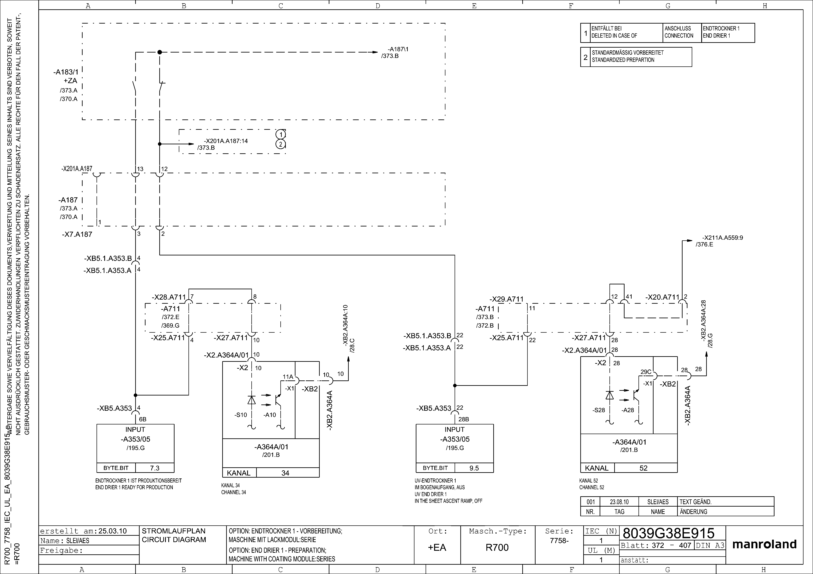

# +EA — Sheet 372 of 407 — OPTION: ENDTROCKNER 1 VORBEREITUNG;

**MASCHINE MIT LACKMODUL:SERIE**

> Part of the manroland **R700** printing press IEC/UL circuit diagrams.
> Drawing class: **Stromlaufplan / Circuit diagram** (DIN A3).
> Document `+EA` covers the **Printing unit** machine section.

## At a glance

| Field | Value |
|---|---|
| Document | `+EA`  (8039G38E915) |
| Sheet | **372** of 407 |
| Section (DE) | OPTION: ENDTROCKNER 1 VORBEREITUNG; |
| Section (EN) | MASCHINE MIT LACKMODUL:SERIE |
| Section type | CIRCUIT — Circuit diagram |
| Machine type | `R700` |
| Series | `7758` |
| Created | 25.03.10 |
| Replaces | — |
| Columns used | A, B, C, D, E, F, G, H |
| Path numbers | — |
| Labels on sheet | 133 |
| Cross-refs out | 17 |
| Cross-refs in | 43 |

**Previous:** [+EA sheet 371](SHEET_0371.md) · **Next:** [+EA sheet 373](SHEET_0373.md) · **Document TOC:** [_TOC.md](_TOC.md)  (+EA) · **Master TOC:** [all sheets](../_MASTER_TOC.md)

## Sheet image (300 DPI, exact vector render)



_Rendered directly from the PDF vector layer at 300 DPI (1-bit), no OCR and no resampling. Use it to confirm anything ambiguous in the text below._

## Cross-references on this sheet

Each entry is a wire leaving this sheet. The printed token is `/sheet.column`; the link resolves to that sheet inside the same document.

| Ref | Target sheet | Col | Path | Destination on target | Target section | From col |
|---|---|---|---|---|---|---|
| `/373.B` | [+EA sheet 373](SHEET_0373.md) | B | — | — | OPTION: ENDTROCKNER 1 VORBEREITUNG; | D |
| `/373.A` | [+EA sheet 373](SHEET_0373.md) | A | — | — | OPTION: ENDTROCKNER 1 VORBEREITUNG; | A |
| `/370.A` | [+EA sheet 370](SHEET_0370.md) | A | — | — | OPTION: ENDTROCKNER 1 VORBEREITUNG; | A |
| `/373.B` | [+EA sheet 373](SHEET_0373.md) | B | — | — | OPTION: ENDTROCKNER 1 VORBEREITUNG; | B |
| `/373.A` | [+EA sheet 373](SHEET_0373.md) | A | — | — | OPTION: ENDTROCKNER 1 VORBEREITUNG; | A |
| `/370.A` | [+EA sheet 370](SHEET_0370.md) | A | — | — | OPTION: ENDTROCKNER 1 VORBEREITUNG; | A |
| `/376.E` | [+EA sheet 376](SHEET_0376.md) | E | — | — | OPTION: ENDTROCKNER 1 VORBEREITUNG; | G |
| `/28.G` | [+EA sheet 28](SHEET_0028.md) | G | — | XB2.A364A:28 | BUSVERBINDUNGEN: SICHERHEITSBUS | G |
| `/28.C` | [+EA sheet 28](SHEET_0028.md) | C | — | XB2.A364A:10 | BUSVERBINDUNGEN: SICHERHEITSBUS | D |
| `/372.E` | [+EA sheet 372](SHEET_0372.md) | E | — | — | OPTION: ENDTROCKNER 1 VORBEREITUNG; | B |
| `/369.G` | [+EA sheet 369](SHEET_0369.md) | G | — | — | OPTION: ENDTROCKNER 1 VORBEREITUNG; | B |
| `/373.B` | [+EA sheet 373](SHEET_0373.md) | B | — | — | OPTION: ENDTROCKNER 1 VORBEREITUNG; | E |
| `/372.B` | [+EA sheet 372](SHEET_0372.md) | B | — | — | OPTION: ENDTROCKNER 1 VORBEREITUNG; | E |
| `/195.G` | [+EA sheet 195](SHEET_0195.md) | G | — | — | REFERENZMODUL | A |
| `/195.G` | [+EA sheet 195](SHEET_0195.md) | G | — | — | REFERENZMODUL | E |
| `/201.B` | [+EA sheet 201](SHEET_0201.md) | B | — | — | REFERENZMODUL | G |
| `/201.B` | [+EA sheet 201](SHEET_0201.md) | B | — | — | REFERENZMODUL | C |

### Incoming references (sheets that point here)

Every other sheet that sends a wire to this one. `Back-ref` is the token printed on *that* sheet; `Path` is its line number.

| From sheet | Cols | Back-ref | Path | Refs | What continues there |
|---|---|---|---|---|---|
| [+EA#28](SHEET_0028.md) | C, G | `/28.C`, `/28.G` | — | 2 | — |
| [+EA#195](SHEET_0195.md) | G | `/195.G` | — | 2 | — |
| [+EA#201](SHEET_0201.md) | B | `/201.B` | — | 2 | — |
| [+EA#227](SHEET_0227.md) | B, C, D, E | `/227.B`, `/227.C`, `/227.D`, `/227.E` | — | 4 | — |
| [+EA#240](SHEET_0240.md) | F | `/240.F` | — | 2 | — |
| [+EA#241](SHEET_0241.md) | A, B | `/241.A`, `/241.B` | — | 4 | — |
| [+EA#246](SHEET_0246.md) | B | `/246.B` | — | 3 | — |
| [+EA#264](SHEET_0264.md) | B | `/264.B` | — | 1 | — |
| [+EA#268](SHEET_0268.md) | E | `/268.E` | — | 2 | — |
| [+EA#271](SHEET_0271.md) | E, F | `/271.E`, `/271.F` | — | 2 | — |
| [+EA#273](SHEET_0273.md) | A | `/273.A` | — | 2 | — |
| [+EA#274](SHEET_0274.md) | E, F | `/274.E`, `/274.F` | — | 3 | — |
| [+EA#286](SHEET_0286.md) | F | `/286.F` | — | 3 | — |
| [+EA#369](SHEET_0369.md) | F | `/369.F` | — | 1 | — |
| [+EA#370](SHEET_0370.md) | A | `/370.A` | — | 2 | — |
| [+EA#372](SHEET_0372.md) | B, E | `/372.B`, `/372.E` | — | 2 | — |
| [+EA#373](SHEET_0373.md) | A, B, C | `/373.A`, `/373.B`, `/373.C` | — | 5 | A187\1; X201A.A187:14 X201A.A187:19 |
| [+EA#376](SHEET_0376.md) | E | `/376.E` | — | 1 | — |


## Devices on this sheet

| Tag | Class | Class meaning (IEC) | Col | Sub | Terminal | Sign |
|---|---|---|---|---|---|---|
| `A353/05` | A | Baugruppe / assembly, module, PC board | A | 05 | — | — |
| `S10` | S | Schalter / switch | C | — | — | — |
| `A10` | A | Baugruppe / assembly, module, PC board | C | — | — | — |
| `X1` | X | Klemme / terminal, plug connector | C | — | — | — |
| `X2` | X | Klemme / terminal, plug connector | C | — | — | — |
| `XB2` | XB |  | C | — | — | — |
| `A711` | A | Baugruppe / assembly, module, PC board | B | — | — | — |
| `A183/1` | A | Baugruppe / assembly, module, PC board | A | 1 | — | — |
| `A187` | A | Baugruppe / assembly, module, PC board | A | — | — | — |
| `A711` | A | Baugruppe / assembly, module, PC board | E | — | — | — |
| `S28` | S | Schalter / switch | F | — | — | — |
| `A28` | A | Baugruppe / assembly, module, PC board | G | — | — | — |
| `X1` | X | Klemme / terminal, plug connector | G | — | — | — |
| `X2` | X | Klemme / terminal, plug connector | F | — | — | — |
| `XB2` | XB |  | G | — | — | — |
| `A353/05` | A | Baugruppe / assembly, module, PC board | E | 05 | — | — |
| `XB5.1.A353.B` | — | cross-device reference | A | — | — | — |
| `XB5.1.A353.A` | — | cross-device reference | A | — | — | — |
| `7.3` | — | cross-device reference | B | — | — | — |
| `XB5.A353` | — | cross-device reference | A | — | — | — |
| `XB2.A364A` | — | cross-device reference | D | — | — | — |
| `X27.A711` | — | cross-device reference | B | — | — | — |
| `X28.A711` | — | cross-device reference | B | — | — | — |
| `X25.A711` | — | cross-device reference | B | — | — | — |
| `X25.A711` | — | cross-device reference | E | — | — | — |
| `X27.A711` | — | cross-device reference | F | — | — | — |
| `XB2.A364A` | — | cross-device reference | G | — | — | — |
| `9.5` | — | cross-device reference | E | — | — | — |
| `XB5.A353` | — | cross-device reference | E | — | — | — |
| `XB5.1.A353.A` | — | cross-device reference | E | — | — | — |
| `XB5.1.A353.B` | — | cross-device reference | E | — | — | — |
| `X20.A711` | — | cross-device reference | G | — | — | — |
| `NR.` | — | cross-device reference | F | — | — | — |
| `23.08.10` | — | cross-device reference | F | — | — | — |
| `X201A.A187:14` | — | cross-device reference | B | — | 14 | — |
| `X211A.A559:9` | — | cross-device reference | H | — | 9 | — |
| `XB2.A364A:28` | — | cross-device reference | G | — | 28 | — |
| `XB2.A364A:10` | — | cross-device reference | D | — | 10 | — |
| `X7.A187` | — | cross-device reference | A | — | — | — |
| `X29.A711` | — | cross-device reference | E | — | — | — |
| `X201A.A187` | — | cross-device reference | A | — | — | — |

## Potentials / nets

_No named potentials on this sheet._

## Wire-end annotations (grouped as printed)

A wire that continues elsewhere is annotated with a small cluster: the destination description, the path/line number `#NN`, and the `/sheet.column` cross reference. Each row below is one such cluster exactly as it is grouped on the drawing.

| Col | Y | Path | Cross-ref | Text on the wire |
|---|---|---|---|---|
| F | 38.9 | — | — | `1 ENTFÄLLT BEI DELETED IN CASE OF` |
| G | 38.9 | — | — | `CONNECTION ANSCHLUSS` |
| H | 38.9 | — | — | `ENDTROCKNER 1 END DRIER 1` |
| D | 68.3 | — | — | `A187\1` |
| G | 74.3 | — | — | `2 STANDARDMÄSSIG VORBEREITET STANDARDIZED PREPARTION` |
| D | 78.2 | — | `/373.B` | — |
| A | 100.9 | — | — | `A183/1` |
| A | 113.6 | — | — | `+ZA` |
| A | 128.9 | — | `/373.A`, `/370.A` | — |
| C | 193.9 | — | — | `1` |
| B | 203.0 | — | — | `X201A.A187:14` |
| C | 208.6 | — | — | `2` |
| B | 212.9 | — | `/373.B` | — |
| A | 243.9 | — | — | `X201A.A187` |
| B | 244.1 | — | — | `13` |
| B | 244.1 | — | — | `12` |
| A | 288.7 | — | — | `A187` |
| A | 301.8 | — | `/373.A`, `/370.A` | — |
| A | 322.1 | — | — | `1` |
| A | 339.1 | — | — | `X7.A187` |
| B | 339.1 | — | — | `3` |
| B | 339.1 | — | — | `2` |
| H | 344.7 | — | — | `X211A.A559:9` |
| G | 354.6 | — | `/376.E` | — |
| A | 374.5 | — | — | `XB5.1.A353.B 4` |
| A | 391.5 | — | — | `XB5.1.A353.A 4` |
| B | 431.2 | — | — | `X28.A711 7` |
| C | 431.2 | — | — | `8` |
| F | 431.2 | — | — | `12` |
| G | 431.2 | — | — | `41 X20.A711 2` |
| E | 434.0 | — | — | `X29.A711` |
| G | 439.9 | — | `/28.G` | `XB2.A364A:28` |
| D | 447.0 | — | `/28.C` | `XB2.A364A:10` |
| B | 448.2 | — | — | `A711` |
| E | 448.2 | — | — | `A711` |
| F | 448.2 | — | — | `11` |
| B | 461.2 | — | `/372.E`, `/369.G` | — |
| E | 461.2 | — | `/373.B`, `/372.B` | — |
| E | 487.9 | — | — | `XB5.1.A353.B 22` |
| B | 490.7 | — | — | `X25.A711 4` |
| C | 490.7 | — | — | `X27.A711 10` |
| E | 490.7 | — | — | `X25.A711 22` |
| F | 490.7 | — | — | `X27.A711 28` |
| E | 504.9 | — | — | `XB5.1.A353.A 22` |
| F | 509.1 | — | — | `X2.A364A/01 28` |
| B | 516.2 | — | — | `X2.A364A/01 10` |
| F | 527.6 | — | — | `X2` |
| G | 529.0 | — | — | `28 28` |
| C | 534.7 | — | — | `X2` |
| C | 536.1 | — | — | `10 10` |
| G | 537.5 | — | — | `28` |
| G | 541.8 | — | — | `29C` |
| D | 544.6 | — | — | `10` |
| C | 548.8 | — | — | `11A` |
| G | 558.7 | — | — | `X1` |
| G | 558.7 | — | — | `XB2` |
| C | 565.8 | — | — | `X1` |
| C | 565.8 | — | — | `XB2` |
| G | 565.8 | — | — | `XB2.A364A` |
| D | 572.9 | — | — | `XB2.A364A` |
| A | 594.2 | — | — | `XB5.A353 4` |
| E | 594.2 | — | — | `XB5.A353 22` |
| F | 597.7 | — | — | `S28 A28` |
| C | 604.8 | — | — | `S10 A10` |
| B | 611.1 | — | — | `6B` |
| E | 611.1 | — | — | `28B` |
| A | 625.7 | — | — | `INPUT` |
| E | 625.7 | — | — | `INPUT` |
| A | 639.5 | — | — | `A353/05` |
| E | 639.5 | — | — | `A353/05` |
| G | 643.8 | — | — | `A364A/01` |
| C | 650.9 | — | — | `A364A/01` |
| A | 653.3 | — | `/195.G` | — |
| E | 653.3 | — | `/195.G` | — |
| G | 656.1 | — | `/201.B` | — |
| C | 663.2 | — | `/201.B` | — |
| F | 682.0 | — | — | `KANAL 52` |
| A | 682.4 | — | — | `BYTE.BIT 7.3` |
| E | 682.4 | — | — | `BYTE.BIT 9.5` |
| C | 689.1 | — | — | `KANAL 34` |
| E | 702.3 | — | — | `UV ENDTROCKNER 1 IM BOGENAUFGANG, AUS UV END DRIER 1 IN THE SHEET ASCENT RAMP, OFF` |
| B | 702.4 | — | — | `ENDTROCKNER 1 IST PRODUKTIONSBEREIT END DRIER 1 READY FOR PRODUCTION` |
| F | 702.4 | — | — | `KANAL 52 CHANNEL 52` |
| C | 709.5 | — | — | `KANAL 34 CHANNEL 34` |
| G | 733.0 | — | — | `001 23.08.10 SLEI/AES TEXT GEÄND.` |
| G | 747.1 | — | — | `NR. TAG NAME ÄNDERUNG` |


## Reconstructed tables

This sheet carries tabular content (pin map / terminal assignment / index). The grid below was rebuilt from the drawing's own rule lines, so each row is exactly one physical row of the table.

### Table 1 — 7 data rows × 3 columns (at x=141.7, y=76.5)

| 1 | 13 3 | 12 2 |
|---|---|---|
| `XB5.1.A353.B XB5.1.A353.A` | `4 4` |  |
|  |  | `X28.A711 A711 /372.E` |
|  |  | `/369.G X25.A711` |
| `XB5.A353` | `4 6B` |  |
| `INPUT` |  |  |
|  | `A353/05 /195.G` |  |
| `BYTE.BIT` | `7.3` |  |


### Table 2 — 9 data rows × 15 columns (at x=276.4, y=76.5)

| /373.B | X201A.A187:14 |  | 1 2 |  |  | /373.B |  |  |  |  | 2 STANDARDIZED | STANDARDMÄSSIG | VORBEREITET PREPARTION |  |
|---|---|---|---|---|---|---|---|---|---|---|---|---|---|---|
| `7` |  | `8` |  |  |  |  |  | `A711 /373.B` | `X29.A711` | `11` |  | `12 41` |  | `X20.A711` |
| `4` | `X27.A711 X2.A364A/01` | `10 10` |  |  | `XB2.A364A:10` | `/28.C` | `XB5.1.A353.B XB5.1.A353.A` | `/372.B 22 22` | `X25.A711` | `22` | `X27.A711 X2.A364A/01` | `28 28` |  |  |
|  | `X2` | `10` | `11A` |  | `10 10` |  |  |  |  |  | `X2` | `28` | `29C X1` | `XB2` |
|  |  |  | `X1` | `XB2` |  |  |  |  |  |  |  |  |  |  |
|  | `S10` | `A10` |  |  | `XB2.A364A` |  | `XB5.A353` | `22 28B` |  |  | `S28` | `A28` |  |  |
|  |  |  |  |  |  |  | `INPUT` |  |  |  |  |  |  |  |
|  |  | `A364A/01 /201.B` |  |  |  |  |  | `A353/05 /195.G` |  |  |  | `A364A/01 /201.B` |  |  |
|  |  |  |  |  |  |  | `BYTE.BIT` | `9.5` |  |  | `KANAL` |  | `52` |  |
|  | `KANAL` |  | `34` |  |  |  |  |  |  |  |  |  |  |  |


### Table 3 — 5 data rows × 1 columns (at x=999.2, y=76.5)

| C1 |
|---|
| `/376.E` |
| `2` |
| `XB2.A364A:28` |
| `28 28` |
| `XB2.A364A` |


## Notes and free text on this sheet

| Text | Col | Y (pt) |
|---|---|---|
| `6B` | B | 611.14 |
| `INPUT` | A | 625.68 |
| `BYTE.BIT` | A | 682.93 |
| `ENDTROCKNER 1 IST PRODUKTIONSBEREIT` | B | 702.35 |
| `END DRIER 1 READY FOR PRODUCTION` | A | 712.3 |
| `KANAL 34` | B | 709.45 |
| `CHANNEL 34` | C | 719.39 |
| `11A` | C | 548.79 |
| `KANAL` | C | 689.12 |
| `A364A/01` | C | 650.86 |
| `X2.A364A/01` | B | 516.21 |
| `+ZA` | A | 113.61 |
| `KANAL 52` | F | 702.35 |
| `CHANNEL 52` | F | 712.3 |
| `29C` | G | 541.75 |
| `KANAL` | F | 682.03 |
| `A364A/01` | G | 643.77 |
| `X2.A364A/01` | F | 509.13 |
| `28B` | E | 611.15 |
| `INPUT` | E | 625.68 |
| `BYTE.BIT` | E | 682.93 |
| `UV ENDTROCKNER 1` | E | 702.32 |
| `IM BOGENAUFGANG, AUS` | E | 712.31 |
| `UV END DRIER 1` | E | 722.24 |
| `IN THE SHEET ASCENT RAMP, OFF` | E | 732.19 |
| `TAG` | G | 747.27 |
| `NAME` | G | 747.25 |
| `ÄNDERUNG` | G | 747.31 |
| `SLEI/AES` | G | 733.13 |
| `TEXT GEÄND.` | G | 733.11 |
| `A187\1` | D | 68.33 |
| `ENTFÄLLT BEI` | F | 38.86 |
| `DELETED IN CASE OF` | F | 49.51 |
| `ANSCHLUSS` | G | 38.9 |
| `CONNECTION` | G | 49.54 |
| `ENDTROCKNER 1` | H | 38.88 |
| `END DRIER 1` | H | 49.49 |
| `STANDARDMÄSSIG VORBEREITET` | G | 74.33 |
| `STANDARDIZED PREPARTION` | G | 84.96 |

## Complete label inventory (exact text from the drawing)

Every text object inside the drawing area of this sheet, in DIN reading order (column A→H, then top→bottom). This is the authoritative list: if a string is not here it is not printed on this sheet.

| Col | Y | X | Dir | Type | Text |
|---|---|---|---|---|---|
| A | 100.9 | 78.2 | → | device tag | `A183/1` |
| A | 113.6 | 93.3 | → | text | `+ZA` |
| A | 128.9 | 87.9 | → | cross-reference | `/373.A` |
| A | 141.3 | 87.9 | → | cross-reference | `/370.A` |
| A | 243.9 | 90.1 | → | device ref | `X201A.A187` |
| A | 288.7 | 85.6 | → | device tag | `A187` |
| A | 301.8 | 87.9 | → | cross-reference | `/373.A` |
| A | 314.2 | 87.9 | → | cross-reference | `/370.A` |
| A | 322.1 | 143.7 | → | number | `1` |
| A | 339.0 | 91.0 | → | device ref | `X7.A187` |
| A | 374.5 | 123.3 | → | device ref | `XB5.1.A353.B` |
| A | 392.2 | 122.5 | → | device ref | `XB5.1.A353.A` |
| A | 594.2 | 142.0 | → | device ref | `XB5.A353` |
| A | 625.7 | 183.5 | → | text | `INPUT` |
| A | 639.5 | 177.0 | → | device tag | `A353/05` |
| A | 653.3 | 185.5 | → | cross-reference | `/195.G` |
| A | 682.9 | 151.7 | → | text | `BYTE.BIT` |
| A | 712.3 | 139.7 | → | text | `END DRIER 1 READY FOR PRODUCTION` |
| B | 203.0 | 298.8 | → | device ref | `X201A.A187:14` |
| B | 212.9 | 289.1 | → | cross-reference | `/373.B` |
| B | 244.1 | 200.4 | → | number | `13` |
| B | 244.1 | 235.8 | → | number | `12` |
| B | 339.1 | 201.0 | → | number | `3` |
| B | 339.1 | 236.4 | → | number | `2` |
| B | 374.5 | 201.0 | → | number | `4` |
| B | 391.5 | 201.0 | → | number | `4` |
| B | 431.2 | 222.5 | → | device ref | `X28.A711` |
| B | 431.2 | 278.9 | → | number | `7` |
| B | 448.2 | 235.8 | → | device tag | `A711` |
| B | 461.2 | 237.3 | → | cross-reference | `/372.E` |
| B | 473.7 | 236.4 | → | cross-reference | `/369.G` |
| B | 490.7 | 221.1 | → | device ref | `X25.A711` |
| B | 490.7 | 313.2 | → | device ref | `X27.A711` |
| B | 495.0 | 278.9 | → | number | `4` |
| B | 516.2 | 298.8 | → | text | `X2.A364A/01` |
| B | 594.2 | 201.0 | → | number | `4` |
| B | 611.1 | 203.8 | → | text | `6B` |
| B | 682.3 | 220.0 | → | device ref | `7.3` |
| B | 702.3 | 139.7 | → | text | `ENDTROCKNER 1 IST PRODUKTIONSBEREIT` |
| B | 709.4 | 324.0 | → | text | `KANAL 34` |
| C | 193.9 | 409.3 | → | number | `1` |
| C | 208.6 | 409.0 | → | number | `2` |
| C | 431.2 | 371.1 | → | number | `8` |
| C | 495.0 | 370.5 | → | number | `10` |
| C | 516.2 | 370.5 | → | number | `10` |
| C | 534.7 | 347.0 | → | device tag | `X2` |
| C | 536.1 | 373.3 | → | number | `10` |
| C | 546.0 | 472.5 | → | number | `10` |
| C | 548.8 | 413.9 | → | text | `11A` |
| C | 565.8 | 417.5 | → | device tag | `X1` |
| C | 565.8 | 441.9 | → | device tag | `XB2` |
| C | 604.8 | 343.3 | → | device tag | `S10` |
| C | 604.8 | 385.8 | → | device tag | `A10` |
| C | 650.9 | 372.6 | → | text | `A364A/01` |
| C | 663.2 | 384.2 | → | cross-reference | `/201.B` |
| C | 689.1 | 332.2 | → | text | `KANAL` |
| C | 689.1 | 412.2 | → | number | `34` |
| C | 719.4 | 324.3 | → | text | `CHANNEL 34` |
| D | 68.3 | 568.1 | → | text | `A187\1` |
| D | 78.2 | 558.4 | → | cross-reference | `/373.B` |
| D | 447.0 | 502.0 | ↕ | device ref | `XB2.A364A:10` |
| D | 496.3 | 511.9 | ↕ | cross-reference | `/28.C` |
| D | 544.6 | 493.8 | → | number | `10` |
| D | 572.9 | 477.9 | ↕ | device ref | `XB2.A364A` |
| E | 434.0 | 717.2 | → | device ref | `X29.A711` |
| E | 448.2 | 696.5 | → | device tag | `A711` |
| E | 461.2 | 697.6 | → | cross-reference | `/373.B` |
| E | 473.6 | 697.6 | → | cross-reference | `/372.B` |
| E | 487.9 | 591.0 | → | device ref | `XB5.1.A353.B` |
| E | 487.9 | 668.7 | → | number | `22` |
| E | 490.7 | 717.2 | → | device ref | `X25.A711` |
| E | 504.9 | 668.7 | → | number | `22` |
| E | 505.6 | 590.2 | → | device ref | `XB5.1.A353.A` |
| E | 594.2 | 609.7 | → | device ref | `XB5.A353` |
| E | 594.2 | 668.7 | → | number | `22` |
| E | 611.2 | 671.5 | → | text | `28B` |
| E | 625.7 | 651.3 | → | text | `INPUT` |
| E | 639.5 | 644.7 | → | device tag | `A353/05` |
| E | 653.3 | 653.2 | → | cross-reference | `/195.G` |
| E | 682.3 | 687.7 | → | device ref | `9.5` |
| E | 682.9 | 619.4 | → | text | `BYTE.BIT` |
| E | 702.3 | 607.5 | → | text | `UV ENDTROCKNER 1` |
| E | 712.3 | 607.5 | → | text | `IM BOGENAUFGANG, AUS` |
| E | 722.2 | 607.5 | → | text | `UV END DRIER 1` |
| E | 732.2 | 607.5 | → | text | `IN THE SHEET ASCENT RAMP, OFF` |
| F | 38.9 | 866.6 | → | text | `ENTFÄLLT BEI` |
| F | 44.2 | 854.9 | → | number | `1` |
| F | 49.5 | 866.6 | → | text | `DELETED IN CASE OF` |
| F | 79.6 | 854.6 | → | number | `2` |
| F | 431.2 | 894.9 | → | number | `12` |
| F | 448.2 | 774.4 | → | number | `11` |
| F | 490.7 | 837.6 | → | device ref | `X27.A711` |
| F | 495.0 | 775.0 | → | number | `22` |
| F | 495.0 | 895.5 | → | number | `28` |
| F | 509.1 | 823.2 | → | text | `X2.A364A/01` |
| F | 509.1 | 895.5 | → | number | `28` |
| F | 527.6 | 871.4 | → | device tag | `X2` |
| F | 529.0 | 898.3 | → | number | `28` |
| F | 597.7 | 867.7 | → | device tag | `S28` |
| F | 682.0 | 856.6 | → | text | `KANAL` |
| F | 702.4 | 848.4 | → | text | `KANAL 52` |
| F | 712.3 | 848.7 | → | text | `CHANNEL 52` |
| F | 733.0 | 859.4 | → | number | `001` |
| F | 733.1 | 893.5 | → | device ref | `23.08.10` |
| F | 747.1 | 858.4 | → | device ref | `NR.` |
| G | 38.9 | 973.7 | → | text | `ANSCHLUSS` |
| G | 49.5 | 973.4 | → | text | `CONNECTION` |
| G | 74.3 | 867.1 | → | text | `STANDARDMÄSSIG VORBEREITET` |
| G | 85.0 | 867.1 | → | text | `STANDARDIZED PREPARTION` |
| G | 354.6 | 1019.1 | → | cross-reference | `/376.E` |
| G | 431.2 | 916.7 | → | number | `41` |
| G | 431.2 | 945.4 | → | device ref | `X20.A711` |
| G | 431.2 | 1001.8 | → | number | `2` |
| G | 439.9 | 1026.4 | ↕ | device ref | `XB2.A364A:28` |
| G | 488.7 | 1036.3 | ↕ | cross-reference | `/28.G` |
| G | 537.5 | 1018.2 | → | number | `28` |
| G | 538.9 | 997.5 | → | number | `28` |
| G | 541.7 | 938.3 | → | text | `29C` |
| G | 558.7 | 942.0 | → | device tag | `X1` |
| G | 558.7 | 966.3 | → | device tag | `XB2` |
| G | 565.8 | 1002.4 | ↕ | device ref | `XB2.A364A` |
| G | 597.7 | 910.2 | → | device tag | `A28` |
| G | 643.8 | 897.0 | → | text | `A364A/01` |
| G | 656.1 | 908.6 | → | cross-reference | `/201.B` |
| G | 682.0 | 936.6 | → | number | `52` |
| G | 733.1 | 948.2 | → | text | `SLEI/AES` |
| G | 733.1 | 995.4 | → | text | `TEXT GEÄND.` |
| G | 747.3 | 900.0 | → | text | `TAG` |
| G | 747.3 | 953.4 | → | text | `NAME` |
| G | 747.3 | 996.0 | → | text | `ÄNDERUNG` |
| H | 38.9 | 1029.5 | → | text | `ENDTROCKNER 1` |
| H | 49.5 | 1029.5 | → | text | `END DRIER 1` |
| H | 344.7 | 1028.7 | → | device ref | `X211A.A559:9` |

## Reading-order text block

The same content as a plain block, grouped by DIN column — convenient to paste or to match against a visual description.

```text
=== Column A ===
 100.9   78.2  devtag       A183/1
 113.6   93.3  text         +ZA
 128.9   87.9  xref         /373.A
 141.3   87.9  xref         /370.A
 243.9   90.1  devref       X201A.A187
 288.7   85.6  devtag       A187
 301.8   87.9  xref         /373.A
 314.2   87.9  xref         /370.A
 322.1  143.7  numeric      1
 339.0   91.0  devref       X7.A187
 374.5  123.3  devref       XB5.1.A353.B
 392.2  122.5  devref       XB5.1.A353.A
 594.2  142.0  devref       XB5.A353
 625.7  183.5  text         INPUT
 639.5  177.0  devtag       A353/05
 653.3  185.5  xref         /195.G
 682.9  151.7  text         BYTE.BIT
 712.3  139.7  text         END DRIER 1 READY FOR PRODUCTION
=== Column B ===
 203.0  298.8  devref       X201A.A187:14
 212.9  289.1  xref         /373.B
 244.1  200.4  numeric      13
 244.1  235.8  numeric      12
 339.1  201.0  numeric      3
 339.1  236.4  numeric      2
 374.5  201.0  numeric      4
 391.5  201.0  numeric      4
 431.2  222.5  devref       X28.A711
 431.2  278.9  numeric      7
 448.2  235.8  devtag       A711
 461.2  237.3  xref         /372.E
 473.7  236.4  xref         /369.G
 490.7  221.1  devref       X25.A711
 490.7  313.2  devref       X27.A711
 495.0  278.9  numeric      4
 516.2  298.8  text         X2.A364A/01
 594.2  201.0  numeric      4
 611.1  203.8  text         6B
 682.3  220.0  devref       7.3
 702.3  139.7  text         ENDTROCKNER 1 IST PRODUKTIONSBEREIT
 709.4  324.0  text         KANAL 34
=== Column C ===
 193.9  409.3  numeric      1
 208.6  409.0  numeric      2
 431.2  371.1  numeric      8
 495.0  370.5  numeric      10
 516.2  370.5  numeric      10
 534.7  347.0  devtag       X2
 536.1  373.3  numeric      10
 546.0  472.5  numeric      10
 548.8  413.9  text         11A
 565.8  417.5  devtag       X1
 565.8  441.9  devtag       XB2
 604.8  343.3  devtag       S10
 604.8  385.8  devtag       A10
 650.9  372.6  text         A364A/01
 663.2  384.2  xref         /201.B
 689.1  332.2  text         KANAL
 689.1  412.2  numeric      34
 719.4  324.3  text         CHANNEL 34
=== Column D ===
  68.3  568.1  text         A187\1
  78.2  558.4  xref         /373.B
 447.0  502.0  devref       XB2.A364A:10
 496.3  511.9  xref         /28.C
 544.6  493.8  numeric      10
 572.9  477.9  devref       XB2.A364A
=== Column E ===
 434.0  717.2  devref       X29.A711
 448.2  696.5  devtag       A711
 461.2  697.6  xref         /373.B
 473.6  697.6  xref         /372.B
 487.9  591.0  devref       XB5.1.A353.B
 487.9  668.7  numeric      22
 490.7  717.2  devref       X25.A711
 504.9  668.7  numeric      22
 505.6  590.2  devref       XB5.1.A353.A
 594.2  609.7  devref       XB5.A353
 594.2  668.7  numeric      22
 611.2  671.5  text         28B
 625.7  651.3  text         INPUT
 639.5  644.7  devtag       A353/05
 653.3  653.2  xref         /195.G
 682.3  687.7  devref       9.5
 682.9  619.4  text         BYTE.BIT
 702.3  607.5  text         UV ENDTROCKNER 1
 712.3  607.5  text         IM BOGENAUFGANG, AUS
 722.2  607.5  text         UV END DRIER 1
 732.2  607.5  text         IN THE SHEET ASCENT RAMP, OFF
=== Column F ===
  38.9  866.6  text         ENTFÄLLT BEI
  44.2  854.9  numeric      1
  49.5  866.6  text         DELETED IN CASE OF
  79.6  854.6  numeric      2
 431.2  894.9  numeric      12
 448.2  774.4  numeric      11
 490.7  837.6  devref       X27.A711
 495.0  775.0  numeric      22
 495.0  895.5  numeric      28
 509.1  823.2  text         X2.A364A/01
 509.1  895.5  numeric      28
 527.6  871.4  devtag       X2
 529.0  898.3  numeric      28
 597.7  867.7  devtag       S28
 682.0  856.6  text         KANAL
 702.4  848.4  text         KANAL 52
 712.3  848.7  text         CHANNEL 52
 733.0  859.4  numeric      001
 733.1  893.5  devref       23.08.10
 747.1  858.4  devref       NR.
=== Column G ===
  38.9  973.7  text         ANSCHLUSS
  49.5  973.4  text         CONNECTION
  74.3  867.1  text         STANDARDMÄSSIG VORBEREITET
  85.0  867.1  text         STANDARDIZED PREPARTION
 354.6 1019.1  xref         /376.E
 431.2  916.7  numeric      41
 431.2  945.4  devref       X20.A711
 431.2 1001.8  numeric      2
 439.9 1026.4  devref       XB2.A364A:28
 488.7 1036.3  xref         /28.G
 537.5 1018.2  numeric      28
 538.9  997.5  numeric      28
 541.7  938.3  text         29C
 558.7  942.0  devtag       X1
 558.7  966.3  devtag       XB2
 565.8 1002.4  devref       XB2.A364A
 597.7  910.2  devtag       A28
 643.8  897.0  text         A364A/01
 656.1  908.6  xref         /201.B
 682.0  936.6  numeric      52
 733.1  948.2  text         SLEI/AES
 733.1  995.4  text         TEXT GEÄND.
 747.3  900.0  text         TAG
 747.3  953.4  text         NAME
 747.3  996.0  text         ÄNDERUNG
=== Column H ===
  38.9 1029.5  text         ENDTROCKNER 1
  49.5 1029.5  text         END DRIER 1
 344.7 1028.7  devref       X211A.A559:9
```

---
_Generated from the PDF vector text layer; no OCR. Source: `R700_7758_IEC_UL_EA_8039G38E915_p`, sheet 372._
