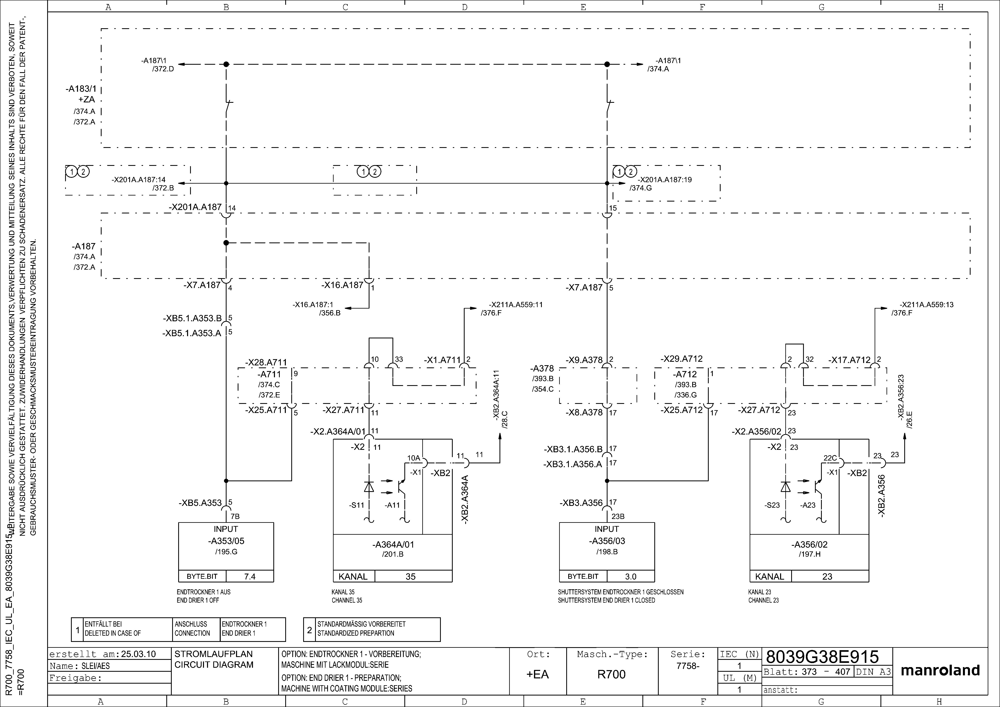

# +EA — Sheet 373 of 407 — OPTION: ENDTROCKNER 1 VORBEREITUNG;

**MASCHINE MIT LACKMODUL:SERIE**

> Part of the manroland **R700** printing press IEC/UL circuit diagrams.
> Drawing class: **Stromlaufplan / Circuit diagram** (DIN A3).
> Document `+EA` covers the **Printing unit** machine section.

## At a glance

| Field | Value |
|---|---|
| Document | `+EA`  (8039G38E915) |
| Sheet | **373** of 407 |
| Section (DE) | OPTION: ENDTROCKNER 1 VORBEREITUNG; |
| Section (EN) | MASCHINE MIT LACKMODUL:SERIE |
| Section type | CIRCUIT — Circuit diagram |
| Machine type | `R700` |
| Series | `7758` |
| Created | 25.03.10 |
| Replaces | — |
| Columns used | A, B, C, D, E, F, G, H |
| Path numbers | — |
| Labels on sheet | 147 |
| Cross-refs out | 23 |
| Cross-refs in | 52 |

**Previous:** [+EA sheet 372](SHEET_0372.md) · **Next:** [+EA sheet 374](SHEET_0374.md) · **Document TOC:** [_TOC.md](_TOC.md)  (+EA) · **Master TOC:** [all sheets](../_MASTER_TOC.md)

## Sheet image (300 DPI, exact vector render)



_Rendered directly from the PDF vector layer at 300 DPI (1-bit), no OCR and no resampling. Use it to confirm anything ambiguous in the text below._

## Cross-references on this sheet

Each entry is a wire leaving this sheet. The printed token is `/sheet.column`; the link resolves to that sheet inside the same document.

| Ref | Target sheet | Col | Path | Destination on target | Target section | From col |
|---|---|---|---|---|---|---|
| `/372.D` | [+EA sheet 372](SHEET_0372.md) | D | — | A187\1 | OPTION: ENDTROCKNER 1 VORBEREITUNG; | A |
| `/374.A` | [+EA sheet 374](SHEET_0374.md) | A | — | — | OPTION: ENDTROCKNER 1 VORBEREITUNG; | F |
| `/374.A` | [+EA sheet 374](SHEET_0374.md) | A | — | — | OPTION: ENDTROCKNER 1 VORBEREITUNG; | A |
| `/372.A` | [+EA sheet 372](SHEET_0372.md) | A | — | — | OPTION: ENDTROCKNER 1 VORBEREITUNG; | A |
| `/372.B` | [+EA sheet 372](SHEET_0372.md) | B | — | X201A.A187:14 X201A.A187:19 | OPTION: ENDTROCKNER 1 VORBEREITUNG; | C |
| `/374.G` | [+EA sheet 374](SHEET_0374.md) | G | — | — | OPTION: ENDTROCKNER 1 VORBEREITUNG; | E |
| `/374.A` | [+EA sheet 374](SHEET_0374.md) | A | — | — | OPTION: ENDTROCKNER 1 VORBEREITUNG; | A |
| `/372.A` | [+EA sheet 372](SHEET_0372.md) | A | — | — | OPTION: ENDTROCKNER 1 VORBEREITUNG; | A |
| `/356.B` | [+EA sheet 356](SHEET_0356.md) | B | — | X16.A187:1 | OPTION: VORBEREITUNG: PUDERABSAUGUNG | C |
| `/376.F` | [+EA sheet 376](SHEET_0376.md) | F | — | X211A.A559:13 | OPTION: ENDTROCKNER 1 VORBEREITUNG; | F |
| `/376.F` | [+EA sheet 376](SHEET_0376.md) | F | — | — | OPTION: ENDTROCKNER 1 VORBEREITUNG; | H |
| `/28.C` | [+EA sheet 28](SHEET_0028.md) | C | — | XB2.A364A:11 | BUSVERBINDUNGEN: SICHERHEITSBUS | D |
| `/26.E` | [+EA sheet 26](SHEET_0026.md) | E | — | XB2.A356:23 | BUSVERBINDUNGEN: SICHERHEITSBUS | H |
| `/393.B` | [+EA sheet 393](SHEET_0393.md) | B | — | — | OPTION: ZWISCHENTROCKNER VORBEREITUNG; | E |
| `/354.C` | [+EA sheet 354](SHEET_0354.md) | C | — | — | OPTION: VORBEREITUNG: PUDERABSAUGUNG | E |
| `/393.B` | [+EA sheet 393](SHEET_0393.md) | B | — | — | OPTION: ZWISCHENTROCKNER VORBEREITUNG; | F |
| `/336.G` | [+EA sheet 336](SHEET_0336.md) | G | — | — | OPTION: BOGENWEICHE | F |
| `/374.C` | [+EA sheet 374](SHEET_0374.md) | C | — | — | OPTION: ENDTROCKNER 1 VORBEREITUNG; | B |
| `/372.E` | [+EA sheet 372](SHEET_0372.md) | E | — | — | OPTION: ENDTROCKNER 1 VORBEREITUNG; | B |
| `/198.B` | [+EA sheet 198](SHEET_0198.md) | B | — | — | REFERENZMODUL | E |
| `/195.G` | [+EA sheet 195](SHEET_0195.md) | G | — | — | REFERENZMODUL | B |
| `/201.B` | [+EA sheet 201](SHEET_0201.md) | B | — | — | REFERENZMODUL | C |
| `/197.H` | [+EA sheet 197](SHEET_0197.md) | H | — | — | REFERENZMODUL | G |

### Incoming references (sheets that point here)

Every other sheet that sends a wire to this one. `Back-ref` is the token printed on *that* sheet; `Path` is its line number.

| From sheet | Cols | Back-ref | Path | Refs | What continues there |
|---|---|---|---|---|---|
| [+EA#26](SHEET_0026.md) | E | `/26.E` | — | 1 | XB2.A356:23 |
| [+EA#28](SHEET_0028.md) | C | `/28.C` | — | 1 | — |
| [+EA#195](SHEET_0195.md) | G | `/195.G` | — | 1 | — |
| [+EA#197](SHEET_0197.md) | H | `/197.H` | — | 1 | — |
| [+EA#198](SHEET_0198.md) | B | `/198.B` | — | 1 | — |
| [+EA#201](SHEET_0201.md) | B | `/201.B` | — | 1 | — |
| [+EA#214](SHEET_0214.md) | B | `/214.B` | — | 1 | — |
| [+EA#225](SHEET_0225.md) | G | `/225.G` | — | 1 | — |
| [+EA#226](SHEET_0226.md) | F | `/226.F` | — | 1 | — |
| [+EA#227](SHEET_0227.md) | B, D | `/227.B`, `/227.D` | — | 2 | — |
| [+EA#234](SHEET_0234.md) | H | `/234.H` | — | 1 | — |
| [+EA#235](SHEET_0235.md) | A, B | `/235.A`, `/235.B` | — | 2 | — |
| [+EA#240](SHEET_0240.md) | F | `/240.F` | — | 1 | — |
| [+EA#241](SHEET_0241.md) | A, B | `/241.A`, `/241.B` | — | 2 | — |
| [+EA#246](SHEET_0246.md) | B | `/246.B` | — | 2 | — |
| [+EA#250](SHEET_0250.md) | D | `/250.D` | — | 1 | — |
| [+EA#252](SHEET_0252.md) | H | `/252.H` | — | 1 | — |
| [+EA#261](SHEET_0261.md) | E | `/261.E` | — | 1 | — |
| [+EA#263](SHEET_0263.md) | C | `/263.C` | — | 1 | — |
| [+EA#268](SHEET_0268.md) | E, F | `/268.E`, `/268.F` | — | 2 | — |
| [+EA#271](SHEET_0271.md) | E, H | `/271.E`, `/271.H` | — | 2 | — |
| [+EA#273](SHEET_0273.md) | A, B | `/273.A`, `/273.B` | — | 3 | — |
| [+EA#274](SHEET_0274.md) | G, H | `/274.G`, `/274.H` | — | 3 | — |
| [+EA#286](SHEET_0286.md) | F | `/286.F` | — | 2 | — |
| [+EA#336](SHEET_0336.md) | F | `/336.F` | — | 1 | — |
| [+EA#354](SHEET_0354.md) | C | `/354.C` | — | 1 | — |
| [+EA#356](SHEET_0356.md) | B | `/356.B` | — | 1 | X16.A187:1 |
| [+EA#372](SHEET_0372.md) | A, B, D, E | `/372.A`, `/372.B`, `/372.D`, `/372.E` | — | 5 | — |
| [+EA#374](SHEET_0374.md) | A, C, G | `/374.A`, `/374.C`, `/374.G` | — | 5 | A187\1; X201A.A187:19 |
| [+EA#376](SHEET_0376.md) | E, F | `/376.E`, `/376.F` | — | 2 | — |
| [+EA#393](SHEET_0393.md) | B | `/393.B` | — | 2 | — |


## Devices on this sheet

| Tag | Class | Class meaning (IEC) | Col | Sub | Terminal | Sign |
|---|---|---|---|---|---|---|
| `A183/1` | A | Baugruppe / assembly, module, PC board | A | 1 | — | — |
| `A187` | A | Baugruppe / assembly, module, PC board | A | — | — | — |
| `A353/05` | A | Baugruppe / assembly, module, PC board | B | 05 | — | — |
| `S11` | S | Schalter / switch | C | — | — | — |
| `A11` | A | Baugruppe / assembly, module, PC board | C | — | — | — |
| `X1` | X | Klemme / terminal, plug connector | D | — | — | — |
| `X2` | X | Klemme / terminal, plug connector | C | — | — | — |
| `XB2` | XB |  | D | — | — | — |
| `A711` | A | Baugruppe / assembly, module, PC board | B | — | — | — |
| `A356/03` | A | Baugruppe / assembly, module, PC board | E | 03 | — | — |
| `A378` | A | Baugruppe / assembly, module, PC board | E | — | — | — |
| `A712` | A | Baugruppe / assembly, module, PC board | F | — | — | — |
| `S23` | S | Schalter / switch | G | — | — | — |
| `A23` | A | Baugruppe / assembly, module, PC board | G | — | — | — |
| `X1` | X | Klemme / terminal, plug connector | G | — | — | — |
| `X2` | X | Klemme / terminal, plug connector | G | — | — | — |
| `XB2` | XB |  | G | — | — | — |
| `A356/02` | A | Baugruppe / assembly, module, PC board | G | 02 | — | — |
| `X7.A187` | — | cross-device reference | B | — | — | — |
| `X201A.A187` | — | cross-device reference | B | — | — | — |
| `XB5.1.A353.B` | — | cross-device reference | B | — | — | — |
| `XB5.1.A353.A` | — | cross-device reference | B | — | — | — |
| `7.4` | — | cross-device reference | B | — | — | — |
| `XB5.A353` | — | cross-device reference | B | — | — | — |
| `XB2.A364A` | — | cross-device reference | D | — | — | — |
| `X27.A711` | — | cross-device reference | C | — | — | — |
| `X25.A711` | — | cross-device reference | B | — | — | — |
| `X7.A187` | — | cross-device reference | E | — | — | — |
| `3.0` | — | cross-device reference | E | — | — | — |
| `XB3.A356` | — | cross-device reference | E | — | — | — |
| `XB3.1.A356.B` | — | cross-device reference | E | — | — | — |
| `XB3.1.A356.A` | — | cross-device reference | E | — | — | — |
| `X16.A187` | — | cross-device reference | C | — | — | — |
| `X1.A711` | — | cross-device reference | D | — | — | — |
| `X9.A378` | — | cross-device reference | E | — | — | — |
| `X8.A378` | — | cross-device reference | E | — | — | — |
| `X27.A712` | — | cross-device reference | F | — | — | — |
| `X25.A712` | — | cross-device reference | F | — | — | — |
| `XB2.A356` | — | cross-device reference | H | — | — | — |
| `X17.A712` | — | cross-device reference | G | — | — | — |
| `X201A.A187:19` | — | cross-device reference | F | — | 19 | — |
| `X201A.A187:14` | — | cross-device reference | A | — | 14 | — |
| `X211A.A559:13` | — | cross-device reference | H | — | 13 | — |
| `X211A.A559:11` | — | cross-device reference | D | — | 11 | — |
| `XB2.A356:23` | — | cross-device reference | H | — | 23 | — |
| `XB2.A364A:11` | — | cross-device reference | D | — | 11 | — |
| `X16.A187:1` | — | cross-device reference | C | — | 1 | — |
| `X28.A711` | — | cross-device reference | B | — | — | — |
| `X29.A712` | — | cross-device reference | F | — | — | — |

## Potentials / nets

_No named potentials on this sheet._

## Wire-end annotations (grouped as printed)

A wire that continues elsewhere is annotated with a small cluster: the destination description, the path/line number `#NN`, and the `/sheet.column` cross reference. Each row below is one such cluster exactly as it is grouped on the drawing.

| Col | Y | Path | Cross-ref | Text on the wire |
|---|---|---|---|---|
| A | 68.3 | — | `/372.D` | `A187\1` |
| F | 68.3 | — | — | `A187\1` |
| F | 78.2 | — | `/374.A` | — |
| A | 100.9 | — | — | `A183/1` |
| A | 113.6 | — | — | `+ZA` |
| A | 128.9 | — | `/374.A`, `/372.A` | — |
| C | 201.0 | — | — | `1 2 2` |
| D | 201.0 | — | — | `1 2 1` |
| C | 210.1 | — | `/372.B` | `X201A.A187:14 X201A.A187:19` |
| E | 220.0 | — | `/374.G` | — |
| B | 241.9 | — | — | `X201A.A187 14` |
| E | 244.1 | — | — | `15` |
| A | 288.7 | — | — | `A187` |
| A | 301.8 | — | `/374.A`, `/372.A` | — |
| B | 334.8 | — | — | `X7.A187 4` |
| C | 334.8 | — | — | `X16.A187 1` |
| E | 337.6 | — | — | `X7.A187 5` |
| C | 358.9 | — | `/356.B` | `X16.A187:1` |
| F | 358.9 | — | `/376.F` | `X211A.A559:13` |
| D | 358.9 | — | — | `X211A.A559:11` |
| H | 368.8 | — | `/376.F` | — |
| B | 374.5 | — | — | `XB5.1.A353.B 5` |
| B | 391.5 | — | — | `XB5.1.A353.A 5` |
| D | 422.7 | — | — | `X28.A711 X29.A712` |
| C | 424.1 | — | — | `10` |
| D | 424.1 | — | — | `33 X1.A711 2` |
| E | 424.1 | — | — | `X9.A378 2` |
| G | 424.1 | — | — | `2` |
| G | 424.1 | — | — | `32 X17.A712 2` |
| E | 434.0 | — | — | `A378` |
| D | 439.9 | — | `/28.C` | `XB2.A364A:11` |
| B | 441.1 | — | — | `A711` |
| C | 441.1 | — | — | `9` |
| F | 441.1 | — | — | `A712` |
| F | 441.1 | — | — | `1` |
| H | 445.9 | — | `/26.E` | `XB2.A356:23` |
| E | 447.1 | — | `/393.B`, `/354.C` | — |
| B | 454.2 | — | `/374.C` | — |
| F | 454.2 | — | `/393.B`, `/336.G` | — |
| B | 466.6 | — | `/372.E` | — |
| B | 483.6 | — | — | `X25.A711 5` |
| C | 483.6 | — | — | `X27.A711 11` |
| F | 483.6 | — | — | `X25.A712 17 X27.A712 23` |
| E | 486.4 | — | — | `X8.A378 17` |
| C | 509.1 | — | — | `X2.A364A/01 11` |
| G | 509.1 | — | — | `X2.A356/02 23` |
| C | 527.6 | — | — | `X2` |
| G | 527.6 | — | — | `X2` |
| D | 529.0 | — | — | `11 11` |
| G | 529.0 | — | — | `23 23` |
| E | 530.4 | — | — | `XB3.1.A356.B 17` |
| D | 537.5 | — | — | `11` |
| H | 537.5 | — | — | `23` |
| D | 541.7 | — | — | `10A` |
| G | 541.8 | — | — | `22C` |
| E | 547.4 | — | — | `XB3.1.A356.A 17` |
| D | 558.7 | — | — | `X1` |
| D | 558.7 | — | — | `XB2` |
| G | 558.7 | — | — | `X1` |
| G | 558.7 | — | — | `XB2` |
| H | 565.0 | — | — | `XB2.A356` |
| D | 565.8 | — | — | `XB2.A364A` |
| B | 594.2 | — | — | `XB5.A353 5` |
| E | 594.2 | — | — | `XB3.A356 17` |
| C | 597.7 | — | — | `S11 A11` |
| G | 597.7 | — | — | `S23 A23` |
| B | 611.1 | — | — | `7B` |
| E | 611.1 | — | — | `23B` |
| B | 625.7 | — | — | `INPUT` |
| E | 625.7 | — | — | `INPUT` |
| B | 639.5 | — | — | `A353/05` |
| E | 639.5 | — | — | `A356/03` |
| C | 643.8 | — | — | `A364A/01` |
| G | 643.8 | — | — | `A356/02` |
| B | 653.3 | — | `/195.G` | — |
| E | 653.3 | — | `/198.B` | — |
| C | 656.1 | — | `/201.B` | — |
| G | 656.2 | — | `/197.H` | — |
| C | 682.0 | — | — | `KANAL 35` |
| G | 682.0 | — | — | `KANAL 23` |
| B | 682.4 | — | — | `BYTE.BIT 7.4` |
| E | 682.4 | — | — | `BYTE.BIT 3.0` |
| B | 702.3 | — | — | `ENDTROCKNER 1 AUS END DRIER 1 OFF` |
| C | 702.4 | — | — | `KANAL 35 CHANNEL 35` |
| E | 702.4 | — | — | `SHUTTERSYSTEM ENDTROCKNER 1 GESCHLOSSEN SHUTTERSYSTEM END DRIER 1 CLOSED` |
| G | 702.4 | — | — | `KANAL 23 CHANNEL 23` |
| A | 740.4 | — | — | `1 ENTFÄLLT BEI DELETED IN CASE OF` |
| B | 740.5 | — | — | `CONNECTION ANSCHLUSS` |
| C | 740.5 | — | — | `ENDTROCKNER 1 END DRIER 1 2 STANDARDMÄSSIG VORBEREITET STANDARDIZED PREPARTION` |


## Reconstructed tables

This sheet carries tabular content (pin map / terminal assignment / index). The grid below was rebuilt from the drawing's own rule lines, so each row is exactly one physical row of the table.

### Table 1 — 6 data rows × 2 columns (at x=212.6, y=76.5)

| X201A.A187 | 14 |
|---|---|
| `X7.A187 XB5.1.A353.B XB5.1.A353.A` | `4 5 5 X28.A711 A711 /374.C` |
|  | `/372.E X25.A711` |
| `XB5.A353` | `5 7B` |
| `INPUT` |  |
|  | `A353/05 /195.G` |
| `BYTE.BIT` | `7.4` |


### Table 2 — 8 data rows × 17 columns (at x=347.2, y=76.5)

|  | 1 | 2 |  |  |  |  |  |  |  | 1 2 | /374.A X201A.A187:19 |  |  |  |  |  |
|---|---|---|---|---|---|---|---|---|---|---|---|---|---|---|---|---|
|  |  |  |  |  |  |  |  |  |  | `/374.G 15` |  |  |  |  |  |  |
| `X16.A187:1 /356.B 9` | `X16.A187` | `1 10` | `33` |  | `X1.A711` |  | `/376.F 2` | `X211A.A559:11 A378 /393.B` | `X7.A187 X9.A378` | `5 2` | `X29.A712 A712 /393.B` | `1` |  | `2 32` |  | `X17.A712` |
| `5` | `X27.A711 X2.A364A/01` | `11 11` |  |  |  |  | `XB2.A364A:11` | `/354.C /28.C` | `X8.A378` | `17` | `/336.G X25.A712` | `17` | `X27.A712 X2.A356/02` | `23 23` |  |  |
|  | `X2` | `11` |  | `10A X1` | `XB2` | `11` | `11` |  | `XB3.1.A356.B XB3.1.A356.A` | `17 17` |  |  | `X2` | `23` | `22C X1` | `XB2` |
|  | `S11` | `A11` |  |  |  |  | `XB2.A364A` |  | `XB3.A356` | `17 23B` |  |  | `S23` | `A23` |  |  |
|  |  |  |  |  |  |  |  |  | `INPUT` |  |  |  |  |  |  |  |
|  |  |  | `A364A/01 /201.B` |  |  |  |  |  |  | `A356/03 /198.B` |  |  |  | `A356/02 /197.H` |  |  |
|  | `KANAL` |  |  | `35` |  |  |  |  | `BYTE.BIT` | `3.0` |  |  | `KANAL` |  | `23` |  |


### Table 3 — 4 data rows × 1 columns (at x=1041.7, y=76.5)

| C1 |
|---|
| `/376.F 2` |
| `XB2.A356:23` |
| `23 23` |
| `XB2.A356` |


## Notes and free text on this sheet

| Text | Col | Y (pt) |
|---|---|---|
| `+ZA` | A | 113.61 |
| `7B` | B | 611.14 |
| `INPUT` | B | 625.68 |
| `BYTE.BIT` | B | 682.93 |
| `ENDTROCKNER 1 AUS` | B | 702.34 |
| `END DRIER 1 OFF` | B | 712.3 |
| `KANAL 35` | C | 702.36 |
| `CHANNEL 35` | C | 712.3 |
| `10A` | D | 541.7 |
| `KANAL` | C | 682.03 |
| `A364A/01` | C | 643.77 |
| `X2.A364A/01` | C | 509.13 |
| `23B` | E | 611.15 |
| `INPUT` | E | 625.68 |
| `BYTE.BIT` | E | 682.93 |
| `SHUTTERSYSTEM ENDTROCKNER 1 GESCHLOSSEN` | E | 702.35 |
| `SHUTTERSYSTEM END DRIER 1 CLOSED` | E | 712.3 |
| `KANAL 23` | F | 702.36 |
| `CHANNEL 23` | G | 712.3 |
| `22C` | G | 541.75 |
| `KANAL` | G | 682.03 |
| `X2.A356/02` | F | 509.13 |
| `A187\1` | A | 68.33 |
| `A187\1` | F | 68.33 |
| `ENTFÄLLT BEI` | A | 740.43 |
| `DELETED IN CASE OF` | A | 751.09 |
| `ANSCHLUSS` | B | 740.48 |
| `CONNECTION` | B | 751.11 |
| `ENDTROCKNER 1` | B | 740.46 |
| `END DRIER 1` | B | 751.07 |
| `STANDARDMÄSSIG VORBEREITET` | C | 740.47 |
| `STANDARDIZED PREPARTION` | C | 751.1 |

## Complete label inventory (exact text from the drawing)

Every text object inside the drawing area of this sheet, in DIN reading order (column A→H, then top→bottom). This is the authoritative list: if a string is not here it is not printed on this sheet.

| Col | Y | X | Dir | Type | Text |
|---|---|---|---|---|---|
| A | 68.3 | 168.1 | → | text | `A187\1` |
| A | 78.2 | 181.4 | → | cross-reference | `/372.D` |
| A | 100.9 | 78.2 | → | device tag | `A183/1` |
| A | 113.6 | 93.3 | → | text | `+ZA` |
| A | 128.9 | 87.9 | → | cross-reference | `/374.A` |
| A | 141.3 | 87.9 | → | cross-reference | `/372.A` |
| A | 201.0 | 83.3 | → | number | `1` |
| A | 201.6 | 97.2 | → | number | `2` |
| A | 210.0 | 132.9 | → | device ref | `X201A.A187:14` |
| A | 219.9 | 181.7 | → | cross-reference | `/372.B` |
| A | 288.7 | 85.6 | → | device tag | `A187` |
| A | 301.8 | 87.9 | → | cross-reference | `/374.A` |
| A | 314.2 | 87.9 | → | cross-reference | `/372.A` |
| A | 740.4 | 101.2 | → | text | `ENTFÄLLT BEI` |
| A | 745.8 | 89.6 | → | number | `1` |
| A | 751.1 | 101.2 | → | text | `DELETED IN CASE OF` |
| B | 242.0 | 201.0 | → | device ref | `X201A.A187` |
| B | 244.1 | 271.3 | → | number | `14` |
| B | 334.8 | 218.6 | → | device ref | `X7.A187` |
| B | 339.1 | 271.8 | → | number | `4` |
| B | 374.5 | 194.2 | → | device ref | `XB5.1.A353.B` |
| B | 374.5 | 271.8 | → | number | `5` |
| B | 391.5 | 271.8 | → | number | `5` |
| B | 392.2 | 193.3 | → | device ref | `XB5.1.A353.A` |
| B | 426.9 | 292.0 | → | device ref | `X28.A711` |
| B | 441.1 | 306.7 | → | device tag | `A711` |
| B | 454.2 | 307.6 | → | cross-reference | `/374.C` |
| B | 466.6 | 308.1 | → | cross-reference | `/372.E` |
| B | 483.6 | 292.0 | → | device ref | `X25.A711` |
| B | 594.2 | 212.9 | → | device ref | `XB5.A353` |
| B | 594.2 | 271.8 | → | number | `5` |
| B | 611.1 | 274.7 | → | text | `7B` |
| B | 625.7 | 254.4 | → | text | `INPUT` |
| B | 639.5 | 247.9 | → | device tag | `A353/05` |
| B | 653.3 | 256.4 | → | cross-reference | `/195.G` |
| B | 682.3 | 290.8 | → | device ref | `7.4` |
| B | 682.9 | 222.5 | → | text | `BYTE.BIT` |
| B | 702.3 | 210.6 | → | text | `ENDTROCKNER 1 AUS` |
| B | 712.3 | 210.6 | → | text | `END DRIER 1 OFF` |
| B | 740.5 | 208.3 | → | text | `ANSCHLUSS` |
| B | 740.5 | 264.2 | → | text | `ENDTROCKNER 1` |
| B | 751.1 | 208.1 | → | text | `CONNECTION` |
| B | 751.1 | 264.2 | → | text | `END DRIER 1` |
| C | 201.0 | 430.5 | → | number | `1` |
| C | 201.6 | 444.5 | → | number | `2` |
| C | 334.8 | 382.7 | → | device ref | `X16.A187` |
| C | 339.1 | 441.4 | → | number | `1` |
| C | 358.9 | 348.4 | → | device ref | `X16.A187:1` |
| C | 368.8 | 380.1 | → | cross-reference | `/356.B` |
| C | 424.1 | 441.4 | → | number | `10` |
| C | 424.1 | 470.3 | → | number | `33` |
| C | 441.1 | 349.8 | → | number | `9` |
| C | 483.6 | 384.1 | → | device ref | `X27.A711` |
| C | 487.9 | 349.8 | → | number | `5` |
| C | 487.9 | 441.4 | → | number | `11` |
| C | 509.1 | 369.6 | → | text | `X2.A364A/01` |
| C | 509.1 | 441.4 | → | number | `11` |
| C | 527.6 | 417.8 | → | device tag | `X2` |
| C | 529.0 | 444.2 | → | number | `11` |
| C | 597.7 | 415.6 | → | device tag | `S11` |
| C | 597.7 | 458.1 | → | device tag | `A11` |
| C | 643.8 | 443.5 | → | text | `A364A/01` |
| C | 656.1 | 455.1 | → | cross-reference | `/201.B` |
| C | 682.0 | 403.1 | → | text | `KANAL` |
| C | 702.4 | 394.9 | → | text | `KANAL 35` |
| C | 712.3 | 395.1 | → | text | `CHANNEL 35` |
| C | 740.5 | 378.1 | → | text | `STANDARDMÄSSIG VORBEREITET` |
| C | 745.8 | 365.7 | → | number | `2` |
| C | 751.1 | 378.1 | → | text | `STANDARDIZED PREPARTION` |
| D | 358.9 | 582.2 | → | device ref | `X211A.A559:11` |
| D | 368.8 | 572.6 | → | cross-reference | `/376.F` |
| D | 424.1 | 504.9 | → | device ref | `X1.A711` |
| D | 424.1 | 555.3 | → | number | `2` |
| D | 439.9 | 587.0 | ↕ | device ref | `XB2.A364A:11` |
| D | 489.3 | 597.0 | ↕ | cross-reference | `/28.C` |
| D | 537.5 | 566.1 | → | number | `11` |
| D | 538.9 | 543.4 | → | number | `11` |
| D | 541.7 | 484.7 | → | text | `10A` |
| D | 558.7 | 488.4 | → | device tag | `X1` |
| D | 558.7 | 512.8 | → | device tag | `XB2` |
| D | 565.8 | 548.8 | ↕ | device ref | `XB2.A364A` |
| D | 682.0 | 483.0 | → | number | `35` |
| E | 201.0 | 735.3 | → | number | `1` |
| E | 201.6 | 749.2 | → | number | `2` |
| E | 220.0 | 749.8 | → | cross-reference | `/374.G` |
| E | 244.1 | 724.8 | → | number | `15` |
| E | 337.6 | 673.5 | → | device ref | `X7.A187` |
| E | 339.1 | 725.4 | → | number | `5` |
| E | 424.1 | 673.5 | → | device ref | `X9.A378` |
| E | 424.1 | 725.4 | → | number | `2` |
| E | 434.0 | 631.3 | → | device tag | `A378` |
| E | 447.1 | 633.8 | → | cross-reference | `/393.B` |
| E | 459.5 | 633.5 | → | cross-reference | `/354.C` |
| E | 486.5 | 673.5 | → | device ref | `X8.A378` |
| E | 487.9 | 724.8 | → | number | `17` |
| E | 530.4 | 647.7 | → | device ref | `XB3.1.A356.B` |
| E | 530.4 | 724.8 | → | number | `17` |
| E | 547.4 | 724.8 | → | number | `17` |
| E | 548.1 | 646.9 | → | device ref | `XB3.1.A356.A` |
| E | 594.2 | 666.4 | → | device ref | `XB3.A356` |
| E | 594.2 | 724.8 | → | number | `17` |
| E | 611.2 | 728.2 | → | text | `23B` |
| E | 625.7 | 708.0 | → | text | `INPUT` |
| E | 639.5 | 701.4 | → | device tag | `A356/03` |
| E | 653.3 | 710.2 | → | cross-reference | `/198.B` |
| E | 682.3 | 744.4 | → | device ref | `3.0` |
| E | 682.9 | 676.1 | → | text | `BYTE.BIT` |
| E | 702.3 | 664.4 | → | text | `SHUTTERSYSTEM ENDTROCKNER 1 GESCHLOSSEN` |
| E | 712.3 | 664.4 | → | text | `SHUTTERSYSTEM END DRIER 1 CLOSED` |
| F | 68.3 | 780.7 | → | text | `A187\1` |
| F | 78.2 | 771.0 | → | cross-reference | `/374.A` |
| F | 210.0 | 759.4 | → | device ref | `X201A.A187:19` |
| F | 422.7 | 786.6 | → | device ref | `X29.A712` |
| F | 441.1 | 801.4 | → | device tag | `A712` |
| F | 441.1 | 845.3 | → | number | `1` |
| F | 454.2 | 803.9 | → | cross-reference | `/393.B` |
| F | 466.6 | 803.3 | → | cross-reference | `/336.G` |
| F | 483.6 | 786.6 | → | device ref | `X25.A712` |
| F | 483.6 | 878.7 | → | device ref | `X27.A712` |
| F | 487.9 | 845.3 | → | number | `17` |
| F | 509.1 | 871.4 | → | text | `X2.A356/02` |
| F | 702.4 | 890.9 | → | text | `KANAL 23` |
| G | 424.1 | 938.0 | → | number | `2` |
| G | 424.1 | 959.2 | → | number | `32` |
| G | 424.1 | 986.5 | → | device ref | `X17.A712` |
| G | 424.1 | 1044.3 | → | number | `2` |
| G | 487.9 | 938.0 | → | number | `23` |
| G | 509.1 | 938.0 | → | number | `23` |
| G | 527.6 | 913.9 | → | device tag | `X2` |
| G | 529.0 | 940.8 | → | number | `23` |
| G | 538.9 | 1040.0 | → | number | `23` |
| G | 541.7 | 980.8 | → | text | `22C` |
| G | 558.7 | 984.5 | → | device tag | `X1` |
| G | 558.7 | 1008.9 | → | device tag | `XB2` |
| G | 597.7 | 910.2 | → | device tag | `S23` |
| G | 597.7 | 952.7 | → | device tag | `A23` |
| G | 643.8 | 942.4 | → | device tag | `A356/02` |
| G | 656.2 | 951.3 | → | cross-reference | `/197.H` |
| G | 682.0 | 899.1 | → | text | `KANAL` |
| G | 682.0 | 979.2 | → | number | `23` |
| G | 712.3 | 891.2 | → | text | `CHANNEL 23` |
| H | 358.9 | 1071.2 | → | device ref | `X211A.A559:13` |
| H | 368.8 | 1061.6 | → | cross-reference | `/376.F` |
| H | 445.9 | 1068.9 | ↕ | device ref | `XB2.A356:23` |
| H | 489.5 | 1078.8 | ↕ | cross-reference | `/26.E` |
| H | 537.5 | 1060.7 | → | number | `23` |
| H | 564.9 | 1044.9 | ↕ | device ref | `XB2.A356` |

## Reading-order text block

The same content as a plain block, grouped by DIN column — convenient to paste or to match against a visual description.

```text
=== Column A ===
  68.3  168.1  text         A187\1
  78.2  181.4  xref         /372.D
 100.9   78.2  devtag       A183/1
 113.6   93.3  text         +ZA
 128.9   87.9  xref         /374.A
 141.3   87.9  xref         /372.A
 201.0   83.3  numeric      1
 201.6   97.2  numeric      2
 210.0  132.9  devref       X201A.A187:14
 219.9  181.7  xref         /372.B
 288.7   85.6  devtag       A187
 301.8   87.9  xref         /374.A
 314.2   87.9  xref         /372.A
 740.4  101.2  text         ENTFÄLLT BEI
 745.8   89.6  numeric      1
 751.1  101.2  text         DELETED IN CASE OF
=== Column B ===
 242.0  201.0  devref       X201A.A187
 244.1  271.3  numeric      14
 334.8  218.6  devref       X7.A187
 339.1  271.8  numeric      4
 374.5  194.2  devref       XB5.1.A353.B
 374.5  271.8  numeric      5
 391.5  271.8  numeric      5
 392.2  193.3  devref       XB5.1.A353.A
 426.9  292.0  devref       X28.A711
 441.1  306.7  devtag       A711
 454.2  307.6  xref         /374.C
 466.6  308.1  xref         /372.E
 483.6  292.0  devref       X25.A711
 594.2  212.9  devref       XB5.A353
 594.2  271.8  numeric      5
 611.1  274.7  text         7B
 625.7  254.4  text         INPUT
 639.5  247.9  devtag       A353/05
 653.3  256.4  xref         /195.G
 682.3  290.8  devref       7.4
 682.9  222.5  text         BYTE.BIT
 702.3  210.6  text         ENDTROCKNER 1 AUS
 712.3  210.6  text         END DRIER 1 OFF
 740.5  208.3  text         ANSCHLUSS
 740.5  264.2  text         ENDTROCKNER 1
 751.1  208.1  text         CONNECTION
 751.1  264.2  text         END DRIER 1
=== Column C ===
 201.0  430.5  numeric      1
 201.6  444.5  numeric      2
 334.8  382.7  devref       X16.A187
 339.1  441.4  numeric      1
 358.9  348.4  devref       X16.A187:1
 368.8  380.1  xref         /356.B
 424.1  441.4  numeric      10
 424.1  470.3  numeric      33
 441.1  349.8  numeric      9
 483.6  384.1  devref       X27.A711
 487.9  349.8  numeric      5
 487.9  441.4  numeric      11
 509.1  369.6  text         X2.A364A/01
 509.1  441.4  numeric      11
 527.6  417.8  devtag       X2
 529.0  444.2  numeric      11
 597.7  415.6  devtag       S11
 597.7  458.1  devtag       A11
 643.8  443.5  text         A364A/01
 656.1  455.1  xref         /201.B
 682.0  403.1  text         KANAL
 702.4  394.9  text         KANAL 35
 712.3  395.1  text         CHANNEL 35
 740.5  378.1  text         STANDARDMÄSSIG VORBEREITET
 745.8  365.7  numeric      2
 751.1  378.1  text         STANDARDIZED PREPARTION
=== Column D ===
 358.9  582.2  devref       X211A.A559:11
 368.8  572.6  xref         /376.F
 424.1  504.9  devref       X1.A711
 424.1  555.3  numeric      2
 439.9  587.0  devref       XB2.A364A:11
 489.3  597.0  xref         /28.C
 537.5  566.1  numeric      11
 538.9  543.4  numeric      11
 541.7  484.7  text         10A
 558.7  488.4  devtag       X1
 558.7  512.8  devtag       XB2
 565.8  548.8  devref       XB2.A364A
 682.0  483.0  numeric      35
=== Column E ===
 201.0  735.3  numeric      1
 201.6  749.2  numeric      2
 220.0  749.8  xref         /374.G
 244.1  724.8  numeric      15
 337.6  673.5  devref       X7.A187
 339.1  725.4  numeric      5
 424.1  673.5  devref       X9.A378
 424.1  725.4  numeric      2
 434.0  631.3  devtag       A378
 447.1  633.8  xref         /393.B
 459.5  633.5  xref         /354.C
 486.5  673.5  devref       X8.A378
 487.9  724.8  numeric      17
 530.4  647.7  devref       XB3.1.A356.B
 530.4  724.8  numeric      17
 547.4  724.8  numeric      17
 548.1  646.9  devref       XB3.1.A356.A
 594.2  666.4  devref       XB3.A356
 594.2  724.8  numeric      17
 611.2  728.2  text         23B
 625.7  708.0  text         INPUT
 639.5  701.4  devtag       A356/03
 653.3  710.2  xref         /198.B
 682.3  744.4  devref       3.0
 682.9  676.1  text         BYTE.BIT
 702.3  664.4  text         SHUTTERSYSTEM ENDTROCKNER 1 GESCHLOSSEN
 712.3  664.4  text         SHUTTERSYSTEM END DRIER 1 CLOSED
=== Column F ===
  68.3  780.7  text         A187\1
  78.2  771.0  xref         /374.A
 210.0  759.4  devref       X201A.A187:19
 422.7  786.6  devref       X29.A712
 441.1  801.4  devtag       A712
 441.1  845.3  numeric      1
 454.2  803.9  xref         /393.B
 466.6  803.3  xref         /336.G
 483.6  786.6  devref       X25.A712
 483.6  878.7  devref       X27.A712
 487.9  845.3  numeric      17
 509.1  871.4  text         X2.A356/02
 702.4  890.9  text         KANAL 23
=== Column G ===
 424.1  938.0  numeric      2
 424.1  959.2  numeric      32
 424.1  986.5  devref       X17.A712
 424.1 1044.3  numeric      2
 487.9  938.0  numeric      23
 509.1  938.0  numeric      23
 527.6  913.9  devtag       X2
 529.0  940.8  numeric      23
 538.9 1040.0  numeric      23
 541.7  980.8  text         22C
 558.7  984.5  devtag       X1
 558.7 1008.9  devtag       XB2
 597.7  910.2  devtag       S23
 597.7  952.7  devtag       A23
 643.8  942.4  devtag       A356/02
 656.2  951.3  xref         /197.H
 682.0  899.1  text         KANAL
 682.0  979.2  numeric      23
 712.3  891.2  text         CHANNEL 23
=== Column H ===
 358.9 1071.2  devref       X211A.A559:13
 368.8 1061.6  xref         /376.F
 445.9 1068.9  devref       XB2.A356:23
 489.5 1078.8  xref         /26.E
 537.5 1060.7  numeric      23
 564.9 1044.9  devref       XB2.A356
```

---
_Generated from the PDF vector text layer; no OCR. Source: `R700_7758_IEC_UL_EA_8039G38E915_p`, sheet 373._
