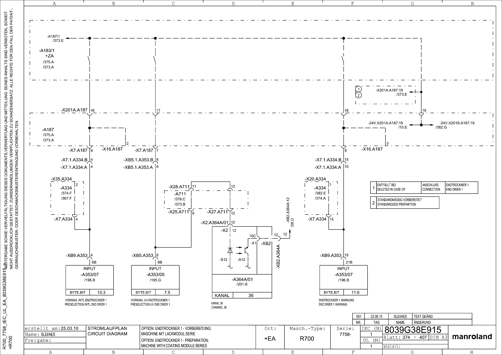

# +EA — Sheet 374 of 407 — OPTION: ENDTROCKNER 1 VORBEREITUNG;

**MASCHINE MIT LACKMODUL:SERIE**

> Part of the manroland **R700** printing press IEC/UL circuit diagrams.
> Drawing class: **Stromlaufplan / Circuit diagram** (DIN A3).
> Document `+EA` covers the **Printing unit** machine section.

## At a glance

| Field | Value |
|---|---|
| Document | `+EA`  (8039G38E915) |
| Sheet | **374** of 407 |
| Section (DE) | OPTION: ENDTROCKNER 1 VORBEREITUNG; |
| Section (EN) | MASCHINE MIT LACKMODUL:SERIE |
| Section type | CIRCUIT — Circuit diagram |
| Machine type | `R700` |
| Series | `7758` |
| Created | 25.03.10 |
| Replaces | — |
| Columns used | A, B, C, D, E, F, G, H |
| Path numbers | — |
| Labels on sheet | 135 |
| Cross-refs out | 19 |
| Cross-refs in | 47 |

**Previous:** [+EA sheet 373](SHEET_0373.md) · **Next:** [+EA sheet 375](SHEET_0375.md) · **Document TOC:** [_TOC.md](_TOC.md)  (+EA) · **Master TOC:** [all sheets](../_MASTER_TOC.md)

## Sheet image (300 DPI, exact vector render)



_Rendered directly from the PDF vector layer at 300 DPI (1-bit), no OCR and no resampling. Use it to confirm anything ambiguous in the text below._

## Cross-references on this sheet

Each entry is a wire leaving this sheet. The printed token is `/sheet.column`; the link resolves to that sheet inside the same document.

| Ref | Target sheet | Col | Path | Destination on target | Target section | From col |
|---|---|---|---|---|---|---|
| `/373.E` | [+EA sheet 373](SHEET_0373.md) | E | — | A187\1 | OPTION: ENDTROCKNER 1 VORBEREITUNG; | A |
| `/375.A` | [+EA sheet 375](SHEET_0375.md) | A | — | — | OPTION: ENDTROCKNER 1 VORBEREITUNG; | A |
| `/373.A` | [+EA sheet 373](SHEET_0373.md) | A | — | — | OPTION: ENDTROCKNER 1 VORBEREITUNG; | A |
| `/373.E` | [+EA sheet 373](SHEET_0373.md) | E | — | X201A.A187:19 | OPTION: ENDTROCKNER 1 VORBEREITUNG; | G |
| `/15.E` | [+EA sheet 15](SHEET_0015.md) | E | — | 24V.X201A.A187:19 | SPANNUNGSVERSORGUNG: 400V, 24V | G |
| `/382.G` | [+EA sheet 382](SHEET_0382.md) | G | — | — | OPTION: ENDTROCKNER 2 VORBEREITUNG | G |
| `/375.A` | [+EA sheet 375](SHEET_0375.md) | A | — | — | OPTION: ENDTROCKNER 1 VORBEREITUNG; | A |
| `/373.A` | [+EA sheet 373](SHEET_0373.md) | A | — | — | OPTION: ENDTROCKNER 1 VORBEREITUNG; | A |
| `/382.E` | [+EA sheet 382](SHEET_0382.md) | E | — | — | OPTION: ENDTROCKNER 2 VORBEREITUNG | E |
| `/374.A` | [+EA sheet 374](SHEET_0374.md) | A | — | — | OPTION: ENDTROCKNER 1 VORBEREITUNG; | E |
| `/374.F` | [+EA sheet 374](SHEET_0374.md) | F | — | — | OPTION: ENDTROCKNER 1 VORBEREITUNG; | A |
| `/367.F` | [+EA sheet 367](SHEET_0367.md) | F | — | — | OPTION: TROCKNER VORBEREITUNG; | A |
| `/28.D` | [+EA sheet 28](SHEET_0028.md) | D | — | XB2.A364A:12 | BUSVERBINDUNGEN: SICHERHEITSBUS | E |
| `/378.C` | [+EA sheet 378](SHEET_0378.md) | C | — | — | OPTION: ENDTROCKNER 2 VORBEREITUNG | C |
| `/373.B` | [+EA sheet 373](SHEET_0373.md) | B | — | — | OPTION: ENDTROCKNER 1 VORBEREITUNG; | C |
| `/196.B` | [+EA sheet 196](SHEET_0196.md) | B | — | — | REFERENZMODUL | B |
| `/196.B` | [+EA sheet 196](SHEET_0196.md) | B | — | — | REFERENZMODUL | F |
| `/195.G` | [+EA sheet 195](SHEET_0195.md) | G | — | — | REFERENZMODUL | C |
| `/201.B` | [+EA sheet 201](SHEET_0201.md) | B | — | — | REFERENZMODUL | D |

### Incoming references (sheets that point here)

Every other sheet that sends a wire to this one. `Back-ref` is the token printed on *that* sheet; `Path` is its line number.

| From sheet | Cols | Back-ref | Path | Refs | What continues there |
|---|---|---|---|---|---|
| [+EA#15](SHEET_0015.md) | F | `/15.F` | — | 1 | 24V.X201A.A187:19 |
| [+EA#28](SHEET_0028.md) | C | `/28.C` | — | 1 | — |
| [+EA#195](SHEET_0195.md) | G | `/195.G` | — | 1 | — |
| [+EA#196](SHEET_0196.md) | B | `/196.B` | — | 2 | — |
| [+EA#201](SHEET_0201.md) | B | `/201.B` | — | 1 | — |
| [+EA#227](SHEET_0227.md) | B, D | `/227.B`, `/227.D` | — | 2 | — |
| [+EA#240](SHEET_0240.md) | F | `/240.F` | — | 1 | — |
| [+EA#241](SHEET_0241.md) | A, B | `/241.A`, `/241.B` | — | 2 | — |
| [+EA#246](SHEET_0246.md) | B, F, G, H | `/246.B`, `/246.F`, `/246.G`, `/246.H` | — | 9 | — |
| [+EA#252](SHEET_0252.md) | C | `/252.C` | — | 2 | — |
| [+EA#261](SHEET_0261.md) | E | `/261.E` | — | 2 | — |
| [+EA#264](SHEET_0264.md) | A | `/264.A` | — | 1 | — |
| [+EA#268](SHEET_0268.md) | E | `/268.E` | — | 1 | — |
| [+EA#271](SHEET_0271.md) | E | `/271.E` | — | 1 | — |
| [+EA#273](SHEET_0273.md) | A | `/273.A` | — | 2 | — |
| [+EA#278](SHEET_0278.md) | F | `/278.F` | — | 1 | — |
| [+EA#286](SHEET_0286.md) | F | `/286.F` | — | 4 | — |
| [+EA#367](SHEET_0367.md) | F | `/367.F` | — | 1 | — |
| [+EA#373](SHEET_0373.md) | A, B, E, F | `/373.A`, `/373.B`, `/373.E`, `/373.F` | — | 5 | — |
| [+EA#374](SHEET_0374.md) | A, E | `/374.A`, `/374.E` | — | 2 | — |
| [+EA#375](SHEET_0375.md) | A | `/375.A` | — | 2 | — |
| [+EA#378](SHEET_0378.md) | C | `/378.C` | — | 1 | — |
| [+EA#382](SHEET_0382.md) | E, G | `/382.E`, `/382.G` | — | 2 | 24V.X201B.A187:19 |


## Devices on this sheet

| Tag | Class | Class meaning (IEC) | Col | Sub | Terminal | Sign |
|---|---|---|---|---|---|---|
| `A353/07` | A | Baugruppe / assembly, module, PC board | F | 07 | — | — |
| `A334` | A | Baugruppe / assembly, module, PC board | E | — | — | — |
| `A183/1` | A | Baugruppe / assembly, module, PC board | A | 1 | — | — |
| `A187` | A | Baugruppe / assembly, module, PC board | A | — | — | — |
| `A353/07` | A | Baugruppe / assembly, module, PC board | B | 07 | — | — |
| `A334` | A | Baugruppe / assembly, module, PC board | A | — | — | — |
| `S12` | S | Schalter / switch | D | — | — | — |
| `A12` | A | Baugruppe / assembly, module, PC board | D | — | — | — |
| `X1` | X | Klemme / terminal, plug connector | D | — | — | — |
| `X2` | X | Klemme / terminal, plug connector | D | — | — | — |
| `XB2` | XB |  | E | — | — | — |
| `A711` | A | Baugruppe / assembly, module, PC board | C | — | — | — |
| `A353/05` | A | Baugruppe / assembly, module, PC board | C | 05 | — | — |
| `11.6` | — | cross-device reference | F | — | — | — |
| `XB9.A353` | — | cross-device reference | F | — | — | — |
| `X7.1.A334.B` | — | cross-device reference | F | — | — | — |
| `X7.1.A334.A` | — | cross-device reference | F | — | — | — |
| `X7.A334` | — | cross-device reference | E | — | — | — |
| `X201A.A187` | — | cross-device reference | A | — | — | — |
| `X7.A187` | — | cross-device reference | A | — | — | — |
| `10.3` | — | cross-device reference | B | — | — | — |
| `XB9.A353` | — | cross-device reference | A | — | — | — |
| `X7.1.A334.B` | — | cross-device reference | A | — | — | — |
| `X7.1.A334.A` | — | cross-device reference | A | — | — | — |
| `X7.A334` | — | cross-device reference | A | — | — | — |
| `XB2.A364A` | — | cross-device reference | E | — | — | — |
| `X27.A711` | — | cross-device reference | D | — | — | — |
| `X28.A711` | — | cross-device reference | C | — | — | — |
| `X25.A711` | — | cross-device reference | C | — | — | — |
| `X7.A187` | — | cross-device reference | C | — | — | — |
| `7.5` | — | cross-device reference | C | — | — | — |
| `XB5.A353` | — | cross-device reference | B | — | — | — |
| `XB5.1.A353.B` | — | cross-device reference | B | — | — | — |
| `XB5.1.A353.A` | — | cross-device reference | B | — | — | — |
| `NR.` | — | cross-device reference | F | — | — | — |
| `23.08.10` | — | cross-device reference | F | — | — | — |
| `X201A.A187:19` | — | cross-device reference | G | — | 19 | — |
| `XB2.A364A:12` | — | cross-device reference | E | — | 12 | — |
| `X20.A334` | — | cross-device reference | E | — | — | — |
| `X16.A187` | — | cross-device reference | F | — | — | — |
| `X35.A334` | — | cross-device reference | A | — | — | — |
| `X16.A187` | — | cross-device reference | B | — | — | — |

## Potentials / nets

| Potential | Count | Columns | Attached devices | Terminals |
|---|---|---|---|---|
| `24V` | 2 | G, H | `A187`, `X201A`, `X201B` | `19` |


A potential such as `L24+/4` or `M24+` is a named supply/return rail; every place it appears on this sheet is electrically common.

## Wire-end annotations (grouped as printed)

A wire that continues elsewhere is annotated with a small cluster: the destination description, the path/line number `#NN`, and the `/sheet.column` cross reference. Each row below is one such cluster exactly as it is grouped on the drawing.

| Col | Y | Path | Cross-ref | Text on the wire |
|---|---|---|---|---|
| A | 82.5 | — | `/373.E` | `A187\1` |
| A | 115.1 | — | — | `A183/1` |
| A | 127.8 | — | — | `+ZA` |
| A | 143.1 | — | `/375.A`, `/373.A` | — |
| F | 208.1 | — | — | `1` |
| G | 210.1 | — | `/373.E` | `X201A.A187:19` |
| F | 222.8 | — | — | `2` |
| A | 256.1 | — | — | `X201A.A187 16` |
| C | 258.3 | — | — | `17` |
| G | 258.3 | — | — | `18 19` |
| G | 288.0 | — | `/15.E` | `24V.X201A.A187:19` |
| H | 288.0 | — | — | `24V.X201B.A187:19` |
| G | 297.9 | — | `/382.G` | — |
| A | 302.9 | — | — | `A187` |
| A | 316.0 | — | `/375.A`, `/373.A` | — |
| B | 336.2 | — | — | `2` |
| G | 336.2 | — | — | `3` |
| B | 349.0 | — | — | `X16.A187` |
| F | 349.0 | — | — | `X16.A187` |
| A | 351.8 | — | — | `X7.A187 6` |
| C | 351.8 | — | — | `X7.A187 7` |
| F | 353.2 | — | — | `8` |
| A | 374.5 | — | — | `X7.1.A334.B 4` |
| B | 374.5 | — | — | `XB5.1.A353.B 6` |
| F | 374.5 | — | — | `X7.1.A334.B 15` |
| A | 391.5 | — | — | `X7.1.A334.A 4` |
| B | 391.5 | — | — | `XB5.1.A353.A 6` |
| F | 391.5 | — | — | `X7.1.A334.A 15` |
| A | 419.8 | — | — | `X35.A334` |
| E | 419.8 | — | — | `X20.A334` |
| A | 434.0 | — | — | `A334 2` |
| F | 434.0 | — | — | `1` |
| G | 435.7 | — | — | `1 ENTFÄLLT BEI DELETED IN CASE OF` |
| H | 435.7 | — | — | `ENDTROCKNER 1 END DRIER 1` |
| G | 435.8 | — | — | `CONNECTION ANSCHLUSS` |
| C | 438.3 | — | — | `X28.A711 11` |
| D | 438.3 | — | — | `12` |
| E | 441.1 | — | — | `A334` |
| A | 454.2 | — | `/374.F`, `/367.F` | — |
| E | 454.2 | — | `/382.E`, `/374.A` | — |
| C | 455.3 | — | — | `A711` |
| E | 468.3 | — | `/28.D` | `XB2.A364A:12` |
| C | 468.4 | — | `/378.C`, `/373.B` | — |
| G | 471.2 | — | — | `2 STANDARDMÄSSIG VORBEREITET STANDARDIZED PREPARTION` |
| C | 497.8 | — | — | `X25.A711 6` |
| D | 497.8 | — | — | `X27.A711 12` |
| A | 514.8 | — | — | `X7.A334 4` |
| E | 514.8 | — | — | `X7.A334 15` |
| D | 523.3 | — | — | `X2.A364A/01 12` |
| D | 541.7 | — | — | `X2` |
| D | 543.2 | — | — | `12 12` |
| E | 551.7 | — | — | `12` |
| D | 555.9 | — | — | `10C` |
| D | 572.9 | — | — | `X1` |
| E | 572.9 | — | — | `XB2` |
| E | 580.0 | — | — | `XB2.A364A` |
| A | 601.2 | — | — | `XB9.A353 4` |
| C | 601.2 | — | — | `XB5.A353 6` |
| F | 601.2 | — | — | `XB9.A353 15` |
| D | 611.9 | — | — | `S12 A12` |
| B | 618.2 | — | — | `6B` |
| C | 618.2 | — | — | `8B` |
| F | 618.2 | — | — | `21B` |
| B | 632.8 | — | — | `INPUT` |
| C | 632.8 | — | — | `INPUT` |
| F | 632.8 | — | — | `INPUT` |
| B | 646.6 | — | — | `A353/07` |
| C | 646.6 | — | — | `A353/05` |
| F | 646.6 | — | — | `A353/07` |
| D | 657.9 | — | — | `A364A/01` |
| B | 660.4 | — | `/196.B` | — |
| C | 660.4 | — | `/195.G` | — |
| F | 660.4 | — | `/196.B` | — |
| D | 670.3 | — | `/201.B` | — |
| C | 689.4 | — | — | `BYTE.BIT 7.5` |
| B | 689.5 | — | — | `BYTE.BIT 10.3` |
| F | 689.5 | — | — | `BYTE.BIT 11.6` |
| D | 696.2 | — | — | `KANAL 36` |
| B | 709.4 | — | — | `PRESELECTION IR/TL END DRIER 1 VORWAHL IR/TL ENDTROCKNER 1` |
| C | 709.4 | — | — | `PRESELECTION UV END DRIER 1 VORWAHL UV ENDTROCKNER 1` |
| F | 709.4 | — | — | `ENDTROCKNER 1 WARNUNG END DRIER 1 WARNING` |
| D | 716.5 | — | — | `KANAL 36 CHANNEL 36` |
| G | 747.2 | — | — | `001 23.08.10 SLEI/AES TEXT GEÄND.` |
| G | 761.3 | — | — | `NR. TAG NAME ÄNDERUNG` |


## Reconstructed tables

This sheet carries tabular content (pin map / terminal assignment / index). The grid below was rebuilt from the drawing's own rule lines, so each row is exactly one physical row of the table.

### Table 1 — 6 data rows × 3 columns (at x=155.9, y=90.7)

| X201A.A187 |  | 16 |
|---|---|---|
| `X7.1.A334.B X7.1.A334.A` | `X7.A187` | `X16.A187 6 4 4` |
| `A334 /374.F /367.F` | `2 4` |  |
|  | `XB9.A353` | `4 6B` |
|  | `INPUT` |  |
|  |  | `A353/07 /196.B` |
|  | `BYTE.BIT` | `10.3` |


### Table 2 — 7 data rows × 9 columns (at x=297.6, y=90.7) — **17**

| 2 | X7.A187 XB5.1.A353.B XB5.1.A353.A | 7 6 6 |  |  |  |  |  |  |
|---|---|---|---|---|---|---|---|---|
|  |  | `X28.A711 X25.A711` | `A711 /378.C /373.B` | `11 6` | `X27.A711 X2.A364A/01` | `12 12 12` |  |  |
|  |  |  |  |  | `X2` | `12` | `10C X1` | `XB2` |
|  | `XB5.A353` | `6 8B` |  |  | `S12` | `A12` |  |  |
|  | `INPUT` |  |  |  |  |  |  |  |
|  |  | `A353/05 /195.G` |  |  |  | `A364A/01 /201.B` |  |  |
|  | `BYTE.BIT` | `7.5` |  |  |  |  |  |  |
|  |  |  |  |  | `KANAL` |  | `36` |  |


### Table 3 — 3 data rows × 5 columns (at x=758.3, y=90.7)

|  |  | 1 2 18 |  | X201A.A187:19 /373.E 24V.X201A.A187:19 /15.E |
|---|---|---|---|---|
| `X7.1.A334.B X7.1.A334.A A334 /382.E /374.A` | `1 15 XB9.A353` | `8 15 15 15 21B` | `X16.A187 ENTFÄLLT 1 DELETED 2` | `3 BEI IN CASE OF STANDARDMÄSSIG VORBEREITET STANDARDIZED PREPARTION` |
|  | `INPUT` | `A353/07 /196.B` |  |  |
|  | `BYTE.BIT` | `11.6` |  |  |


## Notes and free text on this sheet

| Text | Col | Y (pt) |
|---|---|---|
| `21B` | F | 618.24 |
| `INPUT` | F | 632.76 |
| `BYTE.BIT` | F | 690.01 |
| `ENDTROCKNER 1 WARNUNG` | F | 709.41 |
| `END DRIER 1 WARNING` | F | 719.37 |
| `+ZA` | A | 127.78 |
| `6B` | B | 618.22 |
| `INPUT` | B | 632.76 |
| `BYTE.BIT` | A | 690.01 |
| `VORWAHL IR/TL ENDTROCKNER 1` | B | 709.41 |
| `PRESELECTION IR/TL END DRIER 1` | B | 719.39 |
| `KANAL 36` | D | 716.53 |
| `CHANNEL 36` | D | 726.48 |
| `10C` | D | 555.92 |
| `KANAL` | D | 696.2 |
| `A364A/01` | D | 657.94 |
| `X2.A364A/01` | D | 523.3 |
| `8B` | C | 618.22 |
| `INPUT` | C | 632.76 |
| `BYTE.BIT` | B | 690.01 |
| `VORWAHL UV ENDTROCKNER 1` | C | 709.41 |
| `PRESELECTION UV END DRIER 1` | C | 719.39 |
| `TAG` | F | 761.44 |
| `NAME` | G | 761.42 |
| `ÄNDERUNG` | G | 761.48 |
| `SLEI/AES` | G | 747.3 |
| `TEXT GEÄND.` | G | 747.29 |
| `A187\1` | A | 82.5 |
| `ENTFÄLLT BEI` | G | 435.71 |
| `DELETED IN CASE OF` | G | 446.36 |
| `ANSCHLUSS` | G | 435.75 |
| `CONNECTION` | G | 446.39 |
| `ENDTROCKNER 1` | H | 435.73 |
| `END DRIER 1` | H | 446.34 |
| `STANDARDMÄSSIG VORBEREITET` | G | 471.18 |
| `STANDARDIZED PREPARTION` | G | 481.81 |

## Complete label inventory (exact text from the drawing)

Every text object inside the drawing area of this sheet, in DIN reading order (column A→H, then top→bottom). This is the authoritative list: if a string is not here it is not printed on this sheet.

| Col | Y | X | Dir | Type | Text |
|---|---|---|---|---|---|
| A | 82.5 | 111.4 | → | text | `A187\1` |
| A | 92.4 | 125.3 | → | cross-reference | `/373.E` |
| A | 115.1 | 92.4 | → | device tag | `A183/1` |
| A | 127.8 | 107.4 | → | text | `+ZA` |
| A | 143.1 | 102.0 | → | cross-reference | `/375.A` |
| A | 155.5 | 102.0 | → | cross-reference | `/373.A` |
| A | 256.1 | 144.3 | → | device ref | `X201A.A187` |
| A | 302.9 | 99.8 | → | device tag | `A187` |
| A | 316.0 | 102.0 | → | cross-reference | `/375.A` |
| A | 328.4 | 102.0 | → | cross-reference | `/373.A` |
| A | 351.8 | 163.3 | → | device ref | `X7.A187` |
| A | 374.5 | 144.6 | → | device ref | `X7.1.A334.B` |
| A | 392.2 | 143.7 | → | device ref | `X7.1.A334.A` |
| A | 419.8 | 120.5 | → | device ref | `X35.A334` |
| A | 434.0 | 179.7 | → | number | `2` |
| A | 441.1 | 142.3 | → | device tag | `A334` |
| A | 454.2 | 145.4 | → | cross-reference | `/374.F` |
| A | 466.6 | 145.4 | → | cross-reference | `/367.F` |
| A | 514.8 | 127.8 | → | device ref | `X7.A334` |
| A | 516.2 | 179.7 | → | number | `4` |
| A | 601.3 | 156.2 | → | device ref | `XB9.A353` |
| A | 690.0 | 165.8 | → | text | `BYTE.BIT` |
| B | 258.3 | 214.6 | → | number | `16` |
| B | 336.2 | 300.2 | → | number | `2` |
| B | 349.0 | 240.9 | → | device ref | `X16.A187` |
| B | 353.2 | 215.1 | → | number | `6` |
| B | 374.5 | 215.1 | → | number | `4` |
| B | 374.5 | 293.4 | → | device ref | `XB5.1.A353.B` |
| B | 391.5 | 215.1 | → | number | `4` |
| B | 392.2 | 292.5 | → | device ref | `XB5.1.A353.A` |
| B | 601.3 | 215.1 | → | number | `4` |
| B | 601.3 | 312.1 | → | device ref | `XB5.A353` |
| B | 618.2 | 218.0 | → | text | `6B` |
| B | 632.8 | 197.7 | → | text | `INPUT` |
| B | 646.6 | 191.2 | → | device tag | `A353/07` |
| B | 660.4 | 200.0 | → | cross-reference | `/196.B` |
| B | 689.4 | 231.2 | → | device ref | `10.3` |
| B | 690.0 | 321.7 | → | text | `BYTE.BIT` |
| B | 709.4 | 154.5 | → | text | `VORWAHL IR/TL ENDTROCKNER 1` |
| B | 719.4 | 153.9 | → | text | `PRESELECTION IR/TL END DRIER 1` |
| C | 258.3 | 370.5 | → | number | `17` |
| C | 351.8 | 319.2 | → | device ref | `X7.A187` |
| C | 353.2 | 371.1 | → | number | `7` |
| C | 374.5 | 371.1 | → | number | `6` |
| C | 391.5 | 371.1 | → | number | `6` |
| C | 438.3 | 399.7 | → | device ref | `X28.A711` |
| C | 438.3 | 455.5 | → | number | `11` |
| C | 455.3 | 413.0 | → | device tag | `A711` |
| C | 468.4 | 413.9 | → | cross-reference | `/378.C` |
| C | 480.7 | 414.1 | → | cross-reference | `/373.B` |
| C | 497.8 | 398.3 | → | device ref | `X25.A711` |
| C | 502.1 | 456.1 | → | number | `6` |
| C | 601.3 | 371.1 | → | number | `6` |
| C | 618.2 | 373.9 | → | text | `8B` |
| C | 632.8 | 353.6 | → | text | `INPUT` |
| C | 646.6 | 347.1 | → | device tag | `A353/05` |
| C | 660.4 | 355.6 | → | cross-reference | `/195.G` |
| C | 689.4 | 390.0 | → | device ref | `7.5` |
| C | 709.4 | 310.4 | → | text | `VORWAHL UV ENDTROCKNER 1` |
| C | 719.4 | 309.8 | → | text | `PRESELECTION UV END DRIER 1` |
| D | 438.3 | 547.7 | → | number | `12` |
| D | 497.8 | 490.4 | → | device ref | `X27.A711` |
| D | 502.1 | 547.7 | → | number | `12` |
| D | 523.3 | 475.9 | → | text | `X2.A364A/01` |
| D | 523.3 | 547.7 | → | number | `12` |
| D | 541.7 | 524.1 | → | device tag | `X2` |
| D | 543.2 | 550.5 | → | number | `12` |
| D | 555.9 | 591.0 | → | text | `10C` |
| D | 572.9 | 594.7 | → | device tag | `X1` |
| D | 611.9 | 520.7 | → | device tag | `S12` |
| D | 611.9 | 563.2 | → | device tag | `A12` |
| D | 657.9 | 549.8 | → | text | `A364A/01` |
| D | 670.3 | 561.4 | → | cross-reference | `/201.B` |
| D | 696.2 | 509.4 | → | text | `KANAL` |
| D | 696.2 | 589.3 | → | number | `36` |
| D | 716.5 | 501.2 | → | text | `KANAL 36` |
| D | 726.5 | 501.4 | → | text | `CHANNEL 36` |
| E | 419.8 | 722.8 | → | device ref | `X20.A334` |
| E | 441.1 | 744.7 | → | device tag | `A334` |
| E | 454.2 | 747.5 | → | cross-reference | `/382.E` |
| E | 466.6 | 746.9 | → | cross-reference | `/374.A` |
| E | 468.3 | 679.2 | ↕ | device ref | `XB2.A364A:12` |
| E | 514.8 | 730.2 | → | device ref | `X7.A334` |
| E | 517.6 | 689.1 | ↕ | cross-reference | `/28.D` |
| E | 551.7 | 671.2 | → | number | `12` |
| E | 553.1 | 649.7 | → | number | `12` |
| E | 572.9 | 619.1 | → | device tag | `XB2` |
| E | 580.0 | 655.1 | ↕ | device ref | `XB2.A364A` |
| F | 208.1 | 848.6 | → | number | `1` |
| F | 222.8 | 848.4 | → | number | `2` |
| F | 258.3 | 816.9 | → | number | `18` |
| F | 349.0 | 857.5 | → | device ref | `X16.A187` |
| F | 353.2 | 817.5 | → | number | `8` |
| F | 374.5 | 746.9 | → | device ref | `X7.1.A334.B` |
| F | 374.5 | 816.9 | → | number | `15` |
| F | 391.5 | 816.9 | → | number | `15` |
| F | 392.2 | 746.1 | → | device ref | `X7.1.A334.A` |
| F | 434.0 | 781.5 | → | number | `1` |
| F | 441.1 | 883.3 | → | number | `1` |
| F | 476.5 | 883.0 | → | number | `2` |
| F | 516.2 | 781.5 | → | number | `15` |
| F | 601.3 | 758.6 | → | device ref | `XB9.A353` |
| F | 601.3 | 816.9 | → | number | `15` |
| F | 618.2 | 820.3 | → | text | `21B` |
| F | 632.8 | 800.1 | → | text | `INPUT` |
| F | 646.6 | 793.6 | → | device tag | `A353/07` |
| F | 660.4 | 802.3 | → | cross-reference | `/196.B` |
| F | 689.4 | 833.5 | → | device ref | `11.6` |
| F | 690.0 | 768.2 | → | text | `BYTE.BIT` |
| F | 709.4 | 756.3 | → | text | `ENDTROCKNER 1 WARNUNG` |
| F | 719.4 | 756.3 | → | text | `END DRIER 1 WARNING` |
| F | 747.2 | 845.2 | → | number | `001` |
| F | 747.3 | 879.3 | → | device ref | `23.08.10` |
| F | 761.3 | 844.2 | → | device ref | `NR.` |
| F | 761.4 | 885.8 | → | text | `TAG` |
| G | 210.0 | 891.2 | → | device ref | `X201A.A187:19` |
| G | 219.9 | 940.3 | → | cross-reference | `/373.E` |
| G | 258.3 | 1001.2 | → | number | `19` |
| G | 288.0 | 873.1 | → | potential | `24V.X201A.A187:19` |
| G | 297.9 | 945.1 | → | cross-reference | `/15.E` |
| G | 297.9 | 1033.2 | → | cross-reference | `/382.G` |
| G | 336.2 | 916.7 | → | number | `3` |
| G | 435.7 | 894.9 | → | text | `ENTFÄLLT BEI` |
| G | 435.8 | 1002.0 | → | text | `ANSCHLUSS` |
| G | 446.4 | 894.9 | → | text | `DELETED IN CASE OF` |
| G | 446.4 | 1001.8 | → | text | `CONNECTION` |
| G | 471.2 | 895.5 | → | text | `STANDARDMÄSSIG VORBEREITET` |
| G | 481.8 | 895.5 | → | text | `STANDARDIZED PREPARTION` |
| G | 747.3 | 934.0 | → | text | `SLEI/AES` |
| G | 747.3 | 981.2 | → | text | `TEXT GEÄND.` |
| G | 761.4 | 939.2 | → | text | `NAME` |
| G | 761.5 | 981.8 | → | text | `ÄNDERUNG` |
| H | 288.0 | 1042.9 | → | potential | `24V.X201B.A187:19` |
| H | 435.7 | 1057.9 | → | text | `ENDTROCKNER 1` |
| H | 446.3 | 1057.9 | → | text | `END DRIER 1` |

## Reading-order text block

The same content as a plain block, grouped by DIN column — convenient to paste or to match against a visual description.

```text
=== Column A ===
  82.5  111.4  text         A187\1
  92.4  125.3  xref         /373.E
 115.1   92.4  devtag       A183/1
 127.8  107.4  text         +ZA
 143.1  102.0  xref         /375.A
 155.5  102.0  xref         /373.A
 256.1  144.3  devref       X201A.A187
 302.9   99.8  devtag       A187
 316.0  102.0  xref         /375.A
 328.4  102.0  xref         /373.A
 351.8  163.3  devref       X7.A187
 374.5  144.6  devref       X7.1.A334.B
 392.2  143.7  devref       X7.1.A334.A
 419.8  120.5  devref       X35.A334
 434.0  179.7  numeric      2
 441.1  142.3  devtag       A334
 454.2  145.4  xref         /374.F
 466.6  145.4  xref         /367.F
 514.8  127.8  devref       X7.A334
 516.2  179.7  numeric      4
 601.3  156.2  devref       XB9.A353
 690.0  165.8  text         BYTE.BIT
=== Column B ===
 258.3  214.6  numeric      16
 336.2  300.2  numeric      2
 349.0  240.9  devref       X16.A187
 353.2  215.1  numeric      6
 374.5  215.1  numeric      4
 374.5  293.4  devref       XB5.1.A353.B
 391.5  215.1  numeric      4
 392.2  292.5  devref       XB5.1.A353.A
 601.3  215.1  numeric      4
 601.3  312.1  devref       XB5.A353
 618.2  218.0  text         6B
 632.8  197.7  text         INPUT
 646.6  191.2  devtag       A353/07
 660.4  200.0  xref         /196.B
 689.4  231.2  devref       10.3
 690.0  321.7  text         BYTE.BIT
 709.4  154.5  text         VORWAHL IR/TL ENDTROCKNER 1
 719.4  153.9  text         PRESELECTION IR/TL END DRIER 1
=== Column C ===
 258.3  370.5  numeric      17
 351.8  319.2  devref       X7.A187
 353.2  371.1  numeric      7
 374.5  371.1  numeric      6
 391.5  371.1  numeric      6
 438.3  399.7  devref       X28.A711
 438.3  455.5  numeric      11
 455.3  413.0  devtag       A711
 468.4  413.9  xref         /378.C
 480.7  414.1  xref         /373.B
 497.8  398.3  devref       X25.A711
 502.1  456.1  numeric      6
 601.3  371.1  numeric      6
 618.2  373.9  text         8B
 632.8  353.6  text         INPUT
 646.6  347.1  devtag       A353/05
 660.4  355.6  xref         /195.G
 689.4  390.0  devref       7.5
 709.4  310.4  text         VORWAHL UV ENDTROCKNER 1
 719.4  309.8  text         PRESELECTION UV END DRIER 1
=== Column D ===
 438.3  547.7  numeric      12
 497.8  490.4  devref       X27.A711
 502.1  547.7  numeric      12
 523.3  475.9  text         X2.A364A/01
 523.3  547.7  numeric      12
 541.7  524.1  devtag       X2
 543.2  550.5  numeric      12
 555.9  591.0  text         10C
 572.9  594.7  devtag       X1
 611.9  520.7  devtag       S12
 611.9  563.2  devtag       A12
 657.9  549.8  text         A364A/01
 670.3  561.4  xref         /201.B
 696.2  509.4  text         KANAL
 696.2  589.3  numeric      36
 716.5  501.2  text         KANAL 36
 726.5  501.4  text         CHANNEL 36
=== Column E ===
 419.8  722.8  devref       X20.A334
 441.1  744.7  devtag       A334
 454.2  747.5  xref         /382.E
 466.6  746.9  xref         /374.A
 468.3  679.2  devref       XB2.A364A:12
 514.8  730.2  devref       X7.A334
 517.6  689.1  xref         /28.D
 551.7  671.2  numeric      12
 553.1  649.7  numeric      12
 572.9  619.1  devtag       XB2
 580.0  655.1  devref       XB2.A364A
=== Column F ===
 208.1  848.6  numeric      1
 222.8  848.4  numeric      2
 258.3  816.9  numeric      18
 349.0  857.5  devref       X16.A187
 353.2  817.5  numeric      8
 374.5  746.9  devref       X7.1.A334.B
 374.5  816.9  numeric      15
 391.5  816.9  numeric      15
 392.2  746.1  devref       X7.1.A334.A
 434.0  781.5  numeric      1
 441.1  883.3  numeric      1
 476.5  883.0  numeric      2
 516.2  781.5  numeric      15
 601.3  758.6  devref       XB9.A353
 601.3  816.9  numeric      15
 618.2  820.3  text         21B
 632.8  800.1  text         INPUT
 646.6  793.6  devtag       A353/07
 660.4  802.3  xref         /196.B
 689.4  833.5  devref       11.6
 690.0  768.2  text         BYTE.BIT
 709.4  756.3  text         ENDTROCKNER 1 WARNUNG
 719.4  756.3  text         END DRIER 1 WARNING
 747.2  845.2  numeric      001
 747.3  879.3  devref       23.08.10
 761.3  844.2  devref       NR.
 761.4  885.8  text         TAG
=== Column G ===
 210.0  891.2  devref       X201A.A187:19
 219.9  940.3  xref         /373.E
 258.3 1001.2  numeric      19
 288.0  873.1  net          24V.X201A.A187:19
 297.9  945.1  xref         /15.E
 297.9 1033.2  xref         /382.G
 336.2  916.7  numeric      3
 435.7  894.9  text         ENTFÄLLT BEI
 435.8 1002.0  text         ANSCHLUSS
 446.4  894.9  text         DELETED IN CASE OF
 446.4 1001.8  text         CONNECTION
 471.2  895.5  text         STANDARDMÄSSIG VORBEREITET
 481.8  895.5  text         STANDARDIZED PREPARTION
 747.3  934.0  text         SLEI/AES
 747.3  981.2  text         TEXT GEÄND.
 761.4  939.2  text         NAME
 761.5  981.8  text         ÄNDERUNG
=== Column H ===
 288.0 1042.9  net          24V.X201B.A187:19
 435.7 1057.9  text         ENDTROCKNER 1
 446.3 1057.9  text         END DRIER 1
```

---
_Generated from the PDF vector text layer; no OCR. Source: `R700_7758_IEC_UL_EA_8039G38E915_p`, sheet 374._
