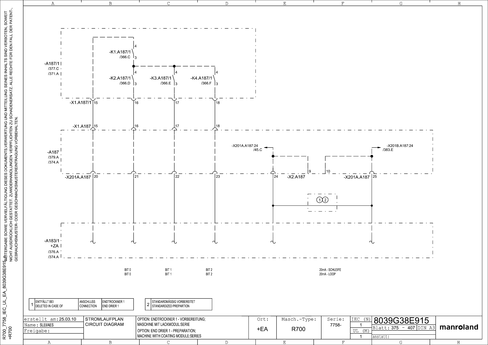

# +EA — Sheet 375 of 407 — OPTION: ENDTROCKNER 1 VORBEREITUNG;

**MASCHINE MIT LACKMODUL:SERIE**

> Part of the manroland **R700** printing press IEC/UL circuit diagrams.
> Drawing class: **Stromlaufplan / Circuit diagram** (DIN A3).
> Document `+EA` covers the **Printing unit** machine section.

## At a glance

| Field | Value |
|---|---|
| Document | `+EA`  (8039G38E915) |
| Sheet | **375** of 407 |
| Section (DE) | OPTION: ENDTROCKNER 1 VORBEREITUNG; |
| Section (EN) | MASCHINE MIT LACKMODUL:SERIE |
| Section type | CIRCUIT — Circuit diagram |
| Machine type | `R700` |
| Series | `7758` |
| Created | 25.03.10 |
| Replaces | — |
| Columns used | A, B, C, D, E, F, G |
| Path numbers | — |
| Labels on sheet | 71 |
| Cross-refs out | 12 |
| Cross-refs in | 28 |

**Previous:** [+EA sheet 374](SHEET_0374.md) · **Next:** [+EA sheet 376](SHEET_0376.md) · **Document TOC:** [_TOC.md](_TOC.md)  (+EA) · **Master TOC:** [all sheets](../_MASTER_TOC.md)

## Sheet image (300 DPI, exact vector render)



_Rendered directly from the PDF vector layer at 300 DPI (1-bit), no OCR and no resampling. Use it to confirm anything ambiguous in the text below._

## Cross-references on this sheet

Each entry is a wire leaving this sheet. The printed token is `/sheet.column`; the link resolves to that sheet inside the same document.

| Ref | Target sheet | Col | Path | Destination on target | Target section | From col |
|---|---|---|---|---|---|---|
| `/366.C` | [+EA sheet 366](SHEET_0366.md) | C | — | — | OPTION: TROCKNER VORBEREITUNG; | B |
| `/377.C` | [+EA sheet 377](SHEET_0377.md) | C | — | — | OPTION: ENDTROCKNER 2 VORBEREITUNG | A |
| `/371.A` | [+EA sheet 371](SHEET_0371.md) | A | — | — | OPTION: ENDTROCKNER 1 VORBEREITUNG; | A |
| `/366.E` | [+EA sheet 366](SHEET_0366.md) | E | — | — | OPTION: TROCKNER VORBEREITUNG; | C |
| `/366.F` | [+EA sheet 366](SHEET_0366.md) | F | — | — | OPTION: TROCKNER VORBEREITUNG; | D |
| `/366.D` | [+EA sheet 366](SHEET_0366.md) | D | — | — | OPTION: TROCKNER VORBEREITUNG; | B |
| `/45.C` | [+EA sheet 45](SHEET_0045.md) | C | — | X201A.A187:24 | BUSVERBINDUNGEN: 20 mA SCHLEIFE | D |
| `/383.E` | [+EA sheet 383](SHEET_0383.md) | E | — | — | OPTION: ENDTROCKNER 2 VORBEREITUNG | G |
| `/379.A` | [+EA sheet 379](SHEET_0379.md) | A | — | — | OPTION: ENDTROCKNER 2 VORBEREITUNG | A |
| `/374.A` | [+EA sheet 374](SHEET_0374.md) | A | — | — | OPTION: ENDTROCKNER 1 VORBEREITUNG; | A |
| `/376.A` | [+EA sheet 376](SHEET_0376.md) | A | — | — | OPTION: ENDTROCKNER 1 VORBEREITUNG; | A |
| `/374.A` | [+EA sheet 374](SHEET_0374.md) | A | — | — | OPTION: ENDTROCKNER 1 VORBEREITUNG; | A |

### Incoming references (sheets that point here)

Every other sheet that sends a wire to this one. `Back-ref` is the token printed on *that* sheet; `Path` is its line number.

| From sheet | Cols | Back-ref | Path | Refs | What continues there |
|---|---|---|---|---|---|
| [+EA#45](SHEET_0045.md) | C | `/45.C` | — | 1 | — |
| [+EA#206](SHEET_0206.md) | G | `/206.G` | — | 4 | — |
| [+EA#207](SHEET_0207.md) | A | `/207.A` | — | 4 | — |
| [+EA#223](SHEET_0223.md) | C | `/223.C` | — | 2 | — |
| [+EA#286](SHEET_0286.md) | F | `/286.F` | — | 6 | — |
| [+EA#366](SHEET_0366.md) | C, D, E, F | `/366.C`, `/366.D`, `/366.E`, `/366.F` | — | 4 | — |
| [+EA#371](SHEET_0371.md) | A | `/371.A` | — | 1 | — |
| [+EA#374](SHEET_0374.md) | A | `/374.A` | — | 2 | — |
| [+EA#376](SHEET_0376.md) | A | `/376.A` | — | 1 | — |
| [+EA#377](SHEET_0377.md) | B | `/377.B` | — | 1 | — |
| [+EA#379](SHEET_0379.md) | A | `/379.A` | — | 1 | — |
| [+EA#383](SHEET_0383.md) | E | `/383.E` | — | 1 | X1.A187:49 X201B.A187:24 |


## Devices on this sheet

| Tag | Class | Class meaning (IEC) | Col | Sub | Terminal | Sign |
|---|---|---|---|---|---|---|
| `A187/1` | A | Baugruppe / assembly, module, PC board | A | 1 | — | — |
| `A187` | A | Baugruppe / assembly, module, PC board | A | — | — | — |
| `A183/1` | A | Baugruppe / assembly, module, PC board | A | 1 | — | — |
| `X1.A187` | — | cross-device reference | B | — | — | — |
| `X201A.A187` | — | cross-device reference | A | — | — | — |
| `X201A.A187` | — | cross-device reference | F | — | — | — |
| `X201A.A187:24` | — | cross-device reference | D | — | 24 | — |
| `X201B.A187:24` | — | cross-device reference | G | — | 24 | — |
| `X2.A187` | — | cross-device reference | E | — | — | — |

## Potentials / nets

_No named potentials on this sheet._

## Wire-end annotations (grouped as printed)

A wire that continues elsewhere is annotated with a small cluster: the destination description, the path/line number `#NN`, and the `/sheet.column` cross reference. Each row below is one such cluster exactly as it is grouped on the drawing.

| Col | Y | Path | Cross-ref | Text on the wire |
|---|---|---|---|---|
| B | 108.8 | — | — | `4` |
| B | 122.2 | — | — | `K1.A187/1 3` |
| B | 135.3 | — | `/366.C` | — |
| A | 150.6 | — | — | `A187/1` |
| A | 163.6 | — | `/377.C`, `/371.A` | — |
| B | 172.5 | — | — | `4` |
| C | 172.5 | — | — | `4` |
| D | 172.5 | — | — | `4` |
| B | 186.0 | — | — | `K2.A187/1 3` |
| C | 186.0 | — | — | `K3.A187/1 3` |
| D | 186.0 | — | — | `K4.A187/1 3` |
| C | 199.0 | — | `/366.E` | — |
| B | 199.1 | — | `/366.D` | — |
| D | 199.1 | — | `/366.F` | — |
| B | 245.5 | — | — | `X1.A187/1 15 16` |
| C | 246.9 | — | — | `17 18` |
| B | 303.6 | — | — | `X1.A187 15 16` |
| C | 303.6 | — | — | `17 18` |
| D | 351.8 | — | `/45.C` | `X201A.A187:24` |
| G | 351.8 | — | — | `X201B.A187:24` |
| G | 361.7 | — | `/383.E` | — |
| A | 366.7 | — | — | `A187` |
| A | 379.8 | — | `/379.A`, `/374.A` | — |
| F | 414.2 | — | — | `9 10` |
| D | 426.9 | — | — | `X201A.A187 20 21 22 23 X201A.A187 25` |
| E | 426.9 | — | — | `24` |
| E | 426.9 | — | — | `X2.A187` |
| F | 484.5 | — | — | `1 2` |
| A | 582.8 | — | — | `A183/1` |
| A | 595.5 | — | — | `+ZA` |
| A | 610.8 | — | `/376.A`, `/374.A` | — |
| C | 655.3 | — | — | `BIT 1 BIT 1` |
| D | 655.3 | — | — | `BIT 2 BIT 2` |
| B | 655.4 | — | — | `BIT 0 BIT 0` |
| F | 655.4 | — | — | `20mA SCHLEIFE 20mA LOOP` |
| A | 733.4 | — | — | `1 ENTFÄLLT BEI DELETED IN CASE OF` |
| B | 733.4 | — | — | `CONNECTION ANSCHLUSS` |
| C | 733.4 | — | — | `ENDTROCKNER 1 END DRIER 1 2 STANDARDMÄSSIG VORBEREITET STANDARDIZED PREPARTION` |


## Reconstructed tables

This sheet carries tabular content (pin map / terminal assignment / index). The grid below was rebuilt from the drawing's own rule lines, so each row is exactly one physical row of the table.

### Table 1 — 5 data rows × 14 columns (at x=204.1, y=0.0) — **K1.A187/1 /366.C 4 3 K2.A187/1 /366.D 15 15 K3.A187/1 /366.E 16 16 4 K4.A187/1 /366.F 3 17 17 4 3 18 18 X201A.A187:24 /45.C X201B.A187:24 /383.E 20 21 22 23 24 X2.A187 9 1 10 2 X201A.A187 25 ANSCHLUSS CONNECTION BIT 0 BIT 0 ENDTROCKNER 1 END DRIER 1 BIT 1 BIT 1 STANDARDMÄSSIG 2 STANDARDIZED BIT 2 BIT 2 VORBEREITET PREPARTION 20mA 20mA SCHLEIFE LOOP**

|  | STROMLAUFPLAN |  | OPTION: ENDTROCKNER | 1 VORBEREITUNG; |  | Ort: |  | Masch. Type: |  |  | Serie: | IEC (N) | 8039G38E915 |
|---|---|---|---|---|---|---|---|---|---|---|---|---|---|
|  | `CIRCUIT DIAGRAM` |  |  |  |  |  |  |  |  |  |  |  |  |
|  |  |  | `MASCHINE MIT` | `LACKMODUL:SERIE` |  |  |  |  |  |  | `7758` | `1` |  |
|  |  |  |  |  |  | `+EA` |  | `R700` |  |  |  |  | `Blatt: DIN A3 375 407` |
|  |  |  | `OPTION: END DRIER 1` | `PREPARATION;` |  |  |  |  |  |  |  | `UL (M)` |  |
|  |  |  | `MACHINE WITH COATING` | `MODULE:SERIES` |  |  |  |  |  |  |  | `1` | `anstatt:` |


## Notes and free text on this sheet

| Text | Col | Y (pt) |
|---|---|---|
| `X1.A187/1` | A | 245.51 |
| `K1.A187/1` | B | 122.2 |
| `K2.A187/1` | B | 185.98 |
| `K3.A187/1` | C | 185.98 |
| `K4.A187/1` | D | 185.98 |
| `+ZA` | A | 595.5 |
| `BIT 0` | B | 655.35 |
| `BIT 1` | C | 655.27 |
| `BIT 2` | D | 655.33 |
| `20mA SCHLEIFE` | F | 655.41 |
| `20mA LOOP` | F | 666.05 |
| `ENTFÄLLT BEI` | A | 733.35 |
| `DELETED IN CASE OF` | A | 744 |
| `ANSCHLUSS` | B | 733.39 |
| `CONNECTION` | B | 744.03 |
| `ENDTROCKNER 1` | B | 733.37 |
| `END DRIER 1` | B | 743.98 |
| `STANDARDMÄSSIG VORBEREITET` | C | 733.38 |
| `STANDARDIZED PREPARTION` | C | 744.01 |

## Complete label inventory (exact text from the drawing)

Every text object inside the drawing area of this sheet, in DIN reading order (column A→H, then top→bottom). This is the authoritative list: if a string is not here it is not printed on this sheet.

| Col | Y | X | Dir | Type | Text |
|---|---|---|---|---|---|
| A | 150.5 | 108.0 | → | device tag | `A187/1` |
| A | 163.6 | 117.6 | → | cross-reference | `/377.C` |
| A | 176.0 | 117.6 | → | cross-reference | `/371.A` |
| A | 245.5 | 170.1 | → | text | `X1.A187/1` |
| A | 366.7 | 115.4 | → | device tag | `A187` |
| A | 379.8 | 117.6 | → | cross-reference | `/379.A` |
| A | 392.2 | 117.6 | → | cross-reference | `/374.A` |
| A | 427.6 | 158.5 | → | device ref | `X201A.A187` |
| A | 582.8 | 108.0 | → | device tag | `A183/1` |
| A | 595.5 | 123.0 | → | text | `+ZA` |
| A | 610.8 | 117.6 | → | cross-reference | `/376.A` |
| A | 623.2 | 117.6 | → | cross-reference | `/374.A` |
| A | 733.3 | 87.0 | → | text | `ENTFÄLLT BEI` |
| A | 738.7 | 75.4 | → | number | `1` |
| A | 744.0 | 87.0 | → | text | `DELETED IN CASE OF` |
| B | 108.7 | 328.5 | → | number | `4` |
| B | 122.2 | 266.5 | → | text | `K1.A187/1` |
| B | 135.3 | 292.0 | → | cross-reference | `/366.C` |
| B | 137.1 | 328.5 | → | number | `3` |
| B | 172.5 | 328.5 | → | number | `4` |
| B | 186.0 | 266.5 | → | text | `K2.A187/1` |
| B | 199.1 | 292.0 | → | cross-reference | `/366.D` |
| B | 200.9 | 328.5 | → | number | `3` |
| B | 246.9 | 228.8 | → | number | `15` |
| B | 246.9 | 328.0 | → | number | `16` |
| B | 303.6 | 177.4 | → | device ref | `X1.A187` |
| B | 303.6 | 228.8 | → | number | `15` |
| B | 303.6 | 328.0 | → | number | `16` |
| B | 426.9 | 229.3 | → | number | `20` |
| B | 426.9 | 328.5 | → | number | `21` |
| B | 655.3 | 303.9 | → | text | `BIT 0` |
| B | 666.0 | 303.9 | → | text | `BIT 0` |
| B | 733.4 | 194.2 | → | text | `ANSCHLUSS` |
| B | 733.4 | 250.0 | → | text | `ENDTROCKNER 1` |
| B | 744.0 | 193.9 | → | text | `CONNECTION` |
| B | 744.0 | 250.0 | → | text | `END DRIER 1` |
| C | 172.5 | 427.7 | → | number | `4` |
| C | 186.0 | 365.7 | → | text | `K3.A187/1` |
| C | 199.0 | 391.7 | → | cross-reference | `/366.E` |
| C | 200.9 | 427.7 | → | number | `3` |
| C | 246.9 | 427.2 | → | number | `17` |
| C | 303.6 | 427.2 | → | number | `17` |
| C | 426.9 | 427.7 | → | number | `22` |
| C | 655.3 | 403.1 | → | text | `BIT 1` |
| C | 665.9 | 403.1 | → | text | `BIT 1` |
| C | 733.4 | 371.1 | → | text | `STANDARDMÄSSIG VORBEREITET` |
| C | 738.7 | 358.6 | → | number | `2` |
| C | 744.0 | 371.1 | → | text | `STANDARDIZED PREPARTION` |
| D | 172.5 | 527.0 | → | number | `4` |
| D | 186.0 | 464.9 | → | text | `K4.A187/1` |
| D | 199.1 | 491.2 | → | cross-reference | `/366.F` |
| D | 200.9 | 527.0 | → | number | `3` |
| D | 246.9 | 526.4 | → | number | `18` |
| D | 303.6 | 526.4 | → | number | `18` |
| D | 351.8 | 565.2 | → | device ref | `X201A.A187:24` |
| D | 426.9 | 527.0 | → | number | `23` |
| D | 655.3 | 502.3 | → | text | `BIT 2` |
| D | 666.0 | 502.3 | → | text | `BIT 2` |
| E | 361.7 | 618.5 | → | cross-reference | `/45.C` |
| E | 414.2 | 753.7 | → | number | `9` |
| E | 426.9 | 668.7 | → | number | `24` |
| E | 426.9 | 700.4 | → | device ref | `X2.A187` |
| F | 414.2 | 795.7 | → | number | `10` |
| F | 427.6 | 838.8 | → | device ref | `X201A.A187` |
| F | 484.5 | 777.8 | → | number | `1` |
| F | 485.0 | 791.7 | → | number | `2` |
| F | 655.4 | 779.2 | → | text | `20mA SCHLEIFE` |
| F | 666.0 | 779.2 | → | text | `20mA LOOP` |
| G | 351.8 | 943.7 | → | device ref | `X201B.A187:24` |
| G | 361.7 | 934.0 | → | cross-reference | `/383.E` |
| G | 426.9 | 909.6 | → | number | `25` |

## Reading-order text block

The same content as a plain block, grouped by DIN column — convenient to paste or to match against a visual description.

```text
=== Column A ===
 150.5  108.0  devtag       A187/1
 163.6  117.6  xref         /377.C
 176.0  117.6  xref         /371.A
 245.5  170.1  text         X1.A187/1
 366.7  115.4  devtag       A187
 379.8  117.6  xref         /379.A
 392.2  117.6  xref         /374.A
 427.6  158.5  devref       X201A.A187
 582.8  108.0  devtag       A183/1
 595.5  123.0  text         +ZA
 610.8  117.6  xref         /376.A
 623.2  117.6  xref         /374.A
 733.3   87.0  text         ENTFÄLLT BEI
 738.7   75.4  numeric      1
 744.0   87.0  text         DELETED IN CASE OF
=== Column B ===
 108.7  328.5  numeric      4
 122.2  266.5  text         K1.A187/1
 135.3  292.0  xref         /366.C
 137.1  328.5  numeric      3
 172.5  328.5  numeric      4
 186.0  266.5  text         K2.A187/1
 199.1  292.0  xref         /366.D
 200.9  328.5  numeric      3
 246.9  228.8  numeric      15
 246.9  328.0  numeric      16
 303.6  177.4  devref       X1.A187
 303.6  228.8  numeric      15
 303.6  328.0  numeric      16
 426.9  229.3  numeric      20
 426.9  328.5  numeric      21
 655.3  303.9  text         BIT 0
 666.0  303.9  text         BIT 0
 733.4  194.2  text         ANSCHLUSS
 733.4  250.0  text         ENDTROCKNER 1
 744.0  193.9  text         CONNECTION
 744.0  250.0  text         END DRIER 1
=== Column C ===
 172.5  427.7  numeric      4
 186.0  365.7  text         K3.A187/1
 199.0  391.7  xref         /366.E
 200.9  427.7  numeric      3
 246.9  427.2  numeric      17
 303.6  427.2  numeric      17
 426.9  427.7  numeric      22
 655.3  403.1  text         BIT 1
 665.9  403.1  text         BIT 1
 733.4  371.1  text         STANDARDMÄSSIG VORBEREITET
 738.7  358.6  numeric      2
 744.0  371.1  text         STANDARDIZED PREPARTION
=== Column D ===
 172.5  527.0  numeric      4
 186.0  464.9  text         K4.A187/1
 199.1  491.2  xref         /366.F
 200.9  527.0  numeric      3
 246.9  526.4  numeric      18
 303.6  526.4  numeric      18
 351.8  565.2  devref       X201A.A187:24
 426.9  527.0  numeric      23
 655.3  502.3  text         BIT 2
 666.0  502.3  text         BIT 2
=== Column E ===
 361.7  618.5  xref         /45.C
 414.2  753.7  numeric      9
 426.9  668.7  numeric      24
 426.9  700.4  devref       X2.A187
=== Column F ===
 414.2  795.7  numeric      10
 427.6  838.8  devref       X201A.A187
 484.5  777.8  numeric      1
 485.0  791.7  numeric      2
 655.4  779.2  text         20mA SCHLEIFE
 666.0  779.2  text         20mA LOOP
=== Column G ===
 351.8  943.7  devref       X201B.A187:24
 361.7  934.0  xref         /383.E
 426.9  909.6  numeric      25
```

---
_Generated from the PDF vector text layer; no OCR. Source: `R700_7758_IEC_UL_EA_8039G38E915_p`, sheet 375._
