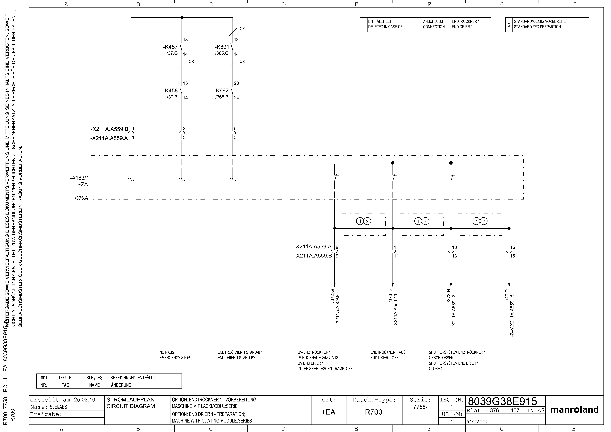

# +EA — Sheet 376 of 407 — OPTION: ENDTROCKNER 1 VORBEREITUNG;

**MASCHINE MIT LACKMODUL:SERIE**

> Part of the manroland **R700** printing press IEC/UL circuit diagrams.
> Drawing class: **Stromlaufplan / Circuit diagram** (DIN A3).
> Document `+EA` covers the **Printing unit** machine section.

## At a glance

| Field | Value |
|---|---|
| Document | `+EA`  (8039G38E915) |
| Sheet | **376** of 407 |
| Section (DE) | OPTION: ENDTROCKNER 1 VORBEREITUNG; |
| Section (EN) | MASCHINE MIT LACKMODUL:SERIE |
| Section type | CIRCUIT — Circuit diagram |
| Machine type | `R700` |
| Series | `7758` |
| Created | 25.03.10 |
| Replaces | — |
| Columns used | A, B, C, D, E, F, G, H |
| Path numbers | — |
| Labels on sheet | 86 |
| Cross-refs out | 9 |
| Cross-refs in | 23 |

**Previous:** [+EA sheet 375](SHEET_0375.md) · **Next:** [+EA sheet 377](SHEET_0377.md) · **Document TOC:** [_TOC.md](_TOC.md)  (+EA) · **Master TOC:** [all sheets](../_MASTER_TOC.md)

## Sheet image (300 DPI, exact vector render)



_Rendered directly from the PDF vector layer at 300 DPI (1-bit), no OCR and no resampling. Use it to confirm anything ambiguous in the text below._

## Cross-references on this sheet

Each entry is a wire leaving this sheet. The printed token is `/sheet.column`; the link resolves to that sheet inside the same document.

| Ref | Target sheet | Col | Path | Destination on target | Target section | From col |
|---|---|---|---|---|---|---|
| `/37.G` | [+EA sheet 37](SHEET_0037.md) | G | — | — | BUSVERBINDUNGEN: NOT AUS | B |
| `/365.G` | [+EA sheet 365](SHEET_0365.md) | G | — | — | OPTION: TROCKNER VORBEREITUNG; | C |
| `/37.B` | [+EA sheet 37](SHEET_0037.md) | B | — | — | BUSVERBINDUNGEN: NOT AUS | B |
| `/368.B` | [+EA sheet 368](SHEET_0368.md) | B | — | — | OPTION: ENDTROCKNER 1 VORBEREITUNG; | C |
| `/375.A` | [+EA sheet 375](SHEET_0375.md) | A | — | — | OPTION: ENDTROCKNER 1 VORBEREITUNG; | A |
| `/373.H` | [+EA sheet 373](SHEET_0373.md) | H | — | — | OPTION: ENDTROCKNER 1 VORBEREITUNG; | F |
| `/372.G` | [+EA sheet 372](SHEET_0372.md) | G | — | — | OPTION: ENDTROCKNER 1 VORBEREITUNG; | E |
| `/373.D` | [+EA sheet 373](SHEET_0373.md) | D | — | — | OPTION: ENDTROCKNER 1 VORBEREITUNG; | E |
| `/20.D` | [+EA sheet 20](SHEET_0020.md) | D | — | — | SPANNUNGSVERSORGUNG: 400V, 24V | G |

### Incoming references (sheets that point here)

Every other sheet that sends a wire to this one. `Back-ref` is the token printed on *that* sheet; `Path` is its line number.

| From sheet | Cols | Back-ref | Path | Refs | What continues there |
|---|---|---|---|---|---|
| [+EA#20](SHEET_0020.md) | D | `/20.D` | — | 1 | 24V.X211A.A559:15 |
| [+EA#37](SHEET_0037.md) | B, G | `/37.B`, `/37.G` | — | 2 | — |
| [+EA#288](SHEET_0288.md) | G, H | `/288.G`, `/288.H` | — | 14 | — |
| [+EA#365](SHEET_0365.md) | G | `/365.G` | — | 1 | — |
| [+EA#368](SHEET_0368.md) | B | `/368.B` | — | 1 | — |
| [+EA#372](SHEET_0372.md) | G | `/372.G` | — | 1 | — |
| [+EA#373](SHEET_0373.md) | F, H | `/373.F`, `/373.H` | — | 2 | X211A.A559:13 |
| [+EA#375](SHEET_0375.md) | A | `/375.A` | — | 1 | — |


## Devices on this sheet

| Tag | Class | Class meaning (IEC) | Col | Sub | Terminal | Sign |
|---|---|---|---|---|---|---|
| `A183/1` | A | Baugruppe / assembly, module, PC board | A | 1 | — | — |
| `K457` | K | Relais / relay, contactor | B | — | — | — |
| `K691` | K | Relais / relay, contactor | C | — | — | — |
| `K458` | K | Relais / relay, contactor | B | — | — | — |
| `K692` | K | Relais / relay, contactor | C | — | — | — |
| `X211A.A559.B` | — | cross-device reference | B | — | — | — |
| `X211A.A559.A` | — | cross-device reference | B | — | — | — |
| `X211A.A559.B` | — | cross-device reference | D | — | — | — |
| `X211A.A559.A` | — | cross-device reference | D | — | — | — |
| `NR.` | — | cross-device reference | A | — | — | — |
| `17.09.10` | — | cross-device reference | A | — | — | — |
| `X211A.A559:9` | — | cross-device reference | E | — | 9 | — |
| `X211A.A559:13` | — | cross-device reference | F | — | 13 | — |
| `X211A.A559:11` | — | cross-device reference | F | — | 11 | — |

## Potentials / nets

| Potential | Count | Columns | Attached devices | Terminals |
|---|---|---|---|---|
| `24V` | 1 | G | `A559`, `X211A` | `15` |


A potential such as `L24+/4` or `M24+` is a named supply/return rail; every place it appears on this sheet is electrically common.

## Wire-end annotations (grouped as printed)

A wire that continues elsewhere is annotated with a small cluster: the destination description, the path/line number `#NN`, and the `/sheet.column` cross reference. Each row below is one such cluster exactly as it is grouped on the drawing.

| Col | Y | Path | Cross-ref | Text on the wire |
|---|---|---|---|---|
| E | 38.9 | — | — | `1 ENTFÄLLT BEI DELETED IN CASE OF` |
| F | 38.9 | — | — | `CONNECTION ANSCHLUSS` |
| G | 38.9 | — | — | `ENDTROCKNER 1 END DRIER 1 2 STANDARDMÄSSIG VORBEREITET STANDARDIZED PREPARTION` |
| C | 53.1 | — | — | `OR` |
| C | 73.3 | — | — | `13` |
| C | 73.3 | — | — | `13` |
| C | 86.8 | — | — | `K457 14` |
| C | 86.8 | — | — | `K691 14` |
| B | 99.8 | — | `/37.G` | — |
| C | 99.8 | — | `/365.G` | — |
| C | 116.8 | — | — | `OR OR` |
| C | 158.4 | — | — | `13` |
| C | 158.4 | — | — | `23` |
| C | 171.8 | — | — | `K458 14` |
| C | 171.8 | — | — | `K692 24` |
| B | 184.9 | — | `/37.B` | — |
| C | 184.9 | — | `/368.B` | — |
| B | 246.9 | — | — | `X211A.A559.B 1` |
| C | 246.9 | — | — | `3` |
| C | 246.9 | — | — | `5` |
| B | 263.9 | — | — | `X211A.A559.A 1` |
| C | 263.9 | — | — | `3` |
| C | 263.9 | — | — | `5` |
| A | 341.9 | — | — | `A183/1` |
| A | 354.6 | — | — | `+ZA` |
| A | 382.2 | — | `/375.A` | — |
| F | 427.8 | — | — | `1 2 1 2 1 2` |
| D | 475.8 | — | — | `X211A.A559.A 9` |
| F | 478.0 | — | — | `11` |
| F | 478.0 | — | — | `13` |
| G | 478.0 | — | — | `15` |
| D | 493.5 | — | — | `X211A.A559.B 9` |
| F | 495.0 | — | — | `11` |
| F | 495.0 | — | — | `13` |
| G | 495.0 | — | — | `15` |
| F | 563.2 | — | `/373.H` | — |
| E | 563.5 | — | `/372.G` | — |
| E | 563.8 | — | `/373.D` | — |
| G | 563.8 | — | `/20.D` | — |
| F | 572.3 | — | — | `X211A.A559:11` |
| E | 573.7 | — | — | `X211A.A559:9` |
| F | 573.7 | — | — | `X211A.A559:13` |
| G | 573.7 | — | — | `24V.X211A.A559:15` |
| C | 683.8 | — | — | `NOT AUS EMERGENCY STOP` |
| C | 683.8 | — | — | `ENDTROCKNER 1 STAND BY END DRIER 1 STAND BY` |
| E | 683.8 | — | — | `UV ENDTROCKNER 1 IM BOGENAUFGANG, AUS UV END DRIER 1 IN THE SHEET ASCENT RAMP, OFF` |
| E | 683.8 | — | — | `ENDTROCKNER 1 AUS END DRIER 1 OFF` |
| F | 683.8 | — | — | `SHUTTERSYSTEM ENDTROCKNER 1 GESCHLOSSEN SHUTTERSYSTEM END DRIER 1 CLOSED` |
| A | 733.0 | — | — | `001 17.09.10 SLEI/AES BEZEICHNUNG ENTFÄLLT` |
| A | 747.1 | — | — | `NR. TAG NAME ÄNDERUNG` |


## Reconstructed tables

This sheet carries tabular content (pin map / terminal assignment / index). The grid below was rebuilt from the drawing's own rule lines, so each row is exactly one physical row of the table.

### Table 1 — 5 data rows × 14 columns (at x=204.1, y=0.0) — **X211A.A559.B X211A.A559.A 1 1 K457 /37.G K458 /37.B 13 K691 /365.G 14 OR 13 K692 /368.B 14 3 3 OR 13 14 OR 23 24 5 5 ENTFÄLLT BEI 1 DELETED IN CASE OF ANSCHLUSS CONNECTION ENDTROCKNER END DRIER STANDARDMÄSSIG 2 STANDARDIZED 1 2 BEZEICHNUNG ÄNDERUNG NOT AUS EMERGENCY ENTFÄLLT ENDTROCKNER STOP END DRIER 1 STAND BY IM 1 STAND BY UV END IN THE X211A.A559.A X211A.A559.B /372.G UV ENDTROCKNER 1 BOGENAUFGANG, DRIER 1 SHEET ASCENT 9 9 X211A.A559:9 AUS RAMP, /373.D ENDTROCKNER END DRIER 1 OFF 11 11 X211A.A559:11 1 AUS OFF CLOSED /373.H SHUTTERSYSTEM GESCHLOSSEN SHUTTERSYSTEM 13 13 X211A.A559:13 END /20.D ENDTROCKNER 1 DRIER 1 15 15 24V.X211A.A559:15**

| STROMLAUFPLAN |  | OPTION: | ENDTROCKNER 1 | VORBEREITUNG; | Ort: |  | Masch. Type: |  | Serie: | IEC | (N) | 8039G38E915 |  |
|---|---|---|---|---|---|---|---|---|---|---|---|---|---|
| `CIRCUIT` | `DIAGRAM` |  |  |  |  |  |  |  |  |  |  |  |  |
|  |  |  | `MASCHINE MIT LACKMODUL:SERIE` |  |  |  |  |  | `7758` |  | `1` |  |  |
|  |  |  |  |  | `+EA` |  | `R700` |  |  |  |  | `Blatt: 376` | `DIN A3 407` |
|  |  | `OPTION:` | `END DRIER 1 PREPARATION;` |  |  |  |  |  |  | `UL` | `(M)` |  |  |
|  |  | `MACHINE` | `WITH COATING` | `MODULE:SERIES` |  |  |  |  |  |  | `1` | `anstatt:` |  |


## Notes and free text on this sheet

| Text | Col | Y (pt) |
|---|---|---|
| `+ZA` | A | 354.56 |
| `TAG` | A | 747.27 |
| `NAME` | A | 747.25 |
| `ÄNDERUNG` | B | 747.31 |
| `SLEI/AES` | A | 733.13 |
| `BEZEICHNUNG ENTFÄLLT` | B | 733.14 |
| `NOT AUS` | B | 683.76 |
| `EMERGENCY STOP` | C | 694.41 |
| `ENDTROCKNER 1 STAND BY` | C | 683.79 |
| `END DRIER 1 STAND BY` | C | 694.41 |
| `ENTFÄLLT BEI` | E | 38.86 |
| `DELETED IN CASE OF` | E | 49.51 |
| `ANSCHLUSS` | F | 38.9 |
| `CONNECTION` | F | 49.54 |
| `ENDTROCKNER 1` | G | 38.88 |
| `END DRIER 1` | F | 49.49 |
| `STANDARDMÄSSIG VORBEREITET` | H | 38.9 |
| `STANDARDIZED PREPARTION` | G | 49.53 |
| `ENDTROCKNER 1 AUS` | E | 683.78 |
| `END DRIER 1 OFF` | E | 694.41 |
| `SHUTTERSYSTEM ENDTROCKNER 1` | F | 683.78 |
| `GESCHLOSSEN` | F | 694.4 |
| `SHUTTERSYSTEM END DRIER 1` | F | 705.04 |
| `CLOSED` | F | 715.68 |
| `UV ENDTROCKNER 1` | D | 683.77 |
| `IM BOGENAUFGANG, AUS` | D | 694.4 |
| `UV END DRIER 1` | D | 705.01 |
| `IN THE SHEET ASCENT RAMP, OFF` | E | 715.67 |
| `OR` | C | 116.84 |

## Complete label inventory (exact text from the drawing)

Every text object inside the drawing area of this sheet, in DIN reading order (column A→H, then top→bottom). This is the authoritative list: if a string is not here it is not printed on this sheet.

| Col | Y | X | Dir | Type | Text |
|---|---|---|---|---|---|
| A | 341.9 | 136.3 | → | device tag | `A183/1` |
| A | 354.6 | 151.4 | → | text | `+ZA` |
| A | 382.2 | 146.0 | → | cross-reference | `/375.A` |
| A | 733.0 | 79.8 | → | number | `001` |
| A | 733.1 | 113.6 | → | device ref | `17.09.10` |
| A | 733.1 | 168.7 | → | text | `SLEI/AES` |
| A | 747.1 | 78.9 | → | device ref | `NR.` |
| A | 747.3 | 120.4 | → | text | `TAG` |
| A | 747.3 | 173.8 | → | text | `NAME` |
| B | 86.8 | 318.0 | → | device tag | `K457` |
| B | 99.8 | 324.9 | → | cross-reference | `/37.G` |
| B | 171.8 | 318.0 | → | device tag | `K458` |
| B | 184.9 | 325.4 | → | cross-reference | `/37.B` |
| B | 246.9 | 176.9 | → | device ref | `X211A.A559.B` |
| B | 246.9 | 257.1 | → | number | `1` |
| B | 263.9 | 257.1 | → | number | `1` |
| B | 264.6 | 176.0 | → | device ref | `X211A.A559.A` |
| B | 683.8 | 311.0 | → | text | `NOT AUS` |
| B | 733.1 | 215.3 | → | text | `BEZEICHNUNG ENTFÄLLT` |
| B | 747.3 | 216.4 | → | text | `ÄNDERUNG` |
| C | 53.1 | 467.4 | → | text | `OR` |
| C | 73.3 | 356.3 | → | number | `13` |
| C | 73.3 | 455.5 | → | number | `13` |
| C | 86.8 | 418.7 | → | device tag | `K691` |
| C | 99.8 | 419.2 | → | cross-reference | `/365.G` |
| C | 101.7 | 356.3 | → | number | `14` |
| C | 101.7 | 455.5 | → | number | `14` |
| C | 116.8 | 368.2 | → | text | `OR` |
| C | 116.8 | 467.4 | → | text | `OR` |
| C | 158.4 | 356.3 | → | number | `13` |
| C | 158.4 | 456.1 | → | number | `23` |
| C | 171.8 | 417.3 | → | device tag | `K692` |
| C | 184.9 | 419.8 | → | cross-reference | `/368.B` |
| C | 186.7 | 356.3 | → | number | `14` |
| C | 186.7 | 456.1 | → | number | `24` |
| C | 246.9 | 356.9 | → | number | `3` |
| C | 246.9 | 456.1 | → | number | `5` |
| C | 263.9 | 356.9 | → | number | `3` |
| C | 263.9 | 456.1 | → | number | `5` |
| C | 683.8 | 424.3 | → | text | `ENDTROCKNER 1 STAND BY` |
| C | 694.4 | 311.0 | → | text | `EMERGENCY STOP` |
| C | 694.4 | 424.3 | → | text | `END DRIER 1 STAND BY` |
| D | 475.8 | 572.9 | → | device ref | `X211A.A559.A` |
| D | 493.5 | 573.7 | → | device ref | `X211A.A559.B` |
| D | 683.8 | 580.3 | → | text | `UV ENDTROCKNER 1` |
| D | 694.4 | 580.3 | → | text | `IM BOGENAUFGANG, AUS` |
| D | 705.0 | 580.3 | → | text | `UV END DRIER 1` |
| E | 38.9 | 717.7 | → | text | `ENTFÄLLT BEI` |
| E | 44.2 | 706.1 | → | number | `1` |
| E | 49.5 | 717.7 | → | text | `DELETED IN CASE OF` |
| E | 427.8 | 699.8 | → | number | `1` |
| E | 428.3 | 713.8 | → | number | `2` |
| E | 478.0 | 654.5 | → | number | `9` |
| E | 495.0 | 654.5 | → | number | `9` |
| E | 563.5 | 643.7 | ↕ | cross-reference | `/372.G` |
| E | 563.8 | 757.1 | ↕ | cross-reference | `/373.D` |
| E | 573.7 | 653.7 | ↕ | device ref | `X211A.A559:9` |
| E | 683.8 | 722.0 | → | text | `ENDTROCKNER 1 AUS` |
| E | 694.4 | 722.0 | → | text | `END DRIER 1 OFF` |
| E | 715.7 | 580.3 | → | text | `IN THE SHEET ASCENT RAMP, OFF` |
| F | 38.9 | 824.9 | → | text | `ANSCHLUSS` |
| F | 49.5 | 824.6 | → | text | `CONNECTION` |
| F | 49.5 | 880.7 | → | text | `END DRIER 1` |
| F | 427.8 | 813.2 | → | number | `1` |
| F | 428.3 | 827.1 | → | number | `2` |
| F | 478.0 | 767.3 | → | number | `11` |
| F | 478.0 | 880.7 | → | number | `13` |
| F | 495.0 | 767.3 | → | number | `11` |
| F | 495.0 | 880.7 | → | number | `13` |
| F | 563.2 | 870.5 | ↕ | cross-reference | `/373.H` |
| F | 572.3 | 767.1 | ↕ | device ref | `X211A.A559:11` |
| F | 573.7 | 880.4 | ↕ | device ref | `X211A.A559:13` |
| F | 683.8 | 835.9 | → | text | `SHUTTERSYSTEM ENDTROCKNER 1` |
| F | 694.4 | 835.9 | → | text | `GESCHLOSSEN` |
| F | 705.0 | 835.9 | → | text | `SHUTTERSYSTEM END DRIER 1` |
| F | 715.7 | 835.9 | → | text | `CLOSED` |
| G | 38.9 | 880.7 | → | text | `ENDTROCKNER 1` |
| G | 44.2 | 989.3 | → | number | `2` |
| G | 49.5 | 1001.8 | → | text | `STANDARDIZED PREPARTION` |
| G | 427.8 | 926.6 | → | number | `1` |
| G | 428.3 | 940.5 | → | number | `2` |
| G | 478.0 | 994.1 | → | number | `15` |
| G | 495.0 | 994.1 | → | number | `15` |
| G | 563.8 | 983.9 | ↕ | cross-reference | `/20.D` |
| G | 573.7 | 993.8 | ↕ | potential | `24V.X211A.A559:15` |
| H | 38.9 | 1001.8 | → | text | `STANDARDMÄSSIG VORBEREITET` |

## Reading-order text block

The same content as a plain block, grouped by DIN column — convenient to paste or to match against a visual description.

```text
=== Column A ===
 341.9  136.3  devtag       A183/1
 354.6  151.4  text         +ZA
 382.2  146.0  xref         /375.A
 733.0   79.8  numeric      001
 733.1  113.6  devref       17.09.10
 733.1  168.7  text         SLEI/AES
 747.1   78.9  devref       NR.
 747.3  120.4  text         TAG
 747.3  173.8  text         NAME
=== Column B ===
  86.8  318.0  devtag       K457
  99.8  324.9  xref         /37.G
 171.8  318.0  devtag       K458
 184.9  325.4  xref         /37.B
 246.9  176.9  devref       X211A.A559.B
 246.9  257.1  numeric      1
 263.9  257.1  numeric      1
 264.6  176.0  devref       X211A.A559.A
 683.8  311.0  text         NOT AUS
 733.1  215.3  text         BEZEICHNUNG ENTFÄLLT
 747.3  216.4  text         ÄNDERUNG
=== Column C ===
  53.1  467.4  text         OR
  73.3  356.3  numeric      13
  73.3  455.5  numeric      13
  86.8  418.7  devtag       K691
  99.8  419.2  xref         /365.G
 101.7  356.3  numeric      14
 101.7  455.5  numeric      14
 116.8  368.2  text         OR
 116.8  467.4  text         OR
 158.4  356.3  numeric      13
 158.4  456.1  numeric      23
 171.8  417.3  devtag       K692
 184.9  419.8  xref         /368.B
 186.7  356.3  numeric      14
 186.7  456.1  numeric      24
 246.9  356.9  numeric      3
 246.9  456.1  numeric      5
 263.9  356.9  numeric      3
 263.9  456.1  numeric      5
 683.8  424.3  text         ENDTROCKNER 1 STAND BY
 694.4  311.0  text         EMERGENCY STOP
 694.4  424.3  text         END DRIER 1 STAND BY
=== Column D ===
 475.8  572.9  devref       X211A.A559.A
 493.5  573.7  devref       X211A.A559.B
 683.8  580.3  text         UV ENDTROCKNER 1
 694.4  580.3  text         IM BOGENAUFGANG, AUS
 705.0  580.3  text         UV END DRIER 1
=== Column E ===
  38.9  717.7  text         ENTFÄLLT BEI
  44.2  706.1  numeric      1
  49.5  717.7  text         DELETED IN CASE OF
 427.8  699.8  numeric      1
 428.3  713.8  numeric      2
 478.0  654.5  numeric      9
 495.0  654.5  numeric      9
 563.5  643.7  xref         /372.G
 563.8  757.1  xref         /373.D
 573.7  653.7  devref       X211A.A559:9
 683.8  722.0  text         ENDTROCKNER 1 AUS
 694.4  722.0  text         END DRIER 1 OFF
 715.7  580.3  text         IN THE SHEET ASCENT RAMP, OFF
=== Column F ===
  38.9  824.9  text         ANSCHLUSS
  49.5  824.6  text         CONNECTION
  49.5  880.7  text         END DRIER 1
 427.8  813.2  numeric      1
 428.3  827.1  numeric      2
 478.0  767.3  numeric      11
 478.0  880.7  numeric      13
 495.0  767.3  numeric      11
 495.0  880.7  numeric      13
 563.2  870.5  xref         /373.H
 572.3  767.1  devref       X211A.A559:11
 573.7  880.4  devref       X211A.A559:13
 683.8  835.9  text         SHUTTERSYSTEM ENDTROCKNER 1
 694.4  835.9  text         GESCHLOSSEN
 705.0  835.9  text         SHUTTERSYSTEM END DRIER 1
 715.7  835.9  text         CLOSED
=== Column G ===
  38.9  880.7  text         ENDTROCKNER 1
  44.2  989.3  numeric      2
  49.5 1001.8  text         STANDARDIZED PREPARTION
 427.8  926.6  numeric      1
 428.3  940.5  numeric      2
 478.0  994.1  numeric      15
 495.0  994.1  numeric      15
 563.8  983.9  xref         /20.D
 573.7  993.8  net          24V.X211A.A559:15
=== Column H ===
  38.9 1001.8  text         STANDARDMÄSSIG VORBEREITET
```

---
_Generated from the PDF vector text layer; no OCR. Source: `R700_7758_IEC_UL_EA_8039G38E915_p`, sheet 376._
