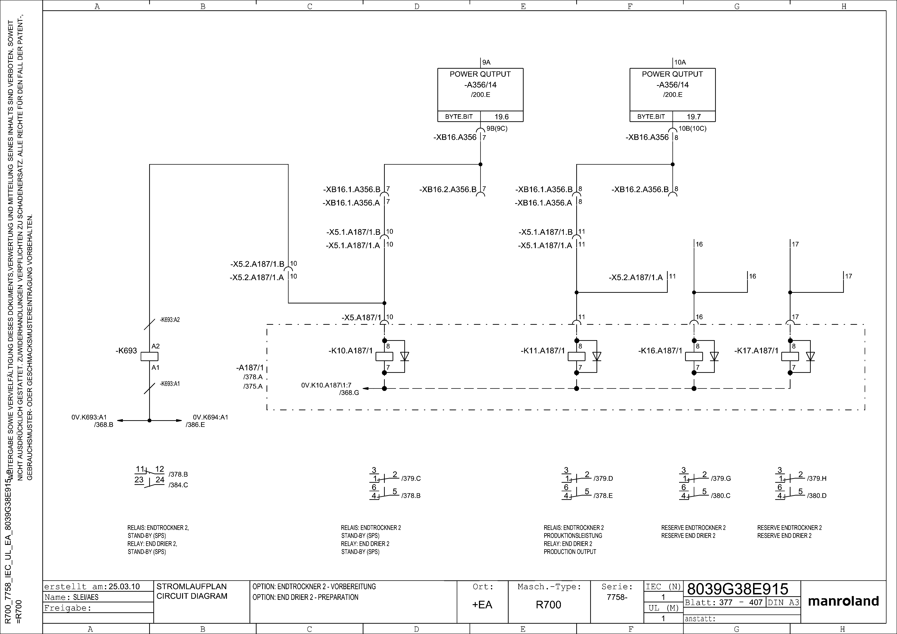

# +EA — Sheet 377 of 407 — OPTION: ENDTROCKNER 2 VORBEREITUNG

**OPTION: END DRIER 2 PREPARATION**

> Part of the manroland **R700** printing press IEC/UL circuit diagrams.
> Drawing class: **Stromlaufplan / Circuit diagram** (DIN A3).
> Document `+EA` covers the **Printing unit** machine section.

## At a glance

| Field | Value |
|---|---|
| Document | `+EA`  (8039G38E915) |
| Sheet | **377** of 407 |
| Section (DE) | OPTION: ENDTROCKNER 2 VORBEREITUNG |
| Section (EN) | OPTION: END DRIER 2 PREPARATION |
| Section type | CIRCUIT — Circuit diagram |
| Machine type | `R700` |
| Series | `7758` |
| Created | 25.03.10 |
| Replaces | — |
| Columns used | A, B, C, D, E, F, G, H |
| Path numbers | — |
| Labels on sheet | 132 |
| Cross-refs out | 16 |
| Cross-refs in | 40 |

**Previous:** [+EA sheet 376](SHEET_0376.md) · **Next:** [+EA sheet 378](SHEET_0378.md) · **Document TOC:** [_TOC.md](_TOC.md)  (+EA) · **Master TOC:** [all sheets](../_MASTER_TOC.md)

## Sheet image (300 DPI, exact vector render)



_Rendered directly from the PDF vector layer at 300 DPI (1-bit), no OCR and no resampling. Use it to confirm anything ambiguous in the text below._

## Cross-references on this sheet

Each entry is a wire leaving this sheet. The printed token is `/sheet.column`; the link resolves to that sheet inside the same document.

| Ref | Target sheet | Col | Path | Destination on target | Target section | From col |
|---|---|---|---|---|---|---|
| `/200.E` | [+EA sheet 200](SHEET_0200.md) | E | — | — | REFERENZMODUL | E |
| `/200.E` | [+EA sheet 200](SHEET_0200.md) | E | — | — | REFERENZMODUL | F |
| `/378.A` | [+EA sheet 378](SHEET_0378.md) | A | — | — | OPTION: ENDTROCKNER 2 VORBEREITUNG | B |
| `/375.A` | [+EA sheet 375](SHEET_0375.md) | A | — | — | OPTION: ENDTROCKNER 1 VORBEREITUNG; | B |
| `/368.G` | [+EA sheet 368](SHEET_0368.md) | G | — | 0V.K10.A187\1:7 | OPTION: ENDTROCKNER 1 VORBEREITUNG; | C |
| `/368.B` | [+EA sheet 368](SHEET_0368.md) | B | — | 0V.K693:A1 | OPTION: ENDTROCKNER 1 VORBEREITUNG; | A |
| `/386.E` | [+EA sheet 386](SHEET_0386.md) | E | — | — | OPTION: ZWISCHENTROCKNER VORBEREITUNG; | B |
| `/379.G` | [+EA sheet 379](SHEET_0379.md) | G | — | — | OPTION: ENDTROCKNER 2 VORBEREITUNG | G |
| `/379.C` | [+EA sheet 379](SHEET_0379.md) | C | — | — | OPTION: ENDTROCKNER 2 VORBEREITUNG | D |
| `/379.D` | [+EA sheet 379](SHEET_0379.md) | D | — | — | OPTION: ENDTROCKNER 2 VORBEREITUNG | F |
| `/379.H` | [+EA sheet 379](SHEET_0379.md) | H | — | — | OPTION: ENDTROCKNER 2 VORBEREITUNG | H |
| `/384.C` | [+EA sheet 384](SHEET_0384.md) | C | — | — | OPTION: ENDTROCKNER 2 VORBEREITUNG | B |
| `/378.B` | [+EA sheet 378](SHEET_0378.md) | B | — | — | OPTION: ENDTROCKNER 2 VORBEREITUNG | D |
| `/378.E` | [+EA sheet 378](SHEET_0378.md) | E | — | — | OPTION: ENDTROCKNER 2 VORBEREITUNG | F |
| `/380.C` | [+EA sheet 380](SHEET_0380.md) | C | — | — | OPTION: ENDTROCKNER 2 VORBEREITUNG | G |
| `/380.D` | [+EA sheet 380](SHEET_0380.md) | D | — | — | OPTION: ENDTROCKNER 2 VORBEREITUNG | H |

### Incoming references (sheets that point here)

Every other sheet that sends a wire to this one. `Back-ref` is the token printed on *that* sheet; `Path` is its line number.

| From sheet | Cols | Back-ref | Path | Refs | What continues there |
|---|---|---|---|---|---|
| [+EA#200](SHEET_0200.md) | E | `/200.E` | — | 2 | — |
| [+EA#239](SHEET_0239.md) | C, D, E, F, G, H | `/239.C`, `/239.D`, `/239.E`, `/239.F`, `/239.G`, `/239.H` | — | 15 | — |
| [+EA#261](SHEET_0261.md) | H | `/261.H` | — | 2 | — |
| [+EA#262](SHEET_0262.md) | A, B, E | `/262.A`, `/262.B`, `/262.E` | — | 6 | — |
| [+EA#368](SHEET_0368.md) | A, E | `/368.A`, `/368.E` | — | 2 | 0V.K692:A1; 0V.K8.A187\1:7 |
| [+EA#375](SHEET_0375.md) | A | `/375.A` | — | 1 | — |
| [+EA#378](SHEET_0378.md) | A, B, E | `/378.A`, `/378.B`, `/378.E` | — | 4 | — |
| [+EA#379](SHEET_0379.md) | C, D, G, H | `/379.C`, `/379.D`, `/379.G`, `/379.H` | — | 4 | — |
| [+EA#380](SHEET_0380.md) | C, D | `/380.C`, `/380.D` | — | 2 | — |
| [+EA#384](SHEET_0384.md) | C | `/384.C` | — | 1 | — |
| [+EA#386](SHEET_0386.md) | D | `/386.D` | — | 1 | 0V.K2.A484:7 0V.K694:A1 0V.K1.A484:13 |


## Devices on this sheet

| Tag | Class | Class meaning (IEC) | Col | Sub | Terminal | Sign |
|---|---|---|---|---|---|---|
| `A187/1` | A | Baugruppe / assembly, module, PC board | B | 1 | — | — |
| `A356/14` | A | Baugruppe / assembly, module, PC board | E | 14 | — | — |
| `A356/14` | A | Baugruppe / assembly, module, PC board | F | 14 | — | — |
| `A2` | A | Baugruppe / assembly, module, PC board | B | — | — | — |
| `A1` | A | Baugruppe / assembly, module, PC board | B | — | — | — |
| `K693` | K | Relais / relay, contactor | A | — | — | — |
| `K693:A1` | K | Relais / relay, contactor | B | — | A1 | — |
| `K693:A2` | K | Relais / relay, contactor | B | — | A2 | — |
| `19.6` | — | cross-device reference | E | — | — | — |
| `XB16.A356` | — | cross-device reference | D | — | — | — |
| `XB16.2.A356.B` | — | cross-device reference | D | — | — | — |
| `XB16.1.A356.B` | — | cross-device reference | C | — | — | — |
| `XB16.1.A356.A` | — | cross-device reference | C | — | — | — |
| `19.7` | — | cross-device reference | G | — | — | — |
| `XB16.A356` | — | cross-device reference | F | — | — | — |
| `XB16.2.A356.B` | — | cross-device reference | F | — | — | — |
| `XB16.1.A356.B` | — | cross-device reference | E | — | — | — |
| `XB16.1.A356.A` | — | cross-device reference | E | — | — | — |

## Potentials / nets

| Potential | Count | Columns | Attached devices | Terminals |
|---|---|---|---|---|
| `0V` | 3 | A, B, C | `A187\1`, `K10`, `K693`, `K694` | `7`, `A1` |


A potential such as `L24+/4` or `M24+` is a named supply/return rail; every place it appears on this sheet is electrically common.

## Wire-end annotations (grouped as printed)

A wire that continues elsewhere is annotated with a small cluster: the destination description, the path/line number `#NN`, and the `/sheet.column` cross reference. Each row below is one such cluster exactly as it is grouped on the drawing.

| Col | Y | Path | Cross-ref | Text on the wire |
|---|---|---|---|---|
| E | 78.9 | — | — | `9A` |
| F | 79.0 | — | — | `10A` |
| E | 94.1 | — | — | `POWER QUTPUT` |
| F | 94.1 | — | — | `POWER QUTPUT` |
| E | 108.0 | — | — | `A356/14` |
| F | 108.0 | — | — | `A356/14` |
| E | 121.8 | — | `/200.E` | — |
| F | 121.8 | — | `/200.E` | — |
| E | 150.9 | — | — | `BYTE.BIT 19.6` |
| F | 150.9 | — | — | `BYTE.BIT 19.7` |
| E | 166.8 | — | — | `9B(9C)` |
| G | 166.9 | — | — | `10B(10C)` |
| D | 177.5 | — | — | `XB16.A356 7` |
| F | 177.5 | — | — | `XB16.A356 8` |
| D | 246.9 | — | — | `XB16.1.A356.B 7 XB16.2.A356.B 7` |
| F | 246.9 | — | — | `XB16.1.A356.B 8 XB16.2.A356.B 8` |
| C | 263.9 | — | — | `XB16.1.A356.A 7` |
| E | 263.9 | — | — | `XB16.1.A356.A 8` |
| C | 303.6 | — | — | `X5.1.A187/1.B 10` |
| E | 303.6 | — | — | `X5.1.A187/1.B 11` |
| C | 320.6 | — | — | `X5.1.A187/1.A 10` |
| F | 320.6 | — | — | `X5.1.A187/1.A 11 17` |
| G | 320.6 | — | — | `16` |
| C | 346.1 | — | — | `X5.2.A187/1.B 10` |
| C | 363.2 | — | — | `X5.2.A187/1.A 10` |
| G | 363.2 | — | — | `X5.2.A187/1.A 11 17` |
| G | 363.2 | — | — | `16` |
| D | 417.0 | — | — | `X5.A187/1 10` |
| F | 417.0 | — | — | `11` |
| G | 417.0 | — | — | `16` |
| H | 417.0 | — | — | `17` |
| B | 421.6 | — | — | `K693:A2` |
| B | 455.9 | — | — | `A2` |
| D | 456.0 | — | — | `8` |
| F | 456.0 | — | — | `8` |
| G | 456.0 | — | — | `8` |
| H | 456.0 | — | — | `8` |
| A | 460.9 | — | — | `K693` |
| C | 460.9 | — | — | `K10.A187/1` |
| E | 460.9 | — | — | `K11.A187/1` |
| F | 460.9 | — | — | `K16.A187/1` |
| G | 460.9 | — | — | `K17.A187/1` |
| B | 483.6 | — | — | `A187/1` |
| B | 484.3 | — | — | `A1` |
| D | 484.3 | — | — | `7` |
| F | 484.3 | — | — | `7` |
| G | 484.3 | — | — | `7` |
| H | 484.3 | — | — | `7` |
| B | 496.7 | — | `/378.A`, `/375.A` | — |
| B | 506.6 | — | — | `K693:A1` |
| C | 507.7 | — | `/368.G` | `0V.K10.A187\1:7` |
| A | 550.2 | — | `/368.B` | `0V.K693:A1` |
| B | 550.2 | — | — | `0V.K694:A1` |
| B | 560.1 | — | `/386.E` | — |
| B | 618.2 | — | — | `23 11 12 /378.B 24` |
| D | 619.6 | — | — | `3 6 4 1` |
| E | 619.6 | — | — | `3 6 4 1` |
| G | 619.6 | — | — | `3 6 4 1` |
| G | 619.6 | — | — | `3 6 4 1` |
| D | 625.3 | — | — | `2` |
| F | 625.3 | — | — | `2` |
| G | 625.3 | — | — | `2` |
| H | 625.3 | — | — | `2` |
| D | 631.7 | — | `/379.C` | — |
| F | 631.7 | — | `/379.D` | — |
| G | 631.7 | — | `/379.G` | — |
| H | 631.7 | — | `/379.H` | — |
| B | 640.2 | — | `/384.C` | — |
| D | 648.0 | — | — | `5` |
| F | 648.0 | — | — | `5` |
| G | 648.0 | — | — | `5` |
| H | 648.0 | — | — | `5` |
| D | 654.4 | — | `/378.B` | — |
| F | 654.4 | — | `/378.E` | — |
| G | 654.4 | — | `/380.C` | — |
| H | 654.4 | — | `/380.D` | — |
| B | 697.9 | — | — | `RELAIS: ENDTROCKNER 2,` |
| D | 698.0 | — | — | `RELAIS: ENDTROCKNER 2` |
| E | 698.0 | — | — | `RELAIS: ENDTROCKNER 2 PRODUKTIONSLEISTUNG RELAY: END DRIER 2 PRODUCTION OUTPUT` |
| G | 698.0 | — | — | `RESERVE ENDTROCKNER 2 RESERVE END DRIER 2` |
| G | 698.0 | — | — | `RESERVE ENDTROCKNER 2 RESERVE END DRIER 2` |
| B | 708.6 | — | — | `RELAY: END DRIER 2, STAND BY (SPS)` |
| D | 708.6 | — | — | `RELAY: END DRIER 2 STAND BY (SPS)` |
| A | 729.8 | — | — | `STAND BY (SPS)` |
| C | 729.8 | — | — | `STAND BY (SPS)` |


## Reconstructed tables

This sheet carries tabular content (pin map / terminal assignment / index). The grid below was rebuilt from the drawing's own rule lines, so each row is exactly one physical row of the table.

### Table 1 — 2 data rows × 1 columns (at x=510.2, y=90.7)

| C1 |
|---|
| `7 7 10 10` |
| `10 8 7` |


### Table 2 — 4 data rows × 4 columns (at x=581.1, y=90.7)

| POWER | QUTPUT A356/14 /200.E |  |  |
|---|---|---|---|
| `BYTE.BIT` | `19.6` |  |  |
| `XB16.A356` | `9B(9C) 7` |  |  |
| `XB16.2.A356.B` | `7` | `XB16.1.A356.B XB16.1.A356.A X5.1.A187/1.B X5.1.A187/1.A` | `8 8 11 11` |
|  |  | `K11.A187/1` | `11 8 7` |


### Table 3 — 4 data rows × 5 columns (at x=836.2, y=90.7)

| POWER | QUTPUT A356/14 /200.E |  |  |  |
|---|---|---|---|---|
| `BYTE.BIT` | `19.7` |  |  |  |
| `XB16.A356` | `10B(10C) 8` |  |  |  |
| `XB16.2.A356.B 11 X5.2.A187/1.A` | `8` | `16` | `16` | `17` |
| `K16.A187/1` |  | `16 8 7` | `K17.A187/1` | `17 8 7` |


## Notes and free text on this sheet

| Text | Col | Y (pt) |
|---|---|---|
| `X5.A187/1` | C | 417.01 |
| `K10.A187/1` | C | 460.94 |
| `RELAIS: ENDTROCKNER 2` | D | 697.95 |
| `STAND BY (SPS)` | C | 708.57 |
| `RELAY: END DRIER 2` | D | 719.2 |
| `9A` | E | 78.93 |
| `9B(9C)` | E | 166.85 |
| `POWER QUTPUT` | E | 94.1 |
| `BYTE.BIT` | D | 151.43 |
| `X5.1.A187/1.B` | C | 303.63 |
| `X5.1.A187/1.A` | C | 321.35 |
| `X5.2.A187/1.A` | C | 363.87 |
| `X5.2.A187/1.B` | C | 346.15 |
| `K11.A187/1` | E | 460.94 |
| `RELAIS: ENDTROCKNER 2` | E | 697.95 |
| `PRODUKTIONSLEISTUNG` | E | 708.58 |
| `RELAY: END DRIER 2` | E | 719.2 |
| `PRODUCTION OUTPUT` | E | 729.86 |
| `10A` | F | 78.95 |
| `10B(10C)` | G | 166.86 |
| `POWER QUTPUT` | F | 94.1 |
| `BYTE.BIT` | F | 151.43 |
| `K16.A187/1` | F | 460.94 |
| `RESERVE ENDTROCKNER 2` | G | 697.95 |
| `RESERVE END DRIER 2` | G | 708.57 |
| `12 /378.B` | B | 618.22 |
| `RELAIS: ENDTROCKNER 2,` | B | 697.94 |
| `STAND BY (SPS)` | A | 708.57 |
| `RELAY: END DRIER 2,` | B | 719.2 |
| `X5.1.A187/1.B` | E | 303.63 |
| `X5.1.A187/1.A` | E | 321.35 |
| `X5.2.A187/1.A` | F | 363.87 |
| `K17.A187/1` | G | 460.94 |

## Complete label inventory (exact text from the drawing)

Every text object inside the drawing area of this sheet, in DIN reading order (column A→H, then top→bottom). This is the authoritative list: if a string is not here it is not printed on this sheet.

| Col | Y | X | Dir | Type | Text |
|---|---|---|---|---|---|
| A | 460.9 | 153.6 | → | device tag | `K693` |
| A | 550.2 | 95.0 | → | potential | `0V.K693:A1` |
| A | 560.1 | 125.0 | → | cross-reference | `/368.B` |
| A | 618.2 | 180.0 | → | number | `11` |
| A | 632.4 | 178.6 | → | number | `23` |
| A | 708.6 | 169.8 | → | text | `STAND BY (SPS)` |
| A | 729.8 | 169.8 | → | text | `STAND BY (SPS)` |
| B | 421.6 | 212.3 | → | device tag | `K693:A2` |
| B | 455.9 | 201.3 | → | device tag | `A2` |
| B | 483.6 | 313.5 | → | device tag | `A187/1` |
| B | 484.3 | 201.3 | → | device tag | `A1` |
| B | 496.7 | 323.1 | → | cross-reference | `/378.A` |
| B | 506.6 | 212.3 | → | device tag | `K693:A1` |
| B | 509.1 | 323.1 | → | cross-reference | `/375.A` |
| B | 550.2 | 256.3 | → | potential | `0V.K694:A1` |
| B | 560.1 | 246.6 | → | cross-reference | `/386.E` |
| B | 618.2 | 205.8 | → | text | `12 /378.B` |
| B | 632.4 | 206.6 | → | number | `24` |
| B | 640.2 | 223.9 | → | cross-reference | `/384.C` |
| B | 697.9 | 169.2 | → | text | `RELAIS: ENDTROCKNER 2,` |
| B | 719.2 | 169.2 | → | text | `RELAY: END DRIER 2,` |
| C | 246.9 | 429.2 | → | device ref | `XB16.1.A356.B` |
| C | 264.6 | 428.3 | → | device ref | `XB16.1.A356.A` |
| C | 303.6 | 433.4 | → | text | `X5.1.A187/1.B` |
| C | 321.3 | 432.6 | → | text | `X5.1.A187/1.A` |
| C | 346.1 | 305.9 | → | text | `X5.2.A187/1.B` |
| C | 346.2 | 384.7 | → | number | `10` |
| C | 363.2 | 384.7 | → | number | `10` |
| C | 363.9 | 305.0 | → | text | `X5.2.A187/1.A` |
| C | 417.0 | 453.5 | → | text | `X5.A187/1` |
| C | 460.9 | 436.3 | → | text | `K10.A187/1` |
| C | 507.7 | 400.0 | → | potential | `0V.K10.A187\1:7` |
| C | 517.6 | 450.4 | → | cross-reference | `/368.G` |
| C | 708.6 | 453.3 | → | text | `STAND BY (SPS)` |
| C | 729.8 | 453.3 | → | text | `STAND BY (SPS)` |
| D | 151.4 | 591.0 | → | text | `BYTE.BIT` |
| D | 177.5 | 575.4 | → | device ref | `XB16.A356` |
| D | 246.9 | 512.8 | → | number | `7` |
| D | 246.9 | 556.7 | → | device ref | `XB16.2.A356.B` |
| D | 263.9 | 512.8 | → | number | `7` |
| D | 303.6 | 512.2 | → | number | `10` |
| D | 320.6 | 512.2 | → | number | `10` |
| D | 417.0 | 512.2 | → | number | `10` |
| D | 456.0 | 512.8 | → | number | `8` |
| D | 484.3 | 512.8 | → | number | `7` |
| D | 619.6 | 493.5 | → | number | `3` |
| D | 625.3 | 521.3 | → | number | `2` |
| D | 631.0 | 494.9 | → | number | `1` |
| D | 631.7 | 532.9 | → | cross-reference | `/379.C` |
| D | 642.3 | 493.5 | → | number | `6` |
| D | 648.0 | 521.0 | → | number | `5` |
| D | 653.7 | 493.5 | → | number | `4` |
| D | 654.4 | 532.9 | → | cross-reference | `/378.B` |
| D | 697.9 | 452.7 | → | text | `RELAIS: ENDTROCKNER 2` |
| D | 719.2 | 452.7 | → | text | `RELAY: END DRIER 2` |
| E | 78.9 | 640.3 | → | text | `9A` |
| E | 94.1 | 597.0 | → | text | `POWER QUTPUT` |
| E | 108.0 | 616.4 | → | device tag | `A356/14` |
| E | 121.8 | 625.3 | → | cross-reference | `/200.E` |
| E | 150.9 | 656.4 | → | device ref | `19.6` |
| E | 166.9 | 646.0 | → | text | `9B(9C)` |
| E | 178.9 | 640.3 | → | number | `7` |
| E | 246.9 | 640.3 | → | number | `7` |
| E | 246.9 | 684.3 | → | device ref | `XB16.1.A356.B` |
| E | 264.6 | 683.4 | → | device ref | `XB16.1.A356.A` |
| E | 303.6 | 688.5 | → | text | `X5.1.A187/1.B` |
| E | 321.3 | 687.7 | → | text | `X5.1.A187/1.A` |
| E | 460.9 | 691.4 | → | text | `K11.A187/1` |
| E | 619.6 | 748.6 | → | number | `3` |
| E | 631.0 | 750.0 | → | number | `1` |
| E | 642.3 | 748.6 | → | number | `6` |
| E | 653.7 | 748.6 | → | number | `4` |
| E | 697.9 | 722.0 | → | text | `RELAIS: ENDTROCKNER 2` |
| E | 708.6 | 722.0 | → | text | `PRODUKTIONSLEISTUNG` |
| E | 719.2 | 722.0 | → | text | `RELAY: END DRIER 2` |
| E | 729.9 | 722.0 | → | text | `PRODUCTION OUTPUT` |
| F | 78.9 | 894.9 | → | text | `10A` |
| F | 94.1 | 852.1 | → | text | `POWER QUTPUT` |
| F | 108.0 | 871.5 | → | device tag | `A356/14` |
| F | 121.8 | 880.4 | → | cross-reference | `/200.E` |
| F | 151.4 | 846.1 | → | text | `BYTE.BIT` |
| F | 177.5 | 830.6 | → | device ref | `XB16.A356` |
| F | 178.9 | 895.5 | → | number | `8` |
| F | 246.9 | 767.9 | → | number | `8` |
| F | 246.9 | 811.8 | → | device ref | `XB16.2.A356.B` |
| F | 246.9 | 895.5 | → | number | `8` |
| F | 263.9 | 767.9 | → | number | `8` |
| F | 303.6 | 767.3 | → | number | `11` |
| F | 320.6 | 767.3 | → | number | `11` |
| F | 363.2 | 887.8 | → | number | `11` |
| F | 363.9 | 808.2 | → | text | `X5.2.A187/1.A` |
| F | 417.0 | 767.3 | → | number | `11` |
| F | 456.0 | 767.9 | → | number | `8` |
| F | 460.9 | 847.3 | → | text | `K16.A187/1` |
| F | 484.3 | 767.9 | → | number | `7` |
| F | 625.3 | 776.4 | → | number | `2` |
| F | 631.7 | 788.0 | → | cross-reference | `/379.D` |
| F | 648.0 | 776.1 | → | number | `5` |
| F | 654.4 | 788.0 | → | cross-reference | `/378.E` |
| G | 150.9 | 911.5 | → | device ref | `19.7` |
| G | 166.9 | 900.6 | → | text | `10B(10C)` |
| G | 320.6 | 923.2 | → | number | `16` |
| G | 363.2 | 994.1 | → | number | `16` |
| G | 417.0 | 923.2 | → | number | `16` |
| G | 456.0 | 923.8 | → | number | `8` |
| G | 460.9 | 974.8 | → | text | `K17.A187/1` |
| G | 484.3 | 923.8 | → | number | `7` |
| G | 619.6 | 904.5 | → | number | `3` |
| G | 619.6 | 1032.1 | → | number | `3` |
| G | 625.3 | 932.3 | → | number | `2` |
| G | 631.0 | 906.0 | → | number | `1` |
| G | 631.0 | 1033.5 | → | number | `1` |
| G | 631.7 | 943.9 | → | cross-reference | `/379.G` |
| G | 642.3 | 904.5 | → | number | `6` |
| G | 642.3 | 1032.1 | → | number | `6` |
| G | 648.0 | 932.0 | → | number | `5` |
| G | 653.7 | 904.5 | → | number | `4` |
| G | 653.7 | 1032.1 | → | number | `4` |
| G | 654.4 | 943.9 | → | cross-reference | `/380.C` |
| G | 697.9 | 877.9 | → | text | `RESERVE ENDTROCKNER 2` |
| G | 697.9 | 1005.4 | → | text | `RESERVE ENDTROCKNER 2` |
| G | 708.6 | 877.9 | → | text | `RESERVE END DRIER 2` |
| G | 708.6 | 1005.4 | → | text | `RESERVE END DRIER 2` |
| H | 320.6 | 1050.8 | → | number | `17` |
| H | 363.2 | 1121.7 | → | number | `17` |
| H | 417.0 | 1050.8 | → | number | `17` |
| H | 456.0 | 1051.4 | → | number | `8` |
| H | 484.3 | 1051.4 | → | number | `7` |
| H | 625.3 | 1059.9 | → | number | `2` |
| H | 631.7 | 1071.5 | → | cross-reference | `/379.H` |
| H | 648.0 | 1059.6 | → | number | `5` |
| H | 654.4 | 1071.5 | → | cross-reference | `/380.D` |

## Reading-order text block

The same content as a plain block, grouped by DIN column — convenient to paste or to match against a visual description.

```text
=== Column A ===
 460.9  153.6  devtag       K693
 550.2   95.0  net          0V.K693:A1
 560.1  125.0  xref         /368.B
 618.2  180.0  numeric      11
 632.4  178.6  numeric      23
 708.6  169.8  text         STAND BY (SPS)
 729.8  169.8  text         STAND BY (SPS)
=== Column B ===
 421.6  212.3  devtag       K693:A2
 455.9  201.3  devtag       A2
 483.6  313.5  devtag       A187/1
 484.3  201.3  devtag       A1
 496.7  323.1  xref         /378.A
 506.6  212.3  devtag       K693:A1
 509.1  323.1  xref         /375.A
 550.2  256.3  net          0V.K694:A1
 560.1  246.6  xref         /386.E
 618.2  205.8  text         12 /378.B
 632.4  206.6  numeric      24
 640.2  223.9  xref         /384.C
 697.9  169.2  text         RELAIS: ENDTROCKNER 2,
 719.2  169.2  text         RELAY: END DRIER 2,
=== Column C ===
 246.9  429.2  devref       XB16.1.A356.B
 264.6  428.3  devref       XB16.1.A356.A
 303.6  433.4  text         X5.1.A187/1.B
 321.3  432.6  text         X5.1.A187/1.A
 346.1  305.9  text         X5.2.A187/1.B
 346.2  384.7  numeric      10
 363.2  384.7  numeric      10
 363.9  305.0  text         X5.2.A187/1.A
 417.0  453.5  text         X5.A187/1
 460.9  436.3  text         K10.A187/1
 507.7  400.0  net          0V.K10.A187\1:7
 517.6  450.4  xref         /368.G
 708.6  453.3  text         STAND BY (SPS)
 729.8  453.3  text         STAND BY (SPS)
=== Column D ===
 151.4  591.0  text         BYTE.BIT
 177.5  575.4  devref       XB16.A356
 246.9  512.8  numeric      7
 246.9  556.7  devref       XB16.2.A356.B
 263.9  512.8  numeric      7
 303.6  512.2  numeric      10
 320.6  512.2  numeric      10
 417.0  512.2  numeric      10
 456.0  512.8  numeric      8
 484.3  512.8  numeric      7
 619.6  493.5  numeric      3
 625.3  521.3  numeric      2
 631.0  494.9  numeric      1
 631.7  532.9  xref         /379.C
 642.3  493.5  numeric      6
 648.0  521.0  numeric      5
 653.7  493.5  numeric      4
 654.4  532.9  xref         /378.B
 697.9  452.7  text         RELAIS: ENDTROCKNER 2
 719.2  452.7  text         RELAY: END DRIER 2
=== Column E ===
  78.9  640.3  text         9A
  94.1  597.0  text         POWER QUTPUT
 108.0  616.4  devtag       A356/14
 121.8  625.3  xref         /200.E
 150.9  656.4  devref       19.6
 166.9  646.0  text         9B(9C)
 178.9  640.3  numeric      7
 246.9  640.3  numeric      7
 246.9  684.3  devref       XB16.1.A356.B
 264.6  683.4  devref       XB16.1.A356.A
 303.6  688.5  text         X5.1.A187/1.B
 321.3  687.7  text         X5.1.A187/1.A
 460.9  691.4  text         K11.A187/1
 619.6  748.6  numeric      3
 631.0  750.0  numeric      1
 642.3  748.6  numeric      6
 653.7  748.6  numeric      4
 697.9  722.0  text         RELAIS: ENDTROCKNER 2
 708.6  722.0  text         PRODUKTIONSLEISTUNG
 719.2  722.0  text         RELAY: END DRIER 2
 729.9  722.0  text         PRODUCTION OUTPUT
=== Column F ===
  78.9  894.9  text         10A
  94.1  852.1  text         POWER QUTPUT
 108.0  871.5  devtag       A356/14
 121.8  880.4  xref         /200.E
 151.4  846.1  text         BYTE.BIT
 177.5  830.6  devref       XB16.A356
 178.9  895.5  numeric      8
 246.9  767.9  numeric      8
 246.9  811.8  devref       XB16.2.A356.B
 246.9  895.5  numeric      8
 263.9  767.9  numeric      8
 303.6  767.3  numeric      11
 320.6  767.3  numeric      11
 363.2  887.8  numeric      11
 363.9  808.2  text         X5.2.A187/1.A
 417.0  767.3  numeric      11
 456.0  767.9  numeric      8
 460.9  847.3  text         K16.A187/1
 484.3  767.9  numeric      7
 625.3  776.4  numeric      2
 631.7  788.0  xref         /379.D
 648.0  776.1  numeric      5
 654.4  788.0  xref         /378.E
=== Column G ===
 150.9  911.5  devref       19.7
 166.9  900.6  text         10B(10C)
 320.6  923.2  numeric      16
 363.2  994.1  numeric      16
 417.0  923.2  numeric      16
 456.0  923.8  numeric      8
 460.9  974.8  text         K17.A187/1
 484.3  923.8  numeric      7
 619.6  904.5  numeric      3
 619.6 1032.1  numeric      3
 625.3  932.3  numeric      2
 631.0  906.0  numeric      1
 631.0 1033.5  numeric      1
 631.7  943.9  xref         /379.G
 642.3  904.5  numeric      6
 642.3 1032.1  numeric      6
 648.0  932.0  numeric      5
 653.7  904.5  numeric      4
 653.7 1032.1  numeric      4
 654.4  943.9  xref         /380.C
 697.9  877.9  text         RESERVE ENDTROCKNER 2
 697.9 1005.4  text         RESERVE ENDTROCKNER 2
 708.6  877.9  text         RESERVE END DRIER 2
 708.6 1005.4  text         RESERVE END DRIER 2
=== Column H ===
 320.6 1050.8  numeric      17
 363.2 1121.7  numeric      17
 417.0 1050.8  numeric      17
 456.0 1051.4  numeric      8
 484.3 1051.4  numeric      7
 625.3 1059.9  numeric      2
 631.7 1071.5  xref         /379.H
 648.0 1059.6  numeric      5
 654.4 1071.5  xref         /380.D
```

---
_Generated from the PDF vector text layer; no OCR. Source: `R700_7758_IEC_UL_EA_8039G38E915_p`, sheet 377._
