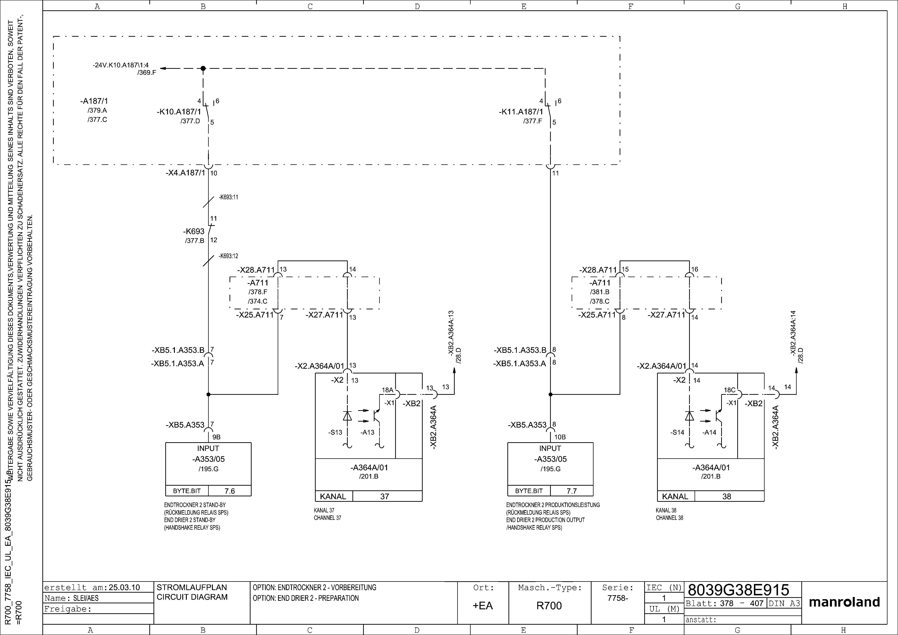

# +EA — Sheet 378 of 407 — OPTION: ENDTROCKNER 2 VORBEREITUNG

**OPTION: END DRIER 2 PREPARATION**

> Part of the manroland **R700** printing press IEC/UL circuit diagrams.
> Drawing class: **Stromlaufplan / Circuit diagram** (DIN A3).
> Document `+EA` covers the **Printing unit** machine section.

## At a glance

| Field | Value |
|---|---|
| Document | `+EA`  (8039G38E915) |
| Sheet | **378** of 407 |
| Section (DE) | OPTION: ENDTROCKNER 2 VORBEREITUNG |
| Section (EN) | OPTION: END DRIER 2 PREPARATION |
| Section type | CIRCUIT — Circuit diagram |
| Machine type | `R700` |
| Series | `7758` |
| Created | 25.03.10 |
| Replaces | — |
| Columns used | A, B, C, D, E, F, G, H |
| Path numbers | — |
| Labels on sheet | 116 |
| Cross-refs out | 16 |
| Cross-refs in | 35 |

**Previous:** [+EA sheet 377](SHEET_0377.md) · **Next:** [+EA sheet 379](SHEET_0379.md) · **Document TOC:** [_TOC.md](_TOC.md)  (+EA) · **Master TOC:** [all sheets](../_MASTER_TOC.md)

## Sheet image (300 DPI, exact vector render)



_Rendered directly from the PDF vector layer at 300 DPI (1-bit), no OCR and no resampling. Use it to confirm anything ambiguous in the text below._

## Cross-references on this sheet

Each entry is a wire leaving this sheet. The printed token is `/sheet.column`; the link resolves to that sheet inside the same document.

| Ref | Target sheet | Col | Path | Destination on target | Target section | From col |
|---|---|---|---|---|---|---|
| `/369.F` | [+EA sheet 369](SHEET_0369.md) | F | — | 24V.K10.A187\1:4 | OPTION: ENDTROCKNER 1 VORBEREITUNG; | A |
| `/379.A` | [+EA sheet 379](SHEET_0379.md) | A | — | — | OPTION: ENDTROCKNER 2 VORBEREITUNG | A |
| `/377.C` | [+EA sheet 377](SHEET_0377.md) | C | — | — | OPTION: ENDTROCKNER 2 VORBEREITUNG | A |
| `/377.F` | [+EA sheet 377](SHEET_0377.md) | F | — | — | OPTION: ENDTROCKNER 2 VORBEREITUNG | E |
| `/377.D` | [+EA sheet 377](SHEET_0377.md) | D | — | — | OPTION: ENDTROCKNER 2 VORBEREITUNG | B |
| `/377.B` | [+EA sheet 377](SHEET_0377.md) | B | — | — | OPTION: ENDTROCKNER 2 VORBEREITUNG | B |
| `/381.B` | [+EA sheet 381](SHEET_0381.md) | B | — | — | OPTION: ENDTROCKNER 2 VORBEREITUNG | F |
| `/378.C` | [+EA sheet 378](SHEET_0378.md) | C | — | — | OPTION: ENDTROCKNER 2 VORBEREITUNG | F |
| `/378.F` | [+EA sheet 378](SHEET_0378.md) | F | — | — | OPTION: ENDTROCKNER 2 VORBEREITUNG | C |
| `/374.C` | [+EA sheet 374](SHEET_0374.md) | C | — | — | OPTION: ENDTROCKNER 1 VORBEREITUNG; | C |
| `/28.D` | [+EA sheet 28](SHEET_0028.md) | D | — | XB2.A364A:13 | BUSVERBINDUNGEN: SICHERHEITSBUS | D |
| `/28.D` | [+EA sheet 28](SHEET_0028.md) | D | — | XB2.A364A:14 | BUSVERBINDUNGEN: SICHERHEITSBUS | H |
| `/195.G` | [+EA sheet 195](SHEET_0195.md) | G | — | — | REFERENZMODUL | B |
| `/195.G` | [+EA sheet 195](SHEET_0195.md) | G | — | — | REFERENZMODUL | E |
| `/201.B` | [+EA sheet 201](SHEET_0201.md) | B | — | — | REFERENZMODUL | D |
| `/201.B` | [+EA sheet 201](SHEET_0201.md) | B | — | — | REFERENZMODUL | G |

### Incoming references (sheets that point here)

Every other sheet that sends a wire to this one. `Back-ref` is the token printed on *that* sheet; `Path` is its line number.

| From sheet | Cols | Back-ref | Path | Refs | What continues there |
|---|---|---|---|---|---|
| [+EA#28](SHEET_0028.md) | D | `/28.D` | — | 2 | — |
| [+EA#195](SHEET_0195.md) | G | `/195.G` | — | 2 | — |
| [+EA#201](SHEET_0201.md) | B | `/201.B` | — | 2 | — |
| [+EA#227](SHEET_0227.md) | B, D | `/227.B`, `/227.D` | — | 4 | — |
| [+EA#236](SHEET_0236.md) | B | `/236.B` | — | 2 | — |
| [+EA#240](SHEET_0240.md) | F | `/240.F` | — | 2 | — |
| [+EA#241](SHEET_0241.md) | A, B | `/241.A`, `/241.B` | — | 4 | — |
| [+EA#268](SHEET_0268.md) | E | `/268.E` | — | 2 | — |
| [+EA#271](SHEET_0271.md) | E | `/271.E` | — | 2 | — |
| [+EA#273](SHEET_0273.md) | A | `/273.A` | — | 4 | — |
| [+EA#369](SHEET_0369.md) | G | `/369.G` | — | 1 | — |
| [+EA#374](SHEET_0374.md) | C | `/374.C` | — | 1 | — |
| [+EA#377](SHEET_0377.md) | B, D, F | `/377.B`, `/377.D`, `/377.F` | — | 3 | — |
| [+EA#378](SHEET_0378.md) | C, F | `/378.C`, `/378.F` | — | 2 | — |
| [+EA#379](SHEET_0379.md) | A | `/379.A` | — | 1 | — |
| [+EA#381](SHEET_0381.md) | B | `/381.B` | — | 1 | — |


## Devices on this sheet

| Tag | Class | Class meaning (IEC) | Col | Sub | Terminal | Sign |
|---|---|---|---|---|---|---|
| `A187/1` | A | Baugruppe / assembly, module, PC board | A | 1 | — | — |
| `A353/05` | A | Baugruppe / assembly, module, PC board | E | 05 | — | — |
| `A353/05` | A | Baugruppe / assembly, module, PC board | B | 05 | — | — |
| `A711` | A | Baugruppe / assembly, module, PC board | C | — | — | — |
| `S13` | S | Schalter / switch | C | — | — | — |
| `A13` | A | Baugruppe / assembly, module, PC board | D | — | — | — |
| `X1` | X | Klemme / terminal, plug connector | D | — | — | — |
| `X2` | X | Klemme / terminal, plug connector | C | — | — | — |
| `XB2` | XB |  | D | — | — | — |
| `A711` | A | Baugruppe / assembly, module, PC board | F | — | — | — |
| `S14` | S | Schalter / switch | F | — | — | — |
| `A14` | A | Baugruppe / assembly, module, PC board | G | — | — | — |
| `X1` | X | Klemme / terminal, plug connector | G | — | — | — |
| `X2` | X | Klemme / terminal, plug connector | F | — | — | — |
| `XB2` | XB |  | G | — | — | — |
| `K693` | K | Relais / relay, contactor | B | — | — | — |
| `K693:12` | K | Relais / relay, contactor | B | — | 12 | — |
| `K693:11` | K | Relais / relay, contactor | B | — | 11 | — |
| `7.7` | — | cross-device reference | E | — | — | — |
| `XB5.A353` | — | cross-device reference | E | — | — | — |
| `7.6` | — | cross-device reference | B | — | — | — |
| `XB5.A353` | — | cross-device reference | B | — | — | — |
| `X27.A711` | — | cross-device reference | C | — | — | — |
| `X28.A711` | — | cross-device reference | B | — | — | — |
| `X25.A711` | — | cross-device reference | B | — | — | — |
| `XB2.A364A` | — | cross-device reference | D | — | — | — |
| `X27.A711` | — | cross-device reference | F | — | — | — |
| `X28.A711` | — | cross-device reference | F | — | — | — |
| `X25.A711` | — | cross-device reference | F | — | — | — |
| `XB2.A364A` | — | cross-device reference | G | — | — | — |
| `XB5.1.A353.B` | — | cross-device reference | B | — | — | — |
| `XB5.1.A353.A` | — | cross-device reference | B | — | — | — |
| `XB5.1.A353.B` | — | cross-device reference | E | — | — | — |
| `XB5.1.A353.A` | — | cross-device reference | E | — | — | — |
| `XB2.A364A:14` | — | cross-device reference | H | — | 14 | — |
| `XB2.A364A:13` | — | cross-device reference | D | — | 13 | — |

## Potentials / nets

| Potential | Count | Columns | Attached devices | Terminals |
|---|---|---|---|---|
| `24V` | 1 | A | `A187\1`, `K10` | `4` |


A potential such as `L24+/4` or `M24+` is a named supply/return rail; every place it appears on this sheet is electrically common.

## Wire-end annotations (grouped as printed)

A wire that continues elsewhere is annotated with a small cluster: the destination description, the path/line number `#NN`, and the `/sheet.column` cross reference. Each row below is one such cluster exactly as it is grouped on the drawing.

| Col | Y | Path | Cross-ref | Text on the wire |
|---|---|---|---|---|
| A | 82.5 | — | `/369.F` | `24V.K10.A187\1:4` |
| A | 129.3 | — | — | `A187/1` |
| B | 130.0 | — | — | `K10.A187/1 6` |
| B | 130.0 | — | — | `4` |
| E | 130.0 | — | — | `K11.A187/1 6` |
| E | 130.0 | — | — | `4` |
| A | 142.3 | — | `/379.A`, `/377.C` | — |
| E | 156.5 | — | `/377.F` | — |
| B | 156.6 | — | `/377.D` | — |
| B | 158.4 | — | — | `5` |
| E | 158.4 | — | — | `5` |
| B | 224.2 | — | — | `X4.A187/1 10` |
| E | 225.7 | — | — | `11` |
| B | 258.6 | — | — | `K693:11` |
| B | 285.9 | — | — | `11` |
| B | 302.2 | — | — | `K693 12` |
| B | 315.3 | — | `/377.B` | — |
| B | 336.5 | — | — | `K693:12` |
| C | 353.2 | — | — | `X28.A711 13` |
| C | 353.2 | — | — | `14` |
| F | 353.2 | — | — | `X28.A711 15` |
| G | 353.2 | — | — | `16` |
| C | 370.2 | — | — | `A711` |
| F | 370.2 | — | — | `A711` |
| C | 383.3 | — | `/378.F`, `/374.C` | — |
| F | 383.3 | — | `/381.B`, `/378.C` | — |
| D | 411.6 | — | `/28.D` | `XB2.A364A:13` |
| H | 411.6 | — | `/28.D` | `XB2.A364A:14` |
| C | 412.8 | — | — | `X25.A711 7` |
| C | 412.8 | — | — | `X27.A711 13` |
| F | 412.8 | — | — | `X25.A711 8` |
| F | 412.8 | — | — | `X27.A711 14` |
| B | 459.5 | — | — | `XB5.1.A353.B 7` |
| E | 459.5 | — | — | `XB5.1.A353.B 8` |
| B | 476.5 | — | — | `XB5.1.A353.A 7` |
| E | 476.5 | — | — | `XB5.1.A353.A 8` |
| C | 480.8 | — | — | `X2.A364A/01 13` |
| F | 480.8 | — | — | `X2.A364A/01 14` |
| C | 499.2 | — | — | `X2` |
| F | 499.2 | — | — | `X2` |
| D | 500.6 | — | — | `13 13` |
| G | 500.6 | — | — | `14 14` |
| D | 509.1 | — | — | `13` |
| G | 509.1 | — | — | `14` |
| D | 513.4 | — | — | `18A` |
| G | 513.4 | — | — | `18C` |
| D | 530.4 | — | — | `X1` |
| D | 530.4 | — | — | `XB2` |
| G | 530.4 | — | — | `X1` |
| G | 530.4 | — | — | `XB2` |
| D | 537.5 | — | — | `XB2.A364A` |
| G | 537.5 | — | — | `XB2.A364A` |
| B | 558.7 | — | — | `XB5.A353 7` |
| E | 558.7 | — | — | `XB5.A353 8` |
| C | 569.4 | — | — | `S13 A13` |
| G | 569.4 | — | — | `S14 A14` |
| B | 575.7 | — | — | `9B` |
| E | 575.7 | — | — | `10B` |
| B | 590.2 | — | — | `INPUT` |
| E | 590.2 | — | — | `INPUT` |
| B | 604.1 | — | — | `A353/05` |
| E | 604.1 | — | — | `A353/05` |
| D | 615.4 | — | — | `A364A/01` |
| G | 615.4 | — | — | `A364A/01` |
| B | 617.9 | — | `/195.G` | — |
| E | 617.9 | — | `/195.G` | — |
| D | 627.8 | — | `/201.B` | — |
| G | 627.8 | — | `/201.B` | — |
| B | 646.9 | — | — | `BYTE.BIT 7.6` |
| E | 646.9 | — | — | `BYTE.BIT 7.7` |
| C | 653.7 | — | — | `KANAL 37` |
| G | 653.7 | — | — | `KANAL 38` |
| B | 666.9 | — | — | `ENDTROCKNER 2 STAND BY (RÜCKMELDUNG RELAIS SPS) END DRIER 2 STAND BY (HANDSHAKE RELAY SPS)` |
| E | 666.9 | — | — | `ENDTROCKNER 2 PRODUKTIONSLEISTUNG (RÜCKMELDUNG RELAIS SPS) END DRIER 2 PRODUCTION OUTPUT` |
| C | 674.0 | — | — | `KANAL 37 CHANNEL 37` |
| F | 674.0 | — | — | `KANAL 38 CHANNEL 38` |
| E | 696.8 | — | — | `/HANDSHAKE RELAY SPS)` |


## Reconstructed tables

This sheet carries tabular content (pin map / terminal assignment / index). The grid below was rebuilt from the drawing's own rule lines, so each row is exactly one physical row of the table.

### Table 1 — 7 data rows × 21 columns (at x=219.7, y=90.7)

| 4 K10.A187/1 /377.D X4.A187/1 K693 /377.B |  | 6 5 10 K693:11 11 12 K693:12 |  |  |  |  |  |  |  |  | 4 K11.A187/1 /377.F |  | 6 5 11 |  |  |  |  |  |  |  |
|---|---|---|---|---|---|---|---|---|---|---|---|---|---|---|---|---|---|---|---|---|
| `XB5.1.A353.B XB5.1.A353.A` |  | `7 7` | `X28.A711 A711 /378.F /374.C X25.A711` | `13 7` | `X27.A711 X2.A364A/01` | `14 13 13` |  |  | `XB2.A364A:13` | `/28.D` | `XB5.1.A353.B XB5.1.A353.A` |  | `8 8` | `X28.A711 A711 /381.B /378.C X25.A711` | `15 8` | `X27.A711 X2.A364A/01` | `16 14 14` |  |  | `XB2.A364A:14` |
|  |  |  |  |  | `X2` | `13` | `18A` |  | `13 13` |  |  |  |  |  |  | `X2` | `14` | `18C` |  | `14 14` |
| `XB5.A353` |  | `7 9B` |  |  | `S13` | `A13` | `X1` | `XB2` | `XB2.A364A` |  | `XB5.A353` |  | `8 10B` |  |  | `S14` | `A14` | `X1` | `XB2` | `XB2.A364A` |
|  | `INPUT` |  |  |  |  |  |  |  |  |  |  | `INPUT` |  |  |  |  |  |  |  |  |
|  |  | `A353/05 /195.G` |  |  |  | `A364A/01 /201.B` |  |  |  |  |  |  | `A353/05 /195.G` |  |  |  | `A364A/01 /201.B` |  |  |  |
| `BYTE.BIT` |  | `7.6` |  |  |  |  |  |  |  |  | `BYTE.BIT` |  | `7.7` |  |  |  |  |  |  |  |
|  |  |  |  |  | `KANAL` |  | `37` |  |  |  |  |  |  |  |  | `KANAL` |  | `38` |  |  |


## Notes and free text on this sheet

| Text | Col | Y (pt) |
|---|---|---|
| `K11.A187/1` | E | 143.46 |
| `K10.A187/1` | B | 143.46 |
| `X4.A187/1` | B | 224.25 |
| `10B` | E | 575.72 |
| `INPUT` | E | 590.24 |
| `BYTE.BIT` | E | 647.49 |
| `ENDTROCKNER 2 PRODUKTIONSLEISTUNG` | E | 666.91 |
| `(RÜCKMELDUNG RELAIS SPS)` | E | 676.88 |
| `END DRIER 2 PRODUCTION OUTPUT` | E | 686.8 |
| `/HANDSHAKE RELAY SPS)` | E | 696.78 |
| `9B` | B | 575.7 |
| `INPUT` | B | 590.24 |
| `BYTE.BIT` | B | 647.49 |
| `ENDTROCKNER 2 STAND BY` | B | 666.91 |
| `(RÜCKMELDUNG RELAIS SPS)` | B | 676.88 |
| `END DRIER 2 STAND BY` | B | 686.82 |
| `(HANDSHAKE RELAY SPS)` | B | 696.77 |
| `KANAL 37` | C | 674.01 |
| `CHANNEL 37` | C | 683.96 |
| `18A` | D | 513.36 |
| `KANAL` | C | 653.68 |
| `A364A/01` | D | 615.42 |
| `X2.A364A/01` | C | 480.78 |
| `KANAL 38` | F | 674.01 |
| `CHANNEL 38` | F | 683.96 |
| `18C` | G | 513.4 |
| `KANAL` | F | 653.68 |
| `A364A/01` | G | 615.42 |
| `X2.A364A/01` | F | 480.78 |

## Complete label inventory (exact text from the drawing)

Every text object inside the drawing area of this sheet, in DIN reading order (column A→H, then top→bottom). This is the authoritative list: if a string is not here it is not printed on this sheet.

| Col | Y | X | Dir | Type | Text |
|---|---|---|---|---|---|
| A | 82.5 | 123.0 | → | potential | `24V.K10.A187\1:4` |
| A | 92.4 | 182.3 | → | cross-reference | `/369.F` |
| A | 129.3 | 106.6 | → | device tag | `A187/1` |
| A | 142.4 | 116.2 | → | cross-reference | `/379.A` |
| A | 154.8 | 116.2 | → | cross-reference | `/377.C` |
| B | 130.0 | 261.9 | → | number | `4` |
| B | 130.0 | 286.0 | → | number | `6` |
| B | 143.5 | 208.1 | → | text | `K10.A187/1` |
| B | 156.5 | 239.5 | → | cross-reference | `/377.D` |
| B | 158.4 | 278.9 | → | number | `5` |
| B | 224.3 | 219.7 | → | text | `X4.A187/1` |
| B | 225.7 | 278.4 | → | number | `10` |
| B | 258.5 | 290.3 | → | device tag | `K693:11` |
| B | 285.9 | 278.4 | → | number | `11` |
| B | 302.2 | 242.9 | → | device tag | `K693` |
| B | 314.3 | 278.4 | → | number | `12` |
| B | 315.3 | 245.5 | → | cross-reference | `/377.B` |
| B | 336.5 | 290.3 | → | device tag | `K693:12` |
| B | 353.2 | 314.6 | → | device ref | `X28.A711` |
| B | 412.7 | 313.2 | → | device ref | `X25.A711` |
| B | 459.5 | 201.3 | → | device ref | `XB5.1.A353.B` |
| B | 459.5 | 278.9 | → | number | `7` |
| B | 476.5 | 278.9 | → | number | `7` |
| B | 477.2 | 200.4 | → | device ref | `XB5.1.A353.A` |
| B | 558.7 | 220.0 | → | device ref | `XB5.A353` |
| B | 558.7 | 278.9 | → | number | `7` |
| B | 575.7 | 281.8 | → | text | `9B` |
| B | 590.2 | 261.5 | → | text | `INPUT` |
| B | 604.1 | 255.0 | → | device tag | `A353/05` |
| B | 617.9 | 263.5 | → | cross-reference | `/195.G` |
| B | 646.9 | 297.9 | → | device ref | `7.6` |
| B | 647.5 | 229.6 | → | text | `BYTE.BIT` |
| B | 666.9 | 217.7 | → | text | `ENDTROCKNER 2 STAND BY` |
| B | 676.9 | 217.7 | → | text | `(RÜCKMELDUNG RELAIS SPS)` |
| B | 686.8 | 217.7 | → | text | `END DRIER 2 STAND BY` |
| B | 696.8 | 217.7 | → | text | `(HANDSHAKE RELAY SPS)` |
| C | 353.2 | 370.5 | → | number | `13` |
| C | 353.2 | 462.6 | → | number | `14` |
| C | 370.2 | 328.0 | → | device tag | `A711` |
| C | 383.3 | 329.7 | → | cross-reference | `/378.F` |
| C | 395.7 | 328.8 | → | cross-reference | `/374.C` |
| C | 412.7 | 405.4 | → | device ref | `X27.A711` |
| C | 417.0 | 371.1 | → | number | `7` |
| C | 417.0 | 462.6 | → | number | `13` |
| C | 480.8 | 390.9 | → | text | `X2.A364A/01` |
| C | 480.8 | 462.6 | → | number | `13` |
| C | 499.2 | 439.1 | → | device tag | `X2` |
| C | 500.6 | 465.4 | → | number | `13` |
| C | 569.4 | 435.4 | → | device tag | `S13` |
| C | 653.7 | 424.3 | → | text | `KANAL` |
| C | 674.0 | 416.1 | → | text | `KANAL 37` |
| C | 684.0 | 416.4 | → | text | `CHANNEL 37` |
| D | 411.6 | 594.1 | ↕ | device ref | `XB2.A364A:13` |
| D | 460.9 | 604.1 | ↕ | cross-reference | `/28.D` |
| D | 509.1 | 585.9 | → | number | `13` |
| D | 510.6 | 564.7 | → | number | `13` |
| D | 513.4 | 506.0 | → | text | `18A` |
| D | 530.4 | 509.7 | → | device tag | `X1` |
| D | 530.4 | 534.0 | → | device tag | `XB2` |
| D | 537.4 | 570.1 | ↕ | device ref | `XB2.A364A` |
| D | 569.4 | 477.9 | → | device tag | `A13` |
| D | 615.4 | 464.7 | → | text | `A364A/01` |
| D | 627.8 | 476.4 | → | cross-reference | `/201.B` |
| D | 653.7 | 504.3 | → | number | `37` |
| E | 130.0 | 715.5 | → | number | `4` |
| E | 130.0 | 739.6 | → | number | `6` |
| E | 143.5 | 661.6 | → | text | `K11.A187/1` |
| E | 156.5 | 693.9 | → | cross-reference | `/377.F` |
| E | 158.4 | 732.5 | → | number | `5` |
| E | 225.7 | 731.9 | → | number | `11` |
| E | 459.5 | 654.8 | → | device ref | `XB5.1.A353.B` |
| E | 459.5 | 732.5 | → | number | `8` |
| E | 476.5 | 732.5 | → | number | `8` |
| E | 477.2 | 654.0 | → | device ref | `XB5.1.A353.A` |
| E | 558.7 | 673.5 | → | device ref | `XB5.A353` |
| E | 558.7 | 732.5 | → | number | `8` |
| E | 575.7 | 734.7 | → | text | `10B` |
| E | 590.2 | 715.0 | → | text | `INPUT` |
| E | 604.1 | 708.5 | → | device tag | `A353/05` |
| E | 617.9 | 717.0 | → | cross-reference | `/195.G` |
| E | 646.9 | 751.5 | → | device ref | `7.7` |
| E | 647.5 | 683.1 | → | text | `BYTE.BIT` |
| E | 666.9 | 671.2 | → | text | `ENDTROCKNER 2 PRODUKTIONSLEISTUNG` |
| E | 676.9 | 671.2 | → | text | `(RÜCKMELDUNG RELAIS SPS)` |
| E | 686.8 | 671.2 | → | text | `END DRIER 2 PRODUCTION OUTPUT` |
| E | 696.8 | 671.8 | → | text | `/HANDSHAKE RELAY SPS)` |
| F | 353.2 | 768.2 | → | device ref | `X28.A711` |
| F | 353.2 | 824.0 | → | number | `15` |
| F | 370.2 | 781.5 | → | device tag | `A711` |
| F | 383.3 | 782.6 | → | cross-reference | `/381.B` |
| F | 395.7 | 782.4 | → | cross-reference | `/378.C` |
| F | 412.7 | 766.8 | → | device ref | `X25.A711` |
| F | 412.7 | 858.9 | → | device ref | `X27.A711` |
| F | 417.0 | 824.6 | → | number | `8` |
| F | 480.8 | 844.4 | → | text | `X2.A364A/01` |
| F | 499.2 | 892.6 | → | device tag | `X2` |
| F | 569.4 | 888.9 | → | device tag | `S14` |
| F | 653.7 | 877.9 | → | text | `KANAL` |
| F | 674.0 | 869.7 | → | text | `KANAL 38` |
| F | 684.0 | 870.0 | → | text | `CHANNEL 38` |
| G | 353.2 | 916.2 | → | number | `16` |
| G | 417.0 | 916.2 | → | number | `14` |
| G | 480.8 | 916.2 | → | number | `14` |
| G | 500.6 | 919.0 | → | number | `14` |
| G | 509.1 | 1039.5 | → | number | `14` |
| G | 510.6 | 1018.2 | → | number | `14` |
| G | 513.4 | 959.5 | → | text | `18C` |
| G | 530.4 | 963.2 | → | device tag | `X1` |
| G | 530.4 | 987.6 | → | device tag | `XB2` |
| G | 537.4 | 1023.6 | ↕ | device ref | `XB2.A364A` |
| G | 569.4 | 931.5 | → | device tag | `A14` |
| G | 615.4 | 918.3 | → | text | `A364A/01` |
| G | 627.8 | 929.9 | → | cross-reference | `/201.B` |
| G | 653.7 | 957.8 | → | number | `38` |
| H | 411.6 | 1047.7 | ↕ | device ref | `XB2.A364A:14` |
| H | 460.9 | 1057.6 | ↕ | cross-reference | `/28.D` |

## Reading-order text block

The same content as a plain block, grouped by DIN column — convenient to paste or to match against a visual description.

```text
=== Column A ===
  82.5  123.0  net          24V.K10.A187\1:4
  92.4  182.3  xref         /369.F
 129.3  106.6  devtag       A187/1
 142.4  116.2  xref         /379.A
 154.8  116.2  xref         /377.C
=== Column B ===
 130.0  261.9  numeric      4
 130.0  286.0  numeric      6
 143.5  208.1  text         K10.A187/1
 156.5  239.5  xref         /377.D
 158.4  278.9  numeric      5
 224.3  219.7  text         X4.A187/1
 225.7  278.4  numeric      10
 258.5  290.3  devtag       K693:11
 285.9  278.4  numeric      11
 302.2  242.9  devtag       K693
 314.3  278.4  numeric      12
 315.3  245.5  xref         /377.B
 336.5  290.3  devtag       K693:12
 353.2  314.6  devref       X28.A711
 412.7  313.2  devref       X25.A711
 459.5  201.3  devref       XB5.1.A353.B
 459.5  278.9  numeric      7
 476.5  278.9  numeric      7
 477.2  200.4  devref       XB5.1.A353.A
 558.7  220.0  devref       XB5.A353
 558.7  278.9  numeric      7
 575.7  281.8  text         9B
 590.2  261.5  text         INPUT
 604.1  255.0  devtag       A353/05
 617.9  263.5  xref         /195.G
 646.9  297.9  devref       7.6
 647.5  229.6  text         BYTE.BIT
 666.9  217.7  text         ENDTROCKNER 2 STAND BY
 676.9  217.7  text         (RÜCKMELDUNG RELAIS SPS)
 686.8  217.7  text         END DRIER 2 STAND BY
 696.8  217.7  text         (HANDSHAKE RELAY SPS)
=== Column C ===
 353.2  370.5  numeric      13
 353.2  462.6  numeric      14
 370.2  328.0  devtag       A711
 383.3  329.7  xref         /378.F
 395.7  328.8  xref         /374.C
 412.7  405.4  devref       X27.A711
 417.0  371.1  numeric      7
 417.0  462.6  numeric      13
 480.8  390.9  text         X2.A364A/01
 480.8  462.6  numeric      13
 499.2  439.1  devtag       X2
 500.6  465.4  numeric      13
 569.4  435.4  devtag       S13
 653.7  424.3  text         KANAL
 674.0  416.1  text         KANAL 37
 684.0  416.4  text         CHANNEL 37
=== Column D ===
 411.6  594.1  devref       XB2.A364A:13
 460.9  604.1  xref         /28.D
 509.1  585.9  numeric      13
 510.6  564.7  numeric      13
 513.4  506.0  text         18A
 530.4  509.7  devtag       X1
 530.4  534.0  devtag       XB2
 537.4  570.1  devref       XB2.A364A
 569.4  477.9  devtag       A13
 615.4  464.7  text         A364A/01
 627.8  476.4  xref         /201.B
 653.7  504.3  numeric      37
=== Column E ===
 130.0  715.5  numeric      4
 130.0  739.6  numeric      6
 143.5  661.6  text         K11.A187/1
 156.5  693.9  xref         /377.F
 158.4  732.5  numeric      5
 225.7  731.9  numeric      11
 459.5  654.8  devref       XB5.1.A353.B
 459.5  732.5  numeric      8
 476.5  732.5  numeric      8
 477.2  654.0  devref       XB5.1.A353.A
 558.7  673.5  devref       XB5.A353
 558.7  732.5  numeric      8
 575.7  734.7  text         10B
 590.2  715.0  text         INPUT
 604.1  708.5  devtag       A353/05
 617.9  717.0  xref         /195.G
 646.9  751.5  devref       7.7
 647.5  683.1  text         BYTE.BIT
 666.9  671.2  text         ENDTROCKNER 2 PRODUKTIONSLEISTUNG
 676.9  671.2  text         (RÜCKMELDUNG RELAIS SPS)
 686.8  671.2  text         END DRIER 2 PRODUCTION OUTPUT
 696.8  671.8  text         /HANDSHAKE RELAY SPS)
=== Column F ===
 353.2  768.2  devref       X28.A711
 353.2  824.0  numeric      15
 370.2  781.5  devtag       A711
 383.3  782.6  xref         /381.B
 395.7  782.4  xref         /378.C
 412.7  766.8  devref       X25.A711
 412.7  858.9  devref       X27.A711
 417.0  824.6  numeric      8
 480.8  844.4  text         X2.A364A/01
 499.2  892.6  devtag       X2
 569.4  888.9  devtag       S14
 653.7  877.9  text         KANAL
 674.0  869.7  text         KANAL 38
 684.0  870.0  text         CHANNEL 38
=== Column G ===
 353.2  916.2  numeric      16
 417.0  916.2  numeric      14
 480.8  916.2  numeric      14
 500.6  919.0  numeric      14
 509.1 1039.5  numeric      14
 510.6 1018.2  numeric      14
 513.4  959.5  text         18C
 530.4  963.2  devtag       X1
 530.4  987.6  devtag       XB2
 537.4 1023.6  devref       XB2.A364A
 569.4  931.5  devtag       A14
 615.4  918.3  text         A364A/01
 627.8  929.9  xref         /201.B
 653.7  957.8  numeric      38
=== Column H ===
 411.6 1047.7  devref       XB2.A364A:14
 460.9 1057.6  xref         /28.D
```

---
_Generated from the PDF vector text layer; no OCR. Source: `R700_7758_IEC_UL_EA_8039G38E915_p`, sheet 378._
