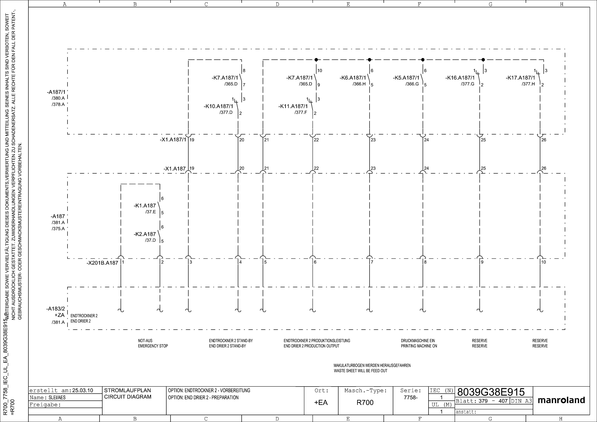

# +EA — Sheet 379 of 407 — OPTION: ENDTROCKNER 2 VORBEREITUNG

**OPTION: END DRIER 2 PREPARATION**

> Part of the manroland **R700** printing press IEC/UL circuit diagrams.
> Drawing class: **Stromlaufplan / Circuit diagram** (DIN A3).
> Document `+EA` covers the **Printing unit** machine section.

## At a glance

| Field | Value |
|---|---|
| Document | `+EA`  (8039G38E915) |
| Sheet | **379** of 407 |
| Section (DE) | OPTION: ENDTROCKNER 2 VORBEREITUNG |
| Section (EN) | OPTION: END DRIER 2 PREPARATION |
| Section type | CIRCUIT — Circuit diagram |
| Machine type | `R700` |
| Series | `7758` |
| Created | 25.03.10 |
| Replaces | — |
| Columns used | A, B, C, D, E, F, G, H |
| Path numbers | — |
| Labels on sheet | 98 |
| Cross-refs out | 15 |
| Cross-refs in | 41 |

**Previous:** [+EA sheet 378](SHEET_0378.md) · **Next:** [+EA sheet 380](SHEET_0380.md) · **Document TOC:** [_TOC.md](_TOC.md)  (+EA) · **Master TOC:** [all sheets](../_MASTER_TOC.md)

## Sheet image (300 DPI, exact vector render)



_Rendered directly from the PDF vector layer at 300 DPI (1-bit), no OCR and no resampling. Use it to confirm anything ambiguous in the text below._

## Cross-references on this sheet

Each entry is a wire leaving this sheet. The printed token is `/sheet.column`; the link resolves to that sheet inside the same document.

| Ref | Target sheet | Col | Path | Destination on target | Target section | From col |
|---|---|---|---|---|---|---|
| `/366.G` | [+EA sheet 366](SHEET_0366.md) | G | — | — | OPTION: TROCKNER VORBEREITUNG; | F |
| `/377.G` | [+EA sheet 377](SHEET_0377.md) | G | — | — | OPTION: ENDTROCKNER 2 VORBEREITUNG | G |
| `/365.D` | [+EA sheet 365](SHEET_0365.md) | D | — | — | OPTION: TROCKNER VORBEREITUNG; | C |
| `/365.D` | [+EA sheet 365](SHEET_0365.md) | D | — | — | OPTION: TROCKNER VORBEREITUNG; | D |
| `/366.H` | [+EA sheet 366](SHEET_0366.md) | H | — | — | OPTION: TROCKNER VORBEREITUNG; | E |
| `/377.H` | [+EA sheet 377](SHEET_0377.md) | H | — | — | OPTION: ENDTROCKNER 2 VORBEREITUNG | H |
| `/380.A` | [+EA sheet 380](SHEET_0380.md) | A | — | — | OPTION: ENDTROCKNER 2 VORBEREITUNG | A |
| `/378.A` | [+EA sheet 378](SHEET_0378.md) | A | — | — | OPTION: ENDTROCKNER 2 VORBEREITUNG | A |
| `/377.F` | [+EA sheet 377](SHEET_0377.md) | F | — | — | OPTION: ENDTROCKNER 2 VORBEREITUNG | D |
| `/377.D` | [+EA sheet 377](SHEET_0377.md) | D | — | — | OPTION: ENDTROCKNER 2 VORBEREITUNG | C |
| `/37.E` | [+EA sheet 37](SHEET_0037.md) | E | — | — | BUSVERBINDUNGEN: NOT AUS | B |
| `/381.A` | [+EA sheet 381](SHEET_0381.md) | A | — | — | OPTION: ENDTROCKNER 2 VORBEREITUNG | A |
| `/375.A` | [+EA sheet 375](SHEET_0375.md) | A | — | — | OPTION: ENDTROCKNER 1 VORBEREITUNG; | A |
| `/37.D` | [+EA sheet 37](SHEET_0037.md) | D | — | — | BUSVERBINDUNGEN: NOT AUS | B |
| `/381.A` | [+EA sheet 381](SHEET_0381.md) | A | — | — | OPTION: ENDTROCKNER 2 VORBEREITUNG | A |

### Incoming references (sheets that point here)

Every other sheet that sends a wire to this one. `Back-ref` is the token printed on *that* sheet; `Path` is its line number.

| From sheet | Cols | Back-ref | Path | Refs | What continues there |
|---|---|---|---|---|---|
| [+EA#37](SHEET_0037.md) | D, E | `/37.D`, `/37.E` | — | 2 | — |
| [+EA#206](SHEET_0206.md) | G, H | `/206.G`, `/206.H` | — | 8 | — |
| [+EA#207](SHEET_0207.md) | A, B | `/207.A`, `/207.B` | — | 8 | — |
| [+EA#286](SHEET_0286.md) | G | `/286.G` | — | 10 | — |
| [+EA#365](SHEET_0365.md) | D | `/365.D` | — | 2 | — |
| [+EA#366](SHEET_0366.md) | G, H | `/366.G`, `/366.H` | — | 2 | — |
| [+EA#375](SHEET_0375.md) | A | `/375.A` | — | 1 | — |
| [+EA#377](SHEET_0377.md) | D, F, G, H | `/377.D`, `/377.F`, `/377.G`, `/377.H` | — | 4 | — |
| [+EA#378](SHEET_0378.md) | A | `/378.A` | — | 1 | — |
| [+EA#380](SHEET_0380.md) | A | `/380.A` | — | 1 | — |
| [+EA#381](SHEET_0381.md) | A | `/381.A` | — | 2 | — |


## Devices on this sheet

| Tag | Class | Class meaning (IEC) | Col | Sub | Terminal | Sign |
|---|---|---|---|---|---|---|
| `A187/1` | A | Baugruppe / assembly, module, PC board | A | 1 | — | — |
| `A187` | A | Baugruppe / assembly, module, PC board | A | — | — | — |
| `A183/2` | A | Baugruppe / assembly, module, PC board | A | 2 | — | — |
| `K1.A187` | — | cross-device reference | B | — | — | — |
| `K2.A187` | — | cross-device reference | B | — | — | — |
| `X1.A187` | — | cross-device reference | C | — | — | — |
| `X201B.A187` | — | cross-device reference | B | — | — | — |

## Potentials / nets

_No named potentials on this sheet._

## Wire-end annotations (grouped as printed)

A wire that continues elsewhere is annotated with a small cluster: the destination description, the path/line number `#NN`, and the `/sheet.column` cross reference. Each row below is one such cluster exactly as it is grouped on the drawing.

| Col | Y | Path | Cross-ref | Text on the wire |
|---|---|---|---|---|
| D | 137.1 | — | — | `8` |
| E | 137.1 | — | — | `10` |
| E | 137.1 | — | — | `6` |
| F | 137.1 | — | — | `6` |
| G | 137.1 | — | — | `K16.A187/1 3` |
| G | 137.1 | — | — | `1` |
| H | 137.1 | — | — | `K17.A187/1 3` |
| H | 137.1 | — | — | `1` |
| C | 150.6 | — | — | `K7.A187/1 7` |
| D | 150.6 | — | — | `K7.A187/1 9` |
| E | 150.6 | — | — | `K6.A187/1 5` |
| F | 150.6 | — | — | `K5.A187/1 5` |
| C | 163.6 | — | `/365.D` | — |
| D | 163.6 | — | `/365.D` | — |
| E | 163.6 | — | `/366.H` | — |
| F | 163.6 | — | `/366.G` | — |
| G | 163.6 | — | `/377.G` | — |
| H | 163.6 | — | `/377.H` | — |
| G | 165.4 | — | — | `2` |
| H | 165.4 | — | — | `2` |
| A | 178.9 | — | — | `A187/1` |
| A | 192.0 | — | `/380.A`, `/378.A` | — |
| C | 193.8 | — | — | `K10.A187/1 3` |
| C | 193.8 | — | — | `1` |
| D | 193.8 | — | — | `K11.A187/1 3` |
| D | 193.8 | — | — | `1` |
| C | 220.3 | — | `/377.D` | — |
| D | 220.3 | — | `/377.F` | — |
| C | 222.1 | — | — | `2` |
| E | 222.1 | — | — | `2` |
| C | 273.9 | — | — | `X1.A187/1 19 21 22` |
| D | 275.3 | — | — | `20` |
| F | 275.3 | — | — | `23 24` |
| G | 275.3 | — | — | `25 26` |
| C | 332.0 | — | — | `X1.A187 19` |
| D | 332.0 | — | — | `20` |
| D | 332.0 | — | — | `21` |
| E | 332.0 | — | — | `22` |
| G | 332.0 | — | — | `23 24 25 26` |
| B | 392.2 | — | — | `6` |
| B | 405.7 | — | — | `K1.A187 5` |
| B | 418.7 | — | `/37.E` | — |
| A | 426.9 | — | — | `A187` |
| A | 440.0 | — | `/381.A`, `/375.A` | — |
| B | 448.9 | — | — | `6` |
| B | 462.4 | — | — | `K2.A187 5` |
| B | 475.4 | — | `/37.D` | — |
| B | 519.1 | — | — | `X201B.A187 1 2 3` |
| C | 519.1 | — | — | `4` |
| D | 519.1 | — | — | `5` |
| E | 519.1 | — | — | `6` |
| G | 519.1 | — | — | `7 8 9 10` |
| A | 611.2 | — | — | `A183/2` |
| A | 623.9 | — | — | `+ZA` |
| A | 627.1 | — | — | `ENDTROCKNER 2 END DRIER 2` |
| A | 639.1 | — | `/381.A` | — |
| E | 676.6 | — | — | `NOT AUS EMERGENCY STOP ENDTROCKNER 2 PRODUKTIONSLEISTUNG END DRIER 2 PRODUCTION OUTPUT RESERVE RESERVE` |
| G | 676.6 | — | — | `RESERVE RESERVE` |
| C | 676.7 | — | — | `ENDTROCKNER 2 STAND BY END DRIER 2 STAND BY` |
| F | 676.7 | — | — | `DRUCKMASCHINE EIN PRINTING MACHINE ON` |
| E | 726.3 | — | — | `MAKULATURBOGEN WERDEN HERAUSGEFAHREN` |
| E | 736.9 | — | — | `WASTE SHEET WILL BE FEED OUT` |


## Reconstructed tables

This sheet carries tabular content (pin map / terminal assignment / index). The grid below was rebuilt from the drawing's own rule lines, so each row is exactly one physical row of the table.

### Table 1 — 5 data rows × 21 columns (at x=204.1, y=0.0) — **X1.A187/1 X1.A187 K7.A187/1 /365.D 1 K10.A187/1 /377.D 19 19 2 8 7 3 20 20 K7.A187/1 K11.A187/1 /377.F 21 21 /365.D 1 10 9 3 22 22 K6.A187/1 /366.H 6 5 23 23 K5.A187/1 /366.G 6 5 24 24 1 K16.A187/1 /377.G 3 K17.A187/1 /377.H 25 25 1 X201B.A187 K1.A187 /37.E K2.A187 /37.D 1 NOT AUS EMERGENCY 6 5 6 5 2 STOP 3 ENDTROCKNER 2 END DRIER 2 STAND BY 4 STAND BY 5 ENDTROCKNER END DRIER 2 6 PRODUCTION PRODUKTIONSLEISTUNG OUTPUT MAKULATURBOGEN WASTE SHEET WILL BE 7 WERDEN FEED OUT DRUCKMASCHINE PRINTING HERAUSGEFAHREN 8 MACHINE EIN ON 9 RESERVE RESERVE 10 RESERVE RESERVE**

|  | STROMLAUFPLAN |  | OPTION: | ENDTROCKNER 2 VORBEREITUNG |  |  |  |  |  | Ort: | Masch. Type: |  | Serie: |  | IEC (N) |  |  | 8039G38E915 |  |  |
|---|---|---|---|---|---|---|---|---|---|---|---|---|---|---|---|---|---|---|---|---|
| `CIRCUIT` | `DIAGRAM` |  |  |  |  |  |  |  |  |  |  |  |  |  |  |  |  |  |  |  |
|  |  |  | `OPTION:` | `END DRIER 2 PREPARATION` |  |  |  |  |  |  |  |  | `7758` |  | `1` |  |  |  |  |  |
|  |  |  |  |  |  |  |  |  |  | `+EA` | `R700` |  |  |  |  | `Blatt:` | `379` | `DIN A3 407` |  |  |
|  |  |  |  |  |  |  |  |  |  |  |  |  |  |  | `UL (M)` |  |  |  |  |  |
|  |  |  |  |  |  |  |  |  |  |  |  |  |  |  | `1` | `anstatt:` |  |  |  |  |


## Notes and free text on this sheet

| Text | Col | Y (pt) |
|---|---|---|
| `K7.A187/1` | D | 150.55 |
| `K5.A187/1` | F | 150.55 |
| `K11.A187/1` | D | 207.24 |
| `K7.A187/1` | C | 150.55 |
| `K10.A187/1` | C | 207.24 |
| `X1.A187/1` | C | 273.86 |
| `K6.A187/1` | E | 150.55 |
| `K16.A187/1` | G | 150.55 |
| `K17.A187/1` | G | 150.55 |
| `+ZA` | A | 623.85 |
| `ENDTROCKNER 2` | A | 627.09 |
| `END DRIER 2` | A | 637.71 |
| `ENDTROCKNER 2 STAND BY` | C | 676.7 |
| `END DRIER 2 STAND BY` | C | 687.32 |
| `DRUCKMASCHINE EIN` | F | 676.69 |
| `PRINTING MACHINE ON` | F | 687.32 |
| `RESERVE` | G | 676.65 |
| `RESERVE` | H | 676.65 |
| `ENDTROCKNER 2 PRODUKTIONSLEISTUNG` | E | 676.7 |
| `END DRIER 2 PRODUCTION OUTPUT` | D | 687.34 |
| `NOT AUS` | B | 676.67 |
| `EMERGENCY STOP` | B | 687.32 |
| `MAKULATURBOGEN WERDEN HERAUSGEFAHREN` | E | 726.3 |
| `WASTE SHEET WILL BE FEED OUT` | E | 736.89 |

## Complete label inventory (exact text from the drawing)

Every text object inside the drawing area of this sheet, in DIN reading order (column A→H, then top→bottom). This is the authoritative list: if a string is not here it is not printed on this sheet.

| Col | Y | X | Dir | Type | Text |
|---|---|---|---|---|---|
| A | 178.9 | 93.8 | → | device tag | `A187/1` |
| A | 192.0 | 103.5 | → | cross-reference | `/380.A` |
| A | 204.4 | 103.5 | → | cross-reference | `/378.A` |
| A | 426.9 | 101.2 | → | device tag | `A187` |
| A | 440.0 | 103.5 | → | cross-reference | `/381.A` |
| A | 452.4 | 103.5 | → | cross-reference | `/375.A` |
| A | 611.2 | 92.4 | → | device tag | `A183/2` |
| A | 623.8 | 108.9 | → | text | `+ZA` |
| A | 627.1 | 140.9 | → | text | `ENDTROCKNER 2` |
| A | 637.7 | 140.9 | → | text | `END DRIER 2` |
| A | 639.1 | 103.5 | → | cross-reference | `/381.A` |
| B | 392.2 | 321.4 | → | number | `6` |
| B | 405.7 | 266.7 | → | device ref | `K1.A187` |
| B | 418.7 | 290.3 | → | cross-reference | `/37.E` |
| B | 420.6 | 321.4 | → | number | `5` |
| B | 448.9 | 321.4 | → | number | `6` |
| B | 462.4 | 266.7 | → | device ref | `K2.A187` |
| B | 475.4 | 289.7 | → | cross-reference | `/37.D` |
| B | 477.3 | 321.4 | → | number | `5` |
| B | 519.1 | 242.9 | → | number | `1` |
| B | 519.1 | 321.4 | → | number | `2` |
| B | 519.7 | 172.6 | → | device ref | `X201B.A187` |
| B | 676.7 | 275.5 | → | text | `NOT AUS` |
| B | 687.3 | 275.5 | → | text | `EMERGENCY STOP` |
| C | 150.5 | 422.4 | → | text | `K7.A187/1` |
| C | 163.6 | 447.9 | → | cross-reference | `/365.D` |
| C | 193.8 | 461.8 | → | number | `1` |
| C | 207.2 | 406.5 | → | text | `K10.A187/1` |
| C | 220.3 | 438.0 | → | cross-reference | `/377.D` |
| C | 222.1 | 477.4 | → | number | `2` |
| C | 273.9 | 318.9 | → | text | `X1.A187/1` |
| C | 275.3 | 377.6 | → | number | `19` |
| C | 332.0 | 326.3 | → | device ref | `X1.A187` |
| C | 332.0 | 377.6 | → | number | `19` |
| C | 519.1 | 378.1 | → | number | `3` |
| C | 519.1 | 477.4 | → | number | `4` |
| C | 676.7 | 417.3 | → | text | `ENDTROCKNER 2 STAND BY` |
| C | 687.3 | 417.3 | → | text | `END DRIER 2 STAND BY` |
| D | 137.1 | 484.4 | → | number | `8` |
| D | 150.5 | 571.2 | → | text | `K7.A187/1` |
| D | 163.6 | 596.7 | → | cross-reference | `/365.D` |
| D | 165.4 | 484.4 | → | number | `7` |
| D | 193.8 | 484.4 | → | number | `3` |
| D | 193.8 | 610.6 | → | number | `1` |
| D | 207.2 | 555.3 | → | text | `K11.A187/1` |
| D | 220.3 | 587.6 | → | cross-reference | `/377.F` |
| D | 275.3 | 477.4 | → | number | `20` |
| D | 275.3 | 527.0 | → | number | `21` |
| D | 332.0 | 477.4 | → | number | `20` |
| D | 332.0 | 527.0 | → | number | `21` |
| D | 519.1 | 527.0 | → | number | `5` |
| D | 687.3 | 566.1 | → | text | `END DRIER 2 PRODUCTION OUTPUT` |
| E | 137.1 | 632.7 | → | number | `10` |
| E | 137.1 | 739.6 | → | number | `6` |
| E | 150.5 | 677.5 | → | text | `K6.A187/1` |
| E | 163.6 | 703.6 | → | cross-reference | `/366.H` |
| E | 165.4 | 633.3 | → | number | `9` |
| E | 165.4 | 739.6 | → | number | `5` |
| E | 193.8 | 633.3 | → | number | `3` |
| E | 222.1 | 626.2 | → | number | `2` |
| E | 275.3 | 626.2 | → | number | `22` |
| E | 275.3 | 739.6 | → | number | `23` |
| E | 332.0 | 626.2 | → | number | `22` |
| E | 332.0 | 739.6 | → | number | `23` |
| E | 519.1 | 626.2 | → | number | `6` |
| E | 519.1 | 739.6 | → | number | `7` |
| E | 676.7 | 566.1 | → | text | `ENDTROCKNER 2 PRODUKTIONSLEISTUNG` |
| E | 726.3 | 665.6 | → | text | `MAKULATURBOGEN WERDEN HERAUSGEFAHREN` |
| E | 736.9 | 666.1 | → | text | `WASTE SHEET WILL BE FEED OUT` |
| F | 137.1 | 845.9 | → | number | `6` |
| F | 150.5 | 783.8 | → | text | `K5.A187/1` |
| F | 163.6 | 809.0 | → | cross-reference | `/366.G` |
| F | 165.4 | 845.9 | → | number | `5` |
| F | 275.3 | 845.9 | → | number | `24` |
| F | 332.0 | 845.9 | → | number | `24` |
| F | 519.1 | 845.9 | → | number | `8` |
| F | 676.7 | 799.9 | → | text | `DRUCKMASCHINE EIN` |
| F | 687.3 | 799.9 | → | text | `PRINTING MACHINE ON` |
| G | 137.1 | 943.7 | → | number | `1` |
| G | 137.1 | 966.3 | → | number | `3` |
| G | 150.5 | 888.4 | → | text | `K16.A187/1` |
| G | 150.5 | 1008.9 | → | text | `K17.A187/1` |
| G | 163.6 | 919.6 | → | cross-reference | `/377.G` |
| G | 165.4 | 959.2 | → | number | `2` |
| G | 275.3 | 959.2 | → | number | `25` |
| G | 332.0 | 959.2 | → | number | `25` |
| G | 519.1 | 959.2 | → | number | `9` |
| G | 676.6 | 941.7 | → | text | `RESERVE` |
| G | 687.3 | 941.7 | → | text | `RESERVE` |
| H | 137.1 | 1064.1 | → | number | `1` |
| H | 137.1 | 1086.8 | → | number | `3` |
| H | 163.6 | 1040.9 | → | cross-reference | `/377.H` |
| H | 165.4 | 1079.7 | → | number | `2` |
| H | 275.3 | 1079.7 | → | number | `26` |
| H | 332.0 | 1079.7 | → | number | `26` |
| H | 519.1 | 1079.1 | → | number | `10` |
| H | 676.6 | 1062.1 | → | text | `RESERVE` |
| H | 687.3 | 1062.1 | → | text | `RESERVE` |

## Reading-order text block

The same content as a plain block, grouped by DIN column — convenient to paste or to match against a visual description.

```text
=== Column A ===
 178.9   93.8  devtag       A187/1
 192.0  103.5  xref         /380.A
 204.4  103.5  xref         /378.A
 426.9  101.2  devtag       A187
 440.0  103.5  xref         /381.A
 452.4  103.5  xref         /375.A
 611.2   92.4  devtag       A183/2
 623.8  108.9  text         +ZA
 627.1  140.9  text         ENDTROCKNER 2
 637.7  140.9  text         END DRIER 2
 639.1  103.5  xref         /381.A
=== Column B ===
 392.2  321.4  numeric      6
 405.7  266.7  devref       K1.A187
 418.7  290.3  xref         /37.E
 420.6  321.4  numeric      5
 448.9  321.4  numeric      6
 462.4  266.7  devref       K2.A187
 475.4  289.7  xref         /37.D
 477.3  321.4  numeric      5
 519.1  242.9  numeric      1
 519.1  321.4  numeric      2
 519.7  172.6  devref       X201B.A187
 676.7  275.5  text         NOT AUS
 687.3  275.5  text         EMERGENCY STOP
=== Column C ===
 150.5  422.4  text         K7.A187/1
 163.6  447.9  xref         /365.D
 193.8  461.8  numeric      1
 207.2  406.5  text         K10.A187/1
 220.3  438.0  xref         /377.D
 222.1  477.4  numeric      2
 273.9  318.9  text         X1.A187/1
 275.3  377.6  numeric      19
 332.0  326.3  devref       X1.A187
 332.0  377.6  numeric      19
 519.1  378.1  numeric      3
 519.1  477.4  numeric      4
 676.7  417.3  text         ENDTROCKNER 2 STAND BY
 687.3  417.3  text         END DRIER 2 STAND BY
=== Column D ===
 137.1  484.4  numeric      8
 150.5  571.2  text         K7.A187/1
 163.6  596.7  xref         /365.D
 165.4  484.4  numeric      7
 193.8  484.4  numeric      3
 193.8  610.6  numeric      1
 207.2  555.3  text         K11.A187/1
 220.3  587.6  xref         /377.F
 275.3  477.4  numeric      20
 275.3  527.0  numeric      21
 332.0  477.4  numeric      20
 332.0  527.0  numeric      21
 519.1  527.0  numeric      5
 687.3  566.1  text         END DRIER 2 PRODUCTION OUTPUT
=== Column E ===
 137.1  632.7  numeric      10
 137.1  739.6  numeric      6
 150.5  677.5  text         K6.A187/1
 163.6  703.6  xref         /366.H
 165.4  633.3  numeric      9
 165.4  739.6  numeric      5
 193.8  633.3  numeric      3
 222.1  626.2  numeric      2
 275.3  626.2  numeric      22
 275.3  739.6  numeric      23
 332.0  626.2  numeric      22
 332.0  739.6  numeric      23
 519.1  626.2  numeric      6
 519.1  739.6  numeric      7
 676.7  566.1  text         ENDTROCKNER 2 PRODUKTIONSLEISTUNG
 726.3  665.6  text         MAKULATURBOGEN WERDEN HERAUSGEFAHREN
 736.9  666.1  text         WASTE SHEET WILL BE FEED OUT
=== Column F ===
 137.1  845.9  numeric      6
 150.5  783.8  text         K5.A187/1
 163.6  809.0  xref         /366.G
 165.4  845.9  numeric      5
 275.3  845.9  numeric      24
 332.0  845.9  numeric      24
 519.1  845.9  numeric      8
 676.7  799.9  text         DRUCKMASCHINE EIN
 687.3  799.9  text         PRINTING MACHINE ON
=== Column G ===
 137.1  943.7  numeric      1
 137.1  966.3  numeric      3
 150.5  888.4  text         K16.A187/1
 150.5 1008.9  text         K17.A187/1
 163.6  919.6  xref         /377.G
 165.4  959.2  numeric      2
 275.3  959.2  numeric      25
 332.0  959.2  numeric      25
 519.1  959.2  numeric      9
 676.6  941.7  text         RESERVE
 687.3  941.7  text         RESERVE
=== Column H ===
 137.1 1064.1  numeric      1
 137.1 1086.8  numeric      3
 163.6 1040.9  xref         /377.H
 165.4 1079.7  numeric      2
 275.3 1079.7  numeric      26
 332.0 1079.7  numeric      26
 519.1 1079.1  numeric      10
 676.6 1062.1  text         RESERVE
 687.3 1062.1  text         RESERVE
```

---
_Generated from the PDF vector text layer; no OCR. Source: `R700_7758_IEC_UL_EA_8039G38E915_p`, sheet 379._
