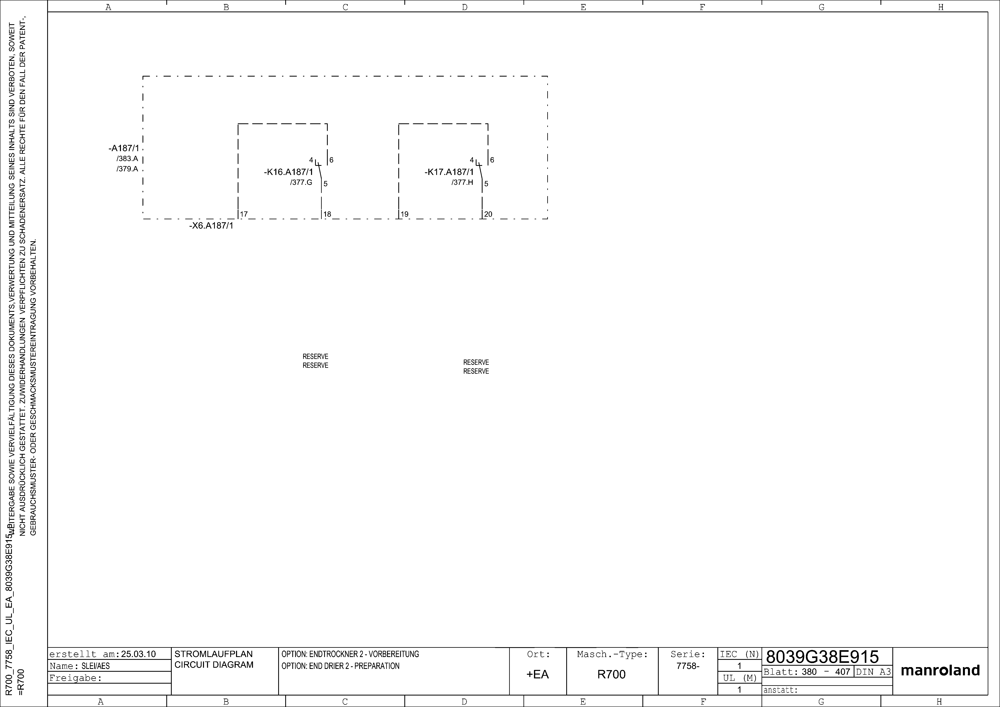

# +EA — Sheet 380 of 407 — OPTION: ENDTROCKNER 2 VORBEREITUNG

**OPTION: END DRIER 2 PREPARATION**

> Part of the manroland **R700** printing press IEC/UL circuit diagrams.
> Drawing class: **Stromlaufplan / Circuit diagram** (DIN A3).
> Document `+EA` covers the **Printing unit** machine section.

## At a glance

| Field | Value |
|---|---|
| Document | `+EA`  (8039G38E915) |
| Sheet | **380** of 407 |
| Section (DE) | OPTION: ENDTROCKNER 2 VORBEREITUNG |
| Section (EN) | OPTION: END DRIER 2 PREPARATION |
| Section type | CIRCUIT — Circuit diagram |
| Machine type | `R700` |
| Series | `7758` |
| Created | 25.03.10 |
| Replaces | — |
| Columns used | A, B, C, D |
| Path numbers | — |
| Labels on sheet | 22 |
| Cross-refs out | 4 |
| Cross-refs in | 8 |

**Previous:** [+EA sheet 379](SHEET_0379.md) · **Next:** [+EA sheet 381](SHEET_0381.md) · **Document TOC:** [_TOC.md](_TOC.md)  (+EA) · **Master TOC:** [all sheets](../_MASTER_TOC.md)

## Sheet image (300 DPI, exact vector render)



_Rendered directly from the PDF vector layer at 300 DPI (1-bit), no OCR and no resampling. Use it to confirm anything ambiguous in the text below._

## Cross-references on this sheet

Each entry is a wire leaving this sheet. The printed token is `/sheet.column`; the link resolves to that sheet inside the same document.

| Ref | Target sheet | Col | Path | Destination on target | Target section | From col |
|---|---|---|---|---|---|---|
| `/383.A` | [+EA sheet 383](SHEET_0383.md) | A | — | — | OPTION: ENDTROCKNER 2 VORBEREITUNG | A |
| `/379.A` | [+EA sheet 379](SHEET_0379.md) | A | — | — | OPTION: ENDTROCKNER 2 VORBEREITUNG | A |
| `/377.G` | [+EA sheet 377](SHEET_0377.md) | G | — | — | OPTION: ENDTROCKNER 2 VORBEREITUNG | C |
| `/377.H` | [+EA sheet 377](SHEET_0377.md) | H | — | — | OPTION: ENDTROCKNER 2 VORBEREITUNG | D |

### Incoming references (sheets that point here)

Every other sheet that sends a wire to this one. `Back-ref` is the token printed on *that* sheet; `Path` is its line number.

| From sheet | Cols | Back-ref | Path | Refs | What continues there |
|---|---|---|---|---|---|
| [+EA#243](SHEET_0243.md) | H | `/243.H` | — | 4 | — |
| [+EA#377](SHEET_0377.md) | G, H | `/377.G`, `/377.H` | — | 2 | — |
| [+EA#379](SHEET_0379.md) | A | `/379.A` | — | 1 | — |
| [+EA#383](SHEET_0383.md) | A | `/383.A` | — | 1 | — |


## Devices on this sheet

| Tag | Class | Class meaning (IEC) | Col | Sub | Terminal | Sign |
|---|---|---|---|---|---|---|
| `A187/1` | A | Baugruppe / assembly, module, PC board | A | 1 | — | — |

## Potentials / nets

_No named potentials on this sheet._

## Wire-end annotations (grouped as printed)

A wire that continues elsewhere is annotated with a small cluster: the destination description, the path/line number `#NN`, and the `/sheet.column` cross reference. Each row below is one such cluster exactly as it is grouped on the drawing.

| Col | Y | Path | Cross-ref | Text on the wire |
|---|---|---|---|---|
| A | 171.8 | — | — | `A187/1` |
| A | 184.9 | — | `/383.A`, `/379.A` | — |
| C | 186.7 | — | — | `K16.A187/1 6` |
| C | 186.7 | — | — | `4` |
| D | 186.7 | — | — | `K17.A187/1 6` |
| D | 186.7 | — | — | `4` |
| C | 213.2 | — | `/377.G` | — |
| D | 213.2 | — | `/377.H` | — |
| C | 215.1 | — | — | `5` |
| D | 215.1 | — | — | `5` |
| C | 251.2 | — | — | `X6.A187/1 19 20` |
| B | 251.2 | — | — | `17 18` |
| C | 421.5 | — | — | `RESERVE RESERVE` |
| D | 428.6 | — | — | `RESERVE RESERVE` |


## Reconstructed tables

This sheet carries tabular content (pin map / terminal assignment / index). The grid below was rebuilt from the drawing's own rule lines, so each row is exactly one physical row of the table.

### Table 1 — 5 data rows × 13 columns (at x=204.1, y=0.0) — **X6.A187/1 17 4 K16.A187/1 /377.G RESERVE RESERVE 5 18 6 4 K17.A187/1 /377.H 19 RESERVE RESERVE 5 6 20**

| STROMLAUFPLAN |  | OPTION: |  | ENDTROCKNER 2 VORBEREITUNG |  |  |  | Ort: | Masch. Type: | Serie: | IEC (N) | 8039G38E915 |
|---|---|---|---|---|---|---|---|---|---|---|---|---|
| `CIRCUIT DIAGRAM` |  |  |  |  |  |  |  |  |  |  |  |  |
|  |  | `OPTION: END` |  | `DRIER 2 PREPARATION` |  |  |  |  |  | `7758` | `1` |  |
|  |  |  |  |  |  |  |  | `+EA` | `R700` |  |  | `Blatt: DIN A3 380 407` |
|  |  |  |  |  |  |  |  |  |  |  | `UL (M)` |  |
|  |  |  |  |  |  |  |  |  |  |  | `1` | `anstatt:` |


## Notes and free text on this sheet

| Text | Col | Y (pt) |
|---|---|---|
| `K16.A187/1` | C | 200.15 |
| `K17.A187/1` | D | 200.15 |
| `X6.A187/1` | B | 263.94 |
| `RESERVE` | D | 428.62 |
| `RESERVE` | C | 421.53 |

## Complete label inventory (exact text from the drawing)

Every text object inside the drawing area of this sheet, in DIN reading order (column A→H, then top→bottom). This is the authoritative list: if a string is not here it is not printed on this sheet.

| Col | Y | X | Dir | Type | Text |
|---|---|---|---|---|---|
| A | 171.8 | 129.3 | → | device tag | `A187/1` |
| A | 184.9 | 138.9 | → | cross-reference | `/383.A` |
| A | 197.3 | 138.9 | → | cross-reference | `/379.A` |
| B | 251.2 | 285.4 | → | number | `17` |
| B | 263.9 | 225.4 | → | text | `X6.A187/1` |
| C | 186.7 | 368.2 | → | number | `4` |
| C | 186.7 | 392.3 | → | number | `6` |
| C | 200.2 | 314.4 | → | text | `K16.A187/1` |
| C | 213.2 | 345.5 | → | cross-reference | `/377.G` |
| C | 215.0 | 385.2 | → | number | `5` |
| C | 251.2 | 384.7 | → | number | `18` |
| C | 251.2 | 476.8 | → | number | `19` |
| C | 421.5 | 360.6 | → | text | `RESERVE` |
| C | 432.2 | 360.6 | → | text | `RESERVE` |
| D | 186.7 | 559.6 | → | number | `4` |
| D | 186.7 | 583.7 | → | number | `6` |
| D | 200.2 | 505.7 | → | text | `K17.A187/1` |
| D | 213.2 | 537.7 | → | cross-reference | `/377.H` |
| D | 215.0 | 576.6 | → | number | `5` |
| D | 251.2 | 576.6 | → | number | `20` |
| D | 428.6 | 551.9 | → | text | `RESERVE` |
| D | 439.2 | 551.9 | → | text | `RESERVE` |

## Reading-order text block

The same content as a plain block, grouped by DIN column — convenient to paste or to match against a visual description.

```text
=== Column A ===
 171.8  129.3  devtag       A187/1
 184.9  138.9  xref         /383.A
 197.3  138.9  xref         /379.A
=== Column B ===
 251.2  285.4  numeric      17
 263.9  225.4  text         X6.A187/1
=== Column C ===
 186.7  368.2  numeric      4
 186.7  392.3  numeric      6
 200.2  314.4  text         K16.A187/1
 213.2  345.5  xref         /377.G
 215.0  385.2  numeric      5
 251.2  384.7  numeric      18
 251.2  476.8  numeric      19
 421.5  360.6  text         RESERVE
 432.2  360.6  text         RESERVE
=== Column D ===
 186.7  559.6  numeric      4
 186.7  583.7  numeric      6
 200.2  505.7  text         K17.A187/1
 213.2  537.7  xref         /377.H
 215.0  576.6  numeric      5
 251.2  576.6  numeric      20
 428.6  551.9  text         RESERVE
 439.2  551.9  text         RESERVE
```

---
_Generated from the PDF vector text layer; no OCR. Source: `R700_7758_IEC_UL_EA_8039G38E915_p`, sheet 380._
