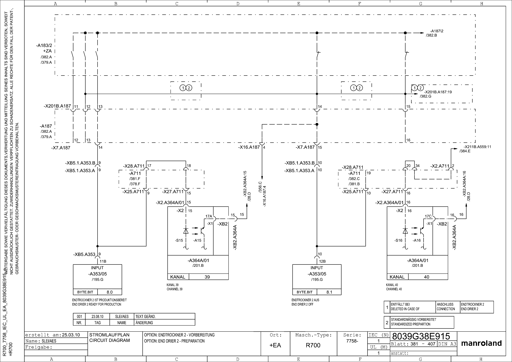

# +EA — Sheet 381 of 407 — OPTION: ENDTROCKNER 2 VORBEREITUNG

**OPTION: END DRIER 2 PREPARATION**

> Part of the manroland **R700** printing press IEC/UL circuit diagrams.
> Drawing class: **Stromlaufplan / Circuit diagram** (DIN A3).
> Document `+EA` covers the **Printing unit** machine section.

## At a glance

| Field | Value |
|---|---|
| Document | `+EA`  (8039G38E915) |
| Sheet | **381** of 407 |
| Section (DE) | OPTION: ENDTROCKNER 2 VORBEREITUNG |
| Section (EN) | OPTION: END DRIER 2 PREPARATION |
| Section type | CIRCUIT — Circuit diagram |
| Machine type | `R700` |
| Series | `7758` |
| Created | 25.03.10 |
| Replaces | — |
| Columns used | A, B, C, D, E, F, G, H |
| Path numbers | — |
| Labels on sheet | 144 |
| Cross-refs out | 18 |
| Cross-refs in | 49 |

**Previous:** [+EA sheet 380](SHEET_0380.md) · **Next:** [+EA sheet 382](SHEET_0382.md) · **Document TOC:** [_TOC.md](_TOC.md)  (+EA) · **Master TOC:** [all sheets](../_MASTER_TOC.md)

## Sheet image (300 DPI, exact vector render)



_Rendered directly from the PDF vector layer at 300 DPI (1-bit), no OCR and no resampling. Use it to confirm anything ambiguous in the text below._

## Cross-references on this sheet

Each entry is a wire leaving this sheet. The printed token is `/sheet.column`; the link resolves to that sheet inside the same document.

| Ref | Target sheet | Col | Path | Destination on target | Target section | From col |
|---|---|---|---|---|---|---|
| `/382.B` | [+EA sheet 382](SHEET_0382.md) | B | — | — | OPTION: ENDTROCKNER 2 VORBEREITUNG | G |
| `/382.A` | [+EA sheet 382](SHEET_0382.md) | A | — | — | OPTION: ENDTROCKNER 2 VORBEREITUNG | A |
| `/379.A` | [+EA sheet 379](SHEET_0379.md) | A | — | — | OPTION: ENDTROCKNER 2 VORBEREITUNG | A |
| `/382.G` | [+EA sheet 382](SHEET_0382.md) | G | — | — | OPTION: ENDTROCKNER 2 VORBEREITUNG | G |
| `/382.A` | [+EA sheet 382](SHEET_0382.md) | A | — | — | OPTION: ENDTROCKNER 2 VORBEREITUNG | A |
| `/379.A` | [+EA sheet 379](SHEET_0379.md) | A | — | — | OPTION: ENDTROCKNER 2 VORBEREITUNG | A |
| `/384.E` | [+EA sheet 384](SHEET_0384.md) | E | — | — | OPTION: ENDTROCKNER 2 VORBEREITUNG | H |
| `/28.D` | [+EA sheet 28](SHEET_0028.md) | D | — | XB2.A364A:15 | BUSVERBINDUNGEN: SICHERHEITSBUS | D |
| `/28.D` | [+EA sheet 28](SHEET_0028.md) | D | — | XB2.A364A:16 | BUSVERBINDUNGEN: SICHERHEITSBUS | H |
| `/381.F` | [+EA sheet 381](SHEET_0381.md) | F | — | — | OPTION: ENDTROCKNER 2 VORBEREITUNG | B |
| `/378.F` | [+EA sheet 378](SHEET_0378.md) | F | — | — | OPTION: ENDTROCKNER 2 VORBEREITUNG | B |
| `/382.C` | [+EA sheet 382](SHEET_0382.md) | C | — | — | OPTION: ENDTROCKNER 2 VORBEREITUNG | F |
| `/381.B` | [+EA sheet 381](SHEET_0381.md) | B | — | — | OPTION: ENDTROCKNER 2 VORBEREITUNG | F |
| `/356.C` | [+EA sheet 356](SHEET_0356.md) | C | — | — | OPTION: VORBEREITUNG: PUDERABSAUGUNG | D |
| `/201.B` | [+EA sheet 201](SHEET_0201.md) | B | — | — | REFERENZMODUL | C |
| `/201.B` | [+EA sheet 201](SHEET_0201.md) | B | — | — | REFERENZMODUL | G |
| `/195.G` | [+EA sheet 195](SHEET_0195.md) | G | — | — | REFERENZMODUL | B |
| `/195.G` | [+EA sheet 195](SHEET_0195.md) | G | — | — | REFERENZMODUL | E |

### Incoming references (sheets that point here)

Every other sheet that sends a wire to this one. `Back-ref` is the token printed on *that* sheet; `Path` is its line number.

| From sheet | Cols | Back-ref | Path | Refs | What continues there |
|---|---|---|---|---|---|
| [+EA#28](SHEET_0028.md) | D | `/28.D` | — | 2 | — |
| [+EA#195](SHEET_0195.md) | G | `/195.G` | — | 2 | — |
| [+EA#201](SHEET_0201.md) | B | `/201.B` | — | 2 | — |
| [+EA#227](SHEET_0227.md) | B, D | `/227.B`, `/227.D` | — | 4 | — |
| [+EA#230](SHEET_0230.md) | G | `/230.G` | — | 1 | — |
| [+EA#240](SHEET_0240.md) | F | `/240.F` | — | 2 | — |
| [+EA#241](SHEET_0241.md) | A, B | `/241.A`, `/241.B` | — | 4 | — |
| [+EA#246](SHEET_0246.md) | B | `/246.B` | — | 5 | — |
| [+EA#261](SHEET_0261.md) | E | `/261.E` | — | 1 | — |
| [+EA#268](SHEET_0268.md) | E | `/268.E` | — | 2 | — |
| [+EA#271](SHEET_0271.md) | E | `/271.E` | — | 2 | — |
| [+EA#273](SHEET_0273.md) | A, B | `/273.A`, `/273.B` | — | 5 | — |
| [+EA#286](SHEET_0286.md) | G | `/286.G` | — | 5 | — |
| [+EA#356](SHEET_0356.md) | C | `/356.C` | — | 1 | X16.A187:4 |
| [+EA#378](SHEET_0378.md) | F | `/378.F` | — | 1 | — |
| [+EA#379](SHEET_0379.md) | A | `/379.A` | — | 2 | — |
| [+EA#381](SHEET_0381.md) | B, F | `/381.B`, `/381.F` | — | 2 | — |
| [+EA#382](SHEET_0382.md) | A, C, G | `/382.A`, `/382.C`, `/382.G` | — | 5 | A187\2; X201B.A187:19 |
| [+EA#384](SHEET_0384.md) | E | `/384.E` | — | 1 | — |


## Devices on this sheet

| Tag | Class | Class meaning (IEC) | Col | Sub | Terminal | Sign |
|---|---|---|---|---|---|---|
| `A183/2` | A | Baugruppe / assembly, module, PC board | A | 2 | — | — |
| `A187` | A | Baugruppe / assembly, module, PC board | A | — | — | — |
| `A353/05` | A | Baugruppe / assembly, module, PC board | E | 05 | — | — |
| `A353/05` | A | Baugruppe / assembly, module, PC board | B | 05 | — | — |
| `A711` | A | Baugruppe / assembly, module, PC board | B | — | — | — |
| `S15` | S | Schalter / switch | C | — | — | — |
| `A15` | A | Baugruppe / assembly, module, PC board | C | — | — | — |
| `X1` | X | Klemme / terminal, plug connector | D | — | — | — |
| `X2` | X | Klemme / terminal, plug connector | C | — | — | — |
| `XB2` | XB |  | D | — | — | — |
| `A711` | A | Baugruppe / assembly, module, PC board | F | — | — | — |
| `S16` | S | Schalter / switch | G | — | — | — |
| `A16` | A | Baugruppe / assembly, module, PC board | G | — | — | — |
| `X1` | X | Klemme / terminal, plug connector | G | — | — | — |
| `X2` | X | Klemme / terminal, plug connector | G | — | — | — |
| `XB2` | XB |  | G | — | — | — |
| `8.1` | — | cross-device reference | F | — | — | — |
| `XB5.1.A353.B` | — | cross-device reference | E | — | — | — |
| `XB5.1.A353.A` | — | cross-device reference | E | — | — | — |
| `X7.A187` | — | cross-device reference | E | — | — | — |
| `8.0` | — | cross-device reference | B | — | — | — |
| `XB5.A353` | — | cross-device reference | A | — | — | — |
| `X201B.A187` | — | cross-device reference | A | — | — | — |
| `XB5.1.A353.B` | — | cross-device reference | A | — | — | — |
| `XB5.1.A353.A` | — | cross-device reference | A | — | — | — |
| `X27.A711` | — | cross-device reference | C | — | — | — |
| `X28.A711` | — | cross-device reference | B | — | — | — |
| `X25.A711` | — | cross-device reference | B | — | — | — |
| `XB2.A364A` | — | cross-device reference | D | — | — | — |
| `X27.A711` | — | cross-device reference | G | — | — | — |
| `X25.A711` | — | cross-device reference | F | — | — | — |
| `XB2.A364A` | — | cross-device reference | H | — | — | — |
| `X16.A187` | — | cross-device reference | D | — | — | — |
| `X2.A711` | — | cross-device reference | G | — | — | — |
| `NR.` | — | cross-device reference | A | — | — | — |
| `23.08.10` | — | cross-device reference | B | — | — | — |
| `X201B.A187:19` | — | cross-device reference | G | — | 19 | — |
| `X211B.A559:11` | — | cross-device reference | H | — | 11 | — |
| `XB2.A364A:16` | — | cross-device reference | H | — | 16 | — |
| `XB2.A364A:15` | — | cross-device reference | D | — | 15 | — |
| `X16.A187:4` | — | cross-device reference | D | — | 4 | — |
| `X7.A187` | — | cross-device reference | A | — | — | — |
| `X28.A711` | — | cross-device reference | F | — | — | — |

## Potentials / nets

_No named potentials on this sheet._

## Wire-end annotations (grouped as printed)

A wire that continues elsewhere is annotated with a small cluster: the destination description, the path/line number `#NN`, and the `/sheet.column` cross reference. Each row below is one such cluster exactly as it is grouped on the drawing.

| Col | Y | Path | Cross-ref | Text on the wire |
|---|---|---|---|---|
| G | 68.3 | — | — | `A187\2` |
| G | 78.2 | — | `/382.B` | — |
| A | 100.9 | — | — | `A183/2` |
| A | 113.6 | — | — | `+ZA` |
| A | 128.9 | — | `/382.A`, `/379.A` | — |
| C | 201.0 | — | — | `1 2` |
| F | 201.0 | — | — | `1 2 1 2` |
| G | 210.1 | — | — | `X201B.A187:19` |
| G | 220.0 | — | `/382.G` | — |
| A | 241.9 | — | — | `X201B.A187 11` |
| B | 244.1 | — | — | `12` |
| B | 244.1 | — | — | `13` |
| E | 244.1 | — | — | `14` |
| G | 244.1 | — | — | `15` |
| A | 288.7 | — | — | `A187` |
| A | 301.8 | — | `/382.A`, `/379.A` | — |
| A | 322.1 | — | — | `12` |
| B | 322.1 | — | — | `13` |
| G | 322.1 | — | — | `16` |
| D | 337.6 | — | — | `X16.A187 4` |
| E | 337.6 | — | — | `X7.A187 15` |
| H | 337.6 | — | — | `X211B.A559:11` |
| A | 339.1 | — | — | `X7.A187` |
| B | 339.1 | — | — | `14` |
| H | 347.5 | — | `/384.E` | — |
| A | 374.5 | — | — | `XB5.1.A353.B 9` |
| E | 374.5 | — | — | `XB5.1.A353.B 10` |
| B | 381.6 | — | — | `X28.A711 17` |
| C | 381.6 | — | — | `18` |
| G | 381.6 | — | — | `20` |
| G | 381.6 | — | — | `34 X2.A711 2` |
| F | 384.4 | — | — | `X28.A711` |
| A | 391.5 | — | — | `XB5.1.A353.A 9` |
| E | 391.5 | — | — | `XB5.1.A353.A 10` |
| D | 397.4 | — | `/28.D` | `XB2.A364A:15` |
| H | 397.4 | — | `/28.D` | `XB2.A364A:16` |
| B | 398.6 | — | — | `A711` |
| F | 398.6 | — | — | `A711` |
| F | 398.6 | — | — | `19` |
| B | 411.6 | — | `/381.F`, `/378.F` | — |
| F | 411.7 | — | `/382.C`, `/381.B` | — |
| D | 422.1 | — | `/356.C` | — |
| D | 432.0 | — | — | `X16.A187:4` |
| B | 441.1 | — | — | `X25.A711 9` |
| C | 441.1 | — | — | `X27.A711 15` |
| F | 441.1 | — | — | `X25.A711 10` |
| G | 441.1 | — | — | `X27.A711 16` |
| C | 466.6 | — | — | `X2.A364A/01 15` |
| G | 466.6 | — | — | `X2.A364A/01 16` |
| C | 485.1 | — | — | `X2` |
| G | 485.1 | — | — | `X2` |
| D | 486.5 | — | — | `15 15` |
| G | 486.5 | — | — | `16 16` |
| D | 495.0 | — | — | `15` |
| H | 495.0 | — | — | `16` |
| D | 499.2 | — | — | `17A` |
| G | 499.2 | — | — | `17C` |
| D | 516.2 | — | — | `X1` |
| D | 516.2 | — | — | `XB2` |
| G | 516.2 | — | — | `X1` |
| G | 516.2 | — | — | `XB2` |
| D | 523.3 | — | — | `XB2.A364A` |
| H | 523.3 | — | — | `XB2.A364A` |
| C | 555.2 | — | — | `S15 A15` |
| G | 555.2 | — | — | `S16 A16` |
| B | 587.1 | — | — | `XB5.A353 9` |
| E | 587.1 | — | — | `10` |
| C | 601.2 | — | — | `A364A/01` |
| G | 601.2 | — | — | `A364A/01` |
| B | 604.1 | — | — | `11B` |
| E | 604.1 | — | — | `12B` |
| C | 613.6 | — | `/201.B` | — |
| G | 613.6 | — | `/201.B` | — |
| B | 618.6 | — | — | `INPUT` |
| E | 618.6 | — | — | `INPUT` |
| B | 632.4 | — | — | `A353/05` |
| E | 632.4 | — | — | `A353/05` |
| C | 639.5 | — | — | `KANAL 39` |
| G | 639.5 | — | — | `KANAL 40` |
| B | 646.2 | — | `/195.G` | — |
| E | 646.2 | — | `/195.G` | — |
| C | 659.8 | — | — | `KANAL 39 CHANNEL 39` |
| G | 659.8 | — | — | `KANAL 40 CHANNEL 40` |
| B | 675.3 | — | — | `BYTE.BIT 8.0` |
| E | 675.3 | — | — | `BYTE.BIT 8.1` |
| E | 695.2 | — | — | `ENDTROCKNER 2 AUS END DRIER 2 OFF` |
| B | 695.3 | — | — | `ENDTROCKNER 2 IST PRODUKTIONSBEREIT END DRIER 2 READY FOR PRODUCTION` |
| G | 705.0 | — | — | `1 ENTFÄLLT BEI DELETED IN CASE OF` |
| G | 705.0 | — | — | `CONNECTION ANSCHLUSS` |
| H | 705.0 | — | — | `ENDTROCKNER 2 END DRIER 2` |
| B | 733.0 | — | — | `001 23.08.10 SLEI/AES TEXT GEÄND.` |
| G | 740.5 | — | — | `2 STANDARDMÄSSIG VORBEREITET STANDARDIZED PREPARTION` |
| B | 747.1 | — | — | `NR. TAG NAME ÄNDERUNG` |


## Reconstructed tables

This sheet carries tabular content (pin map / terminal assignment / index). The grid below was rebuilt from the drawing's own rule lines, so each row is exactly one physical row of the table.

### Table 1 — 11 data rows × 20 columns (at x=170.1, y=76.5)

|  |  |  |  |  | 1 | 2 |  |  |  |  |  |  |  | 1 2 |  |  | 1 2 | /382.B | X201B.A187:19 |
|---|---|---|---|---|---|---|---|---|---|---|---|---|---|---|---|---|---|---|---|
| `11` | `12` | `13` |  |  |  |  |  |  |  |  |  |  | `14` |  |  |  | `15` | `/382.G` |  |
| `12` | `13` | `14` |  |  |  |  |  |  |  | `X16.A187` | `4` | `X7.A187` | `15` |  |  |  | `16` |  |  |
| `XB5.1.A353.B XB5.1.A353.A` |  | `9 9` | `X28.A711 A711 /381.F` | `17` |  | `18` |  |  |  |  |  | `XB5.1.A353.B XB5.1.A353.A` | `10 10` | `X28.A711 A711 /382.C` | `19` |  | `20 34` |  | `X2.A711` |
|  |  |  | `/378.F X25.A711` | `9` | `X27.A711 X2.A364A/01` | `15 15` |  |  | `XB2.A364A:15` | `/356.C /28.D` | `X16.A187:4` |  |  | `/381.B X25.A711` | `10` | `X27.A711 X2.A364A/01` | `16 16` |  |  |
|  |  |  |  |  | `X2 S15` | `15 A15` | `17A X1` | `XB2` | `15 15 XB2.A364A` |  |  |  |  |  |  | `X2 S16` | `16 A16` | `17C X1` | `XB2` |
| `XB5.A353` |  | `9` |  |  |  |  |  |  |  |  |  |  | `10` |  |  |  |  |  |  |
|  |  | `11B` |  |  |  | `A364A/01` |  |  |  |  |  |  | `12B` |  |  |  | `A364A/01` |  |  |
|  | `INPUT` |  |  |  |  | `/201.B` |  |  |  |  |  | `INPUT` |  |  |  |  | `/201.B` |  |  |
|  |  | `A353/05` |  |  | `KANAL` |  | `39` |  |  |  |  |  | `A353/05` |  |  | `KANAL` |  | `40` |  |
|  |  | `/195.G` |  |  | `KANAL 39` |  |  |  |  |  |  |  | `/195.G` |  |  | `KANAL 40` |  |  |  |
| `BYTE.BIT` |  | `8.0` |  |  | `CHANNEL 39` |  |  |  |  |  |  | `BYTE.BIT` | `8.1` |  |  | `CHANNEL 40` |  |  |  |


### Table 2 — 4 data rows × 1 columns (at x=1048.8, y=76.5)

| C1 |
|---|
| `/384.E` |
| `2` |
| `XB2.A364A:16` |
| `16 16 XB2.A364A` |


## Notes and free text on this sheet

| Text | Col | Y (pt) |
|---|---|---|
| `+ZA` | A | 113.61 |
| `12B` | E | 604.07 |
| `INPUT` | E | 618.59 |
| `BYTE.BIT` | E | 675.84 |
| `ENDTROCKNER 2 AUS` | E | 695.25 |
| `END DRIER 2 OFF` | E | 705.21 |
| `11B` | B | 604.07 |
| `INPUT` | B | 618.59 |
| `BYTE.BIT` | A | 675.84 |
| `ENDTROCKNER 2 IST PRODUKTIONSBEREIT` | B | 695.26 |
| `END DRIER 2 READY FOR PRODUCTION` | B | 705.21 |
| `KANAL 39` | C | 659.84 |
| `CHANNEL 39` | C | 669.78 |
| `17A` | D | 499.18 |
| `KANAL` | C | 639.51 |
| `A364A/01` | C | 601.25 |
| `X2.A364A/01` | C | 466.61 |
| `KANAL 40` | G | 659.84 |
| `CHANNEL 40` | G | 669.78 |
| `17C` | G | 499.23 |
| `KANAL` | G | 639.51 |
| `A364A/01` | G | 601.25 |
| `X2.A364A/01` | F | 466.61 |
| `TAG` | B | 747.27 |
| `NAME` | B | 747.25 |
| `ÄNDERUNG` | B | 747.31 |
| `SLEI/AES` | B | 733.13 |
| `TEXT GEÄND.` | B | 733.11 |
| `A187\2` | G | 68.33 |
| `ENTFÄLLT BEI` | G | 705 |
| `DELETED IN CASE OF` | G | 715.65 |
| `ANSCHLUSS` | G | 705.04 |
| `CONNECTION` | G | 715.68 |
| `ENDTROCKNER 2` | H | 705.04 |
| `END DRIER 2` | H | 715.66 |
| `STANDARDMÄSSIG VORBEREITET` | G | 740.47 |
| `STANDARDIZED PREPARTION` | G | 751.1 |

## Complete label inventory (exact text from the drawing)

Every text object inside the drawing area of this sheet, in DIN reading order (column A→H, then top→bottom). This is the authoritative list: if a string is not here it is not printed on this sheet.

| Col | Y | X | Dir | Type | Text |
|---|---|---|---|---|---|
| A | 100.9 | 83.9 | → | device tag | `A183/2` |
| A | 113.6 | 100.3 | → | text | `+ZA` |
| A | 128.9 | 95.0 | → | cross-reference | `/382.A` |
| A | 141.3 | 95.0 | → | cross-reference | `/379.A` |
| A | 242.0 | 101.8 | → | device ref | `X201B.A187` |
| A | 244.1 | 172.1 | → | number | `11` |
| A | 288.7 | 92.7 | → | device tag | `A187` |
| A | 301.8 | 95.0 | → | cross-reference | `/382.A` |
| A | 314.2 | 95.0 | → | cross-reference | `/379.A` |
| A | 322.1 | 172.1 | → | number | `12` |
| A | 339.0 | 119.3 | → | device ref | `X7.A187` |
| A | 374.5 | 151.7 | → | device ref | `XB5.1.A353.B` |
| A | 392.2 | 150.8 | → | device ref | `XB5.1.A353.A` |
| A | 587.1 | 170.4 | → | device ref | `XB5.A353` |
| A | 675.8 | 180.0 | → | text | `BYTE.BIT` |
| A | 733.0 | 179.0 | → | number | `001` |
| A | 747.1 | 178.1 | → | device ref | `NR.` |
| B | 244.1 | 200.4 | → | number | `12` |
| B | 244.1 | 228.8 | → | number | `13` |
| B | 322.1 | 200.4 | → | number | `13` |
| B | 339.1 | 228.8 | → | number | `14` |
| B | 374.5 | 229.3 | → | number | `9` |
| B | 381.6 | 286.3 | → | device ref | `X28.A711` |
| B | 391.5 | 229.3 | → | number | `9` |
| B | 398.6 | 299.6 | → | device tag | `A711` |
| B | 411.7 | 301.3 | → | cross-reference | `/381.F` |
| B | 424.1 | 301.3 | → | cross-reference | `/378.F` |
| B | 441.1 | 284.9 | → | device ref | `X25.A711` |
| B | 587.1 | 229.3 | → | number | `9` |
| B | 604.1 | 231.6 | → | text | `11B` |
| B | 618.6 | 211.9 | → | text | `INPUT` |
| B | 632.4 | 205.4 | → | device tag | `A353/05` |
| B | 646.2 | 213.9 | → | cross-reference | `/195.G` |
| B | 675.3 | 248.3 | → | device ref | `8.0` |
| B | 695.3 | 168.1 | → | text | `ENDTROCKNER 2 IST PRODUKTIONSBEREIT` |
| B | 705.2 | 168.1 | → | text | `END DRIER 2 READY FOR PRODUCTION` |
| B | 733.1 | 213.2 | → | device ref | `23.08.10` |
| B | 733.1 | 267.9 | → | text | `SLEI/AES` |
| B | 733.1 | 315.1 | → | text | `TEXT GEÄND.` |
| B | 747.3 | 219.6 | → | text | `TAG` |
| B | 747.3 | 273.1 | → | text | `NAME` |
| B | 747.3 | 315.6 | → | text | `ÄNDERUNG` |
| C | 201.0 | 423.4 | → | number | `1` |
| C | 201.6 | 437.4 | → | number | `2` |
| C | 381.6 | 342.1 | → | number | `17` |
| C | 381.6 | 434.3 | → | number | `18` |
| C | 441.1 | 377.0 | → | device ref | `X27.A711` |
| C | 445.4 | 342.7 | → | number | `9` |
| C | 445.4 | 434.3 | → | number | `15` |
| C | 466.6 | 362.6 | → | text | `X2.A364A/01` |
| C | 466.6 | 434.3 | → | number | `15` |
| C | 485.0 | 410.7 | → | device tag | `X2` |
| C | 486.5 | 437.1 | → | number | `15` |
| C | 555.2 | 407.1 | → | device tag | `S15` |
| C | 555.2 | 449.6 | → | device tag | `A15` |
| C | 601.2 | 436.4 | → | text | `A364A/01` |
| C | 613.6 | 448.0 | → | cross-reference | `/201.B` |
| C | 639.5 | 396.0 | → | text | `KANAL` |
| C | 639.5 | 475.9 | → | number | `39` |
| C | 659.8 | 387.8 | → | text | `KANAL 39` |
| C | 669.8 | 388.1 | → | text | `CHANNEL 39` |
| D | 337.6 | 554.2 | → | device ref | `X16.A187` |
| D | 339.1 | 612.0 | → | number | `4` |
| D | 397.4 | 565.8 | ↕ | device ref | `XB2.A364A:15` |
| D | 422.1 | 601.2 | ↕ | cross-reference | `/356.C` |
| D | 432.0 | 611.2 | ↕ | device ref | `X16.A187:4` |
| D | 446.7 | 575.7 | ↕ | cross-reference | `/28.D` |
| D | 495.0 | 557.6 | → | number | `15` |
| D | 496.4 | 536.3 | → | number | `15` |
| D | 499.2 | 477.6 | → | text | `17A` |
| D | 516.2 | 481.3 | → | device tag | `X1` |
| D | 516.2 | 505.7 | → | device tag | `XB2` |
| D | 523.3 | 541.7 | ↕ | device ref | `XB2.A364A` |
| E | 244.1 | 739.0 | → | number | `14` |
| E | 337.6 | 687.7 | → | device ref | `X7.A187` |
| E | 339.1 | 739.0 | → | number | `15` |
| E | 374.5 | 661.9 | → | device ref | `XB5.1.A353.B` |
| E | 374.5 | 739.0 | → | number | `10` |
| E | 391.5 | 739.0 | → | number | `10` |
| E | 392.2 | 661.0 | → | device ref | `XB5.1.A353.A` |
| E | 587.1 | 739.0 | → | number | `10` |
| E | 604.1 | 741.8 | → | text | `12B` |
| E | 618.6 | 722.1 | → | text | `INPUT` |
| E | 632.4 | 715.6 | → | device tag | `A353/05` |
| E | 646.2 | 724.1 | → | cross-reference | `/195.G` |
| E | 675.8 | 690.2 | → | text | `BYTE.BIT` |
| E | 695.3 | 678.3 | → | text | `ENDTROCKNER 2 AUS` |
| E | 705.2 | 678.3 | → | text | `END DRIER 2 OFF` |
| F | 201.0 | 820.3 | → | number | `1` |
| F | 201.6 | 834.2 | → | number | `2` |
| F | 384.4 | 795.1 | → | device ref | `X28.A711` |
| F | 398.6 | 809.9 | → | device tag | `A711` |
| F | 398.6 | 852.4 | → | number | `19` |
| F | 411.7 | 810.7 | → | cross-reference | `/382.C` |
| F | 424.0 | 811.0 | → | cross-reference | `/381.B` |
| F | 441.1 | 795.1 | → | device ref | `X25.A711` |
| F | 445.4 | 852.4 | → | number | `10` |
| F | 466.6 | 872.8 | → | text | `X2.A364A/01` |
| F | 675.3 | 759.4 | → | device ref | `8.1` |
| F | 710.3 | 897.4 | → | number | `1` |
| F | 745.8 | 897.2 | → | number | `2` |
| G | 68.3 | 1000.3 | → | text | `A187\2` |
| G | 78.2 | 990.7 | → | cross-reference | `/382.B` |
| G | 201.0 | 962.0 | → | number | `1` |
| G | 201.6 | 976.0 | → | number | `2` |
| G | 210.0 | 986.2 | → | device ref | `X201B.A187:19` |
| G | 220.0 | 976.5 | → | cross-reference | `/382.G` |
| G | 244.1 | 944.5 | → | number | `15` |
| G | 322.1 | 944.5 | → | number | `16` |
| G | 381.6 | 945.1 | → | number | `20` |
| G | 381.6 | 966.3 | → | number | `34` |
| G | 381.6 | 1000.9 | → | device ref | `X2.A711` |
| G | 441.1 | 887.2 | → | device ref | `X27.A711` |
| G | 445.4 | 944.5 | → | number | `16` |
| G | 466.6 | 944.5 | → | number | `16` |
| G | 485.0 | 921.0 | → | device tag | `X2` |
| G | 486.5 | 947.3 | → | number | `16` |
| G | 499.2 | 987.9 | → | text | `17C` |
| G | 516.2 | 991.6 | → | device tag | `X1` |
| G | 516.2 | 1015.9 | → | device tag | `XB2` |
| G | 555.2 | 917.3 | → | device tag | `S16` |
| G | 555.2 | 959.8 | → | device tag | `A16` |
| G | 601.2 | 946.6 | → | text | `A364A/01` |
| G | 613.6 | 958.3 | → | cross-reference | `/201.B` |
| G | 639.5 | 906.2 | → | text | `KANAL` |
| G | 639.5 | 986.3 | → | number | `40` |
| G | 659.8 | 898.0 | → | text | `KANAL 40` |
| G | 669.8 | 898.3 | → | text | `CHANNEL 40` |
| G | 705.0 | 909.1 | → | text | `ENTFÄLLT BEI` |
| G | 705.0 | 1016.2 | → | text | `ANSCHLUSS` |
| G | 715.7 | 909.1 | → | text | `DELETED IN CASE OF` |
| G | 715.7 | 1015.9 | → | text | `CONNECTION` |
| G | 740.5 | 909.6 | → | text | `STANDARDMÄSSIG VORBEREITET` |
| G | 751.1 | 909.6 | → | text | `STANDARDIZED PREPARTION` |
| H | 337.6 | 1078.3 | → | device ref | `X211B.A559:11` |
| H | 347.5 | 1068.7 | → | cross-reference | `/384.E` |
| H | 381.6 | 1051.4 | → | number | `2` |
| H | 397.4 | 1076.0 | ↕ | device ref | `XB2.A364A:16` |
| H | 446.7 | 1086.0 | ↕ | cross-reference | `/28.D` |
| H | 495.0 | 1067.8 | → | number | `16` |
| H | 496.4 | 1046.6 | → | number | `16` |
| H | 523.3 | 1052.0 | ↕ | device ref | `XB2.A364A` |
| H | 705.0 | 1072.1 | → | text | `ENDTROCKNER 2` |
| H | 715.7 | 1072.1 | → | text | `END DRIER 2` |

## Reading-order text block

The same content as a plain block, grouped by DIN column — convenient to paste or to match against a visual description.

```text
=== Column A ===
 100.9   83.9  devtag       A183/2
 113.6  100.3  text         +ZA
 128.9   95.0  xref         /382.A
 141.3   95.0  xref         /379.A
 242.0  101.8  devref       X201B.A187
 244.1  172.1  numeric      11
 288.7   92.7  devtag       A187
 301.8   95.0  xref         /382.A
 314.2   95.0  xref         /379.A
 322.1  172.1  numeric      12
 339.0  119.3  devref       X7.A187
 374.5  151.7  devref       XB5.1.A353.B
 392.2  150.8  devref       XB5.1.A353.A
 587.1  170.4  devref       XB5.A353
 675.8  180.0  text         BYTE.BIT
 733.0  179.0  numeric      001
 747.1  178.1  devref       NR.
=== Column B ===
 244.1  200.4  numeric      12
 244.1  228.8  numeric      13
 322.1  200.4  numeric      13
 339.1  228.8  numeric      14
 374.5  229.3  numeric      9
 381.6  286.3  devref       X28.A711
 391.5  229.3  numeric      9
 398.6  299.6  devtag       A711
 411.7  301.3  xref         /381.F
 424.1  301.3  xref         /378.F
 441.1  284.9  devref       X25.A711
 587.1  229.3  numeric      9
 604.1  231.6  text         11B
 618.6  211.9  text         INPUT
 632.4  205.4  devtag       A353/05
 646.2  213.9  xref         /195.G
 675.3  248.3  devref       8.0
 695.3  168.1  text         ENDTROCKNER 2 IST PRODUKTIONSBEREIT
 705.2  168.1  text         END DRIER 2 READY FOR PRODUCTION
 733.1  213.2  devref       23.08.10
 733.1  267.9  text         SLEI/AES
 733.1  315.1  text         TEXT GEÄND.
 747.3  219.6  text         TAG
 747.3  273.1  text         NAME
 747.3  315.6  text         ÄNDERUNG
=== Column C ===
 201.0  423.4  numeric      1
 201.6  437.4  numeric      2
 381.6  342.1  numeric      17
 381.6  434.3  numeric      18
 441.1  377.0  devref       X27.A711
 445.4  342.7  numeric      9
 445.4  434.3  numeric      15
 466.6  362.6  text         X2.A364A/01
 466.6  434.3  numeric      15
 485.0  410.7  devtag       X2
 486.5  437.1  numeric      15
 555.2  407.1  devtag       S15
 555.2  449.6  devtag       A15
 601.2  436.4  text         A364A/01
 613.6  448.0  xref         /201.B
 639.5  396.0  text         KANAL
 639.5  475.9  numeric      39
 659.8  387.8  text         KANAL 39
 669.8  388.1  text         CHANNEL 39
=== Column D ===
 337.6  554.2  devref       X16.A187
 339.1  612.0  numeric      4
 397.4  565.8  devref       XB2.A364A:15
 422.1  601.2  xref         /356.C
 432.0  611.2  devref       X16.A187:4
 446.7  575.7  xref         /28.D
 495.0  557.6  numeric      15
 496.4  536.3  numeric      15
 499.2  477.6  text         17A
 516.2  481.3  devtag       X1
 516.2  505.7  devtag       XB2
 523.3  541.7  devref       XB2.A364A
=== Column E ===
 244.1  739.0  numeric      14
 337.6  687.7  devref       X7.A187
 339.1  739.0  numeric      15
 374.5  661.9  devref       XB5.1.A353.B
 374.5  739.0  numeric      10
 391.5  739.0  numeric      10
 392.2  661.0  devref       XB5.1.A353.A
 587.1  739.0  numeric      10
 604.1  741.8  text         12B
 618.6  722.1  text         INPUT
 632.4  715.6  devtag       A353/05
 646.2  724.1  xref         /195.G
 675.8  690.2  text         BYTE.BIT
 695.3  678.3  text         ENDTROCKNER 2 AUS
 705.2  678.3  text         END DRIER 2 OFF
=== Column F ===
 201.0  820.3  numeric      1
 201.6  834.2  numeric      2
 384.4  795.1  devref       X28.A711
 398.6  809.9  devtag       A711
 398.6  852.4  numeric      19
 411.7  810.7  xref         /382.C
 424.0  811.0  xref         /381.B
 441.1  795.1  devref       X25.A711
 445.4  852.4  numeric      10
 466.6  872.8  text         X2.A364A/01
 675.3  759.4  devref       8.1
 710.3  897.4  numeric      1
 745.8  897.2  numeric      2
=== Column G ===
  68.3 1000.3  text         A187\2
  78.2  990.7  xref         /382.B
 201.0  962.0  numeric      1
 201.6  976.0  numeric      2
 210.0  986.2  devref       X201B.A187:19
 220.0  976.5  xref         /382.G
 244.1  944.5  numeric      15
 322.1  944.5  numeric      16
 381.6  945.1  numeric      20
 381.6  966.3  numeric      34
 381.6 1000.9  devref       X2.A711
 441.1  887.2  devref       X27.A711
 445.4  944.5  numeric      16
 466.6  944.5  numeric      16
 485.0  921.0  devtag       X2
 486.5  947.3  numeric      16
 499.2  987.9  text         17C
 516.2  991.6  devtag       X1
 516.2 1015.9  devtag       XB2
 555.2  917.3  devtag       S16
 555.2  959.8  devtag       A16
 601.2  946.6  text         A364A/01
 613.6  958.3  xref         /201.B
 639.5  906.2  text         KANAL
 639.5  986.3  numeric      40
 659.8  898.0  text         KANAL 40
 669.8  898.3  text         CHANNEL 40
 705.0  909.1  text         ENTFÄLLT BEI
 705.0 1016.2  text         ANSCHLUSS
 715.7  909.1  text         DELETED IN CASE OF
 715.7 1015.9  text         CONNECTION
 740.5  909.6  text         STANDARDMÄSSIG VORBEREITET
 751.1  909.6  text         STANDARDIZED PREPARTION
=== Column H ===
 337.6 1078.3  devref       X211B.A559:11
 347.5 1068.7  xref         /384.E
 381.6 1051.4  numeric      2
 397.4 1076.0  devref       XB2.A364A:16
 446.7 1086.0  xref         /28.D
 495.0 1067.8  numeric      16
 496.4 1046.6  numeric      16
 523.3 1052.0  devref       XB2.A364A
 705.0 1072.1  text         ENDTROCKNER 2
 715.7 1072.1  text         END DRIER 2
```

---
_Generated from the PDF vector text layer; no OCR. Source: `R700_7758_IEC_UL_EA_8039G38E915_p`, sheet 381._
