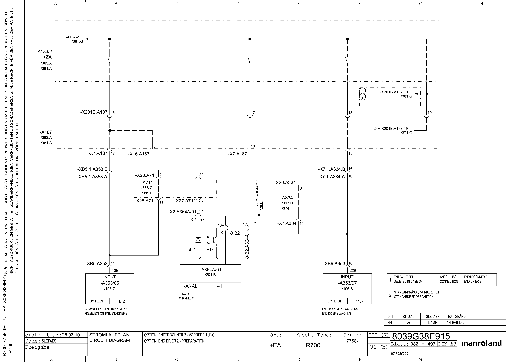

# +EA — Sheet 382 of 407 — OPTION: ENDTROCKNER 2 VORBEREITUNG

**OPTION: END DRIER 2 PREPARATION**

> Part of the manroland **R700** printing press IEC/UL circuit diagrams.
> Drawing class: **Stromlaufplan / Circuit diagram** (DIN A3).
> Document `+EA` covers the **Printing unit** machine section.

## At a glance

| Field | Value |
|---|---|
| Document | `+EA`  (8039G38E915) |
| Sheet | **382** of 407 |
| Section (DE) | OPTION: ENDTROCKNER 2 VORBEREITUNG |
| Section (EN) | OPTION: END DRIER 2 PREPARATION |
| Section type | CIRCUIT — Circuit diagram |
| Machine type | `R700` |
| Series | `7758` |
| Created | 25.03.10 |
| Replaces | — |
| Columns used | A, B, C, D, E, F, G, H |
| Path numbers | — |
| Labels on sheet | 110 |
| Cross-refs out | 15 |
| Cross-refs in | 37 |

**Previous:** [+EA sheet 381](SHEET_0381.md) · **Next:** [+EA sheet 383](SHEET_0383.md) · **Document TOC:** [_TOC.md](_TOC.md)  (+EA) · **Master TOC:** [all sheets](../_MASTER_TOC.md)

## Sheet image (300 DPI, exact vector render)



_Rendered directly from the PDF vector layer at 300 DPI (1-bit), no OCR and no resampling. Use it to confirm anything ambiguous in the text below._

## Cross-references on this sheet

Each entry is a wire leaving this sheet. The printed token is `/sheet.column`; the link resolves to that sheet inside the same document.

| Ref | Target sheet | Col | Path | Destination on target | Target section | From col |
|---|---|---|---|---|---|---|
| `/381.G` | [+EA sheet 381](SHEET_0381.md) | G | — | A187\2 | OPTION: ENDTROCKNER 2 VORBEREITUNG | A |
| `/383.A` | [+EA sheet 383](SHEET_0383.md) | A | — | — | OPTION: ENDTROCKNER 2 VORBEREITUNG | A |
| `/381.A` | [+EA sheet 381](SHEET_0381.md) | A | — | — | OPTION: ENDTROCKNER 2 VORBEREITUNG | A |
| `/381.G` | [+EA sheet 381](SHEET_0381.md) | G | — | X201B.A187:19 | OPTION: ENDTROCKNER 2 VORBEREITUNG | G |
| `/374.G` | [+EA sheet 374](SHEET_0374.md) | G | — | 24V.X201B.A187:19 | OPTION: ENDTROCKNER 1 VORBEREITUNG; | G |
| `/383.A` | [+EA sheet 383](SHEET_0383.md) | A | — | — | OPTION: ENDTROCKNER 2 VORBEREITUNG | A |
| `/381.A` | [+EA sheet 381](SHEET_0381.md) | A | — | — | OPTION: ENDTROCKNER 2 VORBEREITUNG | A |
| `/28.E` | [+EA sheet 28](SHEET_0028.md) | E | — | XB2.A364A:17 | BUSVERBINDUNGEN: SICHERHEITSBUS | D |
| `/388.C` | [+EA sheet 388](SHEET_0388.md) | C | — | — | OPTION: ZWISCHENTROCKNER VORBEREITUNG; | C |
| `/381.F` | [+EA sheet 381](SHEET_0381.md) | F | — | — | OPTION: ENDTROCKNER 2 VORBEREITUNG | C |
| `/393.H` | [+EA sheet 393](SHEET_0393.md) | H | — | — | OPTION: ZWISCHENTROCKNER VORBEREITUNG; | E |
| `/374.F` | [+EA sheet 374](SHEET_0374.md) | F | — | — | OPTION: ENDTROCKNER 1 VORBEREITUNG; | E |
| `/201.B` | [+EA sheet 201](SHEET_0201.md) | B | — | — | REFERENZMODUL | D |
| `/196.B` | [+EA sheet 196](SHEET_0196.md) | B | — | — | REFERENZMODUL | F |
| `/195.G` | [+EA sheet 195](SHEET_0195.md) | G | — | — | REFERENZMODUL | B |

### Incoming references (sheets that point here)

Every other sheet that sends a wire to this one. `Back-ref` is the token printed on *that* sheet; `Path` is its line number.

| From sheet | Cols | Back-ref | Path | Refs | What continues there |
|---|---|---|---|---|---|
| [+EA#28](SHEET_0028.md) | D | `/28.D` | — | 1 | — |
| [+EA#195](SHEET_0195.md) | G | `/195.G` | — | 1 | — |
| [+EA#196](SHEET_0196.md) | B | `/196.B` | — | 1 | — |
| [+EA#201](SHEET_0201.md) | B | `/201.B` | — | 1 | — |
| [+EA#227](SHEET_0227.md) | B, D | `/227.B`, `/227.D` | — | 2 | — |
| [+EA#240](SHEET_0240.md) | F | `/240.F` | — | 1 | — |
| [+EA#241](SHEET_0241.md) | A, B | `/241.A`, `/241.B` | — | 2 | — |
| [+EA#246](SHEET_0246.md) | B, F, G, H | `/246.B`, `/246.F`, `/246.G`, `/246.H` | — | 6 | — |
| [+EA#252](SHEET_0252.md) | C | `/252.C` | — | 1 | — |
| [+EA#261](SHEET_0261.md) | E | `/261.E` | — | 1 | — |
| [+EA#264](SHEET_0264.md) | A | `/264.A` | — | 1 | — |
| [+EA#268](SHEET_0268.md) | E | `/268.E` | — | 1 | — |
| [+EA#271](SHEET_0271.md) | E | `/271.E` | — | 1 | — |
| [+EA#273](SHEET_0273.md) | A | `/273.A` | — | 2 | — |
| [+EA#286](SHEET_0286.md) | G | `/286.G` | — | 4 | — |
| [+EA#374](SHEET_0374.md) | E, G | `/374.E`, `/374.G` | — | 2 | — |
| [+EA#381](SHEET_0381.md) | A, F, G | `/381.A`, `/381.F`, `/381.G` | — | 5 | — |
| [+EA#383](SHEET_0383.md) | A | `/383.A` | — | 2 | — |
| [+EA#388](SHEET_0388.md) | C | `/388.C` | — | 1 | — |
| [+EA#393](SHEET_0393.md) | H | `/393.H` | — | 1 | — |


## Devices on this sheet

| Tag | Class | Class meaning (IEC) | Col | Sub | Terminal | Sign |
|---|---|---|---|---|---|---|
| `A334` | A | Baugruppe / assembly, module, PC board | E | — | — | — |
| `A183/2` | A | Baugruppe / assembly, module, PC board | A | 2 | — | — |
| `A187` | A | Baugruppe / assembly, module, PC board | A | — | — | — |
| `A353/07` | A | Baugruppe / assembly, module, PC board | F | 07 | — | — |
| `A353/05` | A | Baugruppe / assembly, module, PC board | B | 05 | — | — |
| `A711` | A | Baugruppe / assembly, module, PC board | C | — | — | — |
| `S17` | S | Schalter / switch | C | — | — | — |
| `A17` | A | Baugruppe / assembly, module, PC board | D | — | — | — |
| `X1` | X | Klemme / terminal, plug connector | D | — | — | — |
| `X2` | X | Klemme / terminal, plug connector | C | — | — | — |
| `XB2` | XB |  | D | — | — | — |
| `X7.A334` | — | cross-device reference | E | — | — | — |
| `X7.1.A334.B` | — | cross-device reference | F | — | — | — |
| `X7.1.A334.A` | — | cross-device reference | F | — | — | — |
| `11.7` | — | cross-device reference | F | — | — | — |
| `XB9.A353` | — | cross-device reference | F | — | — | — |
| `X201B.A187` | — | cross-device reference | B | — | — | — |
| `X7.A187` | — | cross-device reference | B | — | — | — |
| `8.2` | — | cross-device reference | B | — | — | — |
| `XB5.A353` | — | cross-device reference | B | — | — | — |
| `XB5.1.A353.B` | — | cross-device reference | B | — | — | — |
| `XB5.1.A353.A` | — | cross-device reference | B | — | — | — |
| `X27.A711` | — | cross-device reference | C | — | — | — |
| `X28.A711` | — | cross-device reference | B | — | — | — |
| `X25.A711` | — | cross-device reference | B | — | — | — |
| `XB2.A364A` | — | cross-device reference | D | — | — | — |
| `NR.` | — | cross-device reference | G | — | — | — |
| `23.08.10` | — | cross-device reference | G | — | — | — |
| `X201B.A187:19` | — | cross-device reference | G | — | 19 | — |
| `XB2.A364A:17` | — | cross-device reference | D | — | 17 | — |
| `X20.A334` | — | cross-device reference | E | — | — | — |
| `X16.A187` | — | cross-device reference | B | — | — | — |
| `X7.A187` | — | cross-device reference | D | — | — | — |

## Potentials / nets

| Potential | Count | Columns | Attached devices | Terminals |
|---|---|---|---|---|
| `24V` | 1 | G | `A187`, `X201B` | `19` |


A potential such as `L24+/4` or `M24+` is a named supply/return rail; every place it appears on this sheet is electrically common.

## Wire-end annotations (grouped as printed)

A wire that continues elsewhere is annotated with a small cluster: the destination description, the path/line number `#NN`, and the `/sheet.column` cross reference. Each row below is one such cluster exactly as it is grouped on the drawing.

| Col | Y | Path | Cross-ref | Text on the wire |
|---|---|---|---|---|
| A | 82.5 | — | `/381.G` | `A187\2` |
| A | 115.1 | — | — | `A183/2` |
| A | 127.8 | — | — | `+ZA` |
| A | 143.1 | — | `/383.A`, `/381.A` | — |
| F | 208.1 | — | — | `1` |
| G | 210.1 | — | `/381.G` | `X201B.A187:19` |
| F | 222.8 | — | — | `2` |
| B | 256.1 | — | — | `X201B.A187 16` |
| D | 258.3 | — | — | `17` |
| F | 258.3 | — | — | `18` |
| G | 258.3 | — | — | `19` |
| G | 295.1 | — | `/374.G` | `24V.X201B.A187:19` |
| A | 302.9 | — | — | `A187` |
| A | 316.0 | — | `/383.A`, `/381.A` | — |
| C | 336.2 | — | — | `5` |
| D | 336.2 | — | — | `18` |
| B | 351.8 | — | — | `X7.A187 17` |
| C | 353.2 | — | — | `X16.A187 X7.A187` |
| F | 353.2 | — | — | `19` |
| B | 388.7 | — | — | `XB5.1.A353.B 11` |
| F | 388.7 | — | — | `X7.1.A334.B 16` |
| B | 402.8 | — | — | `XB5.1.A353.A 11 22` |
| C | 402.8 | — | — | `X28.A711 21` |
| F | 405.7 | — | — | `X7.1.A334.A 16` |
| D | 418.7 | — | `/28.E` | `XB2.A364A:17` |
| C | 419.8 | — | — | `A711` |
| E | 419.8 | — | — | `X20.A334` |
| C | 432.9 | — | `/388.C` | — |
| E | 434.0 | — | — | `3` |
| C | 445.3 | — | `/381.F` | — |
| E | 455.3 | — | — | `A334` |
| C | 462.4 | — | — | `X25.A711 11` |
| C | 462.4 | — | — | `X27.A711 17` |
| E | 468.4 | — | `/393.H`, `/374.F` | — |
| C | 487.9 | — | — | `X2.A364A/01 17` |
| C | 506.3 | — | — | `X2` |
| D | 507.7 | — | — | `17 17` |
| E | 514.8 | — | — | `X7.A334 16` |
| D | 516.2 | — | — | `17` |
| D | 520.4 | — | — | `16A` |
| D | 537.5 | — | — | `X1` |
| D | 537.5 | — | — | `XB2` |
| D | 544.5 | — | — | `XB2.A364A` |
| C | 576.4 | — | — | `S17 A17` |
| B | 608.3 | — | — | `XB5.A353 11` |
| F | 608.3 | — | — | `XB9.A353 16` |
| D | 622.5 | — | — | `A364A/01` |
| B | 625.3 | — | — | `13B` |
| F | 625.3 | — | — | `22B` |
| D | 634.9 | — | `/201.B` | — |
| B | 639.9 | — | — | `INPUT` |
| F | 639.9 | — | — | `INPUT` |
| G | 641.2 | — | — | `1 ENTFÄLLT BEI DELETED IN CASE OF` |
| G | 641.3 | — | — | `CONNECTION ANSCHLUSS` |
| H | 641.3 | — | — | `ENDTROCKNER 2 END DRIER 2` |
| B | 653.7 | — | — | `A353/05` |
| F | 653.7 | — | — | `A353/07` |
| C | 660.7 | — | — | `KANAL 41` |
| B | 667.5 | — | `/195.G` | — |
| F | 667.5 | — | `/196.B` | — |
| G | 676.7 | — | — | `2 STANDARDMÄSSIG VORBEREITET STANDARDIZED PREPARTION` |
| C | 681.1 | — | — | `KANAL 41 CHANNEL 41` |
| B | 696.5 | — | — | `BYTE.BIT 8.2` |
| F | 696.5 | — | — | `BYTE.BIT 11.7` |
| B | 716.5 | — | — | `PRESELECTION IR/TL END DRIER 2 VORWAHL IR/TL ENDTROCKNER 2` |
| F | 716.5 | — | — | `ENDTROCKNER 2 WARNUNG END DRIER 2 WARNING` |
| G | 733.0 | — | — | `001 23.08.10 SLEI/AES TEXT GEÄND.` |
| G | 747.1 | — | — | `NR. TAG NAME ÄNDERUNG` |


## Reconstructed tables

This sheet carries tabular content (pin map / terminal assignment / index). The grid below was rebuilt from the drawing's own rule lines, so each row is exactly one physical row of the table.

### Table 1 — 10 data rows × 15 columns (at x=198.4, y=90.7)

| X201B.A187 | 16 |  |  |  |  |  |  |  |  | 17 |  |  |  | 1 2 18 |
|---|---|---|---|---|---|---|---|---|---|---|---|---|---|---|
| `X7.A187 XB5.1.A353.B` | `17 11` | `X16.A187` | `5` |  |  |  |  | `X7.A187` |  | `18` |  |  | `X7.1.A334.B` | `19 16` |
| `XB5.1.A353.A` | `11` | `X28.A711 A711 /388.C /381.F X25.A711` |  | `21 11` | `X27.A711 X2.A364A/01` | `22 17 17` |  |  |  | `XB2.A364A:17` | `X20.A334 A334 /28.E /393.H /374.F` | `3` | `X7.1.A334.A` | `16` |
|  |  |  |  |  | `X2` | `17` | `16A X1` | `XB2` | `17` | `17` | `X7.A334` | `16` |  |  |
|  |  |  |  |  | `S17` | `A17` |  |  | `XB2.A364A` |  |  |  |  |  |
| `XB5.A353` | `11` |  |  |  |  |  |  |  |  |  |  |  | `XB9.A353` | `16` |
|  | `13B` |  |  |  |  | `A364A/01` |  |  |  |  |  |  |  | `22B` |
| `INPUT` |  |  |  |  |  | `/201.B` |  |  |  |  |  |  | `INPUT` |  |
|  | `A353/05` |  |  |  | `KANAL` |  | `41` |  |  |  |  |  |  | `A353/07` |
|  | `/195.G` |  |  |  | `KANAL 41` |  |  |  |  |  |  |  |  | `/196.B` |
| `BYTE.BIT` | `8.2` |  |  |  | `CHANNEL 41` |  |  |  |  |  |  |  | `BYTE.BIT` | `11.7` |


## Notes and free text on this sheet

| Text | Col | Y (pt) |
|---|---|---|
| `+ZA` | A | 127.78 |
| `22B` | F | 625.33 |
| `INPUT` | F | 639.85 |
| `BYTE.BIT` | F | 697.1 |
| `ENDTROCKNER 2 WARNUNG` | F | 716.49 |
| `END DRIER 2 WARNING` | F | 726.46 |
| `13B` | B | 625.33 |
| `INPUT` | B | 639.85 |
| `BYTE.BIT` | B | 697.1 |
| `VORWAHL IR/TL ENDTROCKNER 2` | B | 716.5 |
| `PRESELECTION IR/TL END DRIER 2` | B | 726.48 |
| `KANAL 41` | C | 681.07 |
| `CHANNEL 41` | C | 691.02 |
| `16A` | D | 520.44 |
| `KANAL` | C | 660.77 |
| `A364A/01` | D | 622.51 |
| `X2.A364A/01` | C | 487.87 |
| `TAG` | G | 747.27 |
| `NAME` | G | 747.25 |
| `ÄNDERUNG` | H | 747.31 |
| `SLEI/AES` | G | 733.13 |
| `TEXT GEÄND.` | H | 733.11 |
| `A187\2` | A | 82.5 |
| `ENTFÄLLT BEI` | G | 641.22 |
| `DELETED IN CASE OF` | G | 651.87 |
| `ANSCHLUSS` | G | 641.27 |
| `CONNECTION` | G | 651.9 |
| `ENDTROCKNER 2` | H | 641.26 |
| `END DRIER 2` | H | 651.88 |
| `STANDARDMÄSSIG VORBEREITET` | G | 676.69 |
| `STANDARDIZED PREPARTION` | G | 687.32 |

## Complete label inventory (exact text from the drawing)

Every text object inside the drawing area of this sheet, in DIN reading order (column A→H, then top→bottom). This is the authoritative list: if a string is not here it is not printed on this sheet.

| Col | Y | X | Dir | Type | Text |
|---|---|---|---|---|---|
| A | 82.5 | 152.8 | → | text | `A187\2` |
| A | 92.4 | 167.0 | → | cross-reference | `/381.G` |
| A | 115.1 | 83.9 | → | device tag | `A183/2` |
| A | 127.8 | 100.3 | → | text | `+ZA` |
| A | 143.1 | 95.0 | → | cross-reference | `/383.A` |
| A | 155.5 | 95.0 | → | cross-reference | `/381.A` |
| A | 302.9 | 92.7 | → | device tag | `A187` |
| A | 316.0 | 95.0 | → | cross-reference | `/383.A` |
| A | 328.4 | 95.0 | → | cross-reference | `/381.A` |
| B | 256.1 | 186.8 | → | device ref | `X201B.A187` |
| B | 258.3 | 257.1 | → | number | `16` |
| B | 351.8 | 205.8 | → | device ref | `X7.A187` |
| B | 353.2 | 257.1 | → | number | `17` |
| B | 353.2 | 297.6 | → | device ref | `X16.A187` |
| B | 388.7 | 180.0 | → | device ref | `XB5.1.A353.B` |
| B | 388.7 | 257.1 | → | number | `11` |
| B | 402.8 | 314.6 | → | device ref | `X28.A711` |
| B | 405.7 | 257.1 | → | number | `11` |
| B | 406.4 | 179.1 | → | device ref | `XB5.1.A353.A` |
| B | 462.4 | 313.2 | → | device ref | `X25.A711` |
| B | 608.3 | 198.7 | → | device ref | `XB5.A353` |
| B | 608.4 | 257.1 | → | number | `11` |
| B | 625.3 | 259.9 | → | text | `13B` |
| B | 639.8 | 240.2 | → | text | `INPUT` |
| B | 653.7 | 233.7 | → | device tag | `A353/05` |
| B | 667.5 | 242.2 | → | cross-reference | `/195.G` |
| B | 696.5 | 276.7 | → | device ref | `8.2` |
| B | 697.1 | 208.3 | → | text | `BYTE.BIT` |
| B | 716.5 | 197.0 | → | text | `VORWAHL IR/TL ENDTROCKNER 2` |
| B | 726.5 | 196.4 | → | text | `PRESELECTION IR/TL END DRIER 2` |
| C | 336.2 | 356.9 | → | number | `5` |
| C | 402.8 | 371.1 | → | number | `21` |
| C | 402.8 | 463.2 | → | number | `22` |
| C | 419.8 | 328.0 | → | device tag | `A711` |
| C | 432.9 | 328.8 | → | cross-reference | `/388.C` |
| C | 445.3 | 329.7 | → | cross-reference | `/381.F` |
| C | 462.4 | 405.4 | → | device ref | `X27.A711` |
| C | 466.6 | 370.5 | → | number | `11` |
| C | 466.6 | 462.6 | → | number | `17` |
| C | 487.9 | 390.9 | → | text | `X2.A364A/01` |
| C | 487.9 | 462.6 | → | number | `17` |
| C | 506.3 | 439.1 | → | device tag | `X2` |
| C | 507.7 | 465.4 | → | number | `17` |
| C | 576.4 | 435.4 | → | device tag | `S17` |
| C | 660.8 | 424.3 | → | text | `KANAL` |
| C | 681.1 | 416.1 | → | text | `KANAL 41` |
| C | 691.0 | 416.4 | → | text | `CHANNEL 41` |
| D | 258.3 | 583.1 | → | number | `17` |
| D | 336.2 | 583.1 | → | number | `18` |
| D | 353.2 | 530.4 | → | device ref | `X7.A187` |
| D | 418.7 | 594.1 | ↕ | device ref | `XB2.A364A:17` |
| D | 468.3 | 604.0 | ↕ | cross-reference | `/28.E` |
| D | 516.2 | 585.9 | → | number | `17` |
| D | 517.6 | 564.7 | → | number | `17` |
| D | 520.4 | 506.0 | → | text | `16A` |
| D | 537.5 | 509.7 | → | device tag | `X1` |
| D | 537.5 | 534.0 | → | device tag | `XB2` |
| D | 544.5 | 570.1 | ↕ | device ref | `XB2.A364A` |
| D | 576.4 | 477.9 | → | device tag | `A17` |
| D | 622.5 | 464.7 | → | text | `A364A/01` |
| D | 634.9 | 476.4 | → | cross-reference | `/201.B` |
| D | 660.7 | 505.1 | → | number | `41` |
| E | 419.8 | 637.8 | → | device ref | `X20.A334` |
| E | 434.0 | 697.0 | → | number | `3` |
| E | 455.3 | 652.5 | → | device tag | `A334` |
| E | 468.4 | 655.4 | → | cross-reference | `/393.H` |
| E | 480.7 | 655.7 | → | cross-reference | `/374.F` |
| E | 514.8 | 645.2 | → | device ref | `X7.A334` |
| E | 516.2 | 696.5 | → | number | `16` |
| F | 208.1 | 841.6 | → | number | `1` |
| F | 222.8 | 841.3 | → | number | `2` |
| F | 258.3 | 809.9 | → | number | `18` |
| F | 353.2 | 809.9 | → | number | `19` |
| F | 388.7 | 739.8 | → | device ref | `X7.1.A334.B` |
| F | 388.7 | 809.9 | → | number | `16` |
| F | 405.7 | 809.9 | → | number | `16` |
| F | 406.4 | 739.0 | → | device ref | `X7.1.A334.A` |
| F | 608.3 | 751.5 | → | device ref | `XB9.A353` |
| F | 608.4 | 809.9 | → | number | `16` |
| F | 625.3 | 813.3 | → | text | `22B` |
| F | 639.8 | 793.0 | → | text | `INPUT` |
| F | 653.7 | 786.5 | → | device tag | `A353/07` |
| F | 667.5 | 795.3 | → | cross-reference | `/196.B` |
| F | 696.5 | 826.4 | → | device ref | `11.7` |
| F | 697.1 | 761.1 | → | text | `BYTE.BIT` |
| F | 716.5 | 749.2 | → | text | `ENDTROCKNER 2 WARNUNG` |
| F | 726.5 | 749.2 | → | text | `END DRIER 2 WARNING` |
| G | 210.0 | 884.1 | → | device ref | `X201B.A187:19` |
| G | 220.0 | 932.3 | → | cross-reference | `/381.G` |
| G | 258.3 | 994.1 | → | number | `19` |
| G | 295.1 | 866.0 | → | potential | `24V.X201B.A187:19` |
| G | 305.0 | 932.3 | → | cross-reference | `/374.G` |
| G | 641.2 | 916.2 | → | text | `ENTFÄLLT BEI` |
| G | 641.3 | 1023.3 | → | text | `ANSCHLUSS` |
| G | 646.6 | 904.5 | → | number | `1` |
| G | 651.9 | 916.2 | → | text | `DELETED IN CASE OF` |
| G | 651.9 | 1023.0 | → | text | `CONNECTION` |
| G | 676.7 | 916.7 | → | text | `STANDARDMÄSSIG VORBEREITET` |
| G | 682.0 | 904.3 | → | number | `2` |
| G | 687.3 | 916.7 | → | text | `STANDARDIZED PREPARTION` |
| G | 733.0 | 901.9 | → | number | `001` |
| G | 733.1 | 936.0 | → | device ref | `23.08.10` |
| G | 733.1 | 990.7 | → | text | `SLEI/AES` |
| G | 747.1 | 900.9 | → | device ref | `NR.` |
| G | 747.3 | 942.5 | → | text | `TAG` |
| G | 747.3 | 995.9 | → | text | `NAME` |
| H | 641.3 | 1079.1 | → | text | `ENDTROCKNER 2` |
| H | 651.9 | 1079.1 | → | text | `END DRIER 2` |
| H | 733.1 | 1037.9 | → | text | `TEXT GEÄND.` |
| H | 747.3 | 1038.5 | → | text | `ÄNDERUNG` |

## Reading-order text block

The same content as a plain block, grouped by DIN column — convenient to paste or to match against a visual description.

```text
=== Column A ===
  82.5  152.8  text         A187\2
  92.4  167.0  xref         /381.G
 115.1   83.9  devtag       A183/2
 127.8  100.3  text         +ZA
 143.1   95.0  xref         /383.A
 155.5   95.0  xref         /381.A
 302.9   92.7  devtag       A187
 316.0   95.0  xref         /383.A
 328.4   95.0  xref         /381.A
=== Column B ===
 256.1  186.8  devref       X201B.A187
 258.3  257.1  numeric      16
 351.8  205.8  devref       X7.A187
 353.2  257.1  numeric      17
 353.2  297.6  devref       X16.A187
 388.7  180.0  devref       XB5.1.A353.B
 388.7  257.1  numeric      11
 402.8  314.6  devref       X28.A711
 405.7  257.1  numeric      11
 406.4  179.1  devref       XB5.1.A353.A
 462.4  313.2  devref       X25.A711
 608.3  198.7  devref       XB5.A353
 608.4  257.1  numeric      11
 625.3  259.9  text         13B
 639.8  240.2  text         INPUT
 653.7  233.7  devtag       A353/05
 667.5  242.2  xref         /195.G
 696.5  276.7  devref       8.2
 697.1  208.3  text         BYTE.BIT
 716.5  197.0  text         VORWAHL IR/TL ENDTROCKNER 2
 726.5  196.4  text         PRESELECTION IR/TL END DRIER 2
=== Column C ===
 336.2  356.9  numeric      5
 402.8  371.1  numeric      21
 402.8  463.2  numeric      22
 419.8  328.0  devtag       A711
 432.9  328.8  xref         /388.C
 445.3  329.7  xref         /381.F
 462.4  405.4  devref       X27.A711
 466.6  370.5  numeric      11
 466.6  462.6  numeric      17
 487.9  390.9  text         X2.A364A/01
 487.9  462.6  numeric      17
 506.3  439.1  devtag       X2
 507.7  465.4  numeric      17
 576.4  435.4  devtag       S17
 660.8  424.3  text         KANAL
 681.1  416.1  text         KANAL 41
 691.0  416.4  text         CHANNEL 41
=== Column D ===
 258.3  583.1  numeric      17
 336.2  583.1  numeric      18
 353.2  530.4  devref       X7.A187
 418.7  594.1  devref       XB2.A364A:17
 468.3  604.0  xref         /28.E
 516.2  585.9  numeric      17
 517.6  564.7  numeric      17
 520.4  506.0  text         16A
 537.5  509.7  devtag       X1
 537.5  534.0  devtag       XB2
 544.5  570.1  devref       XB2.A364A
 576.4  477.9  devtag       A17
 622.5  464.7  text         A364A/01
 634.9  476.4  xref         /201.B
 660.7  505.1  numeric      41
=== Column E ===
 419.8  637.8  devref       X20.A334
 434.0  697.0  numeric      3
 455.3  652.5  devtag       A334
 468.4  655.4  xref         /393.H
 480.7  655.7  xref         /374.F
 514.8  645.2  devref       X7.A334
 516.2  696.5  numeric      16
=== Column F ===
 208.1  841.6  numeric      1
 222.8  841.3  numeric      2
 258.3  809.9  numeric      18
 353.2  809.9  numeric      19
 388.7  739.8  devref       X7.1.A334.B
 388.7  809.9  numeric      16
 405.7  809.9  numeric      16
 406.4  739.0  devref       X7.1.A334.A
 608.3  751.5  devref       XB9.A353
 608.4  809.9  numeric      16
 625.3  813.3  text         22B
 639.8  793.0  text         INPUT
 653.7  786.5  devtag       A353/07
 667.5  795.3  xref         /196.B
 696.5  826.4  devref       11.7
 697.1  761.1  text         BYTE.BIT
 716.5  749.2  text         ENDTROCKNER 2 WARNUNG
 726.5  749.2  text         END DRIER 2 WARNING
=== Column G ===
 210.0  884.1  devref       X201B.A187:19
 220.0  932.3  xref         /381.G
 258.3  994.1  numeric      19
 295.1  866.0  net          24V.X201B.A187:19
 305.0  932.3  xref         /374.G
 641.2  916.2  text         ENTFÄLLT BEI
 641.3 1023.3  text         ANSCHLUSS
 646.6  904.5  numeric      1
 651.9  916.2  text         DELETED IN CASE OF
 651.9 1023.0  text         CONNECTION
 676.7  916.7  text         STANDARDMÄSSIG VORBEREITET
 682.0  904.3  numeric      2
 687.3  916.7  text         STANDARDIZED PREPARTION
 733.0  901.9  numeric      001
 733.1  936.0  devref       23.08.10
 733.1  990.7  text         SLEI/AES
 747.1  900.9  devref       NR.
 747.3  942.5  text         TAG
 747.3  995.9  text         NAME
=== Column H ===
 641.3 1079.1  text         ENDTROCKNER 2
 651.9 1079.1  text         END DRIER 2
 733.1 1037.9  text         TEXT GEÄND.
 747.3 1038.5  text         ÄNDERUNG
```

---
_Generated from the PDF vector text layer; no OCR. Source: `R700_7758_IEC_UL_EA_8039G38E915_p`, sheet 382._
