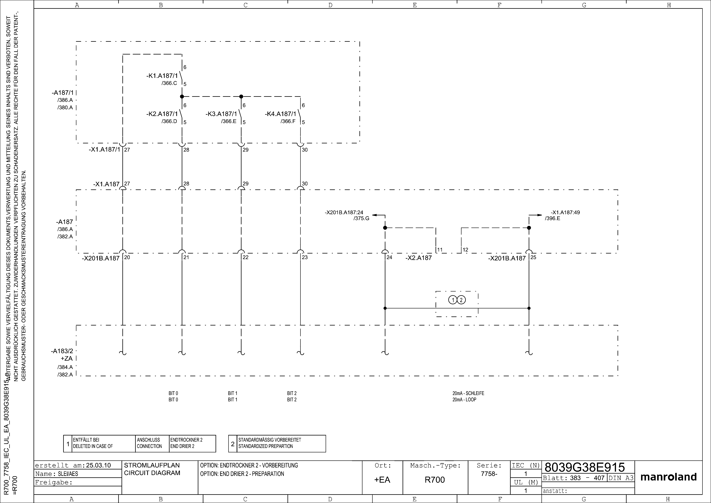

# +EA — Sheet 383 of 407 — OPTION: ENDTROCKNER 2 VORBEREITUNG

**OPTION: END DRIER 2 PREPARATION**

> Part of the manroland **R700** printing press IEC/UL circuit diagrams.
> Drawing class: **Stromlaufplan / Circuit diagram** (DIN A3).
> Document `+EA` covers the **Printing unit** machine section.

## At a glance

| Field | Value |
|---|---|
| Document | `+EA`  (8039G38E915) |
| Sheet | **383** of 407 |
| Section (DE) | OPTION: ENDTROCKNER 2 VORBEREITUNG |
| Section (EN) | OPTION: END DRIER 2 PREPARATION |
| Section type | CIRCUIT — Circuit diagram |
| Machine type | `R700` |
| Series | `7758` |
| Created | 25.03.10 |
| Replaces | — |
| Columns used | A, B, C, D, E, F, G |
| Path numbers | — |
| Labels on sheet | 71 |
| Cross-refs out | 12 |
| Cross-refs in | 28 |

**Previous:** [+EA sheet 382](SHEET_0382.md) · **Next:** [+EA sheet 384](SHEET_0384.md) · **Document TOC:** [_TOC.md](_TOC.md)  (+EA) · **Master TOC:** [all sheets](../_MASTER_TOC.md)

## Sheet image (300 DPI, exact vector render)



_Rendered directly from the PDF vector layer at 300 DPI (1-bit), no OCR and no resampling. Use it to confirm anything ambiguous in the text below._

## Cross-references on this sheet

Each entry is a wire leaving this sheet. The printed token is `/sheet.column`; the link resolves to that sheet inside the same document.

| Ref | Target sheet | Col | Path | Destination on target | Target section | From col |
|---|---|---|---|---|---|---|
| `/366.C` | [+EA sheet 366](SHEET_0366.md) | C | — | — | OPTION: TROCKNER VORBEREITUNG; | B |
| `/386.A` | [+EA sheet 386](SHEET_0386.md) | A | — | — | OPTION: ZWISCHENTROCKNER VORBEREITUNG; | A |
| `/380.A` | [+EA sheet 380](SHEET_0380.md) | A | — | — | OPTION: ENDTROCKNER 2 VORBEREITUNG | A |
| `/366.E` | [+EA sheet 366](SHEET_0366.md) | E | — | — | OPTION: TROCKNER VORBEREITUNG; | C |
| `/366.F` | [+EA sheet 366](SHEET_0366.md) | F | — | — | OPTION: TROCKNER VORBEREITUNG; | D |
| `/366.D` | [+EA sheet 366](SHEET_0366.md) | D | — | — | OPTION: TROCKNER VORBEREITUNG; | B |
| `/375.G` | [+EA sheet 375](SHEET_0375.md) | G | — | X1.A187:49 X201B.A187:24 | OPTION: ENDTROCKNER 1 VORBEREITUNG; | E |
| `/396.E` | [+EA sheet 396](SHEET_0396.md) | E | — | — | OPTION: ZWISCHENTROCKNER VORBEREITUNG; | G |
| `/386.A` | [+EA sheet 386](SHEET_0386.md) | A | — | — | OPTION: ZWISCHENTROCKNER VORBEREITUNG; | A |
| `/382.A` | [+EA sheet 382](SHEET_0382.md) | A | — | — | OPTION: ENDTROCKNER 2 VORBEREITUNG | A |
| `/384.A` | [+EA sheet 384](SHEET_0384.md) | A | — | — | OPTION: ENDTROCKNER 2 VORBEREITUNG | A |
| `/382.A` | [+EA sheet 382](SHEET_0382.md) | A | — | — | OPTION: ENDTROCKNER 2 VORBEREITUNG | A |

### Incoming references (sheets that point here)

Every other sheet that sends a wire to this one. `Back-ref` is the token printed on *that* sheet; `Path` is its line number.

| From sheet | Cols | Back-ref | Path | Refs | What continues there |
|---|---|---|---|---|---|
| [+EA#206](SHEET_0206.md) | H | `/206.H` | — | 4 | — |
| [+EA#207](SHEET_0207.md) | B | `/207.B` | — | 4 | — |
| [+EA#223](SHEET_0223.md) | C | `/223.C` | — | 2 | — |
| [+EA#286](SHEET_0286.md) | G | `/286.G` | — | 6 | — |
| [+EA#366](SHEET_0366.md) | C, D, E, F | `/366.C`, `/366.D`, `/366.E`, `/366.F` | — | 4 | — |
| [+EA#375](SHEET_0375.md) | G | `/375.G` | — | 1 | — |
| [+EA#380](SHEET_0380.md) | A | `/380.A` | — | 1 | — |
| [+EA#382](SHEET_0382.md) | A | `/382.A` | — | 2 | — |
| [+EA#384](SHEET_0384.md) | A | `/384.A` | — | 1 | — |
| [+EA#386](SHEET_0386.md) | A | `/386.A` | — | 2 | — |
| [+EA#396](SHEET_0396.md) | E | `/396.E` | — | 1 | X1.A187:49 |


## Devices on this sheet

| Tag | Class | Class meaning (IEC) | Col | Sub | Terminal | Sign |
|---|---|---|---|---|---|---|
| `A187/1` | A | Baugruppe / assembly, module, PC board | A | 1 | — | — |
| `A187` | A | Baugruppe / assembly, module, PC board | A | — | — | — |
| `A183/2` | A | Baugruppe / assembly, module, PC board | A | 2 | — | — |
| `X1.A187` | — | cross-device reference | A | — | — | — |
| `X201B.A187` | — | cross-device reference | A | — | — | — |
| `X201B.A187` | — | cross-device reference | F | — | — | — |
| `X1.A187:49` | — | cross-device reference | G | — | 49 | — |
| `X201B.A187:24` | — | cross-device reference | D | — | 24 | — |
| `X2.A187` | — | cross-device reference | E | — | — | — |

## Potentials / nets

_No named potentials on this sheet._

## Wire-end annotations (grouped as printed)

A wire that continues elsewhere is annotated with a small cluster: the destination description, the path/line number `#NN`, and the `/sheet.column` cross reference. Each row below is one such cluster exactly as it is grouped on the drawing.

| Col | Y | Path | Cross-ref | Text on the wire |
|---|---|---|---|---|
| B | 108.8 | — | — | `6` |
| B | 122.2 | — | — | `K1.A187/1 5` |
| B | 135.3 | — | `/366.C` | — |
| A | 150.6 | — | — | `A187/1` |
| A | 163.6 | — | `/386.A`, `/380.A` | — |
| B | 172.5 | — | — | `6` |
| C | 172.5 | — | — | `6` |
| D | 172.5 | — | — | `6` |
| B | 186.0 | — | — | `K2.A187/1 5` |
| C | 186.0 | — | — | `K3.A187/1 5` |
| C | 186.0 | — | — | `K4.A187/1 5` |
| C | 199.0 | — | `/366.E` | — |
| B | 199.1 | — | `/366.D` | — |
| D | 199.1 | — | `/366.F` | — |
| B | 245.5 | — | — | `X1.A187/1 27 28` |
| C | 246.9 | — | — | `29 30` |
| B | 303.6 | — | — | `X1.A187 27 28` |
| C | 303.6 | — | — | `29 30` |
| E | 351.8 | — | `/375.G` | `X201B.A187:24 X1.A187:49` |
| G | 361.7 | — | `/396.E` | — |
| A | 366.7 | — | — | `A187` |
| A | 379.8 | — | `/386.A`, `/382.A` | — |
| E | 414.2 | — | — | `11 12` |
| D | 426.9 | — | — | `X201B.A187 20 21 22 23 X201B.A187 25` |
| E | 426.9 | — | — | `24` |
| E | 426.9 | — | — | `X2.A187` |
| F | 498.7 | — | — | `1 2` |
| A | 582.8 | — | — | `A183/2` |
| A | 595.5 | — | — | `+ZA` |
| A | 610.8 | — | `/384.A`, `/382.A` | — |
| C | 655.3 | — | — | `BIT 1 BIT 1` |
| D | 655.3 | — | — | `BIT 2 BIT 2` |
| B | 655.4 | — | — | `BIT 0 BIT 0` |
| F | 655.4 | — | — | `20mA SCHLEIFE 20mA LOOP` |
| A | 733.4 | — | — | `1 ENTFÄLLT BEI DELETED IN CASE OF` |
| B | 733.4 | — | — | `CONNECTION ANSCHLUSS` |
| B | 733.4 | — | — | `ENDTROCKNER 2 END DRIER 2` |
| C | 733.4 | — | — | `2 STANDARDMÄSSIG VORBEREITET STANDARDIZED PREPARTION` |


## Reconstructed tables

This sheet carries tabular content (pin map / terminal assignment / index). The grid below was rebuilt from the drawing's own rule lines, so each row is exactly one physical row of the table.

### Table 1 — 5 data rows × 14 columns (at x=204.1, y=0.0) — **K1.A187/1 /366.C 6 5 K2.A187/1 /366.D 27 27 6 5 28 28 K3.A187/1 /366.E 6 K4.A187/1 /366.F 5 29 29 6 5 30 30 X201B.A187:24 /375.G X1.A187:49 /396.E 20 21 22 23 24 X2.A187 11 1 12 2 X201B.A187 25 BIT 0 BIT 0 ANSCHLUSS END CONNECTION ENDTROCKNER DRIER 2 BIT 1 BIT 1 2 2 BIT 2 BIT 2 STANDARDMÄSSIG VORBEREITET STANDARDIZED PREPARTION 20mA 20mA SCHLEIFE LOOP**

| STROMLAUFPLAN |  | OPTION: ENDTROCKNER | 2 VORBEREITUNG |  | Ort: |  |  | Masch. Type: |  | Serie: | IEC | (N) | 8039G38E915 |
|---|---|---|---|---|---|---|---|---|---|---|---|---|---|
| `CIRCUIT DIAGRAM` |  |  |  |  |  |  |  |  |  |  |  |  |  |
|  |  | `OPTION: END DRIER` | `2 PREPARATION` |  |  |  |  |  |  | `7758` | `1` |  |  |
|  |  |  |  |  | `+EA` |  | `R700` |  |  |  |  |  | `Blatt: DIN A3 383 407` |
|  |  |  |  |  |  |  |  |  |  |  | `UL` | `(M)` |  |
|  |  |  |  |  |  |  |  |  |  |  | `1` |  | `anstatt:` |


## Notes and free text on this sheet

| Text | Col | Y (pt) |
|---|---|---|
| `X1.A187/1` | A | 245.51 |
| `K1.A187/1` | B | 122.2 |
| `K2.A187/1` | B | 185.98 |
| `K3.A187/1` | C | 185.98 |
| `K4.A187/1` | C | 185.98 |
| `+ZA` | A | 595.5 |
| `ENTFÄLLT BEI` | A | 733.35 |
| `DELETED IN CASE OF` | A | 744 |
| `ANSCHLUSS` | B | 733.39 |
| `CONNECTION` | B | 744.03 |
| `ENDTROCKNER 2` | B | 733.39 |
| `END DRIER 2` | B | 744 |
| `BIT 0` | B | 655.35 |
| `BIT 1` | C | 655.27 |
| `BIT 2` | D | 655.33 |
| `20mA SCHLEIFE` | F | 655.41 |
| `20mA LOOP` | F | 666.05 |
| `STANDARDMÄSSIG VORBEREITET` | C | 733.38 |
| `STANDARDIZED PREPARTION` | C | 744.01 |

## Complete label inventory (exact text from the drawing)

Every text object inside the drawing area of this sheet, in DIN reading order (column A→H, then top→bottom). This is the authoritative list: if a string is not here it is not printed on this sheet.

| Col | Y | X | Dir | Type | Text |
|---|---|---|---|---|---|
| A | 150.5 | 86.7 | → | device tag | `A187/1` |
| A | 163.6 | 96.4 | → | cross-reference | `/386.A` |
| A | 176.0 | 96.4 | → | cross-reference | `/380.A` |
| A | 245.5 | 148.8 | → | text | `X1.A187/1` |
| A | 303.6 | 156.2 | → | device ref | `X1.A187` |
| A | 366.7 | 94.1 | → | device tag | `A187` |
| A | 379.8 | 96.4 | → | cross-reference | `/386.A` |
| A | 392.2 | 96.4 | → | cross-reference | `/382.A` |
| A | 427.6 | 137.2 | → | device ref | `X201B.A187` |
| A | 582.8 | 85.3 | → | device tag | `A183/2` |
| A | 595.5 | 101.8 | → | text | `+ZA` |
| A | 610.8 | 96.4 | → | cross-reference | `/384.A` |
| A | 623.2 | 96.4 | → | cross-reference | `/382.A` |
| A | 733.3 | 122.5 | → | text | `ENTFÄLLT BEI` |
| A | 738.7 | 110.8 | → | number | `1` |
| A | 744.0 | 122.5 | → | text | `DELETED IN CASE OF` |
| B | 108.7 | 307.3 | → | number | `6` |
| B | 122.2 | 245.2 | → | text | `K1.A187/1` |
| B | 135.3 | 270.7 | → | cross-reference | `/366.C` |
| B | 137.1 | 307.3 | → | number | `5` |
| B | 172.5 | 307.3 | → | number | `6` |
| B | 186.0 | 245.2 | → | text | `K2.A187/1` |
| B | 199.1 | 270.7 | → | cross-reference | `/366.D` |
| B | 200.9 | 307.3 | → | number | `5` |
| B | 246.9 | 208.1 | → | number | `27` |
| B | 246.9 | 307.3 | → | number | `28` |
| B | 303.6 | 208.1 | → | number | `27` |
| B | 303.6 | 307.3 | → | number | `28` |
| B | 426.9 | 208.1 | → | number | `20` |
| B | 426.9 | 307.3 | → | number | `21` |
| B | 655.3 | 282.6 | → | text | `BIT 0` |
| B | 666.0 | 282.6 | → | text | `BIT 0` |
| B | 733.4 | 229.6 | → | text | `ANSCHLUSS` |
| B | 733.4 | 285.4 | → | text | `ENDTROCKNER 2` |
| B | 744.0 | 229.3 | → | text | `CONNECTION` |
| B | 744.0 | 285.4 | → | text | `END DRIER 2` |
| C | 172.5 | 406.5 | → | number | `6` |
| C | 186.0 | 344.4 | → | text | `K3.A187/1` |
| C | 186.0 | 443.6 | → | text | `K4.A187/1` |
| C | 199.0 | 370.5 | → | cross-reference | `/366.E` |
| C | 200.9 | 406.5 | → | number | `5` |
| C | 246.9 | 406.5 | → | number | `29` |
| C | 303.6 | 406.5 | → | number | `29` |
| C | 426.9 | 406.5 | → | number | `22` |
| C | 655.3 | 381.8 | → | text | `BIT 1` |
| C | 665.9 | 381.8 | → | text | `BIT 1` |
| C | 733.4 | 399.4 | → | text | `STANDARDMÄSSIG VORBEREITET` |
| C | 738.7 | 386.9 | → | number | `2` |
| C | 744.0 | 399.4 | → | text | `STANDARDIZED PREPARTION` |
| D | 172.5 | 505.7 | → | number | `6` |
| D | 199.1 | 470.0 | → | cross-reference | `/366.F` |
| D | 200.9 | 505.7 | → | number | `5` |
| D | 246.9 | 505.7 | → | number | `30` |
| D | 303.6 | 505.7 | → | number | `30` |
| D | 351.8 | 544.0 | → | device ref | `X201B.A187:24` |
| D | 361.7 | 592.2 | → | cross-reference | `/375.G` |
| D | 426.9 | 505.7 | → | number | `23` |
| D | 655.3 | 481.0 | → | text | `BIT 2` |
| D | 666.0 | 481.0 | → | text | `BIT 2` |
| E | 414.2 | 731.9 | → | number | `11` |
| E | 426.9 | 647.4 | → | number | `24` |
| E | 426.9 | 679.2 | → | device ref | `X2.A187` |
| E | 498.7 | 756.5 | → | number | `1` |
| F | 414.2 | 774.4 | → | number | `12` |
| F | 426.9 | 888.4 | → | number | `25` |
| F | 427.6 | 817.5 | → | device ref | `X201B.A187` |
| F | 499.2 | 770.4 | → | number | `2` |
| F | 655.4 | 758.0 | → | text | `20mA SCHLEIFE` |
| F | 666.0 | 758.0 | → | text | `20mA LOOP` |
| G | 351.8 | 922.4 | → | device ref | `X1.A187:49` |
| G | 361.7 | 912.8 | → | cross-reference | `/396.E` |

## Reading-order text block

The same content as a plain block, grouped by DIN column — convenient to paste or to match against a visual description.

```text
=== Column A ===
 150.5   86.7  devtag       A187/1
 163.6   96.4  xref         /386.A
 176.0   96.4  xref         /380.A
 245.5  148.8  text         X1.A187/1
 303.6  156.2  devref       X1.A187
 366.7   94.1  devtag       A187
 379.8   96.4  xref         /386.A
 392.2   96.4  xref         /382.A
 427.6  137.2  devref       X201B.A187
 582.8   85.3  devtag       A183/2
 595.5  101.8  text         +ZA
 610.8   96.4  xref         /384.A
 623.2   96.4  xref         /382.A
 733.3  122.5  text         ENTFÄLLT BEI
 738.7  110.8  numeric      1
 744.0  122.5  text         DELETED IN CASE OF
=== Column B ===
 108.7  307.3  numeric      6
 122.2  245.2  text         K1.A187/1
 135.3  270.7  xref         /366.C
 137.1  307.3  numeric      5
 172.5  307.3  numeric      6
 186.0  245.2  text         K2.A187/1
 199.1  270.7  xref         /366.D
 200.9  307.3  numeric      5
 246.9  208.1  numeric      27
 246.9  307.3  numeric      28
 303.6  208.1  numeric      27
 303.6  307.3  numeric      28
 426.9  208.1  numeric      20
 426.9  307.3  numeric      21
 655.3  282.6  text         BIT 0
 666.0  282.6  text         BIT 0
 733.4  229.6  text         ANSCHLUSS
 733.4  285.4  text         ENDTROCKNER 2
 744.0  229.3  text         CONNECTION
 744.0  285.4  text         END DRIER 2
=== Column C ===
 172.5  406.5  numeric      6
 186.0  344.4  text         K3.A187/1
 186.0  443.6  text         K4.A187/1
 199.0  370.5  xref         /366.E
 200.9  406.5  numeric      5
 246.9  406.5  numeric      29
 303.6  406.5  numeric      29
 426.9  406.5  numeric      22
 655.3  381.8  text         BIT 1
 665.9  381.8  text         BIT 1
 733.4  399.4  text         STANDARDMÄSSIG VORBEREITET
 738.7  386.9  numeric      2
 744.0  399.4  text         STANDARDIZED PREPARTION
=== Column D ===
 172.5  505.7  numeric      6
 199.1  470.0  xref         /366.F
 200.9  505.7  numeric      5
 246.9  505.7  numeric      30
 303.6  505.7  numeric      30
 351.8  544.0  devref       X201B.A187:24
 361.7  592.2  xref         /375.G
 426.9  505.7  numeric      23
 655.3  481.0  text         BIT 2
 666.0  481.0  text         BIT 2
=== Column E ===
 414.2  731.9  numeric      11
 426.9  647.4  numeric      24
 426.9  679.2  devref       X2.A187
 498.7  756.5  numeric      1
=== Column F ===
 414.2  774.4  numeric      12
 426.9  888.4  numeric      25
 427.6  817.5  devref       X201B.A187
 499.2  770.4  numeric      2
 655.4  758.0  text         20mA SCHLEIFE
 666.0  758.0  text         20mA LOOP
=== Column G ===
 351.8  922.4  devref       X1.A187:49
 361.7  912.8  xref         /396.E
```

---
_Generated from the PDF vector text layer; no OCR. Source: `R700_7758_IEC_UL_EA_8039G38E915_p`, sheet 383._
