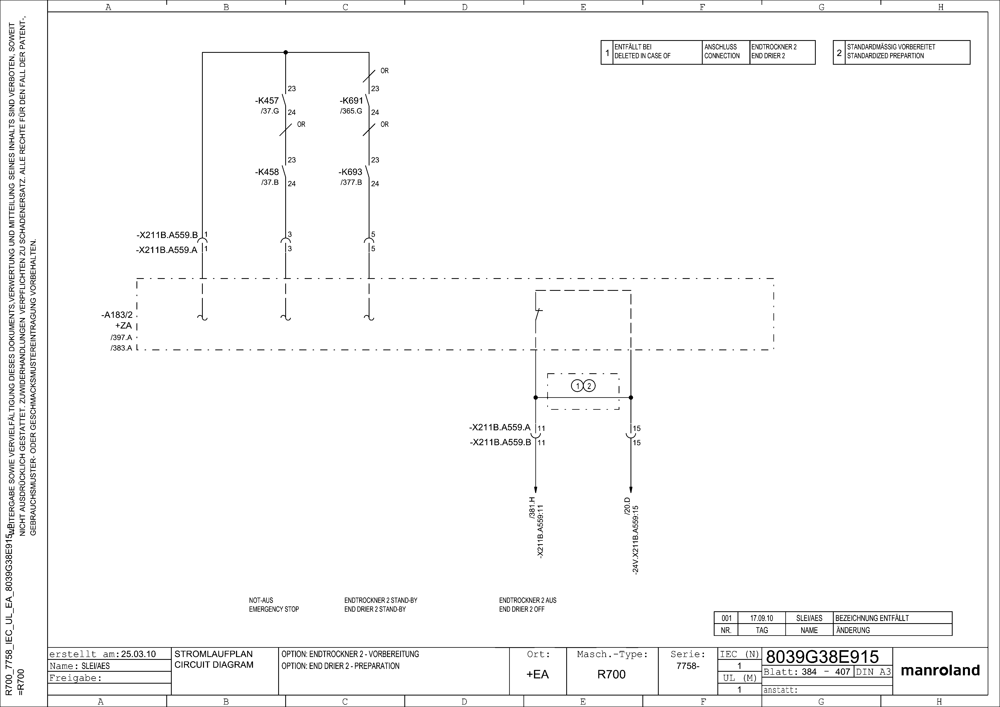

# +EA — Sheet 384 of 407 — OPTION: ENDTROCKNER 2 VORBEREITUNG

**OPTION: END DRIER 2 PREPARATION**

> Part of the manroland **R700** printing press IEC/UL circuit diagrams.
> Drawing class: **Stromlaufplan / Circuit diagram** (DIN A3).
> Document `+EA` covers the **Printing unit** machine section.

## At a glance

| Field | Value |
|---|---|
| Document | `+EA`  (8039G38E915) |
| Sheet | **384** of 407 |
| Section (DE) | OPTION: ENDTROCKNER 2 VORBEREITUNG |
| Section (EN) | OPTION: END DRIER 2 PREPARATION |
| Section type | CIRCUIT — Circuit diagram |
| Machine type | `R700` |
| Series | `7758` |
| Created | 25.03.10 |
| Replaces | — |
| Columns used | A, B, C, D, E, F, G, H |
| Path numbers | — |
| Labels on sheet | 67 |
| Cross-refs out | 8 |
| Cross-refs in | 18 |

**Previous:** [+EA sheet 383](SHEET_0383.md) · **Next:** [+EA sheet 385](SHEET_0385.md) · **Document TOC:** [_TOC.md](_TOC.md)  (+EA) · **Master TOC:** [all sheets](../_MASTER_TOC.md)

## Sheet image (300 DPI, exact vector render)



_Rendered directly from the PDF vector layer at 300 DPI (1-bit), no OCR and no resampling. Use it to confirm anything ambiguous in the text below._

## Cross-references on this sheet

Each entry is a wire leaving this sheet. The printed token is `/sheet.column`; the link resolves to that sheet inside the same document.

| Ref | Target sheet | Col | Path | Destination on target | Target section | From col |
|---|---|---|---|---|---|---|
| `/37.G` | [+EA sheet 37](SHEET_0037.md) | G | — | — | BUSVERBINDUNGEN: NOT AUS | B |
| `/365.G` | [+EA sheet 365](SHEET_0365.md) | G | — | — | OPTION: TROCKNER VORBEREITUNG; | C |
| `/37.B` | [+EA sheet 37](SHEET_0037.md) | B | — | — | BUSVERBINDUNGEN: NOT AUS | B |
| `/377.B` | [+EA sheet 377](SHEET_0377.md) | B | — | — | OPTION: ENDTROCKNER 2 VORBEREITUNG | C |
| `/397.A` | [+EA sheet 397](SHEET_0397.md) | A | — | — | OPTION: ZWISCHENTROCKNER VORBEREITUNG; | A |
| `/383.A` | [+EA sheet 383](SHEET_0383.md) | A | — | — | OPTION: ENDTROCKNER 2 VORBEREITUNG | A |
| `/381.H` | [+EA sheet 381](SHEET_0381.md) | H | — | — | OPTION: ENDTROCKNER 2 VORBEREITUNG | E |
| `/20.D` | [+EA sheet 20](SHEET_0020.md) | D | — | — | SPANNUNGSVERSORGUNG: 400V, 24V | E |

### Incoming references (sheets that point here)

Every other sheet that sends a wire to this one. `Back-ref` is the token printed on *that* sheet; `Path` is its line number.

| From sheet | Cols | Back-ref | Path | Refs | What continues there |
|---|---|---|---|---|---|
| [+EA#20](SHEET_0020.md) | D | `/20.D` | — | 1 | 24V.X211B.A559:15 |
| [+EA#37](SHEET_0037.md) | B, G | `/37.B`, `/37.G` | — | 2 | — |
| [+EA#289](SHEET_0289.md) | A, B | `/289.A`, `/289.B` | — | 10 | — |
| [+EA#365](SHEET_0365.md) | G | `/365.G` | — | 1 | — |
| [+EA#377](SHEET_0377.md) | B | `/377.B` | — | 1 | — |
| [+EA#381](SHEET_0381.md) | H | `/381.H` | — | 1 | — |
| [+EA#383](SHEET_0383.md) | A | `/383.A` | — | 1 | — |
| [+EA#397](SHEET_0397.md) | A | `/397.A` | — | 1 | — |


## Devices on this sheet

| Tag | Class | Class meaning (IEC) | Col | Sub | Terminal | Sign |
|---|---|---|---|---|---|---|
| `A183/2` | A | Baugruppe / assembly, module, PC board | A | 2 | — | — |
| `K457` | K | Relais / relay, contactor | B | — | — | — |
| `K691` | K | Relais / relay, contactor | C | — | — | — |
| `K458` | K | Relais / relay, contactor | B | — | — | — |
| `K693` | K | Relais / relay, contactor | C | — | — | — |
| `X211B.A559.B` | — | cross-device reference | B | — | — | — |
| `X211B.A559.A` | — | cross-device reference | A | — | — | — |
| `X211B.A559.B` | — | cross-device reference | D | — | — | — |
| `X211B.A559.A` | — | cross-device reference | D | — | — | — |
| `NR.` | — | cross-device reference | F | — | — | — |
| `17.09.10` | — | cross-device reference | F | — | — | — |
| `X211B.A559:11` | — | cross-device reference | E | — | 11 | — |

## Potentials / nets

| Potential | Count | Columns | Attached devices | Terminals |
|---|---|---|---|---|
| `24V` | 1 | E | `A559`, `X211B` | `15` |


A potential such as `L24+/4` or `M24+` is a named supply/return rail; every place it appears on this sheet is electrically common.

## Wire-end annotations (grouped as printed)

A wire that continues elsewhere is annotated with a small cluster: the destination description, the path/line number `#NN`, and the `/sheet.column` cross reference. Each row below is one such cluster exactly as it is grouped on the drawing.

| Col | Y | Path | Cross-ref | Text on the wire |
|---|---|---|---|---|
| E | 53.0 | — | — | `1 ENTFÄLLT BEI DELETED IN CASE OF` |
| F | 53.1 | — | — | `CONNECTION ANSCHLUSS` |
| G | 53.1 | — | — | `ENDTROCKNER 2 END DRIER 2 2 STANDARDMÄSSIG VORBEREITET STANDARDIZED PREPARTION` |
| C | 81.4 | — | — | `OR` |
| C | 101.7 | — | — | `23` |
| C | 101.7 | — | — | `23` |
| B | 115.1 | — | — | `K457 24` |
| C | 115.1 | — | — | `K691 24` |
| B | 128.2 | — | `/37.G` | — |
| C | 128.2 | — | `/365.G` | — |
| C | 145.2 | — | — | `OR OR` |
| C | 186.7 | — | — | `23` |
| C | 186.7 | — | — | `23` |
| B | 200.1 | — | — | `K458 24` |
| C | 200.1 | — | — | `K693 24` |
| B | 213.2 | — | `/37.B` | — |
| C | 213.2 | — | `/377.B` | — |
| B | 275.3 | — | — | `X211B.A559.B 1` |
| C | 275.3 | — | — | `3` |
| C | 275.3 | — | — | `5` |
| B | 292.3 | — | — | `X211B.A559.A 1` |
| C | 292.3 | — | — | `3` |
| C | 292.3 | — | — | `5` |
| A | 370.2 | — | — | `A183/2` |
| A | 382.9 | — | — | `+ZA` |
| A | 398.2 | — | `/397.A`, `/383.A` | — |
| E | 456.1 | — | — | `1 2` |
| D | 504.2 | — | — | `X211B.A559.A 11` |
| E | 506.3 | — | — | `15` |
| D | 521.9 | — | — | `X211B.A559.B 11` |
| E | 523.3 | — | — | `15` |
| E | 591.6 | — | `/381.H` | — |
| E | 592.2 | — | `/20.D` | — |
| E | 600.7 | — | — | `X211B.A559:11` |
| E | 602.1 | — | — | `24V.X211B.A559:15` |
| B | 712.1 | — | — | `NOT AUS EMERGENCY STOP` |
| C | 712.1 | — | — | `ENDTROCKNER 2 STAND BY END DRIER 2 STAND BY` |
| E | 712.1 | — | — | `ENDTROCKNER 2 AUS END DRIER 2 OFF` |
| G | 733.0 | — | — | `001 17.09.10 SLEI/AES BEZEICHNUNG ENTFÄLLT` |
| G | 747.1 | — | — | `NR. TAG NAME ÄNDERUNG` |


## Reconstructed tables

This sheet carries tabular content (pin map / terminal assignment / index). The grid below was rebuilt from the drawing's own rule lines, so each row is exactly one physical row of the table.

### Table 1 — 6 data rows × 12 columns (at x=204.1, y=0.0) — **ENTFÄLLT BEI ANSCHLUSS STANDARDMÄSSIG ENDTROCKNER 2 K457 /37.G K458 /37.B 1 1 23 K691 /365.G 24 OR 23 K693 /377.B 24 3 3 OR 23 24 OR 23 24 5 5 1 DELETED IN CASE OF END CONNECTION 2 DRIER 2 STANDARDIZED 1 2**

|  | NOT AUS EMERGENCY |  | ENDTROCKNER STOP END DRIER | X211B.A559.A X211B.A559.B 2 STAND BY END 2 STAND BY | /381.H ENDTROCKNER DRIER 2 | 11 11 X211B.A559:11 2 AUS OFF | /20.D | 15 15 24V.X211B.A559:15 |  | 001 17.09.10 NR. | SLEI/AES BEZEICHNUNG NAME TAG ÄNDERUNG |
|---|---|---|---|---|---|---|---|---|---|---|---|
|  | `STROMLAUFPLAN` |  | `OPTION: ENDTROCKNER 2` | `VORBEREITUNG` |  | `Ort:` | `Masch. Type:` |  | `Serie:` | `IEC (N)` | `8039G38E915` |
| `CIRCUIT` | `DIAGRAM` |  |  |  |  |  |  |  |  |  |  |
|  |  |  | `OPTION: END DRIER 2` | `PREPARATION` |  |  |  |  | `7758` | `1` |  |
|  |  |  |  |  |  | `+EA` | `R700` |  |  |  | `Blatt: DIN A3 384 407` |
|  |  |  |  |  |  |  |  |  |  | `UL (M)` |  |
|  |  |  |  |  |  |  |  |  |  | `1` | `anstatt:` |


## Notes and free text on this sheet

| Text | Col | Y (pt) |
|---|---|---|
| `+ZA` | A | 382.9 |
| `TAG` | G | 747.27 |
| `NAME` | G | 747.25 |
| `ÄNDERUNG` | G | 747.31 |
| `SLEI/AES` | G | 733.13 |
| `BEZEICHNUNG ENTFÄLLT` | G | 733.14 |
| `NOT AUS` | B | 712.11 |
| `EMERGENCY STOP` | B | 722.75 |
| `ENDTROCKNER 2 STAND BY` | C | 712.13 |
| `END DRIER 2 STAND BY` | C | 722.76 |
| `ENDTROCKNER 2 AUS` | E | 712.12 |
| `END DRIER 2 OFF` | D | 722.75 |
| `ENTFÄLLT BEI` | E | 53.03 |
| `DELETED IN CASE OF` | E | 63.69 |
| `ANSCHLUSS` | F | 53.08 |
| `CONNECTION` | F | 63.71 |
| `ENDTROCKNER 2` | G | 53.07 |
| `END DRIER 2` | G | 63.69 |
| `STANDARDMÄSSIG VORBEREITET` | H | 53.07 |
| `STANDARDIZED PREPARTION` | H | 63.7 |
| `OR` | C | 145.19 |

## Complete label inventory (exact text from the drawing)

Every text object inside the drawing area of this sheet, in DIN reading order (column A→H, then top→bottom). This is the authoritative list: if a string is not here it is not printed on this sheet.

| Col | Y | X | Dir | Type | Text |
|---|---|---|---|---|---|
| A | 293.0 | 161.9 | → | device ref | `X211B.A559.A` |
| A | 370.2 | 120.8 | → | device tag | `A183/2` |
| A | 382.9 | 137.2 | → | text | `+ZA` |
| A | 398.2 | 131.8 | → | cross-reference | `/397.A` |
| A | 410.6 | 131.8 | → | cross-reference | `/383.A` |
| B | 115.1 | 303.9 | → | device tag | `K457` |
| B | 128.2 | 310.7 | → | cross-reference | `/37.G` |
| B | 200.1 | 303.9 | → | device tag | `K458` |
| B | 213.2 | 311.2 | → | cross-reference | `/37.B` |
| B | 275.3 | 162.7 | → | device ref | `X211B.A559.B` |
| B | 275.3 | 242.9 | → | number | `1` |
| B | 292.3 | 242.9 | → | number | `1` |
| B | 712.1 | 296.8 | → | text | `NOT AUS` |
| B | 722.8 | 296.8 | → | text | `EMERGENCY STOP` |
| C | 81.4 | 453.3 | → | text | `OR` |
| C | 101.7 | 342.7 | → | number | `23` |
| C | 101.7 | 441.9 | → | number | `23` |
| C | 115.1 | 404.5 | → | device tag | `K691` |
| C | 128.2 | 405.1 | → | cross-reference | `/365.G` |
| C | 130.0 | 342.7 | → | number | `24` |
| C | 130.0 | 441.9 | → | number | `24` |
| C | 145.2 | 354.0 | → | text | `OR` |
| C | 145.2 | 453.3 | → | text | `OR` |
| C | 186.7 | 342.7 | → | number | `23` |
| C | 186.7 | 441.9 | → | number | `23` |
| C | 200.1 | 403.1 | → | device tag | `K693` |
| C | 213.2 | 405.6 | → | cross-reference | `/377.B` |
| C | 215.0 | 342.7 | → | number | `24` |
| C | 215.0 | 441.9 | → | number | `24` |
| C | 275.3 | 342.7 | → | number | `3` |
| C | 275.3 | 441.9 | → | number | `5` |
| C | 292.3 | 342.7 | → | number | `3` |
| C | 292.3 | 441.9 | → | number | `5` |
| C | 712.1 | 410.2 | → | text | `ENDTROCKNER 2 STAND BY` |
| C | 722.8 | 410.2 | → | text | `END DRIER 2 STAND BY` |
| D | 504.2 | 558.7 | → | device ref | `X211B.A559.A` |
| D | 521.9 | 559.6 | → | device ref | `X211B.A559.B` |
| D | 722.8 | 594.4 | → | text | `END DRIER 2 OFF` |
| E | 53.0 | 731.9 | → | text | `ENTFÄLLT BEI` |
| E | 58.4 | 720.3 | → | number | `1` |
| E | 63.7 | 731.9 | → | text | `DELETED IN CASE OF` |
| E | 456.2 | 685.6 | → | number | `1` |
| E | 456.7 | 699.6 | → | number | `2` |
| E | 506.3 | 639.8 | → | number | `11` |
| E | 506.3 | 753.2 | → | number | `15` |
| E | 523.3 | 639.8 | → | number | `11` |
| E | 523.3 | 753.2 | → | number | `15` |
| E | 591.6 | 629.6 | ↕ | cross-reference | `/381.H` |
| E | 592.2 | 743.0 | ↕ | cross-reference | `/20.D` |
| E | 600.7 | 639.5 | ↕ | device ref | `X211B.A559:11` |
| E | 602.1 | 752.9 | ↕ | potential | `24V.X211B.A559:15` |
| E | 712.1 | 594.4 | → | text | `ENDTROCKNER 2 AUS` |
| F | 53.1 | 839.1 | → | text | `ANSCHLUSS` |
| F | 63.7 | 838.8 | → | text | `CONNECTION` |
| F | 733.0 | 859.4 | → | number | `001` |
| F | 733.1 | 893.2 | → | device ref | `17.09.10` |
| F | 747.1 | 858.4 | → | device ref | `NR.` |
| G | 53.1 | 894.9 | → | text | `ENDTROCKNER 2` |
| G | 58.4 | 996.4 | → | number | `2` |
| G | 63.7 | 894.9 | → | text | `END DRIER 2` |
| G | 733.1 | 948.2 | → | text | `SLEI/AES` |
| G | 733.1 | 994.8 | → | text | `BEZEICHNUNG ENTFÄLLT` |
| G | 747.3 | 900.0 | → | text | `TAG` |
| G | 747.3 | 953.4 | → | text | `NAME` |
| G | 747.3 | 996.0 | → | text | `ÄNDERUNG` |
| H | 53.1 | 1008.9 | → | text | `STANDARDMÄSSIG VORBEREITET` |
| H | 63.7 | 1008.9 | → | text | `STANDARDIZED PREPARTION` |

## Reading-order text block

The same content as a plain block, grouped by DIN column — convenient to paste or to match against a visual description.

```text
=== Column A ===
 293.0  161.9  devref       X211B.A559.A
 370.2  120.8  devtag       A183/2
 382.9  137.2  text         +ZA
 398.2  131.8  xref         /397.A
 410.6  131.8  xref         /383.A
=== Column B ===
 115.1  303.9  devtag       K457
 128.2  310.7  xref         /37.G
 200.1  303.9  devtag       K458
 213.2  311.2  xref         /37.B
 275.3  162.7  devref       X211B.A559.B
 275.3  242.9  numeric      1
 292.3  242.9  numeric      1
 712.1  296.8  text         NOT AUS
 722.8  296.8  text         EMERGENCY STOP
=== Column C ===
  81.4  453.3  text         OR
 101.7  342.7  numeric      23
 101.7  441.9  numeric      23
 115.1  404.5  devtag       K691
 128.2  405.1  xref         /365.G
 130.0  342.7  numeric      24
 130.0  441.9  numeric      24
 145.2  354.0  text         OR
 145.2  453.3  text         OR
 186.7  342.7  numeric      23
 186.7  441.9  numeric      23
 200.1  403.1  devtag       K693
 213.2  405.6  xref         /377.B
 215.0  342.7  numeric      24
 215.0  441.9  numeric      24
 275.3  342.7  numeric      3
 275.3  441.9  numeric      5
 292.3  342.7  numeric      3
 292.3  441.9  numeric      5
 712.1  410.2  text         ENDTROCKNER 2 STAND BY
 722.8  410.2  text         END DRIER 2 STAND BY
=== Column D ===
 504.2  558.7  devref       X211B.A559.A
 521.9  559.6  devref       X211B.A559.B
 722.8  594.4  text         END DRIER 2 OFF
=== Column E ===
  53.0  731.9  text         ENTFÄLLT BEI
  58.4  720.3  numeric      1
  63.7  731.9  text         DELETED IN CASE OF
 456.2  685.6  numeric      1
 456.7  699.6  numeric      2
 506.3  639.8  numeric      11
 506.3  753.2  numeric      15
 523.3  639.8  numeric      11
 523.3  753.2  numeric      15
 591.6  629.6  xref         /381.H
 592.2  743.0  xref         /20.D
 600.7  639.5  devref       X211B.A559:11
 602.1  752.9  net          24V.X211B.A559:15
 712.1  594.4  text         ENDTROCKNER 2 AUS
=== Column F ===
  53.1  839.1  text         ANSCHLUSS
  63.7  838.8  text         CONNECTION
 733.0  859.4  numeric      001
 733.1  893.2  devref       17.09.10
 747.1  858.4  devref       NR.
=== Column G ===
  53.1  894.9  text         ENDTROCKNER 2
  58.4  996.4  numeric      2
  63.7  894.9  text         END DRIER 2
 733.1  948.2  text         SLEI/AES
 733.1  994.8  text         BEZEICHNUNG ENTFÄLLT
 747.3  900.0  text         TAG
 747.3  953.4  text         NAME
 747.3  996.0  text         ÄNDERUNG
=== Column H ===
  53.1 1008.9  text         STANDARDMÄSSIG VORBEREITET
  63.7 1008.9  text         STANDARDIZED PREPARTION
```

---
_Generated from the PDF vector text layer; no OCR. Source: `R700_7758_IEC_UL_EA_8039G38E915_p`, sheet 384._
