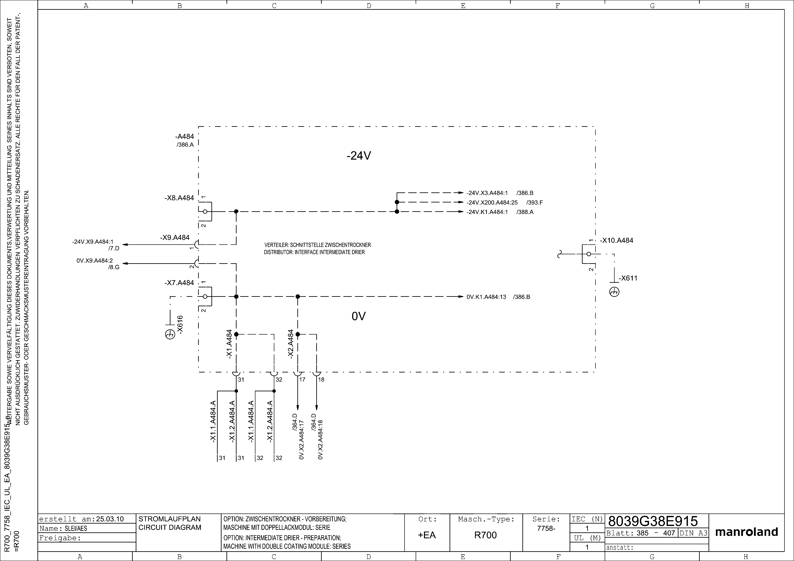

# +EA — Sheet 385 of 407 — OPTION: ZWISCHENTROCKNER VORBEREITUNG;

**MASCHINE MIT DOPPELLACKMODUL: SERIE**

> Part of the manroland **R700** printing press IEC/UL circuit diagrams.
> Drawing class: **Stromlaufplan / Circuit diagram** (DIN A3).
> Document `+EA` covers the **Printing unit** machine section.

## At a glance

| Field | Value |
|---|---|
| Document | `+EA`  (8039G38E915) |
| Sheet | **385** of 407 |
| Section (DE) | OPTION: ZWISCHENTROCKNER VORBEREITUNG; |
| Section (EN) | MASCHINE MIT DOPPELLACKMODUL: SERIE |
| Section type | CIRCUIT — Circuit diagram |
| Machine type | `R700` |
| Series | `7758` |
| Created | 25.03.10 |
| Replaces | — |
| Columns used | A, B, C, D, E, F, G |
| Path numbers | — |
| Labels on sheet | 50 |
| Cross-refs out | 9 |
| Cross-refs in | 19 |

**Previous:** [+EA sheet 384](SHEET_0384.md) · **Next:** [+EA sheet 386](SHEET_0386.md) · **Document TOC:** [_TOC.md](_TOC.md)  (+EA) · **Master TOC:** [all sheets](../_MASTER_TOC.md)

## Sheet image (300 DPI, exact vector render)



_Rendered directly from the PDF vector layer at 300 DPI (1-bit), no OCR and no resampling. Use it to confirm anything ambiguous in the text below._

## Cross-references on this sheet

Each entry is a wire leaving this sheet. The printed token is `/sheet.column`; the link resolves to that sheet inside the same document.

| Ref | Target sheet | Col | Path | Destination on target | Target section | From col |
|---|---|---|---|---|---|---|
| `/386.A` | [+EA sheet 386](SHEET_0386.md) | A | — | — | OPTION: ZWISCHENTROCKNER VORBEREITUNG; | B |
| `/386.B` | [+EA sheet 386](SHEET_0386.md) | B | — | 24V.X3.A484:1 | OPTION: ZWISCHENTROCKNER VORBEREITUNG; | E |
| `/393.F` | [+EA sheet 393](SHEET_0393.md) | F | — | 24V.X200.A484:25 | OPTION: ZWISCHENTROCKNER VORBEREITUNG; | E |
| `/388.A` | [+EA sheet 388](SHEET_0388.md) | A | — | 24V.K1.A484:1 | OPTION: ZWISCHENTROCKNER VORBEREITUNG; | E |
| `/7.D` | [+EA sheet 7](SHEET_0007.md) | D | — | 24V.X9.A484:1 | SPANNUNGSVERSORGUNG: 400V, 24V | A |
| `/8.G` | [+EA sheet 8](SHEET_0008.md) | G | — | 0V.X9.A484:2 | SPANNUNGSVERSORGUNG: 400V, 24V | A |
| `/386.B` | [+EA sheet 386](SHEET_0386.md) | B | — | 0V.K1.A484:13 | OPTION: ZWISCHENTROCKNER VORBEREITUNG; | E |
| `/364.D` | [+EA sheet 364](SHEET_0364.md) | D | — | — | OPTION: TROCKNER VORBEREITUNG; | C |
| `/364.D` | [+EA sheet 364](SHEET_0364.md) | D | — | — | OPTION: TROCKNER VORBEREITUNG; | C |

### Incoming references (sheets that point here)

Every other sheet that sends a wire to this one. `Back-ref` is the token printed on *that* sheet; `Path` is its line number.

| From sheet | Cols | Back-ref | Path | Refs | What continues there |
|---|---|---|---|---|---|
| [+EA#7](SHEET_0007.md) | D | `/7.D` | — | 1 | 24V.X9.A484:1 |
| [+EA#8](SHEET_0008.md) | G | `/8.G` | — | 1 | 0V.X9.A484:2 |
| [+EA#210](SHEET_0210.md) | F, H | `/210.F`, `/210.H` | — | 4 | — |
| [+EA#211](SHEET_0211.md) | B | `/211.B` | — | 2 | — |
| [+EA#230](SHEET_0230.md) | B | `/230.B` | — | 2 | — |
| [+EA#253](SHEET_0253.md) | A | `/253.A` | — | 2 | — |
| [+EA#364](SHEET_0364.md) | D | `/364.D` | — | 2 | — |
| [+EA#386](SHEET_0386.md) | A, B, D | `/386.A`, `/386.B`, `/386.D` | — | 3 | 0V.K2.A484:7 0V.K694:A1 0V.K1.A484:13; 24V.X3.A484:1 |
| [+EA#388](SHEET_0388.md) | A | `/388.A` | — | 1 | 24V.K1.A484:1 |
| [+EA#393](SHEET_0393.md) | F | `/393.F` | — | 1 | 24V.X200.A484:25 24V.X200.A484:31 |


## Devices on this sheet

| Tag | Class | Class meaning (IEC) | Col | Sub | Terminal | Sign |
|---|---|---|---|---|---|---|
| `A484` | A | Baugruppe / assembly, module, PC board | B | — | — | — |
| `X616` | X | Klemme / terminal, plug connector | B | — | — | — |
| `X611` | X | Klemme / terminal, plug connector | G | — | — | — |
| `X9.A484` | — | cross-device reference | B | — | — | — |
| `X1.A484` | — | cross-device reference | C | — | — | — |
| `X1.1.A484.A` | — | cross-device reference | B | — | — | — |
| `X1.2.A484.A` | — | cross-device reference | C | — | — | — |
| `X2.A484` | — | cross-device reference | C | — | — | — |
| `X1.1.A484.A` | — | cross-device reference | C | — | — | — |
| `X1.2.A484.A` | — | cross-device reference | C | — | — | — |
| `X8.A484` | — | cross-device reference | B | — | — | — |
| `X7.A484` | — | cross-device reference | B | — | — | — |
| `X10.A484` | — | cross-device reference | G | — | — | — |

## Potentials / nets

| Potential | Count | Columns | Attached devices | Terminals |
|---|---|---|---|---|
| `0V` | 5 | A, C, D, E | `A484`, `K1`, `X2`, `X9` | `13`, `17`, `18`, `2` |
| `24V` | 5 | A, D, E | `A484`, `K1`, `X200`, `X3`, `X9` | `1`, `25` |


A potential such as `L24+/4` or `M24+` is a named supply/return rail; every place it appears on this sheet is electrically common.

## Wire-end annotations (grouped as printed)

A wire that continues elsewhere is annotated with a small cluster: the destination description, the path/line number `#NN`, and the `/sheet.column` cross reference. Each row below is one such cluster exactly as it is grouped on the drawing.

| Col | Y | Path | Cross-ref | Text on the wire |
|---|---|---|---|---|
| B | 200.1 | — | — | `A484` |
| B | 213.2 | — | `/386.A` | — |
| D | 226.0 | — | — | `24V` |
| E | 285.9 | — | `/386.B` | `24V.X3.A484:1` |
| B | 292.3 | — | — | `X8.A484` |
| B | 293.4 | — | — | `1 2` |
| E | 300.0 | — | `/393.F` | `24V.X200.A484:25` |
| E | 314.2 | — | `/388.A` | `24V.K1.A484:1` |
| B | 351.8 | — | — | `X9.A484` |
| G | 356.1 | — | — | `X10.A484` |
| F | 358.3 | — | — | `1 2` |
| A | 358.9 | — | `/7.D` | `24V.X9.A484:1` |
| C | 364.9 | — | — | `DISTRIBUTOR: INTERFACE INTERMEDIATE DRIER VERTEILER: SCHNITTSTELLE ZWISCHENTROCKNER` |
| B | 370.2 | — | — | `1` |
| A | 387.2 | — | `/8.G` | `0V.X9.A484:2` |
| B | 398.0 | — | — | `2` |
| G | 412.7 | — | — | `X611` |
| B | 419.8 | — | — | `X7.A484` |
| B | 420.9 | — | — | `1 2` |
| E | 441.8 | — | `/386.B` | `0V.K1.A484:13` |
| D | 466.9 | — | — | `0V` |
| B | 473.2 | — | — | `X616` |
| C | 494.1 | — | — | `X1.A484` |
| C | 494.1 | — | — | `X2.A484` |
| C | 565.8 | — | — | `31` |
| C | 565.8 | — | — | `32 17` |
| C | 565.8 | — | — | `18` |
| B | 601.2 | — | — | `X1.1.A484.A` |
| C | 601.2 | — | — | `X1.2.A484.A` |
| C | 601.2 | — | — | `X1.1.A484.A` |
| C | 601.2 | — | — | `X1.2.A484.A` |
| C | 620.5 | — | `/364.D` | — |
| C | 620.5 | — | `/364.D` | — |
| C | 630.4 | — | — | `0V.X2.A484:17` |
| C | 630.4 | — | — | `0V.X2.A484:18` |
| B | 683.5 | — | — | `31` |
| C | 683.5 | — | — | `31` |
| C | 683.5 | — | — | `32` |
| C | 683.5 | — | — | `32` |


## Reconstructed tables

This sheet carries tabular content (pin map / terminal assignment / index). The grid below was rebuilt from the drawing's own rule lines, so each row is exactly one physical row of the table.

### Table 1 — 4 data rows × 1 columns (at x=255.1, y=317.5)

| C1 |
|---|
| `2 X9.A484` |
| `1` |
| `2 X7.A484 1` |
| `2 X616` |


## Notes and free text on this sheet

| Text | Col | Y (pt) |
|---|---|---|
| `VERTEILER: SCHNITTSTELLE ZWISCHENTROCKNER` | C | 364.88 |
| `DISTRIBUTOR: INTERFACE INTERMEDIATE DRIER` | C | 375.51 |

## Complete label inventory (exact text from the drawing)

Every text object inside the drawing area of this sheet, in DIN reading order (column A→H, then top→bottom). This is the authoritative list: if a string is not here it is not printed on this sheet.

| Col | Y | X | Dir | Type | Text |
|---|---|---|---|---|---|
| A | 358.9 | 108.3 | → | potential | `24V.X9.A484:1` |
| A | 368.8 | 162.7 | → | cross-reference | `/7.D` |
| A | 387.2 | 114.8 | → | potential | `0V.X9.A484:2` |
| A | 397.1 | 162.4 | → | cross-reference | `/8.G` |
| B | 200.1 | 262.8 | → | device tag | `A484` |
| B | 213.2 | 265.0 | → | cross-reference | `/386.A` |
| B | 292.3 | 246.9 | → | device ref | `X8.A484` |
| B | 293.4 | 301.5 | ↕ | number | `1` |
| B | 336.2 | 301.5 | ↕ | number | `2` |
| B | 351.8 | 240.2 | → | device ref | `X9.A484` |
| B | 370.2 | 283.8 | ↕ | number | `1` |
| B | 398.0 | 283.8 | ↕ | number | `2` |
| B | 419.8 | 246.9 | → | device ref | `X7.A484` |
| B | 420.9 | 301.5 | ↕ | number | `1` |
| B | 463.7 | 301.5 | ↕ | number | `2` |
| B | 473.2 | 265.3 | ↕ | device tag | `X616` |
| B | 601.2 | 315.0 | ↕ | device ref | `X1.1.A484.A` |
| B | 683.5 | 328.5 | → | number | `31` |
| C | 364.9 | 396.9 | → | text | `VERTEILER: SCHNITTSTELLE ZWISCHENTROCKNER` |
| C | 375.5 | 396.0 | → | text | `DISTRIBUTOR: INTERFACE INTERMEDIATE DRIER` |
| C | 494.1 | 339.0 | ↕ | device ref | `X1.A484` |
| C | 494.1 | 431.2 | ↕ | device ref | `X2.A484` |
| C | 565.8 | 356.9 | → | number | `31` |
| C | 565.8 | 413.6 | → | number | `32` |
| C | 565.8 | 448.4 | → | number | `17` |
| C | 565.8 | 476.8 | → | number | `18` |
| C | 601.2 | 343.3 | ↕ | device ref | `X1.2.A484.A` |
| C | 601.2 | 371.7 | ↕ | device ref | `X1.1.A484.A` |
| C | 601.2 | 400.0 | ↕ | device ref | `X1.2.A484.A` |
| C | 620.5 | 438.2 | ↕ | cross-reference | `/364.D` |
| C | 620.5 | 466.6 | ↕ | cross-reference | `/364.D` |
| C | 630.4 | 448.1 | ↕ | potential | `0V.X2.A484:17` |
| C | 630.4 | 476.5 | ↕ | potential | `0V.X2.A484:18` |
| C | 683.5 | 356.9 | → | number | `31` |
| C | 683.5 | 385.2 | → | number | `32` |
| C | 683.5 | 413.6 | → | number | `32` |
| D | 226.0 | 519.7 | → | potential | `24V` |
| D | 466.9 | 527.4 | → | potential | `0V` |
| E | 285.9 | 699.9 | → | potential | `24V.X3.A484:1` |
| E | 300.0 | 699.9 | → | potential | `24V.X200.A484:25` |
| E | 314.2 | 699.9 | → | potential | `24V.K1.A484:1` |
| E | 441.8 | 699.9 | → | potential | `0V.K1.A484:13` |
| F | 285.9 | 774.6 | → | cross-reference | `/386.B` |
| F | 300.0 | 789.4 | → | cross-reference | `/393.F` |
| F | 314.2 | 774.6 | → | cross-reference | `/388.A` |
| F | 358.3 | 882.6 | ↕ | number | `1` |
| F | 402.0 | 882.6 | ↕ | number | `2` |
| F | 441.8 | 769.6 | → | cross-reference | `/386.B` |
| G | 356.1 | 899.7 | → | device ref | `X10.A484` |
| G | 412.7 | 928.1 | → | device tag | `X611` |

## Reading-order text block

The same content as a plain block, grouped by DIN column — convenient to paste or to match against a visual description.

```text
=== Column A ===
 358.9  108.3  net          24V.X9.A484:1
 368.8  162.7  xref         /7.D
 387.2  114.8  net          0V.X9.A484:2
 397.1  162.4  xref         /8.G
=== Column B ===
 200.1  262.8  devtag       A484
 213.2  265.0  xref         /386.A
 292.3  246.9  devref       X8.A484
 293.4  301.5  numeric      1
 336.2  301.5  numeric      2
 351.8  240.2  devref       X9.A484
 370.2  283.8  numeric      1
 398.0  283.8  numeric      2
 419.8  246.9  devref       X7.A484
 420.9  301.5  numeric      1
 463.7  301.5  numeric      2
 473.2  265.3  devtag       X616
 601.2  315.0  devref       X1.1.A484.A
 683.5  328.5  numeric      31
=== Column C ===
 364.9  396.9  text         VERTEILER: SCHNITTSTELLE ZWISCHENTROCKNER
 375.5  396.0  text         DISTRIBUTOR: INTERFACE INTERMEDIATE DRIER
 494.1  339.0  devref       X1.A484
 494.1  431.2  devref       X2.A484
 565.8  356.9  numeric      31
 565.8  413.6  numeric      32
 565.8  448.4  numeric      17
 565.8  476.8  numeric      18
 601.2  343.3  devref       X1.2.A484.A
 601.2  371.7  devref       X1.1.A484.A
 601.2  400.0  devref       X1.2.A484.A
 620.5  438.2  xref         /364.D
 620.5  466.6  xref         /364.D
 630.4  448.1  net          0V.X2.A484:17
 630.4  476.5  net          0V.X2.A484:18
 683.5  356.9  numeric      31
 683.5  385.2  numeric      32
 683.5  413.6  numeric      32
=== Column D ===
 226.0  519.7  net          24V
 466.9  527.4  net          0V
=== Column E ===
 285.9  699.9  net          24V.X3.A484:1
 300.0  699.9  net          24V.X200.A484:25
 314.2  699.9  net          24V.K1.A484:1
 441.8  699.9  net          0V.K1.A484:13
=== Column F ===
 285.9  774.6  xref         /386.B
 300.0  789.4  xref         /393.F
 314.2  774.6  xref         /388.A
 358.3  882.6  numeric      1
 402.0  882.6  numeric      2
 441.8  769.6  xref         /386.B
=== Column G ===
 356.1  899.7  devref       X10.A484
 412.7  928.1  devtag       X611
```

---
_Generated from the PDF vector text layer; no OCR. Source: `R700_7758_IEC_UL_EA_8039G38E915_p`, sheet 385._
