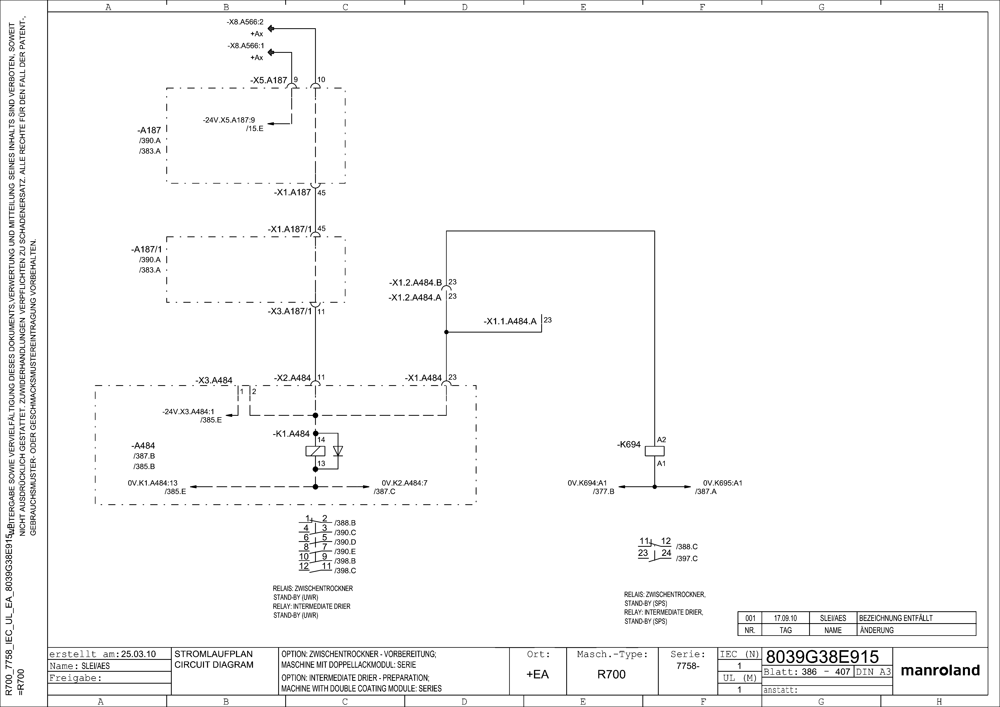

# +EA — Sheet 386 of 407 — OPTION: ZWISCHENTROCKNER VORBEREITUNG;

**MASCHINE MIT DOPPELLACKMODUL: SERIE**

> Part of the manroland **R700** printing press IEC/UL circuit diagrams.
> Drawing class: **Stromlaufplan / Circuit diagram** (DIN A3).
> Document `+EA` covers the **Printing unit** machine section.

## At a glance

| Field | Value |
|---|---|
| Document | `+EA`  (8039G38E915) |
| Sheet | **386** of 407 |
| Section (DE) | OPTION: ZWISCHENTROCKNER VORBEREITUNG; |
| Section (EN) | MASCHINE MIT DOPPELLACKMODUL: SERIE |
| Section type | CIRCUIT — Circuit diagram |
| Machine type | `R700` |
| Series | `7758` |
| Created | 25.03.10 |
| Replaces | — |
| Columns used | A, B, C, D, E, F, G, H |
| Path numbers | — |
| Labels on sheet | 92 |
| Cross-refs out | 19 |
| Cross-refs in | 32 |

**Previous:** [+EA sheet 385](SHEET_0385.md) · **Next:** [+EA sheet 387](SHEET_0387.md) · **Document TOC:** [_TOC.md](_TOC.md)  (+EA) · **Master TOC:** [all sheets](../_MASTER_TOC.md)

## Sheet image (300 DPI, exact vector render)



_Rendered directly from the PDF vector layer at 300 DPI (1-bit), no OCR and no resampling. Use it to confirm anything ambiguous in the text below._

## Cross-references on this sheet

Each entry is a wire leaving this sheet. The printed token is `/sheet.column`; the link resolves to that sheet inside the same document.

| Ref | Target sheet | Col | Path | Destination on target | Target section | From col |
|---|---|---|---|---|---|---|
| `/15.E` | [+EA sheet 15](SHEET_0015.md) | E | — | 24V.X5.A187:9 | SPANNUNGSVERSORGUNG: 400V, 24V | B |
| `/390.A` | [+EA sheet 390](SHEET_0390.md) | A | — | — | OPTION: ZWISCHENTROCKNER VORBEREITUNG; | A |
| `/383.A` | [+EA sheet 383](SHEET_0383.md) | A | — | — | OPTION: ENDTROCKNER 2 VORBEREITUNG | A |
| `/390.A` | [+EA sheet 390](SHEET_0390.md) | A | — | — | OPTION: ZWISCHENTROCKNER VORBEREITUNG; | A |
| `/383.A` | [+EA sheet 383](SHEET_0383.md) | A | — | — | OPTION: ENDTROCKNER 2 VORBEREITUNG | A |
| `/385.E` | [+EA sheet 385](SHEET_0385.md) | E | — | 24V.X3.A484:1 | OPTION: ZWISCHENTROCKNER VORBEREITUNG; | B |
| `/387.B` | [+EA sheet 387](SHEET_0387.md) | B | — | — | OPTION: ZWISCHENTROCKNER VORBEREITUNG; | A |
| `/385.B` | [+EA sheet 385](SHEET_0385.md) | B | — | — | OPTION: ZWISCHENTROCKNER VORBEREITUNG; | A |
| `/385.E` | [+EA sheet 385](SHEET_0385.md) | E | — | 0V.K2.A484:7 0V.K694:A1 0V.K1.A484:13 | OPTION: ZWISCHENTROCKNER VORBEREITUNG; | D |
| `/377.B` | [+EA sheet 377](SHEET_0377.md) | B | — | 0V.K2.A484:7 0V.K694:A1 0V.K1.A484:13 | OPTION: ENDTROCKNER 2 VORBEREITUNG | D |
| `/387.A` | [+EA sheet 387](SHEET_0387.md) | A | — | 0V.K2.A484:7 0V.K694:A1 0V.K1.A484:13 | OPTION: ZWISCHENTROCKNER VORBEREITUNG; | D |
| `/387.C` | [+EA sheet 387](SHEET_0387.md) | C | — | — | OPTION: ZWISCHENTROCKNER VORBEREITUNG; | C |
| `/388.B` | [+EA sheet 388](SHEET_0388.md) | B | — | — | OPTION: ZWISCHENTROCKNER VORBEREITUNG; | C |
| `/390.C` | [+EA sheet 390](SHEET_0390.md) | C | — | — | OPTION: ZWISCHENTROCKNER VORBEREITUNG; | C |
| `/390.D` | [+EA sheet 390](SHEET_0390.md) | D | — | — | OPTION: ZWISCHENTROCKNER VORBEREITUNG; | C |
| `/390.E` | [+EA sheet 390](SHEET_0390.md) | E | — | — | OPTION: ZWISCHENTROCKNER VORBEREITUNG; | C |
| `/398.B` | [+EA sheet 398](SHEET_0398.md) | B | — | — | OPTION: ZWISCHENTROCKNER VORBEREITUNG; | C |
| `/398.C` | [+EA sheet 398](SHEET_0398.md) | C | — | — | OPTION: ZWISCHENTROCKNER VORBEREITUNG; | C |
| `/397.C` | [+EA sheet 397](SHEET_0397.md) | C | — | — | OPTION: ZWISCHENTROCKNER VORBEREITUNG; | F |

### Incoming references (sheets that point here)

Every other sheet that sends a wire to this one. `Back-ref` is the token printed on *that* sheet; `Path` is its line number.

| From sheet | Cols | Back-ref | Path | Refs | What continues there |
|---|---|---|---|---|---|
| [+EA#15](SHEET_0015.md) | F | `/15.F` | — | 1 | 24V.X5.A187:9 |
| [+EA#206](SHEET_0206.md) | H | `/206.H` | — | 1 | — |
| [+EA#207](SHEET_0207.md) | B | `/207.B` | — | 1 | — |
| [+EA#210](SHEET_0210.md) | F, H | `/210.F`, `/210.H` | — | 2 | — |
| [+EA#211](SHEET_0211.md) | B, D | `/211.B`, `/211.D` | — | 2 | — |
| [+EA#230](SHEET_0230.md) | B | `/230.B` | — | 1 | — |
| [+EA#231](SHEET_0231.md) | G | `/231.G` | — | 1 | — |
| [+EA#235](SHEET_0235.md) | D | `/235.D` | — | 2 | — |
| [+EA#239](SHEET_0239.md) | B | `/239.B` | — | 2 | — |
| [+EA#377](SHEET_0377.md) | B | `/377.B` | — | 1 | — |
| [+EA#383](SHEET_0383.md) | A | `/383.A` | — | 2 | — |
| [+EA#385](SHEET_0385.md) | B, E | `/385.B`, `/385.E` | — | 3 | 0V.K1.A484:13; 24V.X3.A484:1 |
| [+EA#387](SHEET_0387.md) | A, B | `/387.A`, `/387.B` | — | 3 | 0V.K2.A484:7; 0V.K695:A1 |
| [+EA#388](SHEET_0388.md) | A, C | `/388.A`, `/388.C` | — | 2 | — |
| [+EA#390](SHEET_0390.md) | A, C, D, E | `/390.A`, `/390.C`, `/390.D`, `/390.E` | — | 5 | — |
| [+EA#397](SHEET_0397.md) | C | `/397.C` | — | 1 | — |
| [+EA#398](SHEET_0398.md) | B, C | `/398.B`, `/398.C` | — | 2 | — |


## Devices on this sheet

| Tag | Class | Class meaning (IEC) | Col | Sub | Terminal | Sign |
|---|---|---|---|---|---|---|
| `A187` | A | Baugruppe / assembly, module, PC board | A | — | — | — |
| `A187/1` | A | Baugruppe / assembly, module, PC board | A | 1 | — | — |
| `A484` | A | Baugruppe / assembly, module, PC board | A | — | — | — |
| `A2` | A | Baugruppe / assembly, module, PC board | F | — | — | — |
| `A1` | A | Baugruppe / assembly, module, PC board | F | — | — | — |
| `K694` | K | Relais / relay, contactor | E | — | — | — |
| `X1.A187` | — | cross-device reference | C | — | — | — |
| `X5.A187` | — | cross-device reference | B | — | — | — |
| `X8.A566:1` | — | cross-device reference | B | — | 1 | — |
| `X8.A566:2` | — | cross-device reference | B | — | 2 | — |
| `X2.A484` | — | cross-device reference | C | — | — | — |
| `K1.A484` | — | cross-device reference | C | — | — | — |
| `X1.A484` | — | cross-device reference | D | — | — | — |
| `X1.2.A484.B` | — | cross-device reference | D | — | — | — |
| `X1.2.A484.A` | — | cross-device reference | D | — | — | — |
| `X1.1.A484.A` | — | cross-device reference | D | — | — | — |
| `NR.` | — | cross-device reference | F | — | — | — |
| `17.09.10` | — | cross-device reference | G | — | — | — |
| `X3.A484` | — | cross-device reference | B | — | — | — |

## Potentials / nets

| Potential | Count | Columns | Attached devices | Terminals |
|---|---|---|---|---|
| `0V` | 4 | A, C, E, F | `A484`, `K1`, `K2`, `K694`, `K695` | `13`, `7`, `A1` |
| `24V` | 2 | B | `A187`, `A484`, `X3`, `X5` | `1`, `9` |


A potential such as `L24+/4` or `M24+` is a named supply/return rail; every place it appears on this sheet is electrically common.

## Wire-end annotations (grouped as printed)

A wire that continues elsewhere is annotated with a small cluster: the destination description, the path/line number `#NN`, and the `/sheet.column` cross reference. Each row below is one such cluster exactly as it is grouped on the drawing.

| Col | Y | Path | Cross-ref | Text on the wire |
|---|---|---|---|---|
| B | 22.2 | — | — | `X8.A566:2` |
| B | 36.5 | — | — | `+Ax` |
| B | 50.6 | — | — | `X8.A566:1` |
| B | 64.8 | — | — | `+Ax` |
| B | 91.0 | — | — | `X5.A187 9` |
| C | 91.0 | — | — | `10` |
| B | 139.2 | — | `/15.E` | `24V.X5.A187:9` |
| A | 150.5 | — | — | `A187` |
| A | 163.6 | — | `/390.A`, `/383.A` | — |
| C | 224.2 | — | — | `X1.A187 45` |
| C | 268.2 | — | — | `X1.A187/1 45` |
| A | 292.3 | — | — | `A187/1` |
| A | 305.3 | — | `/390.A`, `/383.A` | — |
| D | 332.0 | — | — | `X1.2.A484.B 23` |
| D | 349.0 | — | — | `X1.2.A484.A 23` |
| C | 366.0 | — | — | `X3.A187/1 11` |
| D | 377.3 | — | — | `X1.1.A484.A 23` |
| C | 445.4 | — | — | `X2.A484 11` |
| D | 445.4 | — | — | `X1.A484 23` |
| B | 448.2 | — | — | `X3.A484` |
| B | 462.4 | — | — | `1 2` |
| B | 486.4 | — | `/385.E` | `24V.X3.A484:1` |
| C | 512.0 | — | — | `K1.A484` |
| F | 519.7 | — | — | `A2` |
| C | 519.8 | — | — | `14` |
| E | 524.7 | — | — | `K694` |
| A | 526.1 | — | — | `A484` |
| A | 539.2 | — | `/387.B`, `/385.B` | — |
| C | 548.1 | — | — | `13` |
| F | 548.1 | — | — | `A1` |
| D | 571.5 | — | `/385.E`, `/377.B`, `/387.A` | `0V.K1.A484:13 0V.K2.A484:7 0V.K694:A1` |
| F | 571.5 | — | — | `0V.K695:A1` |
| C | 581.4 | — | `/387.C` | — |
| C | 612.5 | — | — | `1 2` |
| C | 618.9 | — | `/388.B`, `/390.C`, `/390.D`, `/390.E`, `/398.B`, `/398.C` | — |
| C | 623.9 | — | — | `4 6 3 5` |
| F | 639.5 | — | — | `23 11 12 /388.C 24` |
| C | 646.6 | — | — | `8` |
| C | 646.6 | — | — | `7` |
| C | 657.9 | — | — | `10 12 11 9` |
| F | 661.5 | — | `/397.C` | — |
| C | 697.9 | — | — | `RELAIS: ZWISCHENTROCKNER` |
| F | 705.0 | — | — | `RELAIS: ZWISCHENTROCKNER,` |
| C | 708.6 | — | — | `RELAY: INTERMEDIATE DRIER STAND BY (UWR)` |
| F | 715.7 | — | — | `RELAY: INTERMEDIATE DRIER, STAND BY (SPS)` |
| C | 729.8 | — | — | `STAND BY (UWR)` |
| G | 733.0 | — | — | `001 17.09.10 SLEI/AES BEZEICHNUNG ENTFÄLLT` |
| F | 736.9 | — | — | `STAND BY (SPS)` |
| G | 747.1 | — | — | `NR. TAG NAME ÄNDERUNG` |


## Reconstructed tables

This sheet carries tabular content (pin map / terminal assignment / index). The grid below was rebuilt from the drawing's own rule lines, so each row is exactly one physical row of the table.

### Table 1 — 1 data rows × 4 columns (at x=283.5, y=34.0)

| X8.A566:1 1 | +Ax +Ax X5.A187 /15.E X1.A187/1 X3.A187/1 2 | 9 X1.A187 X2.A484 | 10 45 45 11 11 |
|---|---|---|---|
|  | `K1.A484` |  | `14 13` |


## Notes and free text on this sheet

| Text | Col | Y (pt) |
|---|---|---|
| `+Ax` | B | 64.85 |
| `X1.A187/1` | C | 268.19 |
| `X3.A187/1` | C | 365.98 |
| `RELAIS: ZWISCHENTROCKNER` | C | 697.93 |
| `STAND BY (UWR)` | C | 708.56 |
| `RELAY: INTERMEDIATE DRIER` | C | 719.21 |
| `12 /388.C` | F | 639.48 |
| `RELAIS: ZWISCHENTROCKNER,` | F | 705.01 |
| `STAND BY (SPS)` | F | 715.66 |
| `RELAY: INTERMEDIATE DRIER,` | F | 726.29 |
| `TAG` | G | 747.27 |
| `NAME` | G | 747.25 |
| `ÄNDERUNG` | G | 747.31 |
| `SLEI/AES` | G | 733.13 |
| `BEZEICHNUNG ENTFÄLLT` | H | 733.14 |

## Complete label inventory (exact text from the drawing)

Every text object inside the drawing area of this sheet, in DIN reading order (column A→H, then top→bottom). This is the authoritative list: if a string is not here it is not printed on this sheet.

| Col | Y | X | Dir | Type | Text |
|---|---|---|---|---|---|
| A | 150.5 | 163.6 | → | device tag | `A187` |
| A | 163.6 | 165.8 | → | cross-reference | `/390.A` |
| A | 176.0 | 165.8 | → | cross-reference | `/383.A` |
| A | 292.3 | 156.2 | → | device tag | `A187/1` |
| A | 305.3 | 165.8 | → | cross-reference | `/390.A` |
| A | 317.7 | 165.8 | → | cross-reference | `/383.A` |
| A | 526.1 | 156.5 | → | device tag | `A484` |
| A | 539.2 | 159.0 | → | cross-reference | `/387.B` |
| A | 551.6 | 159.0 | → | cross-reference | `/385.B` |
| A | 571.5 | 152.2 | → | potential | `0V.K1.A484:13` |
| B | 22.2 | 269.9 | → | device ref | `X8.A566:2` |
| B | 36.5 | 298.2 | → | text | `+Ax` |
| B | 50.6 | 271.0 | → | device ref | `X8.A566:1` |
| B | 64.8 | 298.2 | → | text | `+Ax` |
| B | 91.0 | 297.9 | → | device ref | `X5.A187` |
| B | 139.2 | 241.5 | → | potential | `24V.X5.A187:9` |
| B | 149.1 | 293.1 | → | cross-reference | `/15.E` |
| B | 448.2 | 232.7 | → | device ref | `X3.A484` |
| B | 462.4 | 285.4 | → | number | `1` |
| B | 462.4 | 300.2 | → | number | `2` |
| B | 486.4 | 193.3 | → | potential | `24V.X3.A484:1` |
| B | 496.3 | 238.7 | → | cross-reference | `/385.E` |
| B | 581.4 | 196.2 | → | cross-reference | `/385.E` |
| C | 91.0 | 349.8 | → | number | `9` |
| C | 91.0 | 377.6 | → | number | `10` |
| C | 224.2 | 326.3 | → | device ref | `X1.A187` |
| C | 225.7 | 378.1 | → | number | `45` |
| C | 268.2 | 318.9 | → | text | `X1.A187/1` |
| C | 268.2 | 378.1 | → | number | `45` |
| C | 366.0 | 318.9 | → | text | `X3.A187/1` |
| C | 367.4 | 377.6 | → | number | `11` |
| C | 445.3 | 326.3 | → | device ref | `X2.A484` |
| C | 445.4 | 377.6 | → | number | `11` |
| C | 512.0 | 324.9 | → | device ref | `K1.A484` |
| C | 519.8 | 377.6 | → | number | `14` |
| C | 548.1 | 377.6 | → | number | `13` |
| C | 571.4 | 454.7 | → | potential | `0V.K2.A484:7` |
| C | 581.4 | 445.0 | → | cross-reference | `/387.C` |
| C | 612.6 | 363.1 | → | number | `1` |
| C | 612.6 | 383.8 | → | number | `2` |
| C | 618.9 | 398.3 | → | cross-reference | `/388.B` |
| C | 623.9 | 361.7 | → | number | `4` |
| C | 623.9 | 383.5 | → | number | `3` |
| C | 630.3 | 398.3 | → | cross-reference | `/390.C` |
| C | 635.2 | 361.7 | → | number | `6` |
| C | 635.2 | 383.5 | → | number | `5` |
| C | 641.6 | 398.3 | → | cross-reference | `/390.D` |
| C | 646.6 | 361.7 | → | number | `8` |
| C | 646.6 | 383.8 | → | number | `7` |
| C | 652.9 | 398.3 | → | cross-reference | `/390.E` |
| C | 657.9 | 355.7 | → | number | `10` |
| C | 657.9 | 383.5 | → | number | `9` |
| C | 664.3 | 398.3 | → | cross-reference | `/398.B` |
| C | 669.2 | 355.7 | → | number | `12` |
| C | 669.2 | 383.0 | → | number | `11` |
| C | 675.6 | 398.3 | → | cross-reference | `/398.C` |
| C | 697.9 | 325.1 | → | text | `RELAIS: ZWISCHENTROCKNER` |
| C | 708.6 | 325.7 | → | text | `STAND BY (UWR)` |
| C | 719.2 | 325.1 | → | text | `RELAY: INTERMEDIATE DRIER` |
| C | 729.8 | 325.7 | → | text | `STAND BY (UWR)` |
| D | 332.0 | 463.5 | → | device ref | `X1.2.A484.B` |
| D | 332.0 | 534.0 | → | number | `23` |
| D | 349.0 | 534.0 | → | number | `23` |
| D | 349.7 | 462.6 | → | device ref | `X1.2.A484.A` |
| D | 378.0 | 576.0 | → | device ref | `X1.1.A484.A` |
| D | 445.3 | 482.2 | → | device ref | `X1.A484` |
| D | 445.4 | 534.0 | → | number | `23` |
| E | 377.3 | 647.4 | → | number | `23` |
| E | 524.7 | 734.7 | → | device tag | `K694` |
| E | 571.4 | 676.1 | → | potential | `0V.K694:A1` |
| E | 581.4 | 706.1 | → | cross-reference | `/377.B` |
| F | 519.7 | 782.4 | → | device tag | `A2` |
| F | 548.1 | 782.4 | → | device tag | `A1` |
| F | 571.4 | 837.4 | → | potential | `0V.K695:A1` |
| F | 581.4 | 827.7 | → | cross-reference | `/387.A` |
| F | 639.5 | 761.1 | → | number | `11` |
| F | 639.5 | 786.9 | → | text | `12 /388.C` |
| F | 653.7 | 759.7 | → | number | `23` |
| F | 653.7 | 787.7 | → | number | `24` |
| F | 661.5 | 805.0 | → | cross-reference | `/397.C` |
| F | 705.0 | 743.2 | → | text | `RELAIS: ZWISCHENTROCKNER,` |
| F | 715.7 | 743.8 | → | text | `STAND BY (SPS)` |
| F | 726.3 | 743.2 | → | text | `RELAY: INTERMEDIATE DRIER,` |
| F | 733.0 | 887.7 | → | number | `001` |
| F | 736.9 | 743.8 | → | text | `STAND BY (SPS)` |
| F | 747.1 | 886.7 | → | device ref | `NR.` |
| G | 733.1 | 921.5 | → | device ref | `17.09.10` |
| G | 733.1 | 976.6 | → | text | `SLEI/AES` |
| G | 747.3 | 928.3 | → | text | `TAG` |
| G | 747.3 | 981.7 | → | text | `NAME` |
| G | 747.3 | 1024.3 | → | text | `ÄNDERUNG` |
| H | 733.1 | 1023.2 | → | text | `BEZEICHNUNG ENTFÄLLT` |

## Reading-order text block

The same content as a plain block, grouped by DIN column — convenient to paste or to match against a visual description.

```text
=== Column A ===
 150.5  163.6  devtag       A187
 163.6  165.8  xref         /390.A
 176.0  165.8  xref         /383.A
 292.3  156.2  devtag       A187/1
 305.3  165.8  xref         /390.A
 317.7  165.8  xref         /383.A
 526.1  156.5  devtag       A484
 539.2  159.0  xref         /387.B
 551.6  159.0  xref         /385.B
 571.5  152.2  net          0V.K1.A484:13
=== Column B ===
  22.2  269.9  devref       X8.A566:2
  36.5  298.2  text         +Ax
  50.6  271.0  devref       X8.A566:1
  64.8  298.2  text         +Ax
  91.0  297.9  devref       X5.A187
 139.2  241.5  net          24V.X5.A187:9
 149.1  293.1  xref         /15.E
 448.2  232.7  devref       X3.A484
 462.4  285.4  numeric      1
 462.4  300.2  numeric      2
 486.4  193.3  net          24V.X3.A484:1
 496.3  238.7  xref         /385.E
 581.4  196.2  xref         /385.E
=== Column C ===
  91.0  349.8  numeric      9
  91.0  377.6  numeric      10
 224.2  326.3  devref       X1.A187
 225.7  378.1  numeric      45
 268.2  318.9  text         X1.A187/1
 268.2  378.1  numeric      45
 366.0  318.9  text         X3.A187/1
 367.4  377.6  numeric      11
 445.3  326.3  devref       X2.A484
 445.4  377.6  numeric      11
 512.0  324.9  devref       K1.A484
 519.8  377.6  numeric      14
 548.1  377.6  numeric      13
 571.4  454.7  net          0V.K2.A484:7
 581.4  445.0  xref         /387.C
 612.6  363.1  numeric      1
 612.6  383.8  numeric      2
 618.9  398.3  xref         /388.B
 623.9  361.7  numeric      4
 623.9  383.5  numeric      3
 630.3  398.3  xref         /390.C
 635.2  361.7  numeric      6
 635.2  383.5  numeric      5
 641.6  398.3  xref         /390.D
 646.6  361.7  numeric      8
 646.6  383.8  numeric      7
 652.9  398.3  xref         /390.E
 657.9  355.7  numeric      10
 657.9  383.5  numeric      9
 664.3  398.3  xref         /398.B
 669.2  355.7  numeric      12
 669.2  383.0  numeric      11
 675.6  398.3  xref         /398.C
 697.9  325.1  text         RELAIS: ZWISCHENTROCKNER
 708.6  325.7  text         STAND BY (UWR)
 719.2  325.1  text         RELAY: INTERMEDIATE DRIER
 729.8  325.7  text         STAND BY (UWR)
=== Column D ===
 332.0  463.5  devref       X1.2.A484.B
 332.0  534.0  numeric      23
 349.0  534.0  numeric      23
 349.7  462.6  devref       X1.2.A484.A
 378.0  576.0  devref       X1.1.A484.A
 445.3  482.2  devref       X1.A484
 445.4  534.0  numeric      23
=== Column E ===
 377.3  647.4  numeric      23
 524.7  734.7  devtag       K694
 571.4  676.1  net          0V.K694:A1
 581.4  706.1  xref         /377.B
=== Column F ===
 519.7  782.4  devtag       A2
 548.1  782.4  devtag       A1
 571.4  837.4  net          0V.K695:A1
 581.4  827.7  xref         /387.A
 639.5  761.1  numeric      11
 639.5  786.9  text         12 /388.C
 653.7  759.7  numeric      23
 653.7  787.7  numeric      24
 661.5  805.0  xref         /397.C
 705.0  743.2  text         RELAIS: ZWISCHENTROCKNER,
 715.7  743.8  text         STAND BY (SPS)
 726.3  743.2  text         RELAY: INTERMEDIATE DRIER,
 733.0  887.7  numeric      001
 736.9  743.8  text         STAND BY (SPS)
 747.1  886.7  devref       NR.
=== Column G ===
 733.1  921.5  devref       17.09.10
 733.1  976.6  text         SLEI/AES
 747.3  928.3  text         TAG
 747.3  981.7  text         NAME
 747.3 1024.3  text         ÄNDERUNG
=== Column H ===
 733.1 1023.2  text         BEZEICHNUNG ENTFÄLLT
```

---
_Generated from the PDF vector text layer; no OCR. Source: `R700_7758_IEC_UL_EA_8039G38E915_p`, sheet 386._
