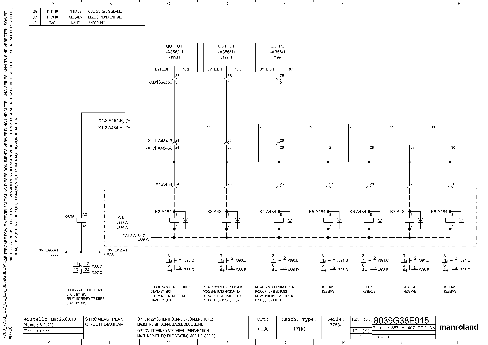

# +EA — Sheet 387 of 407 — OPTION: ZWISCHENTROCKNER VORBEREITUNG;

**MASCHINE MIT DOPPELLACKMODUL: SERIE**

> Part of the manroland **R700** printing press IEC/UL circuit diagrams.
> Drawing class: **Stromlaufplan / Circuit diagram** (DIN A3).
> Document `+EA` covers the **Printing unit** machine section.

## At a glance

| Field | Value |
|---|---|
| Document | `+EA`  (8039G38E915) |
| Sheet | **387** of 407 |
| Section (DE) | OPTION: ZWISCHENTROCKNER VORBEREITUNG; |
| Section (EN) | MASCHINE MIT DOPPELLACKMODUL: SERIE |
| Section type | CIRCUIT — Circuit diagram |
| Machine type | `R700` |
| Series | `7758` |
| Created | 25.03.10 |
| Replaces | — |
| Columns used | A, B, C, D, E, F, G, H |
| Path numbers | — |
| Labels on sheet | 182 |
| Cross-refs out | 23 |
| Cross-refs in | 52 |

**Previous:** [+EA sheet 386](SHEET_0386.md) · **Next:** [+EA sheet 388](SHEET_0388.md) · **Document TOC:** [_TOC.md](_TOC.md)  (+EA) · **Master TOC:** [all sheets](../_MASTER_TOC.md)

## Sheet image (300 DPI, exact vector render)



_Rendered directly from the PDF vector layer at 300 DPI (1-bit), no OCR and no resampling. Use it to confirm anything ambiguous in the text below._

## Cross-references on this sheet

Each entry is a wire leaving this sheet. The printed token is `/sheet.column`; the link resolves to that sheet inside the same document.

| Ref | Target sheet | Col | Path | Destination on target | Target section | From col |
|---|---|---|---|---|---|---|
| `/199.H` | [+EA sheet 199](SHEET_0199.md) | H | — | — | REFERENZMODUL | C |
| `/199.H` | [+EA sheet 199](SHEET_0199.md) | H | — | — | REFERENZMODUL | D |
| `/199.H` | [+EA sheet 199](SHEET_0199.md) | H | — | — | REFERENZMODUL | E |
| `/388.A` | [+EA sheet 388](SHEET_0388.md) | A | — | — | OPTION: ZWISCHENTROCKNER VORBEREITUNG; | B |
| `/386.A` | [+EA sheet 386](SHEET_0386.md) | A | — | — | OPTION: ZWISCHENTROCKNER VORBEREITUNG; | B |
| `/386.C` | [+EA sheet 386](SHEET_0386.md) | C | — | 0V.K2.A484:7 | OPTION: ZWISCHENTROCKNER VORBEREITUNG; | B |
| `/386.F` | [+EA sheet 386](SHEET_0386.md) | F | — | 0V.K695:A1 | OPTION: ZWISCHENTROCKNER VORBEREITUNG; | A |
| `/407.C` | [+EA sheet 407](SHEET_0407.md) | C | — | — | OPTION: AIR STATION | B |
| `/390.E` | [+EA sheet 390](SHEET_0390.md) | E | — | — | OPTION: ZWISCHENTROCKNER VORBEREITUNG; | E |
| `/391.B` | [+EA sheet 391](SHEET_0391.md) | B | — | — | OPTION: ZWISCHENTROCKNER VORBEREITUNG; | F |
| `/391.E` | [+EA sheet 391](SHEET_0391.md) | E | — | — | OPTION: ZWISCHENTROCKNER VORBEREITUNG; | H |
| `/390.C` | [+EA sheet 390](SHEET_0390.md) | C | — | — | OPTION: ZWISCHENTROCKNER VORBEREITUNG; | C |
| `/390.D` | [+EA sheet 390](SHEET_0390.md) | D | — | — | OPTION: ZWISCHENTROCKNER VORBEREITUNG; | D |
| `/391.C` | [+EA sheet 391](SHEET_0391.md) | C | — | — | OPTION: ZWISCHENTROCKNER VORBEREITUNG; | G |
| `/391.D` | [+EA sheet 391](SHEET_0391.md) | D | — | — | OPTION: ZWISCHENTROCKNER VORBEREITUNG; | G |
| `/398.E` | [+EA sheet 398](SHEET_0398.md) | E | — | — | OPTION: ZWISCHENTROCKNER VORBEREITUNG; | G |
| `/388.F` | [+EA sheet 388](SHEET_0388.md) | F | — | — | OPTION: ZWISCHENTROCKNER VORBEREITUNG; | D |
| `/398.F` | [+EA sheet 398](SHEET_0398.md) | F | — | — | OPTION: ZWISCHENTROCKNER VORBEREITUNG; | G |
| `/398.G` | [+EA sheet 398](SHEET_0398.md) | G | — | — | OPTION: ZWISCHENTROCKNER VORBEREITUNG; | H |
| `/388.C` | [+EA sheet 388](SHEET_0388.md) | C | — | — | OPTION: ZWISCHENTROCKNER VORBEREITUNG; | C |
| `/389.D` | [+EA sheet 389](SHEET_0389.md) | D | — | — | OPTION: ZWISCHENTROCKNER VORBEREITUNG; | E |
| `/398.D` | [+EA sheet 398](SHEET_0398.md) | D | — | — | OPTION: ZWISCHENTROCKNER VORBEREITUNG; | F |
| `/397.C` | [+EA sheet 397](SHEET_0397.md) | C | — | — | OPTION: ZWISCHENTROCKNER VORBEREITUNG; | B |

### Incoming references (sheets that point here)

Every other sheet that sends a wire to this one. `Back-ref` is the token printed on *that* sheet; `Path` is its line number.

| From sheet | Cols | Back-ref | Path | Refs | What continues there |
|---|---|---|---|---|---|
| [+EA#199](SHEET_0199.md) | H | `/199.H` | — | 3 | — |
| [+EA#210](SHEET_0210.md) | F, H | `/210.F`, `/210.H` | — | 17 | — |
| [+EA#211](SHEET_0211.md) | B, D | `/211.B`, `/211.D` | — | 8 | — |
| [+EA#258](SHEET_0258.md) | F | `/258.F` | — | 3 | — |
| [+EA#386](SHEET_0386.md) | A, C, D | `/386.A`, `/386.C`, `/386.D` | — | 3 | 0V.K2.A484:7 0V.K694:A1 0V.K1.A484:13 |
| [+EA#388](SHEET_0388.md) | A, C, F | `/388.A`, `/388.C`, `/388.F` | — | 4 | — |
| [+EA#389](SHEET_0389.md) | C | `/389.C` | — | 1 | — |
| [+EA#390](SHEET_0390.md) | C, D, E | `/390.C`, `/390.D`, `/390.E` | — | 3 | — |
| [+EA#391](SHEET_0391.md) | B, C, D, E | `/391.B`, `/391.C`, `/391.D`, `/391.E` | — | 4 | — |
| [+EA#397](SHEET_0397.md) | C | `/397.C` | — | 1 | — |
| [+EA#398](SHEET_0398.md) | D, E, F, G | `/398.D`, `/398.E`, `/398.F`, `/398.G` | — | 4 | — |
| [+EA#407](SHEET_0407.md) | B | `/407.B` | — | 1 | 0V.K612:A1 |


## Devices on this sheet

| Tag | Class | Class meaning (IEC) | Col | Sub | Terminal | Sign |
|---|---|---|---|---|---|---|
| `A2` | A | Baugruppe / assembly, module, PC board | B | — | — | — |
| `A1` | A | Baugruppe / assembly, module, PC board | B | — | — | — |
| `K695` | K | Relais / relay, contactor | A | — | — | — |
| `A356/11` | A | Baugruppe / assembly, module, PC board | C | 11 | — | — |
| `A356/11` | A | Baugruppe / assembly, module, PC board | D | 11 | — | — |
| `A356/11` | A | Baugruppe / assembly, module, PC board | E | 11 | — | — |
| `A484` | A | Baugruppe / assembly, module, PC board | B | — | — | — |
| `K7.A484` | — | cross-device reference | G | — | — | — |
| `K8.A484` | — | cross-device reference | H | — | — | — |
| `K5.A484` | — | cross-device reference | F | — | — | — |
| `K6.A484` | — | cross-device reference | F | — | — | — |
| `16.2` | — | cross-device reference | C | — | — | — |
| `XB13.A356` | — | cross-device reference | C | — | — | — |
| `X1.A484` | — | cross-device reference | C | — | — | — |
| `K2.A484` | — | cross-device reference | C | — | — | — |
| `16.3` | — | cross-device reference | D | — | — | — |
| `K3.A484` | — | cross-device reference | D | — | — | — |
| `16.4` | — | cross-device reference | E | — | — | — |
| `K4.A484` | — | cross-device reference | E | — | — | — |
| `X1.1.A484.A` | — | cross-device reference | C | — | — | — |
| `X1.1.A484.B` | — | cross-device reference | C | — | — | — |
| `X1.2.A484.B` | — | cross-device reference | B | — | — | — |
| `X1.2.A484.A` | — | cross-device reference | B | — | — | — |
| `NR.` | — | cross-device reference | A | — | — | — |
| `17.09.10` | — | cross-device reference | A | — | — | — |
| `11.11.10` | — | cross-device reference | A | — | — | — |

## Potentials / nets

| Potential | Count | Columns | Attached devices | Terminals |
|---|---|---|---|---|
| `0V` | 3 | A, B | `A484`, `K2`, `K612`, `K695` | `7`, `A1` |


A potential such as `L24+/4` or `M24+` is a named supply/return rail; every place it appears on this sheet is electrically common.

## Wire-end annotations (grouped as printed)

A wire that continues elsewhere is annotated with a small cluster: the destination description, the path/line number `#NN`, and the `/sheet.column` cross reference. Each row below is one such cluster exactly as it is grouped on the drawing.

| Col | Y | Path | Cross-ref | Text on the wire |
|---|---|---|---|---|
| A | 24.4 | — | — | `002 11.11.10 NHI/AES QUERVERWEIS GEÄND.` |
| A | 38.5 | — | — | `001 17.09.10 SLEI/AES BEZEICHNUNG ENTFÄLLT` |
| A | 52.7 | — | — | `NR. TAG NAME ÄNDERUNG` |
| C | 108.3 | — | — | `QUTPUT` |
| D | 108.3 | — | — | `QUTPUT` |
| E | 108.3 | — | — | `QUTPUT` |
| C | 122.2 | — | — | `A356/11` |
| D | 122.2 | — | — | `A356/11` |
| E | 122.2 | — | — | `A356/11` |
| C | 136.0 | — | `/199.H` | — |
| D | 136.0 | — | `/199.H` | — |
| E | 136.0 | — | `/199.H` | — |
| C | 165.6 | — | — | `BYTE.BIT 16.2` |
| D | 165.6 | — | — | `BYTE.BIT 16.3` |
| E | 165.6 | — | — | `BYTE.BIT 16.4` |
| C | 181.0 | — | — | `5B` |
| D | 181.0 | — | — | `6B` |
| E | 181.0 | — | — | `7B` |
| C | 195.9 | — | — | `XB13.A356 3` |
| D | 197.3 | — | — | `4` |
| E | 197.3 | — | — | `5` |
| B | 289.4 | — | — | `X1.2.A484.B 24` |
| B | 306.5 | — | — | `X1.2.A484.A 24` |
| D | 306.5 | — | — | `25 26` |
| E | 306.5 | — | — | `27` |
| F | 306.5 | — | — | `28` |
| G | 306.5 | — | — | `29` |
| H | 306.5 | — | — | `30` |
| C | 339.1 | — | — | `X1.1.A484.B 24` |
| D | 339.1 | — | — | `25` |
| E | 339.1 | — | — | `26` |
| C | 356.1 | — | — | `X1.1.A484.A 24` |
| D | 356.1 | — | — | `25` |
| E | 356.1 | — | — | `26` |
| F | 356.1 | — | — | `27` |
| G | 356.1 | — | — | `28` |
| G | 356.1 | — | — | `29` |
| H | 356.1 | — | — | `30` |
| C | 445.4 | — | — | `X1.A484 24` |
| D | 445.4 | — | — | `25` |
| E | 445.4 | — | — | `26` |
| F | 445.4 | — | — | `27` |
| G | 445.4 | — | — | `28` |
| G | 445.4 | — | — | `29` |
| H | 445.4 | — | — | `30` |
| C | 512.0 | — | — | `K2.A484` |
| D | 512.0 | — | — | `K3.A484` |
| E | 512.0 | — | — | `K4.A484` |
| F | 512.0 | — | — | `K5.A484` |
| F | 512.0 | — | — | `K6.A484` |
| G | 512.0 | — | — | `K7.A484` |
| H | 512.0 | — | — | `K8.A484` |
| B | 519.7 | — | — | `A2` |
| C | 519.8 | — | — | `8` |
| D | 519.8 | — | — | `8` |
| E | 519.8 | — | — | `8` |
| F | 519.8 | — | — | `8` |
| F | 519.8 | — | — | `8` |
| G | 519.8 | — | — | `8` |
| H | 519.8 | — | — | `8` |
| A | 524.7 | — | — | `K695` |
| B | 526.1 | — | — | `A484` |
| B | 539.2 | — | `/388.A`, `/386.A` | — |
| B | 548.1 | — | — | `A1` |
| C | 548.1 | — | — | `7` |
| D | 548.1 | — | — | `7` |
| E | 548.1 | — | — | `7` |
| F | 548.1 | — | — | `7` |
| F | 548.1 | — | — | `7` |
| G | 548.1 | — | — | `7` |
| H | 548.1 | — | — | `7` |
| B | 571.5 | — | `/386.C` | `0V.K2.A484:7` |
| A | 606.9 | — | `/386.F` | `0V.K695:A1` |
| B | 606.9 | — | — | `0V.K612:A1` |
| B | 616.8 | — | `/407.C` | — |
| C | 619.6 | — | — | `3 6 4 1` |
| D | 619.6 | — | — | `3 6 4 1` |
| E | 619.6 | — | — | `3 6 4 1` |
| F | 619.6 | — | — | `3 6 4 1` |
| F | 619.6 | — | — | `3 6 4 1` |
| G | 619.6 | — | — | `3 6 4 1` |
| H | 619.6 | — | — | `3 6 4 1` |
| C | 625.3 | — | — | `2` |
| D | 625.3 | — | — | `2` |
| E | 625.3 | — | — | `2` |
| F | 625.3 | — | — | `2` |
| G | 625.3 | — | — | `2` |
| G | 625.3 | — | — | `2` |
| H | 625.3 | — | — | `2` |
| C | 631.7 | — | `/390.C` | — |
| D | 631.7 | — | `/390.D` | — |
| E | 631.7 | — | `/390.E` | — |
| F | 631.7 | — | `/391.B` | — |
| G | 631.7 | — | `/391.C` | — |
| G | 631.7 | — | `/391.D` | — |
| H | 631.7 | — | `/391.E` | — |
| B | 639.5 | — | — | `23 11 12 /388.C 24` |
| C | 648.0 | — | — | `5` |
| D | 648.0 | — | — | `5` |
| E | 648.0 | — | — | `5` |
| F | 648.0 | — | — | `5` |
| G | 648.0 | — | — | `5` |
| G | 648.0 | — | — | `5` |
| H | 648.0 | — | — | `5` |
| C | 654.4 | — | `/388.C` | — |
| D | 654.4 | — | `/388.F` | — |
| E | 654.4 | — | `/389.D` | — |
| F | 654.4 | — | `/398.D` | — |
| G | 654.4 | — | `/398.E` | — |
| G | 654.4 | — | `/398.F` | — |
| H | 654.4 | — | `/398.G` | — |
| B | 661.5 | — | `/397.C` | — |
| C | 697.9 | — | — | `RELAIS: ZWISCHENTROCKNER` |
| D | 697.9 | — | — | `RELAIS: ZWISCHENTROCKNER` |
| E | 697.9 | — | — | `RELAIS: ZWISCHENTROCKNER PRODUKTIONSLEISTUNG RELAY: INTERMEDIATE DRIER PRODUCTION OUTPUT` |
| F | 697.9 | — | — | `RESERVE RESERVE` |
| F | 697.9 | — | — | `RESERVE RESERVE` |
| G | 697.9 | — | — | `RESERVE RESERVE` |
| H | 697.9 | — | — | `RESERVE RESERVE` |
| B | 705.0 | — | — | `RELAIS: ZWISCHENTROCKNER,` |
| C | 708.6 | — | — | `RELAY: INTERMEDIATE DRIER STAND BY (SPS)` |
| D | 708.6 | — | — | `RELAY: INTERMEDIATE DRIER PREPARATION PRODUCTION VORBEREITUNG PRODUKTION` |
| B | 715.7 | — | — | `RELAY: INTERMEDIATE DRIER, STAND BY (SPS)` |
| C | 729.8 | — | — | `STAND BY (SPS)` |
| A | 736.9 | — | — | `STAND BY (SPS)` |


## Reconstructed tables

This sheet carries tabular content (pin map / terminal assignment / index). The grid below was rebuilt from the drawing's own rule lines, so each row is exactly one physical row of the table.

### Table 1 — 4 data rows × 5 columns (at x=198.4, y=104.9)

|  |  | QUTPUT | A356/11 /199.H |  |
|---|---|---|---|---|
|  |  | `BYTE.BIT` |  | `16.2` |
|  |  | `XB13.A356` | `5B 3` |  |
| `X1.2.A484.B X1.2.A484.A` | `24 24` | `X1.1.A484.B X1.1.A484.A` | `24 24` |  |
| `A2 A484 /388.A A1 /386.A` | `0V.K2.A484:7` | `X1.A484 K2.A484` | `24 8 7` |  |


### Table 2 — 4 data rows × 3 columns (at x=503.1, y=104.9)

| QUTPUT | A356/11 /199.H |  |
|---|---|---|
| `BYTE.BIT` |  | `16.3` |
|  | `6B 4` |  |
| `25` | `25 25` |  |
| `K3.A484` | `25 8 7` |  |


### Table 3 — 4 data rows × 3 columns (at x=630.7, y=104.9)

| QUTPUT | A356/11 /199.H |  |
|---|---|---|
| `BYTE.BIT` |  | `16.4` |
|  | `7B 5` |  |
| `26` | `26 26` |  |
| `K4.A484` | `26 8 7` |  |


### Table 4 — 1 data rows × 2 columns (at x=751.2, y=104.9)

| 27 | 27 |
|---|---|
| `K5.A484` | `27 8 7` |


### Table 5 — 1 data rows × 2 columns (at x=850.4, y=104.9)

| 28 | 28 |
|---|---|
| `K6.A484` | `28 8 7` |


### Table 6 — 1 data rows × 2 columns (at x=949.6, y=104.9)

| 29 | 29 |
|---|---|
| `K7.A484` | `29 8 7` |


### Table 7 — 1 data rows × 2 columns (at x=1048.8, y=104.9)

| 30 | 30 |
|---|---|
| `K8.A484` | `30 8 7` |


## Notes and free text on this sheet

| Text | Col | Y (pt) |
|---|---|---|
| `RESERVE` | G | 697.91 |
| `RESERVE` | H | 697.91 |
| `RESERVE` | F | 697.91 |
| `12 /388.C` | B | 639.48 |
| `RELAIS: ZWISCHENTROCKNER,` | B | 705.01 |
| `STAND BY (SPS)` | A | 715.66 |
| `RELAY: INTERMEDIATE DRIER,` | B | 726.29 |
| `5B` | C | 180.98 |
| `QUTPUT` | C | 108.33 |
| `BYTE.BIT` | C | 165.6 |
| `RELAIS: ZWISCHENTROCKNER` | C | 697.93 |
| `STAND BY (SPS)` | C | 708.57 |
| `RELAY: INTERMEDIATE DRIER` | C | 719.21 |
| `6B` | D | 180.98 |
| `QUTPUT` | D | 108.33 |
| `BYTE.BIT` | D | 165.6 |
| `RELAIS: ZWISCHENTROCKNER` | D | 697.93 |
| `VORBEREITUNG PRODUKTION` | D | 708.59 |
| `RELAY: INTERMEDIATE DRIER` | D | 719.21 |
| `PREPARATION PRODUCTION` | D | 729.85 |
| `7B` | E | 180.98 |
| `QUTPUT` | E | 108.33 |
| `BYTE.BIT` | E | 165.6 |
| `RELAIS: ZWISCHENTROCKNER` | E | 697.93 |
| `PRODUKTIONSLEISTUNG` | E | 708.58 |
| `RELAY: INTERMEDIATE DRIER` | E | 719.21 |
| `PRODUCTION OUTPUT` | E | 729.86 |
| `TAG` | A | 52.78 |
| `NAME` | A | 52.76 |
| `ÄNDERUNG` | B | 52.82 |
| `SLEI/AES` | A | 38.64 |
| `BEZEICHNUNG ENTFÄLLT` | B | 38.66 |
| `NHI/AES` | A | 24.45 |
| `QUERVERWEIS GEÄND.` | B | 24.44 |

## Complete label inventory (exact text from the drawing)

Every text object inside the drawing area of this sheet, in DIN reading order (column A→H, then top→bottom). This is the authoritative list: if a string is not here it is not printed on this sheet.

| Col | Y | X | Dir | Type | Text |
|---|---|---|---|---|---|
| A | 24.4 | 170.0 | → | text | `NHI/AES` |
| A | 24.5 | 79.2 | → | number | `002` |
| A | 24.5 | 113.6 | → | device ref | `11.11.10` |
| A | 38.5 | 79.8 | → | number | `001` |
| A | 38.6 | 113.6 | → | device ref | `17.09.10` |
| A | 38.6 | 168.7 | → | text | `SLEI/AES` |
| A | 52.7 | 78.9 | → | device ref | `NR.` |
| A | 52.8 | 120.4 | → | text | `TAG` |
| A | 52.8 | 173.8 | → | text | `NAME` |
| A | 524.7 | 153.6 | → | device tag | `K695` |
| A | 606.9 | 95.0 | → | potential | `0V.K695:A1` |
| A | 616.8 | 125.6 | → | cross-reference | `/386.F` |
| A | 639.5 | 180.0 | → | number | `11` |
| A | 653.7 | 178.6 | → | number | `23` |
| A | 715.7 | 162.7 | → | text | `STAND BY (SPS)` |
| A | 736.9 | 162.7 | → | text | `STAND BY (SPS)` |
| B | 24.4 | 215.6 | → | text | `QUERVERWEIS GEÄND.` |
| B | 38.7 | 215.3 | → | text | `BEZEICHNUNG ENTFÄLLT` |
| B | 52.8 | 216.4 | → | text | `ÄNDERUNG` |
| B | 289.5 | 236.7 | → | device ref | `X1.2.A484.B` |
| B | 289.5 | 307.3 | → | number | `24` |
| B | 306.5 | 307.3 | → | number | `24` |
| B | 307.2 | 235.8 | → | device ref | `X1.2.A484.A` |
| B | 519.7 | 201.3 | → | device tag | `A2` |
| B | 526.1 | 284.0 | → | device tag | `A484` |
| B | 539.2 | 286.3 | → | cross-reference | `/388.A` |
| B | 548.1 | 201.3 | → | device tag | `A1` |
| B | 551.6 | 286.3 | → | cross-reference | `/386.A` |
| B | 571.4 | 298.8 | → | potential | `0V.K2.A484:7` |
| B | 606.9 | 263.3 | → | potential | `0V.K612:A1` |
| B | 616.8 | 253.7 | → | cross-reference | `/407.C` |
| B | 639.5 | 205.8 | → | text | `12 /388.C` |
| B | 653.7 | 206.6 | → | number | `24` |
| B | 661.5 | 223.9 | → | cross-reference | `/397.C` |
| B | 705.0 | 162.1 | → | text | `RELAIS: ZWISCHENTROCKNER,` |
| B | 726.3 | 162.1 | → | text | `RELAY: INTERMEDIATE DRIER,` |
| C | 108.3 | 404.9 | → | text | `QUTPUT` |
| C | 122.2 | 404.5 | → | device tag | `A356/11` |
| C | 136.0 | 412.7 | → | cross-reference | `/199.H` |
| C | 165.6 | 378.4 | → | text | `BYTE.BIT` |
| C | 165.6 | 445.5 | → | device ref | `16.2` |
| C | 181.0 | 427.7 | → | text | `5B` |
| C | 195.9 | 362.8 | → | device ref | `XB13.A356` |
| C | 197.3 | 427.7 | → | number | `3` |
| C | 339.1 | 357.2 | → | device ref | `X1.1.A484.B` |
| C | 339.1 | 427.7 | → | number | `24` |
| C | 356.1 | 427.7 | → | number | `24` |
| C | 356.8 | 356.3 | → | device ref | `X1.1.A484.A` |
| C | 445.3 | 375.9 | → | device ref | `X1.A484` |
| C | 445.4 | 427.7 | → | number | `24` |
| C | 512.0 | 374.5 | → | device ref | `K2.A484` |
| C | 519.8 | 427.7 | → | number | `8` |
| C | 548.1 | 427.7 | → | number | `7` |
| C | 581.4 | 337.3 | → | cross-reference | `/386.C` |
| C | 619.6 | 408.5 | → | number | `3` |
| C | 625.3 | 436.3 | → | number | `2` |
| C | 631.0 | 409.9 | → | number | `1` |
| C | 631.7 | 447.9 | → | cross-reference | `/390.C` |
| C | 642.3 | 408.5 | → | number | `6` |
| C | 648.0 | 436.0 | → | number | `5` |
| C | 653.7 | 408.5 | → | number | `4` |
| C | 654.4 | 447.9 | → | cross-reference | `/388.C` |
| C | 697.9 | 367.7 | → | text | `RELAIS: ZWISCHENTROCKNER` |
| C | 708.6 | 368.2 | → | text | `STAND BY (SPS)` |
| C | 719.2 | 367.7 | → | text | `RELAY: INTERMEDIATE DRIER` |
| C | 729.8 | 368.2 | → | text | `STAND BY (SPS)` |
| D | 108.3 | 532.5 | → | text | `QUTPUT` |
| D | 122.2 | 532.1 | → | device tag | `A356/11` |
| D | 136.0 | 540.3 | → | cross-reference | `/199.H` |
| D | 165.6 | 506.0 | → | text | `BYTE.BIT` |
| D | 165.6 | 572.9 | → | device ref | `16.3` |
| D | 181.0 | 555.3 | → | text | `6B` |
| D | 197.3 | 555.3 | → | number | `4` |
| D | 306.5 | 505.7 | → | number | `25` |
| D | 339.1 | 555.3 | → | number | `25` |
| D | 356.1 | 555.3 | → | number | `25` |
| D | 445.4 | 555.3 | → | number | `25` |
| D | 512.0 | 502.0 | → | device ref | `K3.A484` |
| D | 519.8 | 555.3 | → | number | `8` |
| D | 548.1 | 555.3 | → | number | `7` |
| D | 619.6 | 536.0 | → | number | `3` |
| D | 625.3 | 563.8 | → | number | `2` |
| D | 631.0 | 537.4 | → | number | `1` |
| D | 631.7 | 575.4 | → | cross-reference | `/390.D` |
| D | 642.3 | 536.0 | → | number | `6` |
| D | 648.0 | 563.5 | → | number | `5` |
| D | 653.7 | 536.0 | → | number | `4` |
| D | 654.4 | 575.4 | → | cross-reference | `/388.F` |
| D | 697.9 | 495.2 | → | text | `RELAIS: ZWISCHENTROCKNER` |
| D | 708.6 | 496.1 | → | text | `VORBEREITUNG PRODUKTION` |
| D | 719.2 | 495.2 | → | text | `RELAY: INTERMEDIATE DRIER` |
| D | 729.8 | 495.2 | → | text | `PREPARATION PRODUCTION` |
| E | 108.3 | 660.0 | → | text | `QUTPUT` |
| E | 122.2 | 659.6 | → | device tag | `A356/11` |
| E | 136.0 | 667.8 | → | cross-reference | `/199.H` |
| E | 165.6 | 633.5 | → | text | `BYTE.BIT` |
| E | 165.6 | 700.4 | → | device ref | `16.4` |
| E | 181.0 | 682.9 | → | text | `7B` |
| E | 197.3 | 682.9 | → | number | `5` |
| E | 306.5 | 633.3 | → | number | `26` |
| E | 306.5 | 753.7 | → | number | `27` |
| E | 339.1 | 682.9 | → | number | `26` |
| E | 356.1 | 682.9 | → | number | `26` |
| E | 445.4 | 682.9 | → | number | `26` |
| E | 512.0 | 629.6 | → | device ref | `K4.A484` |
| E | 519.8 | 682.9 | → | number | `8` |
| E | 548.1 | 682.9 | → | number | `7` |
| E | 619.6 | 663.6 | → | number | `3` |
| E | 625.3 | 691.4 | → | number | `2` |
| E | 631.0 | 665.0 | → | number | `1` |
| E | 631.7 | 703.0 | → | cross-reference | `/390.E` |
| E | 642.3 | 663.6 | → | number | `6` |
| E | 648.0 | 691.1 | → | number | `5` |
| E | 653.7 | 663.6 | → | number | `4` |
| E | 654.4 | 703.0 | → | cross-reference | `/389.D` |
| E | 697.9 | 622.8 | → | text | `RELAIS: ZWISCHENTROCKNER` |
| E | 708.6 | 622.8 | → | text | `PRODUKTIONSLEISTUNG` |
| E | 719.2 | 622.8 | → | text | `RELAY: INTERMEDIATE DRIER` |
| E | 729.9 | 622.8 | → | text | `PRODUCTION OUTPUT` |
| F | 306.5 | 852.9 | → | number | `28` |
| F | 356.1 | 803.3 | → | number | `27` |
| F | 445.4 | 803.3 | → | number | `27` |
| F | 512.0 | 750.0 | → | device ref | `K5.A484` |
| F | 512.0 | 849.3 | → | device ref | `K6.A484` |
| F | 519.8 | 803.3 | → | number | `8` |
| F | 519.8 | 902.6 | → | number | `8` |
| F | 548.1 | 803.3 | → | number | `7` |
| F | 548.1 | 902.6 | → | number | `7` |
| F | 619.6 | 784.1 | → | number | `3` |
| F | 619.6 | 883.3 | → | number | `3` |
| F | 625.3 | 811.8 | → | number | `2` |
| F | 631.0 | 785.5 | → | number | `1` |
| F | 631.0 | 884.7 | → | number | `1` |
| F | 631.7 | 823.5 | → | cross-reference | `/391.B` |
| F | 642.3 | 784.1 | → | number | `6` |
| F | 642.3 | 883.3 | → | number | `6` |
| F | 648.0 | 811.6 | → | number | `5` |
| F | 653.7 | 784.1 | → | number | `4` |
| F | 653.7 | 883.3 | → | number | `4` |
| F | 654.4 | 823.5 | → | cross-reference | `/398.D` |
| F | 697.9 | 785.8 | → | text | `RESERVE` |
| F | 697.9 | 885.0 | → | text | `RESERVE` |
| F | 708.5 | 785.8 | → | text | `RESERVE` |
| F | 708.5 | 885.0 | → | text | `RESERVE` |
| G | 306.5 | 952.2 | → | number | `29` |
| G | 356.1 | 902.6 | → | number | `28` |
| G | 356.1 | 1001.8 | → | number | `29` |
| G | 445.4 | 902.6 | → | number | `28` |
| G | 445.4 | 1001.8 | → | number | `29` |
| G | 512.0 | 948.5 | → | device ref | `K7.A484` |
| G | 519.8 | 1001.8 | → | number | `8` |
| G | 548.1 | 1001.8 | → | number | `7` |
| G | 619.6 | 982.5 | → | number | `3` |
| G | 625.3 | 911.1 | → | number | `2` |
| G | 625.3 | 1010.3 | → | number | `2` |
| G | 631.0 | 983.9 | → | number | `1` |
| G | 631.7 | 922.7 | → | cross-reference | `/391.C` |
| G | 631.7 | 1021.9 | → | cross-reference | `/391.D` |
| G | 642.3 | 982.5 | → | number | `6` |
| G | 648.0 | 910.8 | → | number | `5` |
| G | 648.0 | 1010.0 | → | number | `5` |
| G | 653.7 | 982.5 | → | number | `4` |
| G | 654.4 | 922.7 | → | cross-reference | `/398.E` |
| G | 654.4 | 1021.9 | → | cross-reference | `/398.F` |
| G | 697.9 | 984.2 | → | text | `RESERVE` |
| G | 708.5 | 984.2 | → | text | `RESERVE` |
| H | 306.5 | 1051.4 | → | number | `30` |
| H | 356.1 | 1101.0 | → | number | `30` |
| H | 445.4 | 1101.0 | → | number | `30` |
| H | 512.0 | 1047.7 | → | device ref | `K8.A484` |
| H | 519.8 | 1101.0 | → | number | `8` |
| H | 548.1 | 1101.0 | → | number | `7` |
| H | 619.6 | 1081.7 | → | number | `3` |
| H | 625.3 | 1109.5 | → | number | `2` |
| H | 631.0 | 1083.1 | → | number | `1` |
| H | 631.7 | 1121.1 | → | cross-reference | `/391.E` |
| H | 642.3 | 1081.7 | → | number | `6` |
| H | 648.0 | 1109.2 | → | number | `5` |
| H | 653.7 | 1081.7 | → | number | `4` |
| H | 654.4 | 1121.1 | → | cross-reference | `/398.G` |
| H | 697.9 | 1083.4 | → | text | `RESERVE` |
| H | 708.5 | 1083.4 | → | text | `RESERVE` |

## Reading-order text block

The same content as a plain block, grouped by DIN column — convenient to paste or to match against a visual description.

```text
=== Column A ===
  24.4  170.0  text         NHI/AES
  24.5   79.2  numeric      002
  24.5  113.6  devref       11.11.10
  38.5   79.8  numeric      001
  38.6  113.6  devref       17.09.10
  38.6  168.7  text         SLEI/AES
  52.7   78.9  devref       NR.
  52.8  120.4  text         TAG
  52.8  173.8  text         NAME
 524.7  153.6  devtag       K695
 606.9   95.0  net          0V.K695:A1
 616.8  125.6  xref         /386.F
 639.5  180.0  numeric      11
 653.7  178.6  numeric      23
 715.7  162.7  text         STAND BY (SPS)
 736.9  162.7  text         STAND BY (SPS)
=== Column B ===
  24.4  215.6  text         QUERVERWEIS GEÄND.
  38.7  215.3  text         BEZEICHNUNG ENTFÄLLT
  52.8  216.4  text         ÄNDERUNG
 289.5  236.7  devref       X1.2.A484.B
 289.5  307.3  numeric      24
 306.5  307.3  numeric      24
 307.2  235.8  devref       X1.2.A484.A
 519.7  201.3  devtag       A2
 526.1  284.0  devtag       A484
 539.2  286.3  xref         /388.A
 548.1  201.3  devtag       A1
 551.6  286.3  xref         /386.A
 571.4  298.8  net          0V.K2.A484:7
 606.9  263.3  net          0V.K612:A1
 616.8  253.7  xref         /407.C
 639.5  205.8  text         12 /388.C
 653.7  206.6  numeric      24
 661.5  223.9  xref         /397.C
 705.0  162.1  text         RELAIS: ZWISCHENTROCKNER,
 726.3  162.1  text         RELAY: INTERMEDIATE DRIER,
=== Column C ===
 108.3  404.9  text         QUTPUT
 122.2  404.5  devtag       A356/11
 136.0  412.7  xref         /199.H
 165.6  378.4  text         BYTE.BIT
 165.6  445.5  devref       16.2
 181.0  427.7  text         5B
 195.9  362.8  devref       XB13.A356
 197.3  427.7  numeric      3
 339.1  357.2  devref       X1.1.A484.B
 339.1  427.7  numeric      24
 356.1  427.7  numeric      24
 356.8  356.3  devref       X1.1.A484.A
 445.3  375.9  devref       X1.A484
 445.4  427.7  numeric      24
 512.0  374.5  devref       K2.A484
 519.8  427.7  numeric      8
 548.1  427.7  numeric      7
 581.4  337.3  xref         /386.C
 619.6  408.5  numeric      3
 625.3  436.3  numeric      2
 631.0  409.9  numeric      1
 631.7  447.9  xref         /390.C
 642.3  408.5  numeric      6
 648.0  436.0  numeric      5
 653.7  408.5  numeric      4
 654.4  447.9  xref         /388.C
 697.9  367.7  text         RELAIS: ZWISCHENTROCKNER
 708.6  368.2  text         STAND BY (SPS)
 719.2  367.7  text         RELAY: INTERMEDIATE DRIER
 729.8  368.2  text         STAND BY (SPS)
=== Column D ===
 108.3  532.5  text         QUTPUT
 122.2  532.1  devtag       A356/11
 136.0  540.3  xref         /199.H
 165.6  506.0  text         BYTE.BIT
 165.6  572.9  devref       16.3
 181.0  555.3  text         6B
 197.3  555.3  numeric      4
 306.5  505.7  numeric      25
 339.1  555.3  numeric      25
 356.1  555.3  numeric      25
 445.4  555.3  numeric      25
 512.0  502.0  devref       K3.A484
 519.8  555.3  numeric      8
 548.1  555.3  numeric      7
 619.6  536.0  numeric      3
 625.3  563.8  numeric      2
 631.0  537.4  numeric      1
 631.7  575.4  xref         /390.D
 642.3  536.0  numeric      6
 648.0  563.5  numeric      5
 653.7  536.0  numeric      4
 654.4  575.4  xref         /388.F
 697.9  495.2  text         RELAIS: ZWISCHENTROCKNER
 708.6  496.1  text         VORBEREITUNG PRODUKTION
 719.2  495.2  text         RELAY: INTERMEDIATE DRIER
 729.8  495.2  text         PREPARATION PRODUCTION
=== Column E ===
 108.3  660.0  text         QUTPUT
 122.2  659.6  devtag       A356/11
 136.0  667.8  xref         /199.H
 165.6  633.5  text         BYTE.BIT
 165.6  700.4  devref       16.4
 181.0  682.9  text         7B
 197.3  682.9  numeric      5
 306.5  633.3  numeric      26
 306.5  753.7  numeric      27
 339.1  682.9  numeric      26
 356.1  682.9  numeric      26
 445.4  682.9  numeric      26
 512.0  629.6  devref       K4.A484
 519.8  682.9  numeric      8
 548.1  682.9  numeric      7
 619.6  663.6  numeric      3
 625.3  691.4  numeric      2
 631.0  665.0  numeric      1
 631.7  703.0  xref         /390.E
 642.3  663.6  numeric      6
 648.0  691.1  numeric      5
 653.7  663.6  numeric      4
 654.4  703.0  xref         /389.D
 697.9  622.8  text         RELAIS: ZWISCHENTROCKNER
 708.6  622.8  text         PRODUKTIONSLEISTUNG
 719.2  622.8  text         RELAY: INTERMEDIATE DRIER
 729.9  622.8  text         PRODUCTION OUTPUT
=== Column F ===
 306.5  852.9  numeric      28
 356.1  803.3  numeric      27
 445.4  803.3  numeric      27
 512.0  750.0  devref       K5.A484
 512.0  849.3  devref       K6.A484
 519.8  803.3  numeric      8
 519.8  902.6  numeric      8
 548.1  803.3  numeric      7
 548.1  902.6  numeric      7
 619.6  784.1  numeric      3
 619.6  883.3  numeric      3
 625.3  811.8  numeric      2
 631.0  785.5  numeric      1
 631.0  884.7  numeric      1
 631.7  823.5  xref         /391.B
 642.3  784.1  numeric      6
 642.3  883.3  numeric      6
 648.0  811.6  numeric      5
 653.7  784.1  numeric      4
 653.7  883.3  numeric      4
 654.4  823.5  xref         /398.D
 697.9  785.8  text         RESERVE
 697.9  885.0  text         RESERVE
 708.5  785.8  text         RESERVE
 708.5  885.0  text         RESERVE
=== Column G ===
 306.5  952.2  numeric      29
 356.1  902.6  numeric      28
 356.1 1001.8  numeric      29
 445.4  902.6  numeric      28
 445.4 1001.8  numeric      29
 512.0  948.5  devref       K7.A484
 519.8 1001.8  numeric      8
 548.1 1001.8  numeric      7
 619.6  982.5  numeric      3
 625.3  911.1  numeric      2
 625.3 1010.3  numeric      2
 631.0  983.9  numeric      1
 631.7  922.7  xref         /391.C
 631.7 1021.9  xref         /391.D
 642.3  982.5  numeric      6
 648.0  910.8  numeric      5
 648.0 1010.0  numeric      5
 653.7  982.5  numeric      4
 654.4  922.7  xref         /398.E
 654.4 1021.9  xref         /398.F
 697.9  984.2  text         RESERVE
 708.5  984.2  text         RESERVE
=== Column H ===
 306.5 1051.4  numeric      30
 356.1 1101.0  numeric      30
 445.4 1101.0  numeric      30
 512.0 1047.7  devref       K8.A484
 519.8 1101.0  numeric      8
 548.1 1101.0  numeric      7
 619.6 1081.7  numeric      3
 625.3 1109.5  numeric      2
 631.0 1083.1  numeric      1
 631.7 1121.1  xref         /391.E
 642.3 1081.7  numeric      6
 648.0 1109.2  numeric      5
 653.7 1081.7  numeric      4
 654.4 1121.1  xref         /398.G
 697.9 1083.4  text         RESERVE
 708.5 1083.4  text         RESERVE
```

---
_Generated from the PDF vector text layer; no OCR. Source: `R700_7758_IEC_UL_EA_8039G38E915_p`, sheet 387._
