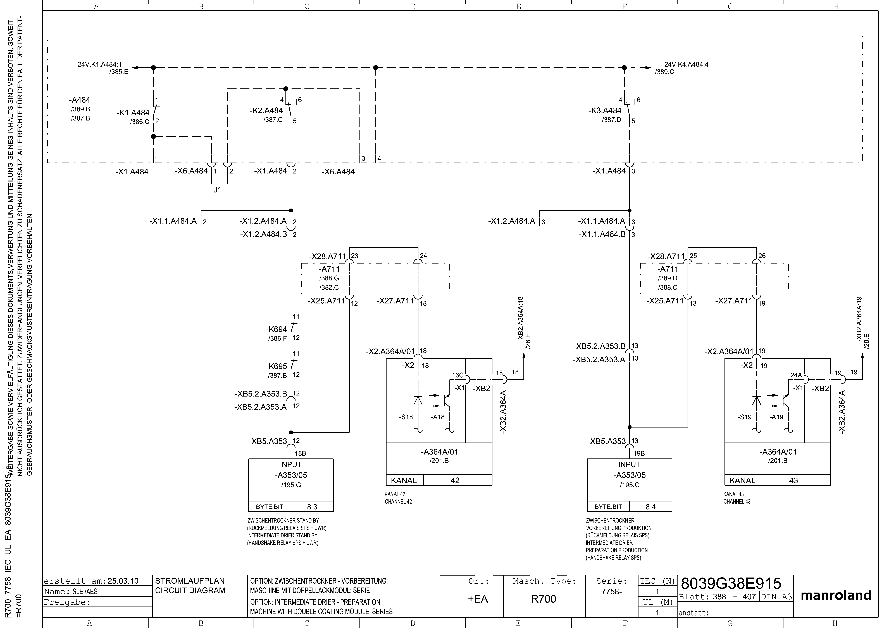

# +EA — Sheet 388 of 407 — OPTION: ZWISCHENTROCKNER VORBEREITUNG;

**MASCHINE MIT DOPPELLACKMODUL: SERIE**

> Part of the manroland **R700** printing press IEC/UL circuit diagrams.
> Drawing class: **Stromlaufplan / Circuit diagram** (DIN A3).
> Document `+EA` covers the **Printing unit** machine section.

## At a glance

| Field | Value |
|---|---|
| Document | `+EA`  (8039G38E915) |
| Sheet | **388** of 407 |
| Section (DE) | OPTION: ZWISCHENTROCKNER VORBEREITUNG; |
| Section (EN) | MASCHINE MIT DOPPELLACKMODUL: SERIE |
| Section type | CIRCUIT — Circuit diagram |
| Machine type | `R700` |
| Series | `7758` |
| Created | 25.03.10 |
| Replaces | — |
| Columns used | A, B, C, D, E, F, G, H |
| Path numbers | — |
| Labels on sheet | 148 |
| Cross-refs out | 19 |
| Cross-refs in | 48 |

**Previous:** [+EA sheet 387](SHEET_0387.md) · **Next:** [+EA sheet 389](SHEET_0389.md) · **Document TOC:** [_TOC.md](_TOC.md)  (+EA) · **Master TOC:** [all sheets](../_MASTER_TOC.md)

## Sheet image (300 DPI, exact vector render)



_Rendered directly from the PDF vector layer at 300 DPI (1-bit), no OCR and no resampling. Use it to confirm anything ambiguous in the text below._

## Cross-references on this sheet

Each entry is a wire leaving this sheet. The printed token is `/sheet.column`; the link resolves to that sheet inside the same document.

| Ref | Target sheet | Col | Path | Destination on target | Target section | From col |
|---|---|---|---|---|---|---|
| `/385.E` | [+EA sheet 385](SHEET_0385.md) | E | — | 24V.K1.A484:1 | OPTION: ZWISCHENTROCKNER VORBEREITUNG; | A |
| `/389.C` | [+EA sheet 389](SHEET_0389.md) | C | — | — | OPTION: ZWISCHENTROCKNER VORBEREITUNG; | F |
| `/389.B` | [+EA sheet 389](SHEET_0389.md) | B | — | — | OPTION: ZWISCHENTROCKNER VORBEREITUNG; | A |
| `/387.B` | [+EA sheet 387](SHEET_0387.md) | B | — | — | OPTION: ZWISCHENTROCKNER VORBEREITUNG; | A |
| `/387.C` | [+EA sheet 387](SHEET_0387.md) | C | — | — | OPTION: ZWISCHENTROCKNER VORBEREITUNG; | C |
| `/387.D` | [+EA sheet 387](SHEET_0387.md) | D | — | — | OPTION: ZWISCHENTROCKNER VORBEREITUNG; | F |
| `/386.C` | [+EA sheet 386](SHEET_0386.md) | C | — | — | OPTION: ZWISCHENTROCKNER VORBEREITUNG; | A |
| `/388.G` | [+EA sheet 388](SHEET_0388.md) | G | — | — | OPTION: ZWISCHENTROCKNER VORBEREITUNG; | C |
| `/382.C` | [+EA sheet 382](SHEET_0382.md) | C | — | — | OPTION: ENDTROCKNER 2 VORBEREITUNG | C |
| `/389.D` | [+EA sheet 389](SHEET_0389.md) | D | — | — | OPTION: ZWISCHENTROCKNER VORBEREITUNG; | F |
| `/388.C` | [+EA sheet 388](SHEET_0388.md) | C | — | — | OPTION: ZWISCHENTROCKNER VORBEREITUNG; | F |
| `/28.E` | [+EA sheet 28](SHEET_0028.md) | E | — | XB2.A364A:18 | BUSVERBINDUNGEN: SICHERHEITSBUS | E |
| `/28.E` | [+EA sheet 28](SHEET_0028.md) | E | — | XB2.A364A:19 | BUSVERBINDUNGEN: SICHERHEITSBUS | H |
| `/386.F` | [+EA sheet 386](SHEET_0386.md) | F | — | — | OPTION: ZWISCHENTROCKNER VORBEREITUNG; | C |
| `/387.B` | [+EA sheet 387](SHEET_0387.md) | B | — | — | OPTION: ZWISCHENTROCKNER VORBEREITUNG; | C |
| `/201.B` | [+EA sheet 201](SHEET_0201.md) | B | — | — | REFERENZMODUL | D |
| `/201.B` | [+EA sheet 201](SHEET_0201.md) | B | — | — | REFERENZMODUL | G |
| `/195.G` | [+EA sheet 195](SHEET_0195.md) | G | — | — | REFERENZMODUL | C |
| `/195.G` | [+EA sheet 195](SHEET_0195.md) | G | — | — | REFERENZMODUL | F |

### Incoming references (sheets that point here)

Every other sheet that sends a wire to this one. `Back-ref` is the token printed on *that* sheet; `Path` is its line number.

| From sheet | Cols | Back-ref | Path | Refs | What continues there |
|---|---|---|---|---|---|
| [+EA#28](SHEET_0028.md) | E | `/28.E` | — | 2 | — |
| [+EA#195](SHEET_0195.md) | G | `/195.G` | — | 2 | — |
| [+EA#201](SHEET_0201.md) | B | `/201.B` | — | 2 | — |
| [+EA#210](SHEET_0210.md) | E, G | `/210.E`, `/210.G` | — | 6 | — |
| [+EA#211](SHEET_0211.md) | A, C | `/211.A`, `/211.C` | — | 3 | — |
| [+EA#227](SHEET_0227.md) | C, E | `/227.C`, `/227.E` | — | 4 | — |
| [+EA#240](SHEET_0240.md) | F | `/240.F` | — | 2 | — |
| [+EA#241](SHEET_0241.md) | C, E | `/241.C`, `/241.E` | — | 4 | — |
| [+EA#245](SHEET_0245.md) | G | `/245.G` | — | 4 | — |
| [+EA#268](SHEET_0268.md) | E | `/268.E` | — | 2 | — |
| [+EA#271](SHEET_0271.md) | F | `/271.F` | — | 2 | — |
| [+EA#273](SHEET_0273.md) | A, B | `/273.A`, `/273.B` | — | 4 | — |
| [+EA#382](SHEET_0382.md) | C | `/382.C` | — | 1 | — |
| [+EA#385](SHEET_0385.md) | E | `/385.E` | — | 1 | 24V.K1.A484:1 |
| [+EA#386](SHEET_0386.md) | C | `/386.C` | — | 1 | — |
| [+EA#387](SHEET_0387.md) | B, C, D | `/387.B`, `/387.C`, `/387.D` | — | 3 | — |
| [+EA#388](SHEET_0388.md) | C, F | `/388.C`, `/388.F` | — | 2 | — |
| [+EA#389](SHEET_0389.md) | B, D | `/389.B`, `/389.D` | — | 3 | 24V.K4.A484:4 |


## Devices on this sheet

| Tag | Class | Class meaning (IEC) | Col | Sub | Terminal | Sign |
|---|---|---|---|---|---|---|
| `A484` | A | Baugruppe / assembly, module, PC board | A | — | — | — |
| `A711` | A | Baugruppe / assembly, module, PC board | C | — | — | — |
| `A711` | A | Baugruppe / assembly, module, PC board | F | — | — | — |
| `A353/05` | A | Baugruppe / assembly, module, PC board | C | 05 | — | — |
| `S18` | S | Schalter / switch | D | — | — | — |
| `A18` | A | Baugruppe / assembly, module, PC board | D | — | — | — |
| `X1` | X | Klemme / terminal, plug connector | D | — | — | — |
| `X2` | X | Klemme / terminal, plug connector | D | — | — | — |
| `XB2` | XB |  | E | — | — | — |
| `A353/05` | A | Baugruppe / assembly, module, PC board | F | 05 | — | — |
| `S19` | S | Schalter / switch | G | — | — | — |
| `A19` | A | Baugruppe / assembly, module, PC board | G | — | — | — |
| `X1` | X | Klemme / terminal, plug connector | H | — | — | — |
| `X2` | X | Klemme / terminal, plug connector | G | — | — | — |
| `XB2` | XB |  | H | — | — | — |
| `K695` | K | Relais / relay, contactor | C | — | — | — |
| `K694` | K | Relais / relay, contactor | C | — | — | — |
| `J1` | J |  | B | — | — | — |
| `K1.A484` | — | cross-device reference | A | — | — | — |
| `X6.A484` | — | cross-device reference | B | — | — | — |
| `K2.A484` | — | cross-device reference | C | — | — | — |
| `X1.A484` | — | cross-device reference | C | — | — | — |
| `X27.A711` | — | cross-device reference | D | — | — | — |
| `X28.A711` | — | cross-device reference | C | — | — | — |
| `X25.A711` | — | cross-device reference | C | — | — | — |
| `K3.A484` | — | cross-device reference | F | — | — | — |
| `X1.A484` | — | cross-device reference | F | — | — | — |
| `X27.A711` | — | cross-device reference | G | — | — | — |
| `X28.A711` | — | cross-device reference | F | — | — | — |
| `X25.A711` | — | cross-device reference | F | — | — | — |
| `8.3` | — | cross-device reference | C | — | — | — |
| `XB5.A353` | — | cross-device reference | C | — | — | — |
| `XB2.A364A` | — | cross-device reference | E | — | — | — |
| `8.4` | — | cross-device reference | F | — | — | — |
| `XB5.A353` | — | cross-device reference | F | — | — | — |
| `XB2.A364A` | — | cross-device reference | H | — | — | — |
| `XB5.2.A353.B` | — | cross-device reference | C | — | — | — |
| `XB5.2.A353.A` | — | cross-device reference | C | — | — | — |
| `X1.2.A484.A` | — | cross-device reference | C | — | — | — |
| `X1.2.A484.B` | — | cross-device reference | C | — | — | — |
| `XB5.2.A353.B` | — | cross-device reference | F | — | — | — |
| `XB5.2.A353.A` | — | cross-device reference | F | — | — | — |
| `X1.1.A484.A` | — | cross-device reference | F | — | — | — |
| `X1.1.A484.B` | — | cross-device reference | F | — | — | — |
| `X1.2.A484.A` | — | cross-device reference | E | — | — | — |
| `X1.1.A484.A` | — | cross-device reference | B | — | — | — |
| `XB2.A364A:19` | — | cross-device reference | H | — | 19 | — |
| `XB2.A364A:18` | — | cross-device reference | E | — | 18 | — |
| `X1.A484` | — | cross-device reference | A | — | — | — |
| `X6.A484` | — | cross-device reference | C | — | — | — |

## Potentials / nets

| Potential | Count | Columns | Attached devices | Terminals |
|---|---|---|---|---|
| `24V` | 2 | A, G | `A484`, `K1`, `K4` | `1`, `4` |


A potential such as `L24+/4` or `M24+` is a named supply/return rail; every place it appears on this sheet is electrically common.

## Wire-end annotations (grouped as printed)

A wire that continues elsewhere is annotated with a small cluster: the destination description, the path/line number `#NN`, and the `/sheet.column` cross reference. Each row below is one such cluster exactly as it is grouped on the drawing.

| Col | Y | Path | Cross-ref | Text on the wire |
|---|---|---|---|---|
| A | 82.5 | — | `/385.E` | `24V.K1.A484:1` |
| G | 82.5 | — | — | `24V.K4.A484:4` |
| F | 92.4 | — | `/389.C` | — |
| A | 129.3 | — | — | `A484` |
| B | 130.0 | — | — | `1` |
| C | 130.0 | — | — | `K2.A484 6` |
| C | 130.0 | — | — | `4` |
| F | 130.0 | — | — | `K3.A484 6` |
| F | 130.0 | — | — | `4` |
| A | 142.3 | — | `/389.B`, `/387.B` | — |
| A | 146.3 | — | — | `K1.A484 2` |
| C | 156.6 | — | `/387.C` | — |
| F | 156.6 | — | `/387.D` | — |
| C | 158.4 | — | — | `5` |
| F | 158.4 | — | — | `5` |
| A | 159.4 | — | `/386.C` | — |
| B | 208.7 | — | — | `1` |
| D | 208.7 | — | — | `3 4` |
| B | 224.2 | — | — | `X6.A484 1 2` |
| C | 224.2 | — | — | `X1.A484 2` |
| F | 224.2 | — | — | `X1.A484 3` |
| B | 225.7 | — | — | `X1.A484 X6.A484` |
| B | 249.7 | — | — | `J1` |
| C | 291.6 | — | — | `X1.1.A484.A 2 X1.2.A484.A 3` |
| C | 291.6 | — | — | `X1.2.A484.A 2` |
| F | 291.6 | — | — | `X1.1.A484.A 3` |
| C | 309.3 | — | — | `X1.2.A484.B 2` |
| F | 309.3 | — | — | `X1.1.A484.B 3` |
| C | 339.0 | — | — | `X28.A711 23` |
| F | 339.0 | — | — | `X28.A711 25` |
| D | 339.1 | — | — | `24` |
| G | 339.1 | — | — | `26` |
| C | 356.1 | — | — | `A711` |
| F | 356.1 | — | — | `A711` |
| C | 369.1 | — | `/388.G`, `/382.C` | — |
| F | 369.1 | — | `/389.D`, `/388.C` | — |
| E | 397.4 | — | `/28.E` | `XB2.A364A:18` |
| H | 397.4 | — | `/28.E` | `XB2.A364A:19` |
| C | 398.6 | — | — | `X25.A711 12` |
| D | 398.6 | — | — | `X27.A711 18` |
| F | 398.6 | — | — | `X25.A711 13` |
| G | 398.6 | — | — | `X27.A711 19` |
| C | 420.6 | — | — | `11` |
| C | 436.8 | — | — | `K694 12` |
| C | 449.9 | — | `/386.F` | — |
| F | 459.5 | — | — | `XB5.2.A353.B 13` |
| D | 466.6 | — | — | `X2.A364A/01 18` |
| G | 466.6 | — | — | `X2.A364A/01 19` |
| C | 470.2 | — | — | `11` |
| F | 476.5 | — | — | `XB5.2.A353.A 13` |
| D | 485.1 | — | — | `X2` |
| G | 485.1 | — | — | `X2` |
| C | 486.4 | — | — | `K695 12` |
| D | 486.5 | — | — | `18 18` |
| H | 486.5 | — | — | `19 19` |
| E | 495.0 | — | — | `18` |
| H | 495.0 | — | — | `19` |
| D | 499.2 | — | — | `16C` |
| H | 499.2 | — | — | `24A` |
| C | 499.5 | — | `/387.B` | — |
| D | 516.2 | — | — | `X1` |
| E | 516.2 | — | — | `XB2` |
| H | 516.2 | — | — | `X1` |
| H | 516.2 | — | — | `XB2` |
| C | 523.3 | — | — | `XB5.2.A353.B 12` |
| E | 523.3 | — | — | `XB2.A364A` |
| H | 523.3 | — | — | `XB2.A364A` |
| C | 540.3 | — | — | `XB5.2.A353.A 12` |
| D | 555.2 | — | — | `S18 A18` |
| G | 555.2 | — | — | `S19 A19` |
| C | 587.1 | — | — | `XB5.A353 12` |
| F | 587.1 | — | — | `XB5.A353 13` |
| D | 601.2 | — | — | `A364A/01` |
| G | 601.2 | — | — | `A364A/01` |
| C | 604.1 | — | — | `18B` |
| F | 604.1 | — | — | `19B` |
| D | 613.6 | — | `/201.B` | — |
| G | 613.6 | — | `/201.B` | — |
| C | 618.6 | — | — | `INPUT` |
| F | 618.6 | — | — | `INPUT` |
| C | 632.4 | — | — | `A353/05` |
| F | 632.4 | — | — | `A353/05` |
| D | 639.5 | — | — | `KANAL 42` |
| G | 639.5 | — | — | `KANAL 43` |
| C | 646.2 | — | `/195.G` | — |
| F | 646.2 | — | `/195.G` | — |
| D | 659.8 | — | — | `KANAL 42 CHANNEL 42` |
| G | 659.8 | — | — | `KANAL 43 CHANNEL 43` |
| C | 675.3 | — | — | `BYTE.BIT 8.3` |
| F | 675.3 | — | — | `BYTE.BIT 8.4` |
| C | 695.2 | — | — | `(RÜCKMELDUNG RELAIS SPS + UWR) INTERMEDIATE DRIER STAND BY (HANDSHAKE RELAY SPS + UWR) ZWISCHENTROCKNER STAND BY` |
| F | 695.2 | — | — | `(RÜCKMELDUNG RELAIS SPS) INTERMEDIATE DRIER PREPARATION PRODUCTION (HANDSHAKE RELAY SPS) ZWISCHENTROCKNER VORBEREITUNG PRODUKTION` |


## Reconstructed tables

This sheet carries tabular content (pin map / terminal assignment / index). The grid below was rebuilt from the drawing's own rule lines, so each row is exactly one physical row of the table.

### Table 1 — 10 data rows × 18 columns (at x=205.5, y=90.7) — **/389.C**

| 1 2 |  |  | 4 K2.A484 /387.C | 6 5 |  |  |  |  |  |  |  |  |  |  | 4 K3.A484 /387.D |  | 6 5 |
|---|---|---|---|---|---|---|---|---|---|---|---|---|---|---|---|---|---|
| `1 X6.A484` | `1 J1` | `2` | `X1.A484` | `2` | `X6.A484` |  | `3` | `4` |  |  |  |  |  |  | `X1.A484` |  | `3` |
| `X1.1.A484.A 2` |  |  | `X1.2.A484.A X1.2.A484.B` | `2 2` |  |  |  |  |  |  |  |  | `X1.2.A484.A` | `3` | `X1.1.A484.A X1.1.A484.B` |  | `3 3` |
|  |  |  | `K694 /386.F` | `X28.A711 A711 /388.G /382.C X25.A711 11 12 11` |  | `23 12` |  |  | `X27.A711 X2.A364A/01` | `24 18 18` |  |  | `XB2.A364A:18` | `/28.E` | `XB5.2.A353.B` |  | `X28.A711 A711 /389.D /388.C X25.A711 13` |
|  |  |  | `K695 /387.B XB5.2.A353.B XB5.2.A353.A` | `12 12 12` |  |  |  |  | `X2 S18` | `18 A18` | `16C X1` | `XB2` | `18 18 XB2.A364A` |  | `XB5.2.A353.A` |  | `13` |
|  |  |  | `XB5.A353` | `12` |  |  |  |  |  |  |  |  |  |  | `XB5.A353` |  | `13` |
|  |  |  |  | `18B` |  |  |  |  |  | `A364A/01` |  |  |  |  |  |  | `19B` |
|  |  |  | `INPUT` |  |  |  |  |  |  | `/201.B` |  |  |  |  |  | `INPUT` |  |
|  |  |  |  | `A353/05` |  |  |  |  | `KANAL` |  | `42` |  |  |  |  |  | `A353/05` |
|  |  |  |  | `/195.G` |  |  |  |  | `KANAL 42` |  |  |  |  |  |  |  | `/195.G` |
|  |  |  | `BYTE.BIT` | `8.3` |  |  |  |  | `CHANNEL 42` |  |  |  |  |  | `BYTE.BIT` |  | `8.4` |


### Table 2 — 6 data rows × 6 columns (at x=921.3, y=90.7)

| 25 13 | X27.A711 X2.A364A/01 | 26 19 19 |  |  | XB2.A364A:19 |
|---|---|---|---|---|---|
|  | `X2 S19` | `19 A19` | `24A X1` | `XB2` | `19 19 XB2.A364A` |
|  |  | `A364A/01` |  |  |  |
|  |  | `/201.B` |  |  |  |
|  | `KANAL` |  | `43` |  |  |
|  | `KANAL 43` |  |  |  |  |
|  | `CHANNEL 43` |  |  |  |  |


## Notes and free text on this sheet

| Text | Col | Y (pt) |
|---|---|---|
| `18B` | C | 604.07 |
| `INPUT` | C | 618.59 |
| `BYTE.BIT` | C | 675.84 |
| `ZWISCHENTROCKNER STAND BY` | C | 695.25 |
| `(RÜCKMELDUNG RELAIS SPS + UWR)` | C | 705.21 |
| `INTERMEDIATE DRIER STAND BY` | C | 715.17 |
| `(HANDSHAKE RELAY SPS + UWR)` | C | 725.1 |
| `KANAL 42` | D | 659.83 |
| `CHANNEL 42` | D | 669.78 |
| `16C` | D | 499.23 |
| `KANAL` | D | 639.51 |
| `A364A/01` | D | 601.25 |
| `X2.A364A/01` | D | 466.61 |
| `19B` | F | 604.07 |
| `INPUT` | F | 618.59 |
| `BYTE.BIT` | F | 675.84 |
| `ZWISCHENTROCKNER` | F | 695.25 |
| `VORBEREITUNG PRODUKTION` | F | 705.21 |
| `(RÜCKMELDUNG RELAIS SPS)` | F | 715.18 |
| `INTERMEDIATE DRIER` | F | 725.13 |
| `PREPARATION PRODUCTION` | F | 735.04 |
| `(HANDSHAKE RELAY SPS)` | F | 745.01 |
| `KANAL 43` | G | 659.84 |
| `CHANNEL 43` | G | 669.78 |
| `24A` | H | 499.18 |
| `KANAL` | G | 639.51 |
| `A364A/01` | G | 601.25 |
| `X2.A364A/01` | G | 466.61 |

## Complete label inventory (exact text from the drawing)

Every text object inside the drawing area of this sheet, in DIN reading order (column A→H, then top→bottom). This is the authoritative list: if a string is not here it is not printed on this sheet.

| Col | Y | X | Dir | Type | Text |
|---|---|---|---|---|---|
| A | 82.5 | 101.2 | → | potential | `24V.K1.A484:1` |
| A | 92.4 | 146.6 | → | cross-reference | `/385.E` |
| A | 129.3 | 92.7 | → | device tag | `A484` |
| A | 142.4 | 95.2 | → | cross-reference | `/389.B` |
| A | 146.3 | 156.2 | → | device ref | `K1.A484` |
| A | 154.8 | 95.2 | → | cross-reference | `/387.B` |
| A | 159.4 | 174.3 | → | cross-reference | `/386.C` |
| A | 225.7 | 154.8 | → | device ref | `X1.A484` |
| B | 130.0 | 207.5 | → | number | `1` |
| B | 158.4 | 208.1 | → | number | `2` |
| B | 208.7 | 207.5 | → | number | `1` |
| B | 224.2 | 234.1 | → | device ref | `X6.A484` |
| B | 225.7 | 285.4 | → | number | `1` |
| B | 225.7 | 307.3 | → | number | `2` |
| B | 249.7 | 285.7 | → | device tag | `J1` |
| B | 291.6 | 200.4 | → | device ref | `X1.1.A484.A` |
| B | 293.7 | 271.8 | → | number | `2` |
| C | 130.0 | 375.3 | → | number | `4` |
| C | 130.0 | 399.4 | → | number | `6` |
| C | 143.5 | 334.8 | → | device ref | `K2.A484` |
| C | 156.5 | 352.9 | → | cross-reference | `/387.C` |
| C | 158.4 | 392.3 | → | number | `5` |
| C | 224.2 | 340.4 | → | device ref | `X1.A484` |
| C | 225.7 | 392.3 | → | number | `2` |
| C | 225.7 | 431.1 | → | device ref | `X6.A484` |
| C | 291.6 | 320.9 | → | device ref | `X1.2.A484.A` |
| C | 293.7 | 392.3 | → | number | `2` |
| C | 309.3 | 321.7 | → | device ref | `X1.2.A484.B` |
| C | 310.7 | 392.3 | → | number | `2` |
| C | 339.0 | 413.9 | → | device ref | `X28.A711` |
| C | 339.1 | 470.3 | → | number | `23` |
| C | 356.1 | 427.2 | → | device tag | `A711` |
| C | 369.1 | 427.7 | → | cross-reference | `/388.G` |
| C | 381.5 | 428.0 | → | cross-reference | `/382.C` |
| C | 398.6 | 412.4 | → | device ref | `X25.A711` |
| C | 402.8 | 469.7 | → | number | `12` |
| C | 420.6 | 391.7 | → | number | `11` |
| C | 436.8 | 356.3 | → | device tag | `K694` |
| C | 448.9 | 391.7 | → | number | `12` |
| C | 449.9 | 359.4 | → | cross-reference | `/386.F` |
| C | 470.2 | 391.7 | → | number | `11` |
| C | 486.4 | 356.3 | → | device tag | `K695` |
| C | 498.5 | 391.7 | → | number | `12` |
| C | 499.5 | 358.9 | → | cross-reference | `/387.B` |
| C | 523.3 | 314.6 | → | device ref | `XB5.2.A353.B` |
| C | 523.3 | 391.7 | → | number | `12` |
| C | 540.3 | 391.7 | → | number | `12` |
| C | 541.0 | 313.8 | → | device ref | `XB5.2.A353.A` |
| C | 587.1 | 333.4 | → | device ref | `XB5.A353` |
| C | 587.1 | 391.7 | → | number | `12` |
| C | 604.1 | 394.6 | → | text | `18B` |
| C | 618.6 | 374.9 | → | text | `INPUT` |
| C | 632.4 | 368.4 | → | device tag | `A353/05` |
| C | 646.2 | 376.9 | → | cross-reference | `/195.G` |
| C | 675.3 | 411.3 | → | device ref | `8.3` |
| C | 675.8 | 343.0 | → | text | `BYTE.BIT` |
| C | 695.3 | 331.7 | → | text | `ZWISCHENTROCKNER STAND BY` |
| C | 705.2 | 331.1 | → | text | `(RÜCKMELDUNG RELAIS SPS + UWR)` |
| C | 715.2 | 331.1 | → | text | `INTERMEDIATE DRIER STAND BY` |
| C | 725.1 | 331.1 | → | text | `(HANDSHAKE RELAY SPS + UWR)` |
| D | 208.7 | 484.4 | → | number | `3` |
| D | 208.7 | 505.7 | → | number | `4` |
| D | 339.1 | 562.4 | → | number | `24` |
| D | 398.6 | 504.6 | → | device ref | `X27.A711` |
| D | 402.8 | 561.8 | → | number | `18` |
| D | 466.6 | 490.1 | → | text | `X2.A364A/01` |
| D | 466.6 | 561.8 | → | number | `18` |
| D | 485.0 | 538.3 | → | device tag | `X2` |
| D | 486.5 | 564.7 | → | number | `18` |
| D | 499.2 | 605.2 | → | text | `16C` |
| D | 516.2 | 608.9 | → | device tag | `X1` |
| D | 555.2 | 534.6 | → | device tag | `S18` |
| D | 555.2 | 577.1 | → | device tag | `A18` |
| D | 601.2 | 564.0 | → | text | `A364A/01` |
| D | 613.6 | 575.6 | → | cross-reference | `/201.B` |
| D | 639.5 | 523.6 | → | text | `KANAL` |
| D | 639.5 | 603.6 | → | number | `42` |
| D | 659.8 | 515.3 | → | text | `KANAL 42` |
| D | 669.8 | 515.6 | → | text | `CHANNEL 42` |
| E | 291.6 | 654.0 | → | device ref | `X1.2.A484.A` |
| E | 293.7 | 725.4 | → | number | `3` |
| E | 397.4 | 693.3 | ↕ | device ref | `XB2.A364A:18` |
| E | 447.0 | 703.2 | ↕ | cross-reference | `/28.E` |
| E | 495.0 | 685.1 | → | number | `18` |
| E | 496.4 | 663.9 | → | number | `18` |
| E | 516.2 | 633.3 | → | device tag | `XB2` |
| E | 523.3 | 669.3 | ↕ | device ref | `XB2.A364A` |
| F | 92.4 | 877.3 | → | cross-reference | `/389.C` |
| F | 130.0 | 828.9 | → | number | `4` |
| F | 130.0 | 852.9 | → | number | `6` |
| F | 143.5 | 788.3 | → | device ref | `K3.A484` |
| F | 156.5 | 806.5 | → | cross-reference | `/387.D` |
| F | 158.4 | 845.9 | → | number | `5` |
| F | 224.2 | 794.0 | → | device ref | `X1.A484` |
| F | 225.7 | 845.9 | → | number | `3` |
| F | 291.6 | 774.4 | → | device ref | `X1.1.A484.A` |
| F | 293.7 | 845.9 | → | number | `3` |
| F | 309.3 | 775.3 | → | device ref | `X1.1.A484.B` |
| F | 310.7 | 845.9 | → | number | `3` |
| F | 339.0 | 867.4 | → | device ref | `X28.A711` |
| F | 356.1 | 880.7 | → | device tag | `A711` |
| F | 369.1 | 881.6 | → | cross-reference | `/389.D` |
| F | 381.5 | 881.6 | → | cross-reference | `/388.C` |
| F | 398.6 | 866.0 | → | device ref | `X25.A711` |
| F | 459.5 | 768.2 | → | device ref | `XB5.2.A353.B` |
| F | 459.5 | 845.3 | → | number | `13` |
| F | 476.5 | 845.3 | → | number | `13` |
| F | 477.2 | 767.3 | → | device ref | `XB5.2.A353.A` |
| F | 587.1 | 786.9 | → | device ref | `XB5.A353` |
| F | 587.1 | 845.3 | → | number | `13` |
| F | 604.1 | 848.1 | → | text | `19B` |
| F | 618.6 | 828.4 | → | text | `INPUT` |
| F | 632.4 | 821.9 | → | device tag | `A353/05` |
| F | 646.2 | 830.4 | → | cross-reference | `/195.G` |
| F | 675.3 | 864.9 | → | device ref | `8.4` |
| F | 675.8 | 796.5 | → | text | `BYTE.BIT` |
| F | 695.2 | 785.2 | → | text | `ZWISCHENTROCKNER` |
| F | 705.2 | 785.2 | → | text | `VORBEREITUNG PRODUKTION` |
| F | 715.2 | 784.6 | → | text | `(RÜCKMELDUNG RELAIS SPS)` |
| F | 725.1 | 784.6 | → | text | `INTERMEDIATE DRIER` |
| F | 735.0 | 784.6 | → | text | `PREPARATION PRODUCTION` |
| F | 745.0 | 784.6 | → | text | `(HANDSHAKE RELAY SPS)` |
| G | 82.5 | 887.0 | → | potential | `24V.K4.A484:4` |
| G | 339.1 | 923.8 | → | number | `25` |
| G | 339.1 | 1015.9 | → | number | `26` |
| G | 398.6 | 958.1 | → | device ref | `X27.A711` |
| G | 402.8 | 923.2 | → | number | `13` |
| G | 402.8 | 1015.4 | → | number | `19` |
| G | 466.6 | 943.7 | → | text | `X2.A364A/01` |
| G | 466.6 | 1015.4 | → | number | `19` |
| G | 485.0 | 991.8 | → | device tag | `X2` |
| G | 486.5 | 1018.2 | → | number | `19` |
| G | 555.2 | 988.2 | → | device tag | `S19` |
| G | 555.2 | 1030.7 | → | device tag | `A19` |
| G | 601.2 | 1017.5 | → | text | `A364A/01` |
| G | 613.6 | 1029.1 | → | cross-reference | `/201.B` |
| G | 639.5 | 977.1 | → | text | `KANAL` |
| G | 659.8 | 968.9 | → | text | `KANAL 43` |
| G | 669.8 | 969.2 | → | text | `CHANNEL 43` |
| H | 397.4 | 1146.9 | ↕ | device ref | `XB2.A364A:19` |
| H | 447.0 | 1156.8 | ↕ | cross-reference | `/28.E` |
| H | 495.0 | 1138.7 | → | number | `19` |
| H | 496.4 | 1117.4 | → | number | `19` |
| H | 499.2 | 1058.7 | → | text | `24A` |
| H | 516.2 | 1062.4 | → | device tag | `X1` |
| H | 516.2 | 1086.8 | → | device tag | `XB2` |
| H | 523.3 | 1122.8 | ↕ | device ref | `XB2.A364A` |
| H | 639.5 | 1057.2 | → | number | `43` |

## Reading-order text block

The same content as a plain block, grouped by DIN column — convenient to paste or to match against a visual description.

```text
=== Column A ===
  82.5  101.2  net          24V.K1.A484:1
  92.4  146.6  xref         /385.E
 129.3   92.7  devtag       A484
 142.4   95.2  xref         /389.B
 146.3  156.2  devref       K1.A484
 154.8   95.2  xref         /387.B
 159.4  174.3  xref         /386.C
 225.7  154.8  devref       X1.A484
=== Column B ===
 130.0  207.5  numeric      1
 158.4  208.1  numeric      2
 208.7  207.5  numeric      1
 224.2  234.1  devref       X6.A484
 225.7  285.4  numeric      1
 225.7  307.3  numeric      2
 249.7  285.7  devtag       J1
 291.6  200.4  devref       X1.1.A484.A
 293.7  271.8  numeric      2
=== Column C ===
 130.0  375.3  numeric      4
 130.0  399.4  numeric      6
 143.5  334.8  devref       K2.A484
 156.5  352.9  xref         /387.C
 158.4  392.3  numeric      5
 224.2  340.4  devref       X1.A484
 225.7  392.3  numeric      2
 225.7  431.1  devref       X6.A484
 291.6  320.9  devref       X1.2.A484.A
 293.7  392.3  numeric      2
 309.3  321.7  devref       X1.2.A484.B
 310.7  392.3  numeric      2
 339.0  413.9  devref       X28.A711
 339.1  470.3  numeric      23
 356.1  427.2  devtag       A711
 369.1  427.7  xref         /388.G
 381.5  428.0  xref         /382.C
 398.6  412.4  devref       X25.A711
 402.8  469.7  numeric      12
 420.6  391.7  numeric      11
 436.8  356.3  devtag       K694
 448.9  391.7  numeric      12
 449.9  359.4  xref         /386.F
 470.2  391.7  numeric      11
 486.4  356.3  devtag       K695
 498.5  391.7  numeric      12
 499.5  358.9  xref         /387.B
 523.3  314.6  devref       XB5.2.A353.B
 523.3  391.7  numeric      12
 540.3  391.7  numeric      12
 541.0  313.8  devref       XB5.2.A353.A
 587.1  333.4  devref       XB5.A353
 587.1  391.7  numeric      12
 604.1  394.6  text         18B
 618.6  374.9  text         INPUT
 632.4  368.4  devtag       A353/05
 646.2  376.9  xref         /195.G
 675.3  411.3  devref       8.3
 675.8  343.0  text         BYTE.BIT
 695.3  331.7  text         ZWISCHENTROCKNER STAND BY
 705.2  331.1  text         (RÜCKMELDUNG RELAIS SPS + UWR)
 715.2  331.1  text         INTERMEDIATE DRIER STAND BY
 725.1  331.1  text         (HANDSHAKE RELAY SPS + UWR)
=== Column D ===
 208.7  484.4  numeric      3
 208.7  505.7  numeric      4
 339.1  562.4  numeric      24
 398.6  504.6  devref       X27.A711
 402.8  561.8  numeric      18
 466.6  490.1  text         X2.A364A/01
 466.6  561.8  numeric      18
 485.0  538.3  devtag       X2
 486.5  564.7  numeric      18
 499.2  605.2  text         16C
 516.2  608.9  devtag       X1
 555.2  534.6  devtag       S18
 555.2  577.1  devtag       A18
 601.2  564.0  text         A364A/01
 613.6  575.6  xref         /201.B
 639.5  523.6  text         KANAL
 639.5  603.6  numeric      42
 659.8  515.3  text         KANAL 42
 669.8  515.6  text         CHANNEL 42
=== Column E ===
 291.6  654.0  devref       X1.2.A484.A
 293.7  725.4  numeric      3
 397.4  693.3  devref       XB2.A364A:18
 447.0  703.2  xref         /28.E
 495.0  685.1  numeric      18
 496.4  663.9  numeric      18
 516.2  633.3  devtag       XB2
 523.3  669.3  devref       XB2.A364A
=== Column F ===
  92.4  877.3  xref         /389.C
 130.0  828.9  numeric      4
 130.0  852.9  numeric      6
 143.5  788.3  devref       K3.A484
 156.5  806.5  xref         /387.D
 158.4  845.9  numeric      5
 224.2  794.0  devref       X1.A484
 225.7  845.9  numeric      3
 291.6  774.4  devref       X1.1.A484.A
 293.7  845.9  numeric      3
 309.3  775.3  devref       X1.1.A484.B
 310.7  845.9  numeric      3
 339.0  867.4  devref       X28.A711
 356.1  880.7  devtag       A711
 369.1  881.6  xref         /389.D
 381.5  881.6  xref         /388.C
 398.6  866.0  devref       X25.A711
 459.5  768.2  devref       XB5.2.A353.B
 459.5  845.3  numeric      13
 476.5  845.3  numeric      13
 477.2  767.3  devref       XB5.2.A353.A
 587.1  786.9  devref       XB5.A353
 587.1  845.3  numeric      13
 604.1  848.1  text         19B
 618.6  828.4  text         INPUT
 632.4  821.9  devtag       A353/05
 646.2  830.4  xref         /195.G
 675.3  864.9  devref       8.4
 675.8  796.5  text         BYTE.BIT
 695.2  785.2  text         ZWISCHENTROCKNER
 705.2  785.2  text         VORBEREITUNG PRODUKTION
 715.2  784.6  text         (RÜCKMELDUNG RELAIS SPS)
 725.1  784.6  text         INTERMEDIATE DRIER
 735.0  784.6  text         PREPARATION PRODUCTION
 745.0  784.6  text         (HANDSHAKE RELAY SPS)
=== Column G ===
  82.5  887.0  net          24V.K4.A484:4
 339.1  923.8  numeric      25
 339.1 1015.9  numeric      26
 398.6  958.1  devref       X27.A711
 402.8  923.2  numeric      13
 402.8 1015.4  numeric      19
 466.6  943.7  text         X2.A364A/01
 466.6 1015.4  numeric      19
 485.0  991.8  devtag       X2
 486.5 1018.2  numeric      19
 555.2  988.2  devtag       S19
 555.2 1030.7  devtag       A19
 601.2 1017.5  text         A364A/01
 613.6 1029.1  xref         /201.B
 639.5  977.1  text         KANAL
 659.8  968.9  text         KANAL 43
 669.8  969.2  text         CHANNEL 43
=== Column H ===
 397.4 1146.9  devref       XB2.A364A:19
 447.0 1156.8  xref         /28.E
 495.0 1138.7  numeric      19
 496.4 1117.4  numeric      19
 499.2 1058.7  text         24A
 516.2 1062.4  devtag       X1
 516.2 1086.8  devtag       XB2
 523.3 1122.8  devref       XB2.A364A
 639.5 1057.2  numeric      43
```

---
_Generated from the PDF vector text layer; no OCR. Source: `R700_7758_IEC_UL_EA_8039G38E915_p`, sheet 388._
