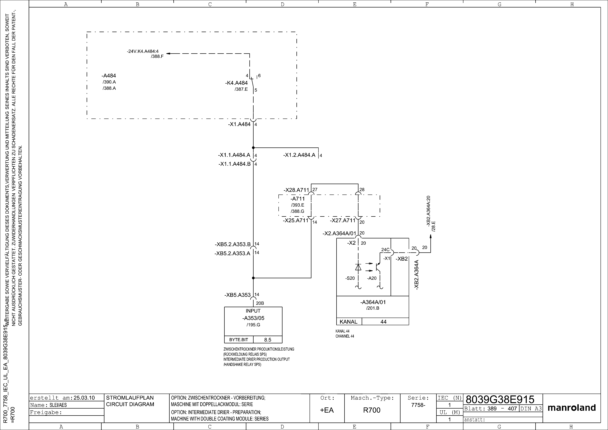

# +EA — Sheet 389 of 407 — OPTION: ZWISCHENTROCKNER VORBEREITUNG;

**MASCHINE MIT DOPPELLACKMODUL: SERIE**

> Part of the manroland **R700** printing press IEC/UL circuit diagrams.
> Drawing class: **Stromlaufplan / Circuit diagram** (DIN A3).
> Document `+EA` covers the **Printing unit** machine section.

## At a glance

| Field | Value |
|---|---|
| Document | `+EA`  (8039G38E915) |
| Sheet | **389** of 407 |
| Section (DE) | OPTION: ZWISCHENTROCKNER VORBEREITUNG; |
| Section (EN) | MASCHINE MIT DOPPELLACKMODUL: SERIE |
| Section type | CIRCUIT — Circuit diagram |
| Machine type | `R700` |
| Series | `7758` |
| Created | 25.03.10 |
| Replaces | — |
| Columns used | B, C, D, E, F |
| Path numbers | — |
| Labels on sheet | 64 |
| Cross-refs out | 9 |
| Cross-refs in | 22 |

**Previous:** [+EA sheet 388](SHEET_0388.md) · **Next:** [+EA sheet 390](SHEET_0390.md) · **Document TOC:** [_TOC.md](_TOC.md)  (+EA) · **Master TOC:** [all sheets](../_MASTER_TOC.md)

## Sheet image (300 DPI, exact vector render)



_Rendered directly from the PDF vector layer at 300 DPI (1-bit), no OCR and no resampling. Use it to confirm anything ambiguous in the text below._

## Cross-references on this sheet

Each entry is a wire leaving this sheet. The printed token is `/sheet.column`; the link resolves to that sheet inside the same document.

| Ref | Target sheet | Col | Path | Destination on target | Target section | From col |
|---|---|---|---|---|---|---|
| `/388.F` | [+EA sheet 388](SHEET_0388.md) | F | — | 24V.K4.A484:4 | OPTION: ZWISCHENTROCKNER VORBEREITUNG; | B |
| `/390.A` | [+EA sheet 390](SHEET_0390.md) | A | — | — | OPTION: ZWISCHENTROCKNER VORBEREITUNG; | B |
| `/388.A` | [+EA sheet 388](SHEET_0388.md) | A | — | — | OPTION: ZWISCHENTROCKNER VORBEREITUNG; | B |
| `/387.E` | [+EA sheet 387](SHEET_0387.md) | E | — | — | OPTION: ZWISCHENTROCKNER VORBEREITUNG; | C |
| `/28.E` | [+EA sheet 28](SHEET_0028.md) | E | — | XB2.A364A:20 | BUSVERBINDUNGEN: SICHERHEITSBUS | F |
| `/393.E` | [+EA sheet 393](SHEET_0393.md) | E | — | — | OPTION: ZWISCHENTROCKNER VORBEREITUNG; | D |
| `/388.G` | [+EA sheet 388](SHEET_0388.md) | G | — | — | OPTION: ZWISCHENTROCKNER VORBEREITUNG; | D |
| `/201.B` | [+EA sheet 201](SHEET_0201.md) | B | — | — | REFERENZMODUL | E |
| `/195.G` | [+EA sheet 195](SHEET_0195.md) | G | — | — | REFERENZMODUL | D |

### Incoming references (sheets that point here)

Every other sheet that sends a wire to this one. `Back-ref` is the token printed on *that* sheet; `Path` is its line number.

| From sheet | Cols | Back-ref | Path | Refs | What continues there |
|---|---|---|---|---|---|
| [+EA#28](SHEET_0028.md) | E | `/28.E` | — | 1 | — |
| [+EA#195](SHEET_0195.md) | G | `/195.G` | — | 1 | — |
| [+EA#201](SHEET_0201.md) | B | `/201.B` | — | 1 | — |
| [+EA#210](SHEET_0210.md) | E, G | `/210.E`, `/210.G` | — | 3 | — |
| [+EA#211](SHEET_0211.md) | A | `/211.A` | — | 1 | — |
| [+EA#227](SHEET_0227.md) | C, E | `/227.C`, `/227.E` | — | 2 | — |
| [+EA#240](SHEET_0240.md) | F | `/240.F` | — | 1 | — |
| [+EA#241](SHEET_0241.md) | C, E | `/241.C`, `/241.E` | — | 2 | — |
| [+EA#268](SHEET_0268.md) | E | `/268.E` | — | 1 | — |
| [+EA#271](SHEET_0271.md) | F | `/271.F` | — | 1 | — |
| [+EA#273](SHEET_0273.md) | B | `/273.B` | — | 2 | — |
| [+EA#387](SHEET_0387.md) | E | `/387.E` | — | 1 | — |
| [+EA#388](SHEET_0388.md) | A, F | `/388.A`, `/388.F` | — | 3 | — |
| [+EA#390](SHEET_0390.md) | A | `/390.A` | — | 1 | — |
| [+EA#393](SHEET_0393.md) | E | `/393.E` | — | 1 | — |


## Devices on this sheet

| Tag | Class | Class meaning (IEC) | Col | Sub | Terminal | Sign |
|---|---|---|---|---|---|---|
| `A484` | A | Baugruppe / assembly, module, PC board | B | — | — | — |
| `A353/05` | A | Baugruppe / assembly, module, PC board | D | 05 | — | — |
| `A711` | A | Baugruppe / assembly, module, PC board | D | — | — | — |
| `S20` | S | Schalter / switch | E | — | — | — |
| `A20` | A | Baugruppe / assembly, module, PC board | E | — | — | — |
| `X1` | X | Klemme / terminal, plug connector | E | — | — | — |
| `X2` | X | Klemme / terminal, plug connector | E | — | — | — |
| `XB2` | XB |  | F | — | — | — |
| `K4.A484` | — | cross-device reference | C | — | — | — |
| `X1.A484` | — | cross-device reference | C | — | — | — |
| `8.5` | — | cross-device reference | D | — | — | — |
| `XB5.A353` | — | cross-device reference | C | — | — | — |
| `X27.A711` | — | cross-device reference | E | — | — | — |
| `X28.A711` | — | cross-device reference | D | — | — | — |
| `X25.A711` | — | cross-device reference | D | — | — | — |
| `XB2.A364A` | — | cross-device reference | F | — | — | — |
| `XB5.2.A353.B` | — | cross-device reference | C | — | — | — |
| `XB5.2.A353.A` | — | cross-device reference | C | — | — | — |
| `X1.1.A484.A` | — | cross-device reference | C | — | — | — |
| `X1.1.A484.B` | — | cross-device reference | C | — | — | — |
| `X1.2.A484.A` | — | cross-device reference | D | — | — | — |
| `XB2.A364A:20` | — | cross-device reference | F | — | 20 | — |

## Potentials / nets

| Potential | Count | Columns | Attached devices | Terminals |
|---|---|---|---|---|
| `24V` | 1 | B | `A484`, `K4` | `4` |


A potential such as `L24+/4` or `M24+` is a named supply/return rail; every place it appears on this sheet is electrically common.

## Wire-end annotations (grouped as printed)

A wire that continues elsewhere is annotated with a small cluster: the destination description, the path/line number `#NN`, and the `/sheet.column` cross reference. Each row below is one such cluster exactly as it is grouped on the drawing.

| Col | Y | Path | Cross-ref | Text on the wire |
|---|---|---|---|---|
| B | 96.7 | — | `/388.F` | `24V.K4.A484:4` |
| B | 143.4 | — | — | `A484` |
| C | 144.2 | — | — | `K4.A484 6` |
| D | 144.2 | — | — | `4` |
| B | 156.5 | — | `/390.A`, `/388.A` | — |
| C | 170.7 | — | `/387.E` | — |
| D | 172.5 | — | — | `5` |
| C | 238.4 | — | — | `X1.A484 4` |
| C | 298.7 | — | — | `X1.1.A484.A 4` |
| D | 298.7 | — | — | `X1.2.A484.A 4` |
| C | 316.4 | — | — | `X1.1.A484.B 4` |
| D | 367.4 | — | — | `X28.A711 27` |
| E | 367.4 | — | — | `28` |
| F | 383.2 | — | `/28.E` | `XB2.A364A:20` |
| D | 384.4 | — | — | `A711` |
| D | 397.5 | — | `/393.E`, `/388.G` | — |
| D | 426.9 | — | — | `X25.A711 14` |
| E | 426.9 | — | — | `X27.A711 20` |
| E | 452.4 | — | — | `X2.A364A/01 20` |
| E | 470.9 | — | — | `X2` |
| E | 472.3 | — | — | `20 20` |
| C | 473.7 | — | — | `XB5.2.A353.B 14` |
| F | 480.8 | — | — | `20` |
| E | 485.1 | — | — | `24C` |
| C | 490.7 | — | — | `XB5.2.A353.A 14` |
| E | 502.0 | — | — | `X1` |
| F | 502.1 | — | — | `XB2` |
| F | 509.1 | — | — | `XB2.A364A` |
| E | 541.0 | — | — | `S20 A20` |
| C | 572.9 | — | — | `XB5.A353 14` |
| E | 587.1 | — | — | `A364A/01` |
| D | 589.9 | — | — | `20B` |
| E | 599.4 | — | `/201.B` | — |
| D | 604.4 | — | — | `INPUT` |
| D | 618.3 | — | — | `A353/05` |
| E | 625.3 | — | — | `KANAL 44` |
| D | 632.0 | — | `/195.G` | — |
| E | 645.7 | — | — | `KANAL 44 CHANNEL 44` |
| D | 661.1 | — | — | `BYTE.BIT 8.5` |
| D | 681.1 | — | — | `(RÜCKMELDUNG RELAIS SPS) INTERMEDIATE DRIER PRODUCTION OUTPUT ZWISCHENTROCKNER PRODUKTIONSLEISTUNG` |
| C | 711.0 | — | — | `/HANDSHAKE RELAY SPS)` |


## Reconstructed tables

This sheet carries tabular content (pin map / terminal assignment / index). The grid below was rebuilt from the drawing's own rule lines, so each row is exactly one physical row of the table.

### Table 1 — 9 data rows × 10 columns (at x=439.4, y=104.9)

| 4 K4.A484 /387.E X1.A484 |  | 6 5 4 |  |  |  |  |  |  |  |
|---|---|---|---|---|---|---|---|---|---|
| `X1.1.A484.A X1.1.A484.B` |  | `4 4` | `X1.2.A484.A` | `4` |  |  |  |  |  |
|  |  |  | `X28.A711 A711 /393.E /388.G X25.A711` | `27 14` | `X27.A711 X2.A364A/01` | `28 20 20` |  |  | `XB2.A364A:20` |
| `XB5.2.A353.B XB5.2.A353.A` |  | `14 14` |  |  | `X2` | `20` | `24C X1` | `XB2` | `20 20 XB2.A364A` |
| `XB5.A353` |  | `14` |  |  | `S20` | `A20` |  |  |  |
|  |  | `20B` |  |  |  | `A364A/01` |  |  |  |
|  | `INPUT` |  |  |  |  | `/201.B` |  |  |  |
|  |  | `A353/05` |  |  | `KANAL` |  | `44` |  |  |
|  |  | `/195.G` |  |  | `KANAL 44` |  |  |  |  |
| `BYTE.BIT` |  | `8.5` |  |  | `CHANNEL 44` |  |  |  |  |


## Notes and free text on this sheet

| Text | Col | Y (pt) |
|---|---|---|
| `20B` | D | 589.89 |
| `INPUT` | D | 604.42 |
| `BYTE.BIT` | C | 661.67 |
| `ZWISCHENTROCKNER PRODUKTIONSLEISTUNG` | D | 681.08 |
| `(RÜCKMELDUNG RELAIS SPS)` | C | 691.06 |
| `INTERMEDIATE DRIER PRODUCTION OUTPUT` | D | 700.98 |
| `/HANDSHAKE RELAY SPS)` | C | 710.95 |
| `KANAL 44` | E | 645.67 |
| `CHANNEL 44` | E | 655.61 |
| `24C` | E | 485.05 |
| `KANAL` | E | 625.34 |
| `A364A/01` | E | 587.08 |
| `X2.A364A/01` | E | 452.43 |

## Complete label inventory (exact text from the drawing)

Every text object inside the drawing area of this sheet, in DIN reading order (column A→H, then top→bottom). This is the authoritative list: if a string is not here it is not printed on this sheet.

| Col | Y | X | Dir | Type | Text |
|---|---|---|---|---|---|
| B | 96.7 | 248.6 | → | potential | `24V.K4.A484:4` |
| B | 106.6 | 295.7 | → | cross-reference | `/388.F` |
| B | 143.5 | 199.0 | → | device tag | `A484` |
| B | 156.5 | 201.3 | → | cross-reference | `/390.A` |
| B | 168.9 | 201.3 | → | cross-reference | `/388.A` |
| C | 157.6 | 441.1 | → | device ref | `K4.A484` |
| C | 170.7 | 459.8 | → | cross-reference | `/387.E` |
| C | 238.4 | 446.7 | → | device ref | `X1.A484` |
| C | 298.7 | 427.2 | → | device ref | `X1.1.A484.A` |
| C | 316.4 | 428.0 | → | device ref | `X1.1.A484.B` |
| C | 473.7 | 420.9 | → | device ref | `XB5.2.A353.B` |
| C | 491.4 | 420.1 | → | device ref | `XB5.2.A353.A` |
| C | 572.9 | 439.7 | → | device ref | `XB5.A353` |
| C | 661.7 | 449.3 | → | text | `BYTE.BIT` |
| C | 691.1 | 437.4 | → | text | `(RÜCKMELDUNG RELAIS SPS)` |
| C | 711.0 | 438.0 | → | text | `/HANDSHAKE RELAY SPS)` |
| D | 144.2 | 481.6 | → | number | `4` |
| D | 144.2 | 505.7 | → | number | `6` |
| D | 172.5 | 498.6 | → | number | `5` |
| D | 239.9 | 498.6 | → | number | `4` |
| D | 298.7 | 554.7 | → | device ref | `X1.2.A484.A` |
| D | 300.8 | 498.6 | → | number | `4` |
| D | 317.8 | 498.6 | → | number | `4` |
| D | 367.4 | 555.6 | → | device ref | `X28.A711` |
| D | 367.4 | 612.0 | → | number | `27` |
| D | 384.4 | 568.9 | → | device tag | `A711` |
| D | 397.5 | 570.3 | → | cross-reference | `/393.E` |
| D | 409.9 | 569.5 | → | cross-reference | `/388.G` |
| D | 426.9 | 554.2 | → | device ref | `X25.A711` |
| D | 431.2 | 611.4 | → | number | `14` |
| D | 473.7 | 498.0 | → | number | `14` |
| D | 490.7 | 498.0 | → | number | `14` |
| D | 572.9 | 498.0 | → | number | `14` |
| D | 589.9 | 501.4 | → | text | `20B` |
| D | 604.4 | 481.2 | → | text | `INPUT` |
| D | 618.3 | 474.7 | → | device tag | `A353/05` |
| D | 632.1 | 483.2 | → | cross-reference | `/195.G` |
| D | 661.1 | 517.6 | → | device ref | `8.5` |
| D | 681.1 | 438.0 | → | text | `ZWISCHENTROCKNER PRODUKTIONSLEISTUNG` |
| D | 701.0 | 437.4 | → | text | `INTERMEDIATE DRIER PRODUCTION OUTPUT` |
| E | 300.8 | 626.2 | → | number | `4` |
| E | 367.4 | 704.1 | → | number | `28` |
| E | 426.9 | 646.3 | → | device ref | `X27.A711` |
| E | 431.2 | 704.1 | → | number | `20` |
| E | 452.4 | 631.8 | → | text | `X2.A364A/01` |
| E | 452.5 | 704.1 | → | number | `20` |
| E | 470.9 | 680.0 | → | device tag | `X2` |
| E | 472.3 | 707.0 | → | number | `20` |
| E | 485.1 | 746.9 | → | text | `24C` |
| E | 502.0 | 750.6 | → | device tag | `X1` |
| E | 541.0 | 676.3 | → | device tag | `S20` |
| E | 541.0 | 718.9 | → | device tag | `A20` |
| E | 587.1 | 705.7 | → | text | `A364A/01` |
| E | 599.4 | 717.3 | → | cross-reference | `/201.B` |
| E | 625.3 | 665.3 | → | text | `KANAL` |
| E | 625.3 | 745.4 | → | number | `44` |
| E | 645.7 | 657.1 | → | text | `KANAL 44` |
| E | 655.6 | 657.4 | → | text | `CHANNEL 44` |
| F | 383.2 | 835.1 | ↕ | device ref | `XB2.A364A:20` |
| F | 432.9 | 845.0 | ↕ | cross-reference | `/28.E` |
| F | 480.8 | 826.9 | → | number | `20` |
| F | 482.2 | 806.2 | → | number | `20` |
| F | 502.1 | 775.0 | → | device tag | `XB2` |
| F | 509.1 | 811.0 | ↕ | device ref | `XB2.A364A` |

## Reading-order text block

The same content as a plain block, grouped by DIN column — convenient to paste or to match against a visual description.

```text
=== Column B ===
  96.7  248.6  net          24V.K4.A484:4
 106.6  295.7  xref         /388.F
 143.5  199.0  devtag       A484
 156.5  201.3  xref         /390.A
 168.9  201.3  xref         /388.A
=== Column C ===
 157.6  441.1  devref       K4.A484
 170.7  459.8  xref         /387.E
 238.4  446.7  devref       X1.A484
 298.7  427.2  devref       X1.1.A484.A
 316.4  428.0  devref       X1.1.A484.B
 473.7  420.9  devref       XB5.2.A353.B
 491.4  420.1  devref       XB5.2.A353.A
 572.9  439.7  devref       XB5.A353
 661.7  449.3  text         BYTE.BIT
 691.1  437.4  text         (RÜCKMELDUNG RELAIS SPS)
 711.0  438.0  text         /HANDSHAKE RELAY SPS)
=== Column D ===
 144.2  481.6  numeric      4
 144.2  505.7  numeric      6
 172.5  498.6  numeric      5
 239.9  498.6  numeric      4
 298.7  554.7  devref       X1.2.A484.A
 300.8  498.6  numeric      4
 317.8  498.6  numeric      4
 367.4  555.6  devref       X28.A711
 367.4  612.0  numeric      27
 384.4  568.9  devtag       A711
 397.5  570.3  xref         /393.E
 409.9  569.5  xref         /388.G
 426.9  554.2  devref       X25.A711
 431.2  611.4  numeric      14
 473.7  498.0  numeric      14
 490.7  498.0  numeric      14
 572.9  498.0  numeric      14
 589.9  501.4  text         20B
 604.4  481.2  text         INPUT
 618.3  474.7  devtag       A353/05
 632.1  483.2  xref         /195.G
 661.1  517.6  devref       8.5
 681.1  438.0  text         ZWISCHENTROCKNER PRODUKTIONSLEISTUNG
 701.0  437.4  text         INTERMEDIATE DRIER PRODUCTION OUTPUT
=== Column E ===
 300.8  626.2  numeric      4
 367.4  704.1  numeric      28
 426.9  646.3  devref       X27.A711
 431.2  704.1  numeric      20
 452.4  631.8  text         X2.A364A/01
 452.5  704.1  numeric      20
 470.9  680.0  devtag       X2
 472.3  707.0  numeric      20
 485.1  746.9  text         24C
 502.0  750.6  devtag       X1
 541.0  676.3  devtag       S20
 541.0  718.9  devtag       A20
 587.1  705.7  text         A364A/01
 599.4  717.3  xref         /201.B
 625.3  665.3  text         KANAL
 625.3  745.4  numeric      44
 645.7  657.1  text         KANAL 44
 655.6  657.4  text         CHANNEL 44
=== Column F ===
 383.2  835.1  devref       XB2.A364A:20
 432.9  845.0  xref         /28.E
 480.8  826.9  numeric      20
 482.2  806.2  numeric      20
 502.1  775.0  devtag       XB2
 509.1  811.0  devref       XB2.A364A
```

---
_Generated from the PDF vector text layer; no OCR. Source: `R700_7758_IEC_UL_EA_8039G38E915_p`, sheet 389._
