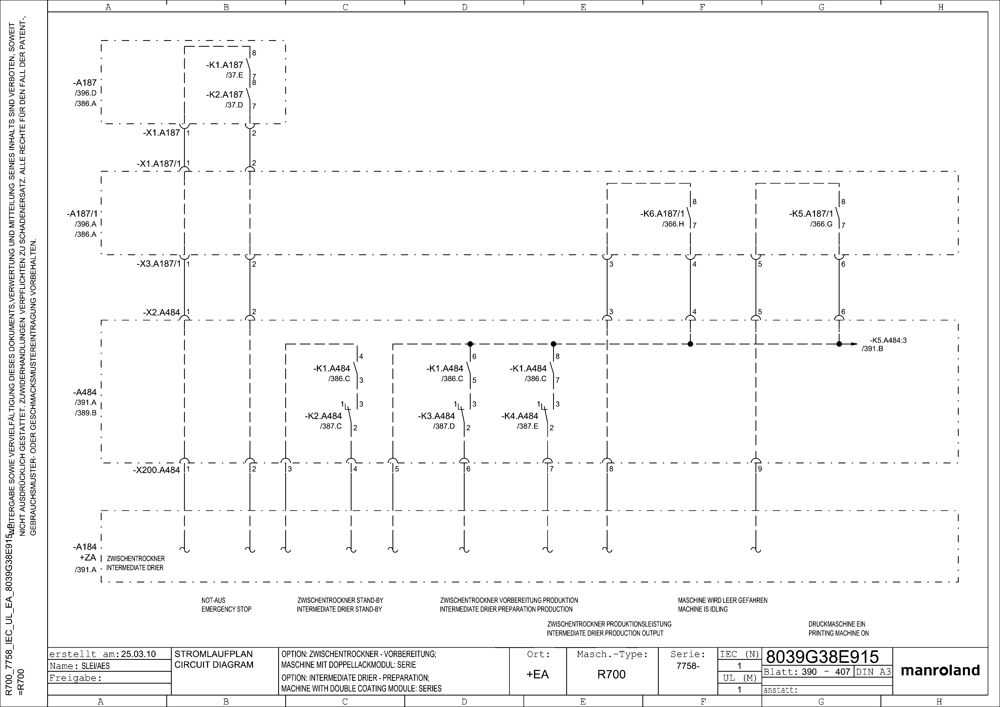

# +EA — Sheet 390 of 407 — OPTION: ZWISCHENTROCKNER VORBEREITUNG;

**MASCHINE MIT DOPPELLACKMODUL: SERIE**

> Part of the manroland **R700** printing press IEC/UL circuit diagrams.
> Drawing class: **Stromlaufplan / Circuit diagram** (DIN A3).
> Document `+EA` covers the **Printing unit** machine section.

## At a glance

| Field | Value |
|---|---|
| Document | `+EA`  (8039G38E915) |
| Sheet | **390** of 407 |
| Section (DE) | OPTION: ZWISCHENTROCKNER VORBEREITUNG; |
| Section (EN) | MASCHINE MIT DOPPELLACKMODUL: SERIE |
| Section type | CIRCUIT — Circuit diagram |
| Machine type | `R700` |
| Series | `7758` |
| Created | 25.03.10 |
| Replaces | — |
| Columns used | A, B, C, D, E, F, G, H |
| Path numbers | — |
| Labels on sheet | 101 |
| Cross-refs out | 18 |
| Cross-refs in | 43 |

**Previous:** [+EA sheet 389](SHEET_0389.md) · **Next:** [+EA sheet 391](SHEET_0391.md) · **Document TOC:** [_TOC.md](_TOC.md)  (+EA) · **Master TOC:** [all sheets](../_MASTER_TOC.md)

## Sheet image (300 DPI, exact vector render)



_Rendered directly from the PDF vector layer at 300 DPI (1-bit), no OCR and no resampling. Use it to confirm anything ambiguous in the text below._

## Cross-references on this sheet

Each entry is a wire leaving this sheet. The printed token is `/sheet.column`; the link resolves to that sheet inside the same document.

| Ref | Target sheet | Col | Path | Destination on target | Target section | From col |
|---|---|---|---|---|---|---|
| `/37.E` | [+EA sheet 37](SHEET_0037.md) | E | — | — | BUSVERBINDUNGEN: NOT AUS | B |
| `/396.D` | [+EA sheet 396](SHEET_0396.md) | D | — | — | OPTION: ZWISCHENTROCKNER VORBEREITUNG; | A |
| `/386.A` | [+EA sheet 386](SHEET_0386.md) | A | — | — | OPTION: ZWISCHENTROCKNER VORBEREITUNG; | A |
| `/37.D` | [+EA sheet 37](SHEET_0037.md) | D | — | — | BUSVERBINDUNGEN: NOT AUS | B |
| `/396.A` | [+EA sheet 396](SHEET_0396.md) | A | — | — | OPTION: ZWISCHENTROCKNER VORBEREITUNG; | A |
| `/386.A` | [+EA sheet 386](SHEET_0386.md) | A | — | — | OPTION: ZWISCHENTROCKNER VORBEREITUNG; | A |
| `/366.G` | [+EA sheet 366](SHEET_0366.md) | G | — | — | OPTION: TROCKNER VORBEREITUNG; | G |
| `/366.H` | [+EA sheet 366](SHEET_0366.md) | H | — | — | OPTION: TROCKNER VORBEREITUNG; | F |
| `/391.B` | [+EA sheet 391](SHEET_0391.md) | B | — | — | OPTION: ZWISCHENTROCKNER VORBEREITUNG; | G |
| `/386.C` | [+EA sheet 386](SHEET_0386.md) | C | — | — | OPTION: ZWISCHENTROCKNER VORBEREITUNG; | C |
| `/386.C` | [+EA sheet 386](SHEET_0386.md) | C | — | — | OPTION: ZWISCHENTROCKNER VORBEREITUNG; | D |
| `/386.C` | [+EA sheet 386](SHEET_0386.md) | C | — | — | OPTION: ZWISCHENTROCKNER VORBEREITUNG; | E |
| `/391.A` | [+EA sheet 391](SHEET_0391.md) | A | — | — | OPTION: ZWISCHENTROCKNER VORBEREITUNG; | A |
| `/389.B` | [+EA sheet 389](SHEET_0389.md) | B | — | — | OPTION: ZWISCHENTROCKNER VORBEREITUNG; | A |
| `/387.E` | [+EA sheet 387](SHEET_0387.md) | E | — | — | OPTION: ZWISCHENTROCKNER VORBEREITUNG; | E |
| `/387.C` | [+EA sheet 387](SHEET_0387.md) | C | — | — | OPTION: ZWISCHENTROCKNER VORBEREITUNG; | C |
| `/387.D` | [+EA sheet 387](SHEET_0387.md) | D | — | — | OPTION: ZWISCHENTROCKNER VORBEREITUNG; | D |
| `/391.A` | [+EA sheet 391](SHEET_0391.md) | A | — | — | OPTION: ZWISCHENTROCKNER VORBEREITUNG; | A |

### Incoming references (sheets that point here)

Every other sheet that sends a wire to this one. `Back-ref` is the token printed on *that* sheet; `Path` is its line number.

| From sheet | Cols | Back-ref | Path | Refs | What continues there |
|---|---|---|---|---|---|
| [+EA#37](SHEET_0037.md) | D, E | `/37.D`, `/37.E` | — | 2 | — |
| [+EA#206](SHEET_0206.md) | G | `/206.G` | — | 2 | — |
| [+EA#207](SHEET_0207.md) | A | `/207.A` | — | 2 | — |
| [+EA#230](SHEET_0230.md) | B | `/230.B` | — | 6 | — |
| [+EA#231](SHEET_0231.md) | G | `/231.G` | — | 6 | — |
| [+EA#286](SHEET_0286.md) | C | `/286.C` | — | 9 | — |
| [+EA#366](SHEET_0366.md) | G, H | `/366.G`, `/366.H` | — | 2 | — |
| [+EA#386](SHEET_0386.md) | A, C | `/386.A`, `/386.C` | — | 5 | — |
| [+EA#387](SHEET_0387.md) | C, D, E | `/387.C`, `/387.D`, `/387.E` | — | 3 | — |
| [+EA#389](SHEET_0389.md) | B | `/389.B` | — | 1 | — |
| [+EA#391](SHEET_0391.md) | A, B | `/391.A`, `/391.B` | — | 3 | K5.A484:3 |
| [+EA#396](SHEET_0396.md) | A, D | `/396.A`, `/396.D` | — | 2 | — |


## Devices on this sheet

| Tag | Class | Class meaning (IEC) | Col | Sub | Terminal | Sign |
|---|---|---|---|---|---|---|
| `A187` | A | Baugruppe / assembly, module, PC board | A | — | — | — |
| `A484` | A | Baugruppe / assembly, module, PC board | A | — | — | — |
| `A184` | A | Baugruppe / assembly, module, PC board | A | — | — | — |
| `A187/1` | A | Baugruppe / assembly, module, PC board | A | 1 | — | — |
| `X200.A484` | — | cross-device reference | A | — | — | — |
| `X2.A484` | — | cross-device reference | A | — | — | — |
| `X1.A187` | — | cross-device reference | A | — | — | — |
| `K2.A187` | — | cross-device reference | B | — | — | — |
| `K1.A187` | — | cross-device reference | B | — | — | — |
| `K2.A484` | — | cross-device reference | C | — | — | — |
| `K1.A484` | — | cross-device reference | C | — | — | — |
| `K3.A484` | — | cross-device reference | D | — | — | — |
| `K1.A484` | — | cross-device reference | D | — | — | — |
| `K4.A484` | — | cross-device reference | D | — | — | — |
| `K1.A484` | — | cross-device reference | E | — | — | — |
| `K5.A484:3` | — | cross-device reference | H | — | 3 | — |

## Potentials / nets

_No named potentials on this sheet._

## Wire-end annotations (grouped as printed)

A wire that continues elsewhere is annotated with a small cluster: the destination description, the path/line number `#NN`, and the `/sheet.column` cross reference. Each row below is one such cluster exactly as it is grouped on the drawing.

| Col | Y | Path | Cross-ref | Text on the wire |
|---|---|---|---|---|
| B | 59.1 | — | — | `8` |
| B | 72.6 | — | — | `K1.A187 7` |
| B | 85.6 | — | `/37.E` | — |
| A | 93.8 | — | — | `A187` |
| B | 94.6 | — | — | `8` |
| A | 106.9 | — | `/396.D`, `/386.A` | — |
| B | 108.0 | — | — | `K2.A187 7` |
| B | 121.1 | — | `/37.D` | — |
| B | 153.4 | — | — | `X1.A187 1 2` |
| B | 190.2 | — | — | `X1.A187/1 1 2` |
| F | 236.3 | — | — | `8` |
| G | 236.3 | — | — | `8` |
| A | 249.8 | — | — | `A187/1` |
| F | 249.8 | — | — | `K6.A187/1 7` |
| G | 249.8 | — | — | `K5.A187/1 7` |
| A | 262.8 | — | `/396.A`, `/386.A` | — |
| G | 262.8 | — | `/366.G` | — |
| F | 262.9 | — | `/366.H` | — |
| B | 309.3 | — | — | `X3.A187/1 1 2` |
| E | 310.7 | — | — | `3` |
| F | 310.7 | — | — | `4` |
| F | 310.7 | — | — | `5` |
| G | 310.7 | — | — | `6` |
| B | 367.4 | — | — | `X2.A484 1 2` |
| E | 367.4 | — | — | `3` |
| F | 367.4 | — | — | `4` |
| F | 367.4 | — | — | `5` |
| G | 367.4 | — | — | `6` |
| H | 401.4 | — | — | `K5.A484:3` |
| G | 411.3 | — | `/391.B` | — |
| C | 420.6 | — | — | `4` |
| D | 420.6 | — | — | `6` |
| E | 420.6 | — | — | `8` |
| C | 434.0 | — | — | `K1.A484 3` |
| D | 434.0 | — | — | `K1.A484 5` |
| E | 434.0 | — | — | `K1.A484 7` |
| C | 447.1 | — | `/386.C` | — |
| D | 447.1 | — | `/386.C` | — |
| E | 447.1 | — | `/386.C` | — |
| A | 462.4 | — | — | `A484` |
| A | 475.4 | — | `/391.A`, `/389.B` | — |
| C | 477.2 | — | — | `K2.A484 3` |
| C | 477.2 | — | — | `1` |
| D | 477.2 | — | — | `K3.A484 3` |
| D | 477.2 | — | — | `1` |
| E | 477.2 | — | — | `K4.A484 3` |
| E | 477.2 | — | — | `1` |
| C | 503.8 | — | `/387.C` | — |
| D | 503.8 | — | `/387.D` | — |
| E | 503.8 | — | `/387.E` | — |
| C | 505.6 | — | — | `2` |
| D | 505.6 | — | — | `2` |
| E | 505.6 | — | — | `2` |
| B | 554.5 | — | — | `X200.A484 1 2` |
| C | 554.5 | — | — | `3 6` |
| C | 554.5 | — | — | `4 5` |
| E | 554.5 | — | — | `7` |
| E | 554.5 | — | — | `8` |
| F | 554.5 | — | — | `9` |
| A | 646.6 | — | — | `A184` |
| A | 659.3 | — | — | `+ZA` |
| A | 662.5 | — | — | `INTERMEDIATE DRIER ZWISCHENTROCKNER` |
| A | 674.5 | — | `/391.A` | — |
| B | 712.1 | — | — | `NOT AUS EMERGENCY STOP` |
| C | 712.1 | — | — | `INTERMEDIATE DRIER STAND BY ZWISCHENTROCKNER STAND BY` |
| D | 712.1 | — | — | `INTERMEDIATE DRIER PREPARATION PRODUCTION ZWISCHENTROCKNER VORBEREITUNG PRODUKTION` |
| F | 712.1 | — | — | `MASCHINE WIRD LEER GEFAHREN MACHINE IS IDLING` |
| E | 740.5 | — | — | `INTERMEDIATE DRIER PRODUCTION OUTPUT ZWISCHENTROCKNER PRODUKTIONSLEISTUNG` |
| G | 740.5 | — | — | `DRUCKMASCHINE EIN PRINTING MACHINE ON` |


## Reconstructed tables

This sheet carries tabular content (pin map / terminal assignment / index). The grid below was rebuilt from the drawing's own rule lines, so each row is exactly one physical row of the table.

### Table 1 — 1 data rows × 2 columns (at x=219.7, y=55.3)

| K1.A187 /37.E K2.A187 /37.D 1 1 | 8 7 8 7 2 2 |
|---|---|
| `1 1` | `2 2` |


## Notes and free text on this sheet

| Text | Col | Y (pt) |
|---|---|---|
| `X3.A187/1` | A | 309.29 |
| `X1.A187/1` | A | 190.23 |
| `+ZA` | A | 659.28 |
| `ZWISCHENTROCKNER` | A | 662.51 |
| `INTERMEDIATE DRIER` | A | 673.15 |
| `K6.A187/1` | F | 249.76 |
| `K5.A187/1` | G | 249.76 |
| `NOT AUS` | B | 712.11 |
| `EMERGENCY STOP` | B | 722.75 |
| `ZWISCHENTROCKNER VORBEREITUNG PRODUKTION` | D | 712.13 |
| `INTERMEDIATE DRIER PREPARATION PRODUCTION` | D | 722.76 |
| `MASCHINE WIRD LEER GEFAHREN` | F | 712.11 |
| `MACHINE IS IDLING` | F | 722.75 |
| `ZWISCHENTROCKNER PRODUKTIONSLEISTUNG` | E | 740.47 |
| `INTERMEDIATE DRIER PRODUCTION OUTPUT` | E | 751.11 |
| `DRUCKMASCHINE EIN` | G | 740.47 |
| `PRINTING MACHINE ON` | G | 751.1 |
| `ZWISCHENTROCKNER STAND BY` | C | 712.12 |
| `INTERMEDIATE DRIER STAND BY` | C | 722.76 |

## Complete label inventory (exact text from the drawing)

Every text object inside the drawing area of this sheet, in DIN reading order (column A→H, then top→bottom). This is the authoritative list: if a string is not here it is not printed on this sheet.

| Col | Y | X | Dir | Type | Text |
|---|---|---|---|---|---|
| A | 93.8 | 87.0 | → | device tag | `A187` |
| A | 106.9 | 89.3 | → | cross-reference | `/396.D` |
| A | 119.3 | 89.3 | → | cross-reference | `/386.A` |
| A | 153.4 | 170.4 | → | device ref | `X1.A187` |
| A | 190.2 | 163.0 | → | text | `X1.A187/1` |
| A | 249.8 | 79.7 | → | device tag | `A187/1` |
| A | 262.8 | 89.3 | → | cross-reference | `/396.A` |
| A | 275.2 | 89.3 | → | cross-reference | `/386.A` |
| A | 309.3 | 163.0 | → | text | `X3.A187/1` |
| A | 367.4 | 170.4 | → | device ref | `X2.A484` |
| A | 462.3 | 87.0 | → | device tag | `A484` |
| A | 475.4 | 89.3 | → | cross-reference | `/391.A` |
| A | 487.8 | 89.6 | → | cross-reference | `/389.B` |
| A | 555.2 | 158.5 | → | device ref | `X200.A484` |
| A | 646.6 | 87.0 | → | device tag | `A184` |
| A | 659.3 | 94.7 | → | text | `+ZA` |
| A | 662.5 | 127.6 | → | text | `ZWISCHENTROCKNER` |
| A | 673.1 | 126.7 | → | text | `INTERMEDIATE DRIER` |
| A | 674.6 | 89.3 | → | cross-reference | `/391.A` |
| B | 59.1 | 300.2 | → | number | `8` |
| B | 72.6 | 245.5 | → | device ref | `K1.A187` |
| B | 85.6 | 269.0 | → | cross-reference | `/37.E` |
| B | 87.5 | 300.2 | → | number | `7` |
| B | 94.6 | 300.2 | → | number | `8` |
| B | 108.0 | 245.5 | → | device ref | `K2.A187` |
| B | 121.1 | 268.4 | → | cross-reference | `/37.D` |
| B | 122.9 | 300.2 | → | number | `7` |
| B | 154.8 | 221.7 | → | number | `1` |
| B | 154.8 | 300.2 | → | number | `2` |
| B | 190.2 | 221.7 | → | number | `1` |
| B | 190.2 | 300.2 | → | number | `2` |
| B | 310.7 | 221.7 | → | number | `1` |
| B | 310.7 | 300.2 | → | number | `2` |
| B | 367.4 | 221.7 | → | number | `1` |
| B | 367.4 | 300.2 | → | number | `2` |
| B | 554.5 | 221.7 | → | number | `1` |
| B | 554.5 | 300.2 | → | number | `2` |
| B | 712.1 | 240.1 | → | text | `NOT AUS` |
| B | 722.8 | 240.1 | → | text | `EMERGENCY STOP` |
| C | 420.6 | 427.7 | → | number | `4` |
| C | 434.0 | 373.0 | → | device ref | `K1.A484` |
| C | 447.1 | 391.2 | → | cross-reference | `/386.C` |
| C | 448.9 | 427.7 | → | number | `3` |
| C | 477.3 | 405.1 | → | number | `1` |
| C | 477.3 | 427.7 | → | number | `3` |
| C | 490.7 | 363.1 | → | device ref | `K2.A484` |
| C | 503.8 | 381.3 | → | cross-reference | `/387.C` |
| C | 505.6 | 420.7 | → | number | `2` |
| C | 554.5 | 342.7 | → | number | `3` |
| C | 554.5 | 420.7 | → | number | `4` |
| C | 554.5 | 470.3 | → | number | `5` |
| C | 712.1 | 354.3 | → | text | `ZWISCHENTROCKNER STAND BY` |
| C | 722.8 | 353.5 | → | text | `INTERMEDIATE DRIER STAND BY` |
| D | 420.6 | 562.4 | → | number | `6` |
| D | 434.0 | 507.7 | → | device ref | `K1.A484` |
| D | 447.1 | 525.8 | → | cross-reference | `/386.C` |
| D | 448.9 | 562.4 | → | number | `5` |
| D | 477.3 | 539.7 | → | number | `1` |
| D | 477.3 | 562.4 | → | number | `3` |
| D | 490.7 | 497.8 | → | device ref | `K3.A484` |
| D | 490.7 | 597.0 | → | device ref | `K4.A484` |
| D | 503.8 | 515.9 | → | cross-reference | `/387.D` |
| D | 505.6 | 555.3 | → | number | `2` |
| D | 554.5 | 555.3 | → | number | `6` |
| D | 712.1 | 524.4 | → | text | `ZWISCHENTROCKNER VORBEREITUNG PRODUKTION` |
| D | 722.8 | 523.6 | → | text | `INTERMEDIATE DRIER PREPARATION PRODUCTION` |
| E | 310.7 | 725.4 | → | number | `3` |
| E | 367.4 | 725.4 | → | number | `3` |
| E | 420.6 | 661.6 | → | number | `8` |
| E | 434.0 | 606.9 | → | device ref | `K1.A484` |
| E | 447.1 | 625.0 | → | cross-reference | `/386.C` |
| E | 448.9 | 661.6 | → | number | `7` |
| E | 477.3 | 638.9 | → | number | `1` |
| E | 477.3 | 661.6 | → | number | `3` |
| E | 503.8 | 615.7 | → | cross-reference | `/387.E` |
| E | 505.6 | 654.5 | → | number | `2` |
| E | 554.5 | 654.5 | → | number | `7` |
| E | 554.5 | 725.4 | → | number | `8` |
| E | 740.5 | 652.0 | → | text | `ZWISCHENTROCKNER PRODUKTIONSLEISTUNG` |
| E | 751.1 | 651.1 | → | text | `INTERMEDIATE DRIER PRODUCTION OUTPUT` |
| F | 236.3 | 824.6 | → | number | `8` |
| F | 249.8 | 762.5 | → | text | `K6.A187/1` |
| F | 262.8 | 788.6 | → | cross-reference | `/366.H` |
| F | 264.7 | 824.6 | → | number | `7` |
| F | 310.7 | 824.6 | → | number | `4` |
| F | 310.7 | 902.6 | → | number | `5` |
| F | 367.4 | 824.6 | → | number | `4` |
| F | 367.4 | 902.6 | → | number | `5` |
| F | 554.5 | 902.6 | → | number | `9` |
| F | 712.1 | 807.3 | → | text | `MASCHINE WIRD LEER GEFAHREN` |
| F | 722.8 | 807.3 | → | text | `MACHINE IS IDLING` |
| G | 236.3 | 1001.8 | → | number | `8` |
| G | 249.8 | 939.7 | → | text | `K5.A187/1` |
| G | 262.8 | 964.9 | → | cross-reference | `/366.G` |
| G | 264.7 | 1001.8 | → | number | `7` |
| G | 310.7 | 1001.8 | → | number | `6` |
| G | 367.4 | 1001.8 | → | number | `6` |
| G | 411.3 | 1026.1 | → | cross-reference | `/391.B` |
| G | 740.5 | 962.9 | → | text | `DRUCKMASCHINE EIN` |
| G | 751.1 | 962.9 | → | text | `PRINTING MACHINE ON` |
| H | 401.4 | 1035.8 | → | device ref | `K5.A484:3` |

## Reading-order text block

The same content as a plain block, grouped by DIN column — convenient to paste or to match against a visual description.

```text
=== Column A ===
  93.8   87.0  devtag       A187
 106.9   89.3  xref         /396.D
 119.3   89.3  xref         /386.A
 153.4  170.4  devref       X1.A187
 190.2  163.0  text         X1.A187/1
 249.8   79.7  devtag       A187/1
 262.8   89.3  xref         /396.A
 275.2   89.3  xref         /386.A
 309.3  163.0  text         X3.A187/1
 367.4  170.4  devref       X2.A484
 462.3   87.0  devtag       A484
 475.4   89.3  xref         /391.A
 487.8   89.6  xref         /389.B
 555.2  158.5  devref       X200.A484
 646.6   87.0  devtag       A184
 659.3   94.7  text         +ZA
 662.5  127.6  text         ZWISCHENTROCKNER
 673.1  126.7  text         INTERMEDIATE DRIER
 674.6   89.3  xref         /391.A
=== Column B ===
  59.1  300.2  numeric      8
  72.6  245.5  devref       K1.A187
  85.6  269.0  xref         /37.E
  87.5  300.2  numeric      7
  94.6  300.2  numeric      8
 108.0  245.5  devref       K2.A187
 121.1  268.4  xref         /37.D
 122.9  300.2  numeric      7
 154.8  221.7  numeric      1
 154.8  300.2  numeric      2
 190.2  221.7  numeric      1
 190.2  300.2  numeric      2
 310.7  221.7  numeric      1
 310.7  300.2  numeric      2
 367.4  221.7  numeric      1
 367.4  300.2  numeric      2
 554.5  221.7  numeric      1
 554.5  300.2  numeric      2
 712.1  240.1  text         NOT AUS
 722.8  240.1  text         EMERGENCY STOP
=== Column C ===
 420.6  427.7  numeric      4
 434.0  373.0  devref       K1.A484
 447.1  391.2  xref         /386.C
 448.9  427.7  numeric      3
 477.3  405.1  numeric      1
 477.3  427.7  numeric      3
 490.7  363.1  devref       K2.A484
 503.8  381.3  xref         /387.C
 505.6  420.7  numeric      2
 554.5  342.7  numeric      3
 554.5  420.7  numeric      4
 554.5  470.3  numeric      5
 712.1  354.3  text         ZWISCHENTROCKNER STAND BY
 722.8  353.5  text         INTERMEDIATE DRIER STAND BY
=== Column D ===
 420.6  562.4  numeric      6
 434.0  507.7  devref       K1.A484
 447.1  525.8  xref         /386.C
 448.9  562.4  numeric      5
 477.3  539.7  numeric      1
 477.3  562.4  numeric      3
 490.7  497.8  devref       K3.A484
 490.7  597.0  devref       K4.A484
 503.8  515.9  xref         /387.D
 505.6  555.3  numeric      2
 554.5  555.3  numeric      6
 712.1  524.4  text         ZWISCHENTROCKNER VORBEREITUNG PRODUKTION
 722.8  523.6  text         INTERMEDIATE DRIER PREPARATION PRODUCTION
=== Column E ===
 310.7  725.4  numeric      3
 367.4  725.4  numeric      3
 420.6  661.6  numeric      8
 434.0  606.9  devref       K1.A484
 447.1  625.0  xref         /386.C
 448.9  661.6  numeric      7
 477.3  638.9  numeric      1
 477.3  661.6  numeric      3
 503.8  615.7  xref         /387.E
 505.6  654.5  numeric      2
 554.5  654.5  numeric      7
 554.5  725.4  numeric      8
 740.5  652.0  text         ZWISCHENTROCKNER PRODUKTIONSLEISTUNG
 751.1  651.1  text         INTERMEDIATE DRIER PRODUCTION OUTPUT
=== Column F ===
 236.3  824.6  numeric      8
 249.8  762.5  text         K6.A187/1
 262.8  788.6  xref         /366.H
 264.7  824.6  numeric      7
 310.7  824.6  numeric      4
 310.7  902.6  numeric      5
 367.4  824.6  numeric      4
 367.4  902.6  numeric      5
 554.5  902.6  numeric      9
 712.1  807.3  text         MASCHINE WIRD LEER GEFAHREN
 722.8  807.3  text         MACHINE IS IDLING
=== Column G ===
 236.3 1001.8  numeric      8
 249.8  939.7  text         K5.A187/1
 262.8  964.9  xref         /366.G
 264.7 1001.8  numeric      7
 310.7 1001.8  numeric      6
 367.4 1001.8  numeric      6
 411.3 1026.1  xref         /391.B
 740.5  962.9  text         DRUCKMASCHINE EIN
 751.1  962.9  text         PRINTING MACHINE ON
=== Column H ===
 401.4 1035.8  devref       K5.A484:3
```

---
_Generated from the PDF vector text layer; no OCR. Source: `R700_7758_IEC_UL_EA_8039G38E915_p`, sheet 390._
