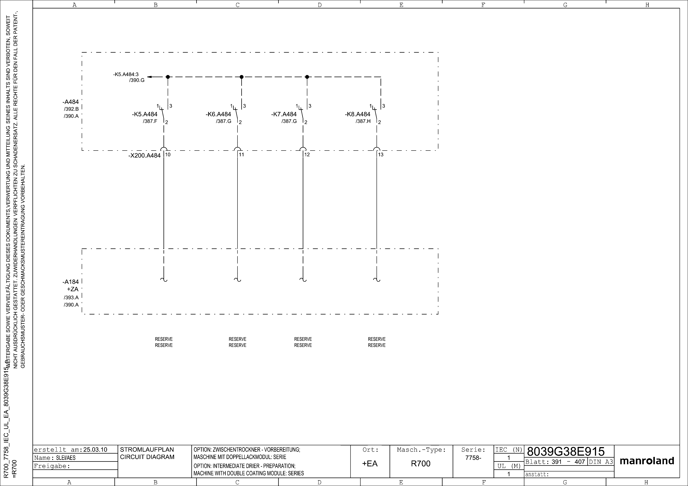

# +EA — Sheet 391 of 407 — OPTION: ZWISCHENTROCKNER VORBEREITUNG;

**MASCHINE MIT DOPPELLACKMODUL: SERIE**

> Part of the manroland **R700** printing press IEC/UL circuit diagrams.
> Drawing class: **Stromlaufplan / Circuit diagram** (DIN A3).
> Document `+EA` covers the **Printing unit** machine section.

## At a glance

| Field | Value |
|---|---|
| Document | `+EA`  (8039G38E915) |
| Sheet | **391** of 407 |
| Section (DE) | OPTION: ZWISCHENTROCKNER VORBEREITUNG; |
| Section (EN) | MASCHINE MIT DOPPELLACKMODUL: SERIE |
| Section type | CIRCUIT — Circuit diagram |
| Machine type | `R700` |
| Series | `7758` |
| Created | 25.03.10 |
| Replaces | — |
| Columns used | A, B, C, D, E |
| Path numbers | — |
| Labels on sheet | 42 |
| Cross-refs out | 9 |
| Cross-refs in | 13 |

**Previous:** [+EA sheet 390](SHEET_0390.md) · **Next:** [+EA sheet 392](SHEET_0392.md) · **Document TOC:** [_TOC.md](_TOC.md)  (+EA) · **Master TOC:** [all sheets](../_MASTER_TOC.md)

## Sheet image (300 DPI, exact vector render)



_Rendered directly from the PDF vector layer at 300 DPI (1-bit), no OCR and no resampling. Use it to confirm anything ambiguous in the text below._

## Cross-references on this sheet

Each entry is a wire leaving this sheet. The printed token is `/sheet.column`; the link resolves to that sheet inside the same document.

| Ref | Target sheet | Col | Path | Destination on target | Target section | From col |
|---|---|---|---|---|---|---|
| `/390.G` | [+EA sheet 390](SHEET_0390.md) | G | — | K5.A484:3 | OPTION: ZWISCHENTROCKNER VORBEREITUNG; | B |
| `/392.B` | [+EA sheet 392](SHEET_0392.md) | B | — | — | OPTION: ZWISCHENTROCKNER VORBEREITUNG; | A |
| `/390.A` | [+EA sheet 390](SHEET_0390.md) | A | — | — | OPTION: ZWISCHENTROCKNER VORBEREITUNG; | A |
| `/387.F` | [+EA sheet 387](SHEET_0387.md) | F | — | — | OPTION: ZWISCHENTROCKNER VORBEREITUNG; | B |
| `/387.G` | [+EA sheet 387](SHEET_0387.md) | G | — | — | OPTION: ZWISCHENTROCKNER VORBEREITUNG; | C |
| `/387.G` | [+EA sheet 387](SHEET_0387.md) | G | — | — | OPTION: ZWISCHENTROCKNER VORBEREITUNG; | D |
| `/387.H` | [+EA sheet 387](SHEET_0387.md) | H | — | — | OPTION: ZWISCHENTROCKNER VORBEREITUNG; | E |
| `/393.A` | [+EA sheet 393](SHEET_0393.md) | A | — | — | OPTION: ZWISCHENTROCKNER VORBEREITUNG; | A |
| `/390.A` | [+EA sheet 390](SHEET_0390.md) | A | — | — | OPTION: ZWISCHENTROCKNER VORBEREITUNG; | A |

### Incoming references (sheets that point here)

Every other sheet that sends a wire to this one. `Back-ref` is the token printed on *that* sheet; `Path` is its line number.

| From sheet | Cols | Back-ref | Path | Refs | What continues there |
|---|---|---|---|---|---|
| [+EA#286](SHEET_0286.md) | C | `/286.C` | — | 4 | — |
| [+EA#387](SHEET_0387.md) | F, G, H | `/387.F`, `/387.G`, `/387.H` | — | 4 | — |
| [+EA#390](SHEET_0390.md) | A, G | `/390.A`, `/390.G` | — | 3 | — |
| [+EA#392](SHEET_0392.md) | A | `/392.A` | — | 1 | — |
| [+EA#393](SHEET_0393.md) | A | `/393.A` | — | 1 | — |


## Devices on this sheet

| Tag | Class | Class meaning (IEC) | Col | Sub | Terminal | Sign |
|---|---|---|---|---|---|---|
| `A484` | A | Baugruppe / assembly, module, PC board | A | — | — | — |
| `A184` | A | Baugruppe / assembly, module, PC board | A | — | — | — |
| `X200.A484` | — | cross-device reference | B | — | — | — |
| `K5.A484` | — | cross-device reference | B | — | — | — |
| `K6.A484` | — | cross-device reference | C | — | — | — |
| `K7.A484` | — | cross-device reference | D | — | — | — |
| `K8.A484` | — | cross-device reference | D | — | — | — |
| `K5.A484:3` | — | cross-device reference | B | — | 3 | — |

## Potentials / nets

_No named potentials on this sheet._

## Wire-end annotations (grouped as printed)

A wire that continues elsewhere is annotated with a small cluster: the destination description, the path/line number `#NN`, and the `/sheet.column` cross reference. Each row below is one such cluster exactly as it is grouped on the drawing.

| Col | Y | Path | Cross-ref | Text on the wire |
|---|---|---|---|---|
| B | 125.0 | — | `/390.G` | `K5.A484:3` |
| A | 171.8 | — | — | `A484` |
| B | 179.6 | — | — | `K5.A484 3` |
| B | 179.6 | — | — | `1` |
| C | 179.6 | — | — | `K6.A484 3` |
| C | 179.6 | — | — | `1` |
| D | 179.6 | — | — | `K7.A484 3` |
| D | 179.6 | — | — | `1` |
| E | 179.6 | — | — | `K8.A484 3` |
| E | 179.6 | — | — | `1` |
| A | 184.9 | — | `/392.B`, `/390.A` | — |
| B | 206.1 | — | `/387.F` | — |
| C | 206.2 | — | `/387.G` | — |
| D | 206.2 | — | `/387.G` | — |
| E | 206.2 | — | `/387.H` | — |
| B | 208.0 | — | — | `2` |
| C | 208.0 | — | — | `2` |
| D | 208.0 | — | — | `2` |
| E | 208.0 | — | — | `2` |
| C | 263.9 | — | — | `X200.A484 10 11 12 13` |
| A | 483.6 | — | — | `A184` |
| A | 496.3 | — | — | `+ZA` |
| A | 511.6 | — | `/393.A`, `/390.A` | — |
| B | 584.5 | — | — | `RESERVE RESERVE` |
| C | 584.5 | — | — | `RESERVE RESERVE` |
| D | 584.5 | — | — | `RESERVE RESERVE` |
| E | 584.5 | — | — | `RESERVE RESERVE` |


## Reconstructed tables

This sheet carries tabular content (pin map / terminal assignment / index). The grid below was rebuilt from the drawing's own rule lines, so each row is exactly one physical row of the table.

### Table 1 — 5 data rows × 15 columns (at x=204.1, y=0.0) — **K5.A484:3 /390.G 1 K5.A484 /387.F X200.A484 2 10 RESERVE RESERVE 3 1 K6.A484 /387.G 2 11 RESERVE RESERVE 3 1 K7.A484 /387.G 2 12 RESERVE RESERVE 1 K8.A484 /387.H 2 13 RESERVE RESERVE**

| STROMLAUFPLAN |  |  | OPTION: ZWISCHENTROCKNER |  | VORBEREITUNG; |  |  | Ort: |  |  | Masch. Type: | Serie: | IEC (N) | 8039G38E915 |
|---|---|---|---|---|---|---|---|---|---|---|---|---|---|---|
| `CIRCUIT DIAGRAM` |  |  |  |  |  |  |  |  |  |  |  |  |  |  |
|  |  |  | `MASCHINE MIT` |  | `DOPPELLACKMODUL: SERIE` |  |  |  |  |  |  | `7758` | `1` |  |
|  |  |  |  |  |  |  |  | `+EA` |  |  | `R700` |  |  | `Blatt: DIN A3 391 407` |
|  |  |  | `OPTION: INTERMEDIATE` |  | `DRIER PREPARATION;` |  |  |  |  |  |  |  | `UL (M)` |  |
|  |  |  | `MACHINE WITH DOUBLE` |  | `COATING MODULE: SERIES` |  |  |  |  |  |  |  | `1` | `anstatt:` |


## Notes and free text on this sheet

| Text | Col | Y (pt) |
|---|---|---|
| `+ZA` | A | 496.29 |
| `RESERVE` | B | 584.52 |
| `RESERVE` | C | 584.52 |
| `RESERVE` | D | 584.52 |
| `RESERVE` | E | 584.52 |

## Complete label inventory (exact text from the drawing)

Every text object inside the drawing area of this sheet, in DIN reading order (column A→H, then top→bottom). This is the authoritative list: if a string is not here it is not printed on this sheet.

| Col | Y | X | Dir | Type | Text |
|---|---|---|---|---|---|
| A | 171.8 | 108.3 | → | device tag | `A484` |
| A | 184.9 | 110.8 | → | cross-reference | `/392.B` |
| A | 197.3 | 110.6 | → | cross-reference | `/390.A` |
| A | 483.6 | 108.3 | → | device tag | `A184` |
| A | 496.3 | 115.9 | → | text | `+ZA` |
| A | 511.6 | 110.6 | → | cross-reference | `/393.A` |
| A | 524.0 | 110.6 | → | cross-reference | `/390.A` |
| B | 125.0 | 195.9 | → | device ref | `K5.A484:3` |
| B | 134.9 | 223.7 | → | cross-reference | `/390.G` |
| B | 179.6 | 270.4 | → | number | `1` |
| B | 179.6 | 293.1 | → | number | `3` |
| B | 193.1 | 228.5 | → | device ref | `K5.A484` |
| B | 206.1 | 247.5 | → | cross-reference | `/387.F` |
| B | 208.0 | 286.0 | → | number | `2` |
| B | 263.9 | 285.4 | → | number | `10` |
| B | 264.6 | 222.2 | → | device ref | `X200.A484` |
| B | 584.5 | 268.4 | → | text | `RESERVE` |
| B | 595.2 | 268.4 | → | text | `RESERVE` |
| C | 179.6 | 398.0 | → | number | `1` |
| C | 179.6 | 420.7 | → | number | `3` |
| C | 193.1 | 356.0 | → | device ref | `K6.A484` |
| C | 206.1 | 373.9 | → | cross-reference | `/387.G` |
| C | 208.0 | 413.6 | → | number | `2` |
| C | 263.9 | 413.0 | → | number | `11` |
| C | 584.5 | 396.0 | → | text | `RESERVE` |
| C | 595.2 | 396.0 | → | text | `RESERVE` |
| D | 179.6 | 511.4 | → | number | `1` |
| D | 179.6 | 534.0 | → | number | `3` |
| D | 193.1 | 469.4 | → | device ref | `K7.A484` |
| D | 193.1 | 597.0 | → | device ref | `K8.A484` |
| D | 206.1 | 487.3 | → | cross-reference | `/387.G` |
| D | 208.0 | 527.0 | → | number | `2` |
| D | 263.9 | 526.4 | → | number | `12` |
| D | 584.5 | 509.4 | → | text | `RESERVE` |
| D | 595.2 | 509.4 | → | text | `RESERVE` |
| E | 179.6 | 638.9 | → | number | `1` |
| E | 179.6 | 661.6 | → | number | `3` |
| E | 206.2 | 615.7 | → | cross-reference | `/387.H` |
| E | 208.0 | 654.5 | → | number | `2` |
| E | 263.9 | 654.0 | → | number | `13` |
| E | 584.5 | 636.9 | → | text | `RESERVE` |
| E | 595.2 | 636.9 | → | text | `RESERVE` |

## Reading-order text block

The same content as a plain block, grouped by DIN column — convenient to paste or to match against a visual description.

```text
=== Column A ===
 171.8  108.3  devtag       A484
 184.9  110.8  xref         /392.B
 197.3  110.6  xref         /390.A
 483.6  108.3  devtag       A184
 496.3  115.9  text         +ZA
 511.6  110.6  xref         /393.A
 524.0  110.6  xref         /390.A
=== Column B ===
 125.0  195.9  devref       K5.A484:3
 134.9  223.7  xref         /390.G
 179.6  270.4  numeric      1
 179.6  293.1  numeric      3
 193.1  228.5  devref       K5.A484
 206.1  247.5  xref         /387.F
 208.0  286.0  numeric      2
 263.9  285.4  numeric      10
 264.6  222.2  devref       X200.A484
 584.5  268.4  text         RESERVE
 595.2  268.4  text         RESERVE
=== Column C ===
 179.6  398.0  numeric      1
 179.6  420.7  numeric      3
 193.1  356.0  devref       K6.A484
 206.1  373.9  xref         /387.G
 208.0  413.6  numeric      2
 263.9  413.0  numeric      11
 584.5  396.0  text         RESERVE
 595.2  396.0  text         RESERVE
=== Column D ===
 179.6  511.4  numeric      1
 179.6  534.0  numeric      3
 193.1  469.4  devref       K7.A484
 193.1  597.0  devref       K8.A484
 206.1  487.3  xref         /387.G
 208.0  527.0  numeric      2
 263.9  526.4  numeric      12
 584.5  509.4  text         RESERVE
 595.2  509.4  text         RESERVE
=== Column E ===
 179.6  638.9  numeric      1
 179.6  661.6  numeric      3
 206.2  615.7  xref         /387.H
 208.0  654.5  numeric      2
 263.9  654.0  numeric      13
 584.5  636.9  text         RESERVE
 595.2  636.9  text         RESERVE
```

---
_Generated from the PDF vector text layer; no OCR. Source: `R700_7758_IEC_UL_EA_8039G38E915_p`, sheet 391._
