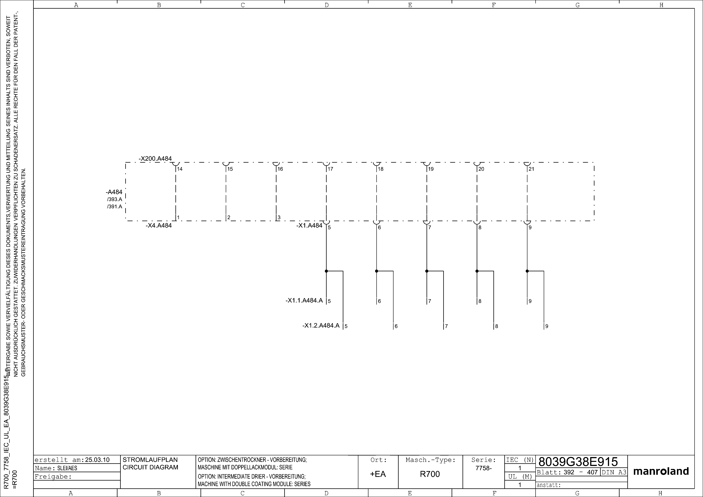

# +EA — Sheet 392 of 407 — OPTION: ZWISCHENTROCKNER VORBEREITUNG;

**MASCHINE MIT DOPPELLACKMODUL: SERIE**

> Part of the manroland **R700** printing press IEC/UL circuit diagrams.
> Drawing class: **Stromlaufplan / Circuit diagram** (DIN A3).
> Document `+EA` covers the **Printing unit** machine section.

## At a glance

| Field | Value |
|---|---|
| Document | `+EA`  (8039G38E915) |
| Sheet | **392** of 407 |
| Section (DE) | OPTION: ZWISCHENTROCKNER VORBEREITUNG; |
| Section (EN) | MASCHINE MIT DOPPELLACKMODUL: SERIE |
| Section type | CIRCUIT — Circuit diagram |
| Machine type | `R700` |
| Series | `7758` |
| Created | 25.03.10 |
| Replaces | — |
| Columns used | A, B, C, D, E, F, G |
| Path numbers | — |
| Labels on sheet | 34 |
| Cross-refs out | 2 |
| Cross-refs in | 28 |

**Previous:** [+EA sheet 391](SHEET_0391.md) · **Next:** [+EA sheet 393](SHEET_0393.md) · **Document TOC:** [_TOC.md](_TOC.md)  (+EA) · **Master TOC:** [all sheets](../_MASTER_TOC.md)

## Sheet image (300 DPI, exact vector render)



_Rendered directly from the PDF vector layer at 300 DPI (1-bit), no OCR and no resampling. Use it to confirm anything ambiguous in the text below._

## Cross-references on this sheet

Each entry is a wire leaving this sheet. The printed token is `/sheet.column`; the link resolves to that sheet inside the same document.

| Ref | Target sheet | Col | Path | Destination on target | Target section | From col |
|---|---|---|---|---|---|---|
| `/393.A` | [+EA sheet 393](SHEET_0393.md) | A | — | — | OPTION: ZWISCHENTROCKNER VORBEREITUNG; | A |
| `/391.A` | [+EA sheet 391](SHEET_0391.md) | A | — | — | OPTION: ZWISCHENTROCKNER VORBEREITUNG; | A |

### Incoming references (sheets that point here)

Every other sheet that sends a wire to this one. `Back-ref` is the token printed on *that* sheet; `Path` is its line number.

| From sheet | Cols | Back-ref | Path | Refs | What continues there |
|---|---|---|---|---|---|
| [+EA#210](SHEET_0210.md) | E, G | `/210.E`, `/210.G` | — | 10 | — |
| [+EA#211](SHEET_0211.md) | A | `/211.A` | — | 5 | — |
| [+EA#238](SHEET_0238.md) | A | `/238.A` | — | 3 | — |
| [+EA#286](SHEET_0286.md) | C | `/286.C` | — | 8 | — |
| [+EA#391](SHEET_0391.md) | A | `/391.A` | — | 1 | — |
| [+EA#393](SHEET_0393.md) | A | `/393.A` | — | 1 | — |


## Devices on this sheet

| Tag | Class | Class meaning (IEC) | Col | Sub | Terminal | Sign |
|---|---|---|---|---|---|---|
| `A484` | A | Baugruppe / assembly, module, PC board | A | — | — | — |
| `X1.1.A484.A` | — | cross-device reference | D | — | — | — |
| `X1.2.A484.A` | — | cross-device reference | D | — | — | — |
| `X4.A484` | — | cross-device reference | B | — | — | — |
| `X200.A484` | — | cross-device reference | B | — | — | — |
| `X1.A484` | — | cross-device reference | D | — | — | — |

## Potentials / nets

_No named potentials on this sheet._

## Wire-end annotations (grouped as printed)

A wire that continues elsewhere is annotated with a small cluster: the destination description, the path/line number `#NN`, and the `/sheet.column` cross reference. Each row below is one such cluster exactly as it is grouped on the drawing.

| Col | Y | Path | Cross-ref | Text on the wire |
|---|---|---|---|---|
| B | 263.9 | — | — | `X200.A484` |
| B | 282.4 | — | — | `14` |
| C | 282.4 | — | — | `15` |
| C | 282.4 | — | — | `16` |
| D | 282.4 | — | — | `17` |
| E | 282.4 | — | — | `18` |
| E | 282.4 | — | — | `19` |
| F | 282.4 | — | — | `20` |
| F | 282.4 | — | — | `21` |
| A | 320.6 | — | — | `A484` |
| A | 333.7 | — | `/393.A`, `/391.A` | — |
| B | 364.6 | — | — | `1` |
| C | 364.6 | — | — | `2` |
| C | 364.6 | — | — | `3` |
| B | 377.3 | — | — | `X4.A484` |
| D | 377.3 | — | — | `X1.A484` |
| D | 381.6 | — | — | `5` |
| E | 381.6 | — | — | `6` |
| E | 381.6 | — | — | `7` |
| F | 381.6 | — | — | `8` |
| F | 381.6 | — | — | `9` |
| E | 504.2 | — | — | `X1.1.A484.A 5 6 7 8 9` |
| E | 546.7 | — | — | `X1.2.A484.A 5 6 7 8 9` |


## Reconstructed tables

This sheet carries tabular content (pin map / terminal assignment / index). The grid below was rebuilt from the drawing's own rule lines, so each row is exactly one physical row of the table.

### Table 1 — 5 data rows × 20 columns (at x=204.1, y=0.0) — **X200.A484 X4.A484 14 1 15 2 16 3 X1.A484 X1.1.A484.A X1.2.A484.A 17 5 5 5 18 6 6 6 19 7 7 7 20 8 8 8 21 9 9 9**

| STROMLAUFPLAN |  | OPTION: | ZWISCHENTROCKNER | VORBEREITUNG; |  |  |  | Ort: |  |  | Masch. Type: |  |  | Serie: |  | IEC | (N) |  | 8039G38E915 |
|---|---|---|---|---|---|---|---|---|---|---|---|---|---|---|---|---|---|---|---|
| `CIRCUIT DIAGRAM` |  |  |  |  |  |  |  |  |  |  |  |  |  |  |  |  |  |  |  |
|  |  | `MASCHINE` | `MIT DOPPELLACKMODUL:` | `SERIE` |  |  |  |  |  |  |  |  |  | `7758` |  | `1` |  |  |  |
|  |  |  |  |  |  |  |  | `+EA` |  |  | `R700` |  |  |  |  |  |  |  | `Blatt: DIN A3 392 407` |
|  |  | `OPTION:` | `INTERMEDIATE DRIER` | `VORBEREITUNG;` |  |  |  |  |  |  |  |  |  |  |  | `UL (M)` |  |  |  |
|  |  | `MACHINE WITH` | `DOUBLE COATING` | `MODULE: SERIES` |  |  |  |  |  |  |  |  |  |  |  | `1` |  |  | `anstatt:` |


## Complete label inventory (exact text from the drawing)

Every text object inside the drawing area of this sheet, in DIN reading order (column A→H, then top→bottom). This is the authoritative list: if a string is not here it is not printed on this sheet.

| Col | Y | X | Dir | Type | Text |
|---|---|---|---|---|---|
| A | 320.6 | 179.1 | → | device tag | `A484` |
| A | 333.7 | 181.4 | → | cross-reference | `/393.A` |
| A | 346.1 | 181.4 | → | cross-reference | `/391.A` |
| B | 263.9 | 235.0 | → | device ref | `X200.A484` |
| B | 282.4 | 299.6 | → | number | `14` |
| B | 364.6 | 299.6 | → | number | `1` |
| B | 377.3 | 246.9 | → | device ref | `X4.A484` |
| C | 282.4 | 384.7 | → | number | `15` |
| C | 282.4 | 469.7 | → | number | `16` |
| C | 364.6 | 385.2 | → | number | `2` |
| C | 364.6 | 470.3 | → | number | `3` |
| D | 282.4 | 554.7 | → | number | `17` |
| D | 377.3 | 502.0 | → | device ref | `X1.A484` |
| D | 381.6 | 555.3 | → | number | `5` |
| D | 504.2 | 483.9 | → | device ref | `X1.1.A484.A` |
| D | 506.3 | 555.3 | → | number | `5` |
| D | 546.7 | 512.2 | → | device ref | `X1.2.A484.A` |
| D | 548.8 | 583.7 | → | number | `5` |
| E | 282.4 | 639.8 | → | number | `18` |
| E | 282.4 | 724.8 | → | number | `19` |
| E | 381.6 | 640.3 | → | number | `6` |
| E | 381.6 | 725.4 | → | number | `7` |
| E | 506.3 | 640.3 | → | number | `6` |
| E | 506.3 | 725.4 | → | number | `7` |
| E | 548.8 | 668.7 | → | number | `6` |
| E | 548.8 | 753.7 | → | number | `7` |
| F | 282.4 | 810.4 | → | number | `20` |
| F | 282.4 | 895.5 | → | number | `21` |
| F | 381.6 | 810.4 | → | number | `8` |
| F | 381.6 | 895.5 | → | number | `9` |
| F | 506.3 | 810.4 | → | number | `8` |
| F | 506.3 | 895.5 | → | number | `9` |
| F | 548.8 | 838.8 | → | number | `8` |
| G | 548.8 | 923.8 | → | number | `9` |

## Reading-order text block

The same content as a plain block, grouped by DIN column — convenient to paste or to match against a visual description.

```text
=== Column A ===
 320.6  179.1  devtag       A484
 333.7  181.4  xref         /393.A
 346.1  181.4  xref         /391.A
=== Column B ===
 263.9  235.0  devref       X200.A484
 282.4  299.6  numeric      14
 364.6  299.6  numeric      1
 377.3  246.9  devref       X4.A484
=== Column C ===
 282.4  384.7  numeric      15
 282.4  469.7  numeric      16
 364.6  385.2  numeric      2
 364.6  470.3  numeric      3
=== Column D ===
 282.4  554.7  numeric      17
 377.3  502.0  devref       X1.A484
 381.6  555.3  numeric      5
 504.2  483.9  devref       X1.1.A484.A
 506.3  555.3  numeric      5
 546.7  512.2  devref       X1.2.A484.A
 548.8  583.7  numeric      5
=== Column E ===
 282.4  639.8  numeric      18
 282.4  724.8  numeric      19
 381.6  640.3  numeric      6
 381.6  725.4  numeric      7
 506.3  640.3  numeric      6
 506.3  725.4  numeric      7
 548.8  668.7  numeric      6
 548.8  753.7  numeric      7
=== Column F ===
 282.4  810.4  numeric      20
 282.4  895.5  numeric      21
 381.6  810.4  numeric      8
 381.6  895.5  numeric      9
 506.3  810.4  numeric      8
 506.3  895.5  numeric      9
 548.8  838.8  numeric      8
=== Column G ===
 548.8  923.8  numeric      9
```

---
_Generated from the PDF vector text layer; no OCR. Source: `R700_7758_IEC_UL_EA_8039G38E915_p`, sheet 392._
