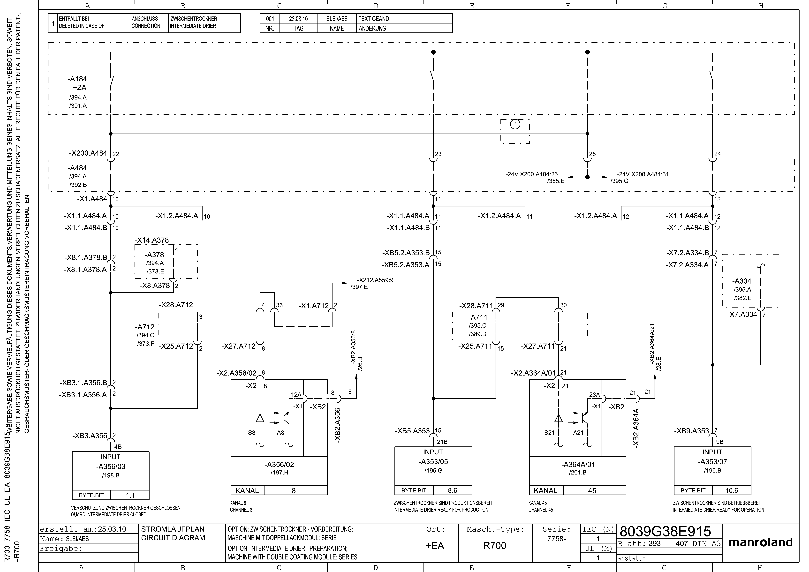

# +EA — Sheet 393 of 407 — OPTION: ZWISCHENTROCKNER VORBEREITUNG;

**MASCHINE MIT DOPPELLACKMODUL: SERIE**

> Part of the manroland **R700** printing press IEC/UL circuit diagrams.
> Drawing class: **Stromlaufplan / Circuit diagram** (DIN A3).
> Document `+EA` covers the **Printing unit** machine section.

## At a glance

| Field | Value |
|---|---|
| Document | `+EA`  (8039G38E915) |
| Sheet | **393** of 407 |
| Section (DE) | OPTION: ZWISCHENTROCKNER VORBEREITUNG; |
| Section (EN) | MASCHINE MIT DOPPELLACKMODUL: SERIE |
| Section type | CIRCUIT — Circuit diagram |
| Machine type | `R700` |
| Series | `7758` |
| Created | 25.03.10 |
| Replaces | — |
| Columns used | A, B, C, D, E, F, G, H |
| Path numbers | — |
| Labels on sheet | 177 |
| Cross-refs out | 22 |
| Cross-refs in | 66 |

**Previous:** [+EA sheet 392](SHEET_0392.md) · **Next:** [+EA sheet 394](SHEET_0394.md) · **Document TOC:** [_TOC.md](_TOC.md)  (+EA) · **Master TOC:** [all sheets](../_MASTER_TOC.md)

## Sheet image (300 DPI, exact vector render)



_Rendered directly from the PDF vector layer at 300 DPI (1-bit), no OCR and no resampling. Use it to confirm anything ambiguous in the text below._

## Cross-references on this sheet

Each entry is a wire leaving this sheet. The printed token is `/sheet.column`; the link resolves to that sheet inside the same document.

| Ref | Target sheet | Col | Path | Destination on target | Target section | From col |
|---|---|---|---|---|---|---|
| `/394.A` | [+EA sheet 394](SHEET_0394.md) | A | — | — | OPTION: ZWISCHENTROCKNER VORBEREITUNG; | A |
| `/391.A` | [+EA sheet 391](SHEET_0391.md) | A | — | — | OPTION: ZWISCHENTROCKNER VORBEREITUNG; | A |
| `/385.E` | [+EA sheet 385](SHEET_0385.md) | E | — | 24V.X200.A484:25 24V.X200.A484:31 | OPTION: ZWISCHENTROCKNER VORBEREITUNG; | F |
| `/394.A` | [+EA sheet 394](SHEET_0394.md) | A | — | — | OPTION: ZWISCHENTROCKNER VORBEREITUNG; | A |
| `/392.B` | [+EA sheet 392](SHEET_0392.md) | B | — | — | OPTION: ZWISCHENTROCKNER VORBEREITUNG; | A |
| `/395.G` | [+EA sheet 395](SHEET_0395.md) | G | — | — | OPTION: ZWISCHENTROCKNER VORBEREITUNG; | G |
| `/394.A` | [+EA sheet 394](SHEET_0394.md) | A | — | — | OPTION: ZWISCHENTROCKNER VORBEREITUNG; | B |
| `/373.E` | [+EA sheet 373](SHEET_0373.md) | E | — | — | OPTION: ENDTROCKNER 1 VORBEREITUNG; | B |
| `/397.E` | [+EA sheet 397](SHEET_0397.md) | E | — | — | OPTION: ZWISCHENTROCKNER VORBEREITUNG; | D |
| `/395.A` | [+EA sheet 395](SHEET_0395.md) | A | — | — | OPTION: ZWISCHENTROCKNER VORBEREITUNG; | H |
| `/382.E` | [+EA sheet 382](SHEET_0382.md) | E | — | — | OPTION: ENDTROCKNER 2 VORBEREITUNG | H |
| `/28.E` | [+EA sheet 28](SHEET_0028.md) | E | — | XB2.A364A:21 | BUSVERBINDUNGEN: SICHERHEITSBUS | G |
| `/395.C` | [+EA sheet 395](SHEET_0395.md) | C | — | — | OPTION: ZWISCHENTROCKNER VORBEREITUNG; | E |
| `/389.D` | [+EA sheet 389](SHEET_0389.md) | D | — | — | OPTION: ZWISCHENTROCKNER VORBEREITUNG; | E |
| `/26.B` | [+EA sheet 26](SHEET_0026.md) | B | — | XB2.A356:8 | BUSVERBINDUNGEN: SICHERHEITSBUS | D |
| `/394.C` | [+EA sheet 394](SHEET_0394.md) | C | — | — | OPTION: ZWISCHENTROCKNER VORBEREITUNG; | B |
| `/373.F` | [+EA sheet 373](SHEET_0373.md) | F | — | — | OPTION: ENDTROCKNER 1 VORBEREITUNG; | B |
| `/196.B` | [+EA sheet 196](SHEET_0196.md) | B | — | — | REFERENZMODUL | G |
| `/195.G` | [+EA sheet 195](SHEET_0195.md) | G | — | — | REFERENZMODUL | E |
| `/201.B` | [+EA sheet 201](SHEET_0201.md) | B | — | — | REFERENZMODUL | F |
| `/197.H` | [+EA sheet 197](SHEET_0197.md) | H | — | — | REFERENZMODUL | C |
| `/198.B` | [+EA sheet 198](SHEET_0198.md) | B | — | — | REFERENZMODUL | A |

### Incoming references (sheets that point here)

Every other sheet that sends a wire to this one. `Back-ref` is the token printed on *that* sheet; `Path` is its line number.

| From sheet | Cols | Back-ref | Path | Refs | What continues there |
|---|---|---|---|---|---|
| [+EA#26](SHEET_0026.md) | B | `/26.B` | — | 1 | XB2.A356:8 |
| [+EA#28](SHEET_0028.md) | E | `/28.E` | — | 1 | — |
| [+EA#195](SHEET_0195.md) | G | `/195.G` | — | 1 | — |
| [+EA#196](SHEET_0196.md) | B | `/196.B` | — | 1 | — |
| [+EA#197](SHEET_0197.md) | H | `/197.H` | — | 1 | — |
| [+EA#198](SHEET_0198.md) | B | `/198.B` | — | 1 | — |
| [+EA#201](SHEET_0201.md) | B | `/201.B` | — | 1 | — |
| [+EA#210](SHEET_0210.md) | E, G | `/210.E`, `/210.G` | — | 9 | — |
| [+EA#211](SHEET_0211.md) | A | `/211.A` | — | 3 | — |
| [+EA#214](SHEET_0214.md) | B | `/214.B` | — | 1 | — |
| [+EA#225](SHEET_0225.md) | F | `/225.F` | — | 1 | — |
| [+EA#226](SHEET_0226.md) | E | `/226.E` | — | 1 | — |
| [+EA#227](SHEET_0227.md) | C, E | `/227.C`, `/227.E` | — | 2 | — |
| [+EA#234](SHEET_0234.md) | H | `/234.H` | — | 1 | — |
| [+EA#235](SHEET_0235.md) | A, B | `/235.A`, `/235.B` | — | 2 | — |
| [+EA#240](SHEET_0240.md) | F | `/240.F` | — | 1 | — |
| [+EA#241](SHEET_0241.md) | C, E | `/241.C`, `/241.E` | — | 2 | — |
| [+EA#246](SHEET_0246.md) | F | `/246.F` | — | 1 | — |
| [+EA#247](SHEET_0247.md) | A, B | `/247.A`, `/247.B` | — | 2 | — |
| [+EA#250](SHEET_0250.md) | D, E, F | `/250.D`, `/250.E`, `/250.F` | — | 3 | — |
| [+EA#252](SHEET_0252.md) | C | `/252.C` | — | 1 | — |
| [+EA#260](SHEET_0260.md) | A | `/260.A` | — | 1 | — |
| [+EA#268](SHEET_0268.md) | E, F | `/268.E`, `/268.F` | — | 2 | — |
| [+EA#271](SHEET_0271.md) | F, G | `/271.F`, `/271.G` | — | 2 | — |
| [+EA#273](SHEET_0273.md) | B, C, D | `/273.B`, `/273.C`, `/273.D` | — | 5 | — |
| [+EA#286](SHEET_0286.md) | C | `/286.C` | — | 4 | — |
| [+EA#373](SHEET_0373.md) | E, F | `/373.E`, `/373.F` | — | 2 | — |
| [+EA#382](SHEET_0382.md) | E | `/382.E` | — | 1 | — |
| [+EA#385](SHEET_0385.md) | E | `/385.E` | — | 1 | 24V.X200.A484:25 |
| [+EA#389](SHEET_0389.md) | D | `/389.D` | — | 1 | — |
| [+EA#391](SHEET_0391.md) | A | `/391.A` | — | 1 | — |
| [+EA#392](SHEET_0392.md) | A | `/392.A` | — | 1 | — |
| [+EA#394](SHEET_0394.md) | A, B | `/394.A`, `/394.B` | — | 4 | — |
| [+EA#395](SHEET_0395.md) | A, C, G | `/395.A`, `/395.C`, `/395.G` | — | 3 | 24V.X200.A484:31 |
| [+EA#397](SHEET_0397.md) | E | `/397.E` | — | 1 | — |


## Devices on this sheet

| Tag | Class | Class meaning (IEC) | Col | Sub | Terminal | Sign |
|---|---|---|---|---|---|---|
| `A353/05` | A | Baugruppe / assembly, module, PC board | E | 05 | — | — |
| `S21` | S | Schalter / switch | F | — | — | — |
| `A21` | A | Baugruppe / assembly, module, PC board | F | — | — | — |
| `X1` | X | Klemme / terminal, plug connector | F | — | — | — |
| `X2` | X | Klemme / terminal, plug connector | F | — | — | — |
| `XB2` | XB |  | G | — | — | — |
| `A353/07` | A | Baugruppe / assembly, module, PC board | G | 07 | — | — |
| `A334` | A | Baugruppe / assembly, module, PC board | H | — | — | — |
| `A184` | A | Baugruppe / assembly, module, PC board | A | — | — | — |
| `S8` | S | Schalter / switch | C | — | — | — |
| `A8` | A | Baugruppe / assembly, module, PC board | C | — | — | — |
| `X1` | X | Klemme / terminal, plug connector | C | — | — | — |
| `X2` | X | Klemme / terminal, plug connector | C | — | — | — |
| `XB2` | XB |  | C | — | — | — |
| `A356/02` | A | Baugruppe / assembly, module, PC board | C | 02 | — | — |
| `A711` | A | Baugruppe / assembly, module, PC board | E | — | — | — |
| `A356/03` | A | Baugruppe / assembly, module, PC board | A | 03 | — | — |
| `A378` | A | Baugruppe / assembly, module, PC board | B | — | — | — |
| `A712` | A | Baugruppe / assembly, module, PC board | B | — | — | — |
| `A484` | A | Baugruppe / assembly, module, PC board | A | — | — | — |
| `8.6` | — | cross-device reference | E | — | — | — |
| `XB5.A353` | — | cross-device reference | D | — | — | — |
| `XB5.2.A353.B` | — | cross-device reference | D | — | — | — |
| `XB5.2.A353.A` | — | cross-device reference | D | — | — | — |
| `XB2.A364A` | — | cross-device reference | G | — | — | — |
| `10.6` | — | cross-device reference | H | — | — | — |
| `XB9.A353` | — | cross-device reference | G | — | — | — |
| `X7.2.A334.B` | — | cross-device reference | G | — | — | — |
| `X7.2.A334.A` | — | cross-device reference | G | — | — | — |
| `X7.A334` | — | cross-device reference | H | — | — | — |
| `X27.A712` | — | cross-device reference | C | — | — | — |
| `X25.A712` | — | cross-device reference | B | — | — | — |
| `XB2.A356` | — | cross-device reference | D | — | — | — |
| `X27.A711` | — | cross-device reference | F | — | — | — |
| `X28.A711` | — | cross-device reference | E | — | — | — |
| `X25.A711` | — | cross-device reference | E | — | — | — |
| `1.1` | — | cross-device reference | A | — | — | — |
| `XB3.A356` | — | cross-device reference | A | — | — | — |
| `X8.1.A378.B` | — | cross-device reference | A | — | — | — |
| `X8.1.A378.A` | — | cross-device reference | A | — | — | — |
| `XB3.1.A356.B` | — | cross-device reference | A | — | — | — |
| `XB3.1.A356.A` | — | cross-device reference | A | — | — | — |
| `X8.A378` | — | cross-device reference | B | — | — | — |
| `X1.A712` | — | cross-device reference | C | — | — | — |
| `X200.A484` | — | cross-device reference | A | — | — | — |
| `X1.A484` | — | cross-device reference | A | — | — | — |
| `X1.1.A484.A` | — | cross-device reference | A | — | — | — |
| `X1.2.A484.A` | — | cross-device reference | B | — | — | — |
| `X1.1.A484.B` | — | cross-device reference | A | — | — | — |
| `X1.1.A484.A` | — | cross-device reference | D | — | — | — |
| `X1.2.A484.A` | — | cross-device reference | E | — | — | — |
| `X1.1.A484.B` | — | cross-device reference | D | — | — | — |
| `X1.1.A484.B` | — | cross-device reference | G | — | — | — |
| `X1.2.A484.A` | — | cross-device reference | F | — | — | — |
| `X1.1.A484.A` | — | cross-device reference | G | — | — | — |
| `NR.` | — | cross-device reference | C | — | — | — |
| `23.08.10` | — | cross-device reference | C | — | — | — |
| `XB2.A356:8` | — | cross-device reference | D | — | 8 | — |
| `X212.A559:9` | — | cross-device reference | D | — | 9 | — |
| `XB2.A364A:21` | — | cross-device reference | G | — | 21 | — |
| `X14.A378` | — | cross-device reference | B | — | — | — |
| `X28.A712` | — | cross-device reference | B | — | — | — |

## Potentials / nets

| Potential | Count | Columns | Attached devices | Terminals |
|---|---|---|---|---|
| `24V` | 2 | F, G | `A484`, `X200` | `25`, `31` |


A potential such as `L24+/4` or `M24+` is a named supply/return rail; every place it appears on this sheet is electrically common.

## Wire-end annotations (grouped as printed)

A wire that continues elsewhere is annotated with a small cluster: the destination description, the path/line number `#NN`, and the `/sheet.column` cross reference. Each row below is one such cluster exactly as it is grouped on the drawing.

| Col | Y | Path | Cross-ref | Text on the wire |
|---|---|---|---|---|
| D | 24.3 | — | — | `001 23.08.10 SLEI/AES TEXT GEÄND.` |
| A | 24.7 | — | — | `1 ENTFÄLLT BEI DELETED IN CASE OF` |
| B | 24.7 | — | — | `CONNECTION ANSCHLUSS` |
| B | 24.7 | — | — | `INTERMEDIATE DRIER ZWISCHENTROCKNER` |
| C | 38.5 | — | — | `NR. TAG NAME ÄNDERUNG` |
| A | 111.6 | — | — | `A184` |
| A | 124.2 | — | — | `+ZA` |
| A | 139.5 | — | `/394.A`, `/391.A` | — |
| E | 179.8 | — | — | `1` |
| D | 220.7 | — | — | `X200.A484 22 23 25 24` |
| A | 242.7 | — | — | `A484` |
| F | 252.6 | — | `/385.E` | `24V.X200.A484:25 24V.X200.A484:31` |
| A | 255.7 | — | `/394.A`, `/392.B` | — |
| G | 262.5 | — | `/395.G` | — |
| C | 288.0 | — | — | `X1.A484 10 11` |
| H | 289.5 | — | — | `12` |
| B | 312.8 | — | — | `X1.1.A484.A 10 X1.2.A484.A 10` |
| E | 312.8 | — | — | `X1.1.A484.A 11 X1.2.A484.A 11` |
| G | 312.8 | — | — | `X1.2.A484.A 12 X1.1.A484.A 12` |
| A | 330.6 | — | — | `X1.1.A484.B 10` |
| F | 330.6 | — | — | `X1.1.A484.B 11 X1.1.A484.B 12` |
| B | 349.0 | — | — | `X14.A378` |
| B | 363.2 | — | — | `4` |
| D | 367.4 | — | — | `XB5.2.A353.B 15` |
| G | 367.4 | — | — | `X7.2.A334.B 7` |
| B | 370.2 | — | — | `A378` |
| A | 374.5 | — | — | `X8.1.A378.B 2` |
| B | 383.3 | — | `/394.A` | — |
| D | 384.4 | — | — | `XB5.2.A353.A 15` |
| G | 384.4 | — | — | `X7.2.A334.A 7` |
| A | 391.5 | — | — | `X8.1.A378.A 2` |
| B | 395.7 | — | `/373.E` | — |
| D | 408.5 | — | — | `X212.A559:9` |
| H | 409.2 | — | — | `A334` |
| B | 415.6 | — | — | `X8.A378 2` |
| D | 418.4 | — | `/397.E` | — |
| H | 422.3 | — | `/395.A` | — |
| H | 434.7 | — | `/382.E` | — |
| B | 443.9 | — | — | `X28.A712` |
| E | 445.3 | — | — | `X28.A711 29` |
| C | 445.4 | — | — | `4` |
| C | 445.4 | — | — | `33 X1.A712 2` |
| F | 445.4 | — | — | `30` |
| H | 458.1 | — | — | `X7.A334 7` |
| B | 462.4 | — | — | `3` |
| E | 462.4 | — | — | `A711` |
| E | 475.4 | — | `/395.C`, `/389.D` | — |
| G | 475.4 | — | `/28.E` | `XB2.A364A:21` |
| B | 476.5 | — | — | `A712` |
| D | 486.1 | — | `/26.B` | `XB2.A356:8` |
| B | 489.6 | — | `/394.C` | — |
| B | 502.0 | — | `/373.F` | — |
| B | 504.9 | — | — | `X25.A712 2 X27.A712 8` |
| E | 504.9 | — | — | `X25.A711 15` |
| F | 504.9 | — | — | `X27.A711 21` |
| C | 544.6 | — | — | `X2.A356/02 8` |
| F | 544.6 | — | — | `X2.A364A/01 21` |
| A | 558.7 | — | — | `XB3.1.A356.B 2` |
| C | 563.0 | — | — | `X2` |
| F | 563.0 | — | — | `X2` |
| C | 564.4 | — | — | `8 8` |
| F | 564.4 | — | — | `21 21` |
| D | 572.9 | — | — | `8` |
| G | 572.9 | — | — | `21` |
| A | 575.8 | — | — | `XB3.1.A356.A 2` |
| C | 577.1 | — | — | `12A` |
| F | 577.1 | — | — | `23A` |
| C | 594.1 | — | — | `X1` |
| F | 594.1 | — | — | `X1` |
| C | 594.2 | — | — | `XB2` |
| G | 594.2 | — | — | `XB2` |
| D | 600.4 | — | — | `XB2.A356` |
| G | 601.2 | — | — | `XB2.A364A` |
| D | 629.6 | — | — | `XB5.A353 15` |
| G | 629.6 | — | — | `XB9.A353 7` |
| C | 633.1 | — | — | `S8 A8` |
| F | 633.1 | — | — | `S21 A21` |
| A | 636.7 | — | — | `XB3.A356 2` |
| E | 646.6 | — | — | `21B` |
| H | 646.6 | — | — | `9B` |
| A | 653.7 | — | — | `4B` |
| E | 661.1 | — | — | `INPUT` |
| G | 661.1 | — | — | `INPUT` |
| A | 668.2 | — | — | `INPUT` |
| E | 675.0 | — | — | `A353/05` |
| G | 675.0 | — | — | `A353/07` |
| C | 679.2 | — | — | `A356/02` |
| F | 679.2 | — | — | `A364A/01` |
| A | 682.0 | — | — | `A356/03` |
| E | 688.7 | — | `/195.G` | — |
| G | 688.7 | — | `/196.B` | — |
| C | 691.6 | — | `/197.H` | — |
| F | 691.6 | — | `/201.B` | — |
| A | 695.8 | — | `/198.B` | — |
| C | 717.4 | — | — | `KANAL 8` |
| F | 717.4 | — | — | `KANAL 45` |
| E | 717.8 | — | — | `BYTE.BIT 8.6` |
| G | 717.8 | — | — | `BYTE.BIT 10.6` |
| A | 724.9 | — | — | `BYTE.BIT 1.1` |
| C | 737.8 | — | — | `KANAL 8 CHANNEL 8` |
| E | 737.8 | — | — | `INTERMEDIATE DRIER READY FOR PRODUCTION ZWISCHENTROCKNER SIND PRODUKTIONSBEREIT` |
| F | 737.8 | — | — | `KANAL 45 CHANNEL 45` |
| H | 737.8 | — | — | `INTERMEDIATE DRIER READY FOR OPERATION ZWISCHENTROCKNER SIND BETRIEBSBEREIT` |
| A | 744.9 | — | — | `GUARD INTERMEDIATE DRIER CLOSED VERSCHUTZUNG ZWISCHENTROCKNER GESCHLOSSEN` |


## Reconstructed tables

This sheet carries tabular content (pin map / terminal assignment / index). The grid below was rebuilt from the drawing's own rule lines, so each row is exactly one physical row of the table.

### Table 1 — 11 data rows × 9 columns (at x=106.3, y=76.5) — **A184 +ZA /394.A /391.A**

| X200.A484 A484 /394.A /392.B X1.A484 | 22 10 |  |  |  |  |  |  |  |
|---|---|---|---|---|---|---|---|---|
| `X1.1.A484.A X1.1.A484.B X8.1.A378.B X8.1.A378.A` | `10 10 2 2` | `X14.A378 A378 /394.A /373.E X8.A378` | `X1.2.A484.A 4 2` | `10` |  |  |  |  |
|  |  |  | `X28.A712` | `3` |  | `4 33` |  | `X1.A712` |
|  | `A712 /394.C /373.F` |  | `X25.A712` | `2` | `X27.A712` | `8` |  |  |
|  |  |  |  |  | `X2.A356/02` | `8` |  |  |
| `XB3.1.A356.B XB3.1.A356.A` | `2 2` |  |  |  | `X2` | `8` | `12A` |  |
|  |  |  |  |  |  |  | `X1` | `XB2` |
| `XB3.A356` | `2` |  |  |  | `S8` | `A8` |  |  |
|  | `4B` |  |  |  |  |  |  |  |
| `INPUT` | `A356/03 /198.B` |  |  |  |  | `A356/02 /197.H` |  |  |
|  |  |  |  |  | `KANAL` |  | `8` |  |
| `BYTE.BIT` | `1.1` |  |  |  |  |  |  |  |


### Table 2 — 10 data rows × 14 columns (at x=489.0, y=76.5) — **1**

|  |  |  | 23 11 |  |  | 24V.X200.A484:25 /385.E |  | 25 | /395.G | 24V.X200.A484:31 |  |  | 24 12 |
|---|---|---|---|---|---|---|---|---|---|---|---|---|---|
|  | `X212.A559:9 /397.E` | `X1.1.A484.A X1.1.A484.B XB5.2.A353.B XB5.2.A353.A` | `11 11 15 15` |  | `X1.2.A484.A 11` |  |  | `X1.2.A484.A` | `12` |  |  | `X1.1.A484.A X1.1.A484.B X7.2.A334.B X7.2.A334.A` | `12 12 7 7 A334 /395.A` |
| `2` |  |  |  | `X28.A711 A711 /395.C` | `29` |  | `30` |  |  |  |  |  | `/382.E X7.A334` |
| `XB2.A356:8` | `/26.B` |  |  | `/389.D X25.A711` | `15` | `X27.A711` | `21` |  |  | `XB2.A364A:21` | `/28.E` |  |  |
|  |  |  |  |  |  | `X2.A364A/01` | `21` |  |  |  |  |  |  |
| `8 8` |  |  |  |  |  | `X2` | `21` | `23A` |  | `21 21` |  |  |  |
|  |  |  |  |  |  |  |  | `X1` | `XB2` |  |  |  |  |
| `XB2.A356` |  | `XB5.A353` | `15 21B` |  |  | `S21` | `A21` |  |  | `XB2.A364A` |  | `XB9.A353` | `7 9B` |
|  |  | `INPUT` |  |  |  |  |  |  |  |  |  | `INPUT` |  |
|  |  |  | `A353/05 /195.G` |  |  |  | `A364A/01 /201.B` |  |  |  |  |  | `A353/07 /196.B` |
|  |  | `BYTE.BIT` | `8.6` |  |  | `KANAL` |  | `45` |  |  |  | `BYTE.BIT` | `10.6` |


## Notes and free text on this sheet

| Text | Col | Y (pt) |
|---|---|---|
| `21B` | E | 646.59 |
| `INPUT` | E | 661.11 |
| `BYTE.BIT` | D | 718.36 |
| `ZWISCHENTROCKNER SIND PRODUKTIONSBEREIT` | E | 737.78 |
| `INTERMEDIATE DRIER READY FOR PRODUCTION` | E | 747.74 |
| `KANAL 45` | F | 737.79 |
| `CHANNEL 45` | F | 747.74 |
| `23A` | F | 577.14 |
| `KANAL` | F | 717.46 |
| `A364A/01` | F | 679.2 |
| `X2.A364A/01` | F | 544.56 |
| `9B` | H | 646.57 |
| `INPUT` | G | 661.11 |
| `BYTE.BIT` | G | 718.36 |
| `ZWISCHENTROCKNER SIND BETRIEBSBEREIT` | H | 737.79 |
| `INTERMEDIATE DRIER READY FOR OPERATION` | H | 747.74 |
| `+ZA` | A | 124.24 |
| `KANAL 8` | C | 737.79 |
| `CHANNEL 8` | C | 747.73 |
| `12A` | C | 577.14 |
| `KANAL` | C | 717.46 |
| `X2.A356/02` | C | 544.56 |
| `4B` | A | 653.66 |
| `INPUT` | A | 668.2 |
| `BYTE.BIT` | A | 725.45 |
| `VERSCHUTZUNG ZWISCHENTROCKNER GESCHLOSSEN` | A | 744.86 |
| `GUARD INTERMEDIATE DRIER CLOSED` | A | 754.83 |
| `TAG` | C | 38.61 |
| `NAME` | D | 38.59 |
| `ÄNDERUNG` | D | 38.65 |
| `SLEI/AES` | D | 24.47 |
| `TEXT GEÄND.` | D | 24.45 |
| `ENTFÄLLT BEI` | A | 24.68 |
| `DELETED IN CASE OF` | A | 35.34 |
| `ANSCHLUSS` | B | 24.73 |
| `CONNECTION` | B | 35.36 |
| `ZWISCHENTROCKNER` | B | 24.72 |
| `INTERMEDIATE DRIER` | B | 35.35 |

## Complete label inventory (exact text from the drawing)

Every text object inside the drawing area of this sheet, in DIN reading order (column A→H, then top→bottom). This is the authoritative list: if a string is not here it is not printed on this sheet.

| Col | Y | X | Dir | Type | Text |
|---|---|---|---|---|---|
| A | 24.7 | 87.0 | → | text | `ENTFÄLLT BEI` |
| A | 30.0 | 75.4 | → | number | `1` |
| A | 35.3 | 87.0 | → | text | `DELETED IN CASE OF` |
| A | 111.6 | 99.8 | → | device tag | `A184` |
| A | 124.2 | 107.4 | → | text | `+ZA` |
| A | 139.5 | 102.0 | → | cross-reference | `/394.A` |
| A | 151.9 | 102.0 | → | cross-reference | `/391.A` |
| A | 220.7 | 101.8 | → | device ref | `X200.A484` |
| A | 222.8 | 165.5 | → | number | `22` |
| A | 242.7 | 99.8 | → | device tag | `A484` |
| A | 255.7 | 102.0 | → | cross-reference | `/394.A` |
| A | 268.1 | 102.3 | → | cross-reference | `/392.B` |
| A | 288.0 | 113.7 | → | device ref | `X1.A484` |
| A | 289.5 | 165.0 | → | number | `10` |
| A | 312.8 | 94.1 | → | device ref | `X1.1.A484.A` |
| A | 315.0 | 165.0 | → | number | `10` |
| A | 330.6 | 95.0 | → | device ref | `X1.1.A484.B` |
| A | 332.0 | 165.0 | → | number | `10` |
| A | 374.5 | 95.0 | → | device ref | `X8.1.A378.B` |
| A | 374.5 | 165.5 | → | number | `2` |
| A | 391.5 | 165.5 | → | number | `2` |
| A | 392.2 | 94.1 | → | device ref | `X8.1.A378.A` |
| A | 558.7 | 87.9 | → | device ref | `XB3.1.A356.B` |
| A | 558.7 | 165.5 | → | number | `2` |
| A | 575.8 | 165.5 | → | number | `2` |
| A | 576.5 | 87.0 | → | device ref | `XB3.1.A356.A` |
| A | 636.7 | 106.6 | → | device ref | `XB3.A356` |
| A | 636.7 | 165.5 | → | number | `2` |
| A | 653.7 | 168.4 | → | text | `4B` |
| A | 668.2 | 148.1 | → | text | `INPUT` |
| A | 682.0 | 141.6 | → | device tag | `A356/03` |
| A | 695.8 | 150.4 | → | cross-reference | `/198.B` |
| A | 724.9 | 185.1 | → | device ref | `1.1` |
| A | 725.4 | 116.2 | → | text | `BYTE.BIT` |
| A | 744.9 | 104.9 | → | text | `VERSCHUTZUNG ZWISCHENTROCKNER GESCHLOSSEN` |
| A | 754.8 | 104.6 | → | text | `GUARD INTERMEDIATE DRIER CLOSED` |
| B | 24.7 | 194.2 | → | text | `ANSCHLUSS` |
| B | 24.7 | 250.9 | → | text | `ZWISCHENTROCKNER` |
| B | 35.4 | 193.9 | → | text | `CONNECTION` |
| B | 35.4 | 250.0 | → | text | `INTERMEDIATE DRIER` |
| B | 312.8 | 228.8 | → | device ref | `X1.2.A484.A` |
| B | 315.0 | 299.6 | → | number | `10` |
| B | 349.0 | 198.4 | → | device ref | `X14.A378` |
| B | 363.2 | 257.7 | → | number | `4` |
| B | 370.2 | 213.2 | → | device tag | `A378` |
| B | 383.3 | 215.4 | → | cross-reference | `/394.A` |
| B | 395.7 | 216.0 | → | cross-reference | `/373.E` |
| B | 415.6 | 205.8 | → | device ref | `X8.A378` |
| B | 417.0 | 257.7 | → | number | `2` |
| B | 443.9 | 233.9 | → | device ref | `X28.A712` |
| B | 462.4 | 293.1 | → | number | `3` |
| B | 476.5 | 199.0 | → | device tag | `A712` |
| B | 489.6 | 201.3 | → | cross-reference | `/394.C` |
| B | 502.0 | 202.1 | → | cross-reference | `/373.F` |
| B | 504.9 | 233.9 | → | device ref | `X25.A712` |
| B | 509.1 | 293.1 | → | number | `2` |
| C | 24.3 | 391.6 | → | number | `001` |
| C | 24.5 | 425.8 | → | device ref | `23.08.10` |
| C | 38.5 | 390.7 | → | device ref | `NR.` |
| C | 38.6 | 432.2 | → | text | `TAG` |
| C | 445.3 | 439.7 | → | device ref | `X1.A712` |
| C | 445.4 | 385.2 | → | number | `4` |
| C | 445.4 | 406.5 | → | number | `33` |
| C | 504.9 | 326.0 | → | device ref | `X27.A712` |
| C | 509.1 | 385.2 | → | number | `8` |
| C | 544.6 | 318.6 | → | text | `X2.A356/02` |
| C | 544.6 | 385.2 | → | number | `8` |
| C | 563.0 | 361.1 | → | device tag | `X2` |
| C | 564.4 | 388.1 | → | number | `8` |
| C | 577.1 | 428.0 | → | text | `12A` |
| C | 594.2 | 431.7 | → | device tag | `X1` |
| C | 594.2 | 456.1 | → | device tag | `XB2` |
| C | 633.1 | 362.3 | → | device tag | `S8` |
| C | 633.1 | 404.8 | → | device tag | `A8` |
| C | 679.2 | 389.6 | → | device tag | `A356/02` |
| C | 691.6 | 398.6 | → | cross-reference | `/197.H` |
| C | 717.4 | 429.3 | → | number | `8` |
| C | 717.5 | 346.4 | → | text | `KANAL` |
| C | 737.8 | 338.2 | → | text | `KANAL 8` |
| C | 747.7 | 338.5 | → | text | `CHANNEL 8` |
| D | 24.5 | 480.5 | → | text | `SLEI/AES` |
| D | 24.5 | 527.7 | → | text | `TEXT GEÄND.` |
| D | 38.6 | 485.7 | → | text | `NAME` |
| D | 38.6 | 528.2 | → | text | `ÄNDERUNG` |
| D | 312.8 | 568.9 | → | device ref | `X1.1.A484.A` |
| D | 330.6 | 569.8 | → | device ref | `X1.1.A484.B` |
| D | 367.4 | 562.7 | → | device ref | `XB5.2.A353.B` |
| D | 385.1 | 561.8 | → | device ref | `XB5.2.A353.A` |
| D | 408.5 | 525.5 | → | device ref | `X212.A559:9` |
| D | 418.4 | 515.9 | → | cross-reference | `/397.E` |
| D | 445.4 | 491.5 | → | number | `2` |
| D | 486.1 | 516.2 | ↕ | device ref | `XB2.A356:8` |
| D | 525.0 | 526.1 | ↕ | cross-reference | `/26.B` |
| D | 572.9 | 512.8 | → | number | `8` |
| D | 574.3 | 487.3 | → | number | `8` |
| D | 600.4 | 492.1 | ↕ | device ref | `XB2.A356` |
| D | 629.6 | 581.4 | → | device ref | `XB5.A353` |
| D | 718.4 | 591.0 | → | text | `BYTE.BIT` |
| E | 179.8 | 756.5 | → | number | `1` |
| E | 222.8 | 640.3 | → | number | `23` |
| E | 289.5 | 639.8 | → | number | `11` |
| E | 312.8 | 703.6 | → | device ref | `X1.2.A484.A` |
| E | 315.0 | 639.8 | → | number | `11` |
| E | 332.0 | 639.8 | → | number | `11` |
| E | 367.4 | 639.8 | → | number | `15` |
| E | 384.4 | 639.8 | → | number | `15` |
| E | 445.3 | 676.1 | → | device ref | `X28.A711` |
| E | 445.4 | 732.5 | → | number | `29` |
| E | 462.3 | 689.4 | → | device tag | `A711` |
| E | 475.4 | 690.2 | → | cross-reference | `/395.C` |
| E | 487.8 | 690.2 | → | cross-reference | `/389.D` |
| E | 504.9 | 674.6 | → | device ref | `X25.A711` |
| E | 509.1 | 731.9 | → | number | `15` |
| E | 629.6 | 639.8 | → | number | `15` |
| E | 646.6 | 643.2 | → | text | `21B` |
| E | 661.1 | 622.9 | → | text | `INPUT` |
| E | 675.0 | 616.4 | → | device tag | `A353/05` |
| E | 688.7 | 624.9 | → | cross-reference | `/195.G` |
| E | 717.8 | 659.3 | → | device ref | `8.6` |
| E | 737.8 | 579.7 | → | text | `ZWISCHENTROCKNER SIND PRODUKTIONSBEREIT` |
| E | 747.7 | 579.1 | → | text | `INTERMEDIATE DRIER READY FOR PRODUCTION` |
| F | 222.8 | 867.1 | → | number | `25` |
| F | 252.6 | 744.4 | → | potential | `24V.X200.A484:25` |
| F | 262.5 | 805.6 | → | cross-reference | `/385.E` |
| F | 312.8 | 845.3 | → | device ref | `X1.2.A484.A` |
| F | 315.0 | 774.4 | → | number | `11` |
| F | 445.4 | 824.6 | → | number | `30` |
| F | 504.9 | 766.8 | → | device ref | `X27.A711` |
| F | 509.1 | 824.6 | → | number | `21` |
| F | 544.6 | 752.3 | → | text | `X2.A364A/01` |
| F | 544.6 | 824.6 | → | number | `21` |
| F | 563.0 | 800.5 | → | device tag | `X2` |
| F | 564.4 | 827.4 | → | number | `21` |
| F | 577.1 | 867.4 | → | text | `23A` |
| F | 594.2 | 871.1 | → | device tag | `X1` |
| F | 633.1 | 798.2 | → | device tag | `S21` |
| F | 633.1 | 840.8 | → | device tag | `A21` |
| F | 679.2 | 826.2 | → | text | `A364A/01` |
| F | 691.6 | 837.8 | → | cross-reference | `/201.B` |
| F | 717.4 | 865.8 | → | number | `45` |
| F | 717.5 | 785.8 | → | text | `KANAL` |
| F | 737.8 | 777.5 | → | text | `KANAL 45` |
| F | 747.7 | 777.8 | → | text | `CHANNEL 45` |
| G | 252.6 | 908.2 | → | potential | `24V.X200.A484:31` |
| G | 262.5 | 898.6 | → | cross-reference | `/395.G` |
| G | 312.8 | 979.9 | → | device ref | `X1.1.A484.A` |
| G | 315.0 | 916.2 | → | number | `12` |
| G | 330.6 | 980.8 | → | device ref | `X1.1.A484.B` |
| G | 367.4 | 980.8 | → | device ref | `X7.2.A334.B` |
| G | 385.1 | 979.9 | → | device ref | `X7.2.A334.A` |
| G | 475.4 | 955.5 | ↕ | device ref | `XB2.A364A:21` |
| G | 525.0 | 965.4 | ↕ | cross-reference | `/28.E` |
| G | 572.9 | 948.8 | → | number | `21` |
| G | 574.3 | 926.6 | → | number | `21` |
| G | 594.2 | 895.5 | → | device tag | `XB2` |
| G | 601.2 | 931.5 | ↕ | device ref | `XB2.A364A` |
| G | 629.6 | 992.4 | → | device ref | `XB9.A353` |
| G | 661.1 | 1033.9 | → | text | `INPUT` |
| G | 675.0 | 1027.4 | → | device tag | `A353/07` |
| G | 688.7 | 1036.2 | → | cross-reference | `/196.B` |
| G | 718.4 | 1002.0 | → | text | `BYTE.BIT` |
| H | 222.8 | 1051.4 | → | number | `24` |
| H | 289.5 | 1050.8 | → | number | `12` |
| H | 315.0 | 1050.8 | → | number | `12` |
| H | 332.0 | 1050.8 | → | number | `12` |
| H | 367.4 | 1051.4 | → | number | `7` |
| H | 384.4 | 1051.4 | → | number | `7` |
| H | 409.2 | 1077.7 | → | device tag | `A334` |
| H | 422.3 | 1080.0 | → | cross-reference | `/395.A` |
| H | 434.7 | 1080.6 | → | cross-reference | `/382.E` |
| H | 458.1 | 1070.4 | → | device ref | `X7.A334` |
| H | 459.5 | 1122.2 | → | number | `7` |
| H | 629.6 | 1051.4 | → | number | `7` |
| H | 646.6 | 1054.2 | → | text | `9B` |
| H | 717.8 | 1067.4 | → | device ref | `10.6` |
| H | 737.8 | 990.7 | → | text | `ZWISCHENTROCKNER SIND BETRIEBSBEREIT` |
| H | 747.7 | 990.1 | → | text | `INTERMEDIATE DRIER READY FOR OPERATION` |

## Reading-order text block

The same content as a plain block, grouped by DIN column — convenient to paste or to match against a visual description.

```text
=== Column A ===
  24.7   87.0  text         ENTFÄLLT BEI
  30.0   75.4  numeric      1
  35.3   87.0  text         DELETED IN CASE OF
 111.6   99.8  devtag       A184
 124.2  107.4  text         +ZA
 139.5  102.0  xref         /394.A
 151.9  102.0  xref         /391.A
 220.7  101.8  devref       X200.A484
 222.8  165.5  numeric      22
 242.7   99.8  devtag       A484
 255.7  102.0  xref         /394.A
 268.1  102.3  xref         /392.B
 288.0  113.7  devref       X1.A484
 289.5  165.0  numeric      10
 312.8   94.1  devref       X1.1.A484.A
 315.0  165.0  numeric      10
 330.6   95.0  devref       X1.1.A484.B
 332.0  165.0  numeric      10
 374.5   95.0  devref       X8.1.A378.B
 374.5  165.5  numeric      2
 391.5  165.5  numeric      2
 392.2   94.1  devref       X8.1.A378.A
 558.7   87.9  devref       XB3.1.A356.B
 558.7  165.5  numeric      2
 575.8  165.5  numeric      2
 576.5   87.0  devref       XB3.1.A356.A
 636.7  106.6  devref       XB3.A356
 636.7  165.5  numeric      2
 653.7  168.4  text         4B
 668.2  148.1  text         INPUT
 682.0  141.6  devtag       A356/03
 695.8  150.4  xref         /198.B
 724.9  185.1  devref       1.1
 725.4  116.2  text         BYTE.BIT
 744.9  104.9  text         VERSCHUTZUNG ZWISCHENTROCKNER GESCHLOSSEN
 754.8  104.6  text         GUARD INTERMEDIATE DRIER CLOSED
=== Column B ===
  24.7  194.2  text         ANSCHLUSS
  24.7  250.9  text         ZWISCHENTROCKNER
  35.4  193.9  text         CONNECTION
  35.4  250.0  text         INTERMEDIATE DRIER
 312.8  228.8  devref       X1.2.A484.A
 315.0  299.6  numeric      10
 349.0  198.4  devref       X14.A378
 363.2  257.7  numeric      4
 370.2  213.2  devtag       A378
 383.3  215.4  xref         /394.A
 395.7  216.0  xref         /373.E
 415.6  205.8  devref       X8.A378
 417.0  257.7  numeric      2
 443.9  233.9  devref       X28.A712
 462.4  293.1  numeric      3
 476.5  199.0  devtag       A712
 489.6  201.3  xref         /394.C
 502.0  202.1  xref         /373.F
 504.9  233.9  devref       X25.A712
 509.1  293.1  numeric      2
=== Column C ===
  24.3  391.6  numeric      001
  24.5  425.8  devref       23.08.10
  38.5  390.7  devref       NR.
  38.6  432.2  text         TAG
 445.3  439.7  devref       X1.A712
 445.4  385.2  numeric      4
 445.4  406.5  numeric      33
 504.9  326.0  devref       X27.A712
 509.1  385.2  numeric      8
 544.6  318.6  text         X2.A356/02
 544.6  385.2  numeric      8
 563.0  361.1  devtag       X2
 564.4  388.1  numeric      8
 577.1  428.0  text         12A
 594.2  431.7  devtag       X1
 594.2  456.1  devtag       XB2
 633.1  362.3  devtag       S8
 633.1  404.8  devtag       A8
 679.2  389.6  devtag       A356/02
 691.6  398.6  xref         /197.H
 717.4  429.3  numeric      8
 717.5  346.4  text         KANAL
 737.8  338.2  text         KANAL 8
 747.7  338.5  text         CHANNEL 8
=== Column D ===
  24.5  480.5  text         SLEI/AES
  24.5  527.7  text         TEXT GEÄND.
  38.6  485.7  text         NAME
  38.6  528.2  text         ÄNDERUNG
 312.8  568.9  devref       X1.1.A484.A
 330.6  569.8  devref       X1.1.A484.B
 367.4  562.7  devref       XB5.2.A353.B
 385.1  561.8  devref       XB5.2.A353.A
 408.5  525.5  devref       X212.A559:9
 418.4  515.9  xref         /397.E
 445.4  491.5  numeric      2
 486.1  516.2  devref       XB2.A356:8
 525.0  526.1  xref         /26.B
 572.9  512.8  numeric      8
 574.3  487.3  numeric      8
 600.4  492.1  devref       XB2.A356
 629.6  581.4  devref       XB5.A353
 718.4  591.0  text         BYTE.BIT
=== Column E ===
 179.8  756.5  numeric      1
 222.8  640.3  numeric      23
 289.5  639.8  numeric      11
 312.8  703.6  devref       X1.2.A484.A
 315.0  639.8  numeric      11
 332.0  639.8  numeric      11
 367.4  639.8  numeric      15
 384.4  639.8  numeric      15
 445.3  676.1  devref       X28.A711
 445.4  732.5  numeric      29
 462.3  689.4  devtag       A711
 475.4  690.2  xref         /395.C
 487.8  690.2  xref         /389.D
 504.9  674.6  devref       X25.A711
 509.1  731.9  numeric      15
 629.6  639.8  numeric      15
 646.6  643.2  text         21B
 661.1  622.9  text         INPUT
 675.0  616.4  devtag       A353/05
 688.7  624.9  xref         /195.G
 717.8  659.3  devref       8.6
 737.8  579.7  text         ZWISCHENTROCKNER SIND PRODUKTIONSBEREIT
 747.7  579.1  text         INTERMEDIATE DRIER READY FOR PRODUCTION
=== Column F ===
 222.8  867.1  numeric      25
 252.6  744.4  net          24V.X200.A484:25
 262.5  805.6  xref         /385.E
 312.8  845.3  devref       X1.2.A484.A
 315.0  774.4  numeric      11
 445.4  824.6  numeric      30
 504.9  766.8  devref       X27.A711
 509.1  824.6  numeric      21
 544.6  752.3  text         X2.A364A/01
 544.6  824.6  numeric      21
 563.0  800.5  devtag       X2
 564.4  827.4  numeric      21
 577.1  867.4  text         23A
 594.2  871.1  devtag       X1
 633.1  798.2  devtag       S21
 633.1  840.8  devtag       A21
 679.2  826.2  text         A364A/01
 691.6  837.8  xref         /201.B
 717.4  865.8  numeric      45
 717.5  785.8  text         KANAL
 737.8  777.5  text         KANAL 45
 747.7  777.8  text         CHANNEL 45
=== Column G ===
 252.6  908.2  net          24V.X200.A484:31
 262.5  898.6  xref         /395.G
 312.8  979.9  devref       X1.1.A484.A
 315.0  916.2  numeric      12
 330.6  980.8  devref       X1.1.A484.B
 367.4  980.8  devref       X7.2.A334.B
 385.1  979.9  devref       X7.2.A334.A
 475.4  955.5  devref       XB2.A364A:21
 525.0  965.4  xref         /28.E
 572.9  948.8  numeric      21
 574.3  926.6  numeric      21
 594.2  895.5  devtag       XB2
 601.2  931.5  devref       XB2.A364A
 629.6  992.4  devref       XB9.A353
 661.1 1033.9  text         INPUT
 675.0 1027.4  devtag       A353/07
 688.7 1036.2  xref         /196.B
 718.4 1002.0  text         BYTE.BIT
=== Column H ===
 222.8 1051.4  numeric      24
 289.5 1050.8  numeric      12
 315.0 1050.8  numeric      12
 332.0 1050.8  numeric      12
 367.4 1051.4  numeric      7
 384.4 1051.4  numeric      7
 409.2 1077.7  devtag       A334
 422.3 1080.0  xref         /395.A
 434.7 1080.6  xref         /382.E
 458.1 1070.4  devref       X7.A334
 459.5 1122.2  numeric      7
 629.6 1051.4  numeric      7
 646.6 1054.2  text         9B
 717.8 1067.4  devref       10.6
 737.8  990.7  text         ZWISCHENTROCKNER SIND BETRIEBSBEREIT
 747.7  990.1  text         INTERMEDIATE DRIER READY FOR OPERATION
```

---
_Generated from the PDF vector text layer; no OCR. Source: `R700_7758_IEC_UL_EA_8039G38E915_p`, sheet 393._
