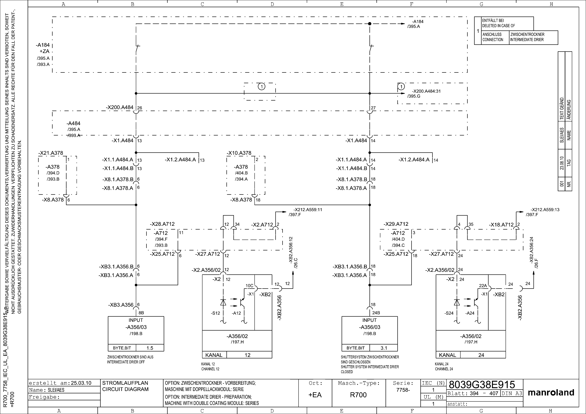

# +EA — Sheet 394 of 407 — OPTION: ZWISCHENTROCKNER VORBEREITUNG;

**MASCHINE MIT DOPPELLACKMODUL: SERIE**

> Part of the manroland **R700** printing press IEC/UL circuit diagrams.
> Drawing class: **Stromlaufplan / Circuit diagram** (DIN A3).
> Document `+EA` covers the **Printing unit** machine section.

## At a glance

| Field | Value |
|---|---|
| Document | `+EA`  (8039G38E915) |
| Sheet | **394** of 407 |
| Section (DE) | OPTION: ZWISCHENTROCKNER VORBEREITUNG; |
| Section (EN) | MASCHINE MIT DOPPELLACKMODUL: SERIE |
| Section type | CIRCUIT — Circuit diagram |
| Machine type | `R700` |
| Series | `7758` |
| Created | 25.03.10 |
| Replaces | — |
| Columns used | A, B, C, D, E, F, G, H |
| Path numbers | — |
| Labels on sheet | 168 |
| Cross-refs out | 22 |
| Cross-refs in | 62 |

**Previous:** [+EA sheet 393](SHEET_0393.md) · **Next:** [+EA sheet 395](SHEET_0395.md) · **Document TOC:** [_TOC.md](_TOC.md)  (+EA) · **Master TOC:** [all sheets](../_MASTER_TOC.md)

## Sheet image (300 DPI, exact vector render)



_Rendered directly from the PDF vector layer at 300 DPI (1-bit), no OCR and no resampling. Use it to confirm anything ambiguous in the text below._

## Cross-references on this sheet

Each entry is a wire leaving this sheet. The printed token is `/sheet.column`; the link resolves to that sheet inside the same document.

| Ref | Target sheet | Col | Path | Destination on target | Target section | From col |
|---|---|---|---|---|---|---|
| `/395.A` | [+EA sheet 395](SHEET_0395.md) | A | — | — | OPTION: ZWISCHENTROCKNER VORBEREITUNG; | F |
| `/395.A` | [+EA sheet 395](SHEET_0395.md) | A | — | — | OPTION: ZWISCHENTROCKNER VORBEREITUNG; | A |
| `/393.A` | [+EA sheet 393](SHEET_0393.md) | A | — | — | OPTION: ZWISCHENTROCKNER VORBEREITUNG; | A |
| `/395.G` | [+EA sheet 395](SHEET_0395.md) | G | — | — | OPTION: ZWISCHENTROCKNER VORBEREITUNG; | F |
| `/395.A` | [+EA sheet 395](SHEET_0395.md) | A | — | — | OPTION: ZWISCHENTROCKNER VORBEREITUNG; | A |
| `/393.A` | [+EA sheet 393](SHEET_0393.md) | A | — | — | OPTION: ZWISCHENTROCKNER VORBEREITUNG; | A |
| `/404.B` | [+EA sheet 404](SHEET_0404.md) | B | — | — | OPTION: SCHNITTSTELLE UV ENDTROCKNER | D |
| `/394.A` | [+EA sheet 394](SHEET_0394.md) | A | — | — | OPTION: ZWISCHENTROCKNER VORBEREITUNG; | D |
| `/394.D` | [+EA sheet 394](SHEET_0394.md) | D | — | — | OPTION: ZWISCHENTROCKNER VORBEREITUNG; | A |
| `/393.B` | [+EA sheet 393](SHEET_0393.md) | B | — | — | OPTION: ZWISCHENTROCKNER VORBEREITUNG; | A |
| `/397.F` | [+EA sheet 397](SHEET_0397.md) | F | — | X212.A559:13 | OPTION: ZWISCHENTROCKNER VORBEREITUNG; | F |
| `/397.F` | [+EA sheet 397](SHEET_0397.md) | F | — | — | OPTION: ZWISCHENTROCKNER VORBEREITUNG; | H |
| `/26.C` | [+EA sheet 26](SHEET_0026.md) | C | — | XB2.A356:12 | BUSVERBINDUNGEN: SICHERHEITSBUS | D |
| `/26.F` | [+EA sheet 26](SHEET_0026.md) | F | — | XB2.A356:24 | BUSVERBINDUNGEN: SICHERHEITSBUS | H |
| `/394.F` | [+EA sheet 394](SHEET_0394.md) | F | — | — | OPTION: ZWISCHENTROCKNER VORBEREITUNG; | B |
| `/393.B` | [+EA sheet 393](SHEET_0393.md) | B | — | — | OPTION: ZWISCHENTROCKNER VORBEREITUNG; | B |
| `/404.D` | [+EA sheet 404](SHEET_0404.md) | D | — | — | OPTION: SCHNITTSTELLE UV ENDTROCKNER | F |
| `/394.C` | [+EA sheet 394](SHEET_0394.md) | C | — | — | OPTION: ZWISCHENTROCKNER VORBEREITUNG; | F |
| `/198.B` | [+EA sheet 198](SHEET_0198.md) | B | — | — | REFERENZMODUL | B |
| `/198.B` | [+EA sheet 198](SHEET_0198.md) | B | — | — | REFERENZMODUL | E |
| `/197.H` | [+EA sheet 197](SHEET_0197.md) | H | — | — | REFERENZMODUL | D |
| `/197.H` | [+EA sheet 197](SHEET_0197.md) | H | — | — | REFERENZMODUL | G |

### Incoming references (sheets that point here)

Every other sheet that sends a wire to this one. `Back-ref` is the token printed on *that* sheet; `Path` is its line number.

| From sheet | Cols | Back-ref | Path | Refs | What continues there |
|---|---|---|---|---|---|
| [+EA#26](SHEET_0026.md) | C, F | `/26.C`, `/26.F` | — | 2 | XB2.A356:12; XB2.A356:24 |
| [+EA#197](SHEET_0197.md) | H | `/197.H` | — | 2 | — |
| [+EA#198](SHEET_0198.md) | B | `/198.B` | — | 2 | — |
| [+EA#210](SHEET_0210.md) | E, G | `/210.E`, `/210.G` | — | 6 | — |
| [+EA#211](SHEET_0211.md) | A | `/211.A` | — | 2 | — |
| [+EA#225](SHEET_0225.md) | F, G | `/225.F`, `/225.G` | — | 2 | — |
| [+EA#226](SHEET_0226.md) | E, F | `/226.E`, `/226.F` | — | 2 | — |
| [+EA#230](SHEET_0230.md) | G | `/230.G` | — | 1 | — |
| [+EA#234](SHEET_0234.md) | H | `/234.H` | — | 2 | — |
| [+EA#235](SHEET_0235.md) | A, B | `/235.A`, `/235.B` | — | 4 | — |
| [+EA#250](SHEET_0250.md) | D, E, F | `/250.D`, `/250.E`, `/250.F` | — | 6 | — |
| [+EA#254](SHEET_0254.md) | G | `/254.G` | — | 1 | — |
| [+EA#263](SHEET_0263.md) | F | `/263.F` | — | 1 | — |
| [+EA#264](SHEET_0264.md) | E | `/264.E` | — | 1 | — |
| [+EA#268](SHEET_0268.md) | F | `/268.F` | — | 2 | — |
| [+EA#271](SHEET_0271.md) | G, H | `/271.G`, `/271.H` | — | 2 | — |
| [+EA#273](SHEET_0273.md) | C, D | `/273.C`, `/273.D` | — | 3 | — |
| [+EA#274](SHEET_0274.md) | G, H | `/274.G`, `/274.H` | — | 3 | — |
| [+EA#286](SHEET_0286.md) | C | `/286.C` | — | 2 | — |
| [+EA#393](SHEET_0393.md) | A, B | `/393.A`, `/393.B` | — | 4 | — |
| [+EA#394](SHEET_0394.md) | A, B, D, F | `/394.A`, `/394.B`, `/394.D`, `/394.F` | — | 4 | — |
| [+EA#395](SHEET_0395.md) | A, G | `/395.A`, `/395.G` | — | 4 | A184; X200.A484:31 |
| [+EA#397](SHEET_0397.md) | E, F | `/397.E`, `/397.F` | — | 2 | — |
| [+EA#404](SHEET_0404.md) | B, D | `/404.B`, `/404.D` | — | 2 | — |


## Devices on this sheet

| Tag | Class | Class meaning (IEC) | Col | Sub | Terminal | Sign |
|---|---|---|---|---|---|---|
| `A356/03` | A | Baugruppe / assembly, module, PC board | B | 03 | — | — |
| `A484` | A | Baugruppe / assembly, module, PC board | A | — | — | — |
| `A184` | A | Baugruppe / assembly, module, PC board | A | — | — | — |
| `A378` | A | Baugruppe / assembly, module, PC board | A | — | — | — |
| `A378` | A | Baugruppe / assembly, module, PC board | D | — | — | — |
| `S12` | S | Schalter / switch | C | — | — | — |
| `A12` | A | Baugruppe / assembly, module, PC board | C | — | — | — |
| `X1` | X | Klemme / terminal, plug connector | D | — | — | — |
| `X2` | X | Klemme / terminal, plug connector | C | — | — | — |
| `XB2` | XB |  | D | — | — | — |
| `A356/02` | A | Baugruppe / assembly, module, PC board | C | 02 | — | — |
| `A712` | A | Baugruppe / assembly, module, PC board | B | — | — | — |
| `A356/03` | A | Baugruppe / assembly, module, PC board | E | 03 | — | — |
| `S24` | S | Schalter / switch | G | — | — | — |
| `A24` | A | Baugruppe / assembly, module, PC board | G | — | — | — |
| `X1` | X | Klemme / terminal, plug connector | G | — | — | — |
| `X2` | X | Klemme / terminal, plug connector | G | — | — | — |
| `XB2` | XB |  | G | — | — | — |
| `A356/02` | A | Baugruppe / assembly, module, PC board | G | 02 | — | — |
| `A712` | A | Baugruppe / assembly, module, PC board | F | — | — | — |
| `A184` | A | Baugruppe / assembly, module, PC board | F | — | — | — |
| `1.5` | — | cross-device reference | B | — | — | — |
| `XB3.A356` | — | cross-device reference | B | — | — | — |
| `X200.A484` | — | cross-device reference | B | — | — | — |
| `X1.A484` | — | cross-device reference | B | — | — | — |
| `X8.A378` | — | cross-device reference | A | — | — | — |
| `X8.A378` | — | cross-device reference | D | — | — | — |
| `XB3.1.A356.B` | — | cross-device reference | B | — | — | — |
| `XB3.1.A356.A` | — | cross-device reference | B | — | — | — |
| `XB2.A356` | — | cross-device reference | D | — | — | — |
| `X27.A712` | — | cross-device reference | C | — | — | — |
| `X25.A712` | — | cross-device reference | B | — | — | — |
| `X2.A712` | — | cross-device reference | D | — | — | — |
| `XB2.A356` | — | cross-device reference | H | — | — | — |
| `X18.A712` | — | cross-device reference | G | — | — | — |
| `X8.1.A378.B` | — | cross-device reference | B | — | — | — |
| `X8.1.A378.A` | — | cross-device reference | B | — | — | — |
| `X1.1.A484.A` | — | cross-device reference | B | — | — | — |
| `X1.1.A484.B` | — | cross-device reference | B | — | — | — |
| `X1.2.A484.A` | — | cross-device reference | C | — | — | — |
| `3.1` | — | cross-device reference | F | — | — | — |
| `X1.A484` | — | cross-device reference | E | — | — | — |
| `XB3.1.A356.B` | — | cross-device reference | E | — | — | — |
| `XB3.1.A356.A` | — | cross-device reference | E | — | — | — |
| `X27.A712` | — | cross-device reference | F | — | — | — |
| `X25.A712` | — | cross-device reference | F | — | — | — |
| `X8.1.A378.B` | — | cross-device reference | E | — | — | — |
| `X8.1.A378.A` | — | cross-device reference | E | — | — | — |
| `X1.1.A484.A` | — | cross-device reference | E | — | — | — |
| `X1.1.A484.B` | — | cross-device reference | E | — | — | — |
| `X1.2.A484.A` | — | cross-device reference | F | — | — | — |
| `NR.` | — | cross-device reference | H | — | — | — |
| `23.08.10` | — | cross-device reference | H | — | — | — |
| `XB2.A356:12` | — | cross-device reference | D | — | 12 | — |
| `X212.A559:13` | — | cross-device reference | H | — | 13 | — |
| `X212.A559:11` | — | cross-device reference | E | — | 11 | — |
| `XB2.A356:24` | — | cross-device reference | H | — | 24 | — |
| `X200.A484:31` | — | cross-device reference | F | — | 31 | — |
| `X21.A378` | — | cross-device reference | A | — | — | — |
| `X10.A378` | — | cross-device reference | D | — | — | — |
| `X28.A712` | — | cross-device reference | B | — | — | — |
| `X29.A712` | — | cross-device reference | F | — | — | — |

## Potentials / nets

_No named potentials on this sheet._

## Wire-end annotations (grouped as printed)

A wire that continues elsewhere is annotated with a small cluster: the destination description, the path/line number `#NN`, and the `/sheet.column` cross reference. Each row below is one such cluster exactly as it is grouped on the drawing.

| Col | Y | Path | Cross-ref | Text on the wire |
|---|---|---|---|---|
| G | 38.9 | — | — | `ENTFÄLLT BEI DELETED IN CASE OF` |
| F | 40.0 | — | — | `A184` |
| F | 49.9 | — | `/395.A` | — |
| G | 58.4 | — | — | `1` |
| G | 67.2 | — | — | `CONNECTION ANSCHLUSS INTERMEDIATE DRIER ZWISCHENTROCKNER` |
| A | 86.8 | — | — | `A184` |
| A | 99.4 | — | — | `+ZA` |
| A | 114.7 | — | `/395.A`, `/393.A` | — |
| D | 172.7 | — | — | `1` |
| F | 172.7 | — | — | `1` |
| F | 181.7 | — | — | `X200.A484:31` |
| F | 191.6 | — | `/395.G` | — |
| H | 196.4 | — | — | `001 TEXT GEÄND. SLEI/AES 23.08.10` |
| H | 202.9 | — | — | `NR. NAME TAG ÄNDERUNG` |
| B | 213.6 | — | — | `X200.A484 26` |
| E | 215.8 | — | — | `27` |
| A | 246.2 | — | — | `A484` |
| A | 259.3 | — | `/395.A`, `/393.A` | — |
| B | 280.9 | — | — | `X1.A484 13` |
| E | 280.9 | — | — | `X1.A484 14` |
| A | 306.4 | — | — | `X21.A378` |
| D | 306.4 | — | — | `X10.A378` |
| B | 319.9 | — | — | `X1.1.A484.A 13` |
| C | 319.9 | — | — | `X1.2.A484.A 13` |
| E | 319.9 | — | — | `X1.1.A484.A 14` |
| F | 319.9 | — | — | `X1.2.A484.A 14` |
| A | 320.6 | — | — | `1` |
| D | 320.6 | — | — | `A378 2` |
| A | 334.8 | — | — | `A378` |
| B | 337.6 | — | — | `X1.1.A484.B 13` |
| E | 337.6 | — | — | `X1.1.A484.B 14` |
| A | 347.9 | — | `/394.D`, `/393.B` | — |
| D | 347.9 | — | `/404.B`, `/394.A` | — |
| B | 360.3 | — | — | `X8.1.A378.B 6` |
| E | 360.3 | — | — | `X8.1.A378.B 18` |
| B | 377.3 | — | — | `X8.1.A378.A 6` |
| E | 377.3 | — | — | `X8.1.A378.A 18` |
| A | 401.4 | — | — | `X8.A378 6` |
| D | 401.4 | — | — | `X8.A378 18` |
| F | 422.6 | — | `/397.F` | `X212.A559:13` |
| E | 422.6 | — | — | `X212.A559:11` |
| H | 432.6 | — | `/397.F` | — |
| D | 451.0 | — | — | `X28.A712 X29.A712` |
| C | 452.4 | — | — | `12` |
| D | 452.4 | — | — | `34 X2.A712 2` |
| G | 452.4 | — | — | `4` |
| G | 452.4 | — | — | `35` |
| G | 452.4 | — | — | `X18.A712 2` |
| B | 469.4 | — | — | `A712` |
| F | 469.4 | — | — | `A712` |
| C | 469.5 | — | — | `11` |
| F | 469.5 | — | — | `3` |
| D | 481.3 | — | `/26.C` | `XB2.A356:12` |
| H | 481.3 | — | `/26.F` | `XB2.A356:24` |
| B | 482.5 | — | `/394.F`, `/393.B` | — |
| F | 482.5 | — | `/404.D`, `/394.C` | — |
| C | 512.0 | — | — | `X25.A712 6 X27.A712 12` |
| F | 512.0 | — | — | `X25.A712 18 X27.A712 24` |
| B | 537.5 | — | — | `XB3.1.A356.B 6` |
| E | 537.5 | — | — | `XB3.1.A356.B 18` |
| C | 544.6 | — | — | `X2.A356/02 12` |
| F | 544.6 | — | — | `X2.A356/02 24` |
| B | 554.5 | — | — | `XB3.1.A356.A 6` |
| E | 554.5 | — | — | `XB3.1.A356.A 18` |
| C | 563.0 | — | — | `X2` |
| G | 563.0 | — | — | `X2` |
| D | 564.4 | — | — | `12 12` |
| G | 564.4 | — | — | `24 24` |
| D | 572.9 | — | — | `12` |
| H | 572.9 | — | — | `24` |
| G | 577.1 | — | — | `22A` |
| D | 577.2 | — | — | `10C` |
| D | 594.1 | — | — | `X1` |
| G | 594.1 | — | — | `X1` |
| D | 594.2 | — | — | `XB2` |
| G | 594.2 | — | — | `XB2` |
| D | 600.4 | — | — | `XB2.A356` |
| H | 600.4 | — | — | `XB2.A356` |
| B | 615.4 | — | — | `XB3.A356 6` |
| E | 615.4 | — | — | `18` |
| B | 632.4 | — | — | `8B` |
| E | 632.4 | — | — | `24B` |
| C | 633.1 | — | — | `S12 A12` |
| G | 633.1 | — | — | `S24 A24` |
| B | 646.9 | — | — | `INPUT` |
| E | 646.9 | — | — | `INPUT` |
| B | 660.8 | — | — | `A356/03` |
| E | 660.8 | — | — | `A356/03` |
| B | 674.5 | — | `/198.B` | — |
| E | 674.5 | — | `/198.B` | — |
| C | 679.2 | — | — | `A356/02` |
| G | 679.2 | — | — | `A356/02` |
| D | 691.6 | — | `/197.H` | — |
| G | 691.6 | — | `/197.H` | — |
| B | 703.6 | — | — | `BYTE.BIT 1.5` |
| E | 703.6 | — | — | `BYTE.BIT 3.1` |
| C | 717.4 | — | — | `KANAL 12` |
| G | 717.4 | — | — | `KANAL 24` |
| B | 723.6 | — | — | `INTERMEDIATE DRIER OFF ZWISCHENTROCKNER SIND AUS` |
| E | 723.6 | — | — | `SHUTTERSYSTEM ZWISCHENTROCKNER SIND GESCHLOSSEN SHUTTER SYSTEM INTERMEDIATE DRIER CLOSED` |
| C | 737.8 | — | — | `KANAL 12 CHANNEL 12` |
| F | 737.8 | — | — | `KANAL 24 CHANNEL 24` |


## Reconstructed tables

This sheet carries tabular content (pin map / terminal assignment / index). The grid below was rebuilt from the drawing's own rule lines, so each row is exactly one physical row of the table.

### Table 1 — 9 data rows × 3 columns (at x=134.6, y=48.2)

| A484 /395.A /393.A | X200.A484 X1.A484 | 26 13 |
|---|---|---|
| `1 6` | `X1.1.A484.A X1.1.A484.B X8.1.A378.B X8.1.A378.A` | `13 13 6 6` |
|  |  | `X28.A712 A712 /394.F` |
|  | `XB3.1.A356.B` | `/393.B X25.A712 6` |
|  | `XB3.1.A356.A` | `6` |
|  | `XB3.A356` | `6 8B` |
|  | `INPUT` | `A356/03` |
|  |  | `/198.B` |
|  | `BYTE.BIT` | `1.5` |
|  | `ZWISCHENTROCKNER` | `SIND AUS` |


### Table 2 — 6 data rows × 5 columns (at x=361.4, y=48.2) — **1**

| X1.2.A484.A 13 |  | X10.A378 A378 /404.B /394.A X8.A378 |  | 2 18 |
|---|---|---|---|---|
| `11` |  | `12 34` |  | `X2.A712` |
| `6` | `X27.A712 X2.A356/02` | `12 12` |  |  |
|  | `X2` | `12` |  |  |
|  | `S12` | `A12` | `10C X1` | `XB2` |
|  |  | `A356/02 /197.H` |  |  |
|  | `KANAL` |  | `12` |  |


### Table 3 — 10 data rows × 12 columns (at x=559.8, y=48.2)

|  |  |  |  | 1 | /395.A X200.A484:31 |  |  | 1 | DELETED IN CASE ANSCHLUSS CONNECTION | OF | ZWISCHENTROCKNER INTERMEDIATE |
|---|---|---|---|---|---|---|---|---|---|---|---|
|  |  | `X1.A484` | `27 14` |  | `/395.G` |  |  |  |  |  |  |
|  |  | `X1.1.A484.A X1.1.A484.B X8.1.A378.B X8.1.A378.A` | `14 14 18 18` |  | `X1.2.A484.A 14` |  |  |  |  |  |  |
| `2` | `X212.A559:11 /397.F` |  | `X29.A712` | `A712 /404.D` | `3` |  | `4 35` |  | `X18.A712` |  | `/397.F 2` |
| `XB2.A356:12` | `/26.C` | `XB3.1.A356.B` | `X25.A712 18` | `/394.C` | `18` | `X27.A712 X2.A356/02` | `24 24` |  |  |  | `XB2.A356:24` |
| `12 12` |  | `XB3.1.A356.A` | `18` |  |  | `X2` | `24` |  |  | `24` | `24` |
| `XB2.A356` |  |  | `18 24B` |  |  | `S24` | `A24` | `22A X1` | `XB2` |  | `XB2.A356` |
|  |  | `INPUT` | `A356/03` |  |  |  |  |  |  |  |  |
|  |  |  | `/198.B` |  |  |  | `A356/02 /197.H` |  |  |  |  |
|  |  | `BYTE.BIT` | `3.1` |  |  |  |  |  |  |  |  |
|  |  | `SHUTTERSYSTEM` | `ZWISCHENTROCKNER` |  |  | `KANAL` |  | `24` |  |  |  |


## Notes and free text on this sheet

| Text | Col | Y (pt) |
|---|---|---|
| `8B` | B | 632.4 |
| `INPUT` | B | 646.94 |
| `BYTE.BIT` | B | 704.19 |
| `ZWISCHENTROCKNER SIND AUS` | B | 723.61 |
| `INTERMEDIATE DRIER OFF` | B | 733.57 |
| `+ZA` | A | 99.44 |
| `KANAL 12` | C | 737.78 |
| `CHANNEL 12` | C | 747.73 |
| `10C` | D | 577.18 |
| `KANAL` | C | 717.46 |
| `X2.A356/02` | C | 544.56 |
| `24B` | E | 632.41 |
| `INPUT` | E | 646.94 |
| `BYTE.BIT` | E | 704.19 |
| `SHUTTERSYSTEM ZWISCHENTROCKNER` | E | 723.6 |
| `SIND GESCHLOSSEN` | E | 733.57 |
| `SHUTTER SYSTEM INTERMEDIATE DRIER` | E | 743.52 |
| `CLOSED` | E | 753.44 |
| `KANAL 24` | F | 737.79 |
| `CHANNEL 24` | F | 747.74 |
| `22A` | G | 577.14 |
| `KANAL` | G | 717.46 |
| `X2.A356/02` | F | 544.56 |
| `TAG` | H | 324.24 |
| `NAME` | H | 264.83 |
| `ÄNDERUNG` | H | 202.86 |
| `SLEI/AES` | H | 259.4 |
| `TEXT GEÄND.` | H | 196.45 |
| `ZWISCHENTROCKNER` | H | 67.24 |
| `INTERMEDIATE DRIER` | H | 77.87 |
| `ANSCHLUSS` | G | 67.25 |
| `CONNECTION` | G | 77.88 |
| `ENTFÄLLT BEI` | G | 38.86 |
| `DELETED IN CASE OF` | G | 49.51 |

## Complete label inventory (exact text from the drawing)

Every text object inside the drawing area of this sheet, in DIN reading order (column A→H, then top→bottom). This is the authoritative list: if a string is not here it is not printed on this sheet.

| Col | Y | X | Dir | Type | Text |
|---|---|---|---|---|---|
| A | 86.8 | 72.9 | → | device tag | `A184` |
| A | 99.4 | 80.5 | → | text | `+ZA` |
| A | 114.7 | 75.1 | → | cross-reference | `/395.A` |
| A | 127.1 | 75.1 | → | cross-reference | `/393.A` |
| A | 246.2 | 135.2 | → | device tag | `A484` |
| A | 259.3 | 137.5 | → | cross-reference | `/395.A` |
| A | 271.7 | 137.5 | → | cross-reference | `/393.A` |
| A | 306.4 | 78.0 | → | device ref | `X21.A378` |
| A | 320.6 | 136.6 | → | number | `1` |
| A | 334.8 | 92.7 | → | device tag | `A378` |
| A | 347.9 | 95.0 | → | cross-reference | `/394.D` |
| A | 360.3 | 95.2 | → | cross-reference | `/393.B` |
| A | 401.4 | 85.3 | → | device ref | `X8.A378` |
| A | 402.8 | 137.2 | → | number | `6` |
| B | 213.6 | 215.1 | → | device ref | `X200.A484` |
| B | 215.8 | 278.9 | → | number | `26` |
| B | 280.9 | 227.1 | → | device ref | `X1.A484` |
| B | 282.4 | 278.4 | → | number | `13` |
| B | 319.9 | 207.5 | → | device ref | `X1.1.A484.A` |
| B | 322.1 | 278.4 | → | number | `13` |
| B | 337.6 | 208.3 | → | device ref | `X1.1.A484.B` |
| B | 339.1 | 278.4 | → | number | `13` |
| B | 360.3 | 208.3 | → | device ref | `X8.1.A378.B` |
| B | 360.3 | 278.9 | → | number | `6` |
| B | 377.3 | 278.9 | → | number | `6` |
| B | 378.0 | 207.5 | → | device ref | `X8.1.A378.A` |
| B | 451.0 | 304.7 | → | device ref | `X28.A712` |
| B | 469.4 | 312.4 | → | device tag | `A712` |
| B | 482.5 | 315.5 | → | cross-reference | `/394.F` |
| B | 494.9 | 314.9 | → | cross-reference | `/393.B` |
| B | 512.0 | 304.7 | → | device ref | `X25.A712` |
| B | 537.5 | 201.3 | → | device ref | `XB3.1.A356.B` |
| B | 537.5 | 278.9 | → | number | `6` |
| B | 554.5 | 278.9 | → | number | `6` |
| B | 555.2 | 200.4 | → | device ref | `XB3.1.A356.A` |
| B | 615.4 | 220.0 | → | device ref | `XB3.A356` |
| B | 615.4 | 278.9 | → | number | `6` |
| B | 632.4 | 281.8 | → | text | `8B` |
| B | 646.9 | 261.5 | → | text | `INPUT` |
| B | 660.8 | 255.0 | → | device tag | `A356/03` |
| B | 674.6 | 263.8 | → | cross-reference | `/198.B` |
| B | 703.6 | 297.6 | → | device ref | `1.5` |
| B | 704.2 | 229.6 | → | text | `BYTE.BIT` |
| B | 723.6 | 218.3 | → | text | `ZWISCHENTROCKNER SIND AUS` |
| B | 733.6 | 217.7 | → | text | `INTERMEDIATE DRIER OFF` |
| C | 319.9 | 335.1 | → | device ref | `X1.2.A484.A` |
| C | 322.1 | 405.9 | → | number | `13` |
| C | 452.5 | 455.5 | → | number | `12` |
| C | 469.5 | 363.4 | → | number | `11` |
| C | 512.0 | 396.9 | → | device ref | `X27.A712` |
| C | 516.2 | 364.0 | → | number | `6` |
| C | 516.2 | 455.5 | → | number | `12` |
| C | 544.6 | 389.5 | → | text | `X2.A356/02` |
| C | 544.6 | 455.5 | → | number | `12` |
| C | 563.0 | 432.0 | → | device tag | `X2` |
| C | 564.4 | 458.4 | → | number | `12` |
| C | 633.1 | 428.6 | → | device tag | `S12` |
| C | 633.1 | 471.1 | → | device tag | `A12` |
| C | 679.2 | 460.5 | → | device tag | `A356/02` |
| C | 717.5 | 417.3 | → | text | `KANAL` |
| C | 737.8 | 409.0 | → | text | `KANAL 12` |
| C | 747.7 | 409.3 | → | text | `CHANNEL 12` |
| D | 172.7 | 529.7 | → | number | `1` |
| D | 306.4 | 460.6 | → | device ref | `X10.A378` |
| D | 320.6 | 519.9 | → | number | `2` |
| D | 334.8 | 475.4 | → | device tag | `A378` |
| D | 347.9 | 477.9 | → | cross-reference | `/404.B` |
| D | 360.3 | 477.6 | → | cross-reference | `/394.A` |
| D | 401.4 | 468.0 | → | device ref | `X8.A378` |
| D | 402.8 | 519.3 | → | number | `18` |
| D | 432.6 | 586.8 | → | cross-reference | `/397.F` |
| D | 452.4 | 510.5 | → | device ref | `X2.A712` |
| D | 452.5 | 477.4 | → | number | `34` |
| D | 452.5 | 562.4 | → | number | `2` |
| D | 481.3 | 587.0 | ↕ | device ref | `XB2.A356:12` |
| D | 524.7 | 597.0 | ↕ | cross-reference | `/26.C` |
| D | 572.9 | 579.1 | → | number | `12` |
| D | 574.3 | 557.6 | → | number | `12` |
| D | 577.2 | 498.9 | → | text | `10C` |
| D | 594.2 | 502.6 | → | device tag | `X1` |
| D | 594.2 | 527.0 | → | device tag | `XB2` |
| D | 600.4 | 563.0 | ↕ | device ref | `XB2.A356` |
| D | 691.6 | 469.4 | → | cross-reference | `/197.H` |
| D | 717.4 | 496.9 | → | number | `12` |
| E | 215.8 | 753.7 | → | number | `27` |
| E | 280.9 | 701.9 | → | device ref | `X1.A484` |
| E | 282.4 | 753.2 | → | number | `14` |
| E | 319.9 | 682.3 | → | device ref | `X1.1.A484.A` |
| E | 322.1 | 753.2 | → | number | `14` |
| E | 337.6 | 683.1 | → | device ref | `X1.1.A484.B` |
| E | 339.1 | 753.2 | → | number | `14` |
| E | 360.3 | 683.1 | → | device ref | `X8.1.A378.B` |
| E | 360.3 | 753.2 | → | number | `18` |
| E | 377.3 | 753.2 | → | number | `18` |
| E | 378.0 | 682.3 | → | device ref | `X8.1.A378.A` |
| E | 422.7 | 596.4 | → | device ref | `X212.A559:11` |
| E | 537.5 | 676.1 | → | device ref | `XB3.1.A356.B` |
| E | 537.5 | 753.2 | → | number | `18` |
| E | 554.5 | 753.2 | → | number | `18` |
| E | 555.2 | 675.2 | → | device ref | `XB3.1.A356.A` |
| E | 615.4 | 753.2 | → | number | `18` |
| E | 632.4 | 756.6 | → | text | `24B` |
| E | 646.9 | 736.3 | → | text | `INPUT` |
| E | 660.8 | 729.8 | → | device tag | `A356/03` |
| E | 674.6 | 738.6 | → | cross-reference | `/198.B` |
| E | 704.2 | 704.4 | → | text | `BYTE.BIT` |
| E | 723.6 | 692.8 | → | text | `SHUTTERSYSTEM ZWISCHENTROCKNER` |
| E | 733.6 | 692.8 | → | text | `SIND GESCHLOSSEN` |
| E | 743.5 | 692.8 | → | text | `SHUTTER SYSTEM INTERMEDIATE DRIER` |
| E | 753.4 | 692.8 | → | text | `CLOSED` |
| F | 40.0 | 837.4 | → | device tag | `A184` |
| F | 49.9 | 827.7 | → | cross-reference | `/395.A` |
| F | 172.7 | 813.2 | → | number | `1` |
| F | 181.7 | 837.4 | → | device ref | `X200.A484:31` |
| F | 191.6 | 827.7 | → | cross-reference | `/395.G` |
| F | 319.9 | 809.9 | → | device ref | `X1.2.A484.A` |
| F | 322.1 | 880.7 | → | number | `14` |
| F | 451.0 | 779.5 | → | device ref | `X29.A712` |
| F | 469.4 | 794.3 | → | device tag | `A712` |
| F | 469.5 | 838.8 | → | number | `3` |
| F | 482.5 | 796.5 | → | cross-reference | `/404.D` |
| F | 494.9 | 796.5 | → | cross-reference | `/394.C` |
| F | 512.0 | 779.5 | → | device ref | `X25.A712` |
| F | 512.0 | 871.7 | → | device ref | `X27.A712` |
| F | 516.2 | 838.2 | → | number | `18` |
| F | 544.6 | 864.3 | → | text | `X2.A356/02` |
| F | 703.6 | 773.6 | → | device ref | `3.1` |
| F | 737.8 | 883.8 | → | text | `KANAL 24` |
| F | 747.7 | 884.1 | → | text | `CHANNEL 24` |
| G | 38.9 | 979.9 | → | text | `ENTFÄLLT BEI` |
| G | 49.5 | 979.9 | → | text | `DELETED IN CASE OF` |
| G | 58.4 | 968.3 | → | number | `1` |
| G | 67.2 | 980.8 | → | text | `ANSCHLUSS` |
| G | 77.9 | 980.5 | → | text | `CONNECTION` |
| G | 452.4 | 993.5 | → | device ref | `X18.A712` |
| G | 452.5 | 930.9 | → | number | `4` |
| G | 452.5 | 952.2 | → | number | `35` |
| G | 516.2 | 930.9 | → | number | `24` |
| G | 544.6 | 930.9 | → | number | `24` |
| G | 563.0 | 906.8 | → | device tag | `X2` |
| G | 564.4 | 933.7 | → | number | `24` |
| G | 574.3 | 1032.9 | → | number | `24` |
| G | 577.1 | 973.7 | → | text | `22A` |
| G | 594.2 | 977.4 | → | device tag | `X1` |
| G | 594.2 | 1001.8 | → | device tag | `XB2` |
| G | 633.1 | 903.1 | → | device tag | `S24` |
| G | 633.1 | 945.6 | → | device tag | `A24` |
| G | 679.2 | 935.3 | → | device tag | `A356/02` |
| G | 691.6 | 944.2 | → | cross-reference | `/197.H` |
| G | 717.4 | 972.1 | → | number | `24` |
| G | 717.5 | 892.1 | → | text | `KANAL` |
| H | 67.2 | 1037.5 | → | text | `ZWISCHENTROCKNER` |
| H | 77.9 | 1036.6 | → | text | `INTERMEDIATE DRIER` |
| H | 196.5 | 1138.5 | ↕ | text | `TEXT GEÄND.` |
| H | 202.9 | 1152.7 | ↕ | text | `ÄNDERUNG` |
| H | 259.4 | 1138.5 | ↕ | text | `SLEI/AES` |
| H | 264.8 | 1152.6 | ↕ | text | `NAME` |
| H | 318.1 | 1138.5 | ↕ | device ref | `23.08.10` |
| H | 324.2 | 1152.6 | ↕ | text | `TAG` |
| H | 367.3 | 1138.4 | ↕ | number | `001` |
| H | 367.7 | 1152.5 | ↕ | device ref | `NR.` |
| H | 422.7 | 1078.3 | → | device ref | `X212.A559:13` |
| H | 432.6 | 1068.7 | → | cross-reference | `/397.F` |
| H | 452.5 | 1051.4 | → | number | `2` |
| H | 481.3 | 1076.0 | ↕ | device ref | `XB2.A356:24` |
| H | 525.5 | 1085.9 | ↕ | cross-reference | `/26.F` |
| H | 572.9 | 1067.8 | → | number | `24` |
| H | 600.4 | 1052.0 | ↕ | device ref | `XB2.A356` |

## Reading-order text block

The same content as a plain block, grouped by DIN column — convenient to paste or to match against a visual description.

```text
=== Column A ===
  86.8   72.9  devtag       A184
  99.4   80.5  text         +ZA
 114.7   75.1  xref         /395.A
 127.1   75.1  xref         /393.A
 246.2  135.2  devtag       A484
 259.3  137.5  xref         /395.A
 271.7  137.5  xref         /393.A
 306.4   78.0  devref       X21.A378
 320.6  136.6  numeric      1
 334.8   92.7  devtag       A378
 347.9   95.0  xref         /394.D
 360.3   95.2  xref         /393.B
 401.4   85.3  devref       X8.A378
 402.8  137.2  numeric      6
=== Column B ===
 213.6  215.1  devref       X200.A484
 215.8  278.9  numeric      26
 280.9  227.1  devref       X1.A484
 282.4  278.4  numeric      13
 319.9  207.5  devref       X1.1.A484.A
 322.1  278.4  numeric      13
 337.6  208.3  devref       X1.1.A484.B
 339.1  278.4  numeric      13
 360.3  208.3  devref       X8.1.A378.B
 360.3  278.9  numeric      6
 377.3  278.9  numeric      6
 378.0  207.5  devref       X8.1.A378.A
 451.0  304.7  devref       X28.A712
 469.4  312.4  devtag       A712
 482.5  315.5  xref         /394.F
 494.9  314.9  xref         /393.B
 512.0  304.7  devref       X25.A712
 537.5  201.3  devref       XB3.1.A356.B
 537.5  278.9  numeric      6
 554.5  278.9  numeric      6
 555.2  200.4  devref       XB3.1.A356.A
 615.4  220.0  devref       XB3.A356
 615.4  278.9  numeric      6
 632.4  281.8  text         8B
 646.9  261.5  text         INPUT
 660.8  255.0  devtag       A356/03
 674.6  263.8  xref         /198.B
 703.6  297.6  devref       1.5
 704.2  229.6  text         BYTE.BIT
 723.6  218.3  text         ZWISCHENTROCKNER SIND AUS
 733.6  217.7  text         INTERMEDIATE DRIER OFF
=== Column C ===
 319.9  335.1  devref       X1.2.A484.A
 322.1  405.9  numeric      13
 452.5  455.5  numeric      12
 469.5  363.4  numeric      11
 512.0  396.9  devref       X27.A712
 516.2  364.0  numeric      6
 516.2  455.5  numeric      12
 544.6  389.5  text         X2.A356/02
 544.6  455.5  numeric      12
 563.0  432.0  devtag       X2
 564.4  458.4  numeric      12
 633.1  428.6  devtag       S12
 633.1  471.1  devtag       A12
 679.2  460.5  devtag       A356/02
 717.5  417.3  text         KANAL
 737.8  409.0  text         KANAL 12
 747.7  409.3  text         CHANNEL 12
=== Column D ===
 172.7  529.7  numeric      1
 306.4  460.6  devref       X10.A378
 320.6  519.9  numeric      2
 334.8  475.4  devtag       A378
 347.9  477.9  xref         /404.B
 360.3  477.6  xref         /394.A
 401.4  468.0  devref       X8.A378
 402.8  519.3  numeric      18
 432.6  586.8  xref         /397.F
 452.4  510.5  devref       X2.A712
 452.5  477.4  numeric      34
 452.5  562.4  numeric      2
 481.3  587.0  devref       XB2.A356:12
 524.7  597.0  xref         /26.C
 572.9  579.1  numeric      12
 574.3  557.6  numeric      12
 577.2  498.9  text         10C
 594.2  502.6  devtag       X1
 594.2  527.0  devtag       XB2
 600.4  563.0  devref       XB2.A356
 691.6  469.4  xref         /197.H
 717.4  496.9  numeric      12
=== Column E ===
 215.8  753.7  numeric      27
 280.9  701.9  devref       X1.A484
 282.4  753.2  numeric      14
 319.9  682.3  devref       X1.1.A484.A
 322.1  753.2  numeric      14
 337.6  683.1  devref       X1.1.A484.B
 339.1  753.2  numeric      14
 360.3  683.1  devref       X8.1.A378.B
 360.3  753.2  numeric      18
 377.3  753.2  numeric      18
 378.0  682.3  devref       X8.1.A378.A
 422.7  596.4  devref       X212.A559:11
 537.5  676.1  devref       XB3.1.A356.B
 537.5  753.2  numeric      18
 554.5  753.2  numeric      18
 555.2  675.2  devref       XB3.1.A356.A
 615.4  753.2  numeric      18
 632.4  756.6  text         24B
 646.9  736.3  text         INPUT
 660.8  729.8  devtag       A356/03
 674.6  738.6  xref         /198.B
 704.2  704.4  text         BYTE.BIT
 723.6  692.8  text         SHUTTERSYSTEM ZWISCHENTROCKNER
 733.6  692.8  text         SIND GESCHLOSSEN
 743.5  692.8  text         SHUTTER SYSTEM INTERMEDIATE DRIER
 753.4  692.8  text         CLOSED
=== Column F ===
  40.0  837.4  devtag       A184
  49.9  827.7  xref         /395.A
 172.7  813.2  numeric      1
 181.7  837.4  devref       X200.A484:31
 191.6  827.7  xref         /395.G
 319.9  809.9  devref       X1.2.A484.A
 322.1  880.7  numeric      14
 451.0  779.5  devref       X29.A712
 469.4  794.3  devtag       A712
 469.5  838.8  numeric      3
 482.5  796.5  xref         /404.D
 494.9  796.5  xref         /394.C
 512.0  779.5  devref       X25.A712
 512.0  871.7  devref       X27.A712
 516.2  838.2  numeric      18
 544.6  864.3  text         X2.A356/02
 703.6  773.6  devref       3.1
 737.8  883.8  text         KANAL 24
 747.7  884.1  text         CHANNEL 24
=== Column G ===
  38.9  979.9  text         ENTFÄLLT BEI
  49.5  979.9  text         DELETED IN CASE OF
  58.4  968.3  numeric      1
  67.2  980.8  text         ANSCHLUSS
  77.9  980.5  text         CONNECTION
 452.4  993.5  devref       X18.A712
 452.5  930.9  numeric      4
 452.5  952.2  numeric      35
 516.2  930.9  numeric      24
 544.6  930.9  numeric      24
 563.0  906.8  devtag       X2
 564.4  933.7  numeric      24
 574.3 1032.9  numeric      24
 577.1  973.7  text         22A
 594.2  977.4  devtag       X1
 594.2 1001.8  devtag       XB2
 633.1  903.1  devtag       S24
 633.1  945.6  devtag       A24
 679.2  935.3  devtag       A356/02
 691.6  944.2  xref         /197.H
 717.4  972.1  numeric      24
 717.5  892.1  text         KANAL
=== Column H ===
  67.2 1037.5  text         ZWISCHENTROCKNER
  77.9 1036.6  text         INTERMEDIATE DRIER
 196.5 1138.5  text         TEXT GEÄND.
 202.9 1152.7  text         ÄNDERUNG
 259.4 1138.5  text         SLEI/AES
 264.8 1152.6  text         NAME
 318.1 1138.5  devref       23.08.10
 324.2 1152.6  text         TAG
 367.3 1138.4  numeric      001
 367.7 1152.5  devref       NR.
 422.7 1078.3  devref       X212.A559:13
 432.6 1068.7  xref         /397.F
 452.5 1051.4  numeric      2
 481.3 1076.0  devref       XB2.A356:24
 525.5 1085.9  xref         /26.F
 572.9 1067.8  numeric      24
 600.4 1052.0  devref       XB2.A356
```

---
_Generated from the PDF vector text layer; no OCR. Source: `R700_7758_IEC_UL_EA_8039G38E915_p`, sheet 394._
