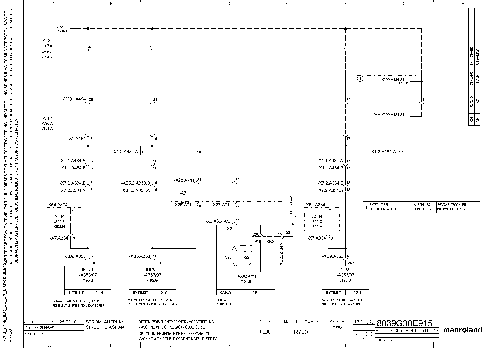

# +EA — Sheet 395 of 407 — OPTION: ZWISCHENTROCKNER VORBEREITUNG;

**MASCHINE MIT DOPPELLACKMODUL: SERIE**

> Part of the manroland **R700** printing press IEC/UL circuit diagrams.
> Drawing class: **Stromlaufplan / Circuit diagram** (DIN A3).
> Document `+EA` covers the **Printing unit** machine section.

## At a glance

| Field | Value |
|---|---|
| Document | `+EA`  (8039G38E915) |
| Sheet | **395** of 407 |
| Section (DE) | OPTION: ZWISCHENTROCKNER VORBEREITUNG; |
| Section (EN) | MASCHINE MIT DOPPELLACKMODUL: SERIE |
| Section type | CIRCUIT — Circuit diagram |
| Machine type | `R700` |
| Series | `7758` |
| Created | 25.03.10 |
| Replaces | — |
| Columns used | A, B, C, D, E, F, G, H |
| Path numbers | — |
| Labels on sheet | 138 |
| Cross-refs out | 17 |
| Cross-refs in | 52 |

**Previous:** [+EA sheet 394](SHEET_0394.md) · **Next:** [+EA sheet 396](SHEET_0396.md) · **Document TOC:** [_TOC.md](_TOC.md)  (+EA) · **Master TOC:** [all sheets](../_MASTER_TOC.md)

## Sheet image (300 DPI, exact vector render)



_Rendered directly from the PDF vector layer at 300 DPI (1-bit), no OCR and no resampling. Use it to confirm anything ambiguous in the text below._

## Cross-references on this sheet

Each entry is a wire leaving this sheet. The printed token is `/sheet.column`; the link resolves to that sheet inside the same document.

| Ref | Target sheet | Col | Path | Destination on target | Target section | From col |
|---|---|---|---|---|---|---|
| `/394.F` | [+EA sheet 394](SHEET_0394.md) | F | — | A184 | OPTION: ZWISCHENTROCKNER VORBEREITUNG; | A |
| `/396.A` | [+EA sheet 396](SHEET_0396.md) | A | — | — | OPTION: ZWISCHENTROCKNER VORBEREITUNG; | A |
| `/394.A` | [+EA sheet 394](SHEET_0394.md) | A | — | — | OPTION: ZWISCHENTROCKNER VORBEREITUNG; | A |
| `/394.F` | [+EA sheet 394](SHEET_0394.md) | F | — | X200.A484:31 | OPTION: ZWISCHENTROCKNER VORBEREITUNG; | G |
| `/393.F` | [+EA sheet 393](SHEET_0393.md) | F | — | 24V.X200.A484:31 | OPTION: ZWISCHENTROCKNER VORBEREITUNG; | G |
| `/396.A` | [+EA sheet 396](SHEET_0396.md) | A | — | — | OPTION: ZWISCHENTROCKNER VORBEREITUNG; | A |
| `/394.A` | [+EA sheet 394](SHEET_0394.md) | A | — | — | OPTION: ZWISCHENTROCKNER VORBEREITUNG; | A |
| `/28.F` | [+EA sheet 28](SHEET_0028.md) | F | — | XB2.A364A:22 | BUSVERBINDUNGEN: SICHERHEITSBUS | E |
| `/393.E` | [+EA sheet 393](SHEET_0393.md) | E | — | — | OPTION: ZWISCHENTROCKNER VORBEREITUNG; | C |
| `/395.F` | [+EA sheet 395](SHEET_0395.md) | F | — | — | OPTION: ZWISCHENTROCKNER VORBEREITUNG; | A |
| `/393.H` | [+EA sheet 393](SHEET_0393.md) | H | — | — | OPTION: ZWISCHENTROCKNER VORBEREITUNG; | A |
| `/399.C` | [+EA sheet 399](SHEET_0399.md) | C | — | — | OPTION: DÜNNDRUCKEINRICHTUNG | F |
| `/395.A` | [+EA sheet 395](SHEET_0395.md) | A | — | — | OPTION: ZWISCHENTROCKNER VORBEREITUNG; | F |
| `/196.B` | [+EA sheet 196](SHEET_0196.md) | B | — | — | REFERENZMODUL | B |
| `/196.B` | [+EA sheet 196](SHEET_0196.md) | B | — | — | REFERENZMODUL | F |
| `/195.G` | [+EA sheet 195](SHEET_0195.md) | G | — | — | REFERENZMODUL | C |
| `/201.B` | [+EA sheet 201](SHEET_0201.md) | B | — | — | REFERENZMODUL | D |

### Incoming references (sheets that point here)

Every other sheet that sends a wire to this one. `Back-ref` is the token printed on *that* sheet; `Path` is its line number.

| From sheet | Cols | Back-ref | Path | Refs | What continues there |
|---|---|---|---|---|---|
| [+EA#28](SHEET_0028.md) | E | `/28.E` | — | 1 | — |
| [+EA#195](SHEET_0195.md) | G | `/195.G` | — | 1 | — |
| [+EA#196](SHEET_0196.md) | B | `/196.B` | — | 2 | — |
| [+EA#201](SHEET_0201.md) | B | `/201.B` | — | 1 | — |
| [+EA#210](SHEET_0210.md) | E, G | `/210.E`, `/210.G` | — | 9 | — |
| [+EA#211](SHEET_0211.md) | A | `/211.A` | — | 3 | — |
| [+EA#227](SHEET_0227.md) | C, E | `/227.C`, `/227.E` | — | 2 | — |
| [+EA#240](SHEET_0240.md) | F | `/240.F` | — | 1 | — |
| [+EA#241](SHEET_0241.md) | C, E | `/241.C`, `/241.E` | — | 2 | — |
| [+EA#246](SHEET_0246.md) | F | `/246.F` | — | 2 | — |
| [+EA#247](SHEET_0247.md) | A, B | `/247.A`, `/247.B` | — | 4 | — |
| [+EA#252](SHEET_0252.md) | C | `/252.C` | — | 2 | — |
| [+EA#268](SHEET_0268.md) | E | `/268.E` | — | 1 | — |
| [+EA#271](SHEET_0271.md) | F | `/271.F` | — | 1 | — |
| [+EA#273](SHEET_0273.md) | B | `/273.B` | — | 2 | — |
| [+EA#282](SHEET_0282.md) | G | `/282.G` | — | 1 | — |
| [+EA#283](SHEET_0283.md) | A | `/283.A` | — | 1 | — |
| [+EA#286](SHEET_0286.md) | C | `/286.C` | — | 4 | — |
| [+EA#393](SHEET_0393.md) | E, G, H | `/393.E`, `/393.G`, `/393.H` | — | 3 | — |
| [+EA#394](SHEET_0394.md) | A, F | `/394.A`, `/394.F` | — | 4 | — |
| [+EA#395](SHEET_0395.md) | A, F | `/395.A`, `/395.F` | — | 2 | — |
| [+EA#396](SHEET_0396.md) | A | `/396.A` | — | 2 | — |
| [+EA#399](SHEET_0399.md) | B | `/399.B` | — | 1 | — |


## Devices on this sheet

| Tag | Class | Class meaning (IEC) | Col | Sub | Terminal | Sign |
|---|---|---|---|---|---|---|
| `A184` | A | Baugruppe / assembly, module, PC board | A | — | — | — |
| `A484` | A | Baugruppe / assembly, module, PC board | A | — | — | — |
| `A353/07` | A | Baugruppe / assembly, module, PC board | F | 07 | — | — |
| `S22` | S | Schalter / switch | D | — | — | — |
| `A22` | A | Baugruppe / assembly, module, PC board | D | — | — | — |
| `X1` | X | Klemme / terminal, plug connector | D | — | — | — |
| `X2` | X | Klemme / terminal, plug connector | D | — | — | — |
| `XB2` | XB |  | E | — | — | — |
| `A711` | A | Baugruppe / assembly, module, PC board | C | — | — | — |
| `A334` | A | Baugruppe / assembly, module, PC board | F | — | — | — |
| `A353/05` | A | Baugruppe / assembly, module, PC board | C | 05 | — | — |
| `A353/07` | A | Baugruppe / assembly, module, PC board | B | 07 | — | — |
| `A334` | A | Baugruppe / assembly, module, PC board | A | — | — | — |
| `A184` | A | Baugruppe / assembly, module, PC board | A | — | — | — |
| `12.1` | — | cross-device reference | F | — | — | — |
| `XB9.A353` | — | cross-device reference | F | — | — | — |
| `X7.A334` | — | cross-device reference | F | — | — | — |
| `XB2.A364A` | — | cross-device reference | E | — | — | — |
| `X27.A711` | — | cross-device reference | D | — | — | — |
| `X28.A711` | — | cross-device reference | C | — | — | — |
| `X25.A711` | — | cross-device reference | C | — | — | — |
| `X7.2.A334.B` | — | cross-device reference | F | — | — | — |
| `X7.2.A334.A` | — | cross-device reference | F | — | — | — |
| `X1.2.A484.A` | — | cross-device reference | G | — | — | — |
| `X1.1.A484.B` | — | cross-device reference | F | — | — | — |
| `X1.1.A484.A` | — | cross-device reference | F | — | — | — |
| `8.7` | — | cross-device reference | C | — | — | — |
| `XB5.A353` | — | cross-device reference | B | — | — | — |
| `X1.2.A484.A` | — | cross-device reference | B | — | — | — |
| `XB5.2.A353.B` | — | cross-device reference | B | — | — | — |
| `XB5.2.A353.A` | — | cross-device reference | B | — | — | — |
| `X200.A484` | — | cross-device reference | A | — | — | — |
| `X1.A484` | — | cross-device reference | A | — | — | — |
| `11.4` | — | cross-device reference | B | — | — | — |
| `XB9.A353` | — | cross-device reference | A | — | — | — |
| `X7.A334` | — | cross-device reference | A | — | — | — |
| `X7.2.A334.B` | — | cross-device reference | A | — | — | — |
| `X7.2.A334.A` | — | cross-device reference | A | — | — | — |
| `X1.1.A484.B` | — | cross-device reference | A | — | — | — |
| `X1.1.A484.A` | — | cross-device reference | A | — | — | — |
| `NR.` | — | cross-device reference | H | — | — | — |
| `23.08.10` | — | cross-device reference | H | — | — | — |
| `XB2.A364A:22` | — | cross-device reference | E | — | 22 | — |
| `X200.A484:31` | — | cross-device reference | G | — | 31 | — |
| `X52.A334` | — | cross-device reference | E | — | — | — |
| `X54.A334` | — | cross-device reference | A | — | — | — |

## Potentials / nets

| Potential | Count | Columns | Attached devices | Terminals |
|---|---|---|---|---|
| `24V` | 1 | G | `A484`, `X200` | `31` |


A potential such as `L24+/4` or `M24+` is a named supply/return rail; every place it appears on this sheet is electrically common.

## Wire-end annotations (grouped as printed)

A wire that continues elsewhere is annotated with a small cluster: the destination description, the path/line number `#NN`, and the `/sheet.column` cross reference. Each row below is one such cluster exactly as it is grouped on the drawing.

| Col | Y | Path | Cross-ref | Text on the wire |
|---|---|---|---|---|
| A | 61.2 | — | `/394.F` | `A184` |
| A | 93.8 | — | — | `A184` |
| A | 106.5 | — | — | `+ZA` |
| H | 111.4 | — | — | `001 TEXT GEÄND. SLEI/AES 23.08.10` |
| H | 117.8 | — | — | `NR. NAME TAG ÄNDERUNG` |
| A | 121.8 | — | `/396.A`, `/394.A` | — |
| F | 186.9 | — | — | `1` |
| G | 188.8 | — | `/394.F` | `X200.A484:31` |
| A | 234.9 | — | — | `X200.A484 28` |
| C | 237.0 | — | — | `29` |
| G | 237.0 | — | — | `30 31` |
| G | 273.8 | — | `/393.F` | `24V.X200.A484:31` |
| A | 281.6 | — | — | `A484` |
| A | 294.7 | — | `/396.A`, `/394.A` | — |
| A | 330.6 | — | — | `X1.A484 15` |
| C | 332.0 | — | — | `16` |
| F | 332.0 | — | — | `17` |
| B | 362.4 | — | — | `X1.2.A484.A 15` |
| G | 362.4 | — | — | `X1.2.A484.A 17` |
| C | 364.6 | — | — | `16` |
| A | 383.7 | — | — | `X1.1.A484.A 15` |
| F | 383.7 | — | — | `X1.1.A484.A 17` |
| C | 385.8 | — | — | `16` |
| A | 401.4 | — | — | `X1.1.A484.B 15` |
| F | 401.4 | — | — | `X1.1.A484.B 17` |
| C | 402.8 | — | — | `16` |
| C | 431.2 | — | — | `X28.A711 31` |
| D | 431.2 | — | — | `32` |
| A | 438.3 | — | — | `X7.2.A334.B 13` |
| B | 438.3 | — | — | `XB5.2.A353.B 16` |
| F | 438.3 | — | — | `X7.2.A334.B 18` |
| A | 455.3 | — | — | `X7.2.A334.A 13` |
| B | 455.3 | — | — | `XB5.2.A353.A 16` |
| F | 455.3 | — | — | `X7.2.A334.A 18` |
| E | 461.2 | — | `/28.F` | `XB2.A364A:22` |
| C | 462.4 | — | — | `A711` |
| C | 487.8 | — | `/393.E` | — |
| D | 490.7 | — | — | `X54.A334 X52.A334 INTERMEDIATE DRIER ZWISCHENTROCKNER` |
| C | 490.7 | — | — | `X25.A711 16` |
| D | 490.7 | — | — | `X27.A711 22` |
| G | 492.4 | — | — | `1 ENTFÄLLT BEI DELETED IN CASE OF` |
| G | 492.4 | — | — | `CONNECTION ANSCHLUSS` |
| A | 504.9 | — | — | `2` |
| F | 504.9 | — | — | `2` |
| A | 519.0 | — | — | `A334` |
| F | 519.0 | — | — | `A334` |
| D | 530.4 | — | — | `X2.A364A/01 22` |
| A | 532.1 | — | `/395.F`, `/393.H` | — |
| F | 532.1 | — | `/399.C`, `/395.A` | — |
| D | 548.8 | — | — | `X2` |
| E | 550.2 | — | — | `22 22` |
| E | 558.8 | — | — | `22` |
| D | 563.0 | — | — | `23C` |
| A | 571.5 | — | — | `X7.A334 13` |
| F | 571.5 | — | — | `X7.A334 18` |
| D | 580.0 | — | — | `X1` |
| E | 580.0 | — | — | `XB2` |
| E | 587.1 | — | — | `XB2.A364A` |
| A | 615.4 | — | — | `XB9.A353 13` |
| C | 615.4 | — | — | `XB5.A353 16` |
| F | 615.4 | — | — | `XB9.A353 18` |
| D | 619.0 | — | — | `S22 A22` |
| B | 632.4 | — | — | `19B` |
| C | 632.4 | — | — | `22B` |
| F | 632.4 | — | — | `24B` |
| B | 646.9 | — | — | `INPUT` |
| C | 646.9 | — | — | `INPUT` |
| F | 646.9 | — | — | `INPUT` |
| B | 660.8 | — | — | `A353/07` |
| C | 660.8 | — | — | `A353/05` |
| F | 660.8 | — | — | `A353/07` |
| D | 665.0 | — | — | `A364A/01` |
| B | 674.5 | — | `/196.B` | — |
| F | 674.5 | — | `/196.B` | — |
| C | 674.6 | — | `/195.G` | — |
| D | 677.4 | — | `/201.B` | — |
| D | 703.3 | — | — | `KANAL 46` |
| B | 703.6 | — | — | `BYTE.BIT 11.4` |
| C | 703.6 | — | — | `BYTE.BIT 8.7` |
| F | 703.6 | — | — | `BYTE.BIT 12.1` |
| C | 723.6 | — | — | `PRESELECTION UV INTERMEDIATE DRIER VORWAHL UV ZWISCHENTROCKNER` |
| D | 723.6 | — | — | `KANAL 46 CHANNEL 46` |
| F | 723.6 | — | — | `INTERMEDIATE DRIER WARNING ZWISCHENTROCKNER WARNUNG` |
| A | 726.4 | — | — | `PRESELECTION IR/TL INTERMEDIATE DRIER VORWAHL IR/TL ZWISCHENTROCKNER` |


## Reconstructed tables

This sheet carries tabular content (pin map / terminal assignment / index). The grid below was rebuilt from the drawing's own rule lines, so each row is exactly one physical row of the table.

### Table 1 — 7 data rows × 13 columns (at x=170.1, y=69.4)

| X200.A484 X1.A484 | 28 15 |  |  | 29 16 |  |  |  |  |  |  |  |  |
|---|---|---|---|---|---|---|---|---|---|---|---|---|
| `X1.1.A484.A X1.1.A484.B` | `15 15` | `X1.2.A484.A` | `15` | `16 16` |  | `16` |  |  |  |  |  |  |
| `X7.2.A334.B X7.2.A334.A 2` | `13 13` |  | `XB5.2.A353.B XB5.2.A353.A` | `16 16` | `X28.A711 A711 /393.E X25.A711` | `31 16` | `X27.A711 X2.A364A/01` | `32 22 22` |  |  | `XB2.A364A:22` | `X52.A334 /28.F A334 /399.C` |
| `13` |  |  |  |  |  |  | `X2` | `22` | `23C X1` | `XB2` | `22 22` | `/395.A X7.A334` |
| `XB9.A353` | `13 19B` |  | `XB5.A353` | `16 22B` |  |  | `S22` | `A22` |  |  | `XB2.A364A` |  |
| `INPUT` |  |  | `INPUT` |  |  |  |  |  |  |  |  |  |
|  | `A353/07 /196.B` |  |  | `A353/05 /195.G` |  |  |  | `A364A/01 /201.B` |  |  |  |  |
| `BYTE.BIT` | `11.4` |  | `BYTE.BIT` | `8.7` |  |  | `KANAL` |  | `46` |  |  |  |


### Table 2 — 6 data rows × 2 columns (at x=793.7, y=69.4) — **1 30 17**

| X1.1.A484.A X1.1.A484.B | 17 17 |
|---|---|
| `X7.2.A334.B X7.2.A334.A 2` | `18 18 1` |
| `18` |  |
| `XB9.A353` | `18 24B` |
| `INPUT` |  |
|  | `A353/07 /196.B` |
| `BYTE.BIT` | `12.1` |


## Notes and free text on this sheet

| Text | Col | Y (pt) |
|---|---|---|
| `+ZA` | A | 106.52 |
| `24B` | F | 632.41 |
| `INPUT` | F | 646.94 |
| `BYTE.BIT` | F | 704.19 |
| `ZWISCHENTROCKNER WARNUNG` | F | 723.58 |
| `INTERMEDIATE DRIER WARNING` | F | 733.56 |
| `KANAL 46` | D | 723.62 |
| `CHANNEL 46` | D | 733.56 |
| `23C` | D | 563.01 |
| `KANAL` | D | 703.29 |
| `A364A/01` | D | 665.03 |
| `X2.A364A/01` | D | 530.39 |
| `22B` | C | 632.41 |
| `INPUT` | C | 646.94 |
| `BYTE.BIT` | B | 704.19 |
| `VORWAHL UV ZWISCHENTROCKNER` | C | 723.59 |
| `PRESELECTION UV INTERMEDIATE DRIER` | C | 733.58 |
| `19B` | B | 632.41 |
| `INPUT` | B | 646.94 |
| `BYTE.BIT` | A | 704.19 |
| `VORWAHL IR/TL ZWISCHENTROCKNER` | A | 726.43 |
| `PRESELECTION IR/TL INTERMEDIATE DRIER` | A | 736.41 |
| `TAG` | H | 239.2 |
| `NAME` | H | 179.79 |
| `ÄNDERUNG` | H | 117.82 |
| `SLEI/AES` | H | 174.36 |
| `TEXT GEÄND.` | H | 111.41 |
| `ENTFÄLLT BEI` | G | 492.4 |
| `DELETED IN CASE OF` | G | 503.06 |
| `ANSCHLUSS` | G | 492.45 |
| `CONNECTION` | G | 503.08 |
| `ZWISCHENTROCKNER` | H | 492.43 |
| `INTERMEDIATE DRIER` | H | 503.07 |

## Complete label inventory (exact text from the drawing)

Every text object inside the drawing area of this sheet, in DIN reading order (column A→H, then top→bottom). This is the authoritative list: if a string is not here it is not printed on this sheet.

| Col | Y | X | Dir | Type | Text |
|---|---|---|---|---|---|
| A | 61.3 | 131.5 | → | device tag | `A184` |
| A | 71.1 | 139.7 | → | cross-reference | `/394.F` |
| A | 93.8 | 99.8 | → | device tag | `A184` |
| A | 106.5 | 107.4 | → | text | `+ZA` |
| A | 121.8 | 102.0 | → | cross-reference | `/396.A` |
| A | 134.2 | 102.0 | → | cross-reference | `/394.A` |
| A | 234.9 | 151.4 | → | device ref | `X200.A484` |
| A | 281.6 | 99.8 | → | device tag | `A484` |
| A | 294.7 | 102.0 | → | cross-reference | `/396.A` |
| A | 307.1 | 102.0 | → | cross-reference | `/394.A` |
| A | 330.5 | 163.3 | → | device ref | `X1.A484` |
| A | 383.7 | 143.7 | → | device ref | `X1.1.A484.A` |
| A | 401.4 | 144.6 | → | device ref | `X1.1.A484.B` |
| A | 438.3 | 144.6 | → | device ref | `X7.2.A334.B` |
| A | 456.0 | 143.7 | → | device ref | `X7.2.A334.A` |
| A | 490.7 | 113.4 | → | device ref | `X54.A334` |
| A | 504.9 | 172.6 | → | number | `2` |
| A | 519.0 | 128.1 | → | device tag | `A334` |
| A | 532.1 | 131.2 | → | cross-reference | `/395.F` |
| A | 544.5 | 131.0 | → | cross-reference | `/393.H` |
| A | 571.5 | 120.8 | → | device ref | `X7.A334` |
| A | 572.9 | 172.1 | → | number | `13` |
| A | 615.4 | 156.2 | → | device ref | `XB9.A353` |
| A | 704.2 | 165.8 | → | text | `BYTE.BIT` |
| A | 726.4 | 127.6 | → | text | `VORWAHL IR/TL ZWISCHENTROCKNER` |
| A | 736.4 | 127.0 | → | text | `PRESELECTION IR/TL INTERMEDIATE DRIER` |
| B | 237.0 | 215.1 | → | number | `28` |
| B | 332.0 | 214.6 | → | number | `15` |
| B | 362.4 | 271.3 | → | device ref | `X1.2.A484.A` |
| B | 385.8 | 214.6 | → | number | `15` |
| B | 402.8 | 214.6 | → | number | `15` |
| B | 438.3 | 214.6 | → | number | `13` |
| B | 438.3 | 293.4 | → | device ref | `XB5.2.A353.B` |
| B | 455.3 | 214.6 | → | number | `13` |
| B | 456.0 | 292.5 | → | device ref | `XB5.2.A353.A` |
| B | 615.4 | 214.6 | → | number | `13` |
| B | 615.4 | 312.1 | → | device ref | `XB5.A353` |
| B | 632.4 | 217.4 | → | text | `19B` |
| B | 646.9 | 197.7 | → | text | `INPUT` |
| B | 660.8 | 191.2 | → | device tag | `A353/07` |
| B | 674.6 | 200.0 | → | cross-reference | `/196.B` |
| B | 703.6 | 231.2 | → | device ref | `11.4` |
| B | 704.2 | 321.7 | → | text | `BYTE.BIT` |
| C | 237.0 | 371.1 | → | number | `29` |
| C | 332.0 | 370.5 | → | number | `16` |
| C | 364.6 | 342.1 | → | number | `15` |
| C | 364.6 | 476.8 | → | number | `16` |
| C | 385.8 | 370.5 | → | number | `16` |
| C | 402.8 | 370.5 | → | number | `16` |
| C | 431.2 | 420.9 | → | device ref | `X28.A711` |
| C | 438.3 | 370.5 | → | number | `16` |
| C | 455.3 | 370.5 | → | number | `16` |
| C | 462.3 | 434.3 | → | device tag | `A711` |
| C | 487.8 | 435.7 | → | cross-reference | `/393.E` |
| C | 490.7 | 419.5 | → | device ref | `X25.A711` |
| C | 495.0 | 476.8 | → | number | `16` |
| C | 615.4 | 370.5 | → | number | `16` |
| C | 632.4 | 373.9 | → | text | `22B` |
| C | 646.9 | 353.6 | → | text | `INPUT` |
| C | 660.8 | 347.1 | → | device tag | `A353/05` |
| C | 674.6 | 355.6 | → | cross-reference | `/195.G` |
| C | 703.6 | 390.0 | → | device ref | `8.7` |
| C | 723.6 | 310.4 | → | text | `VORWAHL UV ZWISCHENTROCKNER` |
| C | 733.6 | 309.8 | → | text | `PRESELECTION UV INTERMEDIATE DRIER` |
| D | 431.2 | 477.4 | → | number | `31` |
| D | 431.2 | 569.5 | → | number | `32` |
| D | 490.7 | 511.7 | → | device ref | `X27.A711` |
| D | 495.0 | 569.5 | → | number | `22` |
| D | 530.4 | 497.2 | → | text | `X2.A364A/01` |
| D | 530.4 | 569.5 | → | number | `22` |
| D | 548.8 | 545.4 | → | device tag | `X2` |
| D | 550.2 | 572.3 | → | number | `22` |
| D | 563.0 | 612.3 | → | text | `23C` |
| D | 580.0 | 616.0 | → | device tag | `X1` |
| D | 619.0 | 542.0 | → | device tag | `S22` |
| D | 619.0 | 584.5 | → | device tag | `A22` |
| D | 665.0 | 571.0 | → | text | `A364A/01` |
| D | 677.4 | 582.7 | → | cross-reference | `/201.B` |
| D | 703.3 | 530.6 | → | text | `KANAL` |
| D | 703.3 | 610.7 | → | number | `46` |
| D | 723.6 | 522.4 | → | text | `KANAL 46` |
| D | 733.6 | 522.7 | → | text | `CHANNEL 46` |
| E | 461.2 | 700.4 | ↕ | device ref | `XB2.A364A:22` |
| E | 490.7 | 737.0 | → | device ref | `X52.A334` |
| E | 511.4 | 710.3 | ↕ | cross-reference | `/28.F` |
| E | 558.7 | 692.5 | → | number | `22` |
| E | 560.2 | 671.5 | → | number | `22` |
| E | 580.0 | 640.3 | → | device tag | `XB2` |
| E | 587.1 | 676.4 | ↕ | device ref | `XB2.A364A` |
| F | 186.9 | 869.9 | → | number | `1` |
| F | 237.0 | 838.8 | → | number | `30` |
| F | 332.0 | 838.2 | → | number | `17` |
| F | 383.7 | 767.3 | → | device ref | `X1.1.A484.A` |
| F | 385.8 | 838.2 | → | number | `17` |
| F | 401.4 | 768.2 | → | device ref | `X1.1.A484.B` |
| F | 402.8 | 838.2 | → | number | `17` |
| F | 438.3 | 768.2 | → | device ref | `X7.2.A334.B` |
| F | 438.3 | 838.2 | → | number | `18` |
| F | 455.3 | 838.2 | → | number | `18` |
| F | 456.0 | 767.3 | → | device ref | `X7.2.A334.A` |
| F | 497.8 | 883.3 | → | number | `1` |
| F | 504.9 | 796.3 | → | number | `2` |
| F | 519.0 | 751.7 | → | device tag | `A334` |
| F | 532.1 | 754.0 | → | cross-reference | `/399.C` |
| F | 544.5 | 754.0 | → | cross-reference | `/395.A` |
| F | 571.5 | 744.4 | → | device ref | `X7.A334` |
| F | 572.9 | 795.7 | → | number | `18` |
| F | 615.4 | 779.8 | → | device ref | `XB9.A353` |
| F | 615.4 | 838.2 | → | number | `18` |
| F | 632.4 | 841.6 | → | text | `24B` |
| F | 646.9 | 821.3 | → | text | `INPUT` |
| F | 660.8 | 814.8 | → | device tag | `A353/07` |
| F | 674.6 | 823.6 | → | cross-reference | `/196.B` |
| F | 703.6 | 855.6 | → | device ref | `12.1` |
| F | 704.2 | 789.4 | → | text | `BYTE.BIT` |
| F | 723.6 | 778.1 | → | text | `ZWISCHENTROCKNER WARNUNG` |
| F | 733.6 | 777.5 | → | text | `INTERMEDIATE DRIER WARNING` |
| G | 188.8 | 919.8 | → | device ref | `X200.A484:31` |
| G | 198.7 | 961.8 | → | cross-reference | `/394.F` |
| G | 237.0 | 1023.0 | → | number | `31` |
| G | 273.8 | 901.7 | → | potential | `24V.X200.A484:31` |
| G | 283.7 | 961.8 | → | cross-reference | `/393.F` |
| G | 362.4 | 894.9 | → | device ref | `X1.2.A484.A` |
| G | 364.6 | 965.8 | → | number | `17` |
| G | 492.4 | 894.9 | → | text | `ENTFÄLLT BEI` |
| G | 492.4 | 1002.0 | → | text | `ANSCHLUSS` |
| G | 503.1 | 894.9 | → | text | `DELETED IN CASE OF` |
| G | 503.1 | 1001.8 | → | text | `CONNECTION` |
| H | 111.4 | 1138.5 | ↕ | text | `TEXT GEÄND.` |
| H | 117.8 | 1152.7 | ↕ | text | `ÄNDERUNG` |
| H | 174.4 | 1138.5 | ↕ | text | `SLEI/AES` |
| H | 179.8 | 1152.6 | ↕ | text | `NAME` |
| H | 233.0 | 1138.5 | ↕ | device ref | `23.08.10` |
| H | 239.2 | 1152.6 | ↕ | text | `TAG` |
| H | 282.2 | 1138.4 | ↕ | number | `001` |
| H | 282.7 | 1152.5 | ↕ | device ref | `NR.` |
| H | 492.4 | 1058.7 | → | text | `ZWISCHENTROCKNER` |
| H | 503.1 | 1057.9 | → | text | `INTERMEDIATE DRIER` |

## Reading-order text block

The same content as a plain block, grouped by DIN column — convenient to paste or to match against a visual description.

```text
=== Column A ===
  61.3  131.5  devtag       A184
  71.1  139.7  xref         /394.F
  93.8   99.8  devtag       A184
 106.5  107.4  text         +ZA
 121.8  102.0  xref         /396.A
 134.2  102.0  xref         /394.A
 234.9  151.4  devref       X200.A484
 281.6   99.8  devtag       A484
 294.7  102.0  xref         /396.A
 307.1  102.0  xref         /394.A
 330.5  163.3  devref       X1.A484
 383.7  143.7  devref       X1.1.A484.A
 401.4  144.6  devref       X1.1.A484.B
 438.3  144.6  devref       X7.2.A334.B
 456.0  143.7  devref       X7.2.A334.A
 490.7  113.4  devref       X54.A334
 504.9  172.6  numeric      2
 519.0  128.1  devtag       A334
 532.1  131.2  xref         /395.F
 544.5  131.0  xref         /393.H
 571.5  120.8  devref       X7.A334
 572.9  172.1  numeric      13
 615.4  156.2  devref       XB9.A353
 704.2  165.8  text         BYTE.BIT
 726.4  127.6  text         VORWAHL IR/TL ZWISCHENTROCKNER
 736.4  127.0  text         PRESELECTION IR/TL INTERMEDIATE DRIER
=== Column B ===
 237.0  215.1  numeric      28
 332.0  214.6  numeric      15
 362.4  271.3  devref       X1.2.A484.A
 385.8  214.6  numeric      15
 402.8  214.6  numeric      15
 438.3  214.6  numeric      13
 438.3  293.4  devref       XB5.2.A353.B
 455.3  214.6  numeric      13
 456.0  292.5  devref       XB5.2.A353.A
 615.4  214.6  numeric      13
 615.4  312.1  devref       XB5.A353
 632.4  217.4  text         19B
 646.9  197.7  text         INPUT
 660.8  191.2  devtag       A353/07
 674.6  200.0  xref         /196.B
 703.6  231.2  devref       11.4
 704.2  321.7  text         BYTE.BIT
=== Column C ===
 237.0  371.1  numeric      29
 332.0  370.5  numeric      16
 364.6  342.1  numeric      15
 364.6  476.8  numeric      16
 385.8  370.5  numeric      16
 402.8  370.5  numeric      16
 431.2  420.9  devref       X28.A711
 438.3  370.5  numeric      16
 455.3  370.5  numeric      16
 462.3  434.3  devtag       A711
 487.8  435.7  xref         /393.E
 490.7  419.5  devref       X25.A711
 495.0  476.8  numeric      16
 615.4  370.5  numeric      16
 632.4  373.9  text         22B
 646.9  353.6  text         INPUT
 660.8  347.1  devtag       A353/05
 674.6  355.6  xref         /195.G
 703.6  390.0  devref       8.7
 723.6  310.4  text         VORWAHL UV ZWISCHENTROCKNER
 733.6  309.8  text         PRESELECTION UV INTERMEDIATE DRIER
=== Column D ===
 431.2  477.4  numeric      31
 431.2  569.5  numeric      32
 490.7  511.7  devref       X27.A711
 495.0  569.5  numeric      22
 530.4  497.2  text         X2.A364A/01
 530.4  569.5  numeric      22
 548.8  545.4  devtag       X2
 550.2  572.3  numeric      22
 563.0  612.3  text         23C
 580.0  616.0  devtag       X1
 619.0  542.0  devtag       S22
 619.0  584.5  devtag       A22
 665.0  571.0  text         A364A/01
 677.4  582.7  xref         /201.B
 703.3  530.6  text         KANAL
 703.3  610.7  numeric      46
 723.6  522.4  text         KANAL 46
 733.6  522.7  text         CHANNEL 46
=== Column E ===
 461.2  700.4  devref       XB2.A364A:22
 490.7  737.0  devref       X52.A334
 511.4  710.3  xref         /28.F
 558.7  692.5  numeric      22
 560.2  671.5  numeric      22
 580.0  640.3  devtag       XB2
 587.1  676.4  devref       XB2.A364A
=== Column F ===
 186.9  869.9  numeric      1
 237.0  838.8  numeric      30
 332.0  838.2  numeric      17
 383.7  767.3  devref       X1.1.A484.A
 385.8  838.2  numeric      17
 401.4  768.2  devref       X1.1.A484.B
 402.8  838.2  numeric      17
 438.3  768.2  devref       X7.2.A334.B
 438.3  838.2  numeric      18
 455.3  838.2  numeric      18
 456.0  767.3  devref       X7.2.A334.A
 497.8  883.3  numeric      1
 504.9  796.3  numeric      2
 519.0  751.7  devtag       A334
 532.1  754.0  xref         /399.C
 544.5  754.0  xref         /395.A
 571.5  744.4  devref       X7.A334
 572.9  795.7  numeric      18
 615.4  779.8  devref       XB9.A353
 615.4  838.2  numeric      18
 632.4  841.6  text         24B
 646.9  821.3  text         INPUT
 660.8  814.8  devtag       A353/07
 674.6  823.6  xref         /196.B
 703.6  855.6  devref       12.1
 704.2  789.4  text         BYTE.BIT
 723.6  778.1  text         ZWISCHENTROCKNER WARNUNG
 733.6  777.5  text         INTERMEDIATE DRIER WARNING
=== Column G ===
 188.8  919.8  devref       X200.A484:31
 198.7  961.8  xref         /394.F
 237.0 1023.0  numeric      31
 273.8  901.7  net          24V.X200.A484:31
 283.7  961.8  xref         /393.F
 362.4  894.9  devref       X1.2.A484.A
 364.6  965.8  numeric      17
 492.4  894.9  text         ENTFÄLLT BEI
 492.4 1002.0  text         ANSCHLUSS
 503.1  894.9  text         DELETED IN CASE OF
 503.1 1001.8  text         CONNECTION
=== Column H ===
 111.4 1138.5  text         TEXT GEÄND.
 117.8 1152.7  text         ÄNDERUNG
 174.4 1138.5  text         SLEI/AES
 179.8 1152.6  text         NAME
 233.0 1138.5  devref       23.08.10
 239.2 1152.6  text         TAG
 282.2 1138.4  numeric      001
 282.7 1152.5  devref       NR.
 492.4 1058.7  text         ZWISCHENTROCKNER
 503.1 1057.9  text         INTERMEDIATE DRIER
```

---
_Generated from the PDF vector text layer; no OCR. Source: `R700_7758_IEC_UL_EA_8039G38E915_p`, sheet 395._
