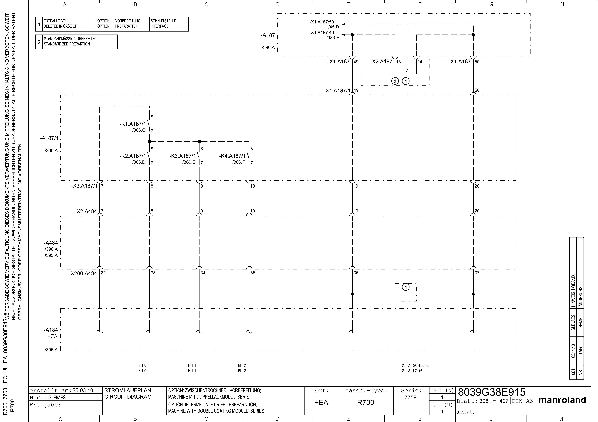

# +EA — Sheet 396 of 407 — OPTION: ZWISCHENTROCKNER VORBEREITUNG;

**MASCHINE MIT DOPPELLACKMODUL: SERIE**

> Part of the manroland **R700** printing press IEC/UL circuit diagrams.
> Drawing class: **Stromlaufplan / Circuit diagram** (DIN A3).
> Document `+EA` covers the **Printing unit** machine section.

## At a glance

| Field | Value |
|---|---|
| Document | `+EA`  (8039G38E915) |
| Sheet | **396** of 407 |
| Section (DE) | OPTION: ZWISCHENTROCKNER VORBEREITUNG; |
| Section (EN) | MASCHINE MIT DOPPELLACKMODUL: SERIE |
| Section type | CIRCUIT — Circuit diagram |
| Machine type | `R700` |
| Series | `7758` |
| Created | 25.03.10 |
| Replaces | — |
| Columns used | A, B, C, D, E, F, G, H |
| Path numbers | — |
| Labels on sheet | 93 |
| Cross-refs out | 11 |
| Cross-refs in | 35 |

**Previous:** [+EA sheet 395](SHEET_0395.md) · **Next:** [+EA sheet 397](SHEET_0397.md) · **Document TOC:** [_TOC.md](_TOC.md)  (+EA) · **Master TOC:** [all sheets](../_MASTER_TOC.md)

## Sheet image (300 DPI, exact vector render)



_Rendered directly from the PDF vector layer at 300 DPI (1-bit), no OCR and no resampling. Use it to confirm anything ambiguous in the text below._

## Cross-references on this sheet

Each entry is a wire leaving this sheet. The printed token is `/sheet.column`; the link resolves to that sheet inside the same document.

| Ref | Target sheet | Col | Path | Destination on target | Target section | From col |
|---|---|---|---|---|---|---|
| `/45.D` | [+EA sheet 45](SHEET_0045.md) | D | — | X1.A187:50 | BUSVERBINDUNGEN: 20 mA SCHLEIFE | E |
| `/383.F` | [+EA sheet 383](SHEET_0383.md) | F | — | X1.A187:49 | OPTION: ENDTROCKNER 2 VORBEREITUNG | E |
| `/390.A` | [+EA sheet 390](SHEET_0390.md) | A | — | — | OPTION: ZWISCHENTROCKNER VORBEREITUNG; | D |
| `/366.C` | [+EA sheet 366](SHEET_0366.md) | C | — | — | OPTION: TROCKNER VORBEREITUNG; | B |
| `/390.A` | [+EA sheet 390](SHEET_0390.md) | A | — | — | OPTION: ZWISCHENTROCKNER VORBEREITUNG; | A |
| `/366.E` | [+EA sheet 366](SHEET_0366.md) | E | — | — | OPTION: TROCKNER VORBEREITUNG; | C |
| `/366.F` | [+EA sheet 366](SHEET_0366.md) | F | — | — | OPTION: TROCKNER VORBEREITUNG; | C |
| `/366.D` | [+EA sheet 366](SHEET_0366.md) | D | — | — | OPTION: TROCKNER VORBEREITUNG; | B |
| `/398.A` | [+EA sheet 398](SHEET_0398.md) | A | — | — | OPTION: ZWISCHENTROCKNER VORBEREITUNG; | A |
| `/395.A` | [+EA sheet 395](SHEET_0395.md) | A | — | — | OPTION: ZWISCHENTROCKNER VORBEREITUNG; | A |
| `/395.A` | [+EA sheet 395](SHEET_0395.md) | A | — | — | OPTION: ZWISCHENTROCKNER VORBEREITUNG; | A |

### Incoming references (sheets that point here)

Every other sheet that sends a wire to this one. `Back-ref` is the token printed on *that* sheet; `Path` is its line number.

| From sheet | Cols | Back-ref | Path | Refs | What continues there |
|---|---|---|---|---|---|
| [+EA#45](SHEET_0045.md) | D | `/45.D` | — | 1 | — |
| [+EA#206](SHEET_0206.md) | H | `/206.H` | — | 2 | — |
| [+EA#207](SHEET_0207.md) | B | `/207.B` | — | 2 | — |
| [+EA#223](SHEET_0223.md) | C | `/223.C` | — | 2 | — |
| [+EA#230](SHEET_0230.md) | B | `/230.B` | — | 6 | — |
| [+EA#231](SHEET_0231.md) | G | `/231.G` | — | 6 | — |
| [+EA#286](SHEET_0286.md) | C | `/286.C` | — | 6 | — |
| [+EA#366](SHEET_0366.md) | C, D, E, F | `/366.C`, `/366.D`, `/366.E`, `/366.F` | — | 4 | — |
| [+EA#383](SHEET_0383.md) | G | `/383.G` | — | 1 | — |
| [+EA#390](SHEET_0390.md) | A | `/390.A` | — | 2 | — |
| [+EA#395](SHEET_0395.md) | A | `/395.A` | — | 2 | — |
| [+EA#398](SHEET_0398.md) | A | `/398.A` | — | 1 | — |


## Devices on this sheet

| Tag | Class | Class meaning (IEC) | Col | Sub | Terminal | Sign |
|---|---|---|---|---|---|---|
| `A184` | A | Baugruppe / assembly, module, PC board | A | — | — | — |
| `A484` | A | Baugruppe / assembly, module, PC board | A | — | — | — |
| `A187/1` | A | Baugruppe / assembly, module, PC board | A | 1 | — | — |
| `A187` | A | Baugruppe / assembly, module, PC board | D | — | — | — |
| `J7` | J |  | F | — | — | — |
| `X2.A187` | — | cross-device reference | E | — | — | — |
| `X2.A484` | — | cross-device reference | A | — | — | — |
| `X200.A484` | — | cross-device reference | A | — | — | — |
| `X1.A187` | — | cross-device reference | E | — | — | — |
| `X1.A187` | — | cross-device reference | G | — | — | — |
| `NR.` | — | cross-device reference | H | — | — | — |
| `05.11.10` | — | cross-device reference | H | — | — | — |
| `X1.A187:50` | — | cross-device reference | E | — | 50 | — |
| `X1.A187:49` | — | cross-device reference | E | — | 49 | — |

## Potentials / nets

_No named potentials on this sheet._

## Wire-end annotations (grouped as printed)

A wire that continues elsewhere is annotated with a small cluster: the destination description, the path/line number `#NN`, and the `/sheet.column` cross reference. Each row below is one such cluster exactly as it is grouped on the drawing.

| Col | Y | Path | Cross-ref | Text on the wire |
|---|---|---|---|---|
| A | 38.9 | — | — | `1 ENTFÄLLT BEI DELETED IN CASE OF` |
| B | 38.9 | — | — | `OPTION OPTION` |
| B | 38.9 | — | — | `PREPARATION VORBEREITUNG` |
| B | 38.9 | — | — | `INTERFACE SCHNITTSTELLE` |
| E | 40.0 | — | `/45.D` | `X1.A187:50` |
| E | 61.2 | — | `/383.F` | `X1.A187:49` |
| D | 65.5 | — | — | `A187` |
| A | 74.3 | — | — | `2 STANDARDMÄSSIG VORBEREITET STANDARDIZED PREPARTION` |
| D | 91.0 | — | `/390.A` | — |
| F | 118.0 | — | — | `X1.A187 49 X1.A187 50` |
| F | 118.0 | — | — | `X2.A187 13 14` |
| F | 137.0 | — | — | `J7` |
| F | 158.5 | — | — | `1` |
| F | 159.0 | — | — | `2` |
| F | 176.1 | — | — | `X1.A187/1 49 50` |
| B | 229.2 | — | — | `8` |
| B | 242.7 | — | — | `K1.A187/1 7` |
| B | 255.8 | — | `/366.C` | — |
| A | 271.0 | — | — | `A187/1` |
| B | 293.0 | — | — | `8` |
| C | 293.0 | — | — | `8` |
| D | 293.0 | — | — | `8` |
| A | 296.5 | — | `/390.A` | — |
| B | 306.5 | — | — | `K2.A187/1 7` |
| C | 306.5 | — | — | `K3.A187/1 7` |
| C | 306.5 | — | — | `K4.A187/1 7` |
| B | 319.5 | — | `/366.D` | — |
| C | 319.5 | — | `/366.E` | — |
| C | 319.5 | — | `/366.F` | — |
| B | 366.0 | — | — | `X3.A187/1 7 8` |
| C | 367.4 | — | — | `9 10` |
| F | 367.4 | — | — | `19 20` |
| B | 417.0 | — | — | `X2.A484 7 8 9 10` |
| E | 417.0 | — | — | `19` |
| G | 417.0 | — | — | `20` |
| A | 480.1 | — | — | `A484` |
| A | 493.1 | — | `/398.A`, `/395.A` | — |
| B | 540.3 | — | — | `X200.A484 32 33 34 35` |
| E | 540.3 | — | — | `36` |
| G | 540.3 | — | — | `37` |
| H | 547.0 | — | — | `001 HINWEIS 1 GEÄND. SLEI/AES 05.11.10` |
| F | 569.5 | — | — | `1` |
| H | 571.4 | — | — | `NR. NAME TAG ÄNDERUNG` |
| A | 653.7 | — | — | `A184` |
| A | 666.4 | — | — | `+ZA` |
| A | 694.0 | — | `/395.A` | — |
| C | 726.1 | — | — | `BIT 1 BIT 1` |
| B | 726.2 | — | — | `BIT 0 BIT 0` |
| C | 726.2 | — | — | `BIT 2 BIT 2` |
| F | 726.3 | — | — | `20mA SCHLEIFE 20mA LOOP` |


## Reconstructed tables

This sheet carries tabular content (pin map / terminal assignment / index). The grid below was rebuilt from the drawing's own rule lines, so each row is exactly one physical row of the table.

### Table 1 — 1 data rows × 2 columns (at x=701.6, y=48.2)

| X2.A187 49 | 13 J7 |
|---|---|
| `49 19 19 36` | `1 2 1` |


## Notes and free text on this sheet

| Text | Col | Y (pt) |
|---|---|---|
| `+ZA` | A | 666.37 |
| `X3.A187/1` | A | 365.98 |
| `K1.A187/1` | B | 242.68 |
| `K2.A187/1` | B | 306.46 |
| `K3.A187/1` | C | 306.46 |
| `K4.A187/1` | C | 306.46 |
| `X1.A187/1` | E | 176.06 |
| `TAG` | H | 692.75 |
| `NAME` | H | 633.34 |
| `ÄNDERUNG` | H | 571.36 |
| `SLEI/AES` | H | 627.9 |
| `HINWEIS 1 GEÄND.` | H | 547.05 |
| `BIT 0` | B | 726.21 |
| `BIT 1` | C | 726.14 |
| `BIT 2` | C | 726.2 |
| `20mA SCHLEIFE` | F | 726.28 |
| `20mA LOOP` | F | 736.91 |
| `ENTFÄLLT BEI` | A | 38.86 |
| `DELETED IN CASE OF` | A | 49.51 |
| `STANDARDMÄSSIG VORBEREITET` | A | 74.33 |
| `STANDARDIZED PREPARTION` | A | 84.96 |
| `OPTION` | B | 38.87 |
| `VORBEREITUNG` | B | 38.9 |
| `PREPARATION` | B | 49.5 |
| `SCHNITTSTELLE` | B | 38.89 |
| `INTERFACE` | B | 49.5 |

## Complete label inventory (exact text from the drawing)

Every text object inside the drawing area of this sheet, in DIN reading order (column A→H, then top→bottom). This is the authoritative list: if a string is not here it is not printed on this sheet.

| Col | Y | X | Dir | Type | Text |
|---|---|---|---|---|---|
| A | 38.9 | 87.0 | → | text | `ENTFÄLLT BEI` |
| A | 44.2 | 75.4 | → | number | `1` |
| A | 49.5 | 87.0 | → | text | `DELETED IN CASE OF` |
| A | 74.3 | 87.6 | → | text | `STANDARDMÄSSIG VORBEREITET` |
| A | 79.6 | 75.1 | → | number | `2` |
| A | 85.0 | 87.6 | → | text | `STANDARDIZED PREPARTION` |
| A | 271.0 | 79.7 | → | device tag | `A187/1` |
| A | 296.5 | 89.3 | → | cross-reference | `/390.A` |
| A | 366.0 | 141.7 | → | text | `X3.A187/1` |
| A | 417.0 | 149.1 | → | device ref | `X2.A484` |
| A | 480.1 | 87.0 | → | device tag | `A484` |
| A | 493.1 | 89.3 | → | cross-reference | `/398.A` |
| A | 505.5 | 89.3 | → | cross-reference | `/395.A` |
| A | 541.0 | 137.2 | → | device ref | `X200.A484` |
| A | 653.7 | 87.0 | → | device tag | `A184` |
| A | 666.4 | 94.7 | → | text | `+ZA` |
| A | 694.0 | 89.3 | → | cross-reference | `/395.A` |
| B | 38.9 | 193.9 | → | text | `OPTION` |
| B | 38.9 | 229.6 | → | text | `VORBEREITUNG` |
| B | 38.9 | 300.2 | → | text | `SCHNITTSTELLE` |
| B | 49.5 | 193.9 | → | text | `OPTION` |
| B | 49.5 | 228.8 | → | text | `PREPARATION` |
| B | 49.5 | 299.6 | → | text | `INTERFACE` |
| B | 229.2 | 300.2 | → | number | `8` |
| B | 242.7 | 238.1 | → | text | `K1.A187/1` |
| B | 255.8 | 263.6 | → | cross-reference | `/366.C` |
| B | 257.6 | 300.2 | → | number | `7` |
| B | 293.0 | 300.2 | → | number | `8` |
| B | 306.5 | 238.1 | → | text | `K2.A187/1` |
| B | 319.5 | 263.6 | → | cross-reference | `/366.D` |
| B | 321.3 | 300.2 | → | number | `7` |
| B | 367.4 | 201.0 | → | number | `7` |
| B | 367.4 | 300.2 | → | number | `8` |
| B | 417.0 | 201.0 | → | number | `7` |
| B | 417.0 | 300.2 | → | number | `8` |
| B | 540.3 | 201.0 | → | number | `32` |
| B | 540.3 | 300.2 | → | number | `33` |
| B | 726.2 | 275.5 | → | text | `BIT 0` |
| B | 736.8 | 275.5 | → | text | `BIT 0` |
| C | 293.0 | 399.4 | → | number | `8` |
| C | 306.5 | 337.3 | → | text | `K3.A187/1` |
| C | 306.5 | 436.5 | → | text | `K4.A187/1` |
| C | 319.5 | 363.4 | → | cross-reference | `/366.E` |
| C | 319.5 | 462.9 | → | cross-reference | `/366.F` |
| C | 321.3 | 399.4 | → | number | `7` |
| C | 367.4 | 399.4 | → | number | `9` |
| C | 417.0 | 399.4 | → | number | `9` |
| C | 540.3 | 399.4 | → | number | `34` |
| C | 726.1 | 374.7 | → | text | `BIT 1` |
| C | 726.2 | 474.0 | → | text | `BIT 2` |
| C | 736.8 | 374.7 | → | text | `BIT 1` |
| C | 736.8 | 474.0 | → | text | `BIT 2` |
| D | 65.5 | 519.3 | → | device tag | `A187` |
| D | 91.0 | 521.6 | → | cross-reference | `/390.A` |
| D | 293.0 | 498.6 | → | number | `8` |
| D | 321.3 | 498.6 | → | number | `7` |
| D | 367.4 | 498.0 | → | number | `10` |
| D | 417.0 | 498.0 | → | number | `10` |
| D | 540.3 | 498.6 | → | number | `35` |
| E | 40.0 | 616.3 | → | device ref | `X1.A187:50` |
| E | 49.9 | 654.0 | → | cross-reference | `/45.D` |
| E | 61.2 | 616.3 | → | device ref | `X1.A187:49` |
| E | 71.1 | 650.0 | → | cross-reference | `/383.F` |
| E | 117.9 | 652.3 | → | device ref | `X1.A187` |
| E | 117.9 | 737.3 | → | device ref | `X2.A187` |
| E | 119.4 | 704.1 | → | number | `49` |
| E | 176.1 | 644.9 | → | text | `X1.A187/1` |
| E | 176.1 | 704.1 | → | number | `49` |
| E | 367.4 | 703.6 | → | number | `19` |
| E | 417.0 | 703.6 | → | number | `19` |
| E | 540.3 | 704.1 | → | number | `36` |
| F | 119.4 | 788.6 | → | number | `13` |
| F | 119.4 | 831.1 | → | number | `14` |
| F | 137.0 | 803.2 | → | device tag | `J7` |
| F | 158.5 | 806.1 | → | number | `1` |
| F | 159.0 | 784.6 | → | number | `2` |
| F | 569.5 | 806.1 | → | number | `1` |
| F | 726.3 | 800.5 | → | text | `20mA SCHLEIFE` |
| F | 736.9 | 800.5 | → | text | `20mA LOOP` |
| G | 117.9 | 893.2 | → | device ref | `X1.A187` |
| G | 119.4 | 945.1 | → | number | `50` |
| G | 176.1 | 945.1 | → | number | `50` |
| G | 367.4 | 945.1 | → | number | `20` |
| G | 417.0 | 945.1 | → | number | `20` |
| G | 540.3 | 945.1 | → | number | `37` |
| H | 547.0 | 1138.4 | ↕ | text | `HINWEIS 1 GEÄND.` |
| H | 571.4 | 1152.7 | ↕ | text | `ÄNDERUNG` |
| H | 627.9 | 1138.5 | ↕ | text | `SLEI/AES` |
| H | 633.3 | 1152.6 | ↕ | text | `NAME` |
| H | 686.6 | 1138.5 | ↕ | device ref | `05.11.10` |
| H | 692.7 | 1152.6 | ↕ | text | `TAG` |
| H | 735.8 | 1138.4 | ↕ | number | `001` |
| H | 736.2 | 1152.5 | ↕ | device ref | `NR.` |

## Reading-order text block

The same content as a plain block, grouped by DIN column — convenient to paste or to match against a visual description.

```text
=== Column A ===
  38.9   87.0  text         ENTFÄLLT BEI
  44.2   75.4  numeric      1
  49.5   87.0  text         DELETED IN CASE OF
  74.3   87.6  text         STANDARDMÄSSIG VORBEREITET
  79.6   75.1  numeric      2
  85.0   87.6  text         STANDARDIZED PREPARTION
 271.0   79.7  devtag       A187/1
 296.5   89.3  xref         /390.A
 366.0  141.7  text         X3.A187/1
 417.0  149.1  devref       X2.A484
 480.1   87.0  devtag       A484
 493.1   89.3  xref         /398.A
 505.5   89.3  xref         /395.A
 541.0  137.2  devref       X200.A484
 653.7   87.0  devtag       A184
 666.4   94.7  text         +ZA
 694.0   89.3  xref         /395.A
=== Column B ===
  38.9  193.9  text         OPTION
  38.9  229.6  text         VORBEREITUNG
  38.9  300.2  text         SCHNITTSTELLE
  49.5  193.9  text         OPTION
  49.5  228.8  text         PREPARATION
  49.5  299.6  text         INTERFACE
 229.2  300.2  numeric      8
 242.7  238.1  text         K1.A187/1
 255.8  263.6  xref         /366.C
 257.6  300.2  numeric      7
 293.0  300.2  numeric      8
 306.5  238.1  text         K2.A187/1
 319.5  263.6  xref         /366.D
 321.3  300.2  numeric      7
 367.4  201.0  numeric      7
 367.4  300.2  numeric      8
 417.0  201.0  numeric      7
 417.0  300.2  numeric      8
 540.3  201.0  numeric      32
 540.3  300.2  numeric      33
 726.2  275.5  text         BIT 0
 736.8  275.5  text         BIT 0
=== Column C ===
 293.0  399.4  numeric      8
 306.5  337.3  text         K3.A187/1
 306.5  436.5  text         K4.A187/1
 319.5  363.4  xref         /366.E
 319.5  462.9  xref         /366.F
 321.3  399.4  numeric      7
 367.4  399.4  numeric      9
 417.0  399.4  numeric      9
 540.3  399.4  numeric      34
 726.1  374.7  text         BIT 1
 726.2  474.0  text         BIT 2
 736.8  374.7  text         BIT 1
 736.8  474.0  text         BIT 2
=== Column D ===
  65.5  519.3  devtag       A187
  91.0  521.6  xref         /390.A
 293.0  498.6  numeric      8
 321.3  498.6  numeric      7
 367.4  498.0  numeric      10
 417.0  498.0  numeric      10
 540.3  498.6  numeric      35
=== Column E ===
  40.0  616.3  devref       X1.A187:50
  49.9  654.0  xref         /45.D
  61.2  616.3  devref       X1.A187:49
  71.1  650.0  xref         /383.F
 117.9  652.3  devref       X1.A187
 117.9  737.3  devref       X2.A187
 119.4  704.1  numeric      49
 176.1  644.9  text         X1.A187/1
 176.1  704.1  numeric      49
 367.4  703.6  numeric      19
 417.0  703.6  numeric      19
 540.3  704.1  numeric      36
=== Column F ===
 119.4  788.6  numeric      13
 119.4  831.1  numeric      14
 137.0  803.2  devtag       J7
 158.5  806.1  numeric      1
 159.0  784.6  numeric      2
 569.5  806.1  numeric      1
 726.3  800.5  text         20mA SCHLEIFE
 736.9  800.5  text         20mA LOOP
=== Column G ===
 117.9  893.2  devref       X1.A187
 119.4  945.1  numeric      50
 176.1  945.1  numeric      50
 367.4  945.1  numeric      20
 417.0  945.1  numeric      20
 540.3  945.1  numeric      37
=== Column H ===
 547.0 1138.4  text         HINWEIS 1 GEÄND.
 571.4 1152.7  text         ÄNDERUNG
 627.9 1138.5  text         SLEI/AES
 633.3 1152.6  text         NAME
 686.6 1138.5  devref       05.11.10
 692.7 1152.6  text         TAG
 735.8 1138.4  numeric      001
 736.2 1152.5  devref       NR.
```

---
_Generated from the PDF vector text layer; no OCR. Source: `R700_7758_IEC_UL_EA_8039G38E915_p`, sheet 396._
