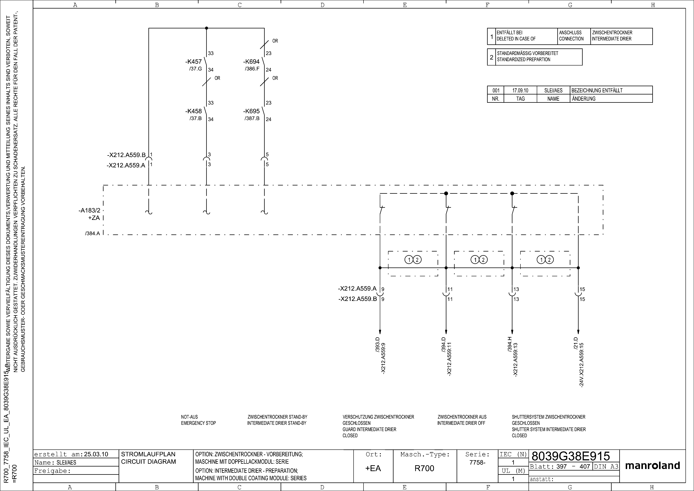

# +EA — Sheet 397 of 407 — OPTION: ZWISCHENTROCKNER VORBEREITUNG;

**MASCHINE MIT DOPPELLACKMODUL: SERIE**

> Part of the manroland **R700** printing press IEC/UL circuit diagrams.
> Drawing class: **Stromlaufplan / Circuit diagram** (DIN A3).
> Document `+EA` covers the **Printing unit** machine section.

## At a glance

| Field | Value |
|---|---|
| Document | `+EA`  (8039G38E915) |
| Sheet | **397** of 407 |
| Section (DE) | OPTION: ZWISCHENTROCKNER VORBEREITUNG; |
| Section (EN) | MASCHINE MIT DOPPELLACKMODUL: SERIE |
| Section type | CIRCUIT — Circuit diagram |
| Machine type | `R700` |
| Series | `7758` |
| Created | 25.03.10 |
| Replaces | — |
| Columns used | A, B, C, D, E, F, G, H |
| Path numbers | — |
| Labels on sheet | 86 |
| Cross-refs out | 9 |
| Cross-refs in | 23 |

**Previous:** [+EA sheet 396](SHEET_0396.md) · **Next:** [+EA sheet 398](SHEET_0398.md) · **Document TOC:** [_TOC.md](_TOC.md)  (+EA) · **Master TOC:** [all sheets](../_MASTER_TOC.md)

## Sheet image (300 DPI, exact vector render)



_Rendered directly from the PDF vector layer at 300 DPI (1-bit), no OCR and no resampling. Use it to confirm anything ambiguous in the text below._

## Cross-references on this sheet

Each entry is a wire leaving this sheet. The printed token is `/sheet.column`; the link resolves to that sheet inside the same document.

| Ref | Target sheet | Col | Path | Destination on target | Target section | From col |
|---|---|---|---|---|---|---|
| `/37.G` | [+EA sheet 37](SHEET_0037.md) | G | — | — | BUSVERBINDUNGEN: NOT AUS | B |
| `/386.F` | [+EA sheet 386](SHEET_0386.md) | F | — | — | OPTION: ZWISCHENTROCKNER VORBEREITUNG; | C |
| `/37.B` | [+EA sheet 37](SHEET_0037.md) | B | — | — | BUSVERBINDUNGEN: NOT AUS | B |
| `/387.B` | [+EA sheet 387](SHEET_0387.md) | B | — | — | OPTION: ZWISCHENTROCKNER VORBEREITUNG; | C |
| `/384.A` | [+EA sheet 384](SHEET_0384.md) | A | — | — | OPTION: ENDTROCKNER 2 VORBEREITUNG | A |
| `/394.H` | [+EA sheet 394](SHEET_0394.md) | H | — | — | OPTION: ZWISCHENTROCKNER VORBEREITUNG; | F |
| `/393.D` | [+EA sheet 393](SHEET_0393.md) | D | — | — | OPTION: ZWISCHENTROCKNER VORBEREITUNG; | E |
| `/394.D` | [+EA sheet 394](SHEET_0394.md) | D | — | — | OPTION: ZWISCHENTROCKNER VORBEREITUNG; | E |
| `/21.D` | [+EA sheet 21](SHEET_0021.md) | D | — | — | SPANNUNGSVERSORGUNG: 400V, 24V | G |

### Incoming references (sheets that point here)

Every other sheet that sends a wire to this one. `Back-ref` is the token printed on *that* sheet; `Path` is its line number.

| From sheet | Cols | Back-ref | Path | Refs | What continues there |
|---|---|---|---|---|---|
| [+EA#21](SHEET_0021.md) | D | `/21.D` | — | 1 | 24V.X212.A559:15 |
| [+EA#37](SHEET_0037.md) | B, G | `/37.B`, `/37.G` | — | 2 | — |
| [+EA#289](SHEET_0289.md) | C, E | `/289.C`, `/289.E` | — | 14 | — |
| [+EA#384](SHEET_0384.md) | A | `/384.A` | — | 1 | — |
| [+EA#386](SHEET_0386.md) | F | `/386.F` | — | 1 | — |
| [+EA#387](SHEET_0387.md) | B | `/387.B` | — | 1 | — |
| [+EA#393](SHEET_0393.md) | D | `/393.D` | — | 1 | — |
| [+EA#394](SHEET_0394.md) | F, H | `/394.F`, `/394.H` | — | 2 | X212.A559:13 |


## Devices on this sheet

| Tag | Class | Class meaning (IEC) | Col | Sub | Terminal | Sign |
|---|---|---|---|---|---|---|
| `A183/2` | A | Baugruppe / assembly, module, PC board | A | 2 | — | — |
| `K457` | K | Relais / relay, contactor | B | — | — | — |
| `K694` | K | Relais / relay, contactor | C | — | — | — |
| `K458` | K | Relais / relay, contactor | B | — | — | — |
| `K695` | K | Relais / relay, contactor | C | — | — | — |
| `X212.A559.B` | — | cross-device reference | B | — | — | — |
| `X212.A559.A` | — | cross-device reference | B | — | — | — |
| `X212.A559.B` | — | cross-device reference | D | — | — | — |
| `X212.A559.A` | — | cross-device reference | D | — | — | — |
| `NR.` | — | cross-device reference | F | — | — | — |
| `17.09.10` | — | cross-device reference | F | — | — | — |
| `X212.A559:13` | — | cross-device reference | F | — | 13 | — |
| `X212.A559:11` | — | cross-device reference | F | — | 11 | — |
| `X212.A559:9` | — | cross-device reference | E | — | 9 | — |

## Potentials / nets

| Potential | Count | Columns | Attached devices | Terminals |
|---|---|---|---|---|
| `24V` | 1 | G | `A559`, `X212` | `15` |


A potential such as `L24+/4` or `M24+` is a named supply/return rail; every place it appears on this sheet is electrically common.

## Wire-end annotations (grouped as printed)

A wire that continues elsewhere is annotated with a small cluster: the destination description, the path/line number `#NN`, and the `/sheet.column` cross reference. Each row below is one such cluster exactly as it is grouped on the drawing.

| Col | Y | Path | Cross-ref | Text on the wire |
|---|---|---|---|---|
| E | 53.0 | — | — | `OR 1 ENTFÄLLT BEI DELETED IN CASE OF` |
| G | 53.1 | — | — | `CONNECTION ANSCHLUSS` |
| H | 53.1 | — | — | `INTERMEDIATE DRIER ZWISCHENTROCKNER` |
| C | 87.5 | — | — | `33` |
| C | 87.5 | — | — | `23` |
| F | 88.5 | — | — | `2 STANDARDMÄSSIG VORBEREITET STANDARDIZED PREPARTION` |
| C | 100.9 | — | — | `K457 34` |
| C | 100.9 | — | — | `K694 24` |
| B | 114.0 | — | `/37.G` | — |
| C | 114.0 | — | `/386.F` | — |
| C | 131.0 | — | — | `OR OR` |
| G | 151.9 | — | — | `001 17.09.10 SLEI/AES BEZEICHNUNG ENTFÄLLT` |
| G | 166.0 | — | — | `NR. TAG NAME ÄNDERUNG` |
| C | 172.5 | — | — | `33` |
| C | 172.5 | — | — | `23` |
| C | 186.0 | — | — | `K458 34` |
| C | 186.0 | — | — | `K695 24` |
| B | 199.0 | — | `/37.B` | — |
| C | 199.0 | — | `/387.B` | — |
| B | 261.1 | — | — | `X212.A559.B 1` |
| C | 261.1 | — | — | `3` |
| C | 261.1 | — | — | `5` |
| B | 278.1 | — | — | `X212.A559.A 1` |
| C | 278.1 | — | — | `3` |
| C | 278.1 | — | — | `5` |
| A | 356.1 | — | — | `A183/2` |
| A | 368.7 | — | — | `+ZA` |
| A | 396.4 | — | `/384.A` | — |
| F | 442.0 | — | — | `1 2 1 2 1 2` |
| D | 490.0 | — | — | `X212.A559.A 9` |
| F | 492.1 | — | — | `11` |
| F | 492.1 | — | — | `13` |
| G | 492.1 | — | — | `15` |
| D | 507.7 | — | — | `X212.A559.B 9` |
| F | 509.1 | — | — | `11` |
| F | 509.1 | — | — | `13` |
| G | 509.1 | — | — | `15` |
| F | 577.4 | — | `/394.H` | — |
| E | 578.0 | — | `/393.D` | — |
| E | 578.0 | — | `/394.D` | — |
| G | 578.0 | — | `/21.D` | — |
| F | 586.5 | — | — | `X212.A559:11` |
| E | 587.9 | — | — | `X212.A559:9` |
| F | 587.9 | — | — | `X212.A559:13` |
| G | 587.9 | — | — | `24V.X212.A559:15` |
| C | 712.1 | — | — | `NOT AUS EMERGENCY STOP` |
| C | 712.1 | — | — | `INTERMEDIATE DRIER STAND BY ZWISCHENTROCKNER STAND BY` |
| E | 712.1 | — | — | `GESCHLOSSEN GUARD INTERMEDIATE DRIER CLOSED VERSCHUTZUNG ZWISCHENTROCKNER` |
| F | 712.1 | — | — | `INTERMEDIATE DRIER OFF ZWISCHENTROCKNER AUS` |
| G | 712.1 | — | — | `SHUTTERSYSTEM ZWISCHENTROCKNER GESCHLOSSEN SHUTTER SYSTEM INTERMEDIATE DRIER CLOSED` |


## Reconstructed tables

This sheet carries tabular content (pin map / terminal assignment / index). The grid below was rebuilt from the drawing's own rule lines, so each row is exactly one physical row of the table.

### Table 1 — 8 data rows × 14 columns (at x=204.1, y=0.0)

| X212.A559.B X212.A559.A | 1 1 | K457 /37.G K458 /37.B | 33 K694 /386.F 34 OR 33 K695 /387.B 34 3 3 | OR 23 24 OR 23 24 5 5 |  |  |  |  | 1 2 001 NR. | ENTFÄLLT DELETED STANDARDIZED | BEI IN CASE STANDARDMÄSSIG 17.09.10 TAG | ANSCHLUSS OF CONNECTION VORBEREITET PREPARTION SLEI/AES NAME | ZWISCHENTROCKNER INTERMEDIATE BEZEICHNUNG ENTFÄLLT ÄNDERUNG |
|---|---|---|---|---|---|---|---|---|---|---|---|---|---|
|  |  |  |  |  |  |  | `1 2` |  | `1 2` |  |  | `1 2` |  |
|  | `NOT AUS EMERGENCY` |  | `STOP INTERMEDIATE` | `ZWISCHENTROCKNER STAND BY DRIER STAND BY GUARD CLOSED` | `X212.A559.A X212.A559.B /393.D VERSCHUTZUNG GESCHLOSSEN INTERMEDIATE` | `9 9 X212.A559:9 DRIER` | `/394.D ZWISCHENTROCKNER` | `11 11 X212.A559:11 INTERMEDIATE` | `ZWISCHENTROCKNER AUS DRIER OFF` | `/394.H` | `13 13 X212.A559:13 SHUTTERSYSTEM GESCHLOSSEN SHUTTER CLOSED` | `/21.D ZWISCHENTROCKNER SYSTEM INTERMEDIATE` | `15 15 24V.X212.A559:15 DRIER` |
| `STROMLAUFPLAN` |  | `OPTION:` | `ZWISCHENTROCKNER` | `VORBEREITUNG;` | `Ort:` |  | `Masch. Type:` |  | `Serie:` | `IEC` | `(N)` | `8039G38E915` |  |
| `CIRCUIT` | `DIAGRAM` |  |  |  |  |  |  |  |  |  |  |  |  |
|  |  |  | `MASCHINE MIT DOPPELLACKMODUL:` | `SERIE` |  |  |  |  | `7758` |  | `1` |  |  |
|  |  |  |  |  | `+EA` |  | `R700` |  |  |  |  | `Blatt: 397` | `DIN A3 407` |
|  |  | `OPTION:` | `INTERMEDIATE DRIER` | `PREPARATION;` |  |  |  |  |  | `UL` | `(M)` |  |  |
|  |  | `MACHINE` | `WITH DOUBLE COATING` | `MODULE: SERIES` |  |  |  |  |  |  | `1` | `anstatt:` |  |


## Notes and free text on this sheet

| Text | Col | Y (pt) |
|---|---|---|
| `+ZA` | A | 368.73 |
| `TAG` | F | 166.17 |
| `NAME` | G | 166.15 |
| `ÄNDERUNG` | G | 166.21 |
| `SLEI/AES` | G | 152.03 |
| `BEZEICHNUNG ENTFÄLLT` | G | 152.04 |
| `NOT AUS` | B | 712.11 |
| `EMERGENCY STOP` | C | 722.75 |
| `ZWISCHENTROCKNER STAND BY` | C | 712.12 |
| `INTERMEDIATE DRIER STAND BY` | C | 722.76 |
| `SHUTTERSYSTEM ZWISCHENTROCKNER` | G | 712.12 |
| `GESCHLOSSEN` | F | 722.75 |
| `SHUTTER SYSTEM INTERMEDIATE DRIER` | G | 733.39 |
| `CLOSED` | F | 744.03 |
| `VERSCHUTZUNG ZWISCHENTROCKNER` | E | 712.13 |
| `GESCHLOSSEN` | D | 722.75 |
| `GUARD INTERMEDIATE DRIER` | E | 733.4 |
| `CLOSED` | D | 744.03 |
| `ZWISCHENTROCKNER AUS` | F | 712.11 |
| `INTERMEDIATE DRIER OFF` | F | 722.75 |
| `OR` | C | 131.01 |
| `ENTFÄLLT BEI` | F | 53.03 |
| `DELETED IN CASE OF` | F | 63.69 |
| `ANSCHLUSS` | G | 53.08 |
| `CONNECTION` | G | 63.71 |
| `ZWISCHENTROCKNER` | H | 53.06 |
| `INTERMEDIATE DRIER` | H | 63.7 |
| `STANDARDMÄSSIG VORBEREITET` | F | 88.5 |
| `STANDARDIZED PREPARTION` | F | 99.13 |

## Complete label inventory (exact text from the drawing)

Every text object inside the drawing area of this sheet, in DIN reading order (column A→H, then top→bottom). This is the authoritative list: if a string is not here it is not printed on this sheet.

| Col | Y | X | Dir | Type | Text |
|---|---|---|---|---|---|
| A | 356.1 | 134.9 | → | device tag | `A183/2` |
| A | 368.7 | 151.4 | → | text | `+ZA` |
| A | 396.4 | 146.0 | → | cross-reference | `/384.A` |
| B | 100.9 | 318.0 | → | device tag | `K457` |
| B | 114.0 | 324.9 | → | cross-reference | `/37.G` |
| B | 186.0 | 318.0 | → | device tag | `K458` |
| B | 199.0 | 325.4 | → | cross-reference | `/37.B` |
| B | 261.1 | 184.0 | → | device ref | `X212.A559.B` |
| B | 261.1 | 257.1 | → | number | `1` |
| B | 278.1 | 257.1 | → | number | `1` |
| B | 278.8 | 183.1 | → | device ref | `X212.A559.A` |
| B | 712.1 | 311.0 | → | text | `NOT AUS` |
| C | 67.2 | 467.4 | → | text | `OR` |
| C | 87.5 | 356.9 | → | number | `33` |
| C | 87.5 | 456.1 | → | number | `23` |
| C | 100.9 | 417.3 | → | device tag | `K694` |
| C | 114.0 | 420.4 | → | cross-reference | `/386.F` |
| C | 115.8 | 356.9 | → | number | `34` |
| C | 115.8 | 456.1 | → | number | `24` |
| C | 131.0 | 368.2 | → | text | `OR` |
| C | 131.0 | 467.4 | → | text | `OR` |
| C | 172.5 | 356.9 | → | number | `33` |
| C | 172.5 | 456.1 | → | number | `23` |
| C | 186.0 | 417.3 | → | device tag | `K695` |
| C | 199.0 | 419.8 | → | cross-reference | `/387.B` |
| C | 200.9 | 356.9 | → | number | `34` |
| C | 200.9 | 456.1 | → | number | `24` |
| C | 261.1 | 356.9 | → | number | `3` |
| C | 261.1 | 456.1 | → | number | `5` |
| C | 278.1 | 356.9 | → | number | `3` |
| C | 278.1 | 456.1 | → | number | `5` |
| C | 712.1 | 425.2 | → | text | `ZWISCHENTROCKNER STAND BY` |
| C | 722.8 | 311.0 | → | text | `EMERGENCY STOP` |
| C | 722.8 | 424.3 | → | text | `INTERMEDIATE DRIER STAND BY` |
| D | 490.0 | 580.0 | → | device ref | `X212.A559.A` |
| D | 507.7 | 580.8 | → | device ref | `X212.A559.B` |
| D | 722.7 | 587.9 | → | text | `GESCHLOSSEN` |
| D | 744.0 | 587.9 | → | text | `CLOSED` |
| E | 442.0 | 699.8 | → | number | `1` |
| E | 442.5 | 713.8 | → | number | `2` |
| E | 492.1 | 654.5 | → | number | `9` |
| E | 509.1 | 654.5 | → | number | `9` |
| E | 578.0 | 643.8 | ↕ | cross-reference | `/393.D` |
| E | 578.0 | 757.1 | ↕ | cross-reference | `/394.D` |
| E | 587.9 | 653.7 | ↕ | device ref | `X212.A559:9` |
| E | 712.1 | 588.2 | → | text | `VERSCHUTZUNG ZWISCHENTROCKNER` |
| E | 733.4 | 587.9 | → | text | `GUARD INTERMEDIATE DRIER` |
| F | 53.0 | 852.4 | → | text | `ENTFÄLLT BEI` |
| F | 58.4 | 840.8 | → | number | `1` |
| F | 63.7 | 852.4 | → | text | `DELETED IN CASE OF` |
| F | 88.5 | 852.9 | → | text | `STANDARDMÄSSIG VORBEREITET` |
| F | 93.8 | 840.5 | → | number | `2` |
| F | 99.1 | 852.9 | → | text | `STANDARDIZED PREPARTION` |
| F | 151.9 | 845.2 | → | number | `001` |
| F | 152.0 | 879.0 | → | device ref | `17.09.10` |
| F | 166.0 | 844.2 | → | device ref | `NR.` |
| F | 166.2 | 885.8 | → | text | `TAG` |
| F | 442.0 | 813.2 | → | number | `1` |
| F | 442.5 | 827.1 | → | number | `2` |
| F | 492.1 | 767.3 | → | number | `11` |
| F | 492.1 | 880.7 | → | number | `13` |
| F | 509.1 | 767.3 | → | number | `11` |
| F | 509.1 | 880.7 | → | number | `13` |
| F | 577.4 | 870.5 | ↕ | cross-reference | `/394.H` |
| F | 586.5 | 767.1 | ↕ | device ref | `X212.A559:11` |
| F | 587.9 | 880.4 | ↕ | device ref | `X212.A559:13` |
| F | 712.1 | 751.2 | → | text | `ZWISCHENTROCKNER AUS` |
| F | 722.7 | 878.5 | → | text | `GESCHLOSSEN` |
| F | 722.8 | 750.3 | → | text | `INTERMEDIATE DRIER OFF` |
| F | 744.0 | 878.5 | → | text | `CLOSED` |
| G | 53.1 | 959.5 | → | text | `ANSCHLUSS` |
| G | 63.7 | 959.2 | → | text | `CONNECTION` |
| G | 152.0 | 934.0 | → | text | `SLEI/AES` |
| G | 152.0 | 980.6 | → | text | `BEZEICHNUNG ENTFÄLLT` |
| G | 166.1 | 939.2 | → | text | `NAME` |
| G | 166.2 | 981.8 | → | text | `ÄNDERUNG` |
| G | 442.0 | 926.6 | → | number | `1` |
| G | 442.5 | 940.5 | → | number | `2` |
| G | 492.1 | 994.1 | → | number | `15` |
| G | 509.1 | 994.1 | → | number | `15` |
| G | 578.0 | 983.9 | ↕ | cross-reference | `/21.D` |
| G | 587.9 | 993.8 | ↕ | potential | `24V.X212.A559:15` |
| G | 712.1 | 878.5 | → | text | `SHUTTERSYSTEM ZWISCHENTROCKNER` |
| G | 733.4 | 878.5 | → | text | `SHUTTER SYSTEM INTERMEDIATE DRIER` |
| H | 53.1 | 1016.2 | → | text | `ZWISCHENTROCKNER` |
| H | 63.7 | 1015.4 | → | text | `INTERMEDIATE DRIER` |

## Reading-order text block

The same content as a plain block, grouped by DIN column — convenient to paste or to match against a visual description.

```text
=== Column A ===
 356.1  134.9  devtag       A183/2
 368.7  151.4  text         +ZA
 396.4  146.0  xref         /384.A
=== Column B ===
 100.9  318.0  devtag       K457
 114.0  324.9  xref         /37.G
 186.0  318.0  devtag       K458
 199.0  325.4  xref         /37.B
 261.1  184.0  devref       X212.A559.B
 261.1  257.1  numeric      1
 278.1  257.1  numeric      1
 278.8  183.1  devref       X212.A559.A
 712.1  311.0  text         NOT AUS
=== Column C ===
  67.2  467.4  text         OR
  87.5  356.9  numeric      33
  87.5  456.1  numeric      23
 100.9  417.3  devtag       K694
 114.0  420.4  xref         /386.F
 115.8  356.9  numeric      34
 115.8  456.1  numeric      24
 131.0  368.2  text         OR
 131.0  467.4  text         OR
 172.5  356.9  numeric      33
 172.5  456.1  numeric      23
 186.0  417.3  devtag       K695
 199.0  419.8  xref         /387.B
 200.9  356.9  numeric      34
 200.9  456.1  numeric      24
 261.1  356.9  numeric      3
 261.1  456.1  numeric      5
 278.1  356.9  numeric      3
 278.1  456.1  numeric      5
 712.1  425.2  text         ZWISCHENTROCKNER STAND BY
 722.8  311.0  text         EMERGENCY STOP
 722.8  424.3  text         INTERMEDIATE DRIER STAND BY
=== Column D ===
 490.0  580.0  devref       X212.A559.A
 507.7  580.8  devref       X212.A559.B
 722.7  587.9  text         GESCHLOSSEN
 744.0  587.9  text         CLOSED
=== Column E ===
 442.0  699.8  numeric      1
 442.5  713.8  numeric      2
 492.1  654.5  numeric      9
 509.1  654.5  numeric      9
 578.0  643.8  xref         /393.D
 578.0  757.1  xref         /394.D
 587.9  653.7  devref       X212.A559:9
 712.1  588.2  text         VERSCHUTZUNG ZWISCHENTROCKNER
 733.4  587.9  text         GUARD INTERMEDIATE DRIER
=== Column F ===
  53.0  852.4  text         ENTFÄLLT BEI
  58.4  840.8  numeric      1
  63.7  852.4  text         DELETED IN CASE OF
  88.5  852.9  text         STANDARDMÄSSIG VORBEREITET
  93.8  840.5  numeric      2
  99.1  852.9  text         STANDARDIZED PREPARTION
 151.9  845.2  numeric      001
 152.0  879.0  devref       17.09.10
 166.0  844.2  devref       NR.
 166.2  885.8  text         TAG
 442.0  813.2  numeric      1
 442.5  827.1  numeric      2
 492.1  767.3  numeric      11
 492.1  880.7  numeric      13
 509.1  767.3  numeric      11
 509.1  880.7  numeric      13
 577.4  870.5  xref         /394.H
 586.5  767.1  devref       X212.A559:11
 587.9  880.4  devref       X212.A559:13
 712.1  751.2  text         ZWISCHENTROCKNER AUS
 722.7  878.5  text         GESCHLOSSEN
 722.8  750.3  text         INTERMEDIATE DRIER OFF
 744.0  878.5  text         CLOSED
=== Column G ===
  53.1  959.5  text         ANSCHLUSS
  63.7  959.2  text         CONNECTION
 152.0  934.0  text         SLEI/AES
 152.0  980.6  text         BEZEICHNUNG ENTFÄLLT
 166.1  939.2  text         NAME
 166.2  981.8  text         ÄNDERUNG
 442.0  926.6  numeric      1
 442.5  940.5  numeric      2
 492.1  994.1  numeric      15
 509.1  994.1  numeric      15
 578.0  983.9  xref         /21.D
 587.9  993.8  net          24V.X212.A559:15
 712.1  878.5  text         SHUTTERSYSTEM ZWISCHENTROCKNER
 733.4  878.5  text         SHUTTER SYSTEM INTERMEDIATE DRIER
=== Column H ===
  53.1 1016.2  text         ZWISCHENTROCKNER
  63.7 1015.4  text         INTERMEDIATE DRIER
```

---
_Generated from the PDF vector text layer; no OCR. Source: `R700_7758_IEC_UL_EA_8039G38E915_p`, sheet 397._
