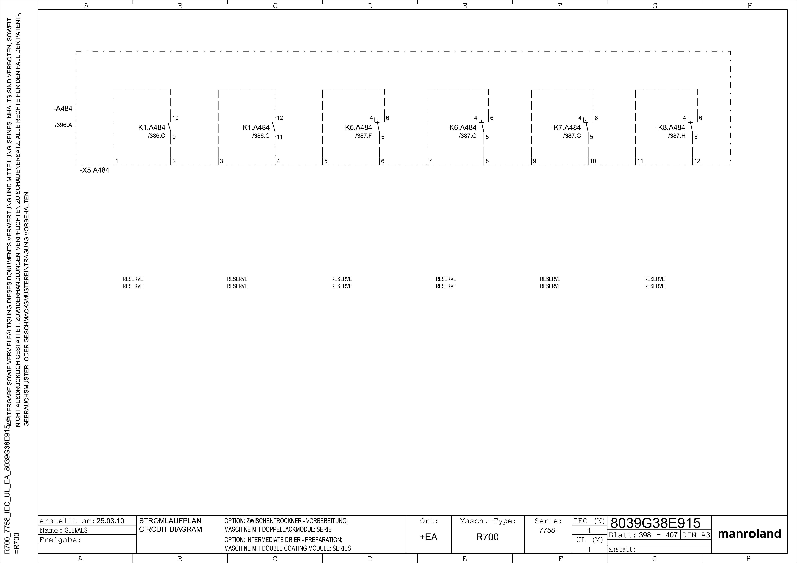

# +EA — Sheet 398 of 407 — OPTION: ZWISCHENTROCKNER VORBEREITUNG;

**MASCHINE MIT DOPPELLACKMODUL: SERIE**

> Part of the manroland **R700** printing press IEC/UL circuit diagrams.
> Drawing class: **Stromlaufplan / Circuit diagram** (DIN A3).
> Document `+EA` covers the **Printing unit** machine section.

## At a glance

| Field | Value |
|---|---|
| Document | `+EA`  (8039G38E915) |
| Sheet | **398** of 407 |
| Section (DE) | OPTION: ZWISCHENTROCKNER VORBEREITUNG; |
| Section (EN) | MASCHINE MIT DOPPELLACKMODUL: SERIE |
| Section type | CIRCUIT — Circuit diagram |
| Machine type | `R700` |
| Series | `7758` |
| Created | 25.03.10 |
| Replaces | — |
| Columns used | A, B, C, D, E, F, G |
| Path numbers | — |
| Labels on sheet | 55 |
| Cross-refs out | 7 |
| Cross-refs in | 19 |

**Previous:** [+EA sheet 397](SHEET_0397.md) · **Next:** [+EA sheet 399](SHEET_0399.md) · **Document TOC:** [_TOC.md](_TOC.md)  (+EA) · **Master TOC:** [all sheets](../_MASTER_TOC.md)

## Sheet image (300 DPI, exact vector render)



_Rendered directly from the PDF vector layer at 300 DPI (1-bit), no OCR and no resampling. Use it to confirm anything ambiguous in the text below._

## Cross-references on this sheet

Each entry is a wire leaving this sheet. The printed token is `/sheet.column`; the link resolves to that sheet inside the same document.

| Ref | Target sheet | Col | Path | Destination on target | Target section | From col |
|---|---|---|---|---|---|---|
| `/396.A` | [+EA sheet 396](SHEET_0396.md) | A | — | — | OPTION: ZWISCHENTROCKNER VORBEREITUNG; | A |
| `/387.F` | [+EA sheet 387](SHEET_0387.md) | F | — | — | OPTION: ZWISCHENTROCKNER VORBEREITUNG; | D |
| `/387.G` | [+EA sheet 387](SHEET_0387.md) | G | — | — | OPTION: ZWISCHENTROCKNER VORBEREITUNG; | E |
| `/387.G` | [+EA sheet 387](SHEET_0387.md) | G | — | — | OPTION: ZWISCHENTROCKNER VORBEREITUNG; | F |
| `/386.C` | [+EA sheet 386](SHEET_0386.md) | C | — | — | OPTION: ZWISCHENTROCKNER VORBEREITUNG; | B |
| `/386.C` | [+EA sheet 386](SHEET_0386.md) | C | — | — | OPTION: ZWISCHENTROCKNER VORBEREITUNG; | C |
| `/387.H` | [+EA sheet 387](SHEET_0387.md) | H | — | — | OPTION: ZWISCHENTROCKNER VORBEREITUNG; | G |

### Incoming references (sheets that point here)

Every other sheet that sends a wire to this one. `Back-ref` is the token printed on *that* sheet; `Path` is its line number.

| From sheet | Cols | Back-ref | Path | Refs | What continues there |
|---|---|---|---|---|---|
| [+EA#243](SHEET_0243.md) | C | `/243.C` | — | 12 | — |
| [+EA#386](SHEET_0386.md) | C | `/386.C` | — | 2 | — |
| [+EA#387](SHEET_0387.md) | F, G, H | `/387.F`, `/387.G`, `/387.H` | — | 4 | — |
| [+EA#396](SHEET_0396.md) | A | `/396.A` | — | 1 | — |


## Devices on this sheet

| Tag | Class | Class meaning (IEC) | Col | Sub | Terminal | Sign |
|---|---|---|---|---|---|---|
| `A484` | A | Baugruppe / assembly, module, PC board | A | — | — | — |
| `K5.A484` | — | cross-device reference | D | — | — | — |
| `K6.A484` | — | cross-device reference | E | — | — | — |
| `K7.A484` | — | cross-device reference | F | — | — | — |
| `K8.A484` | — | cross-device reference | G | — | — | — |
| `K1.A484` | — | cross-device reference | B | — | — | — |
| `K1.A484` | — | cross-device reference | C | — | — | — |
| `X5.A484` | — | cross-device reference | A | — | — | — |

## Potentials / nets

_No named potentials on this sheet._

## Wire-end annotations (grouped as printed)

A wire that continues elsewhere is annotated with a small cluster: the destination description, the path/line number `#NN`, and the `/sheet.column` cross reference. Each row below is one such cluster exactly as it is grouped on the drawing.

| Col | Y | Path | Cross-ref | Text on the wire |
|---|---|---|---|---|
| A | 157.6 | — | — | `A484` |
| B | 172.5 | — | — | `10` |
| C | 172.5 | — | — | `12` |
| D | 172.5 | — | — | `K5.A484 6` |
| D | 172.5 | — | — | `4` |
| E | 172.5 | — | — | `K6.A484 6` |
| E | 172.5 | — | — | `4` |
| F | 172.5 | — | — | `K7.A484 6` |
| F | 172.5 | — | — | `4` |
| G | 172.5 | — | — | `K8.A484 6` |
| G | 172.5 | — | — | `4` |
| A | 183.1 | — | `/396.A` | — |
| B | 186.0 | — | — | `K1.A484 9` |
| C | 186.0 | — | — | `K1.A484 11` |
| B | 199.1 | — | `/386.C` | — |
| C | 199.1 | — | `/386.C` | — |
| D | 199.1 | — | `/387.F` | — |
| E | 199.1 | — | `/387.G` | — |
| F | 199.1 | — | `/387.G` | — |
| G | 199.1 | — | `/387.H` | — |
| D | 200.9 | — | — | `5` |
| E | 200.9 | — | — | `5` |
| F | 200.9 | — | — | `5` |
| G | 200.9 | — | — | `5` |
| A | 237.0 | — | — | `1` |
| C | 237.0 | — | — | `2 3 4 5` |
| D | 237.0 | — | — | `6 7` |
| E | 237.0 | — | — | `8 9` |
| G | 237.0 | — | — | `10 11` |
| G | 237.0 | — | — | `12` |
| A | 249.8 | — | — | `X5.A484` |
| A | 414.4 | — | — | `RESERVE RESERVE` |
| C | 414.4 | — | — | `RESERVE RESERVE` |
| D | 414.4 | — | — | `RESERVE RESERVE` |
| E | 414.4 | — | — | `RESERVE RESERVE` |
| F | 414.4 | — | — | `RESERVE RESERVE` |
| G | 414.4 | — | — | `RESERVE RESERVE` |


## Reconstructed tables

This sheet carries tabular content (pin map / terminal assignment / index). The grid below was rebuilt from the drawing's own rule lines, so each row is exactly one physical row of the table.

### Table 1 — 5 data rows × 23 columns (at x=170.1, y=0.0) — **1 RESERVE RESERVE K1.A484 /386.C 10 9 2 3 K1.A484 /386.C RESERVE RESERVE 12 11 4 4 K5.A484 /387.F 5 RESERVE RESERVE 5 6 6 7 RESERVE RESERVE 4 K6.A484 /387.G 5 8 K7.A484 9 RESERVE RESERVE 4 /387.G 5 10 4 K8.A484 /387.H 11 RESERVE RESERVE 5 12**

|  | STROMLAUFPLAN |  |  | OPTION: ZWISCHENTROCKNER |  | VORBEREITUNG; |  |  |  | Ort: |  |  | Masch. Type: |  | Serie: | IEC |  | (N) |  | 8039G38E915 |  |  |
|---|---|---|---|---|---|---|---|---|---|---|---|---|---|---|---|---|---|---|---|---|---|---|
|  | `CIRCUIT` | `DIAGRAM` |  |  |  |  |  |  |  |  |  |  |  |  |  |  |  |  |  |  |  |  |
|  |  |  |  | `MASCHINE MIT` | `DOPPELLACKMODUL:` | `SERIE` |  |  |  |  |  |  |  |  | `7758` |  | `1` |  |  |  |  |  |
|  |  |  |  |  |  |  |  |  |  | `+EA` |  | `R700` |  |  |  |  |  |  | `Blatt:` | `DIN 398 407` |  | `A3` |
|  |  |  |  | `OPTION: INTERMEDIATE` | `DRIER` | `PREPARATION;` |  |  |  |  |  |  |  |  |  | `UL` |  | `(M)` |  |  |  |  |
|  |  |  |  | `MASCHINE MIT DOUBLE` | `COATING MODULE:` | `SERIES` |  |  |  |  |  |  |  |  |  |  | `1` |  | `anstatt:` |  |  |  |


## Notes and free text on this sheet

| Text | Col | Y (pt) |
|---|---|---|
| `RESERVE` | A | 414.44 |
| `RESERVE` | C | 414.44 |
| `RESERVE` | D | 414.44 |
| `RESERVE` | E | 414.44 |
| `RESERVE` | F | 414.44 |
| `RESERVE` | G | 414.44 |

## Complete label inventory (exact text from the drawing)

Every text object inside the drawing area of this sheet, in DIN reading order (column A→H, then top→bottom). This is the authoritative list: if a string is not here it is not printed on this sheet.

| Col | Y | X | Dir | Type | Text |
|---|---|---|---|---|---|
| A | 157.6 | 79.9 | → | device tag | `A484` |
| A | 183.1 | 82.2 | → | cross-reference | `/396.A` |
| A | 237.0 | 172.1 | → | number | `1` |
| A | 249.8 | 119.3 | → | device ref | `X5.A484` |
| A | 414.4 | 183.4 | → | text | `RESERVE` |
| A | 425.1 | 183.4 | → | text | `RESERVE` |
| B | 172.5 | 257.1 | → | number | `10` |
| B | 186.0 | 203.0 | → | device ref | `K1.A484` |
| B | 199.1 | 221.1 | → | cross-reference | `/386.C` |
| B | 200.9 | 257.7 | → | number | `9` |
| B | 237.0 | 257.7 | → | number | `2` |
| B | 237.0 | 328.5 | → | number | `3` |
| C | 172.5 | 413.0 | → | number | `12` |
| C | 186.0 | 358.9 | → | device ref | `K1.A484` |
| C | 199.1 | 377.0 | → | cross-reference | `/386.C` |
| C | 200.9 | 413.0 | → | number | `11` |
| C | 237.0 | 413.6 | → | number | `4` |
| C | 414.4 | 339.3 | → | text | `RESERVE` |
| C | 425.1 | 339.3 | → | text | `RESERVE` |
| D | 172.5 | 552.5 | → | number | `4` |
| D | 172.5 | 576.6 | → | number | `6` |
| D | 186.0 | 511.9 | → | device ref | `K5.A484` |
| D | 199.1 | 530.9 | → | cross-reference | `/387.F` |
| D | 200.9 | 569.5 | → | number | `5` |
| D | 237.0 | 484.4 | → | number | `5` |
| D | 237.0 | 569.5 | → | number | `6` |
| D | 414.4 | 495.2 | → | text | `RESERVE` |
| D | 425.1 | 495.2 | → | text | `RESERVE` |
| E | 172.5 | 708.4 | → | number | `4` |
| E | 172.5 | 732.5 | → | number | `6` |
| E | 186.0 | 667.8 | → | device ref | `K6.A484` |
| E | 199.1 | 685.7 | → | cross-reference | `/387.G` |
| E | 200.9 | 725.4 | → | number | `5` |
| E | 237.0 | 640.3 | → | number | `7` |
| E | 237.0 | 725.4 | → | number | `8` |
| E | 414.4 | 651.1 | → | text | `RESERVE` |
| E | 425.1 | 651.1 | → | text | `RESERVE` |
| F | 172.5 | 864.3 | → | number | `4` |
| F | 172.5 | 888.4 | → | number | `6` |
| F | 186.0 | 823.7 | → | device ref | `K7.A484` |
| F | 199.1 | 841.6 | → | cross-reference | `/387.G` |
| F | 200.9 | 881.3 | → | number | `5` |
| F | 237.0 | 796.3 | → | number | `9` |
| F | 237.0 | 880.7 | → | number | `10` |
| F | 414.4 | 807.0 | → | text | `RESERVE` |
| F | 425.1 | 807.0 | → | text | `RESERVE` |
| G | 172.5 | 1020.2 | → | number | `4` |
| G | 172.5 | 1044.3 | → | number | `6` |
| G | 186.0 | 979.7 | → | device ref | `K8.A484` |
| G | 199.1 | 998.4 | → | cross-reference | `/387.H` |
| G | 200.9 | 1037.2 | → | number | `5` |
| G | 237.0 | 951.6 | → | number | `11` |
| G | 237.0 | 1036.6 | → | number | `12` |
| G | 414.4 | 962.9 | → | text | `RESERVE` |
| G | 425.1 | 962.9 | → | text | `RESERVE` |

## Reading-order text block

The same content as a plain block, grouped by DIN column — convenient to paste or to match against a visual description.

```text
=== Column A ===
 157.6   79.9  devtag       A484
 183.1   82.2  xref         /396.A
 237.0  172.1  numeric      1
 249.8  119.3  devref       X5.A484
 414.4  183.4  text         RESERVE
 425.1  183.4  text         RESERVE
=== Column B ===
 172.5  257.1  numeric      10
 186.0  203.0  devref       K1.A484
 199.1  221.1  xref         /386.C
 200.9  257.7  numeric      9
 237.0  257.7  numeric      2
 237.0  328.5  numeric      3
=== Column C ===
 172.5  413.0  numeric      12
 186.0  358.9  devref       K1.A484
 199.1  377.0  xref         /386.C
 200.9  413.0  numeric      11
 237.0  413.6  numeric      4
 414.4  339.3  text         RESERVE
 425.1  339.3  text         RESERVE
=== Column D ===
 172.5  552.5  numeric      4
 172.5  576.6  numeric      6
 186.0  511.9  devref       K5.A484
 199.1  530.9  xref         /387.F
 200.9  569.5  numeric      5
 237.0  484.4  numeric      5
 237.0  569.5  numeric      6
 414.4  495.2  text         RESERVE
 425.1  495.2  text         RESERVE
=== Column E ===
 172.5  708.4  numeric      4
 172.5  732.5  numeric      6
 186.0  667.8  devref       K6.A484
 199.1  685.7  xref         /387.G
 200.9  725.4  numeric      5
 237.0  640.3  numeric      7
 237.0  725.4  numeric      8
 414.4  651.1  text         RESERVE
 425.1  651.1  text         RESERVE
=== Column F ===
 172.5  864.3  numeric      4
 172.5  888.4  numeric      6
 186.0  823.7  devref       K7.A484
 199.1  841.6  xref         /387.G
 200.9  881.3  numeric      5
 237.0  796.3  numeric      9
 237.0  880.7  numeric      10
 414.4  807.0  text         RESERVE
 425.1  807.0  text         RESERVE
=== Column G ===
 172.5 1020.2  numeric      4
 172.5 1044.3  numeric      6
 186.0  979.7  devref       K8.A484
 199.1  998.4  xref         /387.H
 200.9 1037.2  numeric      5
 237.0  951.6  numeric      11
 237.0 1036.6  numeric      12
 414.4  962.9  text         RESERVE
 425.1  962.9  text         RESERVE
```

---
_Generated from the PDF vector text layer; no OCR. Source: `R700_7758_IEC_UL_EA_8039G38E915_p`, sheet 398._
