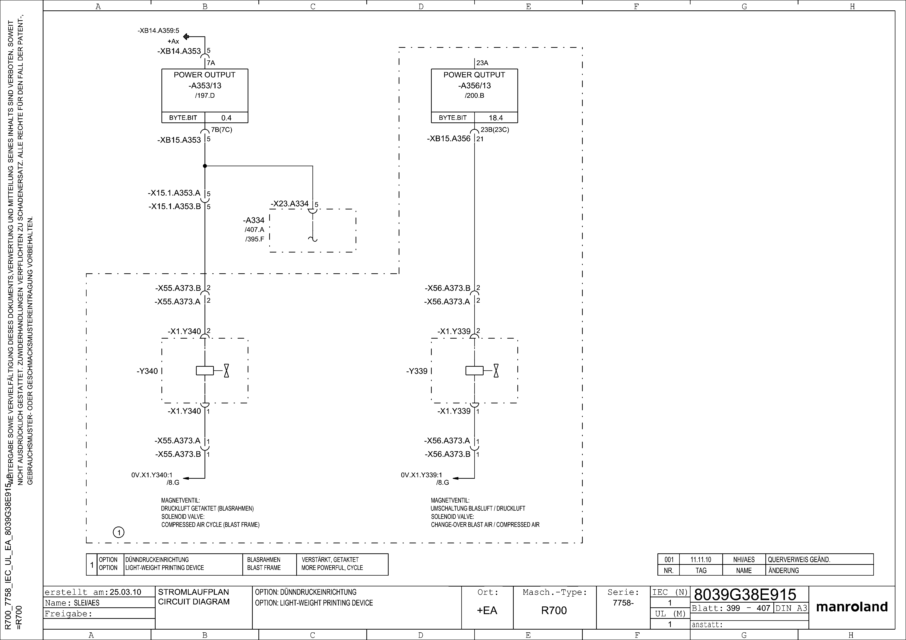

# +EA — Sheet 399 of 407 — OPTION: DÜNNDRUCKEINRICHTUNG

**OPTION: LIGHT WEIGHT PRINTING DEVICE**

> Part of the manroland **R700** printing press IEC/UL circuit diagrams.
> Drawing class: **Stromlaufplan / Circuit diagram** (DIN A3).
> Document `+EA` covers the **Printing unit** machine section.

## At a glance

| Field | Value |
|---|---|
| Document | `+EA`  (8039G38E915) |
| Sheet | **399** of 407 |
| Section (DE) | OPTION: DÜNNDRUCKEINRICHTUNG |
| Section (EN) | OPTION: LIGHT WEIGHT PRINTING DEVICE |
| Section type | CIRCUIT — Circuit diagram |
| Machine type | `R700` |
| Series | `7758` |
| Created | 25.03.10 |
| Replaces | — |
| Columns used | A, B, C, D, E, F, G, H |
| Path numbers | — |
| Labels on sheet | 87 |
| Cross-refs out | 6 |
| Cross-refs in | 24 |

**Previous:** [+EA sheet 398](SHEET_0398.md) · **Next:** [+EA sheet 400](SHEET_0400.md) · **Document TOC:** [_TOC.md](_TOC.md)  (+EA) · **Master TOC:** [all sheets](../_MASTER_TOC.md)

## Sheet image (300 DPI, exact vector render)



_Rendered directly from the PDF vector layer at 300 DPI (1-bit), no OCR and no resampling. Use it to confirm anything ambiguous in the text below._

## Cross-references on this sheet

Each entry is a wire leaving this sheet. The printed token is `/sheet.column`; the link resolves to that sheet inside the same document.

| Ref | Target sheet | Col | Path | Destination on target | Target section | From col |
|---|---|---|---|---|---|---|
| `/200.B` | [+EA sheet 200](SHEET_0200.md) | B | — | — | REFERENZMODUL | E |
| `/197.D` | [+EA sheet 197](SHEET_0197.md) | D | — | — | REFERENZMODUL | B |
| `/407.A` | [+EA sheet 407](SHEET_0407.md) | A | — | — | OPTION: AIR STATION | B |
| `/395.F` | [+EA sheet 395](SHEET_0395.md) | F | — | — | OPTION: ZWISCHENTROCKNER VORBEREITUNG; | B |
| `/8.G` | [+EA sheet 8](SHEET_0008.md) | G | — | 0V.X1.Y340:1 0V.X1.Y339:1 | SPANNUNGSVERSORGUNG: 400V, 24V | C |
| `/8.G` | [+EA sheet 8](SHEET_0008.md) | G | — | 0V.X1.Y340:1 0V.X1.Y339:1 | SPANNUNGSVERSORGUNG: 400V, 24V | C |

### Incoming references (sheets that point here)

Every other sheet that sends a wire to this one. `Back-ref` is the token printed on *that* sheet; `Path` is its line number.

| From sheet | Cols | Back-ref | Path | Refs | What continues there |
|---|---|---|---|---|---|
| [+EA#8](SHEET_0008.md) | G | `/8.G` | — | 2 | 0V.X1.Y339:1; 0V.X1.Y340:1 |
| [+EA#197](SHEET_0197.md) | D | `/197.D` | — | 1 | — |
| [+EA#200](SHEET_0200.md) | B | `/200.B` | — | 1 | — |
| [+EA#222](SHEET_0222.md) | G | `/222.G` | — | 4 | — |
| [+EA#259](SHEET_0259.md) | F | `/259.F` | — | 1 | — |
| [+EA#260](SHEET_0260.md) | F, G, H | `/260.F`, `/260.G`, `/260.H` | — | 3 | — |
| [+EA#261](SHEET_0261.md) | A | `/261.A` | — | 1 | — |
| [+EA#265](SHEET_0265.md) | A | `/265.A` | — | 1 | — |
| [+EA#283](SHEET_0283.md) | B, C | `/283.B`, `/283.C` | — | 8 | — |
| [+EA#395](SHEET_0395.md) | F | `/395.F` | — | 1 | — |
| [+EA#407](SHEET_0407.md) | A | `/407.A` | — | 1 | — |


## Devices on this sheet

| Tag | Class | Class meaning (IEC) | Col | Sub | Terminal | Sign |
|---|---|---|---|---|---|---|
| `A353/13` | A | Baugruppe / assembly, module, PC board | B | 13 | — | — |
| `A334` | A | Baugruppe / assembly, module, PC board | B | — | — | — |
| `A356/13` | A | Baugruppe / assembly, module, PC board | E | 13 | — | — |
| `Y340` | Y | Magnetventil / solenoid valve, actuator | A | — | — | — |
| `Y339` | Y | Magnetventil / solenoid valve, actuator | D | — | — | — |
| `XB15.A353` | — | cross-device reference | B | — | — | — |
| `0.4` | — | cross-device reference | B | — | — | — |
| `XB14.A353` | — | cross-device reference | B | — | — | — |
| `X15.1.A353.B` | — | cross-device reference | B | — | — | — |
| `X15.1.A353.A` | — | cross-device reference | B | — | — | — |
| `XB14.A359:5` | — | cross-device reference | B | — | 5 | — |
| `X23.A334` | — | cross-device reference | C | — | — | — |
| `18.4` | — | cross-device reference | E | — | — | — |
| `XB15.A356` | — | cross-device reference | D | — | — | — |
| `X55.A373.A` | — | cross-device reference | B | — | — | — |
| `X55.A373.B` | — | cross-device reference | B | — | — | — |
| `X1.Y340` | — | cross-device reference | B | — | — | — |
| `X1.Y340` | — | cross-device reference | B | — | — | — |
| `X55.A373.B` | — | cross-device reference | B | — | — | — |
| `X55.A373.A` | — | cross-device reference | B | — | — | — |
| `X56.A373.A` | — | cross-device reference | D | — | — | — |
| `X56.A373.B` | — | cross-device reference | D | — | — | — |
| `X1.Y339` | — | cross-device reference | D | — | — | — |
| `X1.Y339` | — | cross-device reference | D | — | — | — |
| `X56.A373.B` | — | cross-device reference | D | — | — | — |
| `X56.A373.A` | — | cross-device reference | D | — | — | — |
| `NR.` | — | cross-device reference | F | — | — | — |
| `11.11.10` | — | cross-device reference | G | — | — | — |

## Potentials / nets

| Potential | Count | Columns | Attached devices | Terminals |
|---|---|---|---|---|
| `0V` | 2 | B, D | `X1`, `Y339`, `Y340` | `1` |


A potential such as `L24+/4` or `M24+` is a named supply/return rail; every place it appears on this sheet is electrically common.

## Wire-end annotations (grouped as printed)

A wire that continues elsewhere is annotated with a small cluster: the destination description, the path/line number `#NN`, and the `/sheet.column` cross reference. Each row below is one such cluster exactly as it is grouped on the drawing.

| Col | Y | Path | Cross-ref | Text on the wire |
|---|---|---|---|---|
| B | 36.4 | — | — | `XB14.A359:5` |
| B | 50.7 | — | — | `+Ax` |
| B | 62.7 | — | — | `XB14.A353 5` |
| B | 78.9 | — | — | `7A` |
| E | 79.0 | — | — | `23A` |
| B | 94.1 | — | — | `POWER OUTPUT` |
| D | 94.1 | — | — | `POWER QUTPUT` |
| B | 108.0 | — | — | `A353/13` |
| E | 108.0 | — | — | `A356/13` |
| B | 121.8 | — | `/197.D` | — |
| E | 121.8 | — | `/200.B` | — |
| B | 150.8 | — | — | `BYTE.BIT 0.4` |
| D | 150.9 | — | — | `BYTE.BIT 18.4` |
| B | 166.8 | — | — | `7B(7C)` |
| E | 166.9 | — | — | `23B(23C)` |
| D | 177.5 | — | — | `XB15.A356 21` |
| B | 178.9 | — | — | `XB15.A353 5` |
| B | 249.1 | — | — | `X15.1.A353.A 5` |
| C | 263.2 | — | — | `X23.A334 5` |
| B | 266.8 | — | — | `X15.1.A353.B 5` |
| B | 285.2 | — | — | `A334` |
| B | 298.3 | — | `/407.A` | — |
| B | 310.7 | — | `/395.F` | — |
| B | 374.5 | — | — | `X55.A373.B 2` |
| D | 374.5 | — | — | `X56.A373.B 2` |
| B | 391.5 | — | — | `X55.A373.A 2` |
| D | 391.5 | — | — | `X56.A373.A 2` |
| B | 431.2 | — | — | `X1.Y340 2` |
| D | 431.2 | — | — | `X1.Y339 2` |
| A | 483.7 | — | — | `Y340` |
| D | 483.7 | — | — | `Y339` |
| B | 536.1 | — | — | `X1.Y340 1` |
| D | 536.1 | — | — | `X1.Y339 1` |
| B | 575.0 | — | — | `X55.A373.A 1` |
| D | 575.0 | — | — | `X56.A373.A 1` |
| B | 592.8 | — | — | `X55.A373.B 1` |
| D | 592.8 | — | — | `X56.A373.B 1` |
| C | 621.0 | — | `/8.G`, `/8.G` | `0V.X1.Y340:1 0V.X1.Y339:1` |
| B | 655.4 | — | — | `DRUCKLUFT GETAKTET (BLASRAHMEN) MAGNETVENTIL:` |
| E | 655.4 | — | — | `UMSCHALTUNG BLASLUFT / DRUCKLUFT MAGNETVENTIL:` |
| B | 676.7 | — | — | `SOLENOID VALVE: COMPRESSED AIR CYCLE (BLAST FRAME)` |
| E | 676.7 | — | — | `SOLENOID VALVE: CHANGE OVER BLAST AIR / COMPRESSED AIR` |
| A | 697.1 | — | — | `1` |
| G | 733.0 | — | — | `001 11.11.10 NHI/AES QUERVERWEIS GEÄND.` |
| A | 733.4 | — | — | `1 OPTION OPTION` |
| B | 733.4 | — | — | `DÜNNDRUCKEINRICHTUNG LIGHT WEIGHT PRINTING DEVICE` |
| C | 733.4 | — | — | `BLASRAHMEN BLAST FRAME` |
| C | 733.4 | — | — | `MORE POWERFUL, CYCLE VERSTÄRKT, GETAKTET` |
| G | 747.1 | — | — | `NR. TAG NAME ÄNDERUNG` |


## Reconstructed tables

This sheet carries tabular content (pin map / terminal assignment / index). The grid below was rebuilt from the drawing's own rule lines, so each row is exactly one physical row of the table.

### Table 1 — 4 data rows × 4 columns (at x=113.4, y=90.7)

|  | POWER | OUTPUT A353/13 /197.D |  |
|---|---|---|---|
|  | `BYTE.BIT` | `0.4` |  |
|  | `XB15.A353` | `7B(7C) 5` |  |
|  | `X15.1.A353.A X15.1.A353.B` | `5 5` | `X23.A334 A334 /407.A /395.F` |
| `Y340 0V.X1.Y340:1 1` | `X55.A373.B X55.A373.A X1.Y340 X1.Y340 X55.A373.A X55.A373.B /8.G MAGNETVENTIL: DRUCKLUFT GETAKTET SOLENOID VALVE: COMPRESSED AIR` | `2 2 2 1 1 1 (BLASRAHMEN) CYCLE (BLAST` | `FRAME)` |


### Table 2 — 3 data rows × 4 columns (at x=524.4, y=62.4) — **23A**

|  | POWER | QUTPUT A356/13 /200.B |  |
|---|---|---|---|
|  | `BYTE.BIT` | `18.4` |  |
|  | `XB15.A356` | `23B(23C) 21` |  |
| `Y339 0V.X1.Y339:1` | `X56.A373.B X56.A373.A X1.Y339 X1.Y339 X56.A373.A X56.A373.B /8.G MAGNETVENTIL: UMSCHALTUNG SOLENOID VALVE: CHANGE OVER` | `2 2 2 1 1 1 BLASLUFT / DRUCKLUFT BLAST AIR / COMPRESSED` | `AIR` |


## Notes and free text on this sheet

| Text | Col | Y (pt) |
|---|---|---|
| `7A` | B | 78.93 |
| `7B(7C)` | B | 166.85 |
| `POWER OUTPUT` | B | 94.1 |
| `BYTE.BIT` | B | 151.43 |
| `+Ax` | B | 50.67 |
| `23A` | E | 78.95 |
| `23B(23C)` | E | 166.86 |
| `POWER QUTPUT` | D | 94.1 |
| `BYTE.BIT` | D | 151.43 |
| `MAGNETVENTIL:` | B | 655.42 |
| `DRUCKLUFT GETAKTET (BLASRAHMEN)` | B | 666.07 |
| `SOLENOID VALVE:` | B | 676.68 |
| `COMPRESSED AIR CYCLE (BLAST FRAME)` | B | 687.33 |
| `MAGNETVENTIL:` | D | 655.42 |
| `UMSCHALTUNG BLASLUFT / DRUCKLUFT` | E | 666.08 |
| `SOLENOID VALVE:` | D | 676.68 |
| `CHANGE OVER BLAST AIR / COMPRESSED AIR` | E | 687.33 |
| `TAG` | G | 747.27 |
| `NAME` | G | 747.25 |
| `ÄNDERUNG` | G | 747.31 |
| `NHI/AES` | G | 733.11 |
| `QUERVERWEIS GEÄND.` | H | 733.1 |
| `OPTION` | A | 733.35 |
| `DÜNNDRUCKEINRICHTUNG` | B | 733.41 |
| `LIGHT WEIGHT PRINTING DEVICE` | B | 744 |
| `BLASRAHMEN` | C | 733.37 |
| `BLAST FRAME` | C | 743.99 |
| `VERSTÄRKT, GETAKTET` | C | 733.37 |
| `MORE POWERFUL, CYCLE` | C | 744 |

## Complete label inventory (exact text from the drawing)

Every text object inside the drawing area of this sheet, in DIN reading order (column A→H, then top→bottom). This is the authoritative list: if a string is not here it is not printed on this sheet.

| Col | Y | X | Dir | Type | Text |
|---|---|---|---|---|---|
| A | 483.7 | 179.7 | → | device tag | `Y340` |
| A | 697.1 | 154.1 | → | number | `1` |
| A | 733.4 | 130.1 | → | text | `OPTION` |
| A | 738.7 | 117.9 | → | number | `1` |
| A | 744.0 | 130.1 | → | text | `OPTION` |
| B | 36.4 | 180.9 | → | device ref | `XB14.A359:5` |
| B | 50.7 | 220.3 | → | text | `+Ax` |
| B | 62.7 | 206.9 | → | device ref | `XB14.A353` |
| B | 62.7 | 271.8 | → | number | `5` |
| B | 78.9 | 271.8 | → | text | `7A` |
| B | 94.1 | 228.5 | → | text | `POWER OUTPUT` |
| B | 108.0 | 247.9 | → | device tag | `A353/13` |
| B | 121.8 | 256.5 | → | cross-reference | `/197.D` |
| B | 150.9 | 290.8 | → | device ref | `0.4` |
| B | 151.4 | 222.5 | → | text | `BYTE.BIT` |
| B | 166.9 | 277.5 | → | text | `7B(7C)` |
| B | 178.9 | 271.8 | → | number | `5` |
| B | 179.6 | 206.9 | → | device ref | `XB15.A353` |
| B | 249.1 | 194.5 | → | device ref | `X15.1.A353.A` |
| B | 251.2 | 271.8 | → | number | `5` |
| B | 266.8 | 195.3 | → | device ref | `X15.1.A353.B` |
| B | 268.2 | 271.8 | → | number | `5` |
| B | 285.2 | 319.5 | → | device tag | `A334` |
| B | 298.3 | 321.7 | → | cross-reference | `/407.A` |
| B | 310.7 | 322.6 | → | cross-reference | `/395.F` |
| B | 374.5 | 204.1 | → | device ref | `X55.A373.B` |
| B | 374.5 | 271.8 | → | number | `2` |
| B | 391.5 | 271.8 | → | number | `2` |
| B | 392.2 | 203.2 | → | device ref | `X55.A373.A` |
| B | 431.2 | 220.5 | → | device ref | `X1.Y340` |
| B | 431.2 | 271.8 | → | number | `2` |
| B | 536.1 | 220.5 | → | device ref | `X1.Y340` |
| B | 537.5 | 271.3 | → | number | `1` |
| B | 575.0 | 203.2 | → | device ref | `X55.A373.A` |
| B | 577.2 | 271.3 | → | number | `1` |
| B | 592.8 | 204.1 | → | device ref | `X55.A373.B` |
| B | 594.2 | 271.3 | → | number | `1` |
| B | 621.1 | 172.6 | → | potential | `0V.X1.Y340:1` |
| B | 631.0 | 219.1 | → | cross-reference | `/8.G` |
| B | 655.4 | 212.0 | → | text | `MAGNETVENTIL:` |
| B | 666.1 | 211.7 | → | text | `DRUCKLUFT GETAKTET (BLASRAHMEN)` |
| B | 676.7 | 212.3 | → | text | `SOLENOID VALVE:` |
| B | 687.3 | 212.3 | → | text | `COMPRESSED AIR CYCLE (BLAST FRAME)` |
| B | 733.4 | 165.0 | → | text | `DÜNNDRUCKEINRICHTUNG` |
| B | 744.0 | 165.0 | → | text | `LIGHT WEIGHT PRINTING DEVICE` |
| C | 263.2 | 355.7 | → | device ref | `X23.A334` |
| C | 265.4 | 413.6 | → | number | `5` |
| C | 733.4 | 325.1 | → | text | `BLASRAHMEN` |
| C | 733.4 | 396.9 | → | text | `VERSTÄRKT, GETAKTET` |
| C | 744.0 | 325.1 | → | text | `BLAST FRAME` |
| C | 744.0 | 396.3 | → | text | `MORE POWERFUL, CYCLE` |
| D | 94.1 | 582.8 | → | text | `POWER QUTPUT` |
| D | 151.4 | 576.9 | → | text | `BYTE.BIT` |
| D | 177.5 | 561.3 | → | device ref | `XB15.A356` |
| D | 374.5 | 558.4 | → | device ref | `X56.A373.B` |
| D | 392.2 | 557.6 | → | device ref | `X56.A373.A` |
| D | 431.2 | 574.9 | → | device ref | `X1.Y339` |
| D | 483.7 | 534.0 | → | device tag | `Y339` |
| D | 536.1 | 574.9 | → | device ref | `X1.Y339` |
| D | 575.0 | 557.6 | → | device ref | `X56.A373.A` |
| D | 592.8 | 558.4 | → | device ref | `X56.A373.B` |
| D | 621.1 | 527.0 | → | potential | `0V.X1.Y339:1` |
| D | 631.0 | 573.4 | → | cross-reference | `/8.G` |
| D | 655.4 | 566.4 | → | text | `MAGNETVENTIL:` |
| D | 676.7 | 566.6 | → | text | `SOLENOID VALVE:` |
| E | 78.9 | 626.2 | → | text | `23A` |
| E | 108.0 | 602.2 | → | device tag | `A356/13` |
| E | 121.8 | 611.0 | → | cross-reference | `/200.B` |
| E | 150.9 | 642.2 | → | device ref | `18.4` |
| E | 166.9 | 631.8 | → | text | `23B(23C)` |
| E | 178.9 | 626.2 | → | number | `21` |
| E | 374.5 | 626.2 | → | number | `2` |
| E | 391.5 | 626.2 | → | number | `2` |
| E | 431.2 | 626.2 | → | number | `2` |
| E | 537.5 | 625.6 | → | number | `1` |
| E | 577.2 | 625.6 | → | number | `1` |
| E | 594.2 | 625.6 | → | number | `1` |
| E | 666.1 | 566.1 | → | text | `UMSCHALTUNG BLASLUFT / DRUCKLUFT` |
| E | 687.3 | 566.6 | → | text | `CHANGE OVER BLAST AIR / COMPRESSED AIR` |
| F | 733.0 | 873.5 | → | number | `001` |
| F | 747.1 | 872.6 | → | device ref | `NR.` |
| G | 733.1 | 907.3 | → | device ref | `11.11.10` |
| G | 733.1 | 963.7 | → | text | `NHI/AES` |
| G | 747.3 | 914.1 | → | text | `TAG` |
| G | 747.3 | 967.5 | → | text | `NAME` |
| G | 747.3 | 1010.1 | → | text | `ÄNDERUNG` |
| H | 733.1 | 1009.3 | → | text | `QUERVERWEIS GEÄND.` |

## Reading-order text block

The same content as a plain block, grouped by DIN column — convenient to paste or to match against a visual description.

```text
=== Column A ===
 483.7  179.7  devtag       Y340
 697.1  154.1  numeric      1
 733.4  130.1  text         OPTION
 738.7  117.9  numeric      1
 744.0  130.1  text         OPTION
=== Column B ===
  36.4  180.9  devref       XB14.A359:5
  50.7  220.3  text         +Ax
  62.7  206.9  devref       XB14.A353
  62.7  271.8  numeric      5
  78.9  271.8  text         7A
  94.1  228.5  text         POWER OUTPUT
 108.0  247.9  devtag       A353/13
 121.8  256.5  xref         /197.D
 150.9  290.8  devref       0.4
 151.4  222.5  text         BYTE.BIT
 166.9  277.5  text         7B(7C)
 178.9  271.8  numeric      5
 179.6  206.9  devref       XB15.A353
 249.1  194.5  devref       X15.1.A353.A
 251.2  271.8  numeric      5
 266.8  195.3  devref       X15.1.A353.B
 268.2  271.8  numeric      5
 285.2  319.5  devtag       A334
 298.3  321.7  xref         /407.A
 310.7  322.6  xref         /395.F
 374.5  204.1  devref       X55.A373.B
 374.5  271.8  numeric      2
 391.5  271.8  numeric      2
 392.2  203.2  devref       X55.A373.A
 431.2  220.5  devref       X1.Y340
 431.2  271.8  numeric      2
 536.1  220.5  devref       X1.Y340
 537.5  271.3  numeric      1
 575.0  203.2  devref       X55.A373.A
 577.2  271.3  numeric      1
 592.8  204.1  devref       X55.A373.B
 594.2  271.3  numeric      1
 621.1  172.6  net          0V.X1.Y340:1
 631.0  219.1  xref         /8.G
 655.4  212.0  text         MAGNETVENTIL:
 666.1  211.7  text         DRUCKLUFT GETAKTET (BLASRAHMEN)
 676.7  212.3  text         SOLENOID VALVE:
 687.3  212.3  text         COMPRESSED AIR CYCLE (BLAST FRAME)
 733.4  165.0  text         DÜNNDRUCKEINRICHTUNG
 744.0  165.0  text         LIGHT WEIGHT PRINTING DEVICE
=== Column C ===
 263.2  355.7  devref       X23.A334
 265.4  413.6  numeric      5
 733.4  325.1  text         BLASRAHMEN
 733.4  396.9  text         VERSTÄRKT, GETAKTET
 744.0  325.1  text         BLAST FRAME
 744.0  396.3  text         MORE POWERFUL, CYCLE
=== Column D ===
  94.1  582.8  text         POWER QUTPUT
 151.4  576.9  text         BYTE.BIT
 177.5  561.3  devref       XB15.A356
 374.5  558.4  devref       X56.A373.B
 392.2  557.6  devref       X56.A373.A
 431.2  574.9  devref       X1.Y339
 483.7  534.0  devtag       Y339
 536.1  574.9  devref       X1.Y339
 575.0  557.6  devref       X56.A373.A
 592.8  558.4  devref       X56.A373.B
 621.1  527.0  net          0V.X1.Y339:1
 631.0  573.4  xref         /8.G
 655.4  566.4  text         MAGNETVENTIL:
 676.7  566.6  text         SOLENOID VALVE:
=== Column E ===
  78.9  626.2  text         23A
 108.0  602.2  devtag       A356/13
 121.8  611.0  xref         /200.B
 150.9  642.2  devref       18.4
 166.9  631.8  text         23B(23C)
 178.9  626.2  numeric      21
 374.5  626.2  numeric      2
 391.5  626.2  numeric      2
 431.2  626.2  numeric      2
 537.5  625.6  numeric      1
 577.2  625.6  numeric      1
 594.2  625.6  numeric      1
 666.1  566.1  text         UMSCHALTUNG BLASLUFT / DRUCKLUFT
 687.3  566.6  text         CHANGE OVER BLAST AIR / COMPRESSED AIR
=== Column F ===
 733.0  873.5  numeric      001
 747.1  872.6  devref       NR.
=== Column G ===
 733.1  907.3  devref       11.11.10
 733.1  963.7  text         NHI/AES
 747.3  914.1  text         TAG
 747.3  967.5  text         NAME
 747.3 1010.1  text         ÄNDERUNG
=== Column H ===
 733.1 1009.3  text         QUERVERWEIS GEÄND.
```

---
_Generated from the PDF vector text layer; no OCR. Source: `R700_7758_IEC_UL_EA_8039G38E915_p`, sheet 399._
