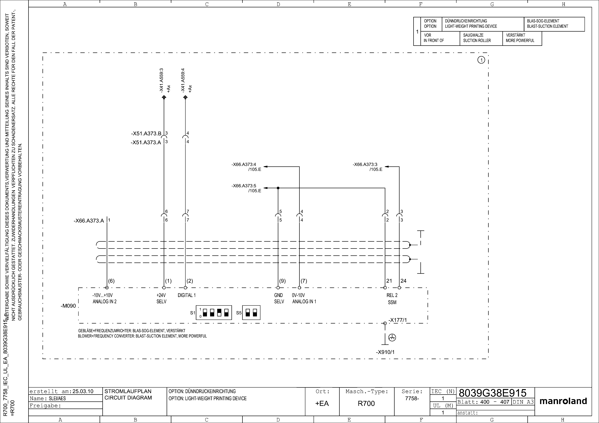

# +EA — Sheet 400 of 407 — OPTION: DÜNNDRUCKEINRICHTUNG

**OPTION: LIGHT WEIGHT PRINTING DEVICE**

> Part of the manroland **R700** printing press IEC/UL circuit diagrams.
> Drawing class: **Stromlaufplan / Circuit diagram** (DIN A3).
> Document `+EA` covers the **Printing unit** machine section.

## At a glance

| Field | Value |
|---|---|
| Document | `+EA`  (8039G38E915) |
| Sheet | **400** of 407 |
| Section (DE) | OPTION: DÜNNDRUCKEINRICHTUNG |
| Section (EN) | OPTION: LIGHT WEIGHT PRINTING DEVICE |
| Section type | CIRCUIT — Circuit diagram |
| Machine type | `R700` |
| Series | `7758` |
| Created | 25.03.10 |
| Replaces | — |
| Columns used | A, B, C, D, E, F, G, H |
| Path numbers | — |
| Labels on sheet | 71 |
| Cross-refs out | 3 |
| Cross-refs in | 20 |

**Previous:** [+EA sheet 399](SHEET_0399.md) · **Next:** [+EA sheet 401](SHEET_0401.md) · **Document TOC:** [_TOC.md](_TOC.md)  (+EA) · **Master TOC:** [all sheets](../_MASTER_TOC.md)

## Sheet image (300 DPI, exact vector render)



_Rendered directly from the PDF vector layer at 300 DPI (1-bit), no OCR and no resampling. Use it to confirm anything ambiguous in the text below._

## Cross-references on this sheet

Each entry is a wire leaving this sheet. The printed token is `/sheet.column`; the link resolves to that sheet inside the same document.

| Ref | Target sheet | Col | Path | Destination on target | Target section | From col |
|---|---|---|---|---|---|---|
| `/105.E` | [+EA sheet 105](SHEET_0105.md) | E | — | X66.A373:4 | BOGENFÜHRUNGSELEMENT | D |
| `/105.E` | [+EA sheet 105](SHEET_0105.md) | E | — | X66.A373:3 | BOGENFÜHRUNGSELEMENT | E |
| `/105.E` | [+EA sheet 105](SHEET_0105.md) | E | — | X66.A373:5 | BOGENFÜHRUNGSELEMENT | D |

### Incoming references (sheets that point here)

Every other sheet that sends a wire to this one. `Back-ref` is the token printed on *that* sheet; `Path` is its line number.

| From sheet | Cols | Back-ref | Path | Refs | What continues there |
|---|---|---|---|---|---|
| [+EA#105](SHEET_0105.md) | E | `/105.E` | — | 3 | X66.A373:3; X66.A373:4; X66.A373:5 |
| [+EA#282](SHEET_0282.md) | F | `/282.F` | — | 4 | — |
| [+EA#284](SHEET_0284.md) | H | `/284.H` | — | 13 | — |


## Devices on this sheet

| Tag | Class | Class meaning (IEC) | Col | Sub | Terminal | Sign |
|---|---|---|---|---|---|---|
| `X177/1` | X | Klemme / terminal, plug connector | F | 1 | — | — |
| `X910/1` | X | Klemme / terminal, plug connector | F | 1 | — | — |
| `S1` | S | Schalter / switch | C | — | — | — |
| `S5` | S | Schalter / switch | C | — | — | — |
| `X51.A373.B` | — | cross-device reference | B | — | — | — |
| `X51.A373.A` | — | cross-device reference | B | — | — | — |
| `X41.A559:3` | — | cross-device reference | B | — | 3 | — |
| `X41.A559:4` | — | cross-device reference | C | — | 4 | — |
| `X66.A373.A` | — | cross-device reference | A | — | — | — |
| `X66.A373:5` | — | cross-device reference | D | — | 5 | — |
| `X66.A373:4` | — | cross-device reference | D | — | 4 | — |
| `X66.A373:3` | — | cross-device reference | E | — | 3 | — |

## Potentials / nets

| Potential | Count | Columns | Attached devices | Terminals |
|---|---|---|---|---|
| `+24V` | 1 | B | — | — |
| `M090` | 1 | A | — | — |


A potential such as `L24+/4` or `M24+` is a named supply/return rail; every place it appears on this sheet is electrically common.

## Wire-end annotations (grouped as printed)

A wire that continues elsewhere is annotated with a small cluster: the destination description, the path/line number `#NN`, and the `/sheet.column` cross reference. Each row below is one such cluster exactly as it is grouped on the drawing.

| Col | Y | Path | Cross-ref | Text on the wire |
|---|---|---|---|---|
| F | 38.9 | — | — | `OPTION OPTION` |
| G | 38.9 | — | — | `DÜNNDRUCKEINRICHTUNG LIGHT WEIGHT PRINTING DEVICE` |
| H | 38.9 | — | — | `BLAS SOG ELEMENT BLAST SUCTION ELEMENT` |
| F | 58.4 | — | — | `1` |
| F | 67.2 | — | — | `IN FRONT OF VOR` |
| G | 67.2 | — | — | `SAUGWALZE SUCTION ROLLER` |
| G | 67.2 | — | — | `MORE POWERFUL VERSTÄRKT` |
| G | 116.0 | — | — | `1` |
| B | 135.8 | — | — | `X41.A559:3` |
| C | 135.8 | — | — | `X41.A559:4` |
| B | 169.5 | — | — | `+Ax` |
| C | 169.5 | — | — | `+Ax` |
| B | 261.1 | — | — | `X51.A373.B 3` |
| C | 261.1 | — | — | `4` |
| B | 278.1 | — | — | `X51.A373.A 3` |
| C | 278.1 | — | — | `4` |
| D | 323.4 | — | `/105.E` | `X66.A373:4` |
| E | 323.4 | — | `/105.E` | `X66.A373:3` |
| D | 365.9 | — | `/105.E` | `X66.A373:5` |
| B | 417.0 | — | — | `6` |
| C | 417.0 | — | — | `7` |
| D | 417.0 | — | — | `5` |
| D | 417.0 | — | — | `4` |
| F | 417.0 | — | — | `2` |
| F | 417.0 | — | — | `3` |
| A | 434.0 | — | — | `X66.A373.A 1` |
| B | 434.0 | — | — | `6` |
| C | 434.0 | — | — | `7` |
| D | 434.0 | — | — | `5` |
| D | 434.0 | — | — | `4` |
| F | 434.0 | — | — | `2` |
| F | 434.0 | — | — | `3` |
| D | 554.4 | — | — | `(1) (2) (9) (7) 21 24` |
| B | 554.5 | — | — | `(6)` |
| D | 584.0 | — | — | `DIGITAL 1 REL 2` |
| B | 584.1 | — | — | `10V...+10V` |
| B | 584.1 | — | — | `+24V SELV` |
| D | 584.1 | — | — | `GND SELV 0V 10V ANALOG IN 1` |
| B | 596.8 | — | — | `ANALOG IN 2` |
| F | 598.2 | — | — | `SSM` |
| A | 604.1 | — | — | `M090` |
| C | 612.5 | — | — | `1` |
| C | 618.9 | — | — | `S1 0 S5` |
| F | 632.4 | — | — | `X177/1` |
| B | 655.4 | — | — | `BLOWER+FREQUENCY CONVERTER: BLAST SUCTION ELEMENT, MORE POWERFUL GEBLÄSE+FREQUENZUMRICHTER: BLAS SOG ELEMENT, VERSTÄRKT` |
| F | 696.2 | — | — | `X910/1` |


## Reconstructed tables

This sheet carries tabular content (pin map / terminal assignment / index). The grid below was rebuilt from the drawing's own rule lines, so each row is exactly one physical row of the table.

### Table 1 — 9 data rows × 14 columns (at x=204.1, y=0.0)

|  | X41.A559:3 X51.A373.B X51.A373.A | 3 3 | X41.A559:4 +Ax | +Ax 4 4 X66.A373:4 |  |  |  | X66.A373:3 |  |  | 1 VOR IN | OPTION OPTION FRONT OF | DÜNNDRUCKEINRICHTUNG LIGHT WEIGHT PRINTING DEVICE SAUGWALZE VERSTÄRKT MORE POWERFUL SUCTION ROLLER 1 |
|---|---|---|---|---|---|---|---|---|---|---|---|---|---|
|  |  |  |  | `/105.E X66.A373:5` |  |  |  | `/105.E` |  |  |  |  |  |
|  | `1` | `6 6` |  | `/105.E 7 7` | `5 5` | `4 4` |  |  | `2 2` |  | `3 3` |  |  |
| `GEBLÄSE+FREQUENZUMRICHTER:` | `(6) +24V SELV IN 2 BLAS SOG ELEMENT, CONVERTER: BLAST SUCTION` |  | `(1) DIGITAL VERSTÄRKT ELEMENT, MORE` | `(2) 1 1 S1 S5 0 POWERFUL` | `(9) GND 0V 10V SELV` | `(7) ANALOG` | `IN 1` |  | `21 REL SSM X910/1` | `2 X177/1` | `24` |  |  |
|  | `STROMLAUFPLAN` |  | `OPTION:` | `DÜNNDRUCKEINRICHTUNG` |  |  | `Ort:` | `Masch. Type:` |  |  | `Serie:` | `IEC (N)` | `8039G38E915` |
|  | `CIRCUIT DIAGRAM` |  |  |  |  |  |  |  |  |  |  |  |  |
|  |  |  | `OPTION:` | `LIGHT WEIGHT PRINTING DEVICE` |  |  |  |  |  |  | `7758` | `1` |  |
|  |  |  |  |  |  |  | `+EA` | `R700` |  |  |  |  | `Blatt: DIN A3 400 407` |
|  |  |  |  |  |  |  |  |  |  |  |  | `UL (M)` |  |
|  |  |  |  |  |  |  |  |  |  |  |  | `1` | `anstatt:` |


## Notes and free text on this sheet

| Text | Col | Y (pt) |
|---|---|---|
| `+Ax` | B | 169.51 |
| `+Ax` | C | 169.51 |
| `GEBLÄSE+FREQUENZUMRICHTER: BLAS SOG ELEMENT, VERSTÄRKT` | B | 655.44 |
| `BLOWER+FREQUENCY CONVERTER: BLAST SUCTION ELEMENT, MORE POWERFUL` | B | 666.06 |
| `SELV` | B | 596.77 |
| `DIGITAL 1` | C | 584.09 |
| `REL 2` | F | 584.05 |
| `SSM` | F | 598.21 |
| `0V 10V` | D | 584.09 |
| `ANALOG IN 1` | D | 596.8 |
| `GND` | D | 584.06 |
| `SELV` | D | 596.77 |
| `10V...+10V` | B | 584.12 |
| `ANALOG IN 2` | B | 596.83 |
| `OPTION` | F | 38.87 |
| `DÜNNDRUCKEINRICHTUNG` | G | 38.92 |
| `LIGHT WEIGHT PRINTING DEVICE` | G | 49.51 |
| `BLAS SOG ELEMENT` | H | 38.9 |
| `BLAST SUCTION ELEMENT` | H | 49.53 |
| `VOR` | F | 67.24 |
| `IN FRONT OF` | F | 77.86 |
| `SAUGWALZE` | G | 67.19 |
| `SUCTION ROLLER` | G | 77.89 |
| `VERSTÄRKT` | G | 67.23 |
| `MORE POWERFUL` | G | 77.86 |

## Complete label inventory (exact text from the drawing)

Every text object inside the drawing area of this sheet, in DIN reading order (column A→H, then top→bottom). This is the authoritative list: if a string is not here it is not printed on this sheet.

| Col | Y | X | Dir | Type | Text |
|---|---|---|---|---|---|
| A | 434.7 | 146.6 | → | device ref | `X66.A373.A` |
| A | 604.1 | 120.8 | → | potential | `M090` |
| B | 135.8 | 317.1 | ↕ | device ref | `X41.A559:3` |
| B | 169.5 | 331.3 | ↕ | text | `+Ax` |
| B | 261.1 | 260.8 | → | device ref | `X51.A373.B` |
| B | 261.1 | 328.5 | → | number | `3` |
| B | 278.1 | 328.5 | → | number | `3` |
| B | 278.8 | 259.9 | → | device ref | `X51.A373.A` |
| B | 417.0 | 328.5 | → | number | `6` |
| B | 434.0 | 214.6 | → | number | `1` |
| B | 434.0 | 328.5 | → | number | `6` |
| B | 554.5 | 214.9 | → | other | `(6)` |
| B | 554.5 | 328.3 | → | other | `(1)` |
| B | 584.1 | 184.0 | → | text | `10V...+10V` |
| B | 584.1 | 311.2 | → | potential | `+24V` |
| B | 596.8 | 184.5 | → | text | `ANALOG IN 2` |
| B | 596.8 | 311.2 | → | text | `SELV` |
| B | 655.4 | 155.6 | → | text | `GEBLÄSE+FREQUENZUMRICHTER: BLAS SOG ELEMENT, VERSTÄRKT` |
| B | 666.1 | 155.1 | → | text | `BLOWER+FREQUENCY CONVERTER: BLAST SUCTION ELEMENT, MORE POWERFUL` |
| C | 135.8 | 359.6 | ↕ | device ref | `X41.A559:4` |
| C | 169.5 | 373.8 | ↕ | text | `+Ax` |
| C | 261.1 | 371.1 | → | number | `4` |
| C | 278.1 | 371.1 | → | number | `4` |
| C | 417.0 | 371.1 | → | number | `7` |
| C | 434.0 | 371.1 | → | number | `7` |
| C | 554.5 | 370.8 | → | other | `(2)` |
| C | 584.1 | 353.5 | → | text | `DIGITAL 1` |
| C | 612.5 | 396.3 | → | number | `1` |
| C | 618.9 | 378.0 | → | device tag | `S1` |
| C | 618.9 | 469.4 | → | device tag | `S5` |
| C | 626.6 | 396.6 | → | number | `0` |
| D | 323.4 | 460.3 | → | device ref | `X66.A373:4` |
| D | 333.3 | 493.8 | → | cross-reference | `/105.E` |
| D | 366.0 | 460.3 | → | device ref | `X66.A373:5` |
| D | 375.9 | 493.8 | → | cross-reference | `/105.E` |
| D | 417.0 | 555.3 | → | number | `5` |
| D | 417.0 | 597.8 | → | number | `4` |
| D | 434.0 | 555.3 | → | number | `5` |
| D | 434.0 | 597.8 | → | number | `4` |
| D | 554.5 | 555.0 | → | other | `(9)` |
| D | 554.5 | 597.5 | → | other | `(7)` |
| D | 584.1 | 545.1 | → | text | `GND` |
| D | 584.1 | 580.5 | → | text | `0V 10V` |
| D | 596.8 | 545.1 | → | text | `SELV` |
| D | 596.8 | 581.4 | → | text | `ANALOG IN 1` |
| E | 323.4 | 701.3 | → | device ref | `X66.A373:3` |
| E | 333.3 | 734.7 | → | cross-reference | `/105.E` |
| F | 38.9 | 843.0 | → | text | `OPTION` |
| F | 49.5 | 843.0 | → | text | `OPTION` |
| F | 58.4 | 826.6 | → | number | `1` |
| F | 67.2 | 843.3 | → | text | `VOR` |
| F | 77.9 | 842.5 | → | text | `IN FRONT OF` |
| F | 417.0 | 767.9 | → | number | `2` |
| F | 417.0 | 796.3 | → | number | `3` |
| F | 434.0 | 767.9 | → | number | `2` |
| F | 434.0 | 796.3 | → | number | `3` |
| F | 554.4 | 767.9 | → | number | `21` |
| F | 554.4 | 796.3 | → | number | `24` |
| F | 584.1 | 768.7 | → | text | `REL 2` |
| F | 598.2 | 771.3 | → | text | `SSM` |
| F | 632.4 | 772.2 | → | device tag | `X177/1` |
| F | 696.2 | 747.6 | → | device tag | `X910/1` |
| G | 38.9 | 885.0 | → | text | `DÜNNDRUCKEINRICHTUNG` |
| G | 49.5 | 885.0 | → | text | `LIGHT WEIGHT PRINTING DEVICE` |
| G | 67.2 | 921.0 | → | text | `SAUGWALZE` |
| G | 67.2 | 1006.3 | → | text | `VERSTÄRKT` |
| G | 77.9 | 921.0 | → | text | `SUCTION ROLLER` |
| G | 77.9 | 1005.7 | → | text | `MORE POWERFUL` |
| G | 116.0 | 954.9 | → | number | `1` |
| H | 38.9 | 1048.0 | → | text | `BLAS SOG ELEMENT` |
| H | 49.5 | 1048.0 | → | text | `BLAST SUCTION ELEMENT` |

## Reading-order text block

The same content as a plain block, grouped by DIN column — convenient to paste or to match against a visual description.

```text
=== Column A ===
 434.7  146.6  devref       X66.A373.A
 604.1  120.8  net          M090
=== Column B ===
 135.8  317.1  devref       X41.A559:3
 169.5  331.3  text         +Ax
 261.1  260.8  devref       X51.A373.B
 261.1  328.5  numeric      3
 278.1  328.5  numeric      3
 278.8  259.9  devref       X51.A373.A
 417.0  328.5  numeric      6
 434.0  214.6  numeric      1
 434.0  328.5  numeric      6
 554.5  214.9  other        (6)
 554.5  328.3  other        (1)
 584.1  184.0  text         10V...+10V
 584.1  311.2  net          +24V
 596.8  184.5  text         ANALOG IN 2
 596.8  311.2  text         SELV
 655.4  155.6  text         GEBLÄSE+FREQUENZUMRICHTER: BLAS SOG ELEMENT, VERSTÄRKT
 666.1  155.1  text         BLOWER+FREQUENCY CONVERTER: BLAST SUCTION ELEMENT, MORE POWERFUL
=== Column C ===
 135.8  359.6  devref       X41.A559:4
 169.5  373.8  text         +Ax
 261.1  371.1  numeric      4
 278.1  371.1  numeric      4
 417.0  371.1  numeric      7
 434.0  371.1  numeric      7
 554.5  370.8  other        (2)
 584.1  353.5  text         DIGITAL 1
 612.5  396.3  numeric      1
 618.9  378.0  devtag       S1
 618.9  469.4  devtag       S5
 626.6  396.6  numeric      0
=== Column D ===
 323.4  460.3  devref       X66.A373:4
 333.3  493.8  xref         /105.E
 366.0  460.3  devref       X66.A373:5
 375.9  493.8  xref         /105.E
 417.0  555.3  numeric      5
 417.0  597.8  numeric      4
 434.0  555.3  numeric      5
 434.0  597.8  numeric      4
 554.5  555.0  other        (9)
 554.5  597.5  other        (7)
 584.1  545.1  text         GND
 584.1  580.5  text         0V 10V
 596.8  545.1  text         SELV
 596.8  581.4  text         ANALOG IN 1
=== Column E ===
 323.4  701.3  devref       X66.A373:3
 333.3  734.7  xref         /105.E
=== Column F ===
  38.9  843.0  text         OPTION
  49.5  843.0  text         OPTION
  58.4  826.6  numeric      1
  67.2  843.3  text         VOR
  77.9  842.5  text         IN FRONT OF
 417.0  767.9  numeric      2
 417.0  796.3  numeric      3
 434.0  767.9  numeric      2
 434.0  796.3  numeric      3
 554.4  767.9  numeric      21
 554.4  796.3  numeric      24
 584.1  768.7  text         REL 2
 598.2  771.3  text         SSM
 632.4  772.2  devtag       X177/1
 696.2  747.6  devtag       X910/1
=== Column G ===
  38.9  885.0  text         DÜNNDRUCKEINRICHTUNG
  49.5  885.0  text         LIGHT WEIGHT PRINTING DEVICE
  67.2  921.0  text         SAUGWALZE
  67.2 1006.3  text         VERSTÄRKT
  77.9  921.0  text         SUCTION ROLLER
  77.9 1005.7  text         MORE POWERFUL
 116.0  954.9  numeric      1
=== Column H ===
  38.9 1048.0  text         BLAS SOG ELEMENT
  49.5 1048.0  text         BLAST SUCTION ELEMENT
```

---
_Generated from the PDF vector text layer; no OCR. Source: `R700_7758_IEC_UL_EA_8039G38E915_p`, sheet 400._
