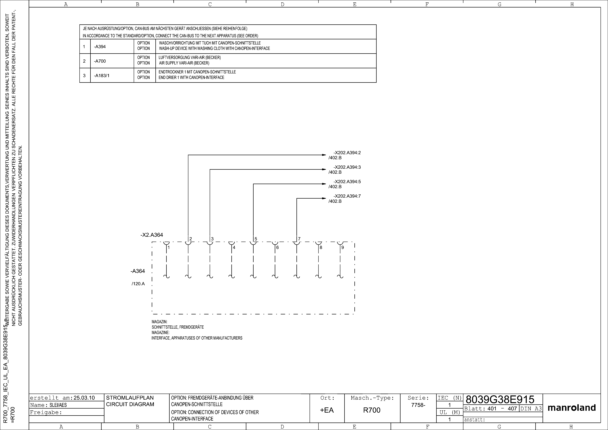

# +EA — Sheet 401 of 407 — OPTION: FREMDGERÄTE ANBINDUNG ÜBER

**CANOPEN SCHNITTSTELLE**

> Part of the manroland **R700** printing press IEC/UL circuit diagrams.
> Drawing class: **Stromlaufplan / Circuit diagram** (DIN A3).
> Document `+EA` covers the **Printing unit** machine section.

## At a glance

| Field | Value |
|---|---|
| Document | `+EA`  (8039G38E915) |
| Sheet | **401** of 407 |
| Section (DE) | OPTION: FREMDGERÄTE ANBINDUNG ÜBER |
| Section (EN) | CANOPEN SCHNITTSTELLE |
| Section type | CIRCUIT — Circuit diagram |
| Machine type | `R700` |
| Series | `7758` |
| Created | 25.03.10 |
| Replaces | — |
| Columns used | A, B, C, D, E |
| Path numbers | — |
| Labels on sheet | 44 |
| Cross-refs out | 5 |
| Cross-refs in | 14 |

**Previous:** [+EA sheet 400](SHEET_0400.md) · **Next:** [+EA sheet 402](SHEET_0402.md) · **Document TOC:** [_TOC.md](_TOC.md)  (+EA) · **Master TOC:** [all sheets](../_MASTER_TOC.md)

## Sheet image (300 DPI, exact vector render)



_Rendered directly from the PDF vector layer at 300 DPI (1-bit), no OCR and no resampling. Use it to confirm anything ambiguous in the text below._

## Cross-references on this sheet

Each entry is a wire leaving this sheet. The printed token is `/sheet.column`; the link resolves to that sheet inside the same document.

| Ref | Target sheet | Col | Path | Destination on target | Target section | From col |
|---|---|---|---|---|---|---|
| `/402.B` | [+EA sheet 402](SHEET_0402.md) | B | — | — | OPTION: FREMDGERÄTE ANBINDUNG ÜBER | E |
| `/402.B` | [+EA sheet 402](SHEET_0402.md) | B | — | — | OPTION: FREMDGERÄTE ANBINDUNG ÜBER | E |
| `/402.B` | [+EA sheet 402](SHEET_0402.md) | B | — | — | OPTION: FREMDGERÄTE ANBINDUNG ÜBER | E |
| `/402.B` | [+EA sheet 402](SHEET_0402.md) | B | — | — | OPTION: FREMDGERÄTE ANBINDUNG ÜBER | E |
| `/120.A` | [+EA sheet 120](SHEET_0120.md) | A | — | — | SCHNITTSTELLE: FREMDGERÄTE | B |

### Incoming references (sheets that point here)

Every other sheet that sends a wire to this one. `Back-ref` is the token printed on *that* sheet; `Path` is its line number.

| From sheet | Cols | Back-ref | Path | Refs | What continues there |
|---|---|---|---|---|---|
| [+EA#120](SHEET_0120.md) | A | `/120.A` | — | 1 | — |
| [+EA#227](SHEET_0227.md) | A | `/227.A` | — | 9 | — |
| [+EA#402](SHEET_0402.md) | A | `/402.A` | — | 4 | X202.A394:2; X202.A394:3; X202.A394:5; X202.A394:7 |


## Devices on this sheet

| Tag | Class | Class meaning (IEC) | Col | Sub | Terminal | Sign |
|---|---|---|---|---|---|---|
| `A364` | A | Baugruppe / assembly, module, PC board | B | — | — | — |
| `A394` | A | Baugruppe / assembly, module, PC board | A | — | — | — |
| `A700` | A | Baugruppe / assembly, module, PC board | A | — | — | — |
| `A183/1` | A | Baugruppe / assembly, module, PC board | B | 1 | — | — |
| `X2.A364` | — | cross-device reference | B | — | — | — |
| `X202.A394:7` | — | cross-device reference | E | — | 7 | — |
| `X202.A394:5` | — | cross-device reference | E | — | 5 | — |
| `X202.A394:3` | — | cross-device reference | E | — | 3 | — |
| `X202.A394:2` | — | cross-device reference | E | — | 2 | — |

## Potentials / nets

_No named potentials on this sheet._

## Wire-end annotations (grouped as printed)

A wire that continues elsewhere is annotated with a small cluster: the destination description, the path/line number `#NN`, and the `/sheet.column` cross reference. Each row below is one such cluster exactly as it is grouped on the drawing.

| Col | Y | Path | Cross-ref | Text on the wire |
|---|---|---|---|---|
| B | 53.1 | — | — | `JE NACH AUSRÜSTUNG/OPTION, CAN BUS AM NÄCHSTEN GERÄT ANSCHLIESSEN (SIEHE REIHENFOLGE)` |
| B | 67.2 | — | — | `IN ACCORDANCE TO THE STANDARD/OPTION, CONNECT THE CAN BUS TO THE NEXT APPARATUS (SEE ORDER)` |
| B | 81.4 | — | — | `OPTION OPTION` |
| C | 81.4 | — | — | `WASCHVORRICHTUNG MIT TUCH MIT CANOPEN SCHNITTSTELLE WASH UP DEVICE WITH WASHING CLOTH WITH CANOPEN INTERFACE` |
| A | 87.5 | — | — | `1` |
| A | 87.5 | — | — | `A394` |
| B | 109.7 | — | — | `OPTION OPTION` |
| C | 109.8 | — | — | `LUFTVERSORGUNG VARI AIR (BECKER)` |
| A | 115.8 | — | — | `2` |
| A | 115.8 | — | — | `A700` |
| C | 120.4 | — | — | `AIR SUPPLY VARI AIR (BECKER)` |
| B | 138.1 | — | — | `OPTION OPTION` |
| C | 138.1 | — | — | `ENDTROCKNER 1 MIT CANOPEN SCHNITTSTELLE END DRIER 1 WITH CANOPEN INTERFACE` |
| A | 144.2 | — | — | `3` |
| B | 144.2 | — | — | `A183/1` |
| E | 295.1 | — | — | `X202.A394:2` |
| E | 305.0 | — | `/402.B` | — |
| E | 323.4 | — | — | `X202.A394:3` |
| E | 333.3 | — | `/402.B` | — |
| E | 351.8 | — | — | `X202.A394:5` |
| E | 361.7 | — | `/402.B` | — |
| E | 380.1 | — | — | `X202.A394:7` |
| E | 390.0 | — | `/402.B` | — |
| B | 455.3 | — | — | `X2.A364 2` |
| C | 463.8 | — | — | `3` |
| D | 463.8 | — | — | `5` |
| D | 463.8 | — | — | `7` |
| B | 480.8 | — | — | `1` |
| D | 480.8 | — | — | `4 6` |
| E | 480.8 | — | — | `8 9` |
| B | 526.1 | — | — | `A364` |
| B | 551.6 | — | `/120.A` | — |
| C | 627.1 | — | — | `INTERFACE, APPARATUSES OF OTHER MANUFACTURERS MAGAZIN: MAGAZINE: SCHNITTSTELLE, FREMDGERÄTE` |


## Reconstructed tables

This sheet carries tabular content (pin map / terminal assignment / index). The grid below was rebuilt from the drawing's own rule lines, so each row is exactly one physical row of the table.

### Table 1 — 3 data rows × 8 columns (at x=155.9, y=48.2)

| JE IN | NACH AUSRÜSTUNG/OPTION, ACCORDANCE TO THE | CAN BUS AM STANDARD/OPTION, | NÄCHSTEN CONNECT | GERÄT THE CAN BUS | ANSCHLIESSEN TO THE | (SIEHE NEXT APPARATUS | REIHENFOLGE) (SEE ORDER) |
|---|---|---|---|---|---|---|---|
| `1` | `A394` | `OPTION OPTION` |  | `WASCHVORRICHTUNG WASH UP DEVICE` | `MIT TUCH WITH WASHING` | `MIT CLOTH WITH` | `CANOPEN SCHNITTSTELLE CANOPEN INTERFACE` |
| `2` | `A700` | `OPTION OPTION` | `AIR` | `LUFTVERSORGUNG SUPPLY VARI AIR` | `VARI AIR (BECKER)` | `(BECKER)` |  |
| `3` | `A183/1` | `OPTION OPTION` | `END` | `ENDTROCKNER 1 DRIER 1 WITH` | `MIT CANOPEN INTERFACE` | `CANOPEN SCHNITTSTELLE` |  |


### Table 2 — 2 data rows × 2 columns (at x=623.6, y=48.2) — **X202.A394:2**

| /402.B | X202.A394:3 |
|---|---|
| `/402.B` | `X202.A394:5` |
| `/402.B` | `X202.A394:7` |


## Notes and free text on this sheet

| Text | Col | Y (pt) |
|---|---|---|
| `MAGAZIN:` | B | 627.06 |
| `SCHNITTSTELLE, FREMDGERÄTE` | C | 637.72 |
| `MAGAZINE:` | B | 648.32 |
| `INTERFACE, APPARATUSES OF OTHER MANUFACTURERS` | C | 658.98 |
| `OPTION` | B | 81.38 |
| `IN ACCORDANCE TO THE STANDARD/OPTION, CONNECT THE CAN BUS TO THE NEXT APPARATUS (SEE ORDER)` | B | 67.25 |
| `JE NACH AUSRÜSTUNG/OPTION, CAN BUS AM NÄCHSTEN GERÄT ANSCHLIESSEN (SIEHE REIHENFOLGE)` | B | 53.07 |
| `WASCHVORRICHTUNG MIT TUCH MIT CANOPEN SCHNITTSTELLE` | C | 81.43 |
| `WASH UP DEVICE WITH WASHING CLOTH WITH CANOPEN INTERFACE` | C | 92.02 |
| `ENDTROCKNER 1 MIT CANOPEN SCHNITTSTELLE` | C | 138.12 |
| `END DRIER 1 WITH CANOPEN INTERFACE` | C | 148.73 |
| `LUFTVERSORGUNG VARI AIR (BECKER)` | C | 109.77 |
| `AIR SUPPLY VARI AIR (BECKER)` | C | 120.39 |

## Complete label inventory (exact text from the drawing)

Every text object inside the drawing area of this sheet, in DIN reading order (column A→H, then top→bottom). This is the authoritative list: if a string is not here it is not printed on this sheet.

| Col | Y | X | Dir | Type | Text |
|---|---|---|---|---|---|
| A | 87.5 | 162.1 | → | number | `1` |
| A | 87.5 | 184.0 | → | device tag | `A394` |
| A | 115.8 | 162.7 | → | number | `2` |
| A | 115.8 | 184.0 | → | device tag | `A700` |
| A | 144.2 | 162.7 | → | number | `3` |
| B | 53.1 | 162.7 | → | text | `JE NACH AUSRÜSTUNG/OPTION, CAN BUS AM NÄCHSTEN GERÄT ANSCHLIESSEN (SIEHE REIHENFOLGE)` |
| B | 67.2 | 162.1 | → | text | `IN ACCORDANCE TO THE STANDARD/OPTION, CONNECT THE CAN BUS TO THE NEXT APPARATUS (SEE ORDER)` |
| B | 81.4 | 269.0 | → | text | `OPTION` |
| B | 92.0 | 269.0 | → | text | `OPTION` |
| B | 109.7 | 269.0 | → | text | `OPTION` |
| B | 120.4 | 269.0 | → | text | `OPTION` |
| B | 138.1 | 269.0 | → | text | `OPTION` |
| B | 144.2 | 184.0 | → | device tag | `A183/1` |
| B | 148.7 | 269.0 | → | text | `OPTION` |
| B | 455.3 | 275.2 | → | device ref | `X2.A364` |
| B | 480.8 | 328.0 | → | number | `1` |
| B | 526.1 | 255.7 | → | device tag | `A364` |
| B | 551.6 | 258.0 | → | cross-reference | `/120.A` |
| B | 627.1 | 297.1 | → | text | `MAGAZIN:` |
| B | 648.3 | 297.1 | → | text | `MAGAZINE:` |
| C | 81.4 | 311.8 | → | text | `WASCHVORRICHTUNG MIT TUCH MIT CANOPEN SCHNITTSTELLE` |
| C | 92.0 | 311.8 | → | text | `WASH UP DEVICE WITH WASHING CLOTH WITH CANOPEN INTERFACE` |
| C | 109.8 | 311.0 | → | text | `LUFTVERSORGUNG VARI AIR (BECKER)` |
| C | 120.4 | 311.8 | → | text | `AIR SUPPLY VARI AIR (BECKER)` |
| C | 138.1 | 311.0 | → | text | `ENDTROCKNER 1 MIT CANOPEN SCHNITTSTELLE` |
| C | 148.7 | 311.0 | → | text | `END DRIER 1 WITH CANOPEN INTERFACE` |
| C | 463.8 | 371.1 | → | number | `2` |
| C | 463.8 | 413.6 | → | number | `3` |
| C | 480.8 | 456.1 | → | number | `4` |
| C | 637.7 | 297.4 | → | text | `SCHNITTSTELLE, FREMDGERÄTE` |
| C | 659.0 | 296.8 | → | text | `INTERFACE, APPARATUSES OF OTHER MANUFACTURERS` |
| D | 463.8 | 498.6 | → | number | `5` |
| D | 463.8 | 583.7 | → | number | `7` |
| D | 480.8 | 541.1 | → | number | `6` |
| E | 295.1 | 653.1 | → | device ref | `X202.A394:2` |
| E | 305.0 | 643.5 | → | cross-reference | `/402.B` |
| E | 323.4 | 653.1 | → | device ref | `X202.A394:3` |
| E | 333.3 | 643.5 | → | cross-reference | `/402.B` |
| E | 351.8 | 653.1 | → | device ref | `X202.A394:5` |
| E | 361.7 | 643.5 | → | cross-reference | `/402.B` |
| E | 380.1 | 653.1 | → | device ref | `X202.A394:7` |
| E | 390.0 | 643.5 | → | cross-reference | `/402.B` |
| E | 480.8 | 626.2 | → | number | `8` |
| E | 480.8 | 668.7 | → | number | `9` |

## Reading-order text block

The same content as a plain block, grouped by DIN column — convenient to paste or to match against a visual description.

```text
=== Column A ===
  87.5  162.1  numeric      1
  87.5  184.0  devtag       A394
 115.8  162.7  numeric      2
 115.8  184.0  devtag       A700
 144.2  162.7  numeric      3
=== Column B ===
  53.1  162.7  text         JE NACH AUSRÜSTUNG/OPTION, CAN BUS AM NÄCHSTEN GERÄT ANSCHLIESSEN (SIEHE REIHENFOLGE)
  67.2  162.1  text         IN ACCORDANCE TO THE STANDARD/OPTION, CONNECT THE CAN BUS TO THE NEXT APPARATUS (SEE ORDER)
  81.4  269.0  text         OPTION
  92.0  269.0  text         OPTION
 109.7  269.0  text         OPTION
 120.4  269.0  text         OPTION
 138.1  269.0  text         OPTION
 144.2  184.0  devtag       A183/1
 148.7  269.0  text         OPTION
 455.3  275.2  devref       X2.A364
 480.8  328.0  numeric      1
 526.1  255.7  devtag       A364
 551.6  258.0  xref         /120.A
 627.1  297.1  text         MAGAZIN:
 648.3  297.1  text         MAGAZINE:
=== Column C ===
  81.4  311.8  text         WASCHVORRICHTUNG MIT TUCH MIT CANOPEN SCHNITTSTELLE
  92.0  311.8  text         WASH UP DEVICE WITH WASHING CLOTH WITH CANOPEN INTERFACE
 109.8  311.0  text         LUFTVERSORGUNG VARI AIR (BECKER)
 120.4  311.8  text         AIR SUPPLY VARI AIR (BECKER)
 138.1  311.0  text         ENDTROCKNER 1 MIT CANOPEN SCHNITTSTELLE
 148.7  311.0  text         END DRIER 1 WITH CANOPEN INTERFACE
 463.8  371.1  numeric      2
 463.8  413.6  numeric      3
 480.8  456.1  numeric      4
 637.7  297.4  text         SCHNITTSTELLE, FREMDGERÄTE
 659.0  296.8  text         INTERFACE, APPARATUSES OF OTHER MANUFACTURERS
=== Column D ===
 463.8  498.6  numeric      5
 463.8  583.7  numeric      7
 480.8  541.1  numeric      6
=== Column E ===
 295.1  653.1  devref       X202.A394:2
 305.0  643.5  xref         /402.B
 323.4  653.1  devref       X202.A394:3
 333.3  643.5  xref         /402.B
 351.8  653.1  devref       X202.A394:5
 361.7  643.5  xref         /402.B
 380.1  653.1  devref       X202.A394:7
 390.0  643.5  xref         /402.B
 480.8  626.2  numeric      8
 480.8  668.7  numeric      9
```

---
_Generated from the PDF vector text layer; no OCR. Source: `R700_7758_IEC_UL_EA_8039G38E915_p`, sheet 401._
