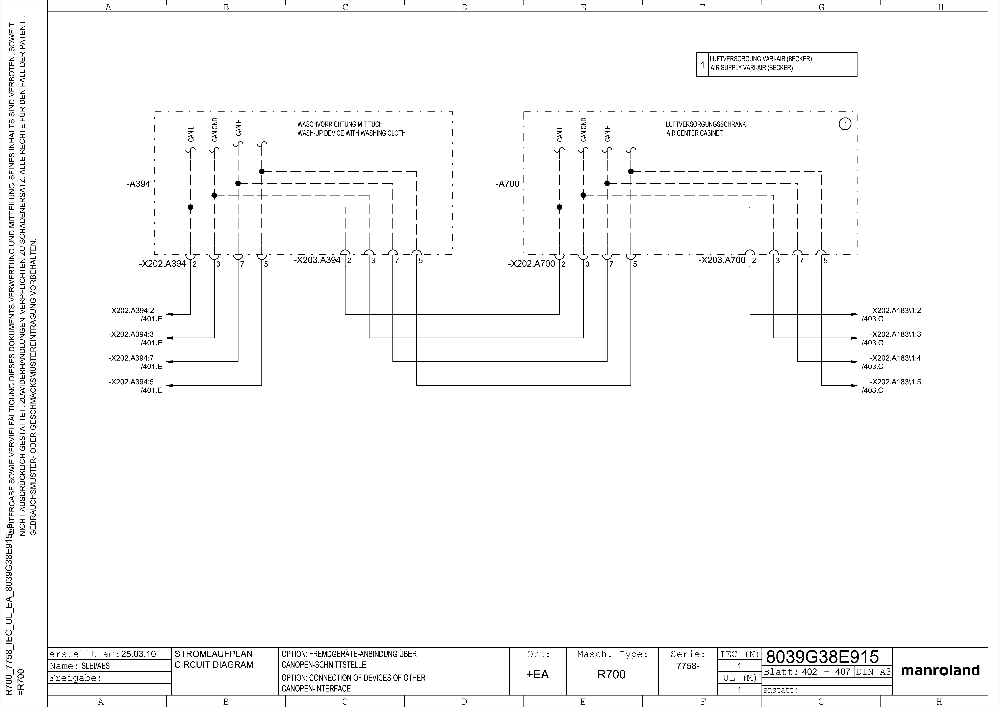

# +EA — Sheet 402 of 407 — OPTION: FREMDGERÄTE ANBINDUNG ÜBER

**CANOPEN SCHNITTSTELLE**

> Part of the manroland **R700** printing press IEC/UL circuit diagrams.
> Drawing class: **Stromlaufplan / Circuit diagram** (DIN A3).
> Document `+EA` covers the **Printing unit** machine section.

## At a glance

| Field | Value |
|---|---|
| Document | `+EA`  (8039G38E915) |
| Sheet | **402** of 407 |
| Section (DE) | OPTION: FREMDGERÄTE ANBINDUNG ÜBER |
| Section (EN) | CANOPEN SCHNITTSTELLE |
| Section type | CIRCUIT — Circuit diagram |
| Machine type | `R700` |
| Series | `7758` |
| Created | 25.03.10 |
| Replaces | — |
| Columns used | A, B, C, D, E, F, G, H |
| Path numbers | — |
| Labels on sheet | 52 |
| Cross-refs out | 8 |
| Cross-refs in | 24 |

**Previous:** [+EA sheet 401](SHEET_0401.md) · **Next:** [+EA sheet 403](SHEET_0403.md) · **Document TOC:** [_TOC.md](_TOC.md)  (+EA) · **Master TOC:** [all sheets](../_MASTER_TOC.md)

## Sheet image (300 DPI, exact vector render)



_Rendered directly from the PDF vector layer at 300 DPI (1-bit), no OCR and no resampling. Use it to confirm anything ambiguous in the text below._

## Cross-references on this sheet

Each entry is a wire leaving this sheet. The printed token is `/sheet.column`; the link resolves to that sheet inside the same document.

| Ref | Target sheet | Col | Path | Destination on target | Target section | From col |
|---|---|---|---|---|---|---|
| `/401.E` | [+EA sheet 401](SHEET_0401.md) | E | — | X202.A394:2 | OPTION: FREMDGERÄTE ANBINDUNG ÜBER | A |
| `/403.C` | [+EA sheet 403](SHEET_0403.md) | C | — | — | OPTION: FREMDGERÄTE ANBINDUNG ÜBER | G |
| `/401.E` | [+EA sheet 401](SHEET_0401.md) | E | — | X202.A394:3 | OPTION: FREMDGERÄTE ANBINDUNG ÜBER | A |
| `/403.C` | [+EA sheet 403](SHEET_0403.md) | C | — | — | OPTION: FREMDGERÄTE ANBINDUNG ÜBER | G |
| `/401.E` | [+EA sheet 401](SHEET_0401.md) | E | — | X202.A394:7 | OPTION: FREMDGERÄTE ANBINDUNG ÜBER | A |
| `/403.C` | [+EA sheet 403](SHEET_0403.md) | C | — | — | OPTION: FREMDGERÄTE ANBINDUNG ÜBER | G |
| `/401.E` | [+EA sheet 401](SHEET_0401.md) | E | — | X202.A394:5 | OPTION: FREMDGERÄTE ANBINDUNG ÜBER | A |
| `/403.C` | [+EA sheet 403](SHEET_0403.md) | C | — | — | OPTION: FREMDGERÄTE ANBINDUNG ÜBER | G |

### Incoming references (sheets that point here)

Every other sheet that sends a wire to this one. `Back-ref` is the token printed on *that* sheet; `Path` is its line number.

| From sheet | Cols | Back-ref | Path | Refs | What continues there |
|---|---|---|---|---|---|
| [+EA#287](SHEET_0287.md) | A, D | `/287.A`, `/287.D` | — | 16 | — |
| [+EA#401](SHEET_0401.md) | E | `/401.E` | — | 4 | — |
| [+EA#403](SHEET_0403.md) | C | `/403.C` | — | 4 | X202.A183\1:2; X202.A183\1:3; X202.A183\1:4; X202.A183\1:5 |


## Devices on this sheet

| Tag | Class | Class meaning (IEC) | Col | Sub | Terminal | Sign |
|---|---|---|---|---|---|---|
| `A394` | A | Baugruppe / assembly, module, PC board | A | — | — | — |
| `A700` | A | Baugruppe / assembly, module, PC board | D | — | — | — |
| `X203.A394` | — | cross-device reference | C | — | — | — |
| `X202.A394` | — | cross-device reference | A | — | — | — |
| `X202.A700` | — | cross-device reference | E | — | — | — |
| `X203.A700` | — | cross-device reference | F | — | — | — |
| `X202.A394:7` | — | cross-device reference | A | — | 7 | — |
| `X202.A394:5` | — | cross-device reference | A | — | 5 | — |
| `X202.A394:3` | — | cross-device reference | A | — | 3 | — |
| `X202.A394:2` | — | cross-device reference | A | — | 2 | — |
| `X202.A183\1:5` | — | cross-device reference | H | — | 5 | — |
| `X202.A183\1:3` | — | cross-device reference | H | — | 3 | — |
| `X202.A183\1:2` | — | cross-device reference | H | — | 2 | — |
| `X202.A183\1:4` | — | cross-device reference | H | — | 4 | — |

## Potentials / nets

_No named potentials on this sheet._

## Wire-end annotations (grouped as printed)

A wire that continues elsewhere is annotated with a small cluster: the destination description, the path/line number `#NN`, and the `/sheet.column` cross reference. Each row below is one such cluster exactly as it is grouped on the drawing.

| Col | Y | Path | Cross-ref | Text on the wire |
|---|---|---|---|---|
| F | 67.2 | — | — | `LUFTVERSORGUNG VARI AIR (BECKER)` |
| F | 72.5 | — | — | `1 AIR SUPPLY VARI AIR (BECKER)` |
| B | 140.2 | — | — | `CAN GND` |
| E | 140.2 | — | — | `CAN GND` |
| B | 142.2 | — | — | `CAN H` |
| G | 144.3 | — | — | `1` |
| C | 145.2 | — | — | `WASCHVORRICHTUNG MIT TUCH WASH UP DEVICE WITH WASHING CLOTH` |
| F | 145.2 | — | — | `LUFTVERSORGUNGSSCHRANK` |
| E | 149.3 | — | — | `CAN H` |
| B | 150.5 | — | — | `CAN L` |
| E | 150.5 | — | — | `CAN L` |
| F | 155.8 | — | — | `AIR CENTER CABINET` |
| A | 214.3 | — | — | `A394` |
| D | 214.3 | — | — | `A700` |
| B | 305.0 | — | — | `X202.A394 2 3 7 X203.A394 2 3 7` |
| F | 305.0 | — | — | `5 X203.A700 2 3 7 5` |
| D | 306.5 | — | — | `5 5 X202.A700 2 3 7` |
| H | 365.9 | — | — | `X202.A183\1:2` |
| A | 366.0 | — | `/401.E` | `X202.A394:2` |
| G | 375.9 | — | `/403.C` | — |
| A | 394.3 | — | `/401.E` | `X202.A394:3` |
| H | 394.3 | — | — | `X202.A183\1:3` |
| G | 404.2 | — | `/403.C` | — |
| A | 422.6 | — | `/401.E` | `X202.A394:7` |
| H | 422.6 | — | — | `X202.A183\1:4` |
| G | 432.6 | — | `/403.C` | — |
| A | 451.0 | — | `/401.E` | `X202.A394:5` |
| H | 451.0 | — | — | `X202.A183\1:5` |
| G | 460.9 | — | `/403.C` | — |


## Reconstructed tables

This sheet carries tabular content (pin map / terminal assignment / index). The grid below was rebuilt from the drawing's own rule lines, so each row is exactly one physical row of the table.

### Table 1 — 5 data rows × 23 columns (at x=204.1, y=0.0) — **L CAN GND CAN H CAN WASCHVORRICHTUNG WASH UP DEVICE MIT WITH TUCH WASHING CLOTH 1 AIR LUFTVERSORGUNGSSCHRANK AIR CENTER CABINET LUFTVERSORGUNG SUPPLY VARI AIR VARI AIR (BECKER) (BECKER) 1 A700 2 3 7 5 X203.A394 X202.A700 X203.A700 /403.C**

|  | STROMLAUFPLAN |  |  |  | OPTION: | FREMDGERÄTE ANBINDUNG |  | ÜBER |  | Ort: |  |  |  | Masch. Type: |  | Serie: | IEC | (N) |  |  |  | 8039G38E915 |
|---|---|---|---|---|---|---|---|---|---|---|---|---|---|---|---|---|---|---|---|---|---|---|
|  | `CIRCUIT` | `DIAGRAM` |  |  |  |  |  |  |  |  |  |  |  |  |  |  |  |  |  |  |  |  |
|  |  |  |  |  | `CANOPEN SCHNITTSTELLE` |  |  |  |  |  |  |  |  |  |  | `7758` | `1` |  |  |  |  |  |
|  |  |  |  |  |  |  |  |  |  | `+EA` |  |  |  | `R700` |  |  |  |  |  | `Blatt:` | `402` | `DIN A3 407` |
|  |  |  |  |  | `OPTION: CONNECTION` | `OF` | `DEVICES` | `OF OTHER` |  |  |  |  |  |  |  |  | `UL (M)` |  |  |  |  |  |
|  |  |  |  |  | `CANOPEN INTERFACE` |  |  |  |  |  |  |  |  |  |  |  | `1` |  |  | `anstatt:` |  |  |


## Notes and free text on this sheet

| Text | Col | Y (pt) |
|---|---|---|
| `WASCHVORRICHTUNG MIT TUCH` | C | 145.2 |
| `WASH UP DEVICE WITH WASHING CLOTH` | C | 155.79 |
| `LUFTVERSORGUNGSSCHRANK` | F | 145.21 |
| `AIR CENTER CABINET` | F | 155.83 |
| `CAN L` | B | 150.47 |
| `CAN GND` | B | 140.2 |
| `CAN H` | B | 142.21 |
| `CAN L` | E | 150.47 |
| `CAN GND` | E | 140.2 |
| `CAN H` | E | 149.3 |
| `LUFTVERSORGUNG VARI AIR (BECKER)` | F | 67.25 |
| `AIR SUPPLY VARI AIR (BECKER)` | F | 77.87 |

## Complete label inventory (exact text from the drawing)

Every text object inside the drawing area of this sheet, in DIN reading order (column A→H, then top→bottom). This is the authoritative list: if a string is not here it is not printed on this sheet.

| Col | Y | X | Dir | Type | Text |
|---|---|---|---|---|---|
| A | 214.3 | 150.8 | → | device tag | `A394` |
| A | 309.3 | 165.5 | → | device ref | `X202.A394` |
| A | 366.0 | 129.8 | → | device ref | `X202.A394:2` |
| A | 375.9 | 167.8 | → | cross-reference | `/401.E` |
| A | 394.3 | 129.5 | → | device ref | `X202.A394:3` |
| A | 404.2 | 167.8 | → | cross-reference | `/401.E` |
| A | 422.6 | 129.5 | → | device ref | `X202.A394:7` |
| A | 432.5 | 167.8 | → | cross-reference | `/401.E` |
| A | 451.0 | 129.5 | → | device ref | `X202.A394:5` |
| A | 460.9 | 167.8 | → | cross-reference | `/401.E` |
| B | 140.2 | 252.9 | ↕ | text | `CAN GND` |
| B | 142.2 | 281.2 | ↕ | text | `CAN H` |
| B | 150.5 | 224.6 | ↕ | text | `CAN L` |
| B | 310.7 | 229.3 | → | number | `2` |
| B | 310.7 | 257.7 | → | number | `3` |
| B | 310.7 | 286.0 | → | number | `7` |
| B | 310.7 | 314.4 | → | number | `5` |
| C | 145.2 | 354.3 | → | text | `WASCHVORRICHTUNG MIT TUCH` |
| C | 155.8 | 354.3 | → | text | `WASH UP DEVICE WITH WASHING CLOTH` |
| C | 305.0 | 349.8 | → | device ref | `X203.A394` |
| C | 306.5 | 413.6 | → | number | `2` |
| C | 306.5 | 441.9 | → | number | `3` |
| C | 306.5 | 470.3 | → | number | `7` |
| D | 214.3 | 590.2 | → | device tag | `A700` |
| D | 306.5 | 498.6 | → | number | `5` |
| E | 140.2 | 692.3 | ↕ | text | `CAN GND` |
| E | 149.3 | 720.6 | ↕ | text | `CAN H` |
| E | 150.5 | 663.9 | ↕ | text | `CAN L` |
| E | 309.3 | 604.9 | → | device ref | `X202.A700` |
| E | 310.7 | 668.7 | → | number | `2` |
| E | 310.7 | 697.0 | → | number | `3` |
| E | 310.7 | 725.4 | → | number | `7` |
| E | 310.7 | 753.7 | → | number | `5` |
| F | 67.2 | 845.3 | → | text | `LUFTVERSORGUNG VARI AIR (BECKER)` |
| F | 72.6 | 833.7 | → | number | `1` |
| F | 77.9 | 846.1 | → | text | `AIR SUPPLY VARI AIR (BECKER)` |
| F | 145.2 | 792.9 | → | text | `LUFTVERSORGUNGSSCHRANK` |
| F | 155.8 | 793.7 | → | text | `AIR CENTER CABINET` |
| F | 305.0 | 831.7 | → | device ref | `X203.A700` |
| F | 306.5 | 895.5 | → | number | `2` |
| G | 144.3 | 1004.5 | → | number | `1` |
| G | 306.5 | 923.8 | → | number | `3` |
| G | 306.5 | 952.2 | → | number | `7` |
| G | 306.5 | 980.5 | → | number | `5` |
| G | 375.9 | 1026.1 | → | cross-reference | `/403.C` |
| G | 404.2 | 1026.1 | → | cross-reference | `/403.C` |
| G | 432.6 | 1026.1 | → | cross-reference | `/403.C` |
| G | 460.9 | 1026.1 | → | cross-reference | `/403.C` |
| H | 366.0 | 1035.8 | → | device ref | `X202.A183\1:2` |
| H | 394.3 | 1035.8 | → | device ref | `X202.A183\1:3` |
| H | 422.6 | 1035.8 | → | device ref | `X202.A183\1:4` |
| H | 451.0 | 1035.8 | → | device ref | `X202.A183\1:5` |

## Reading-order text block

The same content as a plain block, grouped by DIN column — convenient to paste or to match against a visual description.

```text
=== Column A ===
 214.3  150.8  devtag       A394
 309.3  165.5  devref       X202.A394
 366.0  129.8  devref       X202.A394:2
 375.9  167.8  xref         /401.E
 394.3  129.5  devref       X202.A394:3
 404.2  167.8  xref         /401.E
 422.6  129.5  devref       X202.A394:7
 432.5  167.8  xref         /401.E
 451.0  129.5  devref       X202.A394:5
 460.9  167.8  xref         /401.E
=== Column B ===
 140.2  252.9  text         CAN GND
 142.2  281.2  text         CAN H
 150.5  224.6  text         CAN L
 310.7  229.3  numeric      2
 310.7  257.7  numeric      3
 310.7  286.0  numeric      7
 310.7  314.4  numeric      5
=== Column C ===
 145.2  354.3  text         WASCHVORRICHTUNG MIT TUCH
 155.8  354.3  text         WASH UP DEVICE WITH WASHING CLOTH
 305.0  349.8  devref       X203.A394
 306.5  413.6  numeric      2
 306.5  441.9  numeric      3
 306.5  470.3  numeric      7
=== Column D ===
 214.3  590.2  devtag       A700
 306.5  498.6  numeric      5
=== Column E ===
 140.2  692.3  text         CAN GND
 149.3  720.6  text         CAN H
 150.5  663.9  text         CAN L
 309.3  604.9  devref       X202.A700
 310.7  668.7  numeric      2
 310.7  697.0  numeric      3
 310.7  725.4  numeric      7
 310.7  753.7  numeric      5
=== Column F ===
  67.2  845.3  text         LUFTVERSORGUNG VARI AIR (BECKER)
  72.6  833.7  numeric      1
  77.9  846.1  text         AIR SUPPLY VARI AIR (BECKER)
 145.2  792.9  text         LUFTVERSORGUNGSSCHRANK
 155.8  793.7  text         AIR CENTER CABINET
 305.0  831.7  devref       X203.A700
 306.5  895.5  numeric      2
=== Column G ===
 144.3 1004.5  numeric      1
 306.5  923.8  numeric      3
 306.5  952.2  numeric      7
 306.5  980.5  numeric      5
 375.9 1026.1  xref         /403.C
 404.2 1026.1  xref         /403.C
 432.6 1026.1  xref         /403.C
 460.9 1026.1  xref         /403.C
=== Column H ===
 366.0 1035.8  devref       X202.A183\1:2
 394.3 1035.8  devref       X202.A183\1:3
 422.6 1035.8  devref       X202.A183\1:4
 451.0 1035.8  devref       X202.A183\1:5
```

---
_Generated from the PDF vector text layer; no OCR. Source: `R700_7758_IEC_UL_EA_8039G38E915_p`, sheet 402._
