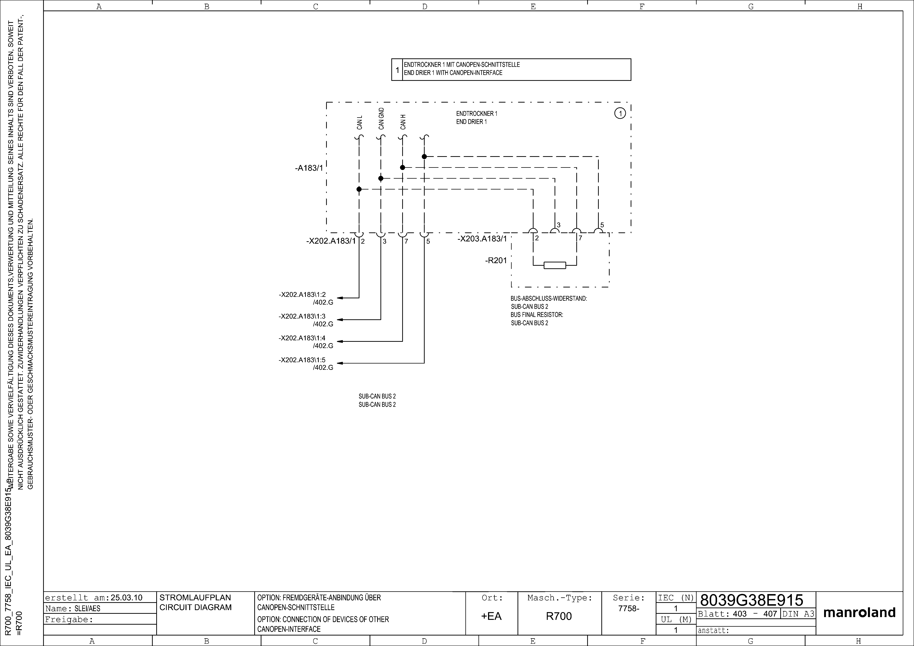

# +EA — Sheet 403 of 407 — OPTION: FREMDGERÄTE ANBINDUNG ÜBER

**CANOPEN SCHNITTSTELLE**

> Part of the manroland **R700** printing press IEC/UL circuit diagrams.
> Drawing class: **Stromlaufplan / Circuit diagram** (DIN A3).
> Document `+EA` covers the **Printing unit** machine section.

## At a glance

| Field | Value |
|---|---|
| Document | `+EA`  (8039G38E915) |
| Sheet | **403** of 407 |
| Section (DE) | OPTION: FREMDGERÄTE ANBINDUNG ÜBER |
| Section (EN) | CANOPEN SCHNITTSTELLE |
| Section type | CIRCUIT — Circuit diagram |
| Machine type | `R700` |
| Series | `7758` |
| Created | 25.03.10 |
| Replaces | — |
| Columns used | C, D, E, F |
| Path numbers | — |
| Labels on sheet | 35 |
| Cross-refs out | 4 |
| Cross-refs in | 10 |

**Previous:** [+EA sheet 402](SHEET_0402.md) · **Next:** [+EA sheet 404](SHEET_0404.md) · **Document TOC:** [_TOC.md](_TOC.md)  (+EA) · **Master TOC:** [all sheets](../_MASTER_TOC.md)

## Sheet image (300 DPI, exact vector render)



_Rendered directly from the PDF vector layer at 300 DPI (1-bit), no OCR and no resampling. Use it to confirm anything ambiguous in the text below._

## Cross-references on this sheet

Each entry is a wire leaving this sheet. The printed token is `/sheet.column`; the link resolves to that sheet inside the same document.

| Ref | Target sheet | Col | Path | Destination on target | Target section | From col |
|---|---|---|---|---|---|---|
| `/402.G` | [+EA sheet 402](SHEET_0402.md) | G | — | X202.A183\1:2 | OPTION: FREMDGERÄTE ANBINDUNG ÜBER | C |
| `/402.G` | [+EA sheet 402](SHEET_0402.md) | G | — | X202.A183\1:3 | OPTION: FREMDGERÄTE ANBINDUNG ÜBER | C |
| `/402.G` | [+EA sheet 402](SHEET_0402.md) | G | — | X202.A183\1:4 | OPTION: FREMDGERÄTE ANBINDUNG ÜBER | C |
| `/402.G` | [+EA sheet 402](SHEET_0402.md) | G | — | X202.A183\1:5 | OPTION: FREMDGERÄTE ANBINDUNG ÜBER | C |

### Incoming references (sheets that point here)

Every other sheet that sends a wire to this one. `Back-ref` is the token printed on *that* sheet; `Path` is its line number.

| From sheet | Cols | Back-ref | Path | Refs | What continues there |
|---|---|---|---|---|---|
| [+EA#286](SHEET_0286.md) | E | `/286.E` | — | 4 | — |
| [+EA#287](SHEET_0287.md) | B | `/287.B` | — | 2 | — |
| [+EA#402](SHEET_0402.md) | G | `/402.G` | — | 4 | — |


## Devices on this sheet

| Tag | Class | Class meaning (IEC) | Col | Sub | Terminal | Sign |
|---|---|---|---|---|---|---|
| `A183/1` | A | Baugruppe / assembly, module, PC board | C | 1 | — | — |
| `R201` | R | Widerstand / resistor | E | — | — | — |
| `X202.A183\1:5` | — | cross-device reference | C | — | 5 | — |
| `X202.A183\1:4` | — | cross-device reference | C | — | 4 | — |
| `X202.A183\1:3` | — | cross-device reference | C | — | 3 | — |
| `X202.A183\1:2` | — | cross-device reference | C | — | 2 | — |

## Potentials / nets

_No named potentials on this sheet._

## Wire-end annotations (grouped as printed)

A wire that continues elsewhere is annotated with a small cluster: the destination description, the path/line number `#NN`, and the `/sheet.column` cross reference. Each row below is one such cluster exactly as it is grouped on the drawing.

| Col | Y | Path | Cross-ref | Text on the wire |
|---|---|---|---|---|
| D | 81.4 | — | — | `1 ENDTROCKNER 1 MIT CANOPEN SCHNITTSTELLE END DRIER 1 WITH CANOPEN INTERFACE` |
| D | 140.2 | — | — | `CAN GND` |
| F | 144.3 | — | — | `1` |
| D | 145.2 | — | — | `ENDTROCKNER 1 END DRIER 1` |
| D | 149.3 | — | — | `CAN H` |
| C | 150.5 | — | — | `CAN L` |
| C | 214.3 | — | — | `A183/1` |
| E | 289.5 | — | — | `3` |
| F | 289.5 | — | — | `5` |
| E | 306.4 | — | — | `X203.A183/1 2 7` |
| C | 309.3 | — | — | `X202.A183/1 2 3 7` |
| D | 310.7 | — | — | `5` |
| E | 334.8 | — | — | `R201` |
| C | 380.1 | — | `/402.G` | `X202.A183\1:2` |
| E | 386.1 | — | — | `BUS ABSCHLUSS WIDERSTAND:` |
| E | 396.8 | — | — | `BUS FINAL RESISTOR: SUB CAN BUS 2` |
| C | 408.5 | — | `/402.G` | `X202.A183\1:3` |
| E | 418.0 | — | — | `SUB CAN BUS 2` |
| C | 436.8 | — | `/402.G` | `X202.A183\1:4` |
| C | 465.2 | — | `/402.G` | `X202.A183\1:5` |
| D | 513.7 | — | — | `SUB CAN BUS 2 SUB CAN BUS 2` |


## Reconstructed tables

This sheet carries tabular content (pin map / terminal assignment / index). The grid below was rebuilt from the drawing's own rule lines, so each row is exactly one physical row of the table.

### Table 1 — 5 data rows × 15 columns (at x=204.1, y=0.0) — **L CAN 1 GND CAN ENDTROCKNER END DRIER H CAN 1 MIT 1 WITH END CANOPEN SCHNITTSTELLE CANOPEN INTERFACE ENDTROCKNER 1 DRIER 1 1 A183/1 X202.A183/1 X202.A183\1:2 /402.G X202.A183\1:3 2 3 7 5 X203.A183/1 R201 BUS SUB CAN FINAL 2 BUS ABSCHLUSS WIDERSTAND: BUS 2 RESISTOR: /402.G X202.A183\1:4 SUB CAN BUS 2 /402.G X202.A183\1:5 /402.G SUB CAN SUB CAN BUS 2 BUS 2**

| STROMLAUFPLAN | OPTION: FREMDGERÄTE ANBINDUNG | ÜBER |  |  |  | Ort: |  |  | Masch. Type: |  |  | Serie: | IEC (N) | 8039G38E915 |
|---|---|---|---|---|---|---|---|---|---|---|---|---|---|---|
| `CIRCUIT DIAGRAM` |  |  |  |  |  |  |  |  |  |  |  |  |  |  |
|  | `CANOPEN SCHNITTSTELLE` |  |  |  |  |  |  |  |  |  |  | `7758` | `1` |  |
|  |  |  |  |  |  | `+EA` |  |  | `R700` |  |  |  |  | `Blatt: DIN A3 403 407` |
|  | `OPTION: CONNECTION OF DEVICES` | `OF OTHER` |  |  |  |  |  |  |  |  |  |  | `UL (M)` |  |
|  | `CANOPEN INTERFACE` |  |  |  |  |  |  |  |  |  |  |  | `1` | `anstatt:` |


## Notes and free text on this sheet

| Text | Col | Y (pt) |
|---|---|---|
| `X202.A183/1` | C | 309.28 |
| `ENDTROCKNER 1` | D | 145.18 |
| `END DRIER 1` | D | 155.79 |
| `BUS ABSCHLUSS WIDERSTAND:` | E | 386.12 |
| `SUB CAN BUS 2` | E | 396.77 |
| `BUS FINAL RESISTOR:` | E | 407.38 |
| `X203.A183/1` | E | 306.45 |
| `CAN L` | C | 150.47 |
| `CAN GND` | D | 140.2 |
| `CAN H` | D | 149.3 |
| `SUB CAN BUS 2` | D | 513.69 |
| `ENDTROCKNER 1 MIT CANOPEN SCHNITTSTELLE` | D | 81.42 |
| `END DRIER 1 WITH CANOPEN INTERFACE` | D | 92.04 |

## Complete label inventory (exact text from the drawing)

Every text object inside the drawing area of this sheet, in DIN reading order (column A→H, then top→bottom). This is the authoritative list: if a string is not here it is not printed on this sheet.

| Col | Y | X | Dir | Type | Text |
|---|---|---|---|---|---|
| C | 150.5 | 465.5 | ↕ | text | `CAN L` |
| C | 214.3 | 384.4 | → | device tag | `A183/1` |
| C | 309.3 | 399.1 | → | text | `X202.A183/1` |
| C | 310.7 | 470.3 | → | number | `2` |
| C | 380.1 | 363.4 | → | device ref | `X202.A183\1:2` |
| C | 390.0 | 407.9 | → | cross-reference | `/402.G` |
| C | 408.5 | 363.1 | → | device ref | `X202.A183\1:3` |
| C | 418.4 | 407.9 | → | cross-reference | `/402.G` |
| C | 436.8 | 363.1 | → | device ref | `X202.A183\1:4` |
| C | 446.7 | 407.9 | → | cross-reference | `/402.G` |
| C | 465.2 | 363.1 | → | device ref | `X202.A183\1:5` |
| C | 475.1 | 407.9 | → | cross-reference | `/402.G` |
| D | 81.4 | 526.4 | → | text | `ENDTROCKNER 1 MIT CANOPEN SCHNITTSTELLE` |
| D | 86.7 | 514.8 | → | number | `1` |
| D | 92.0 | 526.4 | → | text | `END DRIER 1 WITH CANOPEN INTERFACE` |
| D | 140.2 | 493.9 | ↕ | text | `CAN GND` |
| D | 145.2 | 594.4 | → | text | `ENDTROCKNER 1` |
| D | 149.3 | 522.2 | ↕ | text | `CAN H` |
| D | 155.8 | 594.4 | → | text | `END DRIER 1` |
| D | 310.7 | 498.6 | → | number | `3` |
| D | 310.7 | 527.0 | → | number | `7` |
| D | 310.7 | 555.3 | → | number | `5` |
| D | 513.7 | 467.4 | → | text | `SUB CAN BUS 2` |
| D | 524.3 | 467.4 | → | text | `SUB CAN BUS 2` |
| E | 289.5 | 725.4 | → | number | `3` |
| E | 306.4 | 596.1 | → | text | `X203.A183/1` |
| E | 306.5 | 697.0 | → | number | `2` |
| E | 306.5 | 753.7 | → | number | `7` |
| E | 334.8 | 632.1 | → | device tag | `R201` |
| E | 386.1 | 665.3 | → | text | `BUS ABSCHLUSS WIDERSTAND:` |
| E | 396.8 | 665.9 | → | text | `SUB CAN BUS 2` |
| E | 407.4 | 665.3 | → | text | `BUS FINAL RESISTOR:` |
| E | 418.0 | 665.9 | → | text | `SUB CAN BUS 2` |
| F | 144.3 | 806.1 | → | number | `1` |
| F | 289.5 | 782.1 | → | number | `5` |

## Reading-order text block

The same content as a plain block, grouped by DIN column — convenient to paste or to match against a visual description.

```text
=== Column C ===
 150.5  465.5  text         CAN L
 214.3  384.4  devtag       A183/1
 309.3  399.1  text         X202.A183/1
 310.7  470.3  numeric      2
 380.1  363.4  devref       X202.A183\1:2
 390.0  407.9  xref         /402.G
 408.5  363.1  devref       X202.A183\1:3
 418.4  407.9  xref         /402.G
 436.8  363.1  devref       X202.A183\1:4
 446.7  407.9  xref         /402.G
 465.2  363.1  devref       X202.A183\1:5
 475.1  407.9  xref         /402.G
=== Column D ===
  81.4  526.4  text         ENDTROCKNER 1 MIT CANOPEN SCHNITTSTELLE
  86.7  514.8  numeric      1
  92.0  526.4  text         END DRIER 1 WITH CANOPEN INTERFACE
 140.2  493.9  text         CAN GND
 145.2  594.4  text         ENDTROCKNER 1
 149.3  522.2  text         CAN H
 155.8  594.4  text         END DRIER 1
 310.7  498.6  numeric      3
 310.7  527.0  numeric      7
 310.7  555.3  numeric      5
 513.7  467.4  text         SUB CAN BUS 2
 524.3  467.4  text         SUB CAN BUS 2
=== Column E ===
 289.5  725.4  numeric      3
 306.4  596.1  text         X203.A183/1
 306.5  697.0  numeric      2
 306.5  753.7  numeric      7
 334.8  632.1  devtag       R201
 386.1  665.3  text         BUS ABSCHLUSS WIDERSTAND:
 396.8  665.9  text         SUB CAN BUS 2
 407.4  665.3  text         BUS FINAL RESISTOR:
 418.0  665.9  text         SUB CAN BUS 2
=== Column F ===
 144.3  806.1  numeric      1
 289.5  782.1  numeric      5
```

---
_Generated from the PDF vector text layer; no OCR. Source: `R700_7758_IEC_UL_EA_8039G38E915_p`, sheet 403._
