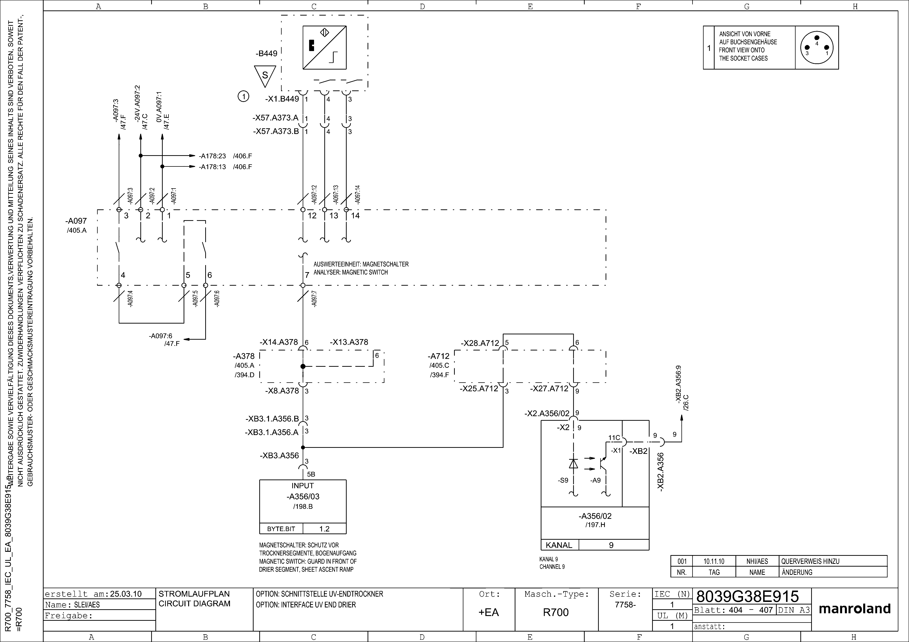

# +EA — Sheet 404 of 407 — OPTION: SCHNITTSTELLE UV ENDTROCKNER

**OPTION: INTERFACE UV END DRIER**

> Part of the manroland **R700** printing press IEC/UL circuit diagrams.
> Drawing class: **Stromlaufplan / Circuit diagram** (DIN A3).
> Document `+EA` covers the **Printing unit** machine section.

## At a glance

| Field | Value |
|---|---|
| Document | `+EA`  (8039G38E915) |
| Sheet | **404** of 407 |
| Section (DE) | OPTION: SCHNITTSTELLE UV ENDTROCKNER |
| Section (EN) | OPTION: INTERFACE UV END DRIER |
| Section type | CIRCUIT — Circuit diagram |
| Machine type | `R700` |
| Series | `7758` |
| Created | 25.03.10 |
| Replaces | — |
| Columns used | A, B, C, D, E, F, G, H |
| Path numbers | — |
| Labels on sheet | 122 |
| Cross-refs out | 14 |
| Cross-refs in | 35 |

**Previous:** [+EA sheet 403](SHEET_0403.md) · **Next:** [+EA sheet 405](SHEET_0405.md) · **Document TOC:** [_TOC.md](_TOC.md)  (+EA) · **Master TOC:** [all sheets](../_MASTER_TOC.md)

## Sheet image (300 DPI, exact vector render)



_Rendered directly from the PDF vector layer at 300 DPI (1-bit), no OCR and no resampling. Use it to confirm anything ambiguous in the text below._

## Cross-references on this sheet

Each entry is a wire leaving this sheet. The printed token is `/sheet.column`; the link resolves to that sheet inside the same document.

| Ref | Target sheet | Col | Path | Destination on target | Target section | From col |
|---|---|---|---|---|---|---|
| `/47.C` | [+EA sheet 47](SHEET_0047.md) | C | — | 24V.A097:2 | SCHUTZ | A |
| `/47.E` | [+EA sheet 47](SHEET_0047.md) | E | — | 0V.A097:1 | SCHUTZ | B |
| `/47.F` | [+EA sheet 47](SHEET_0047.md) | F | — | A097:3 | SCHUTZ | A |
| `/406.F` | [+EA sheet 406](SHEET_0406.md) | F | — | A178:23 | OPTION: SCHNITTSTELLE UV ENDTROCKNER | B |
| `/406.F` | [+EA sheet 406](SHEET_0406.md) | F | — | A178:13 | OPTION: SCHNITTSTELLE UV ENDTROCKNER | B |
| `/405.A` | [+EA sheet 405](SHEET_0405.md) | A | — | — | OPTION: SCHNITTSTELLE UV ENDTROCKNER | A |
| `/47.F` | [+EA sheet 47](SHEET_0047.md) | F | — | A097:6 | SCHUTZ | B |
| `/405.A` | [+EA sheet 405](SHEET_0405.md) | A | — | — | OPTION: SCHNITTSTELLE UV ENDTROCKNER | B |
| `/394.D` | [+EA sheet 394](SHEET_0394.md) | D | — | — | OPTION: ZWISCHENTROCKNER VORBEREITUNG; | B |
| `/405.C` | [+EA sheet 405](SHEET_0405.md) | C | — | — | OPTION: SCHNITTSTELLE UV ENDTROCKNER | D |
| `/26.C` | [+EA sheet 26](SHEET_0026.md) | C | — | XB2.A356:9 | BUSVERBINDUNGEN: SICHERHEITSBUS | F |
| `/394.F` | [+EA sheet 394](SHEET_0394.md) | F | — | — | OPTION: ZWISCHENTROCKNER VORBEREITUNG; | D |
| `/198.B` | [+EA sheet 198](SHEET_0198.md) | B | — | — | REFERENZMODUL | C |
| `/197.H` | [+EA sheet 197](SHEET_0197.md) | H | — | — | REFERENZMODUL | F |

### Incoming references (sheets that point here)

Every other sheet that sends a wire to this one. `Back-ref` is the token printed on *that* sheet; `Path` is its line number.

| From sheet | Cols | Back-ref | Path | Refs | What continues there |
|---|---|---|---|---|---|
| [+EA#26](SHEET_0026.md) | C | `/26.C` | — | 1 | XB2.A356:9 |
| [+EA#47](SHEET_0047.md) | C, D, F | `/47.C`, `/47.D`, `/47.F` | — | 4 | 0V.A097:1; 24V.A097:2 |
| [+EA#197](SHEET_0197.md) | H | `/197.H` | — | 1 | — |
| [+EA#198](SHEET_0198.md) | B | `/198.B` | — | 1 | — |
| [+EA#217](SHEET_0217.md) | H | `/217.H` | — | 3 | — |
| [+EA#225](SHEET_0225.md) | F | `/225.F` | — | 1 | — |
| [+EA#226](SHEET_0226.md) | E | `/226.E` | — | 1 | — |
| [+EA#234](SHEET_0234.md) | H | `/234.H` | — | 1 | — |
| [+EA#235](SHEET_0235.md) | A, B | `/235.A`, `/235.B` | — | 2 | — |
| [+EA#250](SHEET_0250.md) | D | `/250.D` | — | 1 | — |
| [+EA#259](SHEET_0259.md) | A | `/259.A` | — | 1 | — |
| [+EA#260](SHEET_0260.md) | A | `/260.A` | — | 1 | — |
| [+EA#268](SHEET_0268.md) | F | `/268.F` | — | 1 | — |
| [+EA#271](SHEET_0271.md) | G | `/271.G` | — | 1 | — |
| [+EA#273](SHEET_0273.md) | C | `/273.C` | — | 2 | — |
| [+EA#283](SHEET_0283.md) | E | `/283.E` | — | 6 | — |
| [+EA#394](SHEET_0394.md) | D, F | `/394.D`, `/394.F` | — | 2 | — |
| [+EA#405](SHEET_0405.md) | A, B | `/405.A`, `/405.B` | — | 3 | — |
| [+EA#406](SHEET_0406.md) | F | `/406.F` | — | 2 | A178:13; A178:23 |


## Devices on this sheet

| Tag | Class | Class meaning (IEC) | Col | Sub | Terminal | Sign |
|---|---|---|---|---|---|---|
| `A378` | A | Baugruppe / assembly, module, PC board | B | — | — | — |
| `B449` | B | Umformer / transducer, sensor | C | — | — | — |
| `A356/03` | A | Baugruppe / assembly, module, PC board | C | 03 | — | — |
| `S9` | S | Schalter / switch | E | — | — | — |
| `A9` | A | Baugruppe / assembly, module, PC board | F | — | — | — |
| `X1` | X | Klemme / terminal, plug connector | F | — | — | — |
| `X2` | X | Klemme / terminal, plug connector | E | — | — | — |
| `XB2` | XB |  | F | — | — | — |
| `A356/02` | A | Baugruppe / assembly, module, PC board | F | 02 | — | — |
| `A712` | A | Baugruppe / assembly, module, PC board | D | — | — | — |
| `A097` | A | Baugruppe / assembly, module, PC board | A | — | — | — |
| `A097:6` | A | Baugruppe / assembly, module, PC board | B | — | 6 | — |
| `A097:3` | A | Baugruppe / assembly, module, PC board | A | — | 3 | — |
| `A178:13` | A | Baugruppe / assembly, module, PC board | B | — | 13 | — |
| `A178:23` | A | Baugruppe / assembly, module, PC board | B | — | 23 | — |
| `A097:12` | A | Baugruppe / assembly, module, PC board | C | — | 12 | — |
| `A097:14` | A | Baugruppe / assembly, module, PC board | C | — | 14 | — |
| `A097:13` | A | Baugruppe / assembly, module, PC board | C | — | 13 | — |
| `A097:7` | A | Baugruppe / assembly, module, PC board | C | — | 7 | — |
| `A097:2` | A | Baugruppe / assembly, module, PC board | B | — | 2 | — |
| `A097:3` | A | Baugruppe / assembly, module, PC board | A | — | 3 | — |
| `A097:4` | A | Baugruppe / assembly, module, PC board | A | — | 4 | — |
| `A097:1` | A | Baugruppe / assembly, module, PC board | B | — | 1 | — |
| `A097:5` | A | Baugruppe / assembly, module, PC board | B | — | 5 | — |
| `A097:6` | A | Baugruppe / assembly, module, PC board | B | — | 6 | — |
| `X14.A378` | — | cross-device reference | C | — | — | — |
| `X1.B449` | — | cross-device reference | C | — | — | — |
| `X57.A373.B` | — | cross-device reference | C | — | — | — |
| `X57.A373.A` | — | cross-device reference | C | — | — | — |
| `XB3.1.A356.B` | — | cross-device reference | C | — | — | — |
| `XB3.1.A356.A` | — | cross-device reference | C | — | — | — |
| `1.2` | — | cross-device reference | C | — | — | — |
| `XB3.A356` | — | cross-device reference | C | — | — | — |
| `X8.A378` | — | cross-device reference | C | — | — | — |
| `XB2.A356` | — | cross-device reference | F | — | — | — |
| `X28.A712` | — | cross-device reference | E | — | — | — |
| `X27.A712` | — | cross-device reference | E | — | — | — |
| `X25.A712` | — | cross-device reference | E | — | — | — |
| `NR.` | — | cross-device reference | F | — | — | — |
| `10.11.10` | — | cross-device reference | G | — | — | — |
| `XB2.A356:9` | — | cross-device reference | F | — | 9 | — |
| `X13.A378` | — | cross-device reference | C | — | — | — |

## Potentials / nets

| Potential | Count | Columns | Attached devices | Terminals |
|---|---|---|---|---|
| `0V` | 1 | B | `A097` | `1` |
| `24V` | 1 | A | `A097` | `2` |


A potential such as `L24+/4` or `M24+` is a named supply/return rail; every place it appears on this sheet is electrically common.

## Wire-end annotations (grouped as printed)

A wire that continues elsewhere is annotated with a small cluster: the destination description, the path/line number `#NN`, and the `/sheet.column` cross reference. Each row below is one such cluster exactly as it is grouped on the drawing.

| Col | Y | Path | Cross-ref | Text on the wire |
|---|---|---|---|---|
| G | 41.7 | — | — | `FRONT VIEW ONTO ANSICHT VON VORNE AUF BUCHSENGEHÄUSE` |
| H | 54.0 | — | — | `4` |
| G | 58.4 | — | — | `1 THE SOCKET CASES` |
| C | 65.5 | — | — | `B449` |
| H | 66.8 | — | — | `3 1` |
| C | 93.2 | — | — | `S` |
| A | 111.7 | — | `/47.C` | `24V.A097:2` |
| B | 119.3 | — | `/47.E` | `0V.A097:1` |
| B | 123.1 | — | — | `1` |
| C | 125.0 | — | — | `X1.B449 1 4 3` |
| A | 129.8 | — | `/47.F` | `A097:3` |
| C | 149.8 | — | — | `X57.A373.A 1 4 3` |
| C | 167.6 | — | — | `X57.A373.B 1 4 3` |
| B | 200.8 | — | `/406.F` | `A178:23` |
| B | 215.0 | — | `/406.F` | `A178:13` |
| C | 242.8 | — | — | `A097:12` |
| C | 242.8 | — | — | `A097:13` |
| C | 242.8 | — | — | `A097:14` |
| B | 245.8 | — | — | `A097:1` |
| B | 246.2 | — | — | `A097:2` |
| A | 246.3 | — | — | `A097:3 A097:4` |
| A | 278.1 | — | — | `3 2` |
| B | 278.1 | — | — | `1` |
| C | 278.1 | — | — | `12 13 14` |
| A | 285.2 | — | — | `A097` |
| A | 298.3 | — | `/405.A` | — |
| C | 343.6 | — | — | `AUSWERTEEINHEIT: MAGNETSCHALTER ANALYSER: MAGNETIC SWITCH` |
| A | 356.0 | — | — | `4` |
| B | 356.0 | — | — | `5 6` |
| C | 356.0 | — | — | `7` |
| B | 381.0 | — | — | `A097:5` |
| B | 381.0 | — | — | `A097:6` |
| C | 381.0 | — | — | `A097:7` |
| B | 436.8 | — | `/47.F` | `A097:6` |
| C | 443.9 | — | — | `X14.A378 6` |
| C | 443.9 | — | — | `X13.A378` |
| E | 445.3 | — | — | `X28.A712 5 6` |
| B | 462.4 | — | — | `A378` |
| D | 462.4 | — | — | `6` |
| D | 462.4 | — | — | `A712` |
| B | 475.4 | — | `/405.A`, `/394.D` | — |
| D | 475.4 | — | `/405.C` | — |
| F | 479.1 | — | `/26.C` | `XB2.A356:9` |
| D | 487.8 | — | `/394.F` | — |
| E | 504.9 | — | — | `X25.A712 3 X27.A712 9` |
| C | 507.7 | — | — | `X8.A378 3` |
| E | 537.5 | — | — | `X2.A356/02 9` |
| C | 544.6 | — | — | `XB3.1.A356.B 3` |
| E | 555.9 | — | — | `X2` |
| F | 557.3 | — | — | `9 9` |
| C | 561.6 | — | — | `XB3.1.A356.A 3` |
| F | 565.8 | — | — | `9` |
| F | 570.1 | — | — | `11C` |
| F | 587.1 | — | — | `X1` |
| F | 587.1 | — | — | `XB2` |
| C | 592.8 | — | — | `XB3.A356 3` |
| F | 593.3 | — | — | `XB2.A356` |
| C | 618.2 | — | — | `5B` |
| E | 626.0 | — | — | `S9 A9` |
| C | 632.8 | — | — | `INPUT` |
| C | 646.6 | — | — | `A356/03` |
| C | 660.4 | — | `/198.B` | — |
| F | 672.1 | — | — | `A356/02` |
| F | 684.5 | — | `/197.H` | — |
| C | 689.4 | — | — | `BYTE.BIT 1.2` |
| E | 710.4 | — | — | `KANAL 9` |
| C | 712.1 | — | — | `DRIER SEGMENT, SHEET ASCENT RAMP MAGNETSCHALTER: SCHUTZ VOR MAGNETIC SWITCH: GUARD IN FRONT OF TROCKNERSEGMENTE, BOGENAUFGANG` |
| E | 730.7 | — | — | `KANAL 9 CHANNEL 9` |
| G | 733.0 | — | — | `001 10.11.10 NHI/AES QUERVERWEIS HINZU` |
| G | 747.1 | — | — | `NR. TAG NAME ÄNDERUNG` |


## Reconstructed tables

This sheet carries tabular content (pin map / terminal assignment / index). The grid below was rebuilt from the drawing's own rule lines, so each row is exactly one physical row of the table.

### Table 1 — 6 data rows × 8 columns (at x=155.9, y=34.0) — **B449**

| 24V.A097:2 /47.F | 0V.A097:1 /47.C | /47.E |  | 1 | S X1.B449 X57.A373.A X57.A373.B | 1 1 1 | 4 4 4 |
|---|---|---|---|---|---|---|---|
| `A097:3 3 4 A097:4` | `A097:2 2` | `A097:1 1` | `5 A097:5` | `/406.F A178:23 /406.F A178:13 6 A097:6` |  | `A097:12 12 7 A097:7` | `A097:13 13 AUSWERTEEINHEIT: ANALYSER:` |
|  | `A097:6` | `/47.F` |  | `A378 /405.A` | `X14.A378` | `6` |  |
|  |  |  |  | `/394.D` | `X8.A378 XB3.1.A356.B XB3.1.A356.A` | `3 3 3` |  |
|  |  |  |  |  | `XB3.A356` | `3 5B` |  |
|  |  |  |  |  | `INPUT` | `A356/03 /198.B` |  |
|  |  |  |  |  | `BYTE.BIT` | `1.2` |  |


### Table 2 — 5 data rows × 9 columns (at x=659.1, y=34.0)

|  |  |  |  |  |  | 1 | ANSICHT VON VORNE AUF BUCHSENGEHÄUSE FRONT VIEW ONTO THE SOCKET CASES | 4 3 1 |
|---|---|---|---|---|---|---|---|---|
| `5 3` | `X27.A712 X2.A356/02` | `6 9 9` |  |  | `XB2.A356:9` | `/26.C` |  |  |
|  | `X2` | `9` | `11C` |  | `9 9` |  |  |  |
|  | `S9` | `A9` | `X1` | `XB2` | `XB2.A356` |  |  |  |
|  |  | `A356/02 /197.H` |  |  |  |  |  |  |
|  | `KANAL` |  | `9` |  |  |  |  |  |


## Notes and free text on this sheet

| Text | Col | Y (pt) |
|---|---|---|
| `5B` | C | 618.22 |
| `INPUT` | C | 632.76 |
| `BYTE.BIT` | C | 690.01 |
| `MAGNETSCHALTER: SCHUTZ VOR` | C | 712.13 |
| `TROCKNERSEGMENTE, BOGENAUFGANG` | C | 722.77 |
| `MAGNETIC SWITCH: GUARD IN FRONT OF` | C | 733.38 |
| `DRIER SEGMENT, SHEET ASCENT RAMP` | C | 744.02 |
| `KANAL 9` | E | 730.7 |
| `CHANNEL 9` | E | 740.65 |
| `11C` | F | 570.09 |
| `KANAL` | E | 710.38 |
| `X2.A356/02` | E | 537.47 |
| `AUSWERTEEINHEIT: MAGNETSCHALTER` | C | 343.61 |
| `ANALYSER: MAGNETIC SWITCH` | C | 354.23 |
| `TAG` | G | 747.27 |
| `NAME` | G | 747.25 |
| `ÄNDERUNG` | G | 747.31 |
| `NHI/AES` | G | 733.11 |
| `QUERVERWEIS HINZU` | H | 733.11 |
| `ANSICHT VON VORNE` | G | 41.73 |
| `AUF BUCHSENGEHÄUSE` | G | 52.37 |
| `FRONT VIEW ONTO` | G | 62.96 |
| `THE SOCKET CASES` | G | 73.61 |
| `S` | C | 93.21 |

## Complete label inventory (exact text from the drawing)

Every text object inside the drawing area of this sheet, in DIN reading order (column A→H, then top→bottom). This is the authoritative list: if a string is not here it is not printed on this sheet.

| Col | Y | X | Dir | Type | Text |
|---|---|---|---|---|---|
| A | 111.7 | 176.0 | ↕ | potential | `24V.A097:2` |
| A | 129.8 | 147.7 | ↕ | device tag | `A097:3` |
| A | 149.1 | 186.0 | ↕ | cross-reference | `/47.C` |
| A | 150.0 | 157.6 | ↕ | cross-reference | `/47.F` |
| A | 246.3 | 167.9 | ↕ | device tag | `A097:3` |
| A | 278.1 | 162.4 | → | number | `3` |
| A | 278.1 | 191.1 | → | number | `2` |
| A | 285.2 | 85.6 | → | device tag | `A097` |
| A | 298.3 | 87.9 | → | cross-reference | `/405.A` |
| A | 356.0 | 158.5 | → | number | `4` |
| A | 381.0 | 167.9 | ↕ | device tag | `A097:4` |
| B | 119.3 | 204.4 | ↕ | potential | `0V.A097:1` |
| B | 123.1 | 317.1 | → | number | `1` |
| B | 149.4 | 214.3 | ↕ | cross-reference | `/47.E` |
| B | 200.8 | 305.4 | → | cross-reference | `/406.F` |
| B | 200.9 | 260.5 | → | device tag | `A178:23` |
| B | 215.0 | 260.5 | → | device tag | `A178:13` |
| B | 215.0 | 305.4 | → | cross-reference | `/406.F` |
| B | 245.8 | 224.5 | ↕ | device tag | `A097:1` |
| B | 246.2 | 196.2 | ↕ | device tag | `A097:2` |
| B | 278.1 | 218.6 | → | number | `1` |
| B | 356.0 | 243.2 | → | number | `5` |
| B | 356.0 | 271.8 | → | number | `6` |
| B | 381.0 | 252.9 | ↕ | device tag | `A097:5` |
| B | 381.0 | 281.3 | ↕ | device tag | `A097:6` |
| B | 436.8 | 195.0 | → | device tag | `A097:6` |
| B | 446.7 | 215.4 | → | cross-reference | `/47.F` |
| B | 462.3 | 305.3 | → | device tag | `A378` |
| B | 475.4 | 307.6 | → | cross-reference | `/405.A` |
| B | 487.8 | 307.6 | → | cross-reference | `/394.D` |
| C | 65.5 | 335.1 | → | device tag | `B449` |
| C | 93.2 | 343.1 | → | text | `S` |
| C | 125.0 | 347.5 | → | device ref | `X1.B449` |
| C | 126.5 | 398.8 | → | number | `1` |
| C | 126.5 | 427.7 | → | number | `4` |
| C | 126.5 | 456.1 | → | number | `3` |
| C | 149.8 | 330.8 | → | device ref | `X57.A373.A` |
| C | 152.0 | 398.8 | → | number | `1` |
| C | 152.0 | 427.7 | → | number | `4` |
| C | 152.0 | 456.1 | → | number | `3` |
| C | 167.6 | 331.7 | → | device ref | `X57.A373.B` |
| C | 169.0 | 398.8 | → | number | `1` |
| C | 169.0 | 427.7 | → | number | `4` |
| C | 169.0 | 456.1 | → | number | `3` |
| C | 242.8 | 408.8 | ↕ | device tag | `A097:12` |
| C | 242.8 | 437.2 | ↕ | device tag | `A097:13` |
| C | 242.8 | 465.5 | ↕ | device tag | `A097:14` |
| C | 278.1 | 402.8 | → | number | `12` |
| C | 278.1 | 431.1 | → | number | `13` |
| C | 278.1 | 459.5 | → | number | `14` |
| C | 343.6 | 411.0 | → | text | `AUSWERTEEINHEIT: MAGNETSCHALTER` |
| C | 354.2 | 411.0 | → | text | `ANALYSER: MAGNETIC SWITCH` |
| C | 356.0 | 399.4 | → | number | `7` |
| C | 381.0 | 408.8 | ↕ | device tag | `A097:7` |
| C | 443.9 | 340.2 | → | device ref | `X14.A378` |
| C | 443.9 | 432.3 | → | device ref | `X13.A378` |
| C | 445.4 | 399.4 | → | number | `6` |
| C | 507.7 | 347.5 | → | device ref | `X8.A378` |
| C | 509.1 | 399.4 | → | number | `3` |
| C | 544.6 | 321.7 | → | device ref | `XB3.1.A356.B` |
| C | 544.6 | 399.4 | → | number | `3` |
| C | 561.6 | 399.4 | → | number | `3` |
| C | 562.3 | 320.9 | → | device ref | `XB3.1.A356.A` |
| C | 592.7 | 340.4 | → | device ref | `XB3.A356` |
| C | 601.3 | 399.4 | → | number | `3` |
| C | 618.2 | 402.2 | → | text | `5B` |
| C | 632.8 | 382.0 | → | text | `INPUT` |
| C | 646.6 | 375.4 | → | device tag | `A356/03` |
| C | 660.4 | 384.2 | → | cross-reference | `/198.B` |
| C | 689.4 | 418.1 | → | device ref | `1.2` |
| C | 690.0 | 350.1 | → | text | `BYTE.BIT` |
| C | 712.1 | 339.6 | → | text | `MAGNETSCHALTER: SCHUTZ VOR` |
| C | 722.8 | 339.9 | → | text | `TROCKNERSEGMENTE, BOGENAUFGANG` |
| C | 733.4 | 339.6 | → | text | `MAGNETIC SWITCH: GUARD IN FRONT OF` |
| C | 744.0 | 339.3 | → | text | `DRIER SEGMENT, SHEET ASCENT RAMP` |
| D | 462.3 | 560.4 | → | device tag | `A712` |
| D | 462.4 | 491.5 | → | number | `6` |
| D | 475.4 | 562.7 | → | cross-reference | `/405.C` |
| D | 487.8 | 563.5 | → | cross-reference | `/394.F` |
| E | 445.3 | 603.8 | → | device ref | `X28.A712` |
| E | 445.4 | 661.6 | → | number | `5` |
| E | 445.4 | 753.7 | → | number | `6` |
| E | 504.9 | 602.4 | → | device ref | `X25.A712` |
| E | 504.9 | 694.5 | → | device ref | `X27.A712` |
| E | 509.1 | 661.6 | → | number | `3` |
| E | 509.1 | 753.7 | → | number | `9` |
| E | 537.5 | 687.1 | → | text | `X2.A356/02` |
| E | 537.5 | 753.7 | → | number | `9` |
| E | 555.9 | 729.6 | → | device tag | `X2` |
| E | 557.3 | 756.6 | → | number | `9` |
| E | 626.0 | 730.8 | → | device tag | `S9` |
| E | 710.4 | 714.9 | → | text | `KANAL` |
| E | 730.7 | 706.7 | → | text | `KANAL 9` |
| E | 740.6 | 707.0 | → | text | `CHANNEL 9` |
| F | 479.1 | 884.7 | ↕ | device ref | `XB2.A356:9` |
| F | 517.6 | 894.6 | ↕ | cross-reference | `/26.C` |
| F | 565.8 | 881.3 | → | number | `9` |
| F | 567.3 | 855.8 | → | number | `9` |
| F | 570.1 | 796.5 | → | text | `11C` |
| F | 587.1 | 800.2 | → | device tag | `X1` |
| F | 587.1 | 824.6 | → | device tag | `XB2` |
| F | 593.3 | 860.6 | ↕ | device ref | `XB2.A356` |
| F | 626.0 | 773.3 | → | device tag | `A9` |
| F | 672.1 | 758.1 | → | device tag | `A356/02` |
| F | 684.5 | 767.1 | → | cross-reference | `/197.H` |
| F | 710.3 | 797.8 | → | number | `9` |
| F | 733.0 | 887.7 | → | number | `001` |
| F | 747.1 | 886.7 | → | device ref | `NR.` |
| G | 41.7 | 942.5 | → | text | `ANSICHT VON VORNE` |
| G | 52.4 | 942.5 | → | text | `AUF BUCHSENGEHÄUSE` |
| G | 58.4 | 925.8 | → | number | `1` |
| G | 63.0 | 941.7 | → | text | `FRONT VIEW ONTO` |
| G | 73.6 | 942.2 | → | text | `THE SOCKET CASES` |
| G | 733.1 | 921.5 | → | device ref | `10.11.10` |
| G | 733.1 | 977.9 | → | text | `NHI/AES` |
| G | 747.3 | 928.3 | → | text | `TAG` |
| G | 747.3 | 981.7 | → | text | `NAME` |
| G | 747.3 | 1024.3 | → | text | `ÄNDERUNG` |
| H | 54.0 | 1068.1 | → | number | `4` |
| H | 66.8 | 1055.3 | → | number | `3` |
| H | 66.8 | 1081.3 | → | number | `1` |
| H | 733.1 | 1023.4 | → | text | `QUERVERWEIS HINZU` |

## Reading-order text block

The same content as a plain block, grouped by DIN column — convenient to paste or to match against a visual description.

```text
=== Column A ===
 111.7  176.0  net          24V.A097:2
 129.8  147.7  devtag       A097:3
 149.1  186.0  xref         /47.C
 150.0  157.6  xref         /47.F
 246.3  167.9  devtag       A097:3
 278.1  162.4  numeric      3
 278.1  191.1  numeric      2
 285.2   85.6  devtag       A097
 298.3   87.9  xref         /405.A
 356.0  158.5  numeric      4
 381.0  167.9  devtag       A097:4
=== Column B ===
 119.3  204.4  net          0V.A097:1
 123.1  317.1  numeric      1
 149.4  214.3  xref         /47.E
 200.8  305.4  xref         /406.F
 200.9  260.5  devtag       A178:23
 215.0  260.5  devtag       A178:13
 215.0  305.4  xref         /406.F
 245.8  224.5  devtag       A097:1
 246.2  196.2  devtag       A097:2
 278.1  218.6  numeric      1
 356.0  243.2  numeric      5
 356.0  271.8  numeric      6
 381.0  252.9  devtag       A097:5
 381.0  281.3  devtag       A097:6
 436.8  195.0  devtag       A097:6
 446.7  215.4  xref         /47.F
 462.3  305.3  devtag       A378
 475.4  307.6  xref         /405.A
 487.8  307.6  xref         /394.D
=== Column C ===
  65.5  335.1  devtag       B449
  93.2  343.1  text         S
 125.0  347.5  devref       X1.B449
 126.5  398.8  numeric      1
 126.5  427.7  numeric      4
 126.5  456.1  numeric      3
 149.8  330.8  devref       X57.A373.A
 152.0  398.8  numeric      1
 152.0  427.7  numeric      4
 152.0  456.1  numeric      3
 167.6  331.7  devref       X57.A373.B
 169.0  398.8  numeric      1
 169.0  427.7  numeric      4
 169.0  456.1  numeric      3
 242.8  408.8  devtag       A097:12
 242.8  437.2  devtag       A097:13
 242.8  465.5  devtag       A097:14
 278.1  402.8  numeric      12
 278.1  431.1  numeric      13
 278.1  459.5  numeric      14
 343.6  411.0  text         AUSWERTEEINHEIT: MAGNETSCHALTER
 354.2  411.0  text         ANALYSER: MAGNETIC SWITCH
 356.0  399.4  numeric      7
 381.0  408.8  devtag       A097:7
 443.9  340.2  devref       X14.A378
 443.9  432.3  devref       X13.A378
 445.4  399.4  numeric      6
 507.7  347.5  devref       X8.A378
 509.1  399.4  numeric      3
 544.6  321.7  devref       XB3.1.A356.B
 544.6  399.4  numeric      3
 561.6  399.4  numeric      3
 562.3  320.9  devref       XB3.1.A356.A
 592.7  340.4  devref       XB3.A356
 601.3  399.4  numeric      3
 618.2  402.2  text         5B
 632.8  382.0  text         INPUT
 646.6  375.4  devtag       A356/03
 660.4  384.2  xref         /198.B
 689.4  418.1  devref       1.2
 690.0  350.1  text         BYTE.BIT
 712.1  339.6  text         MAGNETSCHALTER: SCHUTZ VOR
 722.8  339.9  text         TROCKNERSEGMENTE, BOGENAUFGANG
 733.4  339.6  text         MAGNETIC SWITCH: GUARD IN FRONT OF
 744.0  339.3  text         DRIER SEGMENT, SHEET ASCENT RAMP
=== Column D ===
 462.3  560.4  devtag       A712
 462.4  491.5  numeric      6
 475.4  562.7  xref         /405.C
 487.8  563.5  xref         /394.F
=== Column E ===
 445.3  603.8  devref       X28.A712
 445.4  661.6  numeric      5
 445.4  753.7  numeric      6
 504.9  602.4  devref       X25.A712
 504.9  694.5  devref       X27.A712
 509.1  661.6  numeric      3
 509.1  753.7  numeric      9
 537.5  687.1  text         X2.A356/02
 537.5  753.7  numeric      9
 555.9  729.6  devtag       X2
 557.3  756.6  numeric      9
 626.0  730.8  devtag       S9
 710.4  714.9  text         KANAL
 730.7  706.7  text         KANAL 9
 740.6  707.0  text         CHANNEL 9
=== Column F ===
 479.1  884.7  devref       XB2.A356:9
 517.6  894.6  xref         /26.C
 565.8  881.3  numeric      9
 567.3  855.8  numeric      9
 570.1  796.5  text         11C
 587.1  800.2  devtag       X1
 587.1  824.6  devtag       XB2
 593.3  860.6  devref       XB2.A356
 626.0  773.3  devtag       A9
 672.1  758.1  devtag       A356/02
 684.5  767.1  xref         /197.H
 710.3  797.8  numeric      9
 733.0  887.7  numeric      001
 747.1  886.7  devref       NR.
=== Column G ===
  41.7  942.5  text         ANSICHT VON VORNE
  52.4  942.5  text         AUF BUCHSENGEHÄUSE
  58.4  925.8  numeric      1
  63.0  941.7  text         FRONT VIEW ONTO
  73.6  942.2  text         THE SOCKET CASES
 733.1  921.5  devref       10.11.10
 733.1  977.9  text         NHI/AES
 747.3  928.3  text         TAG
 747.3  981.7  text         NAME
 747.3 1024.3  text         ÄNDERUNG
=== Column H ===
  54.0 1068.1  numeric      4
  66.8 1055.3  numeric      3
  66.8 1081.3  numeric      1
 733.1 1023.4  text         QUERVERWEIS HINZU
```

---
_Generated from the PDF vector text layer; no OCR. Source: `R700_7758_IEC_UL_EA_8039G38E915_p`, sheet 404._
