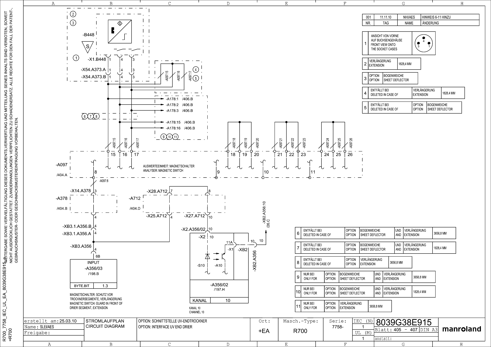

# +EA — Sheet 405 of 407 — OPTION: SCHNITTSTELLE UV ENDTROCKNER

**OPTION: INTERFACE UV END DRIER**

> Part of the manroland **R700** printing press IEC/UL circuit diagrams.
> Drawing class: **Stromlaufplan / Circuit diagram** (DIN A3).
> Document `+EA` covers the **Printing unit** machine section.

## At a glance

| Field | Value |
|---|---|
| Document | `+EA`  (8039G38E915) |
| Sheet | **405** of 407 |
| Section (DE) | OPTION: SCHNITTSTELLE UV ENDTROCKNER |
| Section (EN) | OPTION: INTERFACE UV END DRIER |
| Section type | CIRCUIT — Circuit diagram |
| Machine type | `R700` |
| Series | `7758` |
| Created | 25.03.10 |
| Replaces | — |
| Columns used | A, B, C, D, E, F, G, H |
| Path numbers | — |
| Labels on sheet | 223 |
| Cross-refs out | 11 |
| Cross-refs in | 31 |

**Previous:** [+EA sheet 404](SHEET_0404.md) · **Next:** [+EA sheet 406](SHEET_0406.md) · **Document TOC:** [_TOC.md](_TOC.md)  (+EA) · **Master TOC:** [all sheets](../_MASTER_TOC.md)

## Sheet image (300 DPI, exact vector render)



_Rendered directly from the PDF vector layer at 300 DPI (1-bit), no OCR and no resampling. Use it to confirm anything ambiguous in the text below._

## Cross-references on this sheet

Each entry is a wire leaving this sheet. The printed token is `/sheet.column`; the link resolves to that sheet inside the same document.

| Ref | Target sheet | Col | Path | Destination on target | Target section | From col |
|---|---|---|---|---|---|---|
| `/406.B` | [+EA sheet 406](SHEET_0406.md) | B | — | A178:1 | OPTION: SCHNITTSTELLE UV ENDTROCKNER | C |
| `/406.B` | [+EA sheet 406](SHEET_0406.md) | B | — | A178:2 | OPTION: SCHNITTSTELLE UV ENDTROCKNER | C |
| `/406.B` | [+EA sheet 406](SHEET_0406.md) | B | — | A178:3 | OPTION: SCHNITTSTELLE UV ENDTROCKNER | C |
| `/406.B` | [+EA sheet 406](SHEET_0406.md) | B | — | A178:15 | OPTION: SCHNITTSTELLE UV ENDTROCKNER | C |
| `/406.B` | [+EA sheet 406](SHEET_0406.md) | B | — | A178:16 | OPTION: SCHNITTSTELLE UV ENDTROCKNER | C |
| `/404.A` | [+EA sheet 404](SHEET_0404.md) | A | — | — | OPTION: SCHNITTSTELLE UV ENDTROCKNER | A |
| `/26.C` | [+EA sheet 26](SHEET_0026.md) | C | — | XB2.A356:10 | BUSVERBINDUNGEN: SICHERHEITSBUS | E |
| `/404.B` | [+EA sheet 404](SHEET_0404.md) | B | — | — | OPTION: SCHNITTSTELLE UV ENDTROCKNER | A |
| `/404.D` | [+EA sheet 404](SHEET_0404.md) | D | — | — | OPTION: SCHNITTSTELLE UV ENDTROCKNER | B |
| `/198.B` | [+EA sheet 198](SHEET_0198.md) | B | — | — | REFERENZMODUL | B |
| `/197.H` | [+EA sheet 197](SHEET_0197.md) | H | — | — | REFERENZMODUL | D |

### Incoming references (sheets that point here)

Every other sheet that sends a wire to this one. `Back-ref` is the token printed on *that* sheet; `Path` is its line number.

| From sheet | Cols | Back-ref | Path | Refs | What continues there |
|---|---|---|---|---|---|
| [+EA#26](SHEET_0026.md) | C | `/26.C` | — | 1 | XB2.A356:10 |
| [+EA#197](SHEET_0197.md) | H | `/197.H` | — | 1 | — |
| [+EA#198](SHEET_0198.md) | B | `/198.B` | — | 1 | — |
| [+EA#217](SHEET_0217.md) | G | `/217.G` | — | 3 | — |
| [+EA#225](SHEET_0225.md) | F | `/225.F` | — | 1 | — |
| [+EA#226](SHEET_0226.md) | E | `/226.E` | — | 1 | — |
| [+EA#234](SHEET_0234.md) | H | `/234.H` | — | 1 | — |
| [+EA#235](SHEET_0235.md) | A, B | `/235.A`, `/235.B` | — | 2 | — |
| [+EA#250](SHEET_0250.md) | D | `/250.D` | — | 1 | — |
| [+EA#260](SHEET_0260.md) | A | `/260.A` | — | 1 | — |
| [+EA#268](SHEET_0268.md) | F | `/268.F` | — | 1 | — |
| [+EA#271](SHEET_0271.md) | G | `/271.G` | — | 1 | — |
| [+EA#273](SHEET_0273.md) | C | `/273.C` | — | 2 | — |
| [+EA#283](SHEET_0283.md) | A | `/283.A` | — | 6 | — |
| [+EA#404](SHEET_0404.md) | A, B, D | `/404.A`, `/404.B`, `/404.D` | — | 3 | — |
| [+EA#406](SHEET_0406.md) | A | `/406.A` | — | 5 | A178:1; A178:15; A178:16; A178:2; A178:3 |


## Devices on this sheet

| Tag | Class | Class meaning (IEC) | Col | Sub | Terminal | Sign |
|---|---|---|---|---|---|---|
| `A356/03` | A | Baugruppe / assembly, module, PC board | B | 03 | — | — |
| `A378` | A | Baugruppe / assembly, module, PC board | A | — | — | — |
| `S10` | S | Schalter / switch | D | — | — | — |
| `A10` | A | Baugruppe / assembly, module, PC board | D | — | — | — |
| `X1` | X | Klemme / terminal, plug connector | D | — | — | — |
| `X2` | X | Klemme / terminal, plug connector | D | — | — | — |
| `XB2` | XB |  | D | — | — | — |
| `A356/02` | A | Baugruppe / assembly, module, PC board | D | 02 | — | — |
| `A712` | A | Baugruppe / assembly, module, PC board | B | — | — | — |
| `A097` | A | Baugruppe / assembly, module, PC board | A | — | — | — |
| `B448` | B | Umformer / transducer, sensor | B | — | — | — |
| `A178:1` | A | Baugruppe / assembly, module, PC board | C | — | 1 | — |
| `A178:2` | A | Baugruppe / assembly, module, PC board | C | — | 2 | — |
| `A178:3` | A | Baugruppe / assembly, module, PC board | C | — | 3 | — |
| `A178:15` | A | Baugruppe / assembly, module, PC board | C | — | 15 | — |
| `A178:16` | A | Baugruppe / assembly, module, PC board | C | — | 16 | — |
| `A097:8` | A | Baugruppe / assembly, module, PC board | B | — | 8 | — |
| `A097:16` | A | Baugruppe / assembly, module, PC board | B | — | 16 | — |
| `A097:15` | A | Baugruppe / assembly, module, PC board | B | — | 15 | — |
| `A097:15` | A | Baugruppe / assembly, module, PC board | C | — | 15 | — |
| `A097:16` | A | Baugruppe / assembly, module, PC board | C | — | 16 | — |
| `A097:17` | A | Baugruppe / assembly, module, PC board | C | — | 17 | — |
| `A097:17` | A | Baugruppe / assembly, module, PC board | B | — | 17 | — |
| `A097:20` | A | Baugruppe / assembly, module, PC board | E | — | 20 | — |
| `A097:19` | A | Baugruppe / assembly, module, PC board | D | — | 19 | — |
| `A097:18` | A | Baugruppe / assembly, module, PC board | D | — | 18 | — |
| `A097:23` | A | Baugruppe / assembly, module, PC board | E | — | 23 | — |
| `A097:22` | A | Baugruppe / assembly, module, PC board | E | — | 22 | — |
| `A097:21` | A | Baugruppe / assembly, module, PC board | E | — | 21 | — |
| `A097:26` | A | Baugruppe / assembly, module, PC board | F | — | 26 | — |
| `A097:25` | A | Baugruppe / assembly, module, PC board | F | — | 25 | — |
| `A097:24` | A | Baugruppe / assembly, module, PC board | F | — | 24 | — |
| `XB3.A356` | — | cross-device reference | A | — | — | — |
| `1.3` | — | cross-device reference | B | — | — | — |
| `X14.A378` | — | cross-device reference | A | — | — | — |
| `XB3.1.A356.B` | — | cross-device reference | A | — | — | — |
| `XB3.1.A356.A` | — | cross-device reference | A | — | — | — |
| `XB2.A356` | — | cross-device reference | D | — | — | — |
| `X28.A712` | — | cross-device reference | C | — | — | — |
| `X27.A712` | — | cross-device reference | C | — | — | — |
| `X25.A712` | — | cross-device reference | C | — | — | — |
| `X1.B448` | — | cross-device reference | B | — | — | — |
| `X54.A373.B` | — | cross-device reference | B | — | — | — |
| `X54.A373.A` | — | cross-device reference | B | — | — | — |
| `NR.` | — | cross-device reference | F | — | — | — |
| `11.11.10` | — | cross-device reference | G | — | — | — |
| `XB2.A356:10` | — | cross-device reference | E | — | 10 | — |

## Potentials / nets

_No named potentials on this sheet._

## Wire-end annotations (grouped as printed)

A wire that continues elsewhere is annotated with a small cluster: the destination description, the path/line number `#NN`, and the `/sheet.column` cross reference. Each row below is one such cluster exactly as it is grouped on the drawing.

| Col | Y | Path | Cross-ref | Text on the wire |
|---|---|---|---|---|
| A | 31.5 | — | — | `2` |
| G | 38.5 | — | — | `001 11.11.10 NHI/AES HINWEIS 6 11 HINZU` |
| A | 52.7 | — | — | `3` |
| G | 52.7 | — | — | `NR. TAG NAME ÄNDERUNG` |
| B | 79.7 | — | — | `B448` |
| G | 84.2 | — | — | `FRONT VIEW ONTO ANSICHT VON VORNE AUF BUCHSENGEHÄUSE` |
| G | 96.6 | — | — | `4` |
| G | 100.9 | — | — | `1 THE SOCKET CASES` |
| B | 107.4 | — | — | `S` |
| G | 109.3 | — | — | `3 1` |
| A | 137.3 | — | — | `1` |
| B | 139.2 | — | — | `X1.B448 1 4 3` |
| G | 145.2 | — | — | `2 EXTENSION VERLÄNGERUNG 1828,4 MM` |
| B | 164.0 | — | — | `X54.A373.A 1 4 3` |
| C | 166.1 | — | — | `4` |
| C | 172.0 | — | — | `A097:15` |
| C | 172.0 | — | — | `A097:16` |
| C | 172.0 | — | — | `A097:17` |
| G | 180.6 | — | — | `OPTION OPTION` |
| G | 180.6 | — | — | `BOGENWEICHE` |
| B | 181.7 | — | — | `X54.A373.B 1 4 3` |
| G | 185.9 | — | — | `3 SHEET DEFLECTOR` |
| C | 187.4 | — | — | `5` |
| G | 216.0 | — | — | `4 ENTFÄLLT BEI DELETED IN CASE OF` |
| H | 216.1 | — | — | `EXTENSION VERLÄNGERUNG 1828,4 MM` |
| C | 236.2 | — | `/406.B` | `A178:1` |
| C | 250.4 | — | `/406.B` | `A178:2` |
| H | 251.4 | — | — | `BOGENWEICHE` |
| G | 251.5 | — | — | `5 ENTFÄLLT BEI DELETED IN CASE OF` |
| G | 251.5 | — | — | `OPTION OPTION` |
| H | 262.1 | — | — | `SHEET DEFLECTOR` |
| C | 264.6 | — | `/406.B` | `A178:3` |
| B | 279.5 | — | — | `6 7 8` |
| C | 292.9 | — | `/406.B` | `A178:15` |
| C | 307.1 | — | `/406.B` | `A178:16` |
| C | 329.1 | — | — | `9 10 11` |
| E | 334.6 | — | — | `A097:21` |
| E | 334.9 | — | — | `A097:22` |
| B | 335.0 | — | — | `A097:15` |
| B | 335.0 | — | — | `A097:16` |
| B | 335.0 | — | — | `A097:17` |
| D | 335.0 | — | — | `A097:18` |
| D | 335.0 | — | — | `A097:19` |
| E | 335.0 | — | — | `A097:20` |
| E | 335.0 | — | — | `A097:23` |
| F | 335.0 | — | — | `A097:24` |
| F | 335.0 | — | — | `A097:25` |
| F | 335.0 | — | — | `A097:26` |
| B | 370.2 | — | — | `15 16 17` |
| E | 370.2 | — | — | `18 19 20 21 22 23 24 25 26` |
| A | 395.0 | — | — | `A097` |
| C | 400.3 | — | — | `AUSWERTEEINHEIT: MAGNETSCHALTER ANALYSER: MAGNETIC SWITCH` |
| B | 412.7 | — | — | `8` |
| E | 412.7 | — | — | `9 10 11` |
| A | 420.5 | — | `/404.A` | — |
| B | 435.8 | — | — | `A097:8` |
| B | 458.1 | — | — | `X14.A378 3` |
| C | 459.5 | — | — | `X28.A712 7 8` |
| A | 476.5 | — | — | `A378` |
| B | 476.5 | — | — | `A712` |
| E | 488.4 | — | `/26.C` | `XB2.A356:10` |
| A | 502.0 | — | `/404.B` | — |
| B | 502.0 | — | `/404.D` | — |
| C | 519.0 | — | — | `X25.A712 4 X27.A712 10` |
| B | 523.3 | — | — | `4` |
| A | 544.6 | — | — | `XB3.1.A356.B 4` |
| C | 551.6 | — | — | `X2.A356/02 10` |
| E | 556.2 | — | — | `6 ENTFÄLLT BEI DELETED IN CASE OF` |
| F | 556.2 | — | — | `OPTION OPTION` |
| F | 556.2 | — | — | `BOGENWEICHE` |
| G | 556.2 | — | — | `UND` |
| G | 556.2 | — | — | `EXTENSION VERLÄNGERUNG` |
| A | 561.6 | — | — | `XB3.1.A356.A 4` |
| H | 563.3 | — | — | `3656,8 MM` |
| F | 566.9 | — | — | `SHEET DEFLECTOR` |
| G | 566.9 | — | — | `AND` |
| D | 570.1 | — | — | `X2` |
| D | 571.5 | — | — | `10 10` |
| E | 580.0 | — | — | `10` |
| D | 584.2 | — | — | `11A` |
| E | 591.6 | — | — | `7 ENTFÄLLT BEI DELETED IN CASE OF` |
| F | 591.6 | — | — | `OPTION OPTION` |
| F | 591.6 | — | — | `BOGENWEICHE` |
| G | 591.6 | — | — | `UND` |
| G | 591.7 | — | — | `EXTENSION VERLÄNGERUNG 1828,4 MM` |
| B | 592.8 | — | — | `XB3.A356 4` |
| D | 601.2 | — | — | `X1` |
| D | 601.3 | — | — | `XB2` |
| F | 602.3 | — | — | `SHEET DEFLECTOR` |
| G | 602.3 | — | — | `AND` |
| D | 607.5 | — | — | `XB2.A356` |
| B | 618.2 | — | — | `6B` |
| E | 627.0 | — | — | `8 ENTFÄLLT BEI DELETED IN CASE OF` |
| F | 627.0 | — | — | `OPTION OPTION` |
| F | 627.1 | — | — | `EXTENSION VERLÄNGERUNG` |
| B | 632.8 | — | — | `INPUT` |
| G | 634.2 | — | — | `3656,8 MM` |
| D | 640.2 | — | — | `S10 A10` |
| B | 646.6 | — | — | `A356/03` |
| B | 660.4 | — | `/198.B` | — |
| E | 662.5 | — | — | `9 NUR BEI` |
| F | 662.5 | — | — | `OPTION OPTION` |
| F | 662.5 | — | — | `BOGENWEICHE` |
| G | 662.5 | — | — | `UND` |
| G | 662.5 | — | — | `EXTENSION VERLÄNGERUNG` |
| G | 669.6 | — | — | `3656,8 MM` |
| F | 673.1 | — | — | `SHEET DEFLECTOR` |
| E | 673.2 | — | — | `ONLY FOR` |
| G | 673.2 | — | — | `AND` |
| D | 686.3 | — | — | `A356/02` |
| B | 689.4 | — | — | `BYTE.BIT 1.3` |
| E | 697.9 | — | — | `10 NUR BEI` |
| F | 697.9 | — | — | `OPTION OPTION` |
| F | 697.9 | — | — | `BOGENWEICHE` |
| G | 697.9 | — | — | `UND` |
| G | 698.0 | — | — | `EXTENSION VERLÄNGERUNG 1828,4 MM` |
| D | 698.7 | — | `/197.H` | — |
| E | 708.6 | — | — | `ONLY FOR` |
| F | 708.6 | — | — | `SHEET DEFLECTOR` |
| G | 708.6 | — | — | `AND` |
| B | 712.1 | — | — | `DRIER SEGMENT, EXTENSION MAGNETSCHALTER: SCHUTZ VOR MAGNETIC SWITCH: GUARD IN FRONT OF TROCKNERSEGMENTE, VERLÄNGERUNG` |
| D | 724.5 | — | — | `KANAL 10` |
| E | 733.3 | — | — | `11 NUR BEI` |
| F | 733.4 | — | — | `OPTION OPTION` |
| F | 733.4 | — | — | `EXTENSION VERLÄNGERUNG` |
| G | 740.5 | — | — | `3656,8 MM` |
| E | 744.0 | — | — | `ONLY FOR` |
| C | 744.9 | — | — | `KANAL 10 CHANNEL 10` |


## Reconstructed tables

This sheet carries tabular content (pin map / terminal assignment / index). The grid below was rebuilt from the drawing's own rule lines, so each row is exactly one physical row of the table.

### Table 1 — 9 data rows × 3 columns (at x=170.1, y=48.2) — **3 B448 S**

| 1 X54.A373.A | X1.B448 X54.A373.B | 1 1 1 |
|---|---|---|
| `6 7` | `8` |  |
|  | `8 A097:8` | `A097:15 15` |
| `X14.A378 XB3.1.A356.B` | `3 4 4` |  |
| `XB3.1.A356.A` | `4` |  |
| `XB3.A356` | `4 6B` |  |
| `INPUT` | `A356/03 /198.B` |  |
| `BYTE.BIT` | `1.3` |  |
| `MAGNETSCHALTER:` | `SCHUTZ` | `VOR` |
| `TROCKNERSEGMENTE,` |  | `VERLÄNGERUNG` |


### Table 2 — 12 data rows × 12 columns (at x=290.6, y=48.2)

| 4 4 4 | 3 3 3 | A097:15 |  | A097:16 |  | 4 A097:17 5 |  |  |  |  |  |
|---|---|---|---|---|---|---|---|---|---|---|---|
|  |  |  | `A178:1` |  | `/406.B` |  |  |  |  |  |  |
|  |  |  | `A178:2` |  | `/406.B` |  |  |  |  |  |  |
|  |  |  | `A178:3` |  | `/406.B` |  |  |  |  |  |  |
|  |  |  |  | `A178:15` | `/406.B` |  |  |  |  |  |  |
| `A097:16 16` | `A097:17 17 AUSWERTEEINHEIT: ANALYSER:` | `9 10 MAGNETIC` |  | `A178:16 11 MAGNETSCHALTER SWITCH` | `/406.B` |  | `9` |  | `18` | `A097:18` | `A097:19 19` |
|  | `X28.A712 A712 /404.D X25.A712` |  | `7 4` |  |  | `X27.A712 X2.A356/02` | `8 10 10` |  |  |  |  |
|  |  |  |  |  |  | `X2` | `10` |  |  |  |  |
|  |  |  |  |  |  |  |  |  | `11A X1` |  | `XB2` |
|  |  |  |  |  |  | `S10` | `A10` |  |  |  |  |
|  |  |  |  |  |  |  | `A356/02` |  |  |  |  |
|  |  |  |  |  |  |  | `/197.H` |  |  |  |  |
|  |  |  |  |  |  | `KANAL` |  | `10` |  |  |  |


### Table 3 — 11 data rows × 10 columns (at x=609.4, y=48.2)

|  |  |  |  |  |  |  |  | NR. NAME TAG | ÄNDERUNG |
|---|---|---|---|---|---|---|---|---|---|
|  |  |  |  |  |  |  |  | `ANSICHT VON VORNE AUF BUCHSENGEHÄUSE` | `4` |
|  |  |  |  |  |  |  | `1` | `FRONT VIEW ONTO THE SOCKET CASES` | `3 1` |
|  |  |  |  |  |  |  | `2 3` | `VERLÄNGERUNG 1828,4 MM EXTENSION BOGENWEICHE OPTION OPTION SHEET DEFLECTOR` |  |
|  |  |  |  |  |  |  | `4` | `ENTFÄLLT BEI DELETED IN CASE OF` | `VERLÄNGERUNG EXTENSION` |
|  |  |  |  |  |  |  | `5` | `ENTFÄLLT BEI DELETED IN CASE OF` | `OPTION OPTION SHEET` |
| `A097:20 20` | `10` | `A097:21 21` | `A097:22 22` | `A097:23 23 11` | `A097:24 24` | `A097:25 25` | `A097:26 26` |  |  |
| `XB2.A356:10` | `/26.C` |  |  | `ENTFÄLLT BEI` |  |  | `OPTION` | `BOGENWEICHE UND` | `VERLÄNGERUNG` |
| `10 10` |  |  |  | `6 DELETED IN` | `CASE OF` |  | `OPTION SHEET` | `EXTENSION DEFLECTOR AND` |  |
|  |  |  |  | `ENTFÄLLT BEI 7 DELETED IN` | `CASE OF` |  | `OPTION OPTION SHEET` | `BOGENWEICHE UND EXTENSION DEFLECTOR AND` | `VERLÄNGERUNG` |
| `XB2.A356` |  |  |  | `ENTFÄLLT BEI 8 DELETED IN NUR BEI 9 ONLY FOR` | `CASE OF OPTION OPTION` | `SHEET` | `OPTION EXTENSION OPTION BOGENWEICHE DEFLECTOR` | `VERLÄNGERUNG 3656,8 MM UND VERLÄNGERUNG EXTENSION AND` | `3656,8 MM` |
|  |  |  | `10` | `NUR BEI ONLY FOR` | `OPTION OPTION` | `SHEET` | `BOGENWEICHE DEFLECTOR` | `UND VERLÄNGERUNG EXTENSION AND` | `1828,4 MM` |


## Notes and free text on this sheet

| Text | Col | Y (pt) |
|---|---|---|
| `6B` | B | 618.22 |
| `INPUT` | B | 632.76 |
| `BYTE.BIT` | A | 690.01 |
| `MAGNETSCHALTER: SCHUTZ VOR` | B | 712.13 |
| `TROCKNERSEGMENTE, VERLÄNGERUNG` | B | 722.77 |
| `MAGNETIC SWITCH: GUARD IN FRONT OF` | B | 733.38 |
| `DRIER SEGMENT, EXTENSION` | B | 744.01 |
| `KANAL 10` | C | 744.88 |
| `CHANNEL 10` | C | 754.82 |
| `11A` | D | 584.22 |
| `KANAL` | D | 724.55 |
| `X2.A356/02` | C | 551.65 |
| `AUSWERTEEINHEIT: MAGNETSCHALTER` | C | 400.31 |
| `ANALYSER: MAGNETIC SWITCH` | C | 410.93 |
| `TAG` | G | 52.78 |
| `NAME` | G | 52.76 |
| `ÄNDERUNG` | G | 52.82 |
| `NHI/AES` | G | 38.62 |
| `HINWEIS 6 11 HINZU` | H | 38.62 |
| `ENTFÄLLT BEI` | E | 556.18 |
| `DELETED IN CASE OF` | F | 566.83 |
| `OPTION` | F | 556.19 |
| `BOGENWEICHE` | F | 556.17 |
| `SHEET DEFLECTOR` | F | 566.85 |
| `UND` | G | 556.21 |
| `AND` | G | 566.87 |
| `VERLÄNGERUNG` | G | 556.23 |
| `EXTENSION` | G | 566.81 |
| `VERLÄNGERUNG` | F | 627.1 |
| `EXTENSION` | F | 637.68 |
| `NUR BEI` | E | 662.47 |
| `ONLY FOR` | E | 673.16 |
| `S` | B | 107.39 |
| `ENTFÄLLT BEI` | G | 251.46 |
| `DELETED IN CASE OF` | G | 262.11 |
| `OPTION` | G | 251.46 |
| `BOGENWEICHE` | H | 251.45 |
| `SHEET DEFLECTOR` | H | 262.13 |
| `1828,4 MM` | H | 223.16 |
| `1828,4 MM` | G | 152.29 |
| `ANSICHT VON VORNE` | G | 84.25 |
| `AUF BUCHSENGEHÄUSE` | G | 94.89 |
| `FRONT VIEW ONTO` | G | 105.48 |
| `THE SOCKET CASES` | G | 116.13 |
| `BOGENWEICHE` | G | 180.58 |
| `SHEET DEFLECTOR` | G | 191.26 |
| `3656,8 MM` | H | 563.33 |
| `3656,8 MM` | G | 634.2 |

## Complete label inventory (exact text from the drawing)

Every text object inside the drawing area of this sheet, in DIN reading order (column A→H, then top→bottom). This is the authoritative list: if a string is not here it is not printed on this sheet.

| Col | Y | X | Dir | Type | Text |
|---|---|---|---|---|---|
| A | 31.5 | 175.2 | → | number | `2` |
| A | 52.7 | 175.2 | → | number | `3` |
| A | 137.3 | 182.5 | → | number | `1` |
| A | 395.0 | 135.2 | → | device tag | `A097` |
| A | 420.5 | 137.5 | → | cross-reference | `/404.A` |
| A | 458.1 | 170.1 | → | device ref | `X14.A378` |
| A | 476.5 | 135.2 | → | device tag | `A378` |
| A | 502.0 | 137.8 | → | cross-reference | `/404.B` |
| A | 544.6 | 151.7 | → | device ref | `XB3.1.A356.B` |
| A | 562.3 | 150.8 | → | device ref | `XB3.1.A356.A` |
| A | 592.7 | 170.4 | → | device ref | `XB3.A356` |
| A | 690.0 | 180.0 | → | text | `BYTE.BIT` |
| B | 79.7 | 200.4 | → | device tag | `B448` |
| B | 107.4 | 208.5 | → | text | `S` |
| B | 139.2 | 212.9 | → | device ref | `X1.B448` |
| B | 140.6 | 264.2 | → | number | `1` |
| B | 140.6 | 293.1 | → | number | `4` |
| B | 140.6 | 321.4 | → | number | `3` |
| B | 164.0 | 196.2 | → | device ref | `X54.A373.A` |
| B | 166.2 | 264.2 | → | number | `1` |
| B | 166.2 | 293.1 | → | number | `4` |
| B | 166.2 | 321.4 | → | number | `3` |
| B | 181.7 | 197.0 | → | device ref | `X54.A373.B` |
| B | 183.2 | 264.2 | → | number | `1` |
| B | 183.2 | 293.1 | → | number | `4` |
| B | 183.2 | 321.4 | → | number | `3` |
| B | 279.5 | 203.5 | → | number | `6` |
| B | 279.5 | 217.7 | → | number | `7` |
| B | 279.5 | 231.9 | → | number | `8` |
| B | 335.0 | 274.2 | ↕ | device tag | `A097:15` |
| B | 335.0 | 302.5 | ↕ | device tag | `A097:16` |
| B | 335.0 | 330.9 | ↕ | device tag | `A097:17` |
| B | 370.2 | 268.2 | → | number | `15` |
| B | 370.2 | 296.5 | → | number | `16` |
| B | 370.2 | 324.9 | → | number | `17` |
| B | 412.7 | 229.0 | → | number | `8` |
| B | 435.8 | 240.7 | → | device tag | `A097:8` |
| B | 459.5 | 229.3 | → | number | `3` |
| B | 476.5 | 312.4 | → | device tag | `A712` |
| B | 502.0 | 314.6 | → | cross-reference | `/404.D` |
| B | 523.3 | 229.3 | → | number | `4` |
| B | 544.6 | 229.3 | → | number | `4` |
| B | 561.6 | 229.3 | → | number | `4` |
| B | 601.3 | 229.3 | → | number | `4` |
| B | 618.2 | 232.2 | → | text | `6B` |
| B | 632.8 | 211.9 | → | text | `INPUT` |
| B | 646.6 | 205.4 | → | device tag | `A356/03` |
| B | 660.4 | 214.2 | → | cross-reference | `/198.B` |
| B | 689.4 | 248.0 | → | device ref | `1.3` |
| B | 712.1 | 169.5 | → | text | `MAGNETSCHALTER: SCHUTZ VOR` |
| B | 722.8 | 169.8 | → | text | `TROCKNERSEGMENTE, VERLÄNGERUNG` |
| B | 733.4 | 169.5 | → | text | `MAGNETIC SWITCH: GUARD IN FRONT OF` |
| B | 744.0 | 169.2 | → | text | `DRIER SEGMENT, EXTENSION` |
| C | 166.1 | 472.8 | → | number | `4` |
| C | 172.0 | 401.7 | ↕ | device tag | `A097:15` |
| C | 172.0 | 430.1 | ↕ | device tag | `A097:16` |
| C | 172.0 | 458.4 | ↕ | device tag | `A097:17` |
| C | 187.4 | 472.8 | → | number | `5` |
| C | 236.2 | 442.2 | → | cross-reference | `/406.B` |
| C | 236.3 | 402.2 | → | device tag | `A178:1` |
| C | 250.4 | 442.2 | → | cross-reference | `/406.B` |
| C | 250.5 | 402.2 | → | device tag | `A178:2` |
| C | 264.6 | 402.2 | → | device tag | `A178:3` |
| C | 264.6 | 442.2 | → | cross-reference | `/406.B` |
| C | 292.9 | 447.2 | → | cross-reference | `/406.B` |
| C | 293.0 | 402.2 | → | device tag | `A178:15` |
| C | 307.1 | 402.2 | → | device tag | `A178:16` |
| C | 307.1 | 447.2 | → | cross-reference | `/406.B` |
| C | 329.1 | 394.9 | → | number | `9` |
| C | 329.4 | 421.9 | → | number | `11` |
| C | 329.5 | 407.4 | → | number | `10` |
| C | 400.3 | 347.2 | → | text | `AUSWERTEEINHEIT: MAGNETSCHALTER` |
| C | 410.9 | 347.2 | → | text | `ANALYSER: MAGNETIC SWITCH` |
| C | 459.5 | 355.7 | → | device ref | `X28.A712` |
| C | 459.5 | 413.6 | → | number | `7` |
| C | 519.0 | 354.3 | → | device ref | `X25.A712` |
| C | 519.0 | 446.5 | → | device ref | `X27.A712` |
| C | 523.3 | 413.6 | → | number | `4` |
| C | 551.6 | 439.1 | → | text | `X2.A356/02` |
| C | 744.9 | 458.6 | → | text | `KANAL 10` |
| C | 754.8 | 458.9 | → | text | `CHANNEL 10` |
| D | 335.0 | 564.7 | ↕ | device tag | `A097:18` |
| D | 335.0 | 593.1 | ↕ | device tag | `A097:19` |
| D | 370.2 | 558.7 | → | number | `18` |
| D | 370.2 | 587.1 | → | number | `19` |
| D | 370.2 | 616.3 | → | number | `20` |
| D | 412.7 | 526.7 | → | number | `9` |
| D | 459.5 | 505.7 | → | number | `8` |
| D | 523.3 | 505.1 | → | number | `10` |
| D | 551.7 | 505.1 | → | number | `10` |
| D | 570.1 | 481.6 | → | device tag | `X2` |
| D | 571.5 | 508.0 | → | number | `10` |
| D | 581.4 | 607.2 | → | number | `10` |
| D | 584.2 | 548.5 | → | text | `11A` |
| D | 601.2 | 552.2 | → | device tag | `X1` |
| D | 601.3 | 576.6 | → | device tag | `XB2` |
| D | 607.5 | 612.6 | ↕ | device ref | `XB2.A356` |
| D | 640.2 | 477.9 | → | device tag | `S10` |
| D | 640.2 | 520.4 | → | device tag | `A10` |
| D | 686.3 | 510.1 | → | device tag | `A356/02` |
| D | 698.7 | 519.0 | → | cross-reference | `/197.H` |
| D | 724.5 | 546.5 | → | number | `10` |
| D | 724.6 | 466.9 | → | text | `KANAL` |
| E | 334.6 | 678.1 | ↕ | device tag | `A097:21` |
| E | 334.9 | 706.5 | ↕ | device tag | `A097:22` |
| E | 335.0 | 621.4 | ↕ | device tag | `A097:20` |
| E | 335.0 | 734.8 | ↕ | device tag | `A097:23` |
| E | 370.2 | 672.9 | → | number | `21` |
| E | 370.2 | 701.3 | → | number | `22` |
| E | 370.2 | 729.6 | → | number | `23` |
| E | 412.7 | 639.5 | → | number | `10` |
| E | 412.7 | 752.9 | → | number | `11` |
| E | 488.4 | 636.7 | ↕ | device ref | `XB2.A356:10` |
| E | 531.8 | 646.6 | ↕ | cross-reference | `/26.C` |
| E | 556.2 | 736.2 | → | text | `ENTFÄLLT BEI` |
| E | 561.5 | 720.0 | → | number | `6` |
| E | 580.0 | 628.4 | → | number | `10` |
| E | 591.6 | 736.2 | → | text | `ENTFÄLLT BEI` |
| E | 597.0 | 720.0 | → | number | `7` |
| E | 627.0 | 736.2 | → | text | `ENTFÄLLT BEI` |
| E | 632.4 | 719.9 | → | number | `8` |
| E | 662.5 | 736.2 | → | text | `NUR BEI` |
| E | 667.8 | 719.9 | → | number | `9` |
| E | 673.2 | 736.7 | → | text | `ONLY FOR` |
| E | 697.9 | 736.2 | → | text | `NUR BEI` |
| E | 703.3 | 716.6 | → | number | `10` |
| E | 708.6 | 736.7 | → | text | `ONLY FOR` |
| E | 733.3 | 736.2 | → | text | `NUR BEI` |
| E | 738.7 | 717.3 | → | number | `11` |
| E | 744.0 | 736.7 | → | text | `ONLY FOR` |
| F | 38.5 | 887.7 | → | number | `001` |
| F | 52.7 | 886.7 | → | device ref | `NR.` |
| F | 100.9 | 883.3 | → | number | `1` |
| F | 150.5 | 883.0 | → | number | `2` |
| F | 185.9 | 882.9 | → | number | `3` |
| F | 221.4 | 883.0 | → | number | `4` |
| F | 256.8 | 882.9 | → | number | `5` |
| F | 335.0 | 791.5 | ↕ | device tag | `A097:24` |
| F | 335.0 | 819.9 | ↕ | device tag | `A097:25` |
| F | 335.0 | 848.2 | ↕ | device tag | `A097:26` |
| F | 370.2 | 786.3 | → | number | `24` |
| F | 370.2 | 814.7 | → | number | `25` |
| F | 370.2 | 843.0 | → | number | `26` |
| F | 556.2 | 838.8 | → | text | `OPTION` |
| F | 556.2 | 873.6 | → | text | `BOGENWEICHE` |
| F | 566.8 | 736.2 | → | text | `DELETED IN CASE OF` |
| F | 566.8 | 838.8 | → | text | `OPTION` |
| F | 566.9 | 874.2 | → | text | `SHEET DEFLECTOR` |
| F | 591.6 | 838.8 | → | text | `OPTION` |
| F | 591.6 | 873.6 | → | text | `BOGENWEICHE` |
| F | 602.3 | 736.2 | → | text | `DELETED IN CASE OF` |
| F | 602.3 | 838.8 | → | text | `OPTION` |
| F | 602.3 | 874.2 | → | text | `SHEET DEFLECTOR` |
| F | 627.1 | 838.8 | → | text | `OPTION` |
| F | 627.1 | 874.5 | → | text | `VERLÄNGERUNG` |
| F | 637.7 | 736.2 | → | text | `DELETED IN CASE OF` |
| F | 637.7 | 838.8 | → | text | `OPTION` |
| F | 637.7 | 873.6 | → | text | `EXTENSION` |
| F | 662.5 | 789.2 | → | text | `OPTION` |
| F | 662.5 | 824.0 | → | text | `BOGENWEICHE` |
| F | 673.1 | 789.2 | → | text | `OPTION` |
| F | 673.2 | 824.6 | → | text | `SHEET DEFLECTOR` |
| F | 697.9 | 789.2 | → | text | `OPTION` |
| F | 697.9 | 824.0 | → | text | `BOGENWEICHE` |
| F | 708.6 | 789.2 | → | text | `OPTION` |
| F | 708.6 | 824.6 | → | text | `SHEET DEFLECTOR` |
| F | 733.4 | 789.2 | → | text | `OPTION` |
| F | 733.4 | 824.9 | → | text | `VERLÄNGERUNG` |
| F | 744.0 | 789.2 | → | text | `OPTION` |
| F | 744.0 | 824.0 | → | text | `EXTENSION` |
| G | 38.6 | 921.5 | → | device ref | `11.11.10` |
| G | 38.6 | 977.9 | → | text | `NHI/AES` |
| G | 52.8 | 928.3 | → | text | `TAG` |
| G | 52.8 | 981.7 | → | text | `NAME` |
| G | 52.8 | 1024.3 | → | text | `ÄNDERUNG` |
| G | 84.3 | 900.0 | → | text | `ANSICHT VON VORNE` |
| G | 94.9 | 900.0 | → | text | `AUF BUCHSENGEHÄUSE` |
| G | 96.6 | 1025.6 | → | number | `4` |
| G | 105.5 | 899.1 | → | text | `FRONT VIEW ONTO` |
| G | 109.3 | 1012.8 | → | number | `3` |
| G | 109.3 | 1038.8 | → | number | `1` |
| G | 116.1 | 899.7 | → | text | `THE SOCKET CASES` |
| G | 145.2 | 895.7 | → | text | `VERLÄNGERUNG` |
| G | 152.3 | 966.5 | → | text | `1828,4 MM` |
| G | 155.8 | 894.9 | → | text | `EXTENSION` |
| G | 180.6 | 895.5 | → | text | `OPTION` |
| G | 180.6 | 930.3 | → | text | `BOGENWEICHE` |
| G | 191.2 | 895.5 | → | text | `OPTION` |
| G | 191.3 | 930.9 | → | text | `SHEET DEFLECTOR` |
| G | 216.0 | 899.1 | → | text | `ENTFÄLLT BEI` |
| G | 216.1 | 1002.0 | → | text | `VERLÄNGERUNG` |
| G | 226.7 | 899.1 | → | text | `DELETED IN CASE OF` |
| G | 226.7 | 1001.2 | → | text | `EXTENSION` |
| G | 251.5 | 899.1 | → | text | `ENTFÄLLT BEI` |
| G | 251.5 | 1001.8 | → | text | `OPTION` |
| G | 262.1 | 899.1 | → | text | `DELETED IN CASE OF` |
| G | 262.1 | 1001.8 | → | text | `OPTION` |
| G | 556.2 | 958.7 | → | text | `UND` |
| G | 556.2 | 980.8 | → | text | `VERLÄNGERUNG` |
| G | 566.8 | 979.9 | → | text | `EXTENSION` |
| G | 566.9 | 959.5 | → | text | `AND` |
| G | 591.6 | 958.7 | → | text | `UND` |
| G | 591.7 | 980.8 | → | text | `VERLÄNGERUNG` |
| G | 602.2 | 979.9 | → | text | `EXTENSION` |
| G | 602.3 | 959.5 | → | text | `AND` |
| G | 634.2 | 945.8 | → | text | `3656,8 MM` |
| G | 662.5 | 909.1 | → | text | `UND` |
| G | 662.5 | 931.2 | → | text | `VERLÄNGERUNG` |
| G | 669.6 | 1002.5 | → | text | `3656,8 MM` |
| G | 673.1 | 930.3 | → | text | `EXTENSION` |
| G | 673.2 | 909.9 | → | text | `AND` |
| G | 697.9 | 909.1 | → | text | `UND` |
| G | 698.0 | 931.2 | → | text | `VERLÄNGERUNG` |
| G | 705.1 | 1001.9 | → | text | `1828,4 MM` |
| G | 708.5 | 930.3 | → | text | `EXTENSION` |
| G | 708.6 | 909.9 | → | text | `AND` |
| G | 740.5 | 896.2 | → | text | `3656,8 MM` |
| H | 38.6 | 1023.2 | → | text | `HINWEIS 6 11 HINZU` |
| H | 223.2 | 1072.8 | → | text | `1828,4 MM` |
| H | 251.4 | 1036.6 | → | text | `BOGENWEICHE` |
| H | 262.1 | 1037.2 | → | text | `SHEET DEFLECTOR` |
| H | 563.3 | 1052.1 | → | text | `3656,8 MM` |
| H | 598.8 | 1051.5 | → | text | `1828,4 MM` |

## Reading-order text block

The same content as a plain block, grouped by DIN column — convenient to paste or to match against a visual description.

```text
=== Column A ===
  31.5  175.2  numeric      2
  52.7  175.2  numeric      3
 137.3  182.5  numeric      1
 395.0  135.2  devtag       A097
 420.5  137.5  xref         /404.A
 458.1  170.1  devref       X14.A378
 476.5  135.2  devtag       A378
 502.0  137.8  xref         /404.B
 544.6  151.7  devref       XB3.1.A356.B
 562.3  150.8  devref       XB3.1.A356.A
 592.7  170.4  devref       XB3.A356
 690.0  180.0  text         BYTE.BIT
=== Column B ===
  79.7  200.4  devtag       B448
 107.4  208.5  text         S
 139.2  212.9  devref       X1.B448
 140.6  264.2  numeric      1
 140.6  293.1  numeric      4
 140.6  321.4  numeric      3
 164.0  196.2  devref       X54.A373.A
 166.2  264.2  numeric      1
 166.2  293.1  numeric      4
 166.2  321.4  numeric      3
 181.7  197.0  devref       X54.A373.B
 183.2  264.2  numeric      1
 183.2  293.1  numeric      4
 183.2  321.4  numeric      3
 279.5  203.5  numeric      6
 279.5  217.7  numeric      7
 279.5  231.9  numeric      8
 335.0  274.2  devtag       A097:15
 335.0  302.5  devtag       A097:16
 335.0  330.9  devtag       A097:17
 370.2  268.2  numeric      15
 370.2  296.5  numeric      16
 370.2  324.9  numeric      17
 412.7  229.0  numeric      8
 435.8  240.7  devtag       A097:8
 459.5  229.3  numeric      3
 476.5  312.4  devtag       A712
 502.0  314.6  xref         /404.D
 523.3  229.3  numeric      4
 544.6  229.3  numeric      4
 561.6  229.3  numeric      4
 601.3  229.3  numeric      4
 618.2  232.2  text         6B
 632.8  211.9  text         INPUT
 646.6  205.4  devtag       A356/03
 660.4  214.2  xref         /198.B
 689.4  248.0  devref       1.3
 712.1  169.5  text         MAGNETSCHALTER: SCHUTZ VOR
 722.8  169.8  text         TROCKNERSEGMENTE, VERLÄNGERUNG
 733.4  169.5  text         MAGNETIC SWITCH: GUARD IN FRONT OF
 744.0  169.2  text         DRIER SEGMENT, EXTENSION
=== Column C ===
 166.1  472.8  numeric      4
 172.0  401.7  devtag       A097:15
 172.0  430.1  devtag       A097:16
 172.0  458.4  devtag       A097:17
 187.4  472.8  numeric      5
 236.2  442.2  xref         /406.B
 236.3  402.2  devtag       A178:1
 250.4  442.2  xref         /406.B
 250.5  402.2  devtag       A178:2
 264.6  402.2  devtag       A178:3
 264.6  442.2  xref         /406.B
 292.9  447.2  xref         /406.B
 293.0  402.2  devtag       A178:15
 307.1  402.2  devtag       A178:16
 307.1  447.2  xref         /406.B
 329.1  394.9  numeric      9
 329.4  421.9  numeric      11
 329.5  407.4  numeric      10
 400.3  347.2  text         AUSWERTEEINHEIT: MAGNETSCHALTER
 410.9  347.2  text         ANALYSER: MAGNETIC SWITCH
 459.5  355.7  devref       X28.A712
 459.5  413.6  numeric      7
 519.0  354.3  devref       X25.A712
 519.0  446.5  devref       X27.A712
 523.3  413.6  numeric      4
 551.6  439.1  text         X2.A356/02
 744.9  458.6  text         KANAL 10
 754.8  458.9  text         CHANNEL 10
=== Column D ===
 335.0  564.7  devtag       A097:18
 335.0  593.1  devtag       A097:19
 370.2  558.7  numeric      18
 370.2  587.1  numeric      19
 370.2  616.3  numeric      20
 412.7  526.7  numeric      9
 459.5  505.7  numeric      8
 523.3  505.1  numeric      10
 551.7  505.1  numeric      10
 570.1  481.6  devtag       X2
 571.5  508.0  numeric      10
 581.4  607.2  numeric      10
 584.2  548.5  text         11A
 601.2  552.2  devtag       X1
 601.3  576.6  devtag       XB2
 607.5  612.6  devref       XB2.A356
 640.2  477.9  devtag       S10
 640.2  520.4  devtag       A10
 686.3  510.1  devtag       A356/02
 698.7  519.0  xref         /197.H
 724.5  546.5  numeric      10
 724.6  466.9  text         KANAL
=== Column E ===
 334.6  678.1  devtag       A097:21
 334.9  706.5  devtag       A097:22
 335.0  621.4  devtag       A097:20
 335.0  734.8  devtag       A097:23
 370.2  672.9  numeric      21
 370.2  701.3  numeric      22
 370.2  729.6  numeric      23
 412.7  639.5  numeric      10
 412.7  752.9  numeric      11
 488.4  636.7  devref       XB2.A356:10
 531.8  646.6  xref         /26.C
 556.2  736.2  text         ENTFÄLLT BEI
 561.5  720.0  numeric      6
 580.0  628.4  numeric      10
 591.6  736.2  text         ENTFÄLLT BEI
 597.0  720.0  numeric      7
 627.0  736.2  text         ENTFÄLLT BEI
 632.4  719.9  numeric      8
 662.5  736.2  text         NUR BEI
 667.8  719.9  numeric      9
 673.2  736.7  text         ONLY FOR
 697.9  736.2  text         NUR BEI
 703.3  716.6  numeric      10
 708.6  736.7  text         ONLY FOR
 733.3  736.2  text         NUR BEI
 738.7  717.3  numeric      11
 744.0  736.7  text         ONLY FOR
=== Column F ===
  38.5  887.7  numeric      001
  52.7  886.7  devref       NR.
 100.9  883.3  numeric      1
 150.5  883.0  numeric      2
 185.9  882.9  numeric      3
 221.4  883.0  numeric      4
 256.8  882.9  numeric      5
 335.0  791.5  devtag       A097:24
 335.0  819.9  devtag       A097:25
 335.0  848.2  devtag       A097:26
 370.2  786.3  numeric      24
 370.2  814.7  numeric      25
 370.2  843.0  numeric      26
 556.2  838.8  text         OPTION
 556.2  873.6  text         BOGENWEICHE
 566.8  736.2  text         DELETED IN CASE OF
 566.8  838.8  text         OPTION
 566.9  874.2  text         SHEET DEFLECTOR
 591.6  838.8  text         OPTION
 591.6  873.6  text         BOGENWEICHE
 602.3  736.2  text         DELETED IN CASE OF
 602.3  838.8  text         OPTION
 602.3  874.2  text         SHEET DEFLECTOR
 627.1  838.8  text         OPTION
 627.1  874.5  text         VERLÄNGERUNG
 637.7  736.2  text         DELETED IN CASE OF
 637.7  838.8  text         OPTION
 637.7  873.6  text         EXTENSION
 662.5  789.2  text         OPTION
 662.5  824.0  text         BOGENWEICHE
 673.1  789.2  text         OPTION
 673.2  824.6  text         SHEET DEFLECTOR
 697.9  789.2  text         OPTION
 697.9  824.0  text         BOGENWEICHE
 708.6  789.2  text         OPTION
 708.6  824.6  text         SHEET DEFLECTOR
 733.4  789.2  text         OPTION
 733.4  824.9  text         VERLÄNGERUNG
 744.0  789.2  text         OPTION
 744.0  824.0  text         EXTENSION
=== Column G ===
  38.6  921.5  devref       11.11.10
  38.6  977.9  text         NHI/AES
  52.8  928.3  text         TAG
  52.8  981.7  text         NAME
  52.8 1024.3  text         ÄNDERUNG
  84.3  900.0  text         ANSICHT VON VORNE
  94.9  900.0  text         AUF BUCHSENGEHÄUSE
  96.6 1025.6  numeric      4
 105.5  899.1  text         FRONT VIEW ONTO
 109.3 1012.8  numeric      3
 109.3 1038.8  numeric      1
 116.1  899.7  text         THE SOCKET CASES
 145.2  895.7  text         VERLÄNGERUNG
 152.3  966.5  text         1828,4 MM
 155.8  894.9  text         EXTENSION
 180.6  895.5  text         OPTION
 180.6  930.3  text         BOGENWEICHE
 191.2  895.5  text         OPTION
 191.3  930.9  text         SHEET DEFLECTOR
 216.0  899.1  text         ENTFÄLLT BEI
 216.1 1002.0  text         VERLÄNGERUNG
 226.7  899.1  text         DELETED IN CASE OF
 226.7 1001.2  text         EXTENSION
 251.5  899.1  text         ENTFÄLLT BEI
 251.5 1001.8  text         OPTION
 262.1  899.1  text         DELETED IN CASE OF
 262.1 1001.8  text         OPTION
 556.2  958.7  text         UND
 556.2  980.8  text         VERLÄNGERUNG
 566.8  979.9  text         EXTENSION
 566.9  959.5  text         AND
 591.6  958.7  text         UND
 591.7  980.8  text         VERLÄNGERUNG
 602.2  979.9  text         EXTENSION
 602.3  959.5  text         AND
 634.2  945.8  text         3656,8 MM
 662.5  909.1  text         UND
 662.5  931.2  text         VERLÄNGERUNG
 669.6 1002.5  text         3656,8 MM
 673.1  930.3  text         EXTENSION
 673.2  909.9  text         AND
 697.9  909.1  text         UND
 698.0  931.2  text         VERLÄNGERUNG
 705.1 1001.9  text         1828,4 MM
 708.5  930.3  text         EXTENSION
 708.6  909.9  text         AND
 740.5  896.2  text         3656,8 MM
=== Column H ===
  38.6 1023.2  text         HINWEIS 6 11 HINZU
 223.2 1072.8  text         1828,4 MM
 251.4 1036.6  text         BOGENWEICHE
 262.1 1037.2  text         SHEET DEFLECTOR
 563.3 1052.1  text         3656,8 MM
 598.8 1051.5  text         1828,4 MM
```

---
_Generated from the PDF vector text layer; no OCR. Source: `R700_7758_IEC_UL_EA_8039G38E915_p`, sheet 405._
