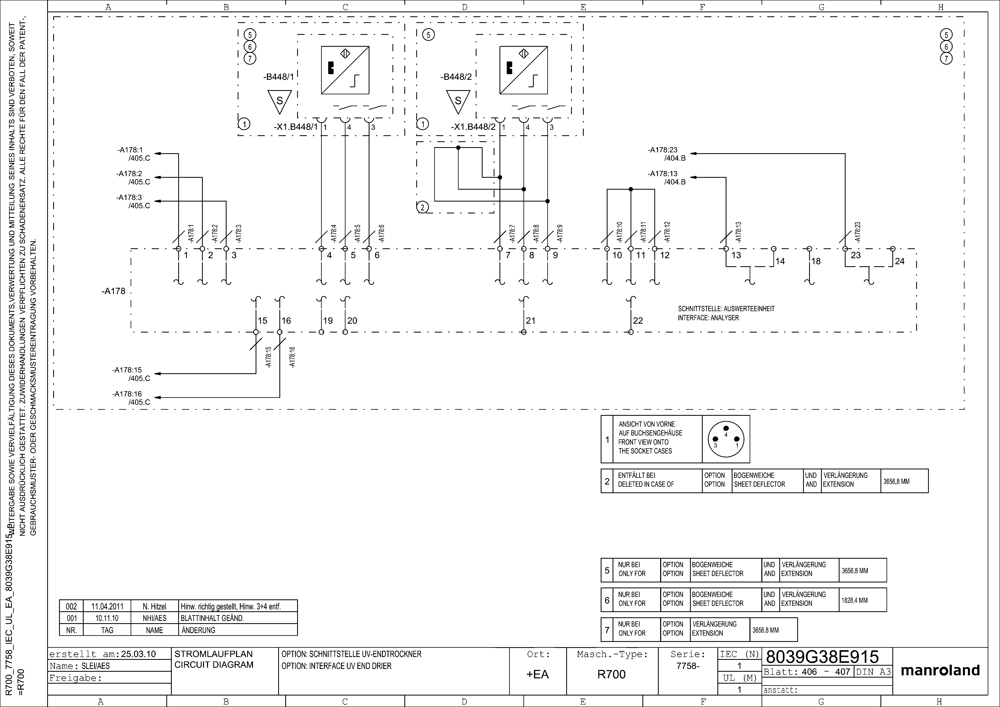

# +EA — Sheet 406 of 407 — OPTION: SCHNITTSTELLE UV ENDTROCKNER

**OPTION: INTERFACE UV END DRIER**

> Part of the manroland **R700** printing press IEC/UL circuit diagrams.
> Drawing class: **Stromlaufplan / Circuit diagram** (DIN A3).
> Document `+EA` covers the **Printing unit** machine section.

## At a glance

| Field | Value |
|---|---|
| Document | `+EA`  (8039G38E915) |
| Sheet | **406** of 407 |
| Section (DE) | OPTION: SCHNITTSTELLE UV ENDTROCKNER |
| Section (EN) | OPTION: INTERFACE UV END DRIER |
| Section type | CIRCUIT — Circuit diagram |
| Machine type | `R700` |
| Series | `7758` |
| Created | 25.03.10 |
| Replaces | — |
| Columns used | A, B, C, D, E, F, G, H |
| Path numbers | — |
| Labels on sheet | 142 |
| Cross-refs out | 7 |
| Cross-refs in | 13 |

**Previous:** [+EA sheet 405](SHEET_0405.md) · **Next:** [+EA sheet 407](SHEET_0407.md) · **Document TOC:** [_TOC.md](_TOC.md)  (+EA) · **Master TOC:** [all sheets](../_MASTER_TOC.md)

## Sheet image (300 DPI, exact vector render)



_Rendered directly from the PDF vector layer at 300 DPI (1-bit), no OCR and no resampling. Use it to confirm anything ambiguous in the text below._

## Cross-references on this sheet

Each entry is a wire leaving this sheet. The printed token is `/sheet.column`; the link resolves to that sheet inside the same document.

| Ref | Target sheet | Col | Path | Destination on target | Target section | From col |
|---|---|---|---|---|---|---|
| `/405.C` | [+EA sheet 405](SHEET_0405.md) | C | — | A178:1 | OPTION: SCHNITTSTELLE UV ENDTROCKNER | A |
| `/404.B` | [+EA sheet 404](SHEET_0404.md) | B | — | A178:23 | OPTION: SCHNITTSTELLE UV ENDTROCKNER | F |
| `/405.C` | [+EA sheet 405](SHEET_0405.md) | C | — | A178:2 | OPTION: SCHNITTSTELLE UV ENDTROCKNER | A |
| `/404.B` | [+EA sheet 404](SHEET_0404.md) | B | — | A178:13 | OPTION: SCHNITTSTELLE UV ENDTROCKNER | F |
| `/405.C` | [+EA sheet 405](SHEET_0405.md) | C | — | A178:3 | OPTION: SCHNITTSTELLE UV ENDTROCKNER | A |
| `/405.C` | [+EA sheet 405](SHEET_0405.md) | C | — | A178:15 | OPTION: SCHNITTSTELLE UV ENDTROCKNER | A |
| `/405.C` | [+EA sheet 405](SHEET_0405.md) | C | — | A178:16 | OPTION: SCHNITTSTELLE UV ENDTROCKNER | A |

### Incoming references (sheets that point here)

Every other sheet that sends a wire to this one. `Back-ref` is the token printed on *that* sheet; `Path` is its line number.

| From sheet | Cols | Back-ref | Path | Refs | What continues there |
|---|---|---|---|---|---|
| [+EA#217](SHEET_0217.md) | G | `/217.G` | — | 6 | — |
| [+EA#404](SHEET_0404.md) | B | `/404.B` | — | 2 | A178:13; A178:23 |
| [+EA#405](SHEET_0405.md) | C | `/405.C` | — | 5 | A178:1; A178:15; A178:16; A178:2; A178:3 |


## Devices on this sheet

| Tag | Class | Class meaning (IEC) | Col | Sub | Terminal | Sign |
|---|---|---|---|---|---|---|
| `B448/1` | B | Umformer / transducer, sensor | B | 1 | — | — |
| `A178` | A | Baugruppe / assembly, module, PC board | A | — | — | — |
| `B448/2` | B | Umformer / transducer, sensor | D | 2 | — | — |
| `A178:1` | A | Baugruppe / assembly, module, PC board | A | — | 1 | — |
| `A178:2` | A | Baugruppe / assembly, module, PC board | A | — | 2 | — |
| `A178:3` | A | Baugruppe / assembly, module, PC board | A | — | 3 | — |
| `A178:13` | A | Baugruppe / assembly, module, PC board | F | — | 13 | — |
| `A178:23` | A | Baugruppe / assembly, module, PC board | F | — | 23 | — |
| `A178:15` | A | Baugruppe / assembly, module, PC board | A | — | 15 | — |
| `A178:16` | A | Baugruppe / assembly, module, PC board | A | — | 16 | — |
| `A178:6` | A | Baugruppe / assembly, module, PC board | C | — | 6 | — |
| `A178:5` | A | Baugruppe / assembly, module, PC board | C | — | 5 | — |
| `A178:4` | A | Baugruppe / assembly, module, PC board | C | — | 4 | — |
| `A178:13` | A | Baugruppe / assembly, module, PC board | F | — | 13 | — |
| `A178:3` | A | Baugruppe / assembly, module, PC board | B | — | 3 | — |
| `A178:2` | A | Baugruppe / assembly, module, PC board | B | — | 2 | — |
| `A178:1` | A | Baugruppe / assembly, module, PC board | B | — | 1 | — |
| `A178:9` | A | Baugruppe / assembly, module, PC board | E | — | 9 | — |
| `A178:8` | A | Baugruppe / assembly, module, PC board | E | — | 8 | — |
| `A178:7` | A | Baugruppe / assembly, module, PC board | D | — | 7 | — |
| `A178:12` | A | Baugruppe / assembly, module, PC board | F | — | 12 | — |
| `A178:11` | A | Baugruppe / assembly, module, PC board | F | — | 11 | — |
| `A178:10` | A | Baugruppe / assembly, module, PC board | E | — | 10 | — |
| `A178:23` | A | Baugruppe / assembly, module, PC board | G | — | 23 | — |
| `A178:15` | A | Baugruppe / assembly, module, PC board | B | — | 15 | — |
| `A178:16` | A | Baugruppe / assembly, module, PC board | C | — | 16 | — |
| `NR.` | — | cross-device reference | A | — | — | — |
| `10.11.10` | — | cross-device reference | A | — | — | — |
| `11.04.2011` | — | cross-device reference | A | — | — | — |

## Potentials / nets

_No named potentials on this sheet._

## Wire-end annotations (grouped as printed)

A wire that continues elsewhere is annotated with a small cluster: the destination description, the path/line number `#NN`, and the `/sheet.column` cross reference. Each row below is one such cluster exactly as it is grouped on the drawing.

| Col | Y | Path | Cross-ref | Text on the wire |
|---|---|---|---|---|
| B | 38.6 | — | — | `5` |
| D | 38.6 | — | — | `5` |
| H | 38.6 | — | — | `5` |
| B | 52.7 | — | — | `6` |
| H | 52.7 | — | — | `6` |
| B | 66.9 | — | — | `7` |
| H | 66.9 | — | — | `7` |
| B | 86.8 | — | — | `B448/1` |
| D | 86.8 | — | — | `B448/2` |
| B | 114.5 | — | — | `S` |
| D | 114.5 | — | — | `S` |
| B | 144.3 | — | — | `1` |
| D | 144.3 | — | — | `1` |
| C | 146.3 | — | — | `X1.B448/1 1 4 3` |
| D | 146.3 | — | — | `X1.B448/2 1 4 3` |
| A | 174.6 | — | `/405.C` | `A178:1` |
| F | 174.6 | — | `/404.B` | `A178:23` |
| A | 203.0 | — | `/405.C` | `A178:2` |
| F | 203.0 | — | `/404.B` | `A178:13` |
| A | 231.3 | — | `/405.C` | `A178:3` |
| D | 244.1 | — | — | `2` |
| F | 263.7 | — | — | `A178:11` |
| F | 264.0 | — | — | `A178:12` |
| E | 264.1 | — | — | `A178:10` |
| F | 264.1 | — | — | `A178:13` |
| G | 264.1 | — | — | `A178:23` |
| B | 267.1 | — | — | `A178:1` |
| B | 267.4 | — | — | `A178:2` |
| B | 267.5 | — | — | `A178:3` |
| C | 267.5 | — | — | `A178:4` |
| C | 267.5 | — | — | `A178:5` |
| C | 267.5 | — | — | `A178:6` |
| D | 267.5 | — | — | `A178:7` |
| E | 267.5 | — | — | `A178:8` |
| E | 267.5 | — | — | `A178:9` |
| B | 299.3 | — | — | `1 2 3` |
| C | 299.3 | — | — | `4 5 6` |
| F | 299.3 | — | — | `7 8 9 10 11 12 14 18 23 24` |
| F | 299.3 | — | — | `13` |
| A | 341.9 | — | — | `A178` |
| F | 364.9 | — | — | `INTERFACE: ANALYSER SCHNITTSTELLE: AUSWERTEEINHEIT` |
| D | 377.3 | — | — | `15 16 19 20 21 22` |
| B | 412.9 | — | — | `A178:15` |
| C | 412.9 | — | — | `A178:16` |
| A | 436.8 | — | `/405.C` | `A178:15` |
| A | 465.2 | — | `/405.C` | `A178:16` |
| F | 502.4 | — | — | `FRONT VIEW ONTO ANSICHT VON VORNE AUF BUCHSENGEHÄUSE` |
| F | 514.7 | — | — | `4` |
| E | 519.0 | — | — | `1 THE SOCKET CASES` |
| F | 527.4 | — | — | `3 1` |
| F | 563.3 | — | — | `ENTFÄLLT BEI DELETED IN CASE OF` |
| F | 563.3 | — | — | `OPTION OPTION` |
| F | 563.3 | — | — | `BOGENWEICHE` |
| G | 563.3 | — | — | `UND` |
| G | 563.3 | — | — | `EXTENSION VERLÄNGERUNG` |
| E | 568.6 | — | — | `2` |
| H | 570.4 | — | — | `3656,8 MM` |
| F | 573.9 | — | — | `SHEET DEFLECTOR` |
| G | 574.0 | — | — | `AND` |
| E | 669.6 | — | — | `NUR BEI` |
| F | 669.6 | — | — | `OPTION OPTION` |
| F | 669.6 | — | — | `BOGENWEICHE` |
| G | 669.6 | — | — | `UND` |
| G | 669.6 | — | — | `EXTENSION VERLÄNGERUNG` |
| E | 674.9 | — | — | `5` |
| G | 676.7 | — | — | `3656,8 MM` |
| E | 680.2 | — | — | `ONLY FOR` |
| F | 680.2 | — | — | `SHEET DEFLECTOR` |
| G | 680.2 | — | — | `AND` |
| E | 705.0 | — | — | `NUR BEI` |
| F | 705.0 | — | — | `OPTION OPTION` |
| F | 705.0 | — | — | `BOGENWEICHE` |
| G | 705.0 | — | — | `UND` |
| G | 705.0 | — | — | `EXTENSION VERLÄNGERUNG 1828,4 MM` |
| E | 710.4 | — | — | `6` |
| E | 715.7 | — | — | `ONLY FOR` |
| F | 715.7 | — | — | `SHEET DEFLECTOR` |
| G | 715.7 | — | — | `AND` |
| B | 718.6 | — | — | `002 11.04.2011 N. Hitzel Hinw. richtig gestellt, Hinw. 3+4 entf.` |
| A | 733.0 | — | — | `001 10.11.10 NHI/AES BLATTINHALT GEÄND.` |
| E | 740.4 | — | — | `NUR BEI` |
| F | 740.4 | — | — | `OPTION OPTION` |
| F | 740.5 | — | — | `EXTENSION VERLÄNGERUNG` |
| E | 745.8 | — | — | `7` |
| A | 747.1 | — | — | `NR. TAG NAME ÄNDERUNG` |
| G | 747.6 | — | — | `3656,8 MM` |
| E | 751.1 | — | — | `ONLY FOR` |


## Reconstructed tables

This sheet carries tabular content (pin map / terminal assignment / index). The grid below was rebuilt from the drawing's own rule lines, so each row is exactly one physical row of the table.

### Table 1 — 3 data rows × 10 columns (at x=212.6, y=55.3)

|  |  | 6 7 | B448/1 |  |  |  |  | B448/2 |  |
|---|---|---|---|---|---|---|---|---|---|
|  |  | `1` | `S` | `X1.B448/1` | `1` | `4` | `1 3` | `S` | `X1.B448/2` |
| `A178:1 1` | `A178:2 2` | `A178:3 3` |  |  | `A178:4 4` | `A178:5 5` | `2 A178:6 6` |  |  |
|  |  |  | `15 A178:15` | `16 A178:16` | `19` | `20` |  |  |  |


### Table 2 — 5 data rows × 9 columns (at x=595.3, y=55.3)

| 1 | 4 | 3 |  |  |  | A178:23 |  |  |
|---|---|---|---|---|---|---|---|---|
|  |  |  |  |  |  | `/404.B A178:13` |  |  |
|  |  |  |  |  |  | `/404.B` |  |  |
| `A178:7 7` | `A178:8 8` | `A178:9 9` |  | `A178:10 10` | `A178:11 11` | `A178:12 12` |  | `A178:13 13` |
|  | `21` |  |  |  | `22` | `SCHNITTSTELLE: INTERFACE:` | `ANALYSER` | `AUSWERTEEINHEIT` |
|  |  |  | `1` | `ANSICHT AUF FRONT THE` | `VON VIEW SOCKET` | `VORNE BUCHSENGEHÄUSE ONTO CASES` | `4 3` | `1` |


## Notes and free text on this sheet

| Text | Col | Y (pt) |
|---|---|---|
| `TAG` | A | 747.27 |
| `NAME` | A | 747.25 |
| `ÄNDERUNG` | B | 747.31 |
| `NHI/AES` | A | 733.11 |
| `BLATTINHALT GEÄND.` | B | 733.13 |
| `X1.B448/1` | C | 146.3 |
| `SCHNITTSTELLE: AUSWERTEEINHEIT` | F | 364.86 |
| `INTERFACE: ANALYSER` | F | 375.5 |
| `X1.B448/2` | D | 146.3 |
| `N. Hitzel` | A | 718.85 |
| `Hinw. richtig gestellt, Hinw. 3+4 entf.` | B | 718.83 |
| `S` | B | 114.47 |
| `S` | D | 114.47 |
| `ANSICHT VON VORNE` | F | 502.36 |
| `AUF BUCHSENGEHÄUSE` | F | 513 |
| `FRONT VIEW ONTO` | F | 523.59 |
| `THE SOCKET CASES` | F | 534.24 |
| `ENTFÄLLT BEI` | E | 563.27 |
| `DELETED IN CASE OF` | F | 573.92 |
| `OPTION` | F | 563.27 |
| `BOGENWEICHE` | F | 563.26 |
| `SHEET DEFLECTOR` | F | 573.94 |
| `UND` | G | 563.3 |
| `AND` | G | 573.95 |
| `VERLÄNGERUNG` | G | 563.32 |
| `EXTENSION` | G | 573.9 |
| `NUR BEI` | E | 669.56 |
| `ONLY FOR` | E | 680.24 |
| `VERLÄNGERUNG` | F | 740.49 |
| `EXTENSION` | F | 751.06 |
| `3656,8 MM` | H | 570.42 |
| `3656,8 MM` | G | 747.59 |
| `1828,4 MM` | G | 712.14 |

## Complete label inventory (exact text from the drawing)

Every text object inside the drawing area of this sheet, in DIN reading order (column A→H, then top→bottom). This is the authoritative list: if a string is not here it is not printed on this sheet.

| Col | Y | X | Dir | Type | Text |
|---|---|---|---|---|---|
| A | 174.6 | 139.7 | → | device tag | `A178:1` |
| A | 184.5 | 153.1 | → | cross-reference | `/405.C` |
| A | 203.0 | 138.6 | → | device tag | `A178:2` |
| A | 212.9 | 153.1 | → | cross-reference | `/405.C` |
| A | 231.3 | 138.3 | → | device tag | `A178:3` |
| A | 241.2 | 153.1 | → | cross-reference | `/405.C` |
| A | 341.9 | 121.0 | → | device tag | `A178` |
| A | 436.8 | 133.5 | → | device tag | `A178:15` |
| A | 446.7 | 153.1 | → | cross-reference | `/405.C` |
| A | 465.2 | 133.5 | → | device tag | `A178:16` |
| A | 475.1 | 153.1 | → | cross-reference | `/405.C` |
| A | 718.6 | 78.5 | → | number | `002` |
| A | 718.7 | 108.6 | → | device ref | `11.04.2011` |
| A | 718.8 | 170.2 | → | text | `N. Hitzel` |
| A | 733.0 | 79.8 | → | number | `001` |
| A | 733.1 | 113.6 | → | device ref | `10.11.10` |
| A | 733.1 | 170.0 | → | text | `NHI/AES` |
| A | 747.1 | 78.9 | → | device ref | `NR.` |
| A | 747.3 | 120.4 | → | text | `TAG` |
| A | 747.3 | 173.8 | → | text | `NAME` |
| B | 38.6 | 295.6 | → | number | `5` |
| B | 52.7 | 295.6 | → | number | `6` |
| B | 66.9 | 295.6 | → | number | `7` |
| B | 86.8 | 313.5 | → | device tag | `B448/1` |
| B | 114.5 | 329.0 | → | text | `S` |
| B | 144.3 | 288.8 | → | number | `1` |
| B | 267.1 | 224.5 | ↕ | device tag | `A178:1` |
| B | 267.4 | 252.9 | ↕ | device tag | `A178:2` |
| B | 267.5 | 281.3 | ↕ | device tag | `A178:3` |
| B | 299.3 | 218.6 | → | number | `1` |
| B | 299.3 | 247.7 | → | number | `2` |
| B | 299.3 | 275.8 | → | number | `3` |
| B | 377.3 | 306.4 | → | number | `15` |
| B | 412.9 | 316.7 | ↕ | device tag | `A178:15` |
| B | 718.8 | 215.4 | → | text | `Hinw. richtig gestellt, Hinw. 3+4 entf.` |
| B | 733.1 | 215.3 | → | text | `BLATTINHALT GEÄND.` |
| B | 747.3 | 216.4 | → | text | `ÄNDERUNG` |
| C | 146.3 | 326.0 | → | text | `X1.B448/1` |
| C | 147.7 | 384.7 | → | number | `1` |
| C | 147.7 | 413.6 | → | number | `4` |
| C | 147.7 | 441.9 | → | number | `3` |
| C | 267.5 | 394.6 | ↕ | device tag | `A178:4` |
| C | 267.5 | 423.0 | ↕ | device tag | `A178:5` |
| C | 267.5 | 451.3 | ↕ | device tag | `A178:6` |
| C | 299.3 | 389.5 | → | number | `4` |
| C | 299.3 | 417.5 | → | number | `5` |
| C | 299.3 | 446.2 | → | number | `6` |
| C | 377.3 | 334.8 | → | number | `16` |
| C | 377.3 | 384.4 | → | number | `19` |
| C | 377.3 | 413.6 | → | number | `20` |
| C | 412.9 | 345.0 | ↕ | device tag | `A178:16` |
| D | 38.6 | 508.2 | → | number | `5` |
| D | 86.8 | 524.7 | → | device tag | `B448/2` |
| D | 114.5 | 541.6 | → | text | `S` |
| D | 144.3 | 501.4 | → | number | `1` |
| D | 146.3 | 537.2 | → | text | `X1.B448/2` |
| D | 147.7 | 597.3 | → | number | `1` |
| D | 244.1 | 501.2 | → | number | `2` |
| D | 267.5 | 607.2 | ↕ | device tag | `A178:7` |
| D | 299.3 | 602.1 | → | number | `7` |
| E | 147.7 | 626.2 | → | number | `4` |
| E | 147.7 | 654.5 | → | number | `3` |
| E | 264.1 | 734.8 | ↕ | device tag | `A178:10` |
| E | 267.5 | 635.6 | ↕ | device tag | `A178:8` |
| E | 267.5 | 663.9 | ↕ | device tag | `A178:9` |
| E | 299.3 | 630.1 | → | number | `8` |
| E | 299.3 | 658.5 | → | number | `9` |
| E | 299.3 | 728.8 | → | number | `10` |
| E | 299.3 | 757.1 | → | number | `11` |
| E | 377.3 | 626.2 | → | number | `21` |
| E | 377.3 | 753.7 | → | number | `22` |
| E | 519.0 | 720.3 | → | number | `1` |
| E | 563.3 | 736.2 | → | text | `ENTFÄLLT BEI` |
| E | 568.6 | 720.0 | → | number | `2` |
| E | 669.6 | 736.2 | → | text | `NUR BEI` |
| E | 674.9 | 719.9 | → | number | `5` |
| E | 680.2 | 736.7 | → | text | `ONLY FOR` |
| E | 705.0 | 736.2 | → | text | `NUR BEI` |
| E | 710.3 | 720.0 | → | number | `6` |
| E | 715.7 | 736.7 | → | text | `ONLY FOR` |
| E | 740.4 | 736.2 | → | text | `NUR BEI` |
| E | 745.8 | 720.0 | → | number | `7` |
| E | 751.1 | 736.7 | → | text | `ONLY FOR` |
| F | 174.6 | 771.3 | → | device tag | `A178:23` |
| F | 184.5 | 791.1 | → | cross-reference | `/404.B` |
| F | 203.0 | 771.3 | → | device tag | `A178:13` |
| F | 212.9 | 791.1 | → | cross-reference | `/404.B` |
| F | 263.7 | 763.1 | ↕ | device tag | `A178:11` |
| F | 264.0 | 791.5 | ↕ | device tag | `A178:12` |
| F | 264.1 | 876.5 | ↕ | device tag | `A178:13` |
| F | 299.3 | 785.5 | → | number | `12` |
| F | 299.3 | 870.5 | → | number | `13` |
| F | 364.9 | 807.6 | → | text | `SCHNITTSTELLE: AUSWERTEEINHEIT` |
| F | 375.5 | 807.0 | → | text | `INTERFACE: ANALYSER` |
| F | 502.4 | 737.0 | → | text | `ANSICHT VON VORNE` |
| F | 513.0 | 737.0 | → | text | `AUF BUCHSENGEHÄUSE` |
| F | 514.7 | 862.6 | → | number | `4` |
| F | 523.6 | 736.2 | → | text | `FRONT VIEW ONTO` |
| F | 527.4 | 849.8 | → | number | `3` |
| F | 527.4 | 875.8 | → | number | `1` |
| F | 534.2 | 736.7 | → | text | `THE SOCKET CASES` |
| F | 563.3 | 838.8 | → | text | `OPTION` |
| F | 563.3 | 873.6 | → | text | `BOGENWEICHE` |
| F | 573.9 | 736.2 | → | text | `DELETED IN CASE OF` |
| F | 573.9 | 838.8 | → | text | `OPTION` |
| F | 573.9 | 874.2 | → | text | `SHEET DEFLECTOR` |
| F | 669.6 | 789.2 | → | text | `OPTION` |
| F | 669.6 | 824.0 | → | text | `BOGENWEICHE` |
| F | 680.2 | 789.2 | → | text | `OPTION` |
| F | 680.2 | 824.6 | → | text | `SHEET DEFLECTOR` |
| F | 705.0 | 789.2 | → | text | `OPTION` |
| F | 705.0 | 824.0 | → | text | `BOGENWEICHE` |
| F | 715.6 | 789.2 | → | text | `OPTION` |
| F | 715.7 | 824.6 | → | text | `SHEET DEFLECTOR` |
| F | 740.4 | 789.2 | → | text | `OPTION` |
| F | 740.5 | 824.9 | → | text | `VERLÄNGERUNG` |
| F | 751.1 | 789.2 | → | text | `OPTION` |
| F | 751.1 | 824.0 | → | text | `EXTENSION` |
| G | 264.1 | 1018.3 | ↕ | device tag | `A178:23` |
| G | 299.3 | 1013.1 | → | number | `23` |
| G | 306.4 | 923.0 | → | number | `14` |
| G | 306.4 | 965.5 | → | number | `18` |
| G | 563.3 | 958.7 | → | text | `UND` |
| G | 563.3 | 980.8 | → | text | `VERLÄNGERUNG` |
| G | 573.9 | 979.9 | → | text | `EXTENSION` |
| G | 574.0 | 959.5 | → | text | `AND` |
| G | 669.6 | 909.1 | → | text | `UND` |
| G | 669.6 | 931.2 | → | text | `VERLÄNGERUNG` |
| G | 676.7 | 1002.5 | → | text | `3656,8 MM` |
| G | 680.2 | 930.3 | → | text | `EXTENSION` |
| G | 680.3 | 909.9 | → | text | `AND` |
| G | 705.0 | 909.1 | → | text | `UND` |
| G | 705.1 | 931.2 | → | text | `VERLÄNGERUNG` |
| G | 712.1 | 1001.9 | → | text | `1828,4 MM` |
| G | 715.6 | 930.3 | → | text | `EXTENSION` |
| G | 715.7 | 909.9 | → | text | `AND` |
| G | 747.6 | 896.2 | → | text | `3656,8 MM` |
| H | 38.6 | 1124.8 | → | number | `5` |
| H | 52.7 | 1124.8 | → | number | `6` |
| H | 66.9 | 1124.8 | → | number | `7` |
| H | 306.4 | 1065.5 | → | number | `24` |
| H | 570.4 | 1052.1 | → | text | `3656,8 MM` |

## Reading-order text block

The same content as a plain block, grouped by DIN column — convenient to paste or to match against a visual description.

```text
=== Column A ===
 174.6  139.7  devtag       A178:1
 184.5  153.1  xref         /405.C
 203.0  138.6  devtag       A178:2
 212.9  153.1  xref         /405.C
 231.3  138.3  devtag       A178:3
 241.2  153.1  xref         /405.C
 341.9  121.0  devtag       A178
 436.8  133.5  devtag       A178:15
 446.7  153.1  xref         /405.C
 465.2  133.5  devtag       A178:16
 475.1  153.1  xref         /405.C
 718.6   78.5  numeric      002
 718.7  108.6  devref       11.04.2011
 718.8  170.2  text         N. Hitzel
 733.0   79.8  numeric      001
 733.1  113.6  devref       10.11.10
 733.1  170.0  text         NHI/AES
 747.1   78.9  devref       NR.
 747.3  120.4  text         TAG
 747.3  173.8  text         NAME
=== Column B ===
  38.6  295.6  numeric      5
  52.7  295.6  numeric      6
  66.9  295.6  numeric      7
  86.8  313.5  devtag       B448/1
 114.5  329.0  text         S
 144.3  288.8  numeric      1
 267.1  224.5  devtag       A178:1
 267.4  252.9  devtag       A178:2
 267.5  281.3  devtag       A178:3
 299.3  218.6  numeric      1
 299.3  247.7  numeric      2
 299.3  275.8  numeric      3
 377.3  306.4  numeric      15
 412.9  316.7  devtag       A178:15
 718.8  215.4  text         Hinw. richtig gestellt, Hinw. 3+4 entf.
 733.1  215.3  text         BLATTINHALT GEÄND.
 747.3  216.4  text         ÄNDERUNG
=== Column C ===
 146.3  326.0  text         X1.B448/1
 147.7  384.7  numeric      1
 147.7  413.6  numeric      4
 147.7  441.9  numeric      3
 267.5  394.6  devtag       A178:4
 267.5  423.0  devtag       A178:5
 267.5  451.3  devtag       A178:6
 299.3  389.5  numeric      4
 299.3  417.5  numeric      5
 299.3  446.2  numeric      6
 377.3  334.8  numeric      16
 377.3  384.4  numeric      19
 377.3  413.6  numeric      20
 412.9  345.0  devtag       A178:16
=== Column D ===
  38.6  508.2  numeric      5
  86.8  524.7  devtag       B448/2
 114.5  541.6  text         S
 144.3  501.4  numeric      1
 146.3  537.2  text         X1.B448/2
 147.7  597.3  numeric      1
 244.1  501.2  numeric      2
 267.5  607.2  devtag       A178:7
 299.3  602.1  numeric      7
=== Column E ===
 147.7  626.2  numeric      4
 147.7  654.5  numeric      3
 264.1  734.8  devtag       A178:10
 267.5  635.6  devtag       A178:8
 267.5  663.9  devtag       A178:9
 299.3  630.1  numeric      8
 299.3  658.5  numeric      9
 299.3  728.8  numeric      10
 299.3  757.1  numeric      11
 377.3  626.2  numeric      21
 377.3  753.7  numeric      22
 519.0  720.3  numeric      1
 563.3  736.2  text         ENTFÄLLT BEI
 568.6  720.0  numeric      2
 669.6  736.2  text         NUR BEI
 674.9  719.9  numeric      5
 680.2  736.7  text         ONLY FOR
 705.0  736.2  text         NUR BEI
 710.3  720.0  numeric      6
 715.7  736.7  text         ONLY FOR
 740.4  736.2  text         NUR BEI
 745.8  720.0  numeric      7
 751.1  736.7  text         ONLY FOR
=== Column F ===
 174.6  771.3  devtag       A178:23
 184.5  791.1  xref         /404.B
 203.0  771.3  devtag       A178:13
 212.9  791.1  xref         /404.B
 263.7  763.1  devtag       A178:11
 264.0  791.5  devtag       A178:12
 264.1  876.5  devtag       A178:13
 299.3  785.5  numeric      12
 299.3  870.5  numeric      13
 364.9  807.6  text         SCHNITTSTELLE: AUSWERTEEINHEIT
 375.5  807.0  text         INTERFACE: ANALYSER
 502.4  737.0  text         ANSICHT VON VORNE
 513.0  737.0  text         AUF BUCHSENGEHÄUSE
 514.7  862.6  numeric      4
 523.6  736.2  text         FRONT VIEW ONTO
 527.4  849.8  numeric      3
 527.4  875.8  numeric      1
 534.2  736.7  text         THE SOCKET CASES
 563.3  838.8  text         OPTION
 563.3  873.6  text         BOGENWEICHE
 573.9  736.2  text         DELETED IN CASE OF
 573.9  838.8  text         OPTION
 573.9  874.2  text         SHEET DEFLECTOR
 669.6  789.2  text         OPTION
 669.6  824.0  text         BOGENWEICHE
 680.2  789.2  text         OPTION
 680.2  824.6  text         SHEET DEFLECTOR
 705.0  789.2  text         OPTION
 705.0  824.0  text         BOGENWEICHE
 715.6  789.2  text         OPTION
 715.7  824.6  text         SHEET DEFLECTOR
 740.4  789.2  text         OPTION
 740.5  824.9  text         VERLÄNGERUNG
 751.1  789.2  text         OPTION
 751.1  824.0  text         EXTENSION
=== Column G ===
 264.1 1018.3  devtag       A178:23
 299.3 1013.1  numeric      23
 306.4  923.0  numeric      14
 306.4  965.5  numeric      18
 563.3  958.7  text         UND
 563.3  980.8  text         VERLÄNGERUNG
 573.9  979.9  text         EXTENSION
 574.0  959.5  text         AND
 669.6  909.1  text         UND
 669.6  931.2  text         VERLÄNGERUNG
 676.7 1002.5  text         3656,8 MM
 680.2  930.3  text         EXTENSION
 680.3  909.9  text         AND
 705.0  909.1  text         UND
 705.1  931.2  text         VERLÄNGERUNG
 712.1 1001.9  text         1828,4 MM
 715.6  930.3  text         EXTENSION
 715.7  909.9  text         AND
 747.6  896.2  text         3656,8 MM
=== Column H ===
  38.6 1124.8  numeric      5
  52.7 1124.8  numeric      6
  66.9 1124.8  numeric      7
 306.4 1065.5  numeric      24
 570.4 1052.1  text         3656,8 MM
```

---
_Generated from the PDF vector text layer; no OCR. Source: `R700_7758_IEC_UL_EA_8039G38E915_p`, sheet 406._
